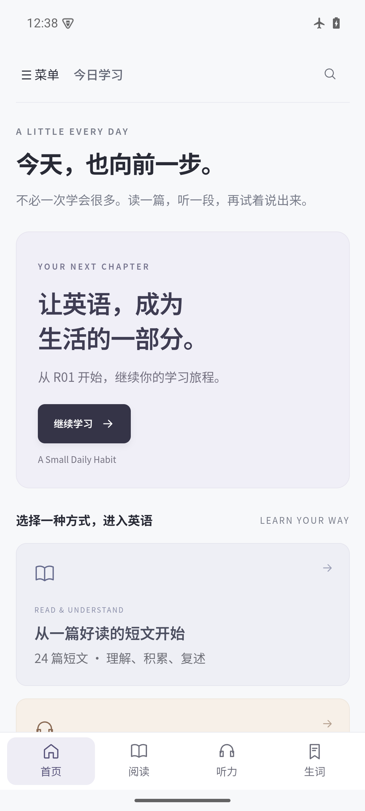

# 拾阶英语 Android 客户端

课程、图示、12 段对话音频和 12 个教学视频随 APK 提供。安装后可离线阅读、播放音视频、记录笔记和生词，免登录。

## 下载和安装

[下载 Android 0.1.0 APK](https://github.com/RayXBuilds/ielts-english-roadmap/releases/download/android-v0.1.0/Stepwise-English-Android-v0.1.0.apk) · [版本说明与 SHA-256](https://github.com/RayXBuilds/ielts-english-roadmap/releases/tag/android-v0.1.0)

1. 在 Android 手机上下载 APK，打开文件。
2. 如果系统提示，在设置中允许当前浏览器或文件管理器「安装未知应用」，然后返回安装。
3. 打开「拾阶英语」。底部进入首页、阅读、听力、生词，左上角菜单提供学习计划、口语与衔接、设置与备份。
4. 安装完成后可关闭该来源的安装权限。下载需要网络，包内课程学习可离线进行。

最低构建目标为 Android 8.0。应用使用系统 Android System WebView，建议使用已更新的 WebView。首版以 Android 15 ARM64 模拟器进行验收，其他系统版本及各厂商真机仍需验证。仅支持运行 Android APK 的设备。

<p align="center"></p>

## 学习内容与操作

- 收录课程 v0.14 的 126 个条目，其中 102 个普通训练条目、24 个听力文字预览，另有原有 84 天计划。Mac 0.2.10 使用同一批课程。
- 听力支持倍速、拖动进度、后退 5 秒、整段循环和位置保存，教学视频可在课程内播放。
- 阅读字号可调，长表格可横向滚动，笔记位于正文下方。Android 返回操作可关闭搜索、菜单或返回课程目录。
- 学习进度和听力文字预览状态分别保存。新增 24 周听力的配套完整音频待补。

Android 首次发布采用独立版本号 0.1.0，Mac 沿用自身版本序列。

## 记录与备份

记录保存在应用私有目录的 `files/progress.json`，使用原子替换写入。读取异常时暂停写入，恢复有效备份后继续。恢复前在私有目录保留原记录副本。

在「菜单 → 设置与备份」通过系统文件选择器导出或恢复 JSON，可在 Mac 与 Android 之间手动迁移当前课程的学习记录。恢复会替换目标设备记录，两个设备的进度不会自动合并。

卸载或清除应用数据会删除记录及恢复前副本，请提前将备份导出到应用外。应用不申请联网、麦克风、相机或整盘存储权限。导入导出仅访问用户在系统选择器中选定的文件。

## 构建和检查

准备 Python 3、JDK 17 或以上版本、Android SDK Platform 35 和 Build Tools 35.0.0。构建使用 SDK 自带的 aapt2、d8、zipalign、apksigner。

为自己的发行版本创建别名为 `stepwise` 的持久签名密钥，把密钥及密码文件放在仓库外的私有目录。后续版本须沿用签名密钥和应用标识，以支持覆盖升级。密码文件仅允许本机用户读取。项目发布密钥不放入仓库。

```sh
python3 scripts/build_android_client.py /tmp/stepwise-android-release \
  --sdk /path/to/android-sdk \
  --java-home /path/to/jdk \
  --keystore /private/path/release.p12 \
  --password-file /private/path/password.txt

node --test tests/client-state.test.cjs tests/android-bridge.test.cjs
```

输出目录必须位于仓库外且尚未存在。脚本校验内置媒体 SHA-256、APK 签名、压缩包完整性和媒体存储方式，生成 APK、校验文件和构建回执。

使用 `--qa` 构建隔离包 `com.rayxbuilds.stepwise.qa`。在测试设备安装后运行下列命令。检查会替换 QA 包内的测试记录。

```sh
python3 scripts/check_android_runtime.py /tmp/stepwise-android-checks \
  --sdk /path/to/android-sdk \
  --java-home /path/to/jdk \
  --keystore /private/path/release.p12 \
  --password-file /private/path/password.txt \
  --serial emulator-5554
```

正式应用标识为 `com.rayxbuilds.stepwise`。WebView 在本地 HTTPS origin 下提供 APK 内文件，支持媒体单段字节范围读取，关闭外部导航和网络权限。实现参考 Android 的本地内容加载及原子文件 API。[本地内容加载](https://developer.android.com/develop/ui/views/layout/webapps/load-local-content) · [AtomicFile](https://developer.android.com/reference/android/util/AtomicFile)

手写客户端与构建代码采用 [MIT License](../LICENSE)。原创课程采用 [CC BY 4.0](../../LICENSE.md)，VOA 媒体保留已有署名、许可依据及校验记录。[媒体来源](../../assets/voa/README.md)
