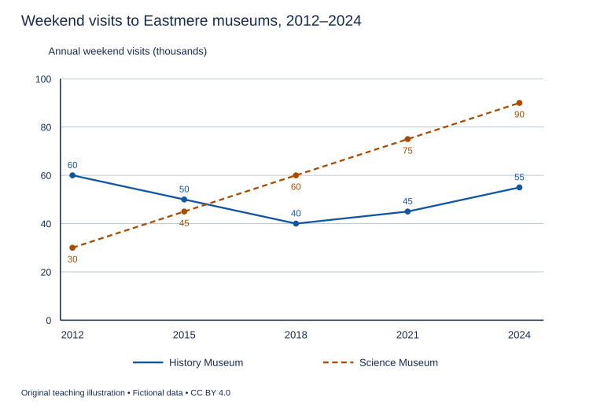

# U11 第5周：长篇阅读、写作与口语

本页为已独立核验的原创文字课程。先完成学生题目，再展开对应参考。非真题、非标准化模考，不换算雅思分数。听力尚未补齐，本页不代表全科课程已完成。

每周选A或G类Task 1一题，加Task 2及三次口语。参考范文不是学生已完成作业，仍须提交初稿、录音和重写，独立真人评分另行安排。

阅读每周180分钟（60分钟首次限时、120分钟证据精读与延迟复测），写作180分钟、口语120分钟。词汇60分钟、听力180分钟另列；新增完整听力未验收，不能勾整周完成。

W08如落实正式T08模拟，替换相应首答时段，不能重复计量；本页原创技能卷不能充当正式陌生卷。后续周数与达标规则见 [U04](u04-exam-preparation.md)。

## 阅读：首答不查词

### R-W05-01 · How a Marsh Borrows Time

W05｜正文 824 词｜13 题｜篇章：科学解释：机制—条件—反例（6段）

本课必做60分钟：首答20、证据复盘20、词汇长句10、48小时后复测10。每周三课180分钟，合卷首答替代单课首答，不重复计算。开放短文选做另加15分钟。

本项目原创虚构教学情境，人物、地点、历史事件和案例数据均非真实研究或史料。科学解释只讨论文内说明的模型与条件。非雅思真题或标准化模考；正确数不换算雅思等级。许可：CC BY 4.0 — RayXBuilds and contributors。

能力点：识别论证关系、区分作者与引述者、条件与因果、精确定位。初读不查词，完成后打开独立答案页。

#### Passage

**A** A visitor looking across the fictional Wren estuary might describe its marsh as land that has not quite decided whether to become sea. Water advances between stems and retreats through narrow channels. The appearance of uncertainty is misleading: these repeated movements are central to the marsh's operation. Consider a simplified model in which a shallow basin receives muddy water through one opening. When water spreads across the basin, its speed falls and some suspended particles settle. Plants may slow the flow further, but they do not manufacture the mineral material being deposited. The model therefore begins with a supply question, not a planting question. Without incoming sediment, a forest of artificial stems cannot produce an unlimited rise in the basin floor. Treating vegetation alone as the explanation confuses an influence on transport with the source of the material transported.

**B** Imagine now that the opening is widened. More water may enter during a rising tide, bringing more sediment, yet faster currents may also remove deposits on the way out. The outcome depends on the balance between arrival and departure. It cannot be inferred from the volume entering on a single occasion. For their classroom demonstration, Wren's students use a transparent tray, coloured sand and a small pump. They collect what leaves the tray as carefully as what remains inside. A line drawn on the tray marks the initial surface, allowing them to compare later deposits with a fixed reference. Their model is intentionally modest: sand does not behave exactly like the mixed particles of an estuary, and a pump does not reproduce all the variations of a tide. Its value lies in making a competing process visible, not in forecasting the future of a particular coastline.

**C** Height introduces a second complication. As deposits accumulate, the basin floor may become less frequently covered. This can reduce the opportunities for further sediment to arrive. At the same time, newly established plants may alter how water travels through the site. A simple prediction based on last month's rate of accumulation can therefore fail even if the incoming water remains unchanged. The growing marsh changes the conditions of its own growth. This is a feedback, but calling it feedback does not specify whether it will strengthen or weaken accumulation. The direction must be argued from the mechanism in question. It is particularly unhelpful to use a scientific label as if it were an explanation. In the tray experiment, students must state which change affects which later process before they are allowed to put an arrow between two boxes on their diagram.

**D** The basin also needs room. Suppose a low bank beside it can gradually become wet as the water level changes. Vegetation may then occupy a new strip even while conditions become unsuitable elsewhere. If a solid wall stands on that bank, this movement is restricted. A map showing only the present outline misses that difference between two apparently similar marshes. The useful question is not merely how much marsh exists today, but which future positions remain possible. This does not establish that every wall should be removed. In the imaginary Wren settlement, the wall protects a road used by the only local bus. A decision about space requires acknowledging that use rather than hiding it inside an ecological diagram. Scientific explanation can reveal consequences without automatically settling how a community should weigh them.

**E** For observation, the students install a marker plate beneath one patch of sediment and measure changes above it. They also photograph the boundary from a fixed position after each simulated tide. These records answer different questions: the plate concerns vertical accumulation, while the photographs reveal movement across the tray. Neither is a direct measurement of how safely residents could travel during a storm. In the demonstration, adding stems reduces flow locally, but water can be diverted towards an unplanted channel. It would be a mistake to turn that local observation into a promise of protection everywhere. One strength of the exercise is precisely that it separates a mechanism which can be observed from a larger claim which would require additional evidence at a different scale.

**F** The demonstration ends with two trays that look equally green but behave differently when the same pump setting is used. One receives muddy water and has a broad edge available for expansion; the other receives clearer water and is confined by rigid sides. Counting stems would conceal these differences. Students write a sediment budget that lists additions and losses, then draw the places where the boundary could move. Their conclusions are conditional rather than dramatic. A marsh may gain height, shift position, or lose material, depending on interacting constraints. There is no shame in a prediction that states its conditions. Indeed, a claim becomes more useful when a reader can identify what would have to change for it to stop being true. The lesson is to describe a living landscape through exchanges and possibilities, not through a single attractive snapshot.

#### Questions

**Choose ONE answer, A, B, C or D.**

1. What distinction is central to paragraph A?

   A. A plant and an artificial stem
   B. A source of material and an influence on its movement
   C. A basin and the open sea
   D. A visitor and a student

2. Why collect material leaving the tray?

   A. To make the water clearer
   B. To avoid drawing a reference line
   C. To include losses in the balance
   D. To copy every tidal variation

3. What makes a linear forecast unreliable?

   A. The marsh modifies conditions as it grows
   B. All incoming water stops
   C. Plants always reverse erosion
   D. Diagrams cannot represent change

4. The wall example primarily shows that

   A. maps should omit infrastructure
   B. future space and existing human uses both matter
   C. ecology supplies automatic policy decisions
   D. bus roads create sediment

**Do the following statements agree with the writer's views? Write YES, NO or NOT GIVEN. YES = the writer agrees; NO = the writer expresses the opposite view; NOT GIVEN = the writer's view is not stated. Do not use outside knowledge.**

5. Vegetation alone is an adequate explanation for unlimited sediment accumulation.

6. Naming a feedback is insufficient unless its mechanism is explained.

7. The writer considers the bus road more valuable than every possible marsh extension.

8. A conditional prediction can be more useful than an unconditional claim.

**Complete the sentences. Choose NO MORE THAN 3 WORDS FROM THE PASSAGE for each answer. Do not change word forms.**

9. Students measure deposits above a buried ______.

10. Boundary movement is recorded using ______ taken from one position.

11. The final account of material additions and losses is a ______.

12. The imaginary wall protects a road used by the only local ______.

13. To create flow in their demonstration, students use a small ______.

#### 复盘

必做：给每道错题标记“定位/作者立场/范围/语法/词数”，抄最短证据；用一行箭头概括本文论证或过程。48小时后重做错题与两道正确题，检查是否仍能指出证据。

选做（15分钟，80–100词）：Explain why two equally green marshes might develop differently.

R-W05-01 答案、证据与精读（首答后展开）

### R-W05-01 · 独立答案与证据

来源与许可同学生页。先完成再核对。可接受答案由 accepted_answers 明确列出；只忽略大小写和首尾空格，不自行删词。开放复盘不计入客观正确数。

1. **B**｜段落 A｜证据：“confuses an influence on transport with the source”

   A比较不是核心；C/D仅背景。

2. **C**｜段落 B｜证据：“as carefully as what remains inside”

   A非目的，B反文，D模型明确有限。

3. **A**｜段落 C｜证据：“changes the conditions of its own growth”

   B/C/D均把条件夸大成绝对。

4. **B**｜段落 D｜证据：“requires acknowledging that use”

   作者明确不自动主张拆所有墙。

5. **NO**｜段落 A｜证据：“cannot produce an unlimited rise”

   作者明确否定，不是信息缺失。

6. **YES**｜段落 C｜证据：“calling it feedback does not specify”

   需说明方向与机制。

7. **NOT GIVEN**｜段落 D｜证据：“without automatically settling how a community should weigh them”

   描述权衡而未给价值排序。

8. **YES**｜段落 F｜证据：“a claim becomes more useful when a reader can identify”

   明确赞成可识别适用边界。

9. **marker plate / plate**｜段落 E｜证据：“install a marker plate”

   plate 为可接受短答；marker 单独不是载体。

10. **photographs**｜段落 E｜证据：“the photographs reveal movement”

   单词答案可用；boundary 指对象而非记录。

11. **sediment budget / budget**｜段落 F｜证据：“write a sediment budget”

   完整名词或中心词均合要求。

12. **bus**｜段落 D｜证据：“the only local bus”

   不是 road，题干已提供。

13. **pump**｜段落 B｜证据：“a small pump”

   设备名唯一；tray 是容器。

#### 词汇与长句

- **sediment**：沉积物
- **confined**：受边界限制的
- **accumulation**：累积
- **conditional**：有条件的

> The growing marsh changes the conditions of its own growth.

主语 growing marsh；its own 回指自身，体现反馈。

> Scientific explanation can reveal consequences without automatically settling how a community should weigh them.

without 后动名词；how 从句作 settling 宾语，解释后果与价值判断分开。

#### 开放任务参考

比较F的泥沙供应与扩展边界，结合B收支；不可声称课堂模型预测真实海岸。

标准：观点有文内依据，保留条件和范围，推断明确标注；不存在唯一措辞。

### R-W05-02 · The Map with Three Editions

W05｜正文 822 词｜13 题｜篇章：虚构历史发展：三个版本的因果链（7段）

本课必做60分钟：首答20、证据复盘20、词汇长句10、48小时后复测10。每周三课180分钟，合卷首答替代单课首答，不重复计算。开放短文选做另加15分钟。

本项目原创虚构教学情境，人物、地点、历史事件和案例数据均非真实研究或史料。科学解释只讨论文内说明的模型与条件。非雅思真题或标准化模考；正确数不换算雅思等级。许可：CC BY 4.0 — RayXBuilds and contributors。

能力点：识别论证关系、区分作者与引述者、条件与因果、精确定位。初读不查词，完成后打开独立答案页。

#### Passage

**A** The first printed map of the imaginary city of Orven was not designed to guide strangers. It was commissioned by merchants who wanted to show which warehouses belonged to their association. Streets appeared as thin connecting lines, while members' buildings occupied generous rectangles. A traveller could recognise the river but could not reliably judge how long it would take to cross the city. Judged as a walking guide, the map was poor. Judged as an announcement of commercial identity, it was much more coherent. This distinction matters because an object that later acquires a familiar use may originally have answered a different question. We misunderstand its early form if we assume that its makers simply failed to achieve our own purpose.

**B** The printer worked from sketches supplied by individual owners. Nobody had surveyed the whole city, and a wealthy merchant could describe a courtyard more carefully than a public alley beyond it. When the pieces were combined, several alleys ended abruptly at the edges of impressive buildings. The printer corrected obvious clashes but had little basis for resolving less visible inconsistencies. Producing a clean engraving gave these uneven observations a uniform appearance. Readers could no longer tell which rectangle followed a careful measurement and which followed an owner's rough memory. The printed surface created consistency of style without creating consistency of evidence, an important difference that the finished sheet did little to advertise to people who bought it.

**C** A second edition appeared after a group of carriers complained that visitors repeatedly requested deliveries through passages too narrow for their carts. The association hired a surveyor to measure routes between the river gate and the principal market. She used a measuring chain, checking it against a marked length before starting each day's work. This did not suddenly make every part of the map accurate. Her commission covered particular routes, and she left distant courtyards largely as they had appeared before. The second edition was thus a layered object: recent measurement stood beside inherited drawing. Its date recorded a moment of publication, not a promise that every feature had been observed in that year.

**D** The new measurements also changed the politics of the page. One warehouse appeared smaller when drawn at the same scale as neighbouring buildings. Its owner complained that the printer had diminished his business. The surveyor replied that the scale concerned distance rather than importance. Both statements reveal what was at stake: the map had begun to act as a spatial description while retaining expectations formed when it was an advertisement. It would be too simple to tell this episode as the victory of science over vanity. The merchants had paid for a particular kind of representation, and the commission had never clearly resolved when its purpose changed. Technical improvement exposed an agreement that had previously remained ambiguous.

**E** In the third edition, the printer added a street index and a small key explaining the symbols. A reader looking for a bridge could now find its name and follow a reference to a marked square. The index did not make the bridge more accurately located, but it made the sheet easier to search. The printer also issued a correction slip when a route was blocked by building work. Owners could insert the slip beside their copies without buying an entirely new map. This arrangement admitted that useful information could become outdated between editions. A finished printed object was no longer being presented as permanently finished knowledge of the city it represented.

**F** Not every improvement reached every reader. The third edition cost more than the first, partly because its larger sheet required a different production process. Carriers sometimes shared a copy at an inn rather than carrying one each. Some relied on instructions from the innkeeper, whose spoken directions included landmarks absent from the printed key. These practices are not evidence that print had failed. They show information moving between forms and people. A map could support a conversation without replacing it, just as a conversation could correct a map without making maps unnecessary. To count copies sold as the number of people informed would therefore miss both shared access and the misunderstandings that ownership alone did not prevent.

**G** The surviving fictional collection includes a heavily folded third edition with handwritten notes beside the river gate. Its margins record the removal of a toll booth and the arrival of a ferry. For the collector, those additions once seemed like damage to an otherwise desirable print. For a reader interested in how the sheet worked, they are part of its history. The three editions tell no simple story of increasing accuracy. Measurement, navigation, cost and revision developed at different rates, and each version combined new possibilities with older purposes. The best historical question is consequently not which edition is most like a modern map. It is what each version allowed particular users to do, and which uncertainties its neat lines made easy to overlook.

#### Questions

**Choose ONE answer, A, B, C or D.**

1. The first map mainly served to

   A. advertise membership and property
   B. provide precise walking times
   C. compare ferry prices
   D. replace spoken directions

2. What problem did uniform engraving create?

   A. It erased every alley
   B. It made unequal evidence look equally reliable
   C. It changed the river course
   D. It prevented future editions

3. The surveyor’s work was limited by

   A. the disappearance of every route
   B. the geographical scope of her commission
   C. a ban on measuring chains
   D. the lack of a printer

4. What did the index improve directly?

   A. The ease of finding information
   B. The cost of paper
   C. The location of the bridge
   D. The scale of courtyards

**Do the following statements agree with the writer's views? Write YES, NO or NOT GIVEN. YES = the writer agrees; NO = the writer expresses the opposite view; NOT GIVEN = the writer's view is not stated. Do not use outside knowledge.**

5. Early maps should be evaluated only by modern navigational standards.

6. The dispute over warehouse size was entirely a conflict between knowledge and vanity.

7. The surveyor was better paid than the printer.

8. Handwritten changes can help explain how a printed map was used.

**Complete the summary. Choose NO MORE THAN 3 WORDS FROM THE PASSAGE for each answer. Do not change word forms.**

The surveyor used a (9) ______ to measure selected routes. In the next edition, the (10) ______ helped readers locate named places. Later changes could be supplied on a (11) ______. Some carriers shared a map at an (12) ______. One handwritten note recorded the removal of a (13) ______.

#### 复盘

必做：给每道错题标记“定位/作者立场/范围/语法/词数”，抄最短证据；用一行箭头概括本文论证或过程。48小时后重做错题与两道正确题，检查是否仍能指出证据。

选做（15分钟，80–100词）：Explain why “more accurate” does not fully describe the map’s development.

R-W05-02 答案、证据与精读（首答后展开）

### R-W05-02 · 独立答案与证据

来源与许可同学生页。先完成再核对。可接受答案由 accepted_answers 明确列出；只忽略大小写和首尾空格，不自行删词。开放复盘不计入客观正确数。

1. **A**｜段落 A｜证据：“show which warehouses belonged to their association”

   B现代用途投射；C/D无据。

2. **B**｜段落 B｜证据：“consistency of style without creating consistency of evidence”

   区别外观与证据，不是物理改变城市。

3. **B**｜段落 C｜证据：“covered particular routes”

   其他选项未发生。

4. **A**｜段落 E｜证据：“made the sheet easier to search”

   明确未提高定位准确性。

5. **NO**｜段落 A｜证据：“We misunderstand its early form”

   作者反对目的投射。

6. **NO**｜段落 D｜证据：“It would be too simple”

   作者明确拒绝单因解释。

7. **NOT GIVEN**｜段落 D｜证据：“The merchants had paid”

   只提支付，未比较薪酬。

8. **YES**｜段落 G｜证据：“they are part of its history”

   作者将批注视作使用史。

9. **measuring chain / chain**｜段落 C｜证据：“used a measuring chain”

   chain 是完整设备的合理短答。

10. **street index / index**｜段落 E｜证据：“added a street index”

   key 用于释符，不是按名检索；index 可接受。

11. **correction slip / slip**｜段落 E｜证据：“issued a correction slip”

   插入而不重购的载体。

12. **inn**｜段落 F｜证据：“shared a copy at an inn”

   共享地点，非 gate。

13. **toll booth / booth**｜段落 G｜证据：“removal of a toll booth”

   removed 对应 removal，ferry 是新增而非移除。

#### 词汇与长句

- **engraving**：版刻图像
- **inherited**：沿用的
- **commission**：委托任务
- **margin**：页边空白

> Its date recorded a moment of publication, not a promise that every feature had been observed in that year.

that 从句说明 promise 内容；出版年不等于全图调查年。

> A map could support a conversation without replacing it, just as a conversation could correct a map without making maps unnecessary.

just as 形成对称类比；两种媒介可以互补。

#### 开放任务参考

C仅局部重测，E改善检索，F价格影响使用；区分各改进维度。

标准：观点有文内依据，保留条件和范围，推断明确标注；不存在唯一措辞。

### R-W05-03 · Who Owns an Uninterrupted Hour?

W05｜正文 884 词｜14 题｜篇章：观点争论：四种立场与作者评议（9段）

本课必做60分钟：首答20、证据复盘20、词汇长句10、48小时后复测10。每周三课180分钟，合卷首答替代单课首答，不重复计算。开放短文选做另加15分钟。

本项目原创虚构教学情境，人物、地点、历史事件和案例数据均非真实研究或史料。科学解释只讨论文内说明的模型与条件。非雅思真题或标准化模考；正确数不换算雅思等级。许可：CC BY 4.0 — RayXBuilds and contributors。

能力点：识别论证关系、区分作者与引述者、条件与因果、精确定位。初读不查词，完成后打开独立答案页。

#### Passage

**A** At the fictional engineering studio Ember, a proposal for an uninterrupted morning divided people who otherwise agreed that concentration mattered. Under the proposal, staff would silence routine messages for one hour and postpone meetings until afterwards. The dispute was not between people who liked work and people who enjoyed distraction. It concerned the distribution of waiting. Someone protected from interruption might concentrate better while a colleague remained unable to proceed. Before declaring the proposal a success, the studio needed to discover where those costs would fall and whether the same arrangement would suit work at different stages.

**B** Designer Ada Vale supported the proposal because starting again after a message was not simply a matter of reopening a document. She described holding several possible shapes in mind while checking how they fitted together. A small question could displace that temporary arrangement. Her preferred measure was not the number of messages received but the time required to reconstruct a line of thought. She accepted that this cost was difficult to observe from outside. That difficulty, she argued, made a simple count of interruptions less adequate, not the underlying experience less important to understanding the work.

**C** Workshop coordinator Ben Orr had a different concern. When a technician was waiting to confirm a measurement, a delayed reply could leave a machine unused and hold up several later tasks. Ben did not oppose concentration; he opposed a rule that treated every message as equally postponable. He suggested a narrow channel for questions that prevented another person from proceeding. The sender would have to explain the dependency, rather than merely label a request urgent. This would not remove judgement from the system. It would at least make the reason for interrupting visible to both people involved.

**D** Research assistant Cora Lim worried about unequal access to that channel. A senior designer might confidently explain that work was blocked, while a new assistant might decide that their uncertainty was not important enough. An apparently neutral rule could therefore reflect differences in confidence and authority. Cora proposed scheduled check-ins for new staff, giving them a legitimate opportunity to ask questions before confusion accumulated. Her argument was about access to help, not a general preference for frequent meetings. She also warned that silence in a shared office should not automatically be interpreted as evidence that everyone understood what to do.

**E** Analyst Dev Sen focused on evidence. The studio's first trial coincided with an unusually familiar project, so people might have worked faster because they already knew its requirements. Dev wanted comparisons across several project stages, including periods when designs were being explored and periods when instructions were settled. He also wanted to record delayed decisions, not just completed drawings. Otherwise, an apparent gain in individual output could hide work accumulating elsewhere. Dev's proposal was a method for investigating the policy, rather than an argument that one hour without messages must always succeed or always fail in a workplace.

**F** The four views are compatible in more ways than the initial argument suggested. Ada identifies a cost of switching attention, Ben identifies a cost of waiting, Cora asks who can obtain help, and Dev asks what evidence could separate these effects. A sensible policy would not settle the issue by choosing the most persuasive speaker and dismissing the rest. Nor would it assume that averaging their preferences produces a workable schedule. Their arguments concern different parts of a connected process. The challenge is to design an arrangement in which those parts can be observed and adjusted together.

**G** Ember therefore tried a protected hour with an explicit dependency channel and a brief check-in beforehand. Staff could use the channel only when they described which next action could not proceed. The rule was reviewed with examples, including cases where a request had seemed urgent but could safely wait. The studio did not publish a ranking of who interrupted most often. Such a ranking would ignore the roles that generated questions and might encourage people to conceal problems. Instead, teams discussed whether a different instruction or earlier decision would have prevented the need for the message.

**H** After the trial, some drawings were completed sooner while several decisions still took longer. These observations did not cancel each other out. They showed why a single productivity total was an unstable summary of the experiment. The studio kept the protected hour during detailed design but shortened it when new work required frequent coordination. New assistants retained their scheduled check-ins. This outcome was less simple than the original proposal, yet simplicity was not the only standard of success. A policy that described its exceptions honestly could be easier to trust than one that presented every necessary adjustment as a failure.

**I** There is a wider lesson here about workplace rules. An uninterrupted hour is not an object that can be handed to one person without affecting others. It is an agreement about whose requests may wait, for how long, and with which alternatives. Making that agreement explicit can improve both concentration and cooperation. It cannot guarantee either in every situation. The relevant question is consequently not whether interruptions are good or bad in themselves. It is which kinds of interruption serve a dependency, which arise from avoidable confusion, and whether the people bearing the cost have a practical way to make that cost known.

#### Questions

**Choose ONE answer, A, B, C or D.**

1. The opening reframes the dispute as one about

   A. the distribution of waiting
   B. software prices
   C. office decoration
   D. employee laziness

2. Why would ranking interrupters be misleading?

   A. It would ignore roles that generate questions
   B. It would make all questions disappear
   C. It would measure every dependency accurately
   D. It would require new machinery

3. Why did the initial trial not settle the question?

   A. Nobody completed drawings
   B. Project familiarity was a competing explanation
   C. No one supported the rule
   D. Messages were never recorded

4. The final policy was

   A. identical at all stages
   B. replaced by a competition
   C. abandoned entirely
   D. adapted to project stage

**Do the following statements agree with the writer's views? Write YES, NO or NOT GIVEN. YES = the writer agrees; NO = the writer expresses the opposite view; NOT GIVEN = the writer's view is not stated. Do not use outside knowledge.**

5. The most persuasive speaker should determine the policy alone.

6. Silence necessarily demonstrates that employees understand their tasks.

7. A policy can gain trust by describing its exceptions honestly.

8. Ember should give every employee the same salary.

9. Protecting one person’s time can affect other people’s work.

**Match each statement with the person who expresses that view. Write a letter. You may use any letter more than once.**

- A: Ada Vale
- B: Ben Orr
- C: Cora Lim
- D: Dev Sen

10. Lost mental context matters more than simply counting messages.

11. A sender should identify the blocked next action.

12. Less experienced staff need a recognised opportunity to seek help.

13. A familiar project could distort the apparent effect of the rule.

14. Delayed decisions belong in the evaluation alongside finished outputs.

#### 复盘

必做：给每道错题标记“定位/作者立场/范围/语法/词数”，抄最短证据；用一行箭头概括本文论证或过程。48小时后重做错题与两道正确题，检查是否仍能指出证据。

选做（15分钟，80–100词）：Design one criterion for an interruption that should be allowed.

R-W05-03 答案、证据与精读（首答后展开）

### R-W05-03 · 独立答案与证据

来源与许可同学生页。先完成再核对。可接受答案由 accepted_answers 明确列出；只忽略大小写和首尾空格，不自行删词。开放复盘不计入客观正确数。

1. **A**｜段落 A｜证据：“It concerned the distribution of waiting.”

   其余均非争议核心。

2. **A**｜段落 G｜证据：“ignore the roles that generated questions”

   B绝对化，C反文，D无据。

3. **B**｜段落 E｜证据：“coincided with an unusually familiar project”

   项目特征是混杂因素，其他选项无据。

4. **D**｜段落 H｜证据：“shortened it when new work required frequent coordination”

   保留并调整，非全盘取消。

5. **NO**｜段落 F｜证据：“not settle the issue by choosing the most persuasive speaker”

   作者明确否定。

6. **NO**｜段落 D｜证据：“should not automatically be interpreted as evidence”

   作者后文支持Cora，沉默不等于理解。

7. **YES**｜段落 H｜证据：“could be easier to trust”

   保留 could 范围。

8. **NOT GIVEN**｜段落 I｜证据：“an agreement about whose requests may wait”

   全文未对薪酬发表立场。

9. **YES**｜段落 I｜证据：“without affecting others”

   该句否定不影响他人的独立赠予。

10. **A**｜段落 B｜证据：“time required to reconstruct a line of thought”

   Ada重建思路；Dev关注比较设计。

11. **B**｜段落 C｜证据：“The sender would have to explain the dependency”

   Ben主张依赖通道。

12. **C**｜段落 D｜证据：“scheduled check-ins for new staff”

   Cora关注权力/经验差异。

13. **D**｜段落 E｜证据：“already knew its requirements”

   Dev讨论混杂因素。

14. **D**｜段落 E｜证据：“record delayed decisions, not just completed drawings”

   同一人物可重复选；不是Ben的通道设计。

#### 词汇与长句

- **dependency**：前一步未完成会阻塞后一步的依赖
- **reconstruct**：重建
- **coordination**：协调
- **postponable**：可以延后的

> Someone protected from interruption might concentrate better while a colleague remained unable to proceed.

while 对照两人的效果；过去分词短语修饰 Someone。

> A policy that described its exceptions honestly could be easier to trust than one that presented every necessary adjustment as a failure.

两组 that 定语从句比较政策；one 代 policy。

#### 开放任务参考

用Ben的阻塞行动判据并结合Cora的求助公平；区分规则与成效证据。

标准：观点有文内依据，保留条件和范围，推断明确标注；不存在唯一措辞。

## 写作与口语：Task 1双分支择一

### WS-W05-T1A 学生页：周末博物馆参观趋势

周次 W05｜题型 T1A｜能力点：折线趋势与比较

Task 1 的 A/G 分支二选一，另一分支不计入本周作业。

#### 使用与记录

原创教学练习，非真题、非标准化模拟，难度未校准。先完成本页再打开参考页。人物、机构、经历与数据均为教学虚构。不要背诵示例。自评和 AI 反馈不能代替独立真人评分，未获得真人评阅时标记“分数未确认”。

保存：任务ID、实际日期、用时、初稿或原始录音、证据化反馈、重写/重答、三条修改理由。没有学生提交物，不得填写“已批改”或“已完成训练”。

#### 完整题干

The line graph shows the number of weekend visits to two museums in the city of Eastmere in selected years from 2012 to 2024. Summarise the information by selecting and reporting the main features, and make comparisons where relevant.

Write at least 150 words. Spend about 20 minutes on this task.

教学虚构。横轴：年份2012、2015、2018、2021、2024；纵轴：年度周末参观人次（千次）。实线History：60、50、40、45、55；虚线Science：30、45、60、75、90。连接线仅帮助阅读趋势，不代表中间年份的测量值。

#### 任务预算（含首次审题，不额外加时）

初稿20分钟（审题规划3、写作15、检查2）；诊断15；反馈阅读与证据核查10；完整重写25；对照归档5。合计75分钟。

#### 初稿后自评清单

- [ ] 达到最低字数；全文连贯成段，没有用项目符号代替作文。
- [ ] 概述给主要特征；数据、阶段或方位都与题图逐项相符，不推断未提供的原因。
- [ ] 每段可写出一个功能标签；例子或数据与该段要点相连。
- [ ] 圈出两处词汇搭配和两处句法疑点，先自行修正再查询或求反馈。
- [ ] 记录一项最影响理解的问题和原句证据，不填写自猜分数。

#### 反馈与重写

打开 独立参考页（本节下方展开参考），按逐段检查和通用协议核验。重写任务：完整重写至少150词：概述含两条趋势和领先者变化；细节至少一处差距比较，删掉猜测原因。

W05 T1A 示例、反馈与重练（首答后展开）

### WS-W05-T1A 独立参考页

只在初稿完成后阅读；不是唯一答案，也没有官方分数。以下是对原创示例的教学讲评，不是对学生尚未提交作文的已完成批改。

#### 思路拆解

识别上升与先降后升；抓首尾主次转换；按2012～2015与2018～2024分段，不猜精确交叉日期。

#### 原创示例

The line graph compares the numbers of weekend visits to the History Museum and the Science Museum in Eastmere in five selected years between 2012 and 2024. The figures are expressed in thousands of visits per year.

Overall, weekend attendance at the Science Museum increased throughout the period, whereas the History Museum experienced a decline followed by a recovery. The History Museum attracted more visits initially, but the Science Museum had become the more popular destination by 2018 and retained its lead thereafter.

The History Museum recorded 60,000 weekend visits in 2012, compared with 30,000 at the Science Museum. Three years later, the former figure had fallen to 50,000, while the latter had climbed to 45,000. The gap between the two institutions therefore narrowed from 30,000 to just 5,000 visits.

In 2018, attendance at the History Museum reached its lowest recorded level, at 40,000, while the Science Museum received 60,000 visits. Both figures subsequently rose, reaching 45,000 and 75,000 respectively in 2021, and 55,000 and 90,000 in 2024. Thus, the final difference was 35,000 visits in favour of the Science Museum.

示例正文词数：194（本项目正则计数；书信不含称呼、结束语与署名；连字符词作一词）。

#### 逐段反馈与迁移

- P1 单位是年度周末参观人次，不是独立访客；自己引言须保留weekend。

- P2 Science持续上升，History先降后升；by 2018只表示该观测点已超过，未编造交叉日期。

- P3 两馆初始差30千，2015差5千；用former/latter时检查指代。

- P4 History谷值40千；末年差90−55=35千；不要写成History也高于起点。

#### 常见失误

把人次当人数；把连线插值当作精确年度数据；解释为新增展馆而题面无此信息。

#### 可执行反馈步骤

1. 先把自己的段落标为引入、概述/论点、支持、收束；分段可不同于示例，按功能核查，不照抄段数。
2. 对照上方逐段检查，逐项标“已有证据/缺失/不适用”。每条意见必须附自己的原句或缺失位置。
3. 按 [反馈协议](u15-feedback.md) 的四维表记录；有争议的 AI 意见回题干、数据或语法依据核验。
4. 只选两项最高优先级问题执行整篇重写；保留原稿，禁止把示例替换为自己的作业。

#### 重写任务

完整重写至少150词：概述含两条趋势和领先者变化；细节至少一处差距比较，删掉猜测原因。

完成后重新勾选 学生页（见本节上方学生题） 清单；将一处改前/改后及理由交给独立评阅者核查。真人评阅状态目前为“待安排”，不是已完成。

### WS-W05-T1G 学生页：向酒店正式投诉

周次 W05｜题型 T1G｜能力点：书信目的、要点与语气

Task 1 的 A/G 分支二选一，另一分支不计入本周作业。

#### 使用与记录

原创教学练习，非真题、非标准化模拟，难度未校准。先完成本页再打开参考页。人物、机构、经历与数据均为教学虚构。不要背诵示例。自评和 AI 反馈不能代替独立真人评分，未获得真人评阅时标记“分数未确认”。

保存：任务ID、实际日期、用时、初稿或原始录音、证据化反馈、重写/重答、三条修改理由。没有学生提交物，不得填写“已批改”或“已完成训练”。

#### 完整题干

You stayed at the Northbridge Hotel during a conference, but the room did not match your booking. Write to the hotel manager. In your letter:
- explain what you booked and what you received
- describe how this affected your stay
- say what you would like the hotel to do.
Begin your letter: Dear Sir or Madam,

Write at least 150 words. You do not need to write any addresses. Spend about 20 minutes on this task.

#### 任务预算（含首次审题，不额外加时）

初稿20分钟（审题规划3、写作15、检查2）；诊断15；反馈阅读与证据核查10；完整重写25；对照归档5。合计75分钟。

#### 初稿后自评清单

- [ ] 达到最低字数；全文连贯成段，没有用项目符号代替作文。
- [ ] 三个要点均展开；称呼、目的、语气和结束语适合收信人。
- [ ] 每段可写出一个功能标签；例子或数据与该段要点相连。
- [ ] 圈出两处词汇搭配和两处句法疑点，先自行修正再查询或求反馈。
- [ ] 记录一项最影响理解的问题和原句证据，不填写自猜分数。

#### 反馈与重写

打开 独立参考页（本节下方展开参考），按逐段检查和通用协议核验。重写任务：完整重写至少150词；用两组事实对比替换情绪形容词，保持正式、具体、合理的请求。

W05 T1G 示例、反馈与重练（首答后展开）

### WS-W05-T1G 独立参考页

只在初稿完成后阅读；不是唯一答案，也没有官方分数。以下是对原创示例的教学讲评，不是对学生尚未提交作文的已完成批改。

#### 思路拆解

正式投诉给未知姓名经理；订房承诺与实际差别→具体影响→可执行补救，不夸大法律责任。

#### 原创示例

Dear Sir or Madam,

I am writing about my stay at the Northbridge Hotel from 12 to 14 May. I booked a quiet single room with a desk because I was attending a conference nearby. However, the room I received faced a busy road and contained only a small bedside table. My booking confirmation specifically listed a desk among the facilities.

The missing desk made it difficult to prepare my presentation in the evenings. I had to work in the hotel lobby, where conversations frequently interrupted my concentration. In addition, traffic noise kept me awake on the first night. I asked at reception about changing rooms, but was told that no suitable room was available for either night of my stay.

I would appreciate a partial refund to reflect the difference between the room advertised and the facilities provided. I have attached my booking confirmation and receipt so that you can check the details. Please also review the room descriptions on your website to prevent similar problems for other guests. I would be grateful for a written response within the next two weeks.

Yours faithfully,
Alex Chen

示例正文词数：179（本项目正则计数；书信不含称呼、结束语与署名；连字符词作一词）。

#### 逐段反馈与迁移

- P1 把预订与收到的房间对照，确认desk确在确认单中；不是泛说bad hotel。

- P2 展开工作与睡眠影响并说明已求助；时态围绕过去住宿一致。

- P3 请求部分退款、提供凭证及回复时间；不应自己宣布经理已同意。

#### 常见失误

只表达愤怒；遗漏原订内容；以不合适的私人称呼结尾。

#### 可执行反馈步骤

1. 先把自己的段落标为引入、概述/论点、支持、收束；分段可不同于示例，按功能核查，不照抄段数。
2. 对照上方逐段检查，逐项标“已有证据/缺失/不适用”。每条意见必须附自己的原句或缺失位置。
3. 按 [反馈协议](u15-feedback.md) 的四维表记录；有争议的 AI 意见回题干、数据或语法依据核验。
4. 只选两项最高优先级问题执行整篇重写；保留原稿，禁止把示例替换为自己的作业。

#### 重写任务

完整重写至少150词；用两组事实对比替换情绪形容词，保持正式、具体、合理的请求。

完成后重新勾选 学生页（见本节上方学生题） 清单；将一处改前/改后及理由交给独立评阅者核查。真人评阅状态目前为“待安排”，不是已完成。

### WS-W05-T2 学生页：博物馆娱乐与教育

周次 W05｜题型 T2｜能力点：观点展开与任务回应

A/G 共用本题。

#### 使用与记录

原创教学练习，非真题、非标准化模拟，难度未校准。先完成本页再打开参考页。人物、机构、经历与数据均为教学虚构。不要背诵示例。自评和 AI 反馈不能代替独立真人评分，未获得真人评阅时标记“分数未确认”。

保存：任务ID、实际日期、用时、初稿或原始录音、证据化反馈、重写/重答、三条修改理由。没有学生提交物，不得填写“已批改”或“已完成训练”。

#### 完整题干

Some people think museums should mainly entertain visitors, while others believe their main purpose should be education. Discuss both views and give your own opinion. Give reasons and include relevant examples.

Write at least 250 words. Spend about 40 minutes on this task.

#### 任务预算（含首次审题，不额外加时）

初稿40分钟（审题规划5、写作30、检查5）；诊断15；反馈阅读与证据核查10；完整重写35；对照归档5。合计105分钟。

#### 初稿后自评清单

- [ ] 达到最低字数；全文连贯成段，没有用项目符号代替作文。
- [ ] 直接回答题目的所有问句，有始终一致的立场。
- [ ] 每段可写出一个功能标签；例子或数据与该段要点相连。
- [ ] 圈出两处词汇搭配和两处句法疑点，先自行修正再查询或求反馈。
- [ ] 记录一项最影响理解的问题和原句证据，不填写自猜分数。

#### 反馈与重写

打开 独立参考页（本节下方展开参考），按逐段检查和通用协议核验。重写任务：整篇重写至少250词；每方至少一段充分展开，结尾明确哪一目标优先及原因。

W05 T2 示例、反馈与重练（首答后展开）

### WS-W05-T2 独立参考页

只在初稿完成后阅读；不是唯一答案，也没有官方分数。以下是对原创示例的教学讲评，不是对学生尚未提交作文的已完成批改。

#### 思路拆解

双方各讲合理性，再明确教育为目的、娱乐为手段；例子围绕展品而非泛谈学校教育。

#### 原创示例

Museums compete with many other ways of spending leisure time, so some people believe that entertaining visitors should be their main objective. Others see them primarily as places of education. I believe education should remain the central purpose, although enjoyable presentation can help museums achieve it.

There is a strong practical argument for making museums entertaining. Visitors who find exhibitions dull may leave quickly or decide never to return. Families, in particular, may struggle to keep young children interested in long written descriptions. Interactive displays or short performances can encourage these visitors to stay and explore. For example, a model bridge that children can build and test may attract attention more effectively than a panel describing engineering principles. Entertainment can therefore make a museum accessible to people who would not normally choose to visit.

Nevertheless, attracting attention is not the same as fulfilling a museum’s purpose. Museums preserve objects and explain what those objects reveal about people, nature or technology. If spectacular effects become the priority, important information may be simplified so far that visitors gain a misleading impression. A historical exhibition, for instance, should explain uncertainty about an object’s original use rather than invent a dramatic story and present it as fact. The institution’s educational value depends partly on visitors being able to trust its explanations.

In my view, the two aims can work together, provided that entertainment supports a clear learning goal. The model bridge activity could be followed by a simple explanation of why some designs carry more weight than others. Staff could then invite visitors to test a different design. This approach makes learning enjoyable without turning the exhibition into an unrelated amusement.

Overall, museums should use entertaining methods, but education should guide their choices. Success means helping visitors understand something more clearly, rather than merely keeping them occupied for an afternoon.

示例正文词数：306（本项目正则计数；书信不含称呼、结束语与署名；连字符词作一词）。

#### 逐段反馈与迁移

- P1 同时呈现双方并明确优先级，不以模糊both important代替观点。

- P2 展开吸引注意→停留→接触展品，桥模型与教育潜力相连。

- P3 区分注意力与可信知识；虚构历史不是必要的娱乐方式。

- P4 回到同一桥例，解释二者如何兼容；不是额外跑题方案。

- P5 重申衡量成功的标准，结尾不增加新论点。

#### 常见失误

两方写成教育好、娱乐坏的标签；给观点却无权衡依据；编造调查比例。

#### 可执行反馈步骤

1. 先把自己的段落标为引入、概述/论点、支持、收束；分段可不同于示例，按功能核查，不照抄段数。
2. 对照上方逐段检查，逐项标“已有证据/缺失/不适用”。每条意见必须附自己的原句或缺失位置。
3. 按 [反馈协议](u15-feedback.md) 的四维表记录；有争议的 AI 意见回题干、数据或语法依据核验。
4. 只选两项最高优先级问题执行整篇重写；保留原稿，禁止把示例替换为自己的作业。

#### 重写任务

整篇重写至少250词；每方至少一段充分展开，结尾明确哪一目标优先及原因。

完成后重新勾选 学生页（见本节上方学生题） 清单；将一处改前/改后及理由交给独立评阅者核查。真人评阅状态目前为“待安排”，不是已完成。

### WS-W05-S1 学生页

周次W05｜Part 1专项｜能力点：描述具体展品与讨论文化价值｜30分钟

#### 使用与记录

原创教学练习，非真题、非标准化模拟，难度未校准。先完成本页再打开参考页。人物、机构、经历与数据均为教学虚构。不要背诵示例。自评和 AI 反馈不能代替独立真人评分，未获得真人评阅时标记“分数未确认”。

保存：任务ID、实际日期、用时、初稿或原始录音、证据化反馈、重写/重答、三条修改理由。没有学生提交物，不得填写“已批改”或“已完成训练”。

#### 操作与预算

设备与审题3分钟；首答录音6；回听及局部转写7；示例和诊断5；不看稿重答6；归档3。共30分钟。

#### Part 1专项题

1. Do you enjoy visiting exhibitions?
2. What kinds of objects interest you?
3. Did you visit museums as a child?
4. Do you prefer going alone or with someone?

追问：

- What did you notice on your most recent visit?
- Would your choice depend on the exhibition?

#### 录音回听清单

- [ ] 保留首答原音，记录实际时长、是否中断、是否看稿；只报真实完成状态。
- [ ] 流利与连贯：标出两处时间戳，区分构思停顿与重复搜词，检查是否偏离问句。
- [ ] 词汇：找一处模糊词或重复表达，先解释原意再替换；不为难词改变意思。
- [ ] 语法：核对经历与习惯的时态；局部转写并更正两处妨碍理解的问题。
- [ ] 发音：不看转写听30秒，标听不清的词尾、重音或断句；没有音频不能判断发音。
- [ ] 展开：主要回答有具体情境或理由；追问后第一句回应追问的新角度。

#### 重答要求

选择两个只有笼统判断的答案，先直接回应再加具体情境；重答一条追问，检查是否真正回应其新角度。

首答回听后才打开独立参考页（本节下方展开参考）。按[反馈协议](u15-feedback.md)填至少三个时间戳，不以文字转写替代音频评阅。

W05 S1 示例、反馈与重练（首答后展开）

### WS-W05-S1 独立参考页

原创教学示例，非真题或评分结果。未收到学生音频；以下是示例分析与待执行反馈，不能登记为已完成学生批改。

#### 展开示例

##### 直接回应→原因→具体情境的展开示例

I like exhibitions that show how ordinary people lived. A display of kitchen tools can interest me more than a room full of famous paintings, because I can imagine using the objects. I usually go with a friend, although I sometimes return alone if I want to read the descriptions carefully.

纯口答示例词数：51；只计MODEL标记内实际英文口答，不含标题、标签、说明。词数不能证明录音时长或流利度。

#### 展开与反馈

本周能力：描述具体展品与讨论文化价值。

1. 示例先表态，再说明偏好理由，最后提供条件或场景。检查自己是否用一个词回答后就结束。
2. 找到一个具体细节：物品、动作、对话或地点。用自己的经历替换，保持与题卡相关，不照搬示例身份与经历。
3. 追问要重新回应，不能继续背长答。首句先回答追问，再用一条理由支持。
4. 标出一处听不清或语法影响理解的原音时间戳；先尝试最小修正。不要把自然停顿一概当成错误，或用加快语速掩盖逻辑断裂。

#### 常见失误

空泛形容词替代具体过程；给了经历却没解释为什么重要；Part 3只有个人故事没有一般解释；AI只看转写就判断发音。逐项回原音核对，不能凭范例推断自己已达到某个分数。

#### 可执行重答与反馈

选择两个只有笼统判断的答案，先直接回应再加具体情境；重答一条追问，检查是否真正回应其新角度。

填写[反馈协议](u15-feedback.md)四维表，附三个时间戳和原话证据。选一个内容问题与一个语言问题先修；重答后并排听两段，记录改善与仍未解决之处。自评与AI不能替代独立真人评分；独立评阅目前待安排，分数未确认。

### WS-W05-S2 学生页

周次W05｜Part 2专项｜能力点：描述具体展品与讨论文化价值｜30分钟

#### 使用与记录

原创教学练习，非真题、非标准化模拟，难度未校准。先完成本页再打开参考页。人物、机构、经历与数据均为教学虚构。不要背诵示例。自评和 AI 反馈不能代替独立真人评分，未获得真人评阅时标记“分数未确认”。

保存：任务ID、实际日期、用时、初稿或原始录音、证据化反馈、重写/重答、三条修改理由。没有学生提交物，不得填写“已批改”或“已完成训练”。

#### 操作与预算

准备、首答录音及追问5分钟；回听及局部转写8；示例与诊断5；关键词重组3；重答及追问5；归档4。共30分钟。

#### Part 2专项任务卡

Describe an exhibition you enjoyed. Say where it was, what it displayed, who you went with, and explain what made it memorable.

准备1分钟，说1～2分钟。只记5个关键词，不预写句子。

收尾追问：

- Would you visit that exhibition again?
- Which display would you recommend to a friend?

#### 录音回听清单

- [ ] 保留首答原音，记录实际时长、是否中断、是否看稿；只报真实完成状态。
- [ ] 流利与连贯：标出两处时间戳，区分构思停顿与重复搜词，检查是否偏离问句。
- [ ] 词汇：找一处模糊词或重复表达，先解释原意再替换；不为难词改变意思。
- [ ] 语法：核对经历与习惯的时态；局部转写并更正两处妨碍理解的问题。
- [ ] 发音：不看转写听30秒，标听不清的词尾、重音或断句；没有音频不能判断发音。
- [ ] 展开：主要回答有具体情境或理由；追问后第一句回应追问的新角度。

#### 重答要求

用五个关键词重答完整任务卡1～2分钟，再答两条追问；补一处具体行动或细节并删一处无关背景。比较首答与重答，不背示例。

首答回听后才打开独立参考页（本节下方展开参考）。按[反馈协议](u15-feedback.md)填至少三个时间戳，不以文字转写替代音频评阅。

W05 S2 示例、反馈与重练（首答后展开）

### WS-W05-S2 独立参考页

原创教学示例，非真题或评分结果。未收到学生音频；以下是示例分析与待执行反馈，不能登记为已完成学生批改。

#### 展开示例

##### 原创长答示例（时长须以个人实际录音测量）

I enjoyed a small exhibition about local food traditions at a town museum. I went there with a friend last autumn, mainly because it was raining and we wanted something to do indoors.

The exhibition contained old cooking tools, photographs of markets and recordings of people describing family recipes. One display showed how bread was made in a communal oven. I had assumed that each family cooked entirely at home, so it surprised me to learn about a place where neighbours shared equipment.

My friend recognised a tool that her grandmother still used. She explained how it worked, and suddenly the objects felt less distant. We spent quite a long time comparing the photographs with shops we knew in the town today.

What made the visit memorable was this connection between the displays and ordinary life. The exhibition was not large or expensive-looking, but it gave us something specific to discuss afterwards. I left wanting to ask older relatives about their own memories of cooking.

纯口答示例词数：165；只计MODEL标记内实际英文口答，不含标题、标签、说明。词数不能证明录音时长或流利度。

#### 展开与反馈

本周能力：描述具体展品与讨论文化价值。

1. 长答示例按背景、行动/观察、变化与意义组织。每段都推进内容；检查自己是否只有背景而没有具体事件。
2. 找到一个具体细节：物品、动作、对话或地点。用自己的经历替换，保持与题卡相关，不照搬示例身份与经历。
3. 追问要重新回应，不能继续背长答。首句先回答追问，再用一条理由支持。
4. 标出一处听不清或语法影响理解的原音时间戳；先尝试最小修正。不要把自然停顿一概当成错误，或用加快语速掩盖逻辑断裂。

#### 常见失误

空泛形容词替代具体过程；给了经历却没解释为什么重要；Part 3只有个人故事没有一般解释；AI只看转写就判断发音。逐项回原音核对，不能凭范例推断自己已达到某个分数。

#### 可执行重答与反馈

用五个关键词重答完整任务卡1～2分钟，再答两条追问；补一处具体行动或细节并删一处无关背景。比较首答与重答，不背示例。

填写[反馈协议](u15-feedback.md)四维表，附三个时间戳和原话证据。选一个内容问题与一个语言问题先修；重答后并排听两段，记录改善与仍未解决之处。自评与AI不能替代独立真人评分；独立评阅目前待安排，分数未确认。

### WS-W05-S3 学生页

周次W05｜三部分全流程｜能力点：描述具体展品与讨论文化价值｜60分钟

#### 使用与记录

原创教学练习，非真题、非标准化模拟，难度未校准。先完成本页再打开参考页。人物、机构、经历与数据均为教学虚构。不要背诵示例。自评和 AI 反馈不能代替独立真人评分，未获得真人评阅时标记“分数未确认”。

保存：任务ID、实际日期、用时、初稿或原始录音、证据化反馈、重写/重答、三条修改理由。没有学生提交物，不得填写“已批改”或“已完成训练”。

#### 操作与预算

D5：设备与流程准备2分钟，连续首答11～14分钟，余14～17分钟完整回听标记，共30分钟。D6：局部转写诊断10，阅读示例与调整5，重答与新追问10，对照归档5，共30分钟。合计60分钟。

#### 连续三部分全流程（首答不可看参考）

找同伴读题，或独练逐题揭示。完整首答11～14分钟，中途不暂停纠错。模拟同伴不是认证考官；自行读题的练习记录不能冒充真实面试。

##### Part 1：4～5分钟

1. What kind of area do you live in?
2. Is there an interesting building near your home?
3. Do you enjoy taking photographs of buildings?
4. Have you ever shown a visitor around your area?
5. Do you like looking at old photographs?
6. Where do you keep your photographs?

可按回答追加 Why? / Can you give an example? 到时转下部分，不强行说完全部备用问题。

##### Part 2：3～4分钟（含准备）

Describe a historical building you have visited. Say where it is, when you visited, what you saw there, and explain why you remember the visit.

准备1分钟，连续说1～2分钟。收尾追问：

- Is the building still used today?
- Would you like to learn more about its history?

##### Part 3：4～5分钟

1. Why do communities preserve old buildings?
2. Should every old building be protected?
3. How can a historic building remain useful today?
4. Who should pay for preservation?

根据回答追加追问：

- What if repairs are more expensive than a replacement?
- Could a new use damage a building’s character?

#### 录音回听清单

- [ ] 保留首答原音，记录实际时长、是否中断、是否看稿；只报真实完成状态。
- [ ] 流利与连贯：标出两处时间戳，区分构思停顿与重复搜词，检查是否偏离问句。
- [ ] 词汇：找一处模糊词或重复表达，先解释原意再替换；不为难词改变意思。
- [ ] 语法：核对经历与习惯的时态；局部转写并更正两处妨碍理解的问题。
- [ ] 发音：不看转写听30秒，标听不清的词尾、重音或断句；没有音频不能判断发音。
- [ ] 展开：主要回答有具体情境或理由；追问后第一句回应追问的新角度。

#### 重答要求

重答最弱的一个Part 1问题、完整Part 2及一个Part 3问题，再答一条未用追问。用不同细节或补一个例外，确认不是复述范例；局部重答不另计全流程。

首答回听后才打开独立参考页（本节下方展开参考）。按[反馈协议](u15-feedback.md)填至少三个时间戳，不以文字转写替代音频评阅。

W05 S3 示例、反馈与重练（首答后展开）

### WS-W05-S3 独立参考页

原创教学示例，非真题或评分结果。未收到学生音频；以下是示例分析与待执行反馈，不能登记为已完成学生批改。

#### 展开示例

##### Part 2原创展开示例（个人语速不同，不能以词数推录音时长）

I remember visiting an old railway station during a short holiday. It had been turned into a local history centre, but the large clock and the wooden ticket counter were still there. I went with my cousin on a quiet weekday afternoon.

At first, I was most interested in the building itself. The waiting room had a very high ceiling, and the windows let in much more light than I expected. Then a volunteer showed us a photograph of the station when it was crowded with passengers carrying baskets and suitcases.

That photograph changed how I looked at the room. I began imagining the noise and movement that had once filled the space. We also saw a timetable with journeys that took far longer than similar trips today.

I remember the visit because the building made the past feel connected to a place I could actually stand in. I did not learn every date, but I understood a little more about how people travelled and how important the station had been to the town.

##### Part 3观点→理由→条件展开示例

Preserving an old building can help people understand how a place developed. However, age alone may not justify a costly restoration. I would consider whether the building has a distinctive history and whether it can still serve a useful purpose. A former station used as a community hall, for example, might retain its character while meeting a current need.

纯口答示例词数：233；只计MODEL标记内实际英文口答，不含标题、标签、说明。词数不能证明录音时长或流利度。

#### 展开与反馈

本周能力：描述具体展品与讨论文化价值。

1. 长答示例按背景、行动/观察、变化与意义组织。每段都推进内容；检查自己是否只有背景而没有具体事件。
2. 找到一个具体细节：物品、动作、对话或地点。用自己的经历替换，保持与题卡相关，不照搬示例身份与经历。
3. Part 3示例不把个人选择强加给所有人；先讲机制，再说明条件或例外。检查自己的追问答案是否直接回应新问题。
4. 标出一处听不清或语法影响理解的原音时间戳；先尝试最小修正。不要把自然停顿一概当成错误，或用加快语速掩盖逻辑断裂。

#### 常见失误

空泛形容词替代具体过程；给了经历却没解释为什么重要；Part 3只有个人故事没有一般解释；AI只看转写就判断发音。逐项回原音核对，不能凭范例推断自己已达到某个分数。

#### 可执行重答与反馈

重答最弱的一个Part 1问题、完整Part 2及一个Part 3问题，再答一条未用追问。用不同细节或补一个例外，确认不是复述范例；局部重答不另计全流程。

填写[反馈协议](u15-feedback.md)四维表，附三个时间戳和原话证据。选一个内容问题与一个语言问题先修；重答后并排听两段，记录改善与仍未解决之处。自评与AI不能替代独立真人评分；独立评阅目前待安排，分数未确认。

## 许可

原创文字：RayXBuilds and contributors，CC BY 4.0。此页由已验收分课汇编，调整了标题和导航；题干、正文和答案内容保留。公开第三方音频未包含。
