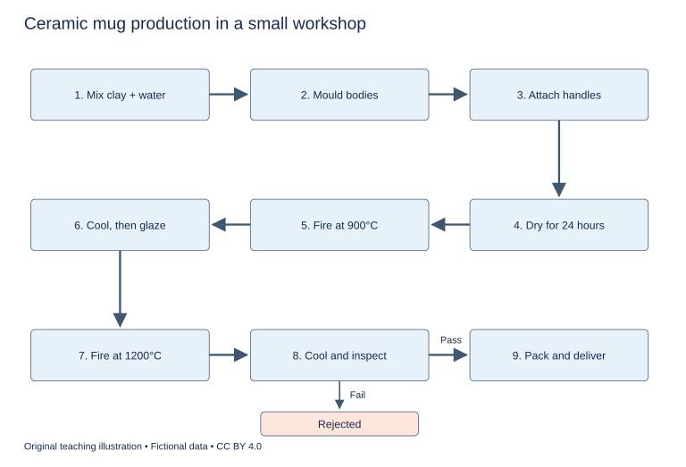

# U12 第6周：长篇阅读、写作与口语

本页为已独立核验的原创文字课程。先完成学生题目，再展开对应参考。非真题、非标准化模考，不换算雅思分数。听力尚未补齐，本页不代表全科课程已完成。

每周选A或G类Task 1一题，加Task 2及三次口语。参考范文不是学生已完成作业，仍须提交初稿、录音和重写，独立真人评分另行安排。

阅读每周180分钟（60分钟首次限时、120分钟证据精读与延迟复测），写作180分钟、口语120分钟。词汇60分钟、听力180分钟另列；新增完整听力未验收，不能勾整周完成。

W08如落实正式T08模拟，替换相应首答时段，不能重复计量；本页原创技能卷不能充当正式陌生卷。后续周数与达标规则见 [U04](u04-exam-preparation.md)。

## 阅读：首答不查词

### R-W06-01 · Two Routes to a Cooler Delivery

W06｜正文 811 词｜13 题｜篇章：过程比较：相同终点、不同能耗路径（6段）

本课必做60分钟：首答20、证据复盘20、词汇长句10、48小时后复测10。每周三课180分钟，合卷首答替代单课首答，不重复计算。开放短文选做另加15分钟。

本项目原创虚构教学情境，人物、地点、历史事件和案例数据均非真实研究或史料。科学解释只讨论文内说明的模型与条件。非雅思真题或标准化模考；正确数不换算雅思等级。许可：CC BY 4.0 — RayXBuilds and contributors。

能力点：识别论证关系、区分作者与引述者、条件与因果、精确定位。初读不查词，完成后打开独立答案页。

#### Passage

**A** In a fictional design exercise, two teams must transport identical boxes of temperature-sensitive wax models across a town. The models are not food or medicine, and the exercise makes no claim about safe storage of either. Team Blue proposes a powered compartment that continually removes heat. Team Amber proposes an insulated box containing packs cooled before departure. Both teams initially advertise the temperature at the end of the trip. That number matters, but it hides most of the process. A box might finish cool after becoming warm halfway through, and two equally cool boxes might have required very different work before departure. A fair comparison must therefore follow a route through time as well as across the street map. It must also define what the teams are trying to preserve rather than treating coldness as valuable without a purpose.

**B** The wax models in this exercise lose their intended shape if they remain above a specified threshold for too long. The assessment consequently records both temperature and time. A brief rise and a sustained rise are not treated as equivalent merely because their maximum readings match. Each box carries a temperature logger, and the teams agree where it will sit before either journey begins. Placing a device against a cooling pack would describe that small location rather than the air around the models. Position is part of the measurement, not an incidental detail that can be decided afterwards. The logger itself does not explain why a change occurred. Its record must be read alongside opening times, stops and other events during the journey before the teams can connect an observed pattern to a plausible cause.

**C** Blue's powered system can respond while travelling. If the lid is opened and warmer air enters, the cooling unit may remove the added heat, provided it has sufficient power and time. That capacity is not unlimited. A control setting describes a desired condition, not proof that the condition has been achieved throughout the compartment. Blue must account for the energy used by the unit and for the possibility of a power interruption. Its team also measures the initial pull-down period: starting with a warm compartment and bringing it to the target condition is part of the job. Ignoring that period would make the system seem more economical simply by beginning the accounting after some of its work had already been done elsewhere in the schedule.

**D** Amber's method stores some of the preparation in the cooled packs. During the trip, incoming heat reduces the protection they can continue to provide. Good insulation slows this process but does not make the reserve endless. Amber therefore weighs its cooling packs and specifies their condition at departure. The energy used to cool them belongs in the comparison, even though it is consumed away from the delivery vehicle. A system without a plug during travel is not necessarily a system without an energy cost. Equally, the absence of active control does not prove that it will perform badly over a short, predictable journey. The relevant question is whether the prepared reserve remains sufficient under the conditions actually tested, including the time spent waiting at the destination before the models are unpacked.

**E** The first comparison goes wrong when Blue follows an empty road early in the morning and Amber travels later through traffic. The teams have changed the journey as well as the cooling method. They repeat the exercise using a route card that specifies departure conditions, planned stops and the duration of lid openings. The card cannot make two real journeys perfectly identical, so unexpected events are recorded rather than concealed. To examine failure, they also run a separate test with a deliberately extended stop. This is not mixed into the ordinary performance average. It asks a different question: how much margin remains when the expected schedule fails? A design that succeeds on its planned route may still need a clear limit beyond which its performance cannot be assumed.

**F** At the end, the teams prepare an energy ledger covering preparation, travel and recovery for the next trip. They pair it with the logger record and notes about the models' condition. The exercise produces no universal winner. Blue may suit a journey with uncertain interruptions, while Amber may suit a shorter route whose demands fit its prepared reserve. Those conclusions remain conditional on the tested designs. The lesson is not that every comparison must collect every imaginable measurement. It is that the boundary of the comparison should include the work necessary to provide the claimed service. Moving a cost outside the vehicle or outside the recorded hour does not make it disappear. A useful evaluation follows the service far enough to reveal where each design obtains its advantage and where that advantage might end. Neither team can claim an advantage simply by choosing an accounting period that omits its own most demanding stage.

#### Questions

**Choose ONE answer, A, B, C or D.**

1. Why is the final temperature insufficient?

   A. It cannot be measured
   B. It conceals earlier conditions and preparation
   C. It measures only vehicle speed
   D. It proves both methods failed

2. A logger next to a pack may mislead because

   A. wax always touches the pack
   B. the route is too short
   C. all loggers create heat
   D. its location is unrepresentative

3. The extended-stop test primarily examines

   A. supplier prices
   B. normal average speed
   C. the popularity of the vehicle
   D. remaining margin under disruption

4. The author’s final comparison is

   A. an argument against measurement
   B. a universal victory for Blue
   C. conditional on service and design
   D. a universal victory for Amber

**Do the following statements agree with the writer's views? Write YES, NO or NOT GIVEN. YES = the writer agrees; NO = the writer expresses the opposite view; NOT GIVEN = the writer's view is not stated. Do not use outside knowledge.**

5. Cooling performed before the journey can legitimately be ignored.

6. A controller setting guarantees uniform achievement of the desired temperature.

7. Amber’s designers were more experienced than Blue’s.

8. It is unnecessary to measure every imaginable variable in every comparison.

**Complete the sentences. Choose NO MORE THAN 3 WORDS FROM THE PASSAGE for each answer. Do not change word forms.**

9. Each box contains a ______ to record conditions over time.

10. Blue measures its initial ______ before the normal journey.

11. Amber records the mass and starting condition of its ______.

12. Planned stops and lid-opening durations appear on a ______.

13. Preparation and recovery costs are collected in an ______.

#### 复盘

必做：给每道错题标记“定位/作者立场/范围/语法/词数”，抄最短证据；用一行箭头概括本文论证或过程。48小时后重做错题与两道正确题，检查是否仍能指出证据。

选做（15分钟，80–100词）：Choose a boundary for comparing two delivery systems and justify it.

R-W06-01 答案、证据与精读（首答后展开）

### R-W06-01 · 独立答案与证据

来源与许可同学生页。先完成再核对。可接受答案由 accepted_answers 明确列出；只忽略大小写和首尾空格，不自行删词。开放复盘不计入客观正确数。

1. **B**｜段落 A｜证据：“it hides most of the process”

   B同时覆盖时间过程与前置成本。

2. **D**｜段落 B｜证据：“describe that small location rather than the air around the models”

   不是断言设备本身无效。

3. **D**｜段落 E｜证据：“how much margin remains when the expected schedule fails”

   专门压力条件，不混入常规平均。

4. **C**｜段落 F｜证据：“conditional on the tested designs”

   作者不推广为技术类别的绝对优劣。

5. **NO**｜段落 D｜证据：“belongs in the comparison”

   移出车辆不等于成本消失。

6. **NO**｜段落 C｜证据：“not proof that the condition has been achieved”

   设定与实现有别。

7. **NOT GIVEN**｜段落 A｜证据：“two teams must transport identical boxes”

   未比较经验。

8. **YES**｜段落 F｜证据：“not that every comparison must collect every imaginable measurement”

   作者明确限制全面测量的要求。

9. **temperature logger / logger / device**｜段落 B｜证据：“carries a temperature logger”

   temperature logger、logger 和 device 均接受。B 段的 Placing a device against a cooling pack 用 device 回指记录设备；a device 语法正确且为一词原文答案。setting 不是设备。

10. **pull-down period / period / pull-down**｜段落 C｜证据：“initial pull-down period”

   initial 已提供；pull-down period、period 及作过程名词的 pull-down 均符合语义和字数。连字符词计一词。

11. **cooling packs / cooled packs / packs**｜段落 D｜证据：“weighs its cooling packs”

   D 同时使用 cooled packs 和 cooling packs 指同一组储冷包，两种词组及中心词 packs 均接纳。

12. **route card / card**｜段落 E｜证据：“using a route card”

   具体信息载体；ledger 记录能量而非行程规程。

13. **energy ledger**｜段落 F｜证据：“prepare an energy ledger”

   ledger 单独不能接 an；此处不接受它。

#### 词汇与长句

- **threshold**：阈值
- **compartment**：隔舱
- **reserve**：储备量
- **ledger**：分类记账表

> A system without a plug during travel is not necessarily a system without an energy cost.

not necessarily 非必然，不等于一定更耗能。

> Moving a cost outside the vehicle or outside the recorded hour does not make it disappear.

动名词短语作主语，make it disappear 为使役结构。

#### 开放任务参考

纳入准备、途中及恢复；评价终点和中途，别把文内蜡模型规则推广到食品药品。

标准：观点有文内依据，保留条件和范围，推断明确标注；不存在唯一措辞。

### R-W06-02 · When the Town Agreed on Noon

W06｜正文 833 词｜13 题｜篇章：虚构历史发展：同步需求与社会后果（7段）

本课必做60分钟：首答20、证据复盘20、词汇长句10、48小时后复测10。每周三课180分钟，合卷首答替代单课首答，不重复计算。开放短文选做另加15分钟。

本项目原创虚构教学情境，人物、地点、历史事件和案例数据均非真实研究或史料。科学解释只讨论文内说明的模型与条件。非雅思真题或标准化模考；正确数不换算雅思等级。许可：CC BY 4.0 — RayXBuilds and contributors。

能力点：识别论证关系、区分作者与引述者、条件与因果、精确定位。初读不查词，完成后打开独立答案页。

#### Passage

**A** Before the imaginary town of Selden adopted a common clock, noon was a flexible arrangement. Farmers judged the working day partly through light and tasks, while shopkeepers followed bells from whichever tower they could hear. The towers did not always agree, but disagreement mattered less when appointments were expressed as a period rather than a precise minute. It would be misleading to describe these residents as people without time. They coordinated activities through conventions suited to particular relationships and distances. What they lacked was not an awareness of sequence or duration, but a single reference capable of organising increasingly connected journeys. The pressure for change grew when an activity in one part of town began to depend on an event occurring elsewhere at a specific moment.

**B** The first such pressure came from a river ferry. When carts arrived shortly after departure, the operator either waited and delayed people already aboard or left and disappointed the newcomers. Publishing a departure hour did little while customers read different clocks. The operator painted a board beside the landing and declared that departures would follow the clock above the grain market. This was a practical choice because its face could be seen from the river road. It did not establish that the market mechanism was technically superior to every other clock. A common reference can improve coordination even when the chosen instrument is imperfect, provided its limitations are understood and its authority is accepted by the people using it.

**C** Later, a workshop began paying a group of workers according to recorded hours. Its manager wanted a bell that sounded at the same moment as the market clock, but the building stood beyond hearing distance. A messenger initially carried a written time note each morning. By the time the note arrived, however, time had moved on. The messenger's journey had to be included in setting the workshop clock. This simple problem made delay visible as part of transmission. Copying a value faithfully was not enough if the value described a condition that continued changing. The messenger system could function only by attaching some estimate of travel time to the information being carried across the town.

**D** A mechanical signal was eventually installed between the buildings in the fictional narrative. It allowed the market keeper to release a flag visible from the workshop roof. The receiver adjusted the local clock when the flag fell. The signal reduced one source of delay but introduced new dependencies: someone had to watch, visibility had to be adequate, and the sending mechanism had to work. On foggy days, the old messenger returned. The newer system did not erase the older one. Instead, reliable coordination depended on knowing when to switch between them. This is a more useful account of technical change than a sequence in which each invention instantly makes every previous practice irrelevant to the people who still need the service.

**E** Agreement about the reference did not settle agreement about fairness. Workers complained that the workshop bell sometimes sounded before the minute indicated by the clock they passed on their way in. The manager replied that only the workshop clock counted for wages. The argument concerned who bore the cost of disagreement, not merely which dial was more accurate. A rule could be technically consistent and still place an avoidable burden on people who could not inspect the official clock before arriving. The town eventually required the workshop to display a public dial near its entrance. This made the relevant reference visible but did not answer every question about how working time should be valued or counted.

**F** The clock keeper maintained an adjustment book, noting when the market clock was corrected and why. Without that record, an observer might interpret a sudden change in the apparent length of a journey as a change in the journey itself. An announced correction helped distinguish changes in measurement from changes in what was measured. The keeper also used a notice card to warn the ferry operator before a planned adjustment. This small administrative practice mattered because a technically better clock could still disrupt coordination if its displayed time changed unexpectedly. Accuracy and continuity were related goals, but they were not automatically identical in a system whose users planned their actions around a shared display.

**G** By the end of Selden's story, residents had not abandoned every older way of organising life. A gardener still spoke of work before sunset, and families still arranged visits around meals. The common clock served connections that required a shared reference; it did not replace every useful local convention. The history therefore concerns an expanding set of agreements rather than the triumph of precise time over confusion. Instruments, signals and rules developed together. To explain the change through the clock mechanism alone would overlook the people who maintained it, announced its corrections and accepted its authority. Standardisation was accomplished when different users could coordinate their actions through the reference, not merely when identical numbers appeared on several faces at one convenient instant.

#### Questions

**Do the following statements agree with the writer's views? Write YES, NO or NOT GIVEN. YES = the writer agrees; NO = the writer expresses the opposite view; NOT GIVEN = the writer's view is not stated. Do not use outside knowledge.**

1. Older coordination practices necessarily disappear when a new signal is introduced.

2. Technical consistency alone guarantees a fair timekeeping rule.

3. An unannounced improvement in clock accuracy can disrupt users.

4. The writer thinks the ferry operator should have owned all the town clocks.

**Complete the summary. Choose NO MORE THAN 3 WORDS FROM THE PASSAGE for each answer. Do not change word forms.**

Ferry departures followed the clock above the (5) ______. The workshop first received a written (6) ______ by messenger. A later signal used a falling (7) ______. Corrections were recorded in an (8) ______. A (9) ______ warned the ferry operator of planned changes.

**Choose ONE answer, A, B, C or D.**

10. Why did early clock disagreement matter less?

   A. Travel had been prohibited
   B. Nobody arranged meetings
   C. Appointments often used periods rather than precise minutes
   D. All towers were equally loud

11. Why was the market clock initially chosen?

   A. It was the only clock
   B. It belonged to the ferry operator
   C. It had proven perfect accuracy
   D. Its face was visible from the river road

12. The messenger example highlights

   A. the value of handwriting
   B. the impossibility of all coordination
   C. the abolition of wages
   D. delay while changing information is transmitted

13. The public dial primarily addressed

   A. ferry capacity
   B. mechanical repair
   C. fog
   D. access to the reference used for wages

#### 复盘

必做：给每道错题标记“定位/作者立场/范围/语法/词数”，抄最短证据；用一行箭头概括本文论证或过程。48小时后重做错题与两道正确题，检查是否仍能指出证据。

选做（15分钟，80–100词）：Explain one conflict between accuracy and coordination.

R-W06-02 答案、证据与精读（首答后展开）

### R-W06-02 · 独立答案与证据

来源与许可同学生页。先完成再核对。可接受答案由 accepted_answers 明确列出；只忽略大小写和首尾空格，不自行删词。开放复盘不计入客观正确数。

1. **NO**｜段落 D｜证据：“did not erase the older one”

   雾天仍用信使。

2. **NO**｜段落 E｜证据：“technically consistent and still place an avoidable burden”

   明确反例。

3. **YES**｜段落 F｜证据：“could still disrupt coordination”

   准确与连续性不是同一目标。

4. **NOT GIVEN**｜段落 G｜证据：“an expanding set of agreements”

   没有产权主张。

5. **grain market / market**｜段落 B｜证据：“clock above the grain market”

   market 是合理短答；river road 是观察位置。

6. **time note / note**｜段落 C｜证据：“a written time note”

   题干已给 written，接受 time note 或 note；不要重复 written。

7. **flag**｜段落 D｜证据：“release a flag”

   被释放的物体而非信使。

8. **adjustment book**｜段落 F｜证据：“maintained an adjustment book”

   an 要求后接元音音素；adjustment book 合适，单独 book 不能接 an。notice card 是通知而非修正记录。

9. **notice card / card**｜段落 F｜证据：“used a notice card”

   向ferry operator预告的载体。

10. **C**｜段落 A｜证据：“appointments were expressed as a period”

   不是没有协调需求。

11. **D**｜段落 B｜证据：“its face could be seen from the river road”

   选取可见性，不等于技术绝对优胜。

12. **D**｜段落 C｜证据：“time had moved on”

   动态信息必须考虑传输延迟。

13. **D**｜段落 E｜证据：“made the relevant reference visible”

   没有解决全部公平争议。

#### 词汇与长句

- **reference**：参照标准
- **transmission**：传递
- **continuity**：连续性
- **dial**：钟面

> Copying a value faithfully was not enough if the value described a condition that continued changing.

if限定条件；that修饰condition，关键是被测量状态持续变化。

> Instruments, signals and rules developed together.

三个并列主语，解释标准化是技术与制度共同形成。

#### 开放任务参考

F修正若未预告可干扰安排；C传递延迟说明即使抄写准确也未必同步。

标准：观点有文内依据，保留条件和范围，推断明确标注；不存在唯一措辞。

### R-W06-03 · A Machine That Sorts the Letters

W06｜正文 808 词｜14 题｜篇章：观点争论：自动分类的四个评价维度（5段）

本课必做60分钟：首答20、证据复盘20、词汇长句10、48小时后复测10。每周三课180分钟，合卷首答替代单课首答，不重复计算。开放短文选做另加15分钟。

本项目原创虚构教学情境，人物、地点、历史事件和案例数据均非真实研究或史料。科学解释只讨论文内说明的模型与条件。非雅思真题或标准化模考；正确数不换算雅思等级。许可：CC BY 4.0 — RayXBuilds and contributors。

能力点：识别论证关系、区分作者与引述者、条件与因果、精确定位。初读不查词，完成后打开独立答案页。

#### Passage

**A** The fictional city of Neral receives letters about broken lights, missed collections and damaged pavements. Clerks read each letter and send it to a department. A proposed text classifier would suggest a destination by comparing its wording with earlier examples. The proposal is modest in one respect: the machine would not repair a light or decide whether a complaint was justified. Yet suggesting a destination is consequential. A misdirected letter can wait unnoticed, and a request that mentions two problems may belong to no single familiar category. The writer's starting point is that automation should be judged by the service people actually receive, not just by the number of labels produced. This does not require opposing the new system. It requires specifying the task honestly enough that a fast answer to one question is not mistaken for an answer to a different one. A tool that sorts efficiently can still leave a citizen unable to obtain a response.

**B** Software developer Lina Ross argues that the classifier should be allowed to express uncertainty. A message using unfamiliar language should not be forced into the closest available category merely to maintain a high completion rate. Lina proposes a review queue for cases in which the system cannot make a sufficiently reliable suggestion. She distinguishes a refusal to guess from a failed service: a carefully routed human review may be better than an immediate confident error. However, the queue must be staffed. Moving difficult cases into a box called review does not resolve them. Lina would measure how long they remain there and whether their eventual destinations are appropriate. She also wants examples with more than one issue kept visible during testing, because removing awkward messages would produce an attractive result on a task simpler than the city actually faces in its daily correspondence.

**C** Service manager Omar Kent focuses on the existing departments. If clerks previously used different labels for the same kind of request, those records cannot be treated as an unquestionable answer key. Omar proposes a shared definition of each destination before the team trains or evaluates the tool. He does not expect perfect agreement about every letter. Instead, disputed examples should reveal where responsibilities overlap. An apparent machine error might expose an unclear division of work rather than a failure to recognise words. Omar therefore wants a handover rule for requests spanning several departments. His main concern is organisational coherence: the city should not ask software to make distinctions that its own staff cannot explain consistently to one another. Clarifying these distinctions would be useful even if the classifier were never installed, because people sorting letters manually face the same overlapping responsibilities.

**D** Community adviser Pia Chen asks who appears in the examples. Letters from confident frequent correspondents may be longer and use the city's preferred vocabulary. People writing briefly or describing a problem indirectly could be underrepresented. Pia would test the system on different ways of expressing the same need, including requests written without official department names. She is not proposing that every citizen be taught to sound like a clerk. On the contrary, she considers that requirement a transfer of work from the institution to the people it is meant to serve. She also wants a visible correction route: someone whose message reaches the wrong destination should be able to challenge that outcome without understanding how the classifier works. An explanation consisting only of a technical score would not meet that need. The citizen needs to know what action can be taken next and who is responsible for taking it.

**E** Evaluator Tomas Reed warns against a comparison that uses carefully prepared messages for the machine and ordinary daily mail for clerks. Both methods should encounter comparable requests, including ambiguous ones. He would count time to a meaningful response, not just time to the first label, and would follow letters that moved between departments. His position brings the debate back to the writer's initial distinction between sorting and service. Lina's uncertainty handling, Omar's definitions and Pia's correction route address different parts of that journey. None can be replaced by a single average accuracy figure. Nor does the need for them prove that the existing manual system is satisfactory. The appropriate comparison asks whether the proposed arrangement improves the whole process, including what happens when it is wrong. A classifier can be a useful component without becoming the final authority over the meaning of a citizen's request. In this case, the city decides to trial suggestions alongside clerks before changing any public submission route, while preserving an explicit record of disagreements for later review. The trial also preserves the original letters, so that a later investigator can distinguish a disputed label from the wording that prompted it. Without that link, a table of successful and unsuccessful outcomes would be difficult to question, even if its arithmetic were completely correct.

#### Questions

**Choose ONE answer, A, B, C or D.**

1. The writer’s central distinction is between

   A. letters and email
   B. classification and effective service
   C. software and mathematics
   D. lighting and pavements

2. Why can historical labels be problematic?

   A. They are always accurate
   B. They contain no words
   C. They may reflect inconsistent departmental definitions
   D. They were all written by software

3. What is wrong with removing awkward messages from tests?

   A. It makes the tested task simpler than the real task
   B. It proves uncertainty is impossible
   C. It guarantees slow replies
   D. It increases the real workload

4. What does the city initially decide to do?

   A. Eliminate clerks
   B. Trial suggestions alongside clerks
   C. Make citizens choose technical scores
   D. Stop recording errors

**Do the following statements agree with the writer's views? Write YES, NO or NOT GIVEN. YES = the writer agrees; NO = the writer expresses the opposite view; NOT GIVEN = the writer's view is not stated. Do not use outside knowledge.**

5. The number of labels is sufficient to judge public service quality.

6. Uncertainty handling removes the need to staff a review queue.

7. The existence of automation problems proves the manual system works well.

8. The classifier costs less to maintain than the old system.

9. A useful classifier need not have final authority over a citizen’s meaning.

**Match each statement with the person who expresses that view. Write a letter. You may use any letter more than once.**

- A: Lina Ross
- B: Omar Kent
- C: Pia Chen
- D: Tomas Reed

10. An uncertain case should be referred instead of forced into a category.

11. Departments need definitions they can explain consistently.

12. Citizens should not need to adopt official vocabulary to obtain service.

13. Evaluation should follow the time until a meaningful response.

14. People need a practical route to challenge a wrong destination.

#### 复盘

必做：给每道错题标记“定位/作者立场/范围/语法/词数”，抄最短证据；用一行箭头概括本文论证或过程。48小时后重做错题与两道正确题，检查是否仍能指出证据。

选做（15分钟，80–100词）：Propose two criteria beyond classification accuracy.

R-W06-03 答案、证据与精读（首答后展开）

### R-W06-03 · 独立答案与证据

来源与许可同学生页。先完成再核对。可接受答案由 accepted_answers 明确列出；只忽略大小写和首尾空格，不自行删词。开放复盘不计入客观正确数。

1. **B**｜段落 A｜证据：“not just by the number of labels produced”

   其余均非全文论旨。

2. **C**｜段落 C｜证据：“clerks previously used different labels”

   历史标签非天然金标准。

3. **A**｜段落 B｜证据：“a task simpler than the city actually faces”

   目标是代表真实任务，不是只看整洁数据。

4. **B**｜段落 E｜证据：“trial suggestions alongside clerks”

   不是直接全自动接管。

5. **NO**｜段落 A｜证据：“not just by the number of labels produced”

   作者反对单一产出指标。

6. **NO**｜段落 B｜证据：“the queue must be staffed”

   作者明确认可实际处理需求。

7. **NO**｜段落 E｜证据：“Nor does the need for them prove”

   不能反向推断。

8. **NOT GIVEN**｜段落 E｜证据：“proposed arrangement improves the whole process”

   无维护成本比较。

9. **YES**｜段落 E｜证据：“without becoming the final authority”

   作者结论明确。

10. **A**｜段落 B｜证据：“should not be forced into the closest available category”

   Lina是拒绝猜测与复核。

11. **B**｜段落 C｜证据：“a shared definition of each destination”

   Omar组织分工。

12. **C**｜段落 D｜证据：“not proposing that every citizen be taught to sound like a clerk”

   Pia用户表达权。

13. **D**｜段落 E｜证据：“count time to a meaningful response”

   Tomas端到端评价。

14. **C**｜段落 D｜证据：“a visible correction route”

   Pia强调可行动纠错；可重复C。

#### 词汇与长句

- **classifier**：分类器
- **underrepresented**：代表不足的
- **handover**：移交
- **ambiguous**：存在多种解释的

> Moving difficult cases into a box called review does not resolve them.

动名词作主语；called review 后置修饰box，标签不是实际解决。

> A tool that sorts efficiently can still leave a citizen unable to obtain a response.

that 定语从句；leave +宾语+unable 描述结果，局部效率不保证最终回应。

#### 开放任务参考

可选回复耗时、复核队列、纠错通道和跨部门交接；用对应人物证据支持。

标准：观点有文内依据，保留条件和范围，推断明确标注；不存在唯一措辞。

## 写作与口语：Task 1双分支择一

### WS-W06-T1A 学生页：陶瓷杯制作流程

周次 W06｜题型 T1A｜能力点：流程顺序与概述

Task 1 的 A/G 分支二选一，另一分支不计入本周作业。

#### 使用与记录

原创教学练习，非真题、非标准化模拟，难度未校准。先完成本页再打开参考页。人物、机构、经历与数据均为教学虚构。不要背诵示例。自评和 AI 反馈不能代替独立真人评分，未获得真人评阅时标记“分数未确认”。

保存：任务ID、实际日期、用时、初稿或原始录音、证据化反馈、重写/重答、三条修改理由。没有学生提交物，不得填写“已批改”或“已完成训练”。

#### 完整题干

The diagram illustrates a small workshop’s process for producing ceramic mugs. Summarise the information by selecting and reporting the main features, and make comparisons where relevant.

Write at least 150 words. Spend about 20 minutes on this task.

教学虚构工坊流程，非实操安全指南。主流程编号1～9：1混合黏土与水→2模具成形杯身→3接杯柄→4架上干燥24小时→5初烧900℃→6冷却后浸釉→7二次烧制1200℃→8冷却并检查→9合格品包装发货。第8步不合格者另分支“Rejected”，无回收箭头。

#### 任务预算（含首次审题，不额外加时）

初稿20分钟（审题规划3、写作15、检查2）；诊断15；反馈阅读与证据核查10；完整重写25；对照归档5。合计75分钟。

#### 初稿后自评清单

- [ ] 达到最低字数；全文连贯成段，没有用项目符号代替作文。
- [ ] 概述给主要特征；数据、阶段或方位都与题图逐项相符，不推断未提供的原因。
- [ ] 每段可写出一个功能标签；例子或数据与该段要点相连。
- [ ] 圈出两处词汇搭配和两处句法疑点，先自行修正再查询或求反馈。
- [ ] 记录一项最影响理解的问题和原句证据，不填写自猜分数。

#### 反馈与重写

打开 独立参考页（本节下方展开参考），按逐段检查和通用协议核验。重写任务：完整重写至少150词；使用被动语态但注意主谓一致；按图中箭头逐步核验，删掉无依据的时间或机制。

W06 T1A 示例、反馈与重练（首答后展开）

### WS-W06-T1A 独立参考页

只在初稿完成后阅读；不是唯一答案，也没有官方分数。以下是对原创示例的教学讲评，不是对学生尚未提交作文的已完成批改。

#### 思路拆解

概述线性生产+两次烧制+末端分支；按初烧前/初烧后分组；只描述图示，不补化学原理或回收路径。

#### 原创示例

The diagram shows how ceramic mugs are produced in a small workshop, beginning with the preparation of clay and ending with the packing of finished products for delivery.

Overall, the process consists of nine successive stages. The mugs are shaped and dried before undergoing two separate firings, with glazing taking place between them. A final inspection determines which mugs are packed and which are rejected.

First, clay is mixed with water until it is ready to be shaped. The mixture is then placed in moulds to form the bodies of the mugs. Handles are attached at the following stage, after which the mugs are left to dry on shelves for twenty-four hours. Once drying is complete, they are fired in a kiln at 900 degrees Celsius.

The resulting mugs are allowed to cool and are then dipped in glaze. A second firing follows, this time at the higher temperature of 1,200 degrees Celsius. Finally, the mugs are cooled again and inspected. Those that pass the inspection are packed for delivery, while any that fail are rejected. The diagram does not show any further treatment of the rejected products.

示例正文词数：189（本项目正则计数；书信不含称呼、结束语与署名；连字符词作一词）。

#### 逐段反馈与迁移

- P1 起止明确；没有把流程误写为自然循环。

- P2 以编号框计九个主阶段，最后合格/淘汰为结果分支；两次烧制关系正确。

- P3 混合→成形→接柄→干燥→初烧，24小时和900℃要核对。

- P4 第六阶段包含冷却与上釉，第八阶段再次冷却检查；1200℃高于900℃。淘汰品无后续箭头，不写回收。

#### 常见失误

把上釉置于初烧前；漏第二次冷却；自造被淘汰杯子重新入模的循环。

#### 可执行反馈步骤

1. 先把自己的段落标为引入、概述/论点、支持、收束；分段可不同于示例，按功能核查，不照抄段数。
2. 对照上方逐段检查，逐项标“已有证据/缺失/不适用”。每条意见必须附自己的原句或缺失位置。
3. 按 [反馈协议](u15-feedback.md) 的四维表记录；有争议的 AI 意见回题干、数据或语法依据核验。
4. 只选两项最高优先级问题执行整篇重写；保留原稿，禁止把示例替换为自己的作业。

#### 重写任务

完整重写至少150词；使用被动语态但注意主谓一致；按图中箭头逐步核验，删掉无依据的时间或机制。

完成后重新勾选 学生页（见本节上方学生题） 清单；将一处改前/改后及理由交给独立评阅者核查。真人评阅状态目前为“待安排”，不是已完成。

### WS-W06-T1G 学生页：请邻居照看植物

周次 W06｜题型 T1G｜能力点：书信目的、要点与语气

Task 1 的 A/G 分支二选一，另一分支不计入本周作业。

#### 使用与记录

原创教学练习，非真题、非标准化模拟，难度未校准。先完成本页再打开参考页。人物、机构、经历与数据均为教学虚构。不要背诵示例。自评和 AI 反馈不能代替独立真人评分，未获得真人评阅时标记“分数未确认”。

保存：任务ID、实际日期、用时、初稿或原始录音、证据化反馈、重写/重答、三条修改理由。没有学生提交物，不得填写“已批改”或“已完成训练”。

#### 完整题干

You will be away for a week and would like your neighbour, whom you know fairly well, to look after your plants. Write a letter to your neighbour, Ms Green. In your letter:
- explain when and why you will be away
- describe what care the plants need
- explain how you will arrange access and thank her for her help.
Begin your letter: Dear Ms Green,

Write at least 150 words. You do not need to write any addresses. Spend about 20 minutes on this task.

#### 任务预算（含首次审题，不额外加时）

初稿20分钟（审题规划3、写作15、检查2）；诊断15；反馈阅读与证据核查10；完整重写25；对照归档5。合计75分钟。

#### 初稿后自评清单

- [ ] 达到最低字数；全文连贯成段，没有用项目符号代替作文。
- [ ] 三个要点均展开；称呼、目的、语气和结束语适合收信人。
- [ ] 每段可写出一个功能标签；例子或数据与该段要点相连。
- [ ] 圈出两处词汇搭配和两处句法疑点，先自行修正再查询或求反馈。
- [ ] 记录一项最影响理解的问题和原句证据，不填写自猜分数。

#### 反馈与重写

打开 独立参考页（本节下方展开参考），按逐段检查和通用协议核验。重写任务：完整重写至少150词，给两类植物不同的可操作照护要求；让请求保持自愿，交接方式完整。

W06 T1G 示例、反馈与重练（首答后展开）

### WS-W06-T1G 独立参考页

只在初稿完成后阅读；不是唯一答案，也没有官方分数。以下是对原创示例的教学讲评，不是对学生尚未提交作文的已完成批改。

#### 思路拆解

认识但非亲密朋友的邻居，半正式请求；时间理由、照护步骤、钥匙安排三要点清晰。

#### 原创示例

Dear Ms Green,

I hope you are well. I will be away from 3 to 10 June to visit my sister, who has recently moved to another city. Would you be willing to look after the plants on my balcony while I am away? I remember that you kindly offered to help when we spoke in the hallway last week.

There are six pots beside the balcony door. The four smaller ones need a little water every other evening, while the two larger plants should only be watered if the soil feels dry. I will leave a labelled watering can beside them, together with a short note identifying each plant. There is no need to move the pots, as they already receive enough light in their current position.

If this is convenient for you, I could bring you a spare key on Sunday afternoon. Please leave it in my letterbox after your final visit, and I will collect it when I return. Thank you very much for considering this request. I would be happy to return the favour whenever you need someone to look after your home.

Best wishes,
Alex

示例正文词数：184（本项目正则计数；书信不含称呼、结束语与署名；连字符词作一词）。

#### 逐段反馈与迁移

- P1 日期与原因齐全；先询问是否方便，不能把帮忙当成既定义务。

- P2 区分四小盆与两大盆，说明频率/条件；避免含糊water them regularly。

- P3 条件式交钥匙、归还安排和感谢，结束语符合熟悉邻居。

#### 常见失误

只说谢谢不交代照护；钥匙取还不清；未获同意却写成已接受。

#### 可执行反馈步骤

1. 先把自己的段落标为引入、概述/论点、支持、收束；分段可不同于示例，按功能核查，不照抄段数。
2. 对照上方逐段检查，逐项标“已有证据/缺失/不适用”。每条意见必须附自己的原句或缺失位置。
3. 按 [反馈协议](u15-feedback.md) 的四维表记录；有争议的 AI 意见回题干、数据或语法依据核验。
4. 只选两项最高优先级问题执行整篇重写；保留原稿，禁止把示例替换为自己的作业。

#### 重写任务

完整重写至少150词，给两类植物不同的可操作照护要求；让请求保持自愿，交接方式完整。

完成后重新勾选 学生页（见本节上方学生题） 清单；将一处改前/改后及理由交给独立评阅者核查。真人评阅状态目前为“待安排”，不是已完成。

### WS-W06-T2 学生页：学校艺术是否必修

周次 W06｜题型 T2｜能力点：观点展开与任务回应

A/G 共用本题。

#### 使用与记录

原创教学练习，非真题、非标准化模拟，难度未校准。先完成本页再打开参考页。人物、机构、经历与数据均为教学虚构。不要背诵示例。自评和 AI 反馈不能代替独立真人评分，未获得真人评阅时标记“分数未确认”。

保存：任务ID、实际日期、用时、初稿或原始录音、证据化反馈、重写/重答、三条修改理由。没有学生提交物，不得填写“已批改”或“已完成训练”。

#### 完整题干

All secondary school students should be required to study art or music, even if they plan to pursue a scientific career. To what extent do you agree or disagree? Give reasons and include relevant examples.

Write at least 250 words. Spend about 40 minutes on this task.

#### 任务预算（含首次审题，不额外加时）

初稿40分钟（审题规划5、写作30、检查5）；诊断15；反馈阅读与证据核查10；完整重写35；对照归档5。合计105分钟。

#### 初稿后自评清单

- [ ] 达到最低字数；全文连贯成段，没有用项目符号代替作文。
- [ ] 直接回答题目的所有问句，有始终一致的立场。
- [ ] 每段可写出一个功能标签；例子或数据与该段要点相连。
- [ ] 圈出两处词汇搭配和两处句法疑点，先自行修正再查询或求反馈。
- [ ] 记录一项最影响理解的问题和原句证据，不填写自猜分数。

#### 反馈与重写

打开 独立参考页（本节下方展开参考），按逐段检查和通用协议核验。重写任务：完整重写至少250词；用一句话划清支持的必修范围，并让反方段回应最强的时间成本异议。

W06 T2 示例、反馈与重练（首答后展开）

### WS-W06-T2 独立参考页

只在初稿完成后阅读；不是唯一答案，也没有官方分数。以下是对原创示例的教学讲评，不是对学生尚未提交作文的已完成批改。

#### 思路拆解

同意基本接触但反对过度统一；机会公平和实践能力两理由；承认课时限制并限定要求。

#### 原创示例

Secondary schools must decide how much time to devote to subjects that students may not use in their future careers. I largely agree that all pupils should study some art or music, including those interested in science. However, a basic requirement should allow choice and should not prevent students from pursuing their main interests.

One reason for maintaining an arts requirement is that school provides access to experiences that may be unavailable elsewhere. A student whose family cannot afford music lessons might never discover an interest in performing without an opportunity at school. Making a limited amount of arts study compulsory ensures that this opportunity does not depend entirely on parental income or existing enthusiasm. Students can then make a more informed decision about whether to continue later.

Art and music also involve ways of working that can complement scientific study. Drawing an unfamiliar object requires close observation, while rehearsing with others requires attention to timing and feedback. These activities do not automatically make someone a better scientist, but they can encourage patience and careful revision. For example, a student designing a poster may need to reconsider how information is arranged after classmates find the first version confusing. That habit of testing and improving an idea is useful beyond the art classroom.

There are reasonable objections to an inflexible requirement. Older pupils already face pressure from examinations, and some may find a particular artistic activity frustrating. Schools should therefore provide options, such as visual design, drama or music, rather than require everyone to master the same instrument. A modest introductory course can offer meaningful exposure without consuming the time needed for advanced scientific subjects.

In conclusion, some compulsory arts education is justified because it broadens access and introduces valuable forms of practice. The requirement should be limited and flexible, with deeper specialisation left to students’ interests rather than imposed on everyone.

示例正文词数：311（本项目正则计数；书信不含称呼、结束语与署名；连字符词作一词）。

#### 逐段反馈与迁移

- P1 largely agree含边界，不回避all students；不把题目偷换成所有人必须学职业艺术。

- P2 公平机会机制具体；不声称人人一定会发现天赋。

- P3 科学与艺术之间用可迁移习惯联系，不夸大因果；海报例与迭代相连。

- P4 反方压力得到回应，选修形式不等于取消基本必修。

- P5 与开头有限且灵活的立场一致。

#### 常见失误

只讲艺术优美不回应是否必修；声称学音乐必然提高智商；结尾突然完全反对。

#### 可执行反馈步骤

1. 先把自己的段落标为引入、概述/论点、支持、收束；分段可不同于示例，按功能核查，不照抄段数。
2. 对照上方逐段检查，逐项标“已有证据/缺失/不适用”。每条意见必须附自己的原句或缺失位置。
3. 按 [反馈协议](u15-feedback.md) 的四维表记录；有争议的 AI 意见回题干、数据或语法依据核验。
4. 只选两项最高优先级问题执行整篇重写；保留原稿，禁止把示例替换为自己的作业。

#### 重写任务

完整重写至少250词；用一句话划清支持的必修范围，并让反方段回应最强的时间成本异议。

完成后重新勾选 学生页（见本节上方学生题） 清单；将一处改前/改后及理由交给独立评阅者核查。真人评阅状态目前为“待安排”，不是已完成。

### WS-W06-S1 学生页

周次W06｜Part 1专项｜能力点：解释创作过程与评价艺术机会｜30分钟

#### 使用与记录

原创教学练习，非真题、非标准化模拟，难度未校准。先完成本页再打开参考页。人物、机构、经历与数据均为教学虚构。不要背诵示例。自评和 AI 反馈不能代替独立真人评分，未获得真人评阅时标记“分数未确认”。

保存：任务ID、实际日期、用时、初稿或原始录音、证据化反馈、重写/重答、三条修改理由。没有学生提交物，不得填写“已批改”或“已完成训练”。

#### 操作与预算

设备与审题3分钟；首答录音6；回听及局部转写7；示例和诊断5；不看稿重答6；归档3。共30分钟。

#### Part 1专项题

1. Do you like drawing?
2. What kinds of music do you listen to?
3. Have you ever performed in front of other people?
4. Would you like to try a new creative activity?

追问：

- What makes that activity appealing?
- How would you find time to practise?

#### 录音回听清单

- [ ] 保留首答原音，记录实际时长、是否中断、是否看稿；只报真实完成状态。
- [ ] 流利与连贯：标出两处时间戳，区分构思停顿与重复搜词，检查是否偏离问句。
- [ ] 词汇：找一处模糊词或重复表达，先解释原意再替换；不为难词改变意思。
- [ ] 语法：核对经历与习惯的时态；局部转写并更正两处妨碍理解的问题。
- [ ] 发音：不看转写听30秒，标听不清的词尾、重音或断句；没有音频不能判断发音。
- [ ] 展开：主要回答有具体情境或理由；追问后第一句回应追问的新角度。

#### 重答要求

选择两个只有笼统判断的答案，先直接回应再加具体情境；重答一条追问，检查是否真正回应其新角度。

首答回听后才打开独立参考页（本节下方展开参考）。按[反馈协议](u15-feedback.md)填至少三个时间戳，不以文字转写替代音频评阅。

W06 S1 示例、反馈与重练（首答后展开）

### WS-W06-S1 独立参考页

原创教学示例，非真题或评分结果。未收到学生音频；以下是示例分析与待执行反馈，不能登记为已完成学生批改。

#### 展开示例

##### 直接回应→原因→具体情境的展开示例

I would like to try pottery because it involves making something I can actually use. Most of my work happens on a screen, so working with my hands would feel different. I would probably begin with a short class rather than buy equipment, since I do not yet know whether I would enjoy it regularly.

纯口答示例词数：55；只计MODEL标记内实际英文口答，不含标题、标签、说明。词数不能证明录音时长或流利度。

#### 展开与反馈

本周能力：解释创作过程与评价艺术机会。

1. 示例先表态，再说明偏好理由，最后提供条件或场景。检查自己是否用一个词回答后就结束。
2. 找到一个具体细节：物品、动作、对话或地点。用自己的经历替换，保持与题卡相关，不照搬示例身份与经历。
3. 追问要重新回应，不能继续背长答。首句先回答追问，再用一条理由支持。
4. 标出一处听不清或语法影响理解的原音时间戳；先尝试最小修正。不要把自然停顿一概当成错误，或用加快语速掩盖逻辑断裂。

#### 常见失误

空泛形容词替代具体过程；给了经历却没解释为什么重要；Part 3只有个人故事没有一般解释；AI只看转写就判断发音。逐项回原音核对，不能凭范例推断自己已达到某个分数。

#### 可执行重答与反馈

选择两个只有笼统判断的答案，先直接回应再加具体情境；重答一条追问，检查是否真正回应其新角度。

填写[反馈协议](u15-feedback.md)四维表，附三个时间戳和原话证据。选一个内容问题与一个语言问题先修；重答后并排听两段，记录改善与仍未解决之处。自评与AI不能替代独立真人评分；独立评阅目前待安排，分数未确认。

### WS-W06-S2 学生页

周次W06｜Part 2专项｜能力点：解释创作过程与评价艺术机会｜30分钟

#### 使用与记录

原创教学练习，非真题、非标准化模拟，难度未校准。先完成本页再打开参考页。人物、机构、经历与数据均为教学虚构。不要背诵示例。自评和 AI 反馈不能代替独立真人评分，未获得真人评阅时标记“分数未确认”。

保存：任务ID、实际日期、用时、初稿或原始录音、证据化反馈、重写/重答、三条修改理由。没有学生提交物，不得填写“已批改”或“已完成训练”。

#### 操作与预算

准备、首答录音及追问5分钟；回听及局部转写8；示例与诊断5；关键词重组3；重答及追问5；归档4。共30分钟。

#### Part 2专项任务卡

Describe something creative you made. Say what it was, why you made it, how you made it, and explain how you felt about the result.

准备1分钟，说1～2分钟。只记5个关键词，不预写句子。

收尾追问：

- Do you still have what you made?
- Would you change anything if you made it again?

#### 录音回听清单

- [ ] 保留首答原音，记录实际时长、是否中断、是否看稿；只报真实完成状态。
- [ ] 流利与连贯：标出两处时间戳，区分构思停顿与重复搜词，检查是否偏离问句。
- [ ] 词汇：找一处模糊词或重复表达，先解释原意再替换；不为难词改变意思。
- [ ] 语法：核对经历与习惯的时态；局部转写并更正两处妨碍理解的问题。
- [ ] 发音：不看转写听30秒，标听不清的词尾、重音或断句；没有音频不能判断发音。
- [ ] 展开：主要回答有具体情境或理由；追问后第一句回应追问的新角度。

#### 重答要求

用五个关键词重答完整任务卡1～2分钟，再答两条追问；补一处具体行动或细节并删一处无关背景。比较首答与重答，不背示例。

首答回听后才打开独立参考页（本节下方展开参考）。按[反馈协议](u15-feedback.md)填至少三个时间戳，不以文字转写替代音频评阅。

W06 S2 示例、反馈与重练（首答后展开）

### WS-W06-S2 独立参考页

原创教学示例，非真题或评分结果。未收到学生音频；以下是示例分析与待执行反馈，不能登记为已完成学生批改。

#### 展开示例

##### 原创长答示例（时长须以个人实际录音测量）

I once made a set of illustrated place cards for a family dinner. We were celebrating my aunt’s birthday, and I wanted to contribute something more personal than simply buying decorations.

I used thick paper, a black pen and a small box of coloured pencils. Each card had a person’s name and a drawing connected with something they enjoyed. My uncle’s card had a bicycle, while my cousin’s had a rather uneven-looking guitar.

The difficult part was keeping the drawings simple. At first, I tried to include too much detail, and the cards looked crowded. I started again with larger names and smaller pictures. That version was much easier to read across the table.

I felt pleased when people recognised their drawings and started talking about them. The cards were certainly not professional, but they helped create a friendly atmosphere. I learned that a creative project can succeed by being appropriate for its purpose, even if the technique is quite basic.

纯口答示例词数：161；只计MODEL标记内实际英文口答，不含标题、标签、说明。词数不能证明录音时长或流利度。

#### 展开与反馈

本周能力：解释创作过程与评价艺术机会。

1. 长答示例按背景、行动/观察、变化与意义组织。每段都推进内容；检查自己是否只有背景而没有具体事件。
2. 找到一个具体细节：物品、动作、对话或地点。用自己的经历替换，保持与题卡相关，不照搬示例身份与经历。
3. 追问要重新回应，不能继续背长答。首句先回答追问，再用一条理由支持。
4. 标出一处听不清或语法影响理解的原音时间戳；先尝试最小修正。不要把自然停顿一概当成错误，或用加快语速掩盖逻辑断裂。

#### 常见失误

空泛形容词替代具体过程；给了经历却没解释为什么重要；Part 3只有个人故事没有一般解释；AI只看转写就判断发音。逐项回原音核对，不能凭范例推断自己已达到某个分数。

#### 可执行重答与反馈

用五个关键词重答完整任务卡1～2分钟，再答两条追问；补一处具体行动或细节并删一处无关背景。比较首答与重答，不背示例。

填写[反馈协议](u15-feedback.md)四维表，附三个时间戳和原话证据。选一个内容问题与一个语言问题先修；重答后并排听两段，记录改善与仍未解决之处。自评与AI不能替代独立真人评分；独立评阅目前待安排，分数未确认。

### WS-W06-S3 学生页

周次W06｜三部分全流程｜能力点：解释创作过程与评价艺术机会｜60分钟

#### 使用与记录

原创教学练习，非真题、非标准化模拟，难度未校准。先完成本页再打开参考页。人物、机构、经历与数据均为教学虚构。不要背诵示例。自评和 AI 反馈不能代替独立真人评分，未获得真人评阅时标记“分数未确认”。

保存：任务ID、实际日期、用时、初稿或原始录音、证据化反馈、重写/重答、三条修改理由。没有学生提交物，不得填写“已批改”或“已完成训练”。

#### 操作与预算

D5：设备与流程准备2分钟，连续首答11～14分钟，余14～17分钟完整回听标记，共30分钟。D6：局部转写诊断10，阅读示例与调整5，重答与新追问10，对照归档5，共30分钟。合计60分钟。

#### 连续三部分全流程（首答不可看参考）

找同伴读题，或独练逐题揭示。完整首答11～14分钟，中途不暂停纠错。模拟同伴不是认证考官；自行读题的练习记录不能冒充真实面试。

##### Part 1：4～5分钟

1. Do you enjoy celebrations?
2. How do you usually celebrate a birthday?
3. Do you prefer small gatherings or large parties?
4. What do you do to prepare for guests?
5. Do you like choosing presents?
6. Have your preferences changed since childhood?

可按回答追加 Why? / Can you give an example? 到时转下部分，不强行说完全部备用问题。

##### Part 2：3～4分钟（含准备）

Describe a performance you watched. Say what kind of performance it was, where and when you watched it, who you were with, and explain what you thought of it.

准备1分钟，连续说1～2分钟。收尾追问：

- Would you watch those performers again?
- Did you discuss the performance afterwards?

##### Part 3：4～5分钟

1. Why do people attend live performances?
2. Should public money support local artists?
3. How can schools introduce children to different art forms?
4. Can online performances replace live events?

根据回答追加追问：

- How should funding decisions be made fairly?
- Who might prefer an online event?

#### 录音回听清单

- [ ] 保留首答原音，记录实际时长、是否中断、是否看稿；只报真实完成状态。
- [ ] 流利与连贯：标出两处时间戳，区分构思停顿与重复搜词，检查是否偏离问句。
- [ ] 词汇：找一处模糊词或重复表达，先解释原意再替换；不为难词改变意思。
- [ ] 语法：核对经历与习惯的时态；局部转写并更正两处妨碍理解的问题。
- [ ] 发音：不看转写听30秒，标听不清的词尾、重音或断句；没有音频不能判断发音。
- [ ] 展开：主要回答有具体情境或理由；追问后第一句回应追问的新角度。

#### 重答要求

重答最弱的一个Part 1问题、完整Part 2及一个Part 3问题，再答一条未用追问。用不同细节或补一个例外，确认不是复述范例；局部重答不另计全流程。

首答回听后才打开独立参考页（本节下方展开参考）。按[反馈协议](u15-feedback.md)填至少三个时间戳，不以文字转写替代音频评阅。

W06 S3 示例、反馈与重练（首答后展开）

### WS-W06-S3 独立参考页

原创教学示例，非真题或评分结果。未收到学生音频；以下是示例分析与待执行反馈，不能登记为已完成学生批改。

#### 展开示例

##### Part 2原创展开示例（个人语速不同，不能以词数推录音时长）

A performance I remember was a small outdoor concert in a courtyard near my home. A local group was playing acoustic music on a Saturday afternoon, and I stopped to listen with a neighbour while we were returning from the shops.

There was no large stage. The musicians stood under a tree, and people sat on folding chairs or along a low wall. At first, I recognised none of the songs, so I paid more attention to the instruments than to the words.

Halfway through, the singer explained that one song had been written about the nearby river. Listening to that explanation helped me follow the mood of the music. My neighbour also noticed a rhythm that reminded her of songs from her childhood.

I enjoyed the performance because it felt informal and close to the audience. We could see the musicians responding to one another, including a moment when they laughed after starting at different speeds. That small mistake made the event feel more human, rather than spoiling it.

##### Part 3观点→理由→条件展开示例

Online performances are valuable for people who cannot travel or afford a ticket. They can also be paused or watched again. A live event offers something different, though: the audience and performers react to one another in real time. I see the two formats as complementary, rather than assuming one should replace the other.

纯口答示例词数：224；只计MODEL标记内实际英文口答，不含标题、标签、说明。词数不能证明录音时长或流利度。

#### 展开与反馈

本周能力：解释创作过程与评价艺术机会。

1. 长答示例按背景、行动/观察、变化与意义组织。每段都推进内容；检查自己是否只有背景而没有具体事件。
2. 找到一个具体细节：物品、动作、对话或地点。用自己的经历替换，保持与题卡相关，不照搬示例身份与经历。
3. Part 3示例不把个人选择强加给所有人；先讲机制，再说明条件或例外。检查自己的追问答案是否直接回应新问题。
4. 标出一处听不清或语法影响理解的原音时间戳；先尝试最小修正。不要把自然停顿一概当成错误，或用加快语速掩盖逻辑断裂。

#### 常见失误

空泛形容词替代具体过程；给了经历却没解释为什么重要；Part 3只有个人故事没有一般解释；AI只看转写就判断发音。逐项回原音核对，不能凭范例推断自己已达到某个分数。

#### 可执行重答与反馈

重答最弱的一个Part 1问题、完整Part 2及一个Part 3问题，再答一条未用追问。用不同细节或补一个例外，确认不是复述范例；局部重答不另计全流程。

填写[反馈协议](u15-feedback.md)四维表，附三个时间戳和原话证据。选一个内容问题与一个语言问题先修；重答后并排听两段，记录改善与仍未解决之处。自评与AI不能替代独立真人评分；独立评阅目前待安排，分数未确认。

## 许可

原创文字：RayXBuilds and contributors，CC BY 4.0。此页由已验收分课汇编，调整了标题和导航；题干、正文和答案内容保留。公开第三方音频未包含。
