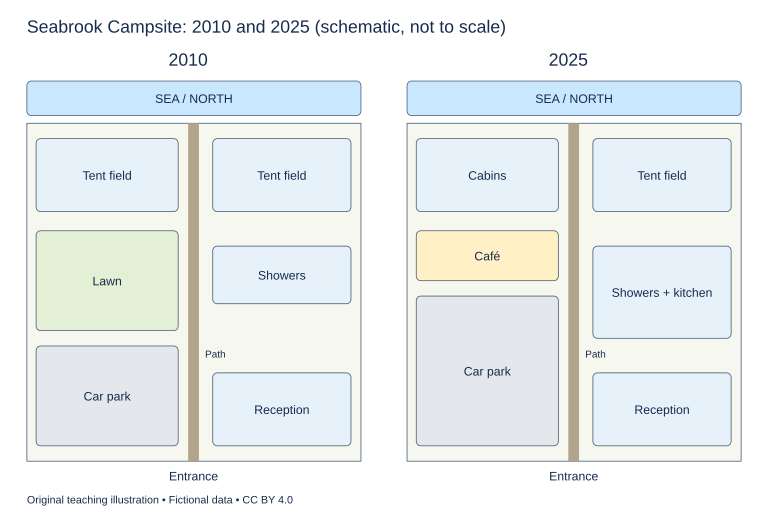

# U13 第7周：长篇阅读、写作与口语

本页为已独立核验的原创文字课程。先完成学生题目，再展开对应参考。非真题、非标准化模考，不换算雅思分数。听力尚未补齐，本页不代表全科课程已完成。

每周选A或G类Task 1一题，加Task 2及三次口语。参考范文不是学生已完成作业，仍须提交初稿、录音和重写，独立真人评分另行安排。

阅读每周180分钟（60分钟首次限时、120分钟证据精读与延迟复测），写作180分钟、口语120分钟。词汇60分钟、听力180分钟另列；新增完整听力未验收，不能勾整周完成。

W08如落实正式T08模拟，替换相应首答时段，不能重复计量；本页原创技能卷不能充当正式陌生卷。后续周数与达标规则见 [U04](u04-exam-preparation.md)。

## 阅读：首答不查词

### R-W07-01 · A Garden of Unequal Neighbours

W07｜正文 812 词｜13 题｜篇章：科学解释：实验设计与因果排除（6段）

本课必做60分钟：首答20、证据复盘20、词汇长句10、48小时后复测10。每周三课180分钟，合卷首答替代单课首答，不重复计算。开放短文选做另加15分钟。

本项目原创虚构教学情境，人物、地点、历史事件和案例数据均非真实研究或史料。科学解释只讨论文内说明的模型与条件。非雅思真题或标准化模考；正确数不换算雅思等级。许可：CC BY 4.0 — RayXBuilds and contributors。

能力点：识别论证关系、区分作者与引述者、条件与因果、精确定位。初读不查词，完成后打开独立答案页。

#### Passage

**A** In a fictional school experiment, two beds of beans seem to offer a simple discovery. Plants in the bed beside a hedge are shorter than those in the open bed. One group concludes that shade reduces growth; another says that roots from the hedge take water from the beans. Both explanations fit the initial observation. The problem is not that observation is useless, but that several differences occur together. A convincing experiment must arrange conditions so that competing explanations make different predictions. Merely repeating the original comparison with more beans may make the pattern clearer without revealing its cause. The class therefore begins by listing what differs between the beds, including light, water, soil history and exposure to wind. The list is not yet an explanation. It is a guide to the contrasts the students might need to create.

**B** Their first design puts a removable screen over part of an open bed. If shade is the only changed feature, the screened plants can help isolate its contribution. But the screen may also change wind and the amount of rain reaching the soil. Calling something a shade treatment does not ensure that it changes only shade. Students record these possible side effects and discuss ways to reduce them. They use a support frame without a screen over another patch, so that the presence of the frame is not automatically confused with the effect of the covering. This control is useful for a specific reason, not because every experiment improves whenever an extra object is called a control. The comparison must match the question and the mechanism that could otherwise mislead the observer.

**C** A second design crosses two conditions: screened or unscreened, and extra water or no extra water. This arrangement allows the class to ask whether the effect of water differs under the screen. It is possible that neither change has the same effect in every combination. The students should not force their results into a story in which one factor always produces a fixed increase. Their plan therefore includes a table with all combinations before planting begins. Empty boxes in the eventual results will be visible, rather than quietly omitted from a summary. The design also requires more space than the first comparison. If there is room for only one patch of each type, a difference between locations could still masquerade as a difference between treatments, however carefully the table has been drawn.

**D** To address location, the class divides the garden into blocks running from the hedge towards the path. Within each block, the treatment positions are assigned by a random draw. This does not make the soil identical. It prevents the students from deliberately or unconsciously placing a preferred treatment in every promising patch. Several plants grow within each patch, but those plants do not automatically count as several independent tests of a treatment applied to the whole patch. They share its location and watering procedure. Counting every leaf as a separate experiment would create a misleading impression of abundant evidence. The relevant unit follows the way the treatment was assigned, not whichever count happens to produce the largest number in the results table.

**E** Measurement is planned before the plants emerge. Students use a height ruler at a specified time of day and record where the measurement begins. They also note whether a stem has bent, because straightening it for one reading but not another changes the procedure. An observation sheet contains spaces for damaged plants and missing readings. The class does not simply delete a plant that grows badly or breaks during a windy afternoon. Such events may matter to the question being studied, or they may reveal a problem unrelated to the treatment. Either way, recording them preserves the possibility of deciding later with reasons rather than selecting the most attractive result. The students agree that the procedure can be revised if necessary, but any revision must be documented and considered when results from different dates are compared.

**F** At harvest, the results do not establish a rule for every garden. They concern these beans, these treatments and this period. The class can nevertheless learn something stronger than its first casual comparison allowed. It can examine whether the response to watering changed under the screen and whether the pattern appeared in several blocks. A treatment key links the labels on the beds to the assigned conditions, while a field diary records unexpected events such as a damaged frame. Together, these records let another class reconstruct what was done. The aim is not to make the garden as simple as the diagram. It is to make the relation between the diagram and the garden clear enough that a reader can see both the strength of the comparison and the limits of the claim drawn from it. Another class should be able to identify what would count as evidence against that claim.

#### Questions

**Do the following statements agree with the writer's views? Write YES, NO or NOT GIVEN. YES = the writer agrees; NO = the writer expresses the opposite view; NOT GIVEN = the writer's view is not stated. Do not use outside knowledge.**

1. More plants in the original comparison necessarily identify the cause.

2. Random allocation makes all patches physically identical.

3. Documenting procedural changes is important when comparing dates.

4. The writer believes beans are easier to investigate than peas.

**Choose ONE answer, A, B, C or D.**

5. What is missing from the initial comparison?

   A. A hedge
   B. A way to separate competing causes
   C. An observable pattern
   D. Any bean plants

6. Why use a frame with no screen?

   A. To guarantee identical rain
   B. To replace watering
   C. To examine effects of the frame itself
   D. To make the garden decorative

7. Why combine water and screen conditions?

   A. To see whether effects depend on combinations
   B. To eliminate location differences automatically
   C. To avoid measuring
   D. To prove water always helps

8. Independent evidence is determined primarily by

   A. the prettiest table
   B. the tallest plant
   C. how treatments were assigned
   D. the number of leaves

**Complete the sentences. Choose NO MORE THAN 3 WORDS FROM THE PASSAGE for each answer. Do not change word forms.**

9. Treatment positions within each block are allocated through a ______.

10. Plant size is measured using a ______.

11. Damaged plants and missing measurements have spaces on an ______.

12. Bed labels are connected with their assigned conditions by a ______.

13. Unexpected events are recorded in a ______.

#### 复盘

必做：给每道错题标记“定位/作者立场/范围/语法/词数”，抄最短证据；用一行箭头概括本文论证或过程。48小时后重做错题与两道正确题，检查是否仍能指出证据。

选做（15分钟，80–100词）：Explain why counting leaves does not necessarily increase independent evidence.

R-W07-01 答案、证据与精读（首答后展开）

### R-W07-01 · 独立答案与证据

来源与许可同学生页。先完成再核对。可接受答案由 accepted_answers 明确列出；只忽略大小写和首尾空格，不自行删词。开放复盘不计入客观正确数。

1. **NO**｜段落 A｜证据：“without revealing its cause”

   可增强模式而非区分解释。

2. **NO**｜段落 D｜证据：“This does not make the soil identical.”

   随机化不等于消除实际差异。

3. **YES**｜段落 E｜证据：“any revision must be documented”

   明确要求记录变更。

4. **NOT GIVEN**｜段落 F｜证据：“these beans, these treatments and this period”

   没有跨物种难度比较。

5. **B**｜段落 A｜证据：“several differences occur together”

   观察存在，但因果未区分。

6. **C**｜段落 B｜证据：“presence of the frame is not automatically confused”

   控制针对具体混杂。

7. **A**｜段落 C｜证据：“whether the effect of water differs under the screen”

   考交互而非固定单因效果。

8. **C**｜段落 D｜证据：“follows the way the treatment was assigned”

   避免伪重复。

9. **random draw / draw**｜段落 D｜证据：“assigned by a random draw”

   draw可接受；block是位置单元。

10. **height ruler / ruler**｜段落 E｜证据：“use a height ruler”

   ruler可接受。

11. **observation sheet**｜段落 E｜证据：“An observation sheet contains spaces”

   sheet单独不能接an。

12. **treatment key / key**｜段落 F｜证据：“A treatment key links the labels”

   field diary记事件不是标签映射。

13. **field diary / diary**｜段落 F｜证据：“a field diary records unexpected events”

   两个接受形式。

#### 词汇与长句

- **treatment**：实验处理条件
- **masquerade**：伪装成；被误认为
- **allocation**：分配
- **independent**：相互独立的

> Calling something a shade treatment does not ensure that it changes only shade.

动名词主语；命名不能证明单变量。

> They share its location and watering procedure.

They指同一patch内植物，its指patch；共享条件限制独立性。

#### 开放任务参考

引用D分配单位与共享环境；结合F重复区块可提高可检验性，勿泛化真实农业效果。

标准：观点有文内依据，保留条件和范围，推断明确标注；不存在唯一措辞。

### R-W07-02 · The Second Life of a Theatre Costume

W07｜正文 898 词｜13 题｜篇章：过程比较：保存、修补与再使用（8段）

本课必做60分钟：首答20、证据复盘20、词汇长句10、48小时后复测10。每周三课180分钟，合卷首答替代单课首答，不重复计算。开放短文选做另加15分钟。

本项目原创虚构教学情境，人物、地点、历史事件和案例数据均非真实研究或史料。科学解释只讨论文内说明的模型与条件。非雅思真题或标准化模考；正确数不换算雅思等级。许可：CC BY 4.0 — RayXBuilds and contributors。

能力点：识别论证关系、区分作者与引述者、条件与因果、精确定位。初读不查词，完成后打开独立答案页。

#### Passage

**A** In the fictional coastal theatre of Maren, a blue coat survives three productions and two very different ideas about care. During its first season, the wardrobe team alters it whenever a scene changes. Later, when the theatre opens a small display of its history, the same coat is treated as something whose alterations should be recorded rather than casually continued. Nothing about the cloth itself announces which role is correct. The decision depends on whether the coat is expected to perform on a body or provide evidence of earlier performances. Confusion begins when these purposes are combined without admitting that one action can help one purpose while making the other harder to fulfil.

**B** A working costume needs to survive movement, sweat, repeated fastening and changes of wearer. The wardrobe manager therefore replaces a weak lining before it tears on stage. She keeps the visible silhouette but chooses a stronger material inside. From the audience's distance, the coat looks much as it did before. From the perspective of someone studying the original construction, however, a part of the evidence has disappeared. Neither description alone settles whether the replacement was wrong. It reveals that appearance, function and material history are separate dimensions of continuity. The theatre should say which one it is trying to preserve instead of using the word original as if it had only one meaning.

**C** For the display, the team begins with a condition report. A sketch marks worn seams, replaced buttons and a patch beneath one sleeve. The patch is not assumed to be accidental damage. An old production note suggests that it was added to support a concealed pocket used in a particular scene. Removing it to create a cleaner-looking coat would erase evidence of how the garment worked. The display team therefore photographs the patch before deciding what further treatment is needed. Looking neat is not an adequate universal aim for an object whose irregularities may carry information, especially when the visitor is supposed to learn something about use rather than merely admire an attractive surface.

**D** Cleaning presents a similar tension. A stain may be ordinary dirt, a remnant of stage make-up or evidence of a deliberate effect. The team cannot determine its history simply by disliking its appearance. It consults photographs and notes, then tests a proposed cleaning method on a small hidden area. A successful test there does not guarantee identical results everywhere: the cloth may have aged unevenly or received different earlier treatments. The purpose of a limited test is to gather relevant evidence while restricting the extent of an uncertain action. It is not a ritual that converts every later decision into a risk-free procedure or removes the need to observe carefully as work continues.

**E** Meanwhile, a director requests the coat for a revival. The theatre could return the displayed garment to the stage, make a replica, or adapt another coat. The wardrobe manager prepares a movement trial using a substitute garment before promising that the old design will suit the new choreography. The trial reveals that a wide gesture catches the sleeve against a prop. Changing the movement would preserve the coat's outline; changing the sleeve would preserve the planned gesture. There is no purely material answer to that choice. The scene, performer and garment form a working relationship, and reproducing one element exactly does not automatically reproduce the relationship that once made it effective.

**F** The theatre eventually makes a replica for performance and keeps the earlier coat for study. The replica is not described as identical in every respect. Its seams are reinforced differently, and its inside label records the year of manufacture. A pattern sheet preserves the measurements used in making it, while a change list explains departures from the earlier garment. These documents allow a future wardrobe team to understand deliberate choices instead of treating every difference as an unexplained error. They also prevent a later display from accidentally presenting the performance copy as the earlier coat. Clear documentation supports both creative reuse and honest historical description without requiring every object to remain untouched forever.

**G** Storage introduces less visible work. The earlier coat receives a support form that reduces strain while it is displayed. When the display closes, staff record its location so that it can be found without opening every box. Regular checks look for changes in the recorded condition rather than relying on a vague impression that it still looks old. These tasks may attract less attention than reconstructing an elaborate sleeve, but they influence whether the object remains available for future study. Care is not exhausted by the most dramatic intervention. It includes routine decisions whose success is often visible only as the absence of a new problem.

**H** Maren's coat consequently has two continuing lives: one as a source of evidence and another through a newly made garment used in performance. The distinction need not diminish either. A replica can be a thoughtful interpretation, and an altered old coat can be valuable evidence rather than a spoiled original. The important obligation is to identify which claims each object can support. Visitors should not be asked to infer authenticity from colour or a weathered surface alone. Once purposes, changes and uncertainties are made explicit, the theatre can tell a richer story about the labour behind performance than a display built around the simple claim that this is the very coat an actor once wore.

#### Questions

**Choose ONE answer, A, B, C or D.**

1. The opening contrast concerns

   A. two audiences with identical needs
   B. different purposes assigned to one object
   C. a ban on costume changes
   D. blue and red fabric

2. Why might removing the patch be harmful?

   A. It would always damage the whole coat
   B. It may erase evidence of stage use
   C. The coat would change colour
   D. Patches are never changed

3. What does the movement trial demonstrate?

   A. Copies cannot move
   B. Materials determine choreography alone
   C. Old designs are always unusable
   D. Garment and action must be considered together

4. Documentation of the replica helps prevent

   A. all future adaptations
   B. any storage needs
   C. confusing it with the earlier coat
   D. the use of new cloth

**Do the following statements agree with the writer's views? Write YES, NO or NOT GIVEN. YES = the writer agrees; NO = the writer expresses the opposite view; NOT GIVEN = the writer's view is not stated. Do not use outside knowledge.**

5. Visual similarity necessarily preserves material history.

6. A small successful cleaning test guarantees the result everywhere.

7. Routine storage work is part of meaningful care.

8. The writer prefers the revival’s script to the original script.

**Complete the summary. Choose NO MORE THAN 3 WORDS FROM THE PASSAGE for each answer. Do not change word forms.**

The display team began with a (9) ______ describing wear and alterations. A cleaning method was first tested on a small (10) ______. The replica’s measurements were recorded on a (11) ______, and departures from the earlier coat were explained in a (12) ______. For display, the older garment received a (13) ______ to reduce strain.

#### 复盘

必做：给每道错题标记“定位/作者立场/范围/语法/词数”，抄最短证据；用一行箭头概括本文论证或过程。48小时后重做错题与两道正确题，检查是否仍能指出证据。

选做（15分钟，80–100词）：Explain how a replica and an altered old object can both be valuable.

R-W07-02 答案、证据与精读（首答后展开）

### R-W07-02 · 独立答案与证据

来源与许可同学生页。先完成再核对。可接受答案由 accepted_answers 明确列出；只忽略大小写和首尾空格，不自行删词。开放复盘不计入客观正确数。

1. **B**｜段落 A｜证据：“perform on a body or provide evidence”

   功能与证据用途。

2. **B**｜段落 C｜证据：“erase evidence of how the garment worked”

   保留理由是具体历史功能，非普遍禁令。

3. **D**｜段落 E｜证据：“form a working relationship”

   不是物件单独决定。

4. **C**｜段落 F｜证据：“presenting the performance copy as the earlier coat”

   明确身份识别。

5. **NO**｜段落 B｜证据：“a part of the evidence has disappeared”

   外观相似不等于材质相同。

6. **NO**｜段落 D｜证据：“does not guarantee identical results everywhere”

   明确否定。

7. **YES**｜段落 G｜证据：“It includes routine decisions”

   作者肯定非戏剧性维护。

8. **NOT GIVEN**｜段落 E｜证据：“a director requests the coat for a revival”

   未比较剧本。

9. **condition report / report**｜段落 C｜证据：“begins with a condition report”

   report可接受；photographs记录细节但不是标注状况报告。

10. **hidden area / area**｜段落 D｜证据：“a small hidden area”

   small已提供；接受hidden area或area。

11. **pattern sheet / sheet**｜段落 F｜证据：“A pattern sheet preserves the measurements”

   change list解释差异，不是尺寸记录。

12. **change list / list**｜段落 F｜证据：“a change list explains departures”

   允许短答list。

13. **support form / form**｜段落 G｜证据：“receives a support form”

   减少展示时受力的支撑。

#### 词汇与长句

- **lining**：衣服衬里
- **silhouette**：外轮廓
- **replica**：复制品
- **intervention**：人为处置或干预

> reproducing one element exactly does not automatically reproduce the relationship that once made it effective.

that修饰relationship；复制要素不等于复制关系。

> It includes routine decisions whose success is often visible only as the absence of a new problem.

whose引导定语从句，维护成功常表现为没有新增问题。

#### 开放任务参考

F复制品服务新演出，C/G旧物保存使用证据；明确不同身份和用途。

标准：观点有文内依据，保留条件和范围，推断明确标注；不存在唯一措辞。

### R-W07-03 · Whose Words Belong on the Sign?

W07｜正文 959 词｜14 题｜篇章：观点争论：多语标识与不同使用情境（10段）

本课必做60分钟：首答20、证据复盘20、词汇长句10、48小时后复测10。每周三课180分钟，合卷首答替代单课首答，不重复计算。开放短文选做另加15分钟。

本项目原创虚构教学情境，人物、地点、历史事件和案例数据均非真实研究或史料。科学解释只讨论文内说明的模型与条件。非雅思真题或标准化模考；正确数不换算雅思等级。许可：CC BY 4.0 — RayXBuilds and contributors。

能力点：识别论证关系、区分作者与引述者、条件与因果、精确定位。初读不查词，完成后打开独立答案页。

#### Passage

**A** A fictional mountain station called Aster receives visitors who speak several languages. Its managers propose replacing crowded noticeboards with shorter signs. Almost everyone supports clearer information, yet agreement ends when the team asks which words can be removed. A warning, a place name and a description of local history do not perform the same task. Treating them as one problem of translation would conceal differences in urgency, identity and context. The writer argues that a sign should be judged through the action or understanding it is meant to support, rather than through its visual tidiness alone.

**B** Emergency planner Nia Cole begins with movement. At a confusing junction, visitors need to know which path leads to the exit before they need a full explanation of the building. She supports a small set of consistent symbols paired with brief words. However, she rejects the claim that a symbol is automatically understood everywhere. Its meaning should be checked with people unfamiliar with the station. A symbol that seems obvious to the designer may depend on conventions learned elsewhere, and repeated use within one organisation does not prove that a newcomer shares those conventions.

**C** Local historian Oren Pike is concerned with place names. Several names on the current board have been replaced by convenient descriptions such as upper path. Those labels may help orientation, but they erase distinctions that matter in stories about the valley. Oren wants local names retained beside the practical directions, with longer accounts available elsewhere. He does not demand that every historical detail appear at the junction. His point is that clarity need not require pretending a place has no history. Different layers of information can serve different kinds of attention without forcing all of them onto the same small panel.

**D** Translator Rina Shah focuses on sentences that appear short only because essential relations have been omitted. A notice saying tickets after gate might mean that tickets are sold beyond the gate or that tickets must be shown after entering. The translator cannot resolve that ambiguity by choosing elegant words in another language. She first needs a decision about the intended action. Rina therefore asks the station to approve an unambiguous source sentence before translation begins. A polished version of an unclear instruction can reproduce uncertainty more fluently, making the problem less visible to the people responsible for the original wording.

**E** Visitor researcher Sol Grant distinguishes what people say they understand from what they can do. In a test, a visitor may explain a sign correctly while standing directly in front of it, yet overlook it when approaching with luggage. Sol proposes observing first-time visitors on actual routes and noting where they pause or turn back. The test should include the context in which the sign must compete for attention. Sol also wants to keep track of visitors who ask another person for help, since a successful arrival may conceal a failure of the sign itself.

**F** These proposals do not imply that every panel should become longer. The writer favours separating immediate directions from optional explanation when that division reflects the user's task. A brief junction sign can point towards a fuller display without demanding that an anxious traveller read a paragraph before choosing a path. But layering information must not hide something essential. If a visitor needs to know that a route includes stairs before committing to it, that fact belongs at the decision point rather than on a page discoverable only after scanning a code.

**G** The first prototype uses consistent destination names, an exit symbol and a short instruction. The station checks it with visitors who have not seen the design process. Some participants recognise the symbol but misunderstand which branch of the junction it refers to. The team changes the arrow position instead of assuming that another translation will solve the problem. This matters because language is only one component of a sign. Placement, contrast and the relation between text and space can affect interpretation even when every individual word is correctly understood.

**H** The next trial compares signs at a realistic walking distance. Participants carry ordinary bags, and some approach from a side entrance. The station does not demand a deliberately stressful simulation. It simply avoids a test that removes the normal conditions of use. When visitors ask staff for help, the question is recorded without treating the visitor as having failed. Such questions reveal where the information system depends on an unannounced human explanation. Staff remain available, but their availability should not be used to disguise avoidable confusion in a sign that was supposedly sufficient on its own.

**I** Oren's historical material appears on a separate display reached after the junction. Rina checks that both the short instruction and the longer display remain consistent across versions. Nia revisits the symbol when the route changes, while Sol observes whether later visitors can still find the new exit. The project is therefore not complete merely because the signs have been printed. A building can change around a stable text, leaving once-useful information misleading. Maintenance includes checking the relationship between words, routes and decisions, not only replacing a panel when its surface becomes damaged or difficult to read.

**J** Aster ends with fewer words at the junction and more clearly identified opportunities to learn elsewhere. That result should not become a universal instruction to shorten every public sign. In another setting, omitted conditions could be more dangerous than visual density. The transferable lesson is to identify the task, test the intended interpretation and preserve a way to revise the result. A sign is successful when people can use it for its stated purpose, including recognising when further help is needed. Counting languages or counting words may describe the design, but neither count by itself establishes that communication has taken place.

#### Questions

**Match each statement with the person who expresses that view. Write a letter. You may use any letter more than once.**

- A: Nia Cole
- B: Oren Pike
- C: Rina Shah
- D: Sol Grant

1. An unfamiliar user must be able to understand a supposedly obvious symbol.

2. Place names should remain visible alongside practical directions.

3. The source instruction needs a clear meaning before translation.

4. Testing should follow visitors moving along real routes.

5. An explanation given face to face with a sign can overstate its practical effectiveness.

**Do the following statements agree with the writer's views? Write YES, NO or NOT GIVEN. YES = the writer agrees; NO = the writer expresses the opposite view; NOT GIVEN = the writer's view is not stated. Do not use outside knowledge.**

6. Essential route conditions can safely be hidden behind optional digital content.

7. A building change can make unchanged wording misleading.

8. The writer believes every public sign should be shorter.

9. Aster should charge visitors for translated information.

10. The number of languages alone proves successful communication.

**Choose ONE answer, A, B, C or D.**

11. Why is treating all signs as one translation problem inadequate?

   A. Words never help movement
   B. All signs are historical
   C. Their purposes differ
   D. Every visitor reads the same language

12. What does the first prototype failure reveal?

   A. Historical names cause every error
   B. No visitors recognised the symbol
   C. Symbols should always be removed
   D. Spatial placement can matter even when words are understood

13. Why record requests for help?

   A. To detect hidden reliance on human explanation
   B. To eliminate staff
   C. To punish visitors
   D. To measure luggage weight

14. The author’s concluding recommendation is to

   A. maximise languages everywhere
   B. minimise words everywhere
   C. stop revisions after printing
   D. test communication against its purpose

#### 复盘

必做：给每道错题标记“定位/作者立场/范围/语法/词数”，抄最短证据；用一行箭头概括本文论证或过程。48小时后重做错题与两道正确题，检查是否仍能指出证据。

选做（15分钟，80–100词）：Decide what information belongs at a junction and what can be optional.

R-W07-03 答案、证据与精读（首答后展开）

### R-W07-03 · 独立答案与证据

来源与许可同学生页。先完成再核对。可接受答案由 accepted_answers 明确列出；只忽略大小写和首尾空格，不自行删词。开放复盘不计入客观正确数。

1. **A**｜段落 B｜证据：“checked with people unfamiliar with the station”

   Nia关注安全导航。

2. **B**｜段落 C｜证据：“local names retained beside the practical directions”

   Oren关注本地记忆。

3. **C**｜段落 D｜证据：“approve an unambiguous source sentence”

   Rina不靠译文替原文做决定。

4. **D**｜段落 E｜证据：“observing first-time visitors on actual routes”

   Sol情境观察。

5. **D**｜段落 E｜证据：“yet overlook it when approaching with luggage”

   Sol区分解释正确与实际注意到。

6. **NO**｜段落 F｜证据：“that fact belongs at the decision point”

   必须在决策点提供。

7. **YES**｜段落 I｜证据：“A building can change around a stable text”

   文本没变不等于仍准确。

8. **NO**｜段落 J｜证据：“should not become a universal instruction”

   反对普遍化。

9. **NOT GIVEN**｜段落 I｜证据：“consistent across versions”

   无收费观点。

10. **NO**｜段落 J｜证据：“neither count by itself establishes”

   计数不足以证明效果。

11. **C**｜段落 A｜证据：“differences in urgency, identity and context”

   用途差异而非翻译不重要。

12. **D**｜段落 G｜证据：“changes the arrow position”

   语言不是唯一变量。

13. **A**｜段落 H｜证据：“depends on an unannounced human explanation”

   成功到达可能借助其他人。

14. **D**｜段落 J｜证据：“use it for its stated purpose”

   不是普遍缩短规则。

#### 词汇与长句

- **junction**：岔路口
- **unambiguous**：意思明确无歧义的
- **prototype**：原型
- **density**：密集程度

> A polished version of an unclear instruction can reproduce uncertainty more fluently, making the problem less visible to the people responsible for the original wording.

making 表结果；流畅译文可能掩盖原义问题。

> A building can change around a stable text, leaving once-useful information misleading.

leaving+宾语+形容词，环境变化造成信息失准。

#### 开放任务参考

F楼梯须在决策前知道，C历史细节可分层；须说明用户任务。

标准：观点有文内依据，保留条件和范围，推断明确标注；不存在唯一措辞。

## 写作与口语：Task 1双分支择一

### WS-W07-T1A 学生页：海边露营地改造地图

周次 W07｜题型 T1A｜能力点：地图变化与方位

Task 1 的 A/G 分支二选一，另一分支不计入本周作业。

#### 使用与记录

原创教学练习，非真题、非标准化模拟，难度未校准。先完成本页再打开参考页。人物、机构、经历与数据均为教学虚构。不要背诵示例。自评和 AI 反馈不能代替独立真人评分，未获得真人评阅时标记“分数未确认”。

保存：任务ID、实际日期、用时、初稿或原始录音、证据化反馈、重写/重答、三条修改理由。没有学生提交物，不得填写“已批改”或“已完成训练”。

#### 完整题干

The maps show Seabrook Campsite in 2010 and after redevelopment in 2025. Summarise the information by selecting and reporting the main features, and make comparisons where relevant.

Write at least 150 words. Spend about 20 minutes on this task.

教学虚构示意地图，非比例尺实测。两图北向上，海在北边；中央南北路径和南侧中央入口位置相同。2010：西北/东北各一帐篷区；西中部草地；西南停车场；东中部洗浴楼；东南接待处。2025：西北木屋替代帐篷；东北帐篷保留；停车场原址向北扩入草地南部，剩余草地改咖啡馆；东中洗浴楼向南扩建并加厨房；接待处保留。

#### 任务预算（含首次审题，不额外加时）

初稿20分钟（审题规划3、写作15、检查2）；诊断15；反馈阅读与证据核查10；完整重写25；对照归档5。合计75分钟。

#### 初稿后自评清单

- [ ] 达到最低字数；全文连贯成段，没有用项目符号代替作文。
- [ ] 概述给主要特征；数据、阶段或方位都与题图逐项相符，不推断未提供的原因。
- [ ] 每段可写出一个功能标签；例子或数据与该段要点相连。
- [ ] 圈出两处词汇搭配和两处句法疑点，先自行修正再查询或求反馈。
- [ ] 记录一项最影响理解的问题和原句证据，不填写自猜分数。

#### 反馈与重写

打开 独立参考页（本节下方展开参考），按逐段检查和通用协议核验。重写任务：完整重写至少150词；至少包含一处保持不变、一处替换和一处扩建；每句方位都回地图指认。

W07 T1A 示例、反馈与重练（首答后展开）

### WS-W07-T1A 独立参考页

只在初稿完成后阅读；不是唯一答案，也没有官方分数。以下是对原创示例的教学讲评，不是对学生尚未提交作文的已完成批改。

#### 思路拆解

先定北海、南入口和中央小路；概述新增与保留；按西侧和东侧空间分组，分清扩建和替换。

#### 原创示例

The maps compare the layout of Seabrook Campsite in 2010 with its arrangement after redevelopment in 2025. Both maps show the sea along the northern boundary and the entrance in the centre of the southern boundary.

Overall, the campsite gained a wider range of accommodation and visitor facilities. Cabins replaced the western tent field, while the eastern tent field remained. The reception building and the central path were retained, and the parking area was enlarged.

In 2010, two tent fields occupied the northern part of the site, on either side of the path leading towards the sea. By 2025, the field to the west of this path had been replaced by a group of cabins. On the eastern side, the tent field remained in its original position. Further south, the former shower block was converted into a larger building containing both showers and a kitchen.

In the southwestern corner, the car park expanded northwards into part of the former lawn. A new café occupied the remaining lawn between the car park and the cabins. Reception stayed immediately to the east of the entrance, while the path continued to connect the entrance with the northern edge of the campsite.

示例正文词数：198（本项目正则计数；书信不含称呼、结束语与署名；连字符词作一词）。

#### 逐段反馈与迁移

- P1 两个年份与方位基准清楚；图无道路网络，不自造公路。

- P2 新住宿与服务、保留设施各有例子；不判断收入或游客量。

- P3 西帐篷变木屋，东帐篷不变；东侧洗浴楼扩大并加厨房。

- P4 停车场向北扩、草地余部变咖啡馆；接待在入口东侧，中央路径保留。

#### 常见失误

左右参照改变；把扩大停车场说成搬迁；推测游客更满意或数量增加。

#### 可执行反馈步骤

1. 先把自己的段落标为引入、概述/论点、支持、收束；分段可不同于示例，按功能核查，不照抄段数。
2. 对照上方逐段检查，逐项标“已有证据/缺失/不适用”。每条意见必须附自己的原句或缺失位置。
3. 按 [反馈协议](u15-feedback.md) 的四维表记录；有争议的 AI 意见回题干、数据或语法依据核验。
4. 只选两项最高优先级问题执行整篇重写；保留原稿，禁止把示例替换为自己的作业。

#### 重写任务

完整重写至少150词；至少包含一处保持不变、一处替换和一处扩建；每句方位都回地图指认。

完成后重新勾选 学生页（见本节上方学生题） 清单；将一处改前/改后及理由交给独立评阅者核查。真人评阅状态目前为“待安排”，不是已完成。

### WS-W07-T1G 学生页：向朋友道歉并改约

周次 W07｜题型 T1G｜能力点：书信目的、要点与语气

Task 1 的 A/G 分支二选一，另一分支不计入本周作业。

#### 使用与记录

原创教学练习，非真题、非标准化模拟，难度未校准。先完成本页再打开参考页。人物、机构、经历与数据均为教学虚构。不要背诵示例。自评和 AI 反馈不能代替独立真人评分，未获得真人评阅时标记“分数未确认”。

保存：任务ID、实际日期、用时、初稿或原始录音、证据化反馈、重写/重答、三条修改理由。没有学生提交物，不得填写“已批改”或“已完成训练”。

#### 完整题干

You promised to attend your friend Mia’s birthday dinner, but you can no longer go. Write a letter to Mia. In your letter:
- apologise and explain why you cannot attend
- suggest another way to celebrate together
- offer to help with the planned dinner.
Begin your letter: Dear Mia,

Write at least 150 words. You do not need to write any addresses. Spend about 20 minutes on this task.

#### 任务预算（含首次审题，不额外加时）

初稿20分钟（审题规划3、写作15、检查2）；诊断15；反馈阅读与证据核查10；完整重写25；对照归档5。合计75分钟。

#### 初稿后自评清单

- [ ] 达到最低字数；全文连贯成段，没有用项目符号代替作文。
- [ ] 三个要点均展开；称呼、目的、语气和结束语适合收信人。
- [ ] 每段可写出一个功能标签；例子或数据与该段要点相连。
- [ ] 圈出两处词汇搭配和两处句法疑点，先自行修正再查询或求反馈。
- [ ] 记录一项最影响理解的问题和原句证据，不填写自猜分数。

#### 反馈与重写

打开 独立参考页（本节下方展开参考），按逐段检查和通用协议核验。重写任务：完整重写至少150词；改用合理的私人原因但保持时间线一致，给一个明确改约和一个可执行帮忙方案。

W07 T1G 示例、反馈与重练（首答后展开）

### WS-W07-T1G 独立参考页

只在初稿完成后阅读；不是唯一答案，也没有官方分数。以下是对原创示例的教学讲评，不是对学生尚未提交作文的已完成批改。

#### 思路拆解

私人书信；歉意与理由、具体补庆祝、原聚会协助各一段；不能只写改约而忘帮忙。

#### 原创示例

Dear Mia,

I am really sorry, but I will not be able to come to your birthday dinner on Saturday after all. My brother has injured his ankle, and I have promised to take him home from hospital that afternoon. He lives outside town, so I cannot be sure that I would get back in time. I know I said I would be there, and I am disappointed to miss the evening.

Could we celebrate together the following weekend instead? There is a new café near the station that serves the kind of cakes you love. I would like to take you there for lunch on Sunday, if you are free. We could go for a walk afterwards and you could tell me all about the party.

I would still love to help with Saturday’s dinner. I can make the dessert we discussed and bring it to your flat on Friday evening. I could also collect the decorations from the shop on my way over, which would save you an extra trip. Let me know what would be most useful, and please accept my apologies again.

Love,
Alex

示例正文词数：184（本项目正则计数；书信不含称呼、结束语与署名；连字符词作一词）。

#### 逐段反馈与迁移

- P1 先道歉，解释无法保证准时；原因不必编重大灾难。

- P2 替代周日午餐与散步具体且留询问空间。

- P3 周五送甜点与取装饰物可在周六缺席前完成；时间线自洽。

#### 常见失误

私人信语气公文化；改约日期仍与冲突重合；只道歉未覆盖另外两点。

#### 可执行反馈步骤

1. 先把自己的段落标为引入、概述/论点、支持、收束；分段可不同于示例，按功能核查，不照抄段数。
2. 对照上方逐段检查，逐项标“已有证据/缺失/不适用”。每条意见必须附自己的原句或缺失位置。
3. 按 [反馈协议](u15-feedback.md) 的四维表记录；有争议的 AI 意见回题干、数据或语法依据核验。
4. 只选两项最高优先级问题执行整篇重写；保留原稿，禁止把示例替换为自己的作业。

#### 重写任务

完整重写至少150词；改用合理的私人原因但保持时间线一致，给一个明确改约和一个可执行帮忙方案。

完成后重新勾选 学生页（见本节上方学生题） 清单；将一处改前/改后及理由交给独立评阅者核查。真人评阅状态目前为“待安排”，不是已完成。

### WS-W07-T2 学生页：旅游景点人群集中

周次 W07｜题型 T2｜能力点：观点展开与任务回应

A/G 共用本题。

#### 使用与记录

原创教学练习，非真题、非标准化模拟，难度未校准。先完成本页再打开参考页。人物、机构、经历与数据均为教学虚构。不要背诵示例。自评和 AI 反馈不能代替独立真人评分，未获得真人评阅时标记“分数未确认”。

保存：任务ID、实际日期、用时、初稿或原始录音、证据化反馈、重写/重答、三条修改理由。没有学生提交物，不得填写“已批改”或“已完成训练”。

#### 完整题干

In some regions, most tourists visit a small number of famous places, while other attractions receive few visitors. Why does this happen, and what could be done to encourage tourists to visit a wider range of places? Give reasons and relevant examples.

Write at least 250 words. Spend about 40 minutes on this task.

#### 任务预算（含首次审题，不额外加时）

初稿40分钟（审题规划5、写作30、检查5）；诊断15；反馈阅读与证据核查10；完整重写35；对照归档5。合计105分钟。

#### 初稿后自评清单

- [ ] 达到最低字数；全文连贯成段，没有用项目符号代替作文。
- [ ] 直接回答题目的所有问句，有始终一致的立场。
- [ ] 每段可写出一个功能标签；例子或数据与该段要点相连。
- [ ] 圈出两处词汇搭配和两处句法疑点，先自行修正再查询或求反馈。
- [ ] 记录一项最影响理解的问题和原句证据，不填写自猜分数。

#### 反馈与重写

打开 独立参考页（本节下方展开参考），按逐段检查和通用协议核验。重写任务：完整重写至少250词；每个措施画线连接它解决的原因，并补一个现实限制条件。

W07 T2 示例、反馈与重练（首答后展开）

### WS-W07-T2 独立参考页

只在初稿完成后阅读；不是唯一答案，也没有官方分数。以下是对原创示例的教学讲评，不是对学生尚未提交作文的已完成批改。

#### 思路拆解

两原因是信息/交通不确定和有限时间的风险规避；措施对应路线说明与可信替代，不跑题只谈环保。

#### 原创示例

Tourism is often concentrated around a few well-known attractions, even when a region offers many other places to visit. This pattern is partly caused by limited information and the desire to avoid disappointment. Better information and more convenient connections could help spread visitors more widely.

Famous attractions are easy to find and easy to include in a short trip. Travel websites repeatedly show the same landmarks, and organised tours often follow familiar routes. Visitors may therefore know very little about smaller museums, villages or walking areas nearby. Even when they hear about an alternative, they may be unsure how long a visit takes or whether they can get there without a car. Choosing a famous place reduces the amount of planning required.

A second reason is that holidays involve scarce time and money. Someone visiting a country for the first time may feel that missing its best-known monument would be a wasted opportunity. Photographs shared by friends can strengthen this feeling. A less familiar attraction may be equally enjoyable, but the visitor has fewer reasons to trust that it will be worth the journey. Simply telling tourists to avoid popular sites does not address this uncertainty.

Regional tourism organisations could provide suggested routes that combine a major attraction with one or two smaller destinations. Each route should explain travel times, opening arrangements and the type of experience available. For example, a clear afternoon itinerary could link a famous castle to a nearby craft workshop by a regular bus service. Booking systems and local accommodation providers could also recommend alternatives suited to visitors’ interests, rather than promote every place in exactly the same way.

In conclusion, concentrated tourism reflects both visibility and practical concerns about making a successful trip. Making lesser-known places easier to understand and reach would give visitors credible alternatives. Expansion should still consider local capacity, so that spreading tourism does not simply transfer overcrowding to previously quiet communities.

示例正文词数：320（本项目正则计数；书信不含称呼、结束语与署名；连字符词作一词）。

#### 逐段反馈与迁移

- P1 回应为什么与如何两问；明确不是所有游客都故意跟风。

- P2 从曝光到规划成本，解释为什么方便影响选择。

- P3 时间金钱有限→怕错过→倾向知名景点，是不同于信息缺口的机制。

- P4 路线与公交例子对应信息和便利；不虚构真实旅游项目业绩。

- P5 以容量限制收束，未另起无关的环境论文。

#### 常见失误

仅罗列拥挤后果；以强制禁游作唯一办法但无论证；把游客当作相同偏好。

#### 可执行反馈步骤

1. 先把自己的段落标为引入、概述/论点、支持、收束；分段可不同于示例，按功能核查，不照抄段数。
2. 对照上方逐段检查，逐项标“已有证据/缺失/不适用”。每条意见必须附自己的原句或缺失位置。
3. 按 [反馈协议](u15-feedback.md) 的四维表记录；有争议的 AI 意见回题干、数据或语法依据核验。
4. 只选两项最高优先级问题执行整篇重写；保留原稿，禁止把示例替换为自己的作业。

#### 重写任务

完整重写至少250词；每个措施画线连接它解决的原因，并补一个现实限制条件。

完成后重新勾选 学生页（见本节上方学生题） 清单；将一处改前/改后及理由交给独立评阅者核查。真人评阅状态目前为“待安排”，不是已完成。

### WS-W07-S1 学生页

周次W07｜Part 1专项｜能力点：叙述旅行选择与讨论游客影响｜30分钟

#### 使用与记录

原创教学练习，非真题、非标准化模拟，难度未校准。先完成本页再打开参考页。人物、机构、经历与数据均为教学虚构。不要背诵示例。自评和 AI 反馈不能代替独立真人评分，未获得真人评阅时标记“分数未确认”。

保存：任务ID、实际日期、用时、初稿或原始录音、证据化反馈、重写/重答、三条修改理由。没有学生提交物，不得填写“已批改”或“已完成训练”。

#### 操作与预算

设备与审题3分钟；首答录音6；回听及局部转写7；示例和诊断5；不看稿重答6；归档3。共30分钟。

#### Part 1专项题

1. Do you enjoy short trips?
2. How do you choose a place to visit?
3. Do you usually plan every detail?
4. What do you like to bring home from a trip?

追问：

- Can you describe a recent choice?
- Would you plan differently when travelling with children?

#### 录音回听清单

- [ ] 保留首答原音，记录实际时长、是否中断、是否看稿；只报真实完成状态。
- [ ] 流利与连贯：标出两处时间戳，区分构思停顿与重复搜词，检查是否偏离问句。
- [ ] 词汇：找一处模糊词或重复表达，先解释原意再替换；不为难词改变意思。
- [ ] 语法：核对经历与习惯的时态；局部转写并更正两处妨碍理解的问题。
- [ ] 发音：不看转写听30秒，标听不清的词尾、重音或断句；没有音频不能判断发音。
- [ ] 展开：主要回答有具体情境或理由；追问后第一句回应追问的新角度。

#### 重答要求

选择两个只有笼统判断的答案，先直接回应再加具体情境；重答一条追问，检查是否真正回应其新角度。

首答回听后才打开独立参考页（本节下方展开参考）。按[反馈协议](u15-feedback.md)填至少三个时间戳，不以文字转写替代音频评阅。

W07 S1 示例、反馈与重练（首答后展开）

### WS-W07-S1 独立参考页

原创教学示例，非真题或评分结果。未收到学生音频；以下是示例分析与待执行反馈，不能登记为已完成学生批改。

#### 展开示例

##### 直接回应→原因→具体情境的展开示例

I normally choose somewhere I can reach without spending most of the day travelling. For a weekend, I would rather explore one small town slowly than rush through several famous places. I plan the transport and somewhere to sleep, but I leave some time free in case I find something interesting after I arrive.

纯口答示例词数：54；只计MODEL标记内实际英文口答，不含标题、标签、说明。词数不能证明录音时长或流利度。

#### 展开与反馈

本周能力：叙述旅行选择与讨论游客影响。

1. 示例先表态，再说明偏好理由，最后提供条件或场景。检查自己是否用一个词回答后就结束。
2. 找到一个具体细节：物品、动作、对话或地点。用自己的经历替换，保持与题卡相关，不照搬示例身份与经历。
3. 追问要重新回应，不能继续背长答。首句先回答追问，再用一条理由支持。
4. 标出一处听不清或语法影响理解的原音时间戳；先尝试最小修正。不要把自然停顿一概当成错误，或用加快语速掩盖逻辑断裂。

#### 常见失误

空泛形容词替代具体过程；给了经历却没解释为什么重要；Part 3只有个人故事没有一般解释；AI只看转写就判断发音。逐项回原音核对，不能凭范例推断自己已达到某个分数。

#### 可执行重答与反馈

选择两个只有笼统判断的答案，先直接回应再加具体情境；重答一条追问，检查是否真正回应其新角度。

填写[反馈协议](u15-feedback.md)四维表，附三个时间戳和原话证据。选一个内容问题与一个语言问题先修；重答后并排听两段，记录改善与仍未解决之处。自评与AI不能替代独立真人评分；独立评阅目前待安排，分数未确认。

### WS-W07-S2 学生页

周次W07｜Part 2专项｜能力点：叙述旅行选择与讨论游客影响｜30分钟

#### 使用与记录

原创教学练习，非真题、非标准化模拟，难度未校准。先完成本页再打开参考页。人物、机构、经历与数据均为教学虚构。不要背诵示例。自评和 AI 反馈不能代替独立真人评分，未获得真人评阅时标记“分数未确认”。

保存：任务ID、实际日期、用时、初稿或原始录音、证据化反馈、重写/重答、三条修改理由。没有学生提交物，不得填写“已批改”或“已完成训练”。

#### 操作与预算

准备、首答录音及追问5分钟；回听及局部转写8；示例与诊断5；关键词重组3；重答及追问5；归档4。共30分钟。

#### Part 2专项任务卡

Describe a place you visited that was less busy than you expected. Say where it was, why you went, what you did there, and explain how the quiet atmosphere affected your visit.

准备1分钟，说1～2分钟。只记5个关键词，不预写句子。

收尾追问：

- Would you return at a busier time?
- Would you recommend the place to others?

#### 录音回听清单

- [ ] 保留首答原音，记录实际时长、是否中断、是否看稿；只报真实完成状态。
- [ ] 流利与连贯：标出两处时间戳，区分构思停顿与重复搜词，检查是否偏离问句。
- [ ] 词汇：找一处模糊词或重复表达，先解释原意再替换；不为难词改变意思。
- [ ] 语法：核对经历与习惯的时态；局部转写并更正两处妨碍理解的问题。
- [ ] 发音：不看转写听30秒，标听不清的词尾、重音或断句；没有音频不能判断发音。
- [ ] 展开：主要回答有具体情境或理由；追问后第一句回应追问的新角度。

#### 重答要求

用五个关键词重答完整任务卡1～2分钟，再答两条追问；补一处具体行动或细节并删一处无关背景。比较首答与重答，不背示例。

首答回听后才打开独立参考页（本节下方展开参考）。按[反馈协议](u15-feedback.md)填至少三个时间戳，不以文字转写替代音频评阅。

W07 S2 示例、反馈与重练（首答后展开）

### WS-W07-S2 独立参考页

原创教学示例，非真题或评分结果。未收到学生音频；以下是示例分析与待执行反馈，不能登记为已完成学生批改。

#### 展开示例

##### 原创长答示例（时长须以个人实际录音测量）

I visited a small coastal village that was much quieter than I expected. I had seen photographs of its colourful harbour and assumed it would be crowded, but I went on a weekday in early spring rather than during the summer holidays.

When I arrived, only a few shops were open. At first, I wondered whether I had chosen the wrong time. Then I walked along the harbour and noticed how clearly I could hear the ropes knocking against the boats. I spent nearly an hour sketching one corner of the waterfront.

Later, I bought lunch from a small bakery. The owner had time to tell me about a path leading to a viewpoint above the village. I probably would not have asked about it if there had been a long queue behind me.

The quiet atmosphere made the visit slower and more personal. There were fewer organised activities, but I felt less pressure to keep moving. I would return, although I would check the opening times more carefully before another visit.

纯口答示例词数：172；只计MODEL标记内实际英文口答，不含标题、标签、说明。词数不能证明录音时长或流利度。

#### 展开与反馈

本周能力：叙述旅行选择与讨论游客影响。

1. 长答示例按背景、行动/观察、变化与意义组织。每段都推进内容；检查自己是否只有背景而没有具体事件。
2. 找到一个具体细节：物品、动作、对话或地点。用自己的经历替换，保持与题卡相关，不照搬示例身份与经历。
3. 追问要重新回应，不能继续背长答。首句先回答追问，再用一条理由支持。
4. 标出一处听不清或语法影响理解的原音时间戳；先尝试最小修正。不要把自然停顿一概当成错误，或用加快语速掩盖逻辑断裂。

#### 常见失误

空泛形容词替代具体过程；给了经历却没解释为什么重要；Part 3只有个人故事没有一般解释；AI只看转写就判断发音。逐项回原音核对，不能凭范例推断自己已达到某个分数。

#### 可执行重答与反馈

用五个关键词重答完整任务卡1～2分钟，再答两条追问；补一处具体行动或细节并删一处无关背景。比较首答与重答，不背示例。

填写[反馈协议](u15-feedback.md)四维表，附三个时间戳和原话证据。选一个内容问题与一个语言问题先修；重答后并排听两段，记录改善与仍未解决之处。自评与AI不能替代独立真人评分；独立评阅目前待安排，分数未确认。

### WS-W07-S3 学生页

周次W07｜三部分全流程｜能力点：叙述旅行选择与讨论游客影响｜60分钟

#### 使用与记录

原创教学练习，非真题、非标准化模拟，难度未校准。先完成本页再打开参考页。人物、机构、经历与数据均为教学虚构。不要背诵示例。自评和 AI 反馈不能代替独立真人评分，未获得真人评阅时标记“分数未确认”。

保存：任务ID、实际日期、用时、初稿或原始录音、证据化反馈、重写/重答、三条修改理由。没有学生提交物，不得填写“已批改”或“已完成训练”。

#### 操作与预算

D5：设备与流程准备2分钟，连续首答11～14分钟，余14～17分钟完整回听标记，共30分钟。D6：局部转写诊断10，阅读示例与调整5，重答与新追问10，对照归档5，共30分钟。合计60分钟。

#### 连续三部分全流程（首答不可看参考）

找同伴读题，或独练逐题揭示。完整首答11～14分钟，中途不暂停纠错。模拟同伴不是认证考官；自行读题的练习记录不能冒充真实面试。

##### Part 1：4～5分钟

1. Do you like trying unfamiliar food?
2. Where do you usually eat when travelling?
3. Do you enjoy reading menus?
4. Have you ever cooked a dish after tasting it elsewhere?
5. Do you prefer eating indoors or outdoors?
6. What makes a meal memorable for you?

可按回答追加 Why? / Can you give an example? 到时转下部分，不强行说完全部备用问题。

##### Part 2：3～4分钟（含准备）

Describe a journey that did not go as planned. Say where you were going, what changed, how you responded, and explain what you learned from the experience.

准备1分钟，连续说1～2分钟。收尾追问：

- Did you eventually reach your destination?
- Would you prepare differently for a similar journey?

##### Part 3：4～5分钟

1. Why do some destinations become more popular than others?
2. How does tourism affect local residents?
3. Should visitor numbers ever be limited?
4. How can tourists discover less familiar places?

根据回答追加追问：

- Who should decide on a visitor limit?
- Could encouraging tourism create new problems in a quiet place?

#### 录音回听清单

- [ ] 保留首答原音，记录实际时长、是否中断、是否看稿；只报真实完成状态。
- [ ] 流利与连贯：标出两处时间戳，区分构思停顿与重复搜词，检查是否偏离问句。
- [ ] 词汇：找一处模糊词或重复表达，先解释原意再替换；不为难词改变意思。
- [ ] 语法：核对经历与习惯的时态；局部转写并更正两处妨碍理解的问题。
- [ ] 发音：不看转写听30秒，标听不清的词尾、重音或断句；没有音频不能判断发音。
- [ ] 展开：主要回答有具体情境或理由；追问后第一句回应追问的新角度。

#### 重答要求

重答最弱的一个Part 1问题、完整Part 2及一个Part 3问题，再答一条未用追问。用不同细节或补一个例外，确认不是复述范例；局部重答不另计全流程。

首答回听后才打开独立参考页（本节下方展开参考）。按[反馈协议](u15-feedback.md)填至少三个时间戳，不以文字转写替代音频评阅。

W07 S3 示例、反馈与重练（首答后展开）

### WS-W07-S3 独立参考页

原创教学示例，非真题或评分结果。未收到学生音频；以下是示例分析与待执行反馈，不能登记为已完成学生批改。

#### 展开示例

##### Part 2原创展开示例（个人语速不同，不能以词数推录音时长）

A journey that changed unexpectedly was a day trip to a hill village with two friends. We intended to take a morning train and then a local bus. However, our train was delayed, and we missed the bus connection by a few minutes.

The next bus would not leave for nearly two hours. We considered paying for a taxi, but that would have used most of our budget. Instead, we looked at the map and found a riverside walk close to the station. We decided to explore that area first and take the later bus.

At the village, we had less time than planned, so we chose one short route rather than trying to see everything. We still reached the viewpoint before returning, and the unexpected walk turned out to be enjoyable too.

I learned to leave more space between connections and to agree priorities with travel companions. The day was different from our plan, but it was not ruined. Having a flexible idea of what mattered helped us avoid spending the whole morning complaining.

##### Part 3观点→理由→条件展开示例

Visitor limits can be reasonable when a place is physically fragile or when overcrowding prevents residents from using basic services. The limit should have a clear purpose, however, rather than simply make entry expensive. Local residents and the people responsible for managing the site should both contribute evidence before a decision is made.

纯口答示例词数：228；只计MODEL标记内实际英文口答，不含标题、标签、说明。词数不能证明录音时长或流利度。

#### 展开与反馈

本周能力：叙述旅行选择与讨论游客影响。

1. 长答示例按背景、行动/观察、变化与意义组织。每段都推进内容；检查自己是否只有背景而没有具体事件。
2. 找到一个具体细节：物品、动作、对话或地点。用自己的经历替换，保持与题卡相关，不照搬示例身份与经历。
3. Part 3示例不把个人选择强加给所有人；先讲机制，再说明条件或例外。检查自己的追问答案是否直接回应新问题。
4. 标出一处听不清或语法影响理解的原音时间戳；先尝试最小修正。不要把自然停顿一概当成错误，或用加快语速掩盖逻辑断裂。

#### 常见失误

空泛形容词替代具体过程；给了经历却没解释为什么重要；Part 3只有个人故事没有一般解释；AI只看转写就判断发音。逐项回原音核对，不能凭范例推断自己已达到某个分数。

#### 可执行重答与反馈

重答最弱的一个Part 1问题、完整Part 2及一个Part 3问题，再答一条未用追问。用不同细节或补一个例外，确认不是复述范例；局部重答不另计全流程。

填写[反馈协议](u15-feedback.md)四维表，附三个时间戳和原话证据。选一个内容问题与一个语言问题先修；重答后并排听两段，记录改善与仍未解决之处。自评与AI不能替代独立真人评分；独立评阅目前待安排，分数未确认。

## 许可

原创文字：RayXBuilds and contributors，CC BY 4.0。此页由已验收分课汇编，调整了标题和导航；题干、正文和答案内容保留。公开第三方音频未包含。
