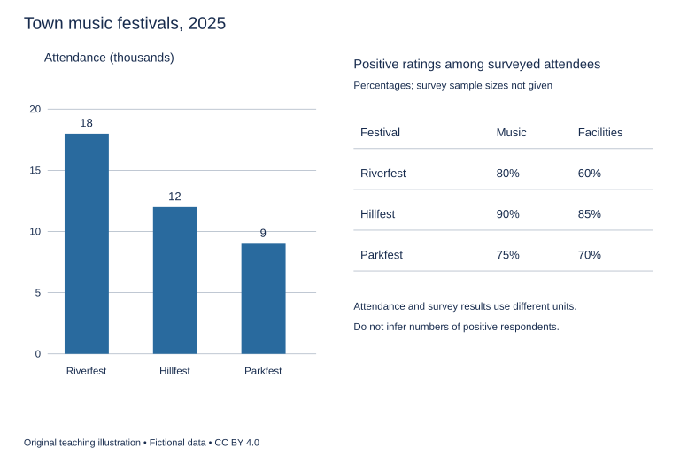

# U14 第8周：长篇阅读、写作与口语

本页为已独立核验的原创文字课程。先完成学生题目，再展开对应参考。非真题、非标准化模考，不换算雅思分数。听力尚未补齐，本页不代表全科课程已完成。

每周选A或G类Task 1一题，加Task 2及三次口语。参考范文不是学生已完成作业，仍须提交初稿、录音和重写，独立真人评分另行安排。

阅读每周180分钟（60分钟首次限时、120分钟证据精读与延迟复测），写作180分钟、口语120分钟。词汇60分钟、听力180分钟另列；新增完整听力未验收，不能勾整周完成。

W08如落实正式T08模拟，替换相应首答时段，不能重复计量；本页原创技能卷不能充当正式陌生卷。后续周数与达标规则见 [U04](u04-exam-preparation.md)。

## 阅读：首答不查词

### R-W08-01 · The Observatory Under a Bright Sky

W08｜正文 830 词｜13 题｜篇章：科学解释：信号、噪声与观测选择（7段）

本课必做60分钟：首答20、证据复盘20、词汇长句10、48小时后复测10。每周三课180分钟，合卷首答替代单课首答，不重复计算。开放短文选做另加15分钟。

本项目原创虚构教学情境，人物、地点、历史事件和案例数据均非真实研究或史料。科学解释只讨论文内说明的模型与条件。非雅思真题或标准化模考；正确数不换算雅思等级。许可：CC BY 4.0 — RayXBuilds and contributors。

能力点：识别论证关系、区分作者与引述者、条件与因果、精确定位。初读不查词，完成后打开独立答案页。

#### Passage

**A** The fictional astronomy club of Vale owns two cameras and a telescope on a school roof. Members want to photograph a faint model star field projected inside a training dome before attempting observations outside. In the exercise, a bright lamp represents unwanted background light. Increasing that background makes faint points harder to distinguish even though the points themselves have not changed. The first lesson is therefore relational: visibility depends not only on an object but on the conditions against which it is observed. Saying that the camera sees less does not mean the projected source has become weaker. The club must separate a change in the target from a change in the background and from a change in its own measuring equipment.

**B** One student proposes leaving the camera exposed for longer. In the model, this can collect more of the faint target's light, but it also collects more background. A longer exposure is not a universal substitute for controlling unwanted illumination. The students also notice that the brightest projected points can exceed the range the camera records usefully. Beyond that limit, distinct brightness levels collapse into the same recorded value. A saturated image may look dramatic while containing less usable information about those points. The relevant setting therefore depends on which feature is being studied. A photograph suitable for locating faint points may be unsuitable for comparing the brightness of strong ones, even if both kinds of point appear somewhere in the frame.

**C** The club next compares two images made with identical settings. Small differences appear even though the projected pattern has been held steady. Some variation comes from the camera and its operation, rather than from the model sky. To investigate, students make a dark frame with the input covered. This does not reproduce every source of uncertainty in a real observation, but it helps them identify some features produced within the recording process. They also photograph an evenly illuminated screen to look for differences across the field. The resulting flat field reveals that positions near one edge are recorded differently from positions near the centre. These reference images answer distinct questions and should not be treated as interchangeable cures for every imperfect photograph.

**D** Alignment becomes important when the club combines several exposures. If the model points shift between frames, averaging the pictures without adjustment can turn a sharp point into a blur. Students use a reference point to bring the frames into agreement before combining them. That step depends on the assumption that the chosen point provides a suitable anchor. A feature that changes shape or disappears cannot serve the same role without further judgement. Processing is therefore not a magical stage that removes the need to understand the observation. Every operation carries assumptions about what should remain constant and what counts as an unwanted difference. Making those assumptions explicit lets another observer assess whether the improved-looking image is also a more informative one.

**E** An outdoor plan introduces another kind of choice. Vale's rooftop is convenient, but a fictional site beyond the town has a darker surrounding sky. Reaching it requires travel, and poor weather could make the journey unproductive. The club compares not only the quality of a successful image but the practical chance of obtaining one under its available schedule. A remote site may be valuable for one observation and unsuitable for a short teaching session. It would be unreasonable to declare location irrelevant merely because processing software exists. It would be equally unreasonable to assume that the darkest available location automatically serves every educational purpose better than an accessible one where students can return regularly and learn from repeated attempts.

**F** For the final exercise, members write an exposure log giving the settings and conditions for each image. They keep the unprocessed files beside the edited versions. When a striking pattern appears only after an aggressive adjustment, they can return to those files and ask which operation made it visible. An attractive pattern is a reason to investigate, not immediate proof of a feature in the source. The instructor also asks for a comparison image showing the same procedure applied to a model known to contain no such feature. This check cannot settle every possible error, but it tests whether the procedure itself tends to create the appearance being interpreted as a discovery.

**G** The club's best result is consequently not just its most impressive photograph. It is a set of images whose settings, transformations and limits can be explained. The model dome provides control at the cost of realism; the outdoor plan adds realism while giving up some control. Both can contribute to learning if their roles are stated honestly. The broader lesson concerns evidence made through instruments. Observation is not passive reception followed by optional interpretation. Choices about background, range, reference images and processing shape what can be claimed. A careful account preserves enough of those choices for someone else to distinguish a source feature from a feature of the method used to reveal it.

#### Questions

**Choose ONE answer, A, B, C or D.**

1. What does increasing background light demonstrate?

   A. The targets must be changing
   B. The camera cannot record anything
   C. Visibility depends on contrast with conditions
   D. The targets have disappeared

2. Why can saturation reduce information?

   A. It eliminates all background
   B. All faint points become brighter
   C. The telescope changes position
   D. Different brightness values become indistinguishable

3. Why align frames before combining them?

   A. To avoid blurring displaced points
   B. To change the projected pattern
   C. To eliminate travel
   D. To remove the need for assumptions

4. The feature-free comparison is intended to test whether

   A. the instructor prefers one camera
   B. all processing is useless
   C. the remote site has roads
   D. the procedure produces the apparent feature

**Do the following statements agree with the writer's views? Write YES, NO or NOT GIVEN. YES = the writer agrees; NO = the writer expresses the opposite view; NOT GIVEN = the writer's view is not stated. Do not use outside knowledge.**

5. Longer exposure solves every problem caused by background illumination.

6. Software makes the choice of observing location irrelevant.

7. The darkest site is always best for every teaching activity.

8. The club’s older camera is more expensive than its newer camera.

**Complete the sentences. Choose NO MORE THAN 3 WORDS FROM THE PASSAGE for each answer. Do not change word forms.**

9. Covering the camera input produces a ______.

10. An evenly lit screen produces a ______ for comparing positions across the image.

11. Frames are aligned with the help of a ______.

12. Settings and conditions are written in an ______.

13. The files kept beside edited versions without any processing are the ______.

#### 复盘

必做：给每道错题标记“定位/作者立场/范围/语法/词数”，抄最短证据；用一行箭头概括本文论证或过程。48小时后重做错题与两道正确题，检查是否仍能指出证据。

选做（15分钟，80–100词）：Explain why an improved-looking image is not automatically stronger evidence.

R-W08-01 答案、证据与精读（首答后展开）

### R-W08-01 · 独立答案与证据

来源与许可同学生页。先完成再核对。可接受答案由 accepted_answers 明确列出；只忽略大小写和首尾空格，不自行删词。开放复盘不计入客观正确数。

1. **C**｜段落 A｜证据：“the points themselves have not changed”

   目标不变可见性仍改变。

2. **D**｜段落 B｜证据：“distinct brightness levels collapse into the same recorded value”

   不等于更艳的图像信息更多。

3. **A**｜段落 D｜证据：“averaging the pictures without adjustment can turn a sharp point into a blur”

   其他无据或反文。

4. **D**｜段落 F｜证据：“whether the procedure itself tends to create the appearance”

   检验处理伪影。

5. **NO**｜段落 B｜证据：“not a universal substitute”

   非万能替代。

6. **NO**｜段落 E｜证据：“unreasonable to declare location irrelevant”

   作者明确反对。

7. **NO**｜段落 E｜证据：“equally unreasonable to assume”

   不同教育任务约束不同。

8. **NOT GIVEN**｜段落 A｜证据：“owns two cameras”

   未给新旧与价钱。

9. **dark frame / frame**｜段落 C｜证据：“make a dark frame with the input covered”

   frame合理短答；flat field需要均匀亮屏。

10. **flat field / field**｜段落 C｜证据：“The resulting flat field”

   flat field 为记录名称，中心词 field 也可接受；dark frame 来自遮住输入，不能满足均匀亮屏条件。

11. **reference point / point / chosen point / suitable anchor / anchor / feature**｜段落 D｜证据：“use a reference point”

   D 用 reference point、chosen point、suitable anchor 及 feature 描述用于配准的参照特征；合理词组及中心词均接受。

12. **exposure log**｜段落 F｜证据：“write an exposure log”

   log不可接an。

13. **unprocessed files / files**｜段落 F｜证据：“keep the unprocessed files”

   unprocessed files 与 files 均接受；题干明确未处理及与编辑版本并列，排除 edited versions。

#### 词汇与长句

- **saturated**：达到可记录上限的
- **alignment**：对齐
- **anchor**：参照锚点
- **transformation**：变换；处理步骤

> A saturated image may look dramatic while containing less usable information about those points.

while对比视觉效果与可用信息量。

> The model dome provides control at the cost of realism; the outdoor plan adds realism while giving up some control.

分号连接两种互补取舍，at the cost of表示代价。

#### 开放任务参考

用D处理假设、F无特征对照和源文件，区分图像外观与可追溯证据。

标准：观点有文内依据，保留条件和范围，推断明确标注；不存在唯一措辞。

### R-W08-02 · The Measure That Changed the Cloth Market

W08｜正文 806 词｜13 题｜篇章：虚构历史发展：量具、交易与信任（6段）

本课必做60分钟：首答20、证据复盘20、词汇长句10、48小时后复测10。每周三课180分钟，合卷首答替代单课首答，不重复计算。开放短文选做另加15分钟。

本项目原创虚构教学情境，人物、地点、历史事件和案例数据均非真实研究或史料。科学解释只讨论文内说明的模型与条件。非雅思真题或标准化模考；正确数不换算雅思等级。许可：CC BY 4.0 — RayXBuilds and contributors。

能力点：识别论证关系、区分作者与引述者、条件与因果、精确定位。初读不查词，完成后打开独立答案页。

#### Passage

**A** In the fictional weaving town of Darsen, cloth was once sold using lengths marked on a trader's wooden rod. Buyers could watch the cloth being placed beside it, but watching did not establish that every rod represented the same distance. A visitor purchasing material in several stalls might receive different lengths under the same spoken name. Local customers often relied on relationships: they knew a seller's habits and expected future dealings. This arrangement was not the absence of trust but a particular way of producing it. Trouble grew as more trade involved people who might never meet again. A promise supported by repeated contact could not easily serve a market increasingly shaped by strangers, and disputes over a short piece of cloth became arguments about which reference should be accepted beyond an individual stall.

**B** The town's first response was to display a public bar at the market entrance. Its length defined the official unit, and traders were invited to compare their rods with it. The bar made a reference available, but availability alone did not ensure that every transaction followed it. Some traders visited when few customers were present; others carried rods altered by wear or by repairs. A buyer also needed to know how the cloth had been placed against the measure. Stretching a flexible fabric during measurement could produce a different usable length after it relaxed. Standardising the instrument therefore left a question about procedure. A shared unit was necessary for the proposed reform, but it could not replace an agreement about how that unit should be applied to the material actually being sold.

**C** A group of weavers proposed a measuring table on which cloth could lie without being pulled tight. The table had a straight edge marked from the official bar, and a short instruction described how to begin at the cloth's end without counting a folded section twice. These details sounded trivial beside the declaration of a common unit, yet they shaped the result that a customer received. The table also changed the rhythm of trade. Measuring carefully occupied space and time, especially when several customers were waiting. Traders objected that the council had imposed a procedure without considering the layout of small stalls. Their objection did not prove that consistent measurement was undesirable. It revealed an implementation cost that the public announcement of a standard had omitted from its account of the reform.

**D** The council then introduced a verification mark for rods checked against the public bar. A mark allowed customers to recognise a recently checked instrument without following its owner to the entrance. However, a mark could outlast the condition it was meant to certify. A rod might be damaged after inspection, or its end might be replaced. The town consequently added an inspection date beside the mark and required a new check after repairs. This was not a guarantee that every marked rod would remain unchanged until the next visit. It was a record of when a particular comparison had been made, together with a rule about events that could invalidate it. Understanding the limited claim of certification was as important as recognising the symbol itself.

**E** A further dispute concerned cloth ordered in advance. A customer could agree to buy a named length but later disagree about what had been promised regarding trimming and damaged edges. Sellers began using an order slip that separated the measured length from conditions about the usable portion. The slip did not abolish judgement: people could still disagree about whether a flaw had been described adequately. It did make some expectations visible before delivery instead of leaving them to memory afterwards. Market officers also maintained a dispute register, recording the instrument, procedure and wording involved in each complaint. Recurring entries showed that some disagreements came from unclear orders rather than inaccurate rods. Rechecking the instrument alone would not resolve a disagreement whose source lay elsewhere in the transaction.

**F** By the end of this fictional history, the market's system included a reference, a method, a record and a means of challenge. None could fully substitute for the others. A precise bar with inaccessible checking arrangements would have limited value, while beautifully written orders measured by inconsistent rods would still disappoint buyers. Nor had personal trust disappeared. Experienced traders helped newcomers understand the procedure, and regular customers continued using their knowledge of particular businesses. The reform widened the range of people who could trade without relying entirely on an established relationship. Its success was not simply a movement from informal life to objective numbers. It was the construction of shared practices through which numbers acquired a stable meaning in an exchange between people who might otherwise understand the same promise differently. Those practices required continued attention because damage, new materials and unfamiliar customers could expose assumptions that had previously remained unnoticed in an apparently settled system.

#### Questions

**Complete the summary. Choose NO MORE THAN 3 WORDS FROM THE PASSAGE for each answer. Do not change word forms.**

The town displayed a (1) ______ as the shared length reference. Weavers proposed a (2) ______ so cloth could lie without tension. A verification mark was supplemented with an (3) ______. Conditions about usable cloth appeared on an (4) ______. Complaints were collected in a (5) ______.

**Choose ONE answer, A, B, C or D.**

6. Why did reliance on repeated personal contact become less sufficient?

   A. More transactions involved strangers
   B. All rods broke simultaneously
   C. Traders forgot the unit’s name
   D. Customers stopped buying cloth

7. What did stretching cloth show?

   A. Flexible fabric cannot be sold
   B. The public bar was always wrong
   C. A common instrument still requires an agreed procedure
   D. Marks remove physical effects

8. Why did traders object to tables?

   A. The council banned customers
   B. They could no longer make cloth
   C. They opposed any units
   D. The procedure required scarce stall space and time

9. What does the inspection date establish?

   A. The buyer’s identity
   B. Permanent accuracy
   C. The date the cloth was woven
   D. When the instrument comparison occurred

**Do the following statements agree with the writer's views? Write YES, NO or NOT GIVEN. YES = the writer agrees; NO = the writer expresses the opposite view; NOT GIVEN = the writer's view is not stated. Do not use outside knowledge.**

10. A visible public reference guarantees that every sale follows it.

11. Certification should be understood as a claim with limits.

12. Instrument checks alone can resolve every complaint about an order.

13. The writer thinks all trade between strangers is preferable to trade between neighbours.

#### 复盘

必做：给每道错题标记“定位/作者立场/范围/语法/词数”，抄最短证据；用一行箭头概括本文论证或过程。48小时后重做错题与两道正确题，检查是否仍能指出证据。

选做（15分钟，80–100词）：Explain why common units need more than a precisely made reference.

R-W08-02 答案、证据与精读（首答后展开）

### R-W08-02 · 独立答案与证据

来源与许可同学生页。先完成再核对。可接受答案由 accepted_answers 明确列出；只忽略大小写和首尾空格，不自行删词。开放复盘不计入客观正确数。

1. **public bar / official bar / bar**｜段落 B｜证据：“display a public bar”

   B 的 public bar 与 C 的 official bar 是同一基准棒，均接受，bar 也是合理短答。

2. **measuring table / table**｜段落 C｜证据：“proposed a measuring table”

   平放布料的桌面。

3. **inspection date**｜段落 D｜证据：“an inspection date beside the mark”

   an 后接 inspection date；单独 date 不符合冠词。

4. **order slip**｜段落 E｜证据：“using an order slip”

   an 后接 order slip；单独 slip 不符合冠词。

5. **dispute register / register**｜段落 E｜证据：“maintained a dispute register”

   投诉记录簿，与订单分工不同。

6. **A**｜段落 A｜证据：“people who might never meet again”

   交易关系改变，非全面失忆。

7. **C**｜段落 B｜证据：“left a question about procedure”

   单位与测量方法须区分。

8. **D**｜段落 C｜证据：“occupied space and time”

   反对实施成本，不必反对目标。

9. **D**｜段落 D｜证据：“when a particular comparison had been made”

   认证为有限历史声明。

10. **NO**｜段落 B｜证据：“availability alone did not ensure”

   可获得不等于实际遵守。

11. **YES**｜段落 D｜证据：“Understanding the limited claim of certification”

   作者明确强调。

12. **NO**｜段落 E｜证据：“would not resolve a disagreement whose source lay elsewhere”

   问题也来自措辞与期待。

13. **NOT GIVEN**｜段落 F｜证据：“Nor had personal trust disappeared.”

   肯定扩展可能性但未排高低。

#### 词汇与长句

- **reference**：参照物
- **verification**：核验
- **invalidate**：使失去效力
- **transaction**：交易过程

> a mark could outlast the condition it was meant to certify.

outlast持续时间超过；it指mark，标记仍在不表示物理状态仍有效。

> Rechecking the instrument alone would not resolve a disagreement whose source lay elsewhere in the transaction.

whose修饰disagreement，指出诊断对象必须对准问题来源。

#### 开放任务参考

B程序、C执行成本、D时效、E合同措辞均有独立作用。

标准：观点有文内依据，保留条件和范围，推断明确标注；不存在唯一措辞。

### R-W08-03 · When a Trial Should Change Its Mind

W08｜正文 916 词｜14 题｜篇章：观点争论：预先承诺、调整与学习（8段）

本课必做60分钟：首答20、证据复盘20、词汇长句10、48小时后复测10。每周三课180分钟，合卷首答替代单课首答，不重复计算。开放短文选做另加15分钟。

本项目原创虚构教学情境，人物、地点、历史事件和案例数据均非真实研究或史料。科学解释只讨论文内说明的模型与条件。非雅思真题或标准化模考；正确数不换算雅思等级。许可：CC BY 4.0 — RayXBuilds and contributors。

能力点：识别论证关系、区分作者与引述者、条件与因果、精确定位。初读不查词，完成后打开独立答案页。

#### Passage

**A** The fictional foundation Harbour funds a trial in which community workshops offer introductory repair classes. Half the workshops use a demonstration followed by practice; the others begin with an attempted task and provide explanations afterwards. The foundation wants to compare what participants can do later. Before the trial ends, organisers ask whether they should change a lesson that several learners find confusing. This creates a real tension. Keeping a plan unchanged may preserve a clear comparison, while changing it may improve the experience of the people attending. The writer rejects the easy claim that either consistency or responsiveness should always win. The issue is what can still be learned when a decision is changed, and how honestly that change is described.

**B** Evaluator Eda Morris wants the team to write its main outcome and comparison before looking at results. Otherwise, it might choose whichever measure makes the preferred course look strongest. Eda distinguishes advance planning from a ban on learning. Unexpected events can justify a revision, but the reason and timing should be recorded. She proposes a decision log showing what information was available when each change was authorised. This matters because a choice made before seeing outcomes has a different evidential role from one made after an attractive pattern appears. Describing both as if they had been planned from the start would hide an important part of how the conclusion was produced.

**C** Tutor Farid Noor focuses on participants who cannot follow a confusing instruction. He argues that the team should not preserve an avoidable obstacle merely to maintain a tidy comparison. Some assistance may be necessary for the activity to remain meaningful. Farid nevertheless accepts that changing support can change what is being tested. He therefore wants the revised instruction documented and the affected sessions identified. His position is not that improvements automatically leave the evidence untouched. It is that the duty to teach and the duty to explain the evidence must both be acknowledged. A participant is not simply a convenient source of data whose experience can be excluded from the discussion of a study's success.

**D** Statistician Greta Shaw asks how outcomes will be measured across the two course formats. If the final task closely resembles the demonstrations used in one format, it may favour familiarity rather than broader ability. Greta suggests a new task requiring the same underlying skills with different materials. She also wants assessors to use the same criteria without knowing which course a participant attended where that can reasonably be arranged. These steps do not make every comparison perfect. They reduce particular alternative explanations for a difference. Greta is especially cautious about interpreting one group's higher score as proof of a general advantage when the assessment itself may resemble that group's practice more closely than the other group's.

**E** Community organiser Hugo Lin examines attendance. People who finish a course may differ from those who leave early, and a strong result among completers need not describe everyone originally offered the programme. Hugo would record reasons for withdrawal when participants are willing to provide them, without inventing reasons for those who cannot be reached. He also asks whether timing and travel requirements prevented some invited people from attending at all. His concern is the scope of the claim: a course may help people who can reach it while failing to offer a usable opportunity to others. Participation is part of the service, not merely a preliminary filter that makes the eventual results table easier to assemble.

**F** The foundation combines these recommendations into a revised plan. It preserves the original outcome definition, introduces a clearer instruction where needed, and marks sessions affected by the change. The final report presents the planned comparison and a separate exploration of differences before and after the revision. The second analysis is explicitly described as exploratory. It may suggest a useful question for a later trial, but it is not promoted into a prediction supposedly made before anyone saw the difficulty. This distinction does not make exploration worthless. It helps readers understand what kind of support each result offers and what additional work would be needed to test an explanation suggested by the experience.

**G** Results remain mixed. Some participants perform well on the new task but report that the schedule was difficult; others enjoy the classes but struggle to apply the skill later. These findings concern different aims and should not be collapsed into a single flattering story. The report includes missing follow-up results, explanations of measurement choices and the recorded lesson changes. It does not assume that every absent participant failed, nor does it silently exclude absence from the account. Where evidence is unavailable, the foundation says which conclusions are limited by that gap. The writer regards this as a strength of the report, although it makes the final message less convenient for a short promotional announcement.

**H** Harbour's trial consequently ends with a decision about both teaching and future inquiry. The clearer instruction is retained, while a later study is proposed to examine the two course sequences under the revised conditions. The original trial has not become useless because it changed, but neither can it support exactly the claim it might have supported under an unchanged plan. Responsible learning requires that distinction. A good evaluation is not a story in which nothing unexpected happens. It is an account in which expectations, decisions and observations remain distinguishable, allowing another reader to see what was tested, what was discovered along the way, and what is still only a promising possibility.

#### Questions

**Do the following statements agree with the writer's views? Write YES, NO or NOT GIVEN. YES = the writer agrees; NO = the writer expresses the opposite view; NOT GIVEN = the writer's view is not stated. Do not use outside knowledge.**

1. Consistency should always take priority over responsiveness.

2. Exploratory findings may guide a later test.

3. Every person missing from follow-up should be treated as a failure.

4. The writer favours paying tutors according to participant scores.

5. A transparent report may be less convenient for promotion.

**Match each statement with the person who expresses that view. Write a letter. You may use any letter more than once.**

- A: Eda Morris
- B: Farid Noor
- C: Greta Shaw
- D: Hugo Lin

6. The information available when a revision is approved should be recorded.

7. A confusing obstacle should not be preserved merely for a neat comparison.

8. Assessors should use consistent criteria without knowing course assignment where feasible.

9. Completers may not represent everyone offered a course.

10. Withdrawal reasons should be collected voluntarily without inventing missing explanations.

**Choose ONE answer, A, B, C or D.**

11. What tension begins the passage?

   A. Deciding whether any class should exist
   B. Selecting a town name
   C. Choosing between two buildings
   D. Maintaining comparison while responding to learners

12. Why use a new task in the assessment?

   A. To avoid scoring
   B. To reduce advantage from familiarity with practiced examples
   C. To remove all shared skills
   D. To guarantee equal results

13. Why is the additional analysis labelled exploratory?

   A. It contains no observations
   B. It cannot inspire future work
   C. It was prompted by developments during the trial
   D. It was the sole original prediction

14. The author thinks the changed trial

   A. became entirely useless
   B. has value but supports a different scope of claim
   C. proved a universal teaching law
   D. needs no explanation of revisions

#### 复盘

必做：给每道错题标记“定位/作者立场/范围/语法/词数”，抄最短证据；用一行箭头概括本文论证或过程。48小时后重做错题与两道正确题，检查是否仍能指出证据。

选做（15分钟，80–100词）：Explain how to report a useful mid-trial change without pretending it was planned.

R-W08-03 答案、证据与精读（首答后展开）

### R-W08-03 · 独立答案与证据

来源与许可同学生页。先完成再核对。可接受答案由 accepted_answers 明确列出；只忽略大小写和首尾空格，不自行删词。开放复盘不计入客观正确数。

1. **NO**｜段落 A｜证据：“rejects the easy claim that either consistency or responsiveness should always win”

   明确反绝对优先。

2. **YES**｜段落 F｜证据：“suggest a useful question for a later trial”

   探索不是确证但可生成问题。

3. **NO**｜段落 G｜证据：“does not assume that every absent participant failed”

   不推测缺失原因。

4. **NOT GIVEN**｜段落 G｜证据：“explanations of measurement choices”

   没有薪酬制度观点。

5. **YES**｜段落 G｜证据：“less convenient for a short promotional announcement”

   作者明确承认。

6. **A**｜段落 B｜证据：“what information was available when each change was authorised”

   Eda变更时点和证据。

7. **B**｜段落 C｜证据：“not preserve an avoidable obstacle merely to maintain a tidy comparison”

   Farid教学责任。

8. **C**｜段落 D｜证据：“without knowing which course a participant attended”

   Greta评估盲法。

9. **D**｜段落 E｜证据：“need not describe everyone originally offered the programme”

   Hugo参与范围。

10. **D**｜段落 E｜证据：“without inventing reasons for those who cannot be reached”

   Hugo知情范围。

11. **D**｜段落 A｜证据：“consistency or responsiveness”

   不是绝对二选一。

12. **B**｜段落 D｜证据：“same underlying skills with different materials”

   降低熟悉度混杂，不保证结果相等。

13. **C**｜段落 F｜证据：“a prediction supposedly made before anyone saw the difficulty”

   区分事先计划与事后生成问题。

14. **B**｜段落 H｜证据：“neither can it support exactly the claim”

   保留价值但调整解释。

#### 词汇与长句

- **outcome**：预先定义的评价结果指标
- **withdrawal**：退出参与
- **exploratory**：探索性的
- **scope**：适用范围

> a choice made before seeing outcomes has a different evidential role from one made after an attractive pattern appears.

made...过去分词修饰choice；one代choice，比较决定时点。

> The original trial has not become useless because it changed, but neither can it support exactly the claim it might have supported under an unchanged plan.

neither置句首倒装；might have supported为假设过去结果。

#### 开放任务参考

B记录时间和可用信息，F区分原定比较与探索，H限定结论。

标准：观点有文内依据，保留条件和范围，推断明确标注；不存在唯一措辞。

## 写作与口语：Task 1双分支择一

### WS-W08-T1A 学生页：音乐节人数与满意度混合数据

周次 W08｜题型 T1A｜能力点：混合数据单位与比较

Task 1 的 A/G 分支二选一，另一分支不计入本周作业。

#### 使用与记录

原创教学练习，非真题、非标准化模拟，难度未校准。先完成本页再打开参考页。人物、机构、经历与数据均为教学虚构。不要背诵示例。自评和 AI 反馈不能代替独立真人评分，未获得真人评阅时标记“分数未确认”。

保存：任务ID、实际日期、用时、初稿或原始录音、证据化反馈、重写/重答、三条修改理由。没有学生提交物，不得填写“已批改”或“已完成训练”。

#### 完整题干

The bar chart shows attendance at three town music festivals in 2025, and the table reports the percentages of surveyed attendees who rated each festival positively for music and facilities. Summarise the information by selecting and reporting the main features, and make comparisons where relevant.

Write at least 150 words. Spend about 20 minutes on this task.

教学虚构。柱图2025观众人数：Riverfest18千、Hillfest12千、Parkfest9千。表格正面评价率（受访者内百分比）：音乐80/90/75%，设施60/85/70%，依次对应三节庆。调查样本数及占总观众比例未给，不可计算正面评价总人数。

#### 任务预算（含首次审题，不额外加时）

初稿20分钟（审题规划3、写作15、检查2）；诊断15；反馈阅读与证据核查10；完整重写25；对照归档5。合计75分钟。

#### 初稿后自评清单

- [ ] 达到最低字数；全文连贯成段，没有用项目符号代替作文。
- [ ] 概述给主要特征；数据、阶段或方位都与题图逐项相符，不推断未提供的原因。
- [ ] 每段可写出一个功能标签；例子或数据与该段要点相连。
- [ ] 圈出两处词汇搭配和两处句法疑点，先自行修正再查询或求反馈。
- [ ] 记录一项最影响理解的问题和原句证据，不填写自猜分数。

#### 反馈与重写

打开 独立参考页（本节下方展开参考），按逐段检查和通用协议核验。重写任务：完整重写至少150词；至少一句跨图比较但不推因果，所有评分主语限定为调查结果。

W08 T1A 示例、反馈与重练（首答后展开）

### WS-W08-T1A 独立参考页

只在初稿完成后阅读；不是唯一答案，也没有官方分数。以下是对原创示例的教学讲评，不是对学生尚未提交作文的已完成批改。

#### 思路拆解

先分清千人与调查百分比；概述人数最大≠评分最高；主体分人数、评价，但末段有跨图联系；不推正面评价人数。

#### 原创示例

The bar chart compares attendance at three town music festivals in 2025, while the table shows positive ratings for their music and facilities among surveyed attendees. Attendance is measured in thousands, whereas the ratings are percentages.

Overall, Riverfest attracted the largest audience, but Hillfest received the highest ratings in both survey categories. Parkfest had the lowest attendance and the lowest positive rating for music. At all three festivals, music was rated more favourably than facilities.

Riverfest recorded 18,000 attendees, making it twice as large as Parkfest, which attracted 9,000. Hillfest occupied the middle position with 12,000 visitors. The attendance gap between Riverfest and Hillfest was therefore 6,000, compared with a difference of 3,000 between Hillfest and Parkfest.

In the survey, Hillfest achieved positive ratings of 90% for music and 85% for facilities. The corresponding figures for Riverfest were 80% and 60%, giving it the widest gap between the two categories, at twenty percentage points. Parkfest received a music rating of 75% and a facilities rating of 70%. Its facilities rating was thus higher than Riverfest’s despite its smaller audience, while its music rating was five points lower.

示例正文词数：192（本项目正则计数；书信不含称呼、结束语与署名；连字符词作一词）。

#### 逐段反馈与迁移

- P1 surveyed attendees不能替换全部观众；两个图的单位必须分开。

- P2 Hillfest两项均最高，Parkfest音乐最低；设施最低为Riverfest。

- P3 18/9=2，人数差6千与3千；不写18%观众。

- P4 评分差20/5/5个百分点；人数与评分并列不证明规模导致满意度。

#### 常见失误

将80%乘18千算满意人数而样本未知；宣称人数越少必然更满意；混用百分比与人数。

#### 可执行反馈步骤

1. 先把自己的段落标为引入、概述/论点、支持、收束；分段可不同于示例，按功能核查，不照抄段数。
2. 对照上方逐段检查，逐项标“已有证据/缺失/不适用”。每条意见必须附自己的原句或缺失位置。
3. 按 [反馈协议](u15-feedback.md) 的四维表记录；有争议的 AI 意见回题干、数据或语法依据核验。
4. 只选两项最高优先级问题执行整篇重写；保留原稿，禁止把示例替换为自己的作业。

#### 重写任务

完整重写至少150词；至少一句跨图比较但不推因果，所有评分主语限定为调查结果。

完成后重新勾选 学生页（见本节上方学生题） 清单；将一处改前/改后及理由交给独立评阅者核查。真人评阅状态目前为“待安排”，不是已完成。

### WS-W08-T1G 学生页：感谢活动组织者并建议改进

周次 W08｜题型 T1G｜能力点：书信目的、要点与语气

Task 1 的 A/G 分支二选一，另一分支不计入本周作业。

#### 使用与记录

原创教学练习，非真题、非标准化模拟，难度未校准。先完成本页再打开参考页。人物、机构、经历与数据均为教学虚构。不要背诵示例。自评和 AI 反馈不能代替独立真人评分，未获得真人评阅时标记“分数未确认”。

保存：任务ID、实际日期、用时、初稿或原始录音、证据化反馈、重写/重答、三条修改理由。没有学生提交物，不得填写“已批改”或“已完成训练”。

#### 完整题干

You recently attended a weekend photography workshop organised by a local club. Write to the organiser, Mr Hall. In your letter:
- explain what you enjoyed about the workshop
- describe one difficulty you experienced
- suggest an improvement for future workshops.
Begin your letter: Dear Mr Hall,

Write at least 150 words. You do not need to write any addresses. Spend about 20 minutes on this task.

#### 任务预算（含首次审题，不额外加时）

初稿20分钟（审题规划3、写作15、检查2）；诊断15；反馈阅读与证据核查10；完整重写25；对照归档5。合计75分钟。

#### 初稿后自评清单

- [ ] 达到最低字数；全文连贯成段，没有用项目符号代替作文。
- [ ] 三个要点均展开；称呼、目的、语气和结束语适合收信人。
- [ ] 每段可写出一个功能标签；例子或数据与该段要点相连。
- [ ] 圈出两处词汇搭配和两处句法疑点，先自行修正再查询或求反馈。
- [ ] 记录一项最影响理解的问题和原句证据，不填写自猜分数。

#### 反馈与重写

打开 独立参考页（本节下方展开参考），按逐段检查和通用协议核验。重写任务：完整重写至少150词；保持一个核心困难，将建议逐句对应其影响，保持感谢而非愤怒的语气。

W08 T1G 示例、反馈与重练（首答后展开）

### WS-W08-T1G 独立参考页

只在初稿完成后阅读；不是唯一答案，也没有官方分数。以下是对原创示例的教学讲评，不是对学生尚未提交作文的已完成批改。

#### 思路拆解

半正式反馈给已知姓名组织者；先具体感谢，再说一个问题与影响，最后给可执行改进和替代方案。

#### 原创示例

Dear Mr Hall,

Thank you for organising last weekend’s photography workshop. I particularly enjoyed the outdoor session in the market square, where we practised taking photographs in changing light. The tutor gave clear explanations and allowed us enough time to experiment before discussing our results as a group. I found this much more useful than simply watching a demonstration.

There was one difficulty during the afternoon session. Several participants, including me, were unable to see the photographs clearly on the small laptop screen. Because we were seated in two rows, those at the back had to move forward whenever the tutor pointed out a detail. This interrupted the discussion and meant that some people missed parts of the explanation.

For future workshops, could the club arrange a larger screen or projector for reviewing photographs? If that is not possible, sending the selected images to participants beforehand would allow us to view them on our own devices. I would be happy to help test either arrangement before another session. Thank you again for an enjoyable and practical introduction to photography.

Yours sincerely,
Alex Chen

示例正文词数：176（本项目正则计数；书信不含称呼、结束语与署名；连字符词作一词）。

#### 逐段反馈与迁移

- P1 描述真实可理解的环节与收获，避免空泛excellent。

- P2 一个屏幕问题得到充分解释，不列十个抱怨分散任务。

- P3 投影/预发图片对同一问题有针对性；未假定组织者必有预算。

#### 常见失误

只有投诉忘感谢；建议增加食品却与困难无关；擅自代表所有参与者给评价。

#### 可执行反馈步骤

1. 先把自己的段落标为引入、概述/论点、支持、收束；分段可不同于示例，按功能核查，不照抄段数。
2. 对照上方逐段检查，逐项标“已有证据/缺失/不适用”。每条意见必须附自己的原句或缺失位置。
3. 按 [反馈协议](u15-feedback.md) 的四维表记录；有争议的 AI 意见回题干、数据或语法依据核验。
4. 只选两项最高优先级问题执行整篇重写；保留原稿，禁止把示例替换为自己的作业。

#### 重写任务

完整重写至少150词；保持一个核心困难，将建议逐句对应其影响，保持感谢而非愤怒的语气。

完成后重新勾选 学生页（见本节上方学生题） 清单；将一处改前/改后及理由交给独立评阅者核查。真人评阅状态目前为“待安排”，不是已完成。

### WS-W08-T2 学生页：大型体育赛事利弊

周次 W08｜题型 T2｜能力点：观点展开与任务回应

A/G 共用本题。

#### 使用与记录

原创教学练习，非真题、非标准化模拟，难度未校准。先完成本页再打开参考页。人物、机构、经历与数据均为教学虚构。不要背诵示例。自评和 AI 反馈不能代替独立真人评分，未获得真人评阅时标记“分数未确认”。

保存：任务ID、实际日期、用时、初稿或原始录音、证据化反馈、重写/重答、三条修改理由。没有学生提交物，不得填写“已批改”或“已完成训练”。

#### 完整题干

Some cities spend large amounts of public money on hosting major international sporting events. Do the advantages of doing this outweigh the disadvantages? Give reasons for your answer and include relevant examples.

Write at least 250 words. Spend about 40 minutes on this task.

#### 任务预算（含首次审题，不额外加时）

初稿40分钟（审题规划5、写作30、检查5）；诊断15；反馈阅读与证据核查10；完整重写35；对照归档5。合计105分钟。

#### 初稿后自评清单

- [ ] 达到最低字数；全文连贯成段，没有用项目符号代替作文。
- [ ] 直接回答题目的所有问句，有始终一致的立场。
- [ ] 每段可写出一个功能标签；例子或数据与该段要点相连。
- [ ] 圈出两处词汇搭配和两处句法疑点，先自行修正再查询或求反馈。
- [ ] 记录一项最影响理解的问题和原句证据，不填写自猜分数。

#### 反馈与重写

打开 独立参考页（本节下方展开参考），按逐段检查和通用协议核验。重写任务：完整重写至少250词；明确比较“长期公共用途”与“短期收益”，加入一个会改变结论的条件。

W08 T2 示例、反馈与重练（首答后展开）

### WS-W08-T2 独立参考页

只在初稿完成后阅读；不是唯一答案，也没有官方分数。以下是对原创示例的教学讲评，不是对学生尚未提交作文的已完成批改。

#### 思路拆解

条件式利弊权衡，限定大量新建时成本较大；利益与机会成本比较，避免只列两边。

#### 原创示例

Hosting a major international sporting event can bring attention and investment to a city, but it can also place a heavy burden on public finances. I believe the disadvantages usually outweigh the advantages when hosting requires extensive new construction, although cities with suitable existing facilities may face a different balance.

Supporters argue that an event can accelerate improvements which residents will use long afterwards. A transport connection built for visitors might also make everyday journeys easier, while a renovated sports centre could serve local clubs. The event may attract temporary customers for hotels and restaurants and give residents an opportunity to enjoy international competition close to home. These are meaningful benefits, particularly if the facilities address needs that the city has already identified.

The difficulty is that the competition’s requirements may not match those long-term needs. A large stadium designed for a brief period of intense use can be expensive to maintain once spectators have left. Meanwhile, money committed to construction is unavailable for other priorities, such as improving ordinary neighbourhood facilities. For example, residents might benefit more from several accessible swimming pools than from a single venue with thousands of seats. The initial excitement does not remove the need to compare these competing uses of public money.

There is also uncertainty about the financial return. Visitor spending may be substantial, but not all of it reaches the public budget that paid for the event. Some regular tourists may avoid the city during a crowded period, and temporary jobs do not necessarily provide lasting security. These risks make it unwise to justify major spending using optimistic forecasts alone. Reusing existing venues and agreeing realistic plans for later use can reduce the burden, but they cannot guarantee a profit.

On balance, the lasting costs and lost alternatives usually outweigh the temporary gains where major new facilities are necessary. Hosting is easier to justify when the city can use what it already has and demonstrate clear benefits for residents after the event.

示例正文词数：330（本项目正则计数；书信不含称呼、结束语与署名；连字符词作一词）。

#### 逐段反馈与迁移

- P1 明确通常缺点更大与例外；回答outweigh而非单纯存在利弊。

- P2 基建与短期商业受益承认充分，条件为符合原需求。

- P3 场馆维护与机会成本可持续，泳池比较说明为什么值得优先。

- P4 游客消费不等于政府收入；保留不确定性而非虚构亏损比例。

- P5 回扣是否需要大量新建，与引言一致。

#### 常见失误

认为游客消费全归政府；忽略长期维护；结尾没有判断哪边更大。

#### 可执行反馈步骤

1. 先把自己的段落标为引入、概述/论点、支持、收束；分段可不同于示例，按功能核查，不照抄段数。
2. 对照上方逐段检查，逐项标“已有证据/缺失/不适用”。每条意见必须附自己的原句或缺失位置。
3. 按 [反馈协议](u15-feedback.md) 的四维表记录；有争议的 AI 意见回题干、数据或语法依据核验。
4. 只选两项最高优先级问题执行整篇重写；保留原稿，禁止把示例替换为自己的作业。

#### 重写任务

完整重写至少250词；明确比较“长期公共用途”与“短期收益”，加入一个会改变结论的条件。

完成后重新勾选 学生页（见本节上方学生题） 清单；将一处改前/改后及理由交给独立评阅者核查。真人评阅状态目前为“待安排”，不是已完成。

### WS-W08-S1 学生页

周次W08｜Part 1专项｜能力点：比较活动收益与成本并检验迁移｜30分钟

#### 使用与记录

原创教学练习，非真题、非标准化模拟，难度未校准。先完成本页再打开参考页。人物、机构、经历与数据均为教学虚构。不要背诵示例。自评和 AI 反馈不能代替独立真人评分，未获得真人评阅时标记“分数未确认”。

保存：任务ID、实际日期、用时、初稿或原始录音、证据化反馈、重写/重答、三条修改理由。没有学生提交物，不得填写“已批改”或“已完成训练”。

#### 操作与预算

设备与审题3分钟；首答录音6；回听及局部转写7；示例和诊断5；不看稿重答6；归档3。共30分钟。

#### Part 1专项题

1. Do you watch sport?
2. Have you ever attended a local competition?
3. Do you prefer taking part or watching?
4. What makes an event enjoyable for you?

追问：

- Would you enjoy the event without knowing the rules?
- Has your preference changed over time?

#### 录音回听清单

- [ ] 保留首答原音，记录实际时长、是否中断、是否看稿；只报真实完成状态。
- [ ] 流利与连贯：标出两处时间戳，区分构思停顿与重复搜词，检查是否偏离问句。
- [ ] 词汇：找一处模糊词或重复表达，先解释原意再替换；不为难词改变意思。
- [ ] 语法：核对经历与习惯的时态；局部转写并更正两处妨碍理解的问题。
- [ ] 发音：不看转写听30秒，标听不清的词尾、重音或断句；没有音频不能判断发音。
- [ ] 展开：主要回答有具体情境或理由；追问后第一句回应追问的新角度。

#### 重答要求

选择两个只有笼统判断的答案，先直接回应再加具体情境；重答一条追问，检查是否真正回应其新角度。

首答回听后才打开独立参考页（本节下方展开参考）。按[反馈协议](u15-feedback.md)填至少三个时间戳，不以文字转写替代音频评阅。

W08 S1 示例、反馈与重练（首答后展开）

### WS-W08-S1 独立参考页

原创教学示例，非真题或评分结果。未收到学生音频；以下是示例分析与待执行反馈，不能登记为已完成学生批改。

#### 展开示例

##### 直接回应→原因→具体情境的展开示例

I prefer taking part in informal games because I enjoy the conversation as much as the competition. When I watch a professional match, I sometimes find it difficult to follow the tactics. A friend who explains what is happening can make a big difference, so I usually watch with someone rather than alone.

纯口答示例词数：53；只计MODEL标记内实际英文口答，不含标题、标签、说明。词数不能证明录音时长或流利度。

#### 展开与反馈

本周能力：比较活动收益与成本并检验迁移。

1. 示例先表态，再说明偏好理由，最后提供条件或场景。检查自己是否用一个词回答后就结束。
2. 找到一个具体细节：物品、动作、对话或地点。用自己的经历替换，保持与题卡相关，不照搬示例身份与经历。
3. 追问要重新回应，不能继续背长答。首句先回答追问，再用一条理由支持。
4. 标出一处听不清或语法影响理解的原音时间戳；先尝试最小修正。不要把自然停顿一概当成错误，或用加快语速掩盖逻辑断裂。

#### 常见失误

空泛形容词替代具体过程；给了经历却没解释为什么重要；Part 3只有个人故事没有一般解释；AI只看转写就判断发音。逐项回原音核对，不能凭范例推断自己已达到某个分数。

#### 可执行重答与反馈

选择两个只有笼统判断的答案，先直接回应再加具体情境；重答一条追问，检查是否真正回应其新角度。

填写[反馈协议](u15-feedback.md)四维表，附三个时间戳和原话证据。选一个内容问题与一个语言问题先修；重答后并排听两段，记录改善与仍未解决之处。自评与AI不能替代独立真人评分；独立评阅目前待安排，分数未确认。

### WS-W08-S2 学生页

周次W08｜Part 2专项｜能力点：比较活动收益与成本并检验迁移｜30分钟

#### 使用与记录

原创教学练习，非真题、非标准化模拟，难度未校准。先完成本页再打开参考页。人物、机构、经历与数据均为教学虚构。不要背诵示例。自评和 AI 反馈不能代替独立真人评分，未获得真人评阅时标记“分数未确认”。

保存：任务ID、实际日期、用时、初稿或原始录音、证据化反馈、重写/重答、三条修改理由。没有学生提交物，不得填写“已批改”或“已完成训练”。

#### 操作与预算

准备、首答录音及追问5分钟；回听及局部转写8；示例与诊断5；关键词重组3；重答及追问5；归档4。共30分钟。

#### Part 2专项任务卡

Describe an event you helped organise. Say what it was, who it was for, what you did, and explain what you learned from organising it.

准备1分钟，说1～2分钟。只记5个关键词，不预写句子。

收尾追问：

- Would you volunteer for a similar event again?
- Which part would you organise differently?

#### 录音回听清单

- [ ] 保留首答原音，记录实际时长、是否中断、是否看稿；只报真实完成状态。
- [ ] 流利与连贯：标出两处时间戳，区分构思停顿与重复搜词，检查是否偏离问句。
- [ ] 词汇：找一处模糊词或重复表达，先解释原意再替换；不为难词改变意思。
- [ ] 语法：核对经历与习惯的时态；局部转写并更正两处妨碍理解的问题。
- [ ] 发音：不看转写听30秒，标听不清的词尾、重音或断句；没有音频不能判断发音。
- [ ] 展开：主要回答有具体情境或理由；追问后第一句回应追问的新角度。

#### 重答要求

用五个关键词重答完整任务卡1～2分钟，再答两条追问；补一处具体行动或细节并删一处无关背景。比较首答与重答，不背示例。

首答回听后才打开独立参考页（本节下方展开参考）。按[反馈协议](u15-feedback.md)填至少三个时间戳，不以文字转写替代音频评阅。

W08 S2 示例、反馈与重练（首答后展开）

### WS-W08-S2 独立参考页

原创教学示例，非真题或评分结果。未收到学生音频；以下是示例分析与待执行反馈，不能登记为已完成学生批改。

#### 展开示例

##### 原创长答示例（时长须以个人实际录音测量）

I helped organise a small charity quiz at my workplace. It was intended for colleagues and their friends, and the money raised would support a local community project. My responsibility was to prepare the questions and check the answers.

At first, I wrote questions about topics I personally enjoyed. When a colleague tested them, she pointed out that there were too many difficult geography questions. I changed the selection to include music, everyday science and a round based on pictures.

On the evening itself, I kept a list of accepted answers beside me. That was useful when two teams used different names for the same place. Instead of deciding quickly under pressure, we could check the wording and treat the teams consistently.

The event went reasonably well, although one round took longer than expected. I learned that organisation is partly about imagining what participants will need, rather than simply completing your own task. Next time, I would test the timing as carefully as the content.

纯口答示例词数：165；只计MODEL标记内实际英文口答，不含标题、标签、说明。词数不能证明录音时长或流利度。

#### 展开与反馈

本周能力：比较活动收益与成本并检验迁移。

1. 长答示例按背景、行动/观察、变化与意义组织。每段都推进内容；检查自己是否只有背景而没有具体事件。
2. 找到一个具体细节：物品、动作、对话或地点。用自己的经历替换，保持与题卡相关，不照搬示例身份与经历。
3. 追问要重新回应，不能继续背长答。首句先回答追问，再用一条理由支持。
4. 标出一处听不清或语法影响理解的原音时间戳；先尝试最小修正。不要把自然停顿一概当成错误，或用加快语速掩盖逻辑断裂。

#### 常见失误

空泛形容词替代具体过程；给了经历却没解释为什么重要；Part 3只有个人故事没有一般解释；AI只看转写就判断发音。逐项回原音核对，不能凭范例推断自己已达到某个分数。

#### 可执行重答与反馈

用五个关键词重答完整任务卡1～2分钟，再答两条追问；补一处具体行动或细节并删一处无关背景。比较首答与重答，不背示例。

填写[反馈协议](u15-feedback.md)四维表，附三个时间戳和原话证据。选一个内容问题与一个语言问题先修；重答后并排听两段，记录改善与仍未解决之处。自评与AI不能替代独立真人评分；独立评阅目前待安排，分数未确认。

### WS-W08-S3 学生页

周次W08｜三部分全流程｜能力点：比较活动收益与成本并检验迁移｜60分钟

#### 使用与记录

原创教学练习，非真题、非标准化模拟，难度未校准。先完成本页再打开参考页。人物、机构、经历与数据均为教学虚构。不要背诵示例。自评和 AI 反馈不能代替独立真人评分，未获得真人评阅时标记“分数未确认”。

保存：任务ID、实际日期、用时、初稿或原始录音、证据化反馈、重写/重答、三条修改理由。没有学生提交物，不得填写“已批改”或“已完成训练”。

#### 操作与预算

D5：设备与流程准备2分钟，连续首答11～14分钟，余14～17分钟完整回听标记，共30分钟。D6：局部转写诊断10，阅读示例与调整5，重答与新追问10，对照归档5，共30分钟。合计60分钟。

#### 连续三部分全流程（首答不可看参考）

找同伴读题，或独练逐题揭示。完整首答11～14分钟，中途不暂停纠错。模拟同伴不是认证考官；自行读题的练习记录不能冒充真实面试。

##### Part 1：4～5分钟

1. Do you enjoy meeting new people?
2. Where do you usually meet friends?
3. Do you prefer organising plans or joining other people’s plans?
4. What do you do when plans change?
5. Do you like spending time outdoors?
6. Is there an outdoor activity you would like to try?

可按回答追加 Why? / Can you give an example? 到时转下部分，不强行说完全部备用问题。

##### Part 2：3～4分钟（含准备）

Describe a public event you would like to attend. Say what it is, where it would take place, who you would go with, and explain why it interests you.

准备1分钟，连续说1～2分钟。收尾追问：

- Have you attended a similar event before?
- What would you need to arrange before attending?

##### Part 3：4～5分钟

1. Why do cities organise public events?
2. How should a city decide which events to fund?
3. What problems can large events create for residents?
4. Are small regular events more valuable than occasional major ones?

根据回答追加追问：

- Could an expensive event still be worth funding?
- How could organisers measure benefits after the event?

#### 录音回听清单

- [ ] 保留首答原音，记录实际时长、是否中断、是否看稿；只报真实完成状态。
- [ ] 流利与连贯：标出两处时间戳，区分构思停顿与重复搜词，检查是否偏离问句。
- [ ] 词汇：找一处模糊词或重复表达，先解释原意再替换；不为难词改变意思。
- [ ] 语法：核对经历与习惯的时态；局部转写并更正两处妨碍理解的问题。
- [ ] 发音：不看转写听30秒，标听不清的词尾、重音或断句；没有音频不能判断发音。
- [ ] 展开：主要回答有具体情境或理由；追问后第一句回应追问的新角度。

#### 重答要求

重答最弱的一个Part 1问题、完整Part 2及一个Part 3问题，再答一条未用追问。用不同细节或补一个例外，确认不是复述范例；局部重答不另计全流程。

首答回听后才打开独立参考页（本节下方展开参考）。按[反馈协议](u15-feedback.md)填至少三个时间戳，不以文字转写替代音频评阅。

#### W08阶段观察

在本任务最后5分钟归档内，与W01或最近一次全流程原音比较：任务完成、停顿位置、具体展开、听不清片段各记一条证据。题目不同，不能用词数或流利感直接推分。正式外部陌生卷T08与真人写说评阅仍须单独安排；本题只记原创技能练习，不标官方模考已完成。

W08 S3 示例、反馈与重练（首答后展开）

### WS-W08-S3 独立参考页

原创教学示例，非真题或评分结果。未收到学生音频；以下是示例分析与待执行反馈，不能登记为已完成学生批改。

#### 展开示例

##### Part 2原创展开示例（个人语速不同，不能以词数推录音时长）

I would like to attend a local night-time astronomy event in a park outside the city. I saw an announcement for a previous event, but I could not go because I was working that evening. If it is organised again, I would invite a friend who is interested in photography.

What attracts me is the opportunity to look through a proper telescope with someone there to explain what I am seeing. I have looked at pictures of planets online, but I sometimes find it difficult to connect those images with the small bright points visible from my window.

Before going, I would check whether booking is required and how to get home afterwards. I would also bring warm clothing, because standing still outdoors can feel cold even after a pleasant day.

I would not expect to see everything shown in dramatic space photographs. I would be happy to identify a few objects and understand them more clearly. For me, the appeal is sharing a real observation with other curious people, rather than simply collecting another photograph.

##### Part 3观点→理由→条件展开示例

Small regular events may reach residents more consistently, while a major event can attract visitors and create a shared occasion that people remember. I would compare the lasting benefits and the cost, not just the size of the audience. An expensive event may be worthwhile if facilities remain useful, but a large crowd alone does not prove that it was good value.

纯口答示例词数：238；只计MODEL标记内实际英文口答，不含标题、标签、说明。词数不能证明录音时长或流利度。

#### 展开与反馈

本周能力：比较活动收益与成本并检验迁移。

1. 长答示例按背景、行动/观察、变化与意义组织。每段都推进内容；检查自己是否只有背景而没有具体事件。
2. 找到一个具体细节：物品、动作、对话或地点。用自己的经历替换，保持与题卡相关，不照搬示例身份与经历。
3. Part 3示例不把个人选择强加给所有人；先讲机制，再说明条件或例外。检查自己的追问答案是否直接回应新问题。
4. 标出一处听不清或语法影响理解的原音时间戳；先尝试最小修正。不要把自然停顿一概当成错误，或用加快语速掩盖逻辑断裂。

#### 常见失误

空泛形容词替代具体过程；给了经历却没解释为什么重要；Part 3只有个人故事没有一般解释；AI只看转写就判断发音。逐项回原音核对，不能凭范例推断自己已达到某个分数。

#### 可执行重答与反馈

重答最弱的一个Part 1问题、完整Part 2及一个Part 3问题，再答一条未用追问。用不同细节或补一个例外，确认不是复述范例；局部重答不另计全流程。

填写[反馈协议](u15-feedback.md)四维表，附三个时间戳和原话证据。选一个内容问题与一个语言问题先修；重答后并排听两段，记录改善与仍未解决之处。自评与AI不能替代独立真人评分；独立评阅目前待安排，分数未确认。

## 许可

原创文字：RayXBuilds and contributors，CC BY 4.0。此页由已验收分课汇编，调整了标题和导航；题干、正文和答案内容保留。公开第三方音频未包含。
