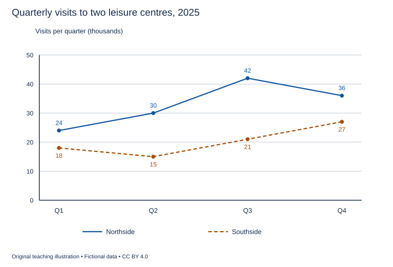

# U16 第9周：长篇阅读、写作与口语

本页为已独立核验的原创文字课程。先完成学生题目，再展开对应参考。非真题、非标准化模考，不换算雅思分数。听力尚未补齐，本页不代表全科课程已完成。

每周选A或G类Task 1一题，加Task 2及三次口语。参考范文不是学生已完成作业，仍须提交初稿、录音和重写，独立真人评分另行安排。

阅读每周180分钟（60分钟首次限时、120分钟证据精读与延迟复测），写作180分钟、口语120分钟。词汇60分钟、听力180分钟另列；新增完整听力未验收，不能勾整周完成。

W12限时复盘按实际错因与延迟复测记录调整；本页原创技能卷不能充当正式陌生卷。后续周数与达标规则见 [U04](u04-exam-preparation.md)。

## 阅读：首答不查词

### R-W09-01 · Reading a Room through Its Echoes

W09｜正文 852 词｜13 题｜篇章：科学解释：假设、信号与空间推断（6段）

本课必做60分钟：首答20、证据复盘20、词汇长句10、48小时后复测10。每周三课180分钟，合卷首答替代单课首答，不重复计算。开放短文选做另加15分钟。

本项目原创虚构教学情境，人物、地点、历史事件和案例数据均非真实研究或史料。科学解释只讨论文内说明的模型与条件。非雅思真题或标准化模考；正确数不换算雅思等级。许可：CC BY 4.0 — RayXBuilds and contributors。

能力点：识别论证关系、区分作者与引述者、条件与因果、精确定位。初读不查词，完成后打开独立答案页。

#### Passage

**A** In the imaginary acoustic laboratory of Kel, students are asked to describe a room without seeing it. A speaker releases a short pulse, and a microphone records what arrives afterwards. The first arrival travels directly from speaker to microphone; later arrivals have followed longer paths involving walls or other surfaces. It is tempting to treat each later mark in the recording as the signature of a particular wall. That interpretation is too quick. Several paths may have similar lengths, and one surface may contribute more than one reflected arrival. The recording contains information about the room, but it does not come with labels explaining how that information was produced. The task is to propose an arrangement consistent with the observations and then find a way to distinguish it from other arrangements that could produce a similar trace. An echo is evidence to interpret, not a miniature drawing waiting to be read.

**B** The class first works with a simplified model consisting of two flat panels and an empty floor. Students move one panel while keeping the speaker and microphone fixed. A delayed peak in the trace shifts, providing a reason to connect that peak with a path involving the moved panel. The strength of the inference comes from a controlled change, not merely from the presence of a peak. Even here, the demonstration has limits. Moving the panel can change which paths are blocked and which are available, so the class does not assume that every altered part of the recording corresponds to a single direct reflection. Students sketch several possible routes and compare their predicted delays. A useful model identifies both the observation it explains and the observations that would count against it. Otherwise, drawing an arrow after seeing a result can become an exercise in fitting a story to whatever happened.

**C** Time must also be measured against a reference. The recorder uses a trigger mark to indicate when the pulse begins. Without that mark, a later arrival could appear to have a longer travel time simply because the recording started earlier. Students make several recordings without moving anything to examine ordinary variation in the setup. They discover a small unwanted sound produced by the speaker housing. Its position in the recording remains nearly constant when the panels move. This does not make it unimportant: it helps separate a feature of the apparatus from a feature attributed to the room. Removing every inconvenient mark would be a poor response. The class keeps the original trace and notes which component is thought to arise from the equipment, leaving a future reader able to reconsider that judgement.

**D** Surface material complicates the relation between shape and sound. In the model, a panel covered with a soft layer returns less energy to the microphone than the same panel without the covering. A weaker peak therefore need not mean that the wall has moved farther away. Nor does the disappearance of a clearly separated peak prove that the corresponding surface has vanished. Reflections can overlap, weaken or become difficult to distinguish from the background. These alternatives matter whenever someone tries to infer an unseen structure from an imperfect signal. The author would not abandon inference because several explanations remain possible. The better response is to ask which further observation would separate them. Changing the microphone's position may reveal a difference that was concealed when all recordings were made from the same point on the floor.

**E** To organise these comparisons, the students keep a position sheet showing the locations of the equipment and panels. Each recording receives a matching label, and a note records whether the soft covering was present. A floor grid makes it possible to return the microphone to an earlier location, although the class still allows for small placement errors. They compare predictions with a delay table rather than relying only on whether two traces look alike. The table does not turn interpretation into an automatic procedure. It makes the proposed connection between a route and an arrival explicit enough to question. When two different layouts fit the same observations, both remain candidates until additional evidence favours one. Reporting only the preferred layout would conceal uncertainty that belongs to the result rather than to the writer's confidence or presentation style.

**F** The exercise ends when another group attempts to reconstruct the panel arrangement from the records. They are given the traces, the position sheet and the assumptions used to calculate the expected delays. Their first proposal differs from the original layout, yet agrees with several prominent peaks. Instead of declaring them careless, the class identifies the missing observation that would separate the proposals. They then make that recording and revise the account. This outcome is more instructive than a perfectly guessed room would have been. It shows that good evidence is not simply a large quantity of data. It is data collected in a way that can discriminate between plausible explanations. The final report includes a path diagram alongside a description of unresolved overlaps. The room has become more knowable, but the students have also learned to state precisely which features their method cannot yet distinguish.

#### Questions

**Choose ONE answer, A, B, C or D.**

1. The opening warns against treating a delayed mark as

   A. part of a recording
   B. proof of one particular wall
   C. evidence that sound travels
   D. a feature worth investigating

2. Why move only one panel initially?

   A. To remove the floor
   B. To test how a controlled change affects the trace
   C. To silence the speaker
   D. To eliminate every alternative

3. What helps identify the housing sound?

   A. It occurs only outdoors
   B. It is the loudest peak
   C. It follows every panel movement
   D. It stays nearly constant when panels move

4. The second group’s different proposal demonstrates

   A. why a discriminating extra observation matters
   B. that equipment always fails
   C. that records are useless
   D. that guessing is sufficient

**Do the following statements agree with the writer's views? Write YES, NO or NOT GIVEN. YES = the writer agrees; NO = the writer expresses the opposite view; NOT GIVEN = the writer's view is not stated. Do not use outside knowledge.**

5. A weaker peak necessarily means a more distant wall.

6. Several possible explanations are a reason to abandon inference altogether.

7. The author prefers wooden panels to metal ones.

8. Unresolved alternatives should remain visible in the report.

**Complete the sentences. Choose NO MORE THAN 3 WORDS FROM THE PASSAGE for each answer. Do not change word forms.**

9. Pulse onset is indicated by a ______.

10. Equipment locations are written on a ______.

11. Returning the microphone to an earlier location is aided by a ______.

12. Expected travel times are compared using a ______.

13. The final report contains a ______ illustrating possible routes.

#### 本周重点

定位与证据：先给题干标定位线索，再抄最短证据；区分直接支持与仅有相同词。

#### 复盘

必做：给每道错题标记“定位/作者立场/范围/语法/词数”，抄最短证据；用一行箭头概括本文论证或过程。48小时后重做错题与两道正确题，检查是否仍能指出证据。

选做（15分钟，80–100词）：Choose an observation that could distinguish two explanations for a weak echo.

R-W09-01 答案、证据与精读（首答后展开）

### R-W09-01 · 独立答案与证据

来源与许可同学生页。先完成再核对。可接受答案由 accepted_answers 明确列出；只忽略大小写和首尾空格，不自行删词。开放复盘不计入客观正确数。

1. **B**｜段落 A｜证据：“That interpretation is too quick.”

   单个峰不天然标注墙面；其余为作者允许的描述。

2. **B**｜段落 B｜证据：“from a controlled change”

   D夸大，A/C无据。

3. **D**｜段落 C｜证据：“remains nearly constant when the panels move”

   判断来自相对稳定而非响度。

4. **A**｜段落 F｜证据：“the missing observation that would separate the proposals”

   不同方案都能解释部分数据，需可区分证据。

5. **NO**｜段落 D｜证据：“need not mean that the wall has moved farther away”

   材料也影响强度。

6. **NO**｜段落 D｜证据：“would not abandon inference”

   作者提倡补证据。

7. **NOT GIVEN**｜段落 B｜证据：“two flat panels”

   没有材料偏好比较。

8. **YES**｜段落 E｜证据：“both remain candidates”

   不能只报喜欢的布局。

9. **trigger mark / mark**｜段落 C｜证据：“uses a trigger mark”

   mark可接受，trace是全部记录而非起点标记。

10. **position sheet / sheet**｜段落 E｜证据：“keep a position sheet”

   sheet及完整名均符合a。

11. **floor grid / grid**｜段落 E｜证据：“A floor grid makes it possible”

   用作位置参照，非延时表。

12. **delay table / table**｜段落 E｜证据：“with a delay table”

   table可接受。

13. **path diagram / diagram**｜段落 F｜证据：“includes a path diagram”

   diagram为合理中心词；position sheet记录位置而非路径图。

#### 词汇与长句

- **pulse**：短脉冲
- **apparatus**：实验装置
- **discriminate**：区分相似解释
- **overlap**：重叠

> A weaker peak therefore need not mean that the wall has moved farther away.

need not不是必然，不能改成cannot；that从句为mean宾语。

> It is data collected in a way that can discriminate between plausible explanations.

collected后置修饰data，that修饰way；关键是收集方式能区分解释。

#### 开放任务参考

D移动麦克风或比较有无覆盖层；须说明不同预测，不仅增加数据数量。

标准：观点有文内依据，保留条件和范围，推断明确标注；不存在唯一措辞。

### R-W09-02 · The Seed Catalogue That Became a Record

W09｜正文 880 词｜13 题｜篇章：虚构历史：商业目录逐步形成比较证据（7段）

本课必做60分钟：首答20、证据复盘20、词汇长句10、48小时后复测10。每周三课180分钟，合卷首答替代单课首答，不重复计算。开放短文选做另加15分钟。

本项目原创虚构教学情境，人物、地点、历史事件和案例数据均非真实研究或史料。科学解释只讨论文内说明的模型与条件。非雅思真题或标准化模考；正确数不换算雅思等级。许可：CC BY 4.0 — RayXBuilds and contributors。

能力点：识别论证关系、区分作者与引述者、条件与因果、精确定位。初读不查词，完成后打开独立答案页。

#### Passage

**A** The earliest seed list preserved in the fictional town of Amberley is a single sheet offering beans, peas and flowers to nearby gardeners. Its writer, a merchant named Mara Fen, used descriptions that sounded precise to her regular customers: the early bean, the red flower, the climbing kind. Those customers could ask questions at her counter and often knew the plants from previous seasons. The sheet was not intended to stand alone as a complete description. Its brevity depended on a surrounding network of conversations and shared experience. Reading it as a failed modern catalogue would miss that relationship. The list worked partly because its readers already possessed information that the paper did not contain and did not claim to provide.

**B** Trouble arose when Fen began sending packets to customers in another valley. The early bean did not flower early there, and two buyers used the same local name for plants that looked different. Fen initially added more enthusiastic adjectives, hoping that attractive descriptions would clarify the offer. They did not. Words such as reliable and excellent expressed approval without identifying a variety or describing the conditions under which it had been grown. The new customers needed distinctions, not stronger praise. A packet that pleased one grower could disappoint another without either person being dishonest. Distance had weakened the informal context that previously helped translate a merchant's short label into a customer's practical expectation about what would emerge from the soil.

**C** The second catalogue therefore assigned a packet code to each lot. Customers were asked to quote it when reporting a problem or requesting more seed. The code did not prove that the contents were uniform, but it linked a report with a particular supply. Fen also kept a source ledger recording who had supplied each lot and when it arrived. This created a route back from a complaint to an earlier transaction. It was a different achievement from producing better plants. A tracking system can make mistakes easier to investigate without preventing every mistake in advance. That limitation does not make tracking pointless; it defines the kind of help the new records could reasonably be expected to provide.

**D** Later, Fen rented a plot beside her store and planted short rows from the available lots. She noted sowing dates and the first visible flowers in a trial book. The catalogue began to include these observations, accompanied by a statement that they described the store's own plot. Some customers wanted a promise that their gardens would show the same timing. Fen refused to give one, pointing to differences in local conditions. Her caution reduced the apparent certainty of the advertising while improving the meaning of its claims. A reader could now distinguish an observation made somewhere from a guarantee made everywhere. The date of the observation also mattered: a result from one season could not silently become a timeless property of the seed simply by being printed again.

**E** The trial plot did not settle every question about comparison. A late delivery meant that one lot was sown after the others. Its later flowering could reflect that delay rather than an inherent difference between varieties. The catalogue's editor wanted to omit the sowing date because the table was already crowded. Fen retained it and marked the affected row. A cleaner table would have concealed a reason not to interpret every difference in the same way. The episode shows that useful records may need information which complicates their apparent message. Evidence is not strengthened by removing the circumstances that make its interpretation difficult, particularly when those circumstances offer a competing explanation for the pattern being advertised to prospective customers.

**F** By the third catalogue, customer letters were being summarised in a response column. Reports from distant places sometimes contradicted the store's observations. The editor grouped them by growing conditions where those conditions had been described, but left unknown details explicitly unknown. Fen did not convert the most flattering letter into a universal claim. She also did not assume that every disappointed customer had planted carelessly. The letters were uneven evidence: people who wrote might differ from those who remained silent, and vivid experiences could be more memorable than ordinary ones. Nevertheless, the reports extended the range of circumstances visible to the merchant. Their value came from comparison and qualification, not from pretending that unsolicited correspondence formed a complete survey of everyone who bought a packet.

**G** A surviving copy contains a correction card explaining that two codes had been transposed in the printed table. The card asks owners to amend the entries rather than discard the whole catalogue. To a collector seeking a perfect original, the added card might seem an inconvenience. To a reader studying how knowledge was maintained, it is central to the object's history. Amberley's catalogue became more useful through labels, linked records, local trials and visible corrections, while remaining a document produced to sell goods. Its commercial purpose did not automatically invalidate every observation, just as the presence of measurements did not remove every incentive to persuade. The reader's task is to identify which claim is supported by which record and under which conditions. That task is more demanding, and more rewarding, than deciding that an entire document must be either advertising or evidence and can never contain aspects of both.

#### Questions

**Which paragraph contains the following information? Write a letter, A–G. You may use any letter more than once.**

1. a comparison made unfair by a difference in planting time

2. a way to trace a customer report back to a supply transaction

3. a warning that people who send letters may not represent all buyers

4. a physical supplement correcting transposed identifiers

**Complete the summary. Choose NO MORE THAN 3 WORDS FROM THE PASSAGE for each answer. Do not change word forms.**

Each seed lot received a (5) ______. Its supplier and arrival were recorded in a (6) ______. Observations from the store’s plot went into a (7) ______. Customer reports later appeared in a (8) ______. Finally, a (9) ______ told readers how to fix the printed code error.

**Do the following statements agree with the writer's views? Write YES, NO or NOT GIVEN. YES = the writer agrees; NO = the writer expresses the opposite view; NOT GIVEN = the writer's view is not stated. Do not use outside knowledge.**

10. Stronger praise was enough to solve the distant customers’ information problem.

11. Tracking is worthless unless it prevents every mistake.

12. Circumstances that complicate results should always be removed from tables.

13. The writer thinks Fen charged less than all neighbouring merchants.

#### 本周重点

定位与证据：先给题干标定位线索，再抄最短证据；区分直接支持与仅有相同词。

#### 复盘

必做：给每道错题标记“定位/作者立场/范围/语法/词数”，抄最短证据；用一行箭头概括本文论证或过程。48小时后重做错题与两道正确题，检查是否仍能指出证据。

选做（15分钟，80–100词）：Explain how a sales document can contain usable evidence without becoming a neutral survey.

R-W09-02 答案、证据与精读（首答后展开）

### R-W09-02 · 独立答案与证据

来源与许可同学生页。先完成再核对。可接受答案由 accepted_answers 明确列出；只忽略大小写和首尾空格，不自行删词。开放复盘不计入客观正确数。

1. **E**｜段落 E｜证据：“one lot was sown after the others”

   E是明确播种时点混杂；D说明一般条件差异。

2. **C**｜段落 C｜证据：“a route back from a complaint to an earlier transaction”

   代码与来源账联结，仅C。

3. **F**｜段落 F｜证据：“people who wrote might differ from those who remained silent”

   非总体调查的边界。

4. **G**｜段落 G｜证据：“two codes had been transposed”

   只有G说印刷对调及卡片。

5. **packet code / code**｜段落 C｜证据：“assigned a packet code”

   code可接受；source ledger不是印在每批上的标识。

6. **source ledger / ledger**｜段落 C｜证据：“kept a source ledger”

   ledger可接受，记录供应者及到货。

7. **trial book / book**｜段落 D｜证据：“in a trial book”

   记录本而非未明确存在的日历。

8. **response column / column**｜段落 F｜证据：“in a response column”

   column为合理短答。

9. **correction card / card**｜段落 G｜证据：“contains a correction card”

   card可接受，内容关于印刷对调。

10. **NO**｜段落 B｜证据：“The new customers needed distinctions, not stronger praise.”

   明确相反。

11. **NO**｜段落 C｜证据：“does not make tracking pointless”

   记录可支持事后调查。

12. **NO**｜段落 E｜证据：“Evidence is not strengthened by removing the circumstances”

   作者强调保留关键条件。

13. **NOT GIVEN**｜段落 A｜证据：“offering beans, peas and flowers”

   没有价格比较。

#### 词汇与长句

- **lot**：同一来源的一批货
- **transpose**：互换位置
- **unsolicited**：未经主动征集的
- **qualification**：对说法范围的限定

> Its brevity depended on a surrounding network of conversations and shared experience.

brevity为简短；依赖外部语境而非信息天然完整。

> A reader could now distinguish an observation made somewhere from a guarantee made everywhere.

distinguish A from B；somewhere/everywhere构成范围对比。

#### 开放任务参考

C追踪、D注明条件、F来信偏差、G纠错；评价具体主张而非整类来源一票否决。

标准：观点有文内依据，保留条件和范围，推断明确标注；不存在唯一措辞。

### R-W09-03 · Where Does a River Begin?

W09｜正文 939 词｜14 题｜篇章：论证：定义差异、测量与使用目的（8段）

本课必做60分钟：首答20、证据复盘20、词汇长句10、48小时后复测10。每周三课180分钟，合卷首答替代单课首答，不重复计算。开放短文选做另加15分钟。

本项目原创虚构教学情境，人物、地点、历史事件和案例数据均非真实研究或史料。科学解释只讨论文内说明的模型与条件。非雅思真题或标准化模考；正确数不换算雅思等级。许可：CC BY 4.0 — RayXBuilds and contributors。

能力点：识别论证关系、区分作者与引述者、条件与因果、精确定位。初读不查词，完成后打开独立答案页。

#### Passage

**A** The fictional valley of Rusk has two villages that each claim to stand beside the beginning of the same river. One points to the most distant trickle connected to its channel; the other points to a spring that supplies water throughout the year. Both have maps, photographs and enthusiastic guides. A visitor expects a dispute that a sufficiently careful survey will settle. Yet the disagreement may begin before anyone measures anything. The villages are using different meanings of beginning. One asks which connected path is longest; the other asks where a dependable flow emerges. Better measurements can answer each question more accurately without making the two questions identical. The writer's first concern is therefore to make the definitions visible.

**B** For a surveyor following the longest path, the upper landscape presents difficulties. A shallow channel may carry water after rain and appear dry later. Whether it belongs to the river depends partly on the rule being applied to intermittent connections. If every possible wet-weather link is included, the identified source can change after an unusual storm. If only channels carrying water on the day of inspection are counted, the result depends on the season of the visit. Neither rule becomes neutral simply because the surveyor writes a precise distance at the end. Precision describes how closely a quantity has been measured under a rule; it does not choose the rule on the reader's behalf.

**C** The second village's spring offers apparent stability. Residents can point to a visible place where water enters the surface channel, and its flow is familiar from everyday use. But the surface emergence is not necessarily the place where all the water originally entered the wider system. In the passage's simplified landscape model, some rain moves below ground before reaching the spring. A study of water supply might therefore investigate a broader area than the spot marked on a tourist map. This does not make the spring label fraudulent. It means that a visible starting point serves one descriptive purpose while leaving other causal questions open. Confusion arises when a useful marker is asked to answer a question for which it was never designed.

**D** Historian Enna Vale introduces a third account. Older residents use a traditional name for a stream joining below both proposed sources, and local stories describe that meeting as the river's birth. Enna does not present the stories as measurements of channel length. She argues that the name records a social relationship with a place. Removing it from every map because it fails a length criterion would discard information rather than merely correct an error. Equally, the traditional name should not be used as if it proved the distance to the farthest headwater. Different forms of evidence can coexist when their claims are distinguished. They become misleading when one is silently substituted for another because it gives a preferred answer.

**E** The valley council initially asks for a single marker that will end the argument. The proposed inscription simply reads source of the river. Such brevity would hide the very choice that needs explanation. The writer favours a marker that states the criterion used, alongside a small description of alternatives. This is not an argument for making every sign an essay. A few carefully chosen words can identify whether the marker concerns persistent flow, measured distance or a traditional name. The aim is not to prevent visitors from enjoying a clear destination. It is to avoid presenting a decision about naming as though nature had supplied only one possible instruction and everyone else had overlooked it.

**F** To document the alternatives, survey teams keep a channel log noting where water is present and when observations are made. A catchment sketch shows the broader area considered in the simplified underground-flow explanation. Interviews about naming are stored separately with information about who gave each account. The records are linked, but not merged into a single list of interchangeable facts. The channel log can support a statement about observed connections; an interview can support a statement about how a name is used. Neither should be asked to perform the other's task. This separation makes disagreement easier to investigate because a reader can identify whether it concerns observation, definition, memory or the purpose for which a map is being produced.

**G** One planner objects that visitors will find several accounts confusing. That concern deserves attention, but eliminating disagreement on paper does not eliminate it in the landscape or in local memory. A clear explanation can reduce confusion more honestly than an unexplained declaration. The council eventually prints a route guide with three labelled destinations, each accompanied by its criterion. Visitors wanting the longest walk can choose accordingly; those interested in the spring or the stories have equally intelligible options. The guide does not announce that every interpretation is equally suitable for every task. A water-supply investigation still requires evidence that a walking route cannot provide, and a historical enquiry cannot be completed by measuring channels alone.

**H** Rusk's dispute illustrates a general limit of the demand to let facts speak for themselves. Facts matter, but a question determines which facts are relevant and what kind of answer they can support. Definitions are not excuses to ignore an inconvenient measurement. Once a criterion is stated, the observations must still be examined honestly, and an unsupported claim should still be corrected. The point is that honesty includes naming the criterion as well as reporting the number. A river can be studied through length, flow, landscape and memory without those perspectives being collapsed into one contest. The strongest explanation tells a reader which question it answers and recognises the questions that remain outside its scope.

#### Questions

**Choose ONE answer, A, B, C or D.**

1. Why might measurement alone fail to settle the opening dispute?

   A. All maps are missing
   B. No channel can be measured
   C. The villages use different definitions
   D. The visitors dislike rivers

2. Precision does not itself determine

   A. where photographs are stored
   B. which inclusion rule should be used
   C. whether rainfall exists
   D. whether a number has digits

3. The spring marker is described as

   A. necessarily dishonest
   B. useful for a limited descriptive purpose
   C. a complete water-supply explanation
   D. proof of the longest route

4. The final guide offers

   A. a universal water-supply result
   B. destinations labelled by their criteria
   C. one unqualified claim
   D. a ban on historical names

**Do the following statements agree with the writer's views? Write YES, NO or NOT GIVEN. YES = the writer agrees; NO = the writer expresses the opposite view; NOT GIVEN = the writer's view is not stated. Do not use outside knowledge.**

5. All interpretations are equally suitable for every purpose.

6. Naming a criterion removes the need to check observations.

7. A short sign can identify the rule behind a source marker.

8. The writer believes the upstream village has the better hotels.

9. Traditional names can preserve information different from measured length.

**Which paragraph contains the following information? Write a letter, A–H. You may use any letter more than once.**

10. a warning that a single day’s survey may depend on season

11. a distinction between surface emergence and earlier underground movement

12. the proposal to separate channel records from interview evidence

13. an objection that multiple accounts could confuse visitors

14. a rejection of using definitions to disregard unfavourable measurements

#### 本周重点

定位与证据：先给题干标定位线索，再抄最短证据；区分直接支持与仅有相同词。

#### 复盘

必做：给每道错题标记“定位/作者立场/范围/语法/词数”，抄最短证据；用一行箭头概括本文论证或过程。48小时后重做错题与两道正确题，检查是否仍能指出证据。

选做（15分钟，80–100词）：Choose a source definition for a walking guide and explain what it cannot establish.

R-W09-03 答案、证据与精读（首答后展开）

### R-W09-03 · 独立答案与证据

来源与许可同学生页。先完成再核对。可接受答案由 accepted_answers 明确列出；只忽略大小写和首尾空格，不自行删词。开放复盘不计入客观正确数。

1. **C**｜段落 A｜证据：“different meanings of beginning”

   争议先于测量。

2. **B**｜段落 B｜证据：“it does not choose the rule”

   精度与定义选择不同。

3. **B**｜段落 C｜证据：“serves one descriptive purpose”

   作者保留用途又限定。

4. **B**｜段落 G｜证据：“three labelled destinations”

   不把不同问题压成一个答案。

5. **NO**｜段落 G｜证据：“does not announce that every interpretation is equally suitable”

   并非相对主义。

6. **NO**｜段落 H｜证据：“observations must still be examined honestly”

   定义公开后仍须证据。

7. **YES**｜段落 E｜证据：“A few carefully chosen words can identify”

   不要求长论文。

8. **NOT GIVEN**｜段落 A｜证据：“two villages”

   旅馆未提及。

9. **YES**｜段落 D｜证据：“records a social relationship with a place”

   作者明确区分而保留。

10. **B**｜段落 B｜证据：“depends on the season of the visit”

   B当日有水规则。

11. **C**｜段落 C｜证据：“moves below ground before reaching the spring”

   C简化机制。

12. **F**｜段落 F｜证据：“not merged into a single list”

   F不同来源支持不同主张。

13. **G**｜段落 G｜证据：“visitors will find several accounts confusing”

   具体反方由planner提出。

14. **H**｜段落 H｜证据：“not excuses to ignore an inconvenient measurement”

   H结论防止滥用定义。

#### 词汇与长句

- **intermittent**：间歇存在的
- **criterion**：判断标准
- **catchment**：集水区域
- **emergence**：涌现；出露

> Better measurements can answer each question more accurately without making the two questions identical.

without限制测量能做到什么；准确回答不等于同一问题。

> They become misleading when one is silently substituted for another because it gives a preferred answer.

one/another指证据类型；when与because说明替换何时及为何误导。

#### 开放任务参考

E/G为用途选标准，C水源机制或D历史名称不能由步行距离证明。

标准：观点有文内依据，保留条件和范围，推断明确标注；不存在唯一措辞。

## 写作与口语：Task 1双分支择一

### WS-W09-T1A 学生页：健身中心季度使用量

周次 W09｜题型 T1A｜能力点：峰值、区间与趋势

Task 1 的 A/G 分支二选一，另一分支不计入本周作业。

#### 使用与记录

原创教学练习，非真题、非标准化模拟，难度未校准。先完成本页再打开参考页。人物、机构、经历与数据均为教学虚构。不要背诵示例。自评和 AI 反馈不能代替独立真人评分，未获得真人评阅时标记“分数未确认”。

保存：任务ID、实际日期、用时、初稿或原始录音、证据化反馈、重写/重答、三条修改理由。没有学生提交物，不得填写“已批改”或“已完成训练”。

#### 完整题干

The line graph shows the number of visits to two leisure centres in the four quarters of 2025. Summarise the information by selecting and reporting the main features, and make comparisons where relevant.

Write at least 150 words. Spend about 20 minutes on this task.

教学虚构数据。横轴Q1～Q4（2025季度）；纵轴千人次/季度。Northside：24、30、42、36；Southside：18、15、21、27。连线仅显示相邻观测值，非逐日记录。

#### 任务预算（含首次审题，不额外加时）

初稿20分钟（审题规划3、写作15、检查2）；诊断15；反馈阅读与证据核查10；完整重写25；对照归档5。合计75分钟。

#### 初稿后自评清单

- [ ] 达到最低字数；全文连贯成段，没有用项目符号代替作文。
- [ ] 概述给主要特征；数据、阶段或方位都与题图逐项相符，不推断未提供的原因。
- [ ] 每段可写出一个功能标签；例子或数据与该段要点相连。
- [ ] 圈出两处词汇搭配和两处句法疑点，先自行修正再查询或求反馈。
- [ ] 记录一项最影响理解的问题和原句证据，不填写自猜分数。

#### 反馈与重写

打开 独立参考页（本节下方展开参考），按逐段检查和通用协议核验。重写任务：完整重写至少150词；把每个趋势动词圈定起止季度，另标一处首尾净变化和一处峰值，删除图外解释。

#### 本周听读能力迁移（包含在既有预算）

在本题诊断/回听时段内用3分钟：圈出一个结论，回题面或自己的原话找直接证据；标出一个不能由现有信息推出的判断。对应U04 W09定位证据而非用常识替代。

这是本地写说步骤，不依赖音频已交付。若另有合法听读材料，只在该科原定复盘时段使用；没有材料则标待补，不宣称完成听力。

W09 T1A 示例、反馈与重练（首答后展开）

### WS-W09-T1A 独立参考页

只在初稿完成后阅读；不是唯一答案，也没有官方分数。以下是对原创示例的教学讲评，不是对学生尚未提交作文的已完成批改。

#### 思路拆解

定位单位与四个离散季度；概述先分两条走势，再讲全年首尾；只在观测点判断最大差距。

#### 原创示例

The line graph compares visits to the Northside and Southside leisure centres during the four quarters of 2025. The figures represent thousands of visits in each quarter, rather than the number of individual members.

Overall, Northside received more visits than Southside in every quarter. Attendance at Northside rose to a peak in the third quarter before falling, whereas Southside experienced an initial decline followed by a steady increase. Despite these different patterns, both centres finished the year above their starting levels.

Northside recorded 24,000 visits in the first quarter and 30,000 in the second. The figure then climbed to 42,000 in the third quarter, its highest point, before dropping to 36,000 in the final quarter. This was still 12,000 higher than the figure at the beginning of the year.

Southside started at 18,000 visits, fell to 15,000 in the second quarter and recovered to 21,000 in the third. By the fourth quarter, visits had reached 27,000. The difference between the centres was smallest in the first quarter, at 6,000, and largest in the third, at 21,000. It subsequently narrowed to 9,000 at the end of the year.

示例正文词数：199（本项目正则计数；书信不含称呼、结束语与署名；连字符词作一词）。

#### 逐段反馈与迁移

- P1 千人次不是会员人数，季度数据不是累计年度总数；引言换词不能改统计对象。

- P2 Northside始终领先但并非一直上升；两中心末值均高于初值。

- P3 峰值42千在Q3，末值36千比初值高12千；写fall只指Q3至Q4。

- P4 Southside先降后升；差距6、15、21、9千，不能把最大差距错当最大访客数。

#### 常见失误

看到末值高就写持续上升；把某季度下降推广到全年下降；凭常识补促销或季节原因。

#### 可执行反馈步骤

1. 先把自己的段落标为引入、概述/论点、支持、收束；分段可不同于示例，按功能核查，不照抄段数。
2. 对照上方逐段检查，逐项标“已有证据/缺失/不适用”。每条意见必须附自己的原句或缺失位置。
3. 按 [反馈协议](u20-feedback.md) 的四维表记录；有争议的 AI 意见回题干、数据或语法依据核验。
4. 只选两项最高优先级问题执行整篇重写；保留原稿，禁止把示例替换为自己的作业。

#### 重写任务

完整重写至少150词；把每个趋势动词圈定起止季度，另标一处首尾净变化和一处峰值，删除图外解释。

完成后重新勾选 学生页（见本节上方学生题） 清单；将一处改前/改后及理由交给独立评阅者核查。真人评阅状态目前为“待安排”，不是已完成。

### WS-W09-T1G 学生页：健身房遗失物品查询

周次 W09｜题型 T1G｜能力点：书信目的、要点与语气

Task 1 的 A/G 分支二选一，另一分支不计入本周作业。

#### 使用与记录

原创教学练习，非真题、非标准化模拟，难度未校准。先完成本页再打开参考页。人物、机构、经历与数据均为教学虚构。不要背诵示例。自评和 AI 反馈不能代替独立真人评分，未获得真人评阅时标记“分数未确认”。

保存：任务ID、实际日期、用时、初稿或原始录音、证据化反馈、重写/重答、三条修改理由。没有学生提交物，不得填写“已批改”或“已完成训练”。

#### 完整题干

You left a bag at a sports centre after a class. Write to the centre manager. In your letter:
- describe when and where you think you left the bag
- describe the bag and its contents
- explain how you would like the centre to help you recover it.
Begin your letter: Dear Sir or Madam,

Write at least 150 words. You do not need to write any addresses. Spend about 20 minutes on this task.

#### 任务预算（含首次审题，不额外加时）

初稿20分钟（审题规划3、写作15、检查2）；诊断15；反馈阅读与证据核查10；完整重写25；对照归档5。合计75分钟。

#### 初稿后自评清单

- [ ] 达到最低字数；全文连贯成段，没有用项目符号代替作文。
- [ ] 三个要点均展开；称呼、目的、语气和结束语适合收信人。
- [ ] 每段可写出一个功能标签；例子或数据与该段要点相连。
- [ ] 圈出两处词汇搭配和两处句法疑点，先自行修正再查询或求反馈。
- [ ] 记录一项最影响理解的问题和原句证据，不填写自猜分数。

#### 反馈与重写

打开 独立参考页（本节下方展开参考），按逐段检查和通用协议核验。重写任务：整篇重写至少150词；把一处不确定信息用适当限定表达，并让领取安排与工作人员确认发现的条件相连。

#### 本周听读能力迁移（包含在既有预算）

在本题诊断/回听时段内用3分钟：圈出一个结论，回题面或自己的原话找直接证据；标出一个不能由现有信息推出的判断。对应U04 W09定位证据而非用常识替代。

这是本地写说步骤，不依赖音频已交付。若另有合法听读材料，只在该科原定复盘时段使用；没有材料则标待补，不宣称完成听力。

W09 T1G 示例、反馈与重练（首答后展开）

### WS-W09-T1G 独立参考页

只在初稿完成后阅读；不是唯一答案，也没有官方分数。以下是对原创示例的教学讲评，不是对学生尚未提交作文的已完成批改。

#### 思路拆解

正式查询，不把推测写成确定指控；时间地点、识别特征、核查与领取请求分别展开。

#### 原创示例

Dear Sir or Madam,

I am writing to ask for help locating a bag that I believe I left at your sports centre yesterday evening. I attended the exercise class in Studio Two from six until seven, and I last remember putting the bag on the bench beside the studio entrance while changing my shoes.

It is a small dark green backpack with a silver zip and a red fabric label on the front. Inside are a blue towel, a pair of black trainers and a notebook with my name, Alex Chen, written on the first page. There is also an empty metal water bottle in the side pocket. These details should make it easier to distinguish the bag from similar items.

Could you please check whether it has been handed in to reception or found by the cleaning team? If it is there, I would be grateful if you could keep it somewhere secure until Friday evening, when I can collect it after work. Please reply to the email address shown on my membership record. I can bring my membership card to confirm my identity when collecting it.

Yours faithfully,
Alex Chen

示例正文词数：185（本项目正则计数；书信不含称呼、结束语与署名；连字符词作一词）。

#### 逐段反馈与迁移

- P1 I believe/last remember标明记忆范围；不能无依据说工作人员拿走了包。

- P2 颜色、标签和内部姓名能识别；细节须前后一致，不须编银行卡号码。

- P3 接待/清洁人员核查、周五保存、联系与身份核验可执行；没有假设包已经找到。

#### 常见失误

只说my bag没有识别信息；将猜测地点写成绝对事实；命令中心赔偿却未请求查找。

#### 可执行反馈步骤

1. 先把自己的段落标为引入、概述/论点、支持、收束；分段可不同于示例，按功能核查，不照抄段数。
2. 对照上方逐段检查，逐项标“已有证据/缺失/不适用”。每条意见必须附自己的原句或缺失位置。
3. 按 [反馈协议](u20-feedback.md) 的四维表记录；有争议的 AI 意见回题干、数据或语法依据核验。
4. 只选两项最高优先级问题执行整篇重写；保留原稿，禁止把示例替换为自己的作业。

#### 重写任务

整篇重写至少150词；把一处不确定信息用适当限定表达，并让领取安排与工作人员确认发现的条件相连。

完成后重新勾选 学生页（见本节上方学生题） 清单；将一处改前/改后及理由交给独立评阅者核查。真人评阅状态目前为“待安排”，不是已完成。

### WS-W09-T2 学生页：所有学生是否都应参加团队运动

周次 W09｜题型 T2｜能力点：观点展开与任务回应

A/G 共用本题。

#### 使用与记录

原创教学练习，非真题、非标准化模拟，难度未校准。先完成本页再打开参考页。人物、机构、经历与数据均为教学虚构。不要背诵示例。自评和 AI 反馈不能代替独立真人评分，未获得真人评阅时标记“分数未确认”。

保存：任务ID、实际日期、用时、初稿或原始录音、证据化反馈、重写/重答、三条修改理由。没有学生提交物，不得填写“已批改”或“已完成训练”。

#### 完整题干

Some people believe every school student should be required to take part in a competitive team sport. To what extent do you agree or disagree? Give reasons and include relevant examples.

Write at least 250 words. Spend about 40 minutes on this task.

#### 任务预算（含首次审题，不额外加时）

初稿40分钟（审题规划5、写作30、检查5）；诊断15；反馈阅读与证据核查10；完整重写35；对照归档5。合计105分钟。

#### 初稿后自评清单

- [ ] 达到最低字数；全文连贯成段，没有用项目符号代替作文。
- [ ] 直接回答题目的所有问句，有始终一致的立场。
- [ ] 每段可写出一个功能标签；例子或数据与该段要点相连。
- [ ] 圈出两处词汇搭配和两处句法疑点，先自行修正再查询或求反馈。
- [ ] 记录一项最影响理解的问题和原句证据，不填写自猜分数。

#### 反馈与重写

打开 独立参考页（本节下方展开参考），按逐段检查和通用协议核验。重写任务：完整重写至少250词；标出主张的范围词、一个真实逻辑上的反例，以及反例如何限制规则而非否认全部价值。

#### 本周听读能力迁移（包含在既有预算）

在本题诊断/回听时段内用3分钟：圈出一个结论，回题面或自己的原话找直接证据；标出一个不能由现有信息推出的判断。对应U04 W09定位证据而非用常识替代。

这是本地写说步骤，不依赖音频已交付。若另有合法听读材料，只在该科原定复盘时段使用；没有材料则标待补，不宣称完成听力。

W09 T2 示例、反馈与重练（首答后展开）

### WS-W09-T2 独立参考页

只在初稿完成后阅读；不是唯一答案，也没有官方分数。以下是对原创示例的教学讲评，不是对学生尚未提交作文的已完成批改。

#### 思路拆解

审题抓every与competitive team，不偷换成反对所有体育；承认好处后用适用范围反例检验普遍要求。

#### 原创示例

Competitive team sports can give students exercise and a shared goal. However, I disagree that every school student should be required to participate in one. Schools should provide opportunities to try team sports while allowing other forms of physical activity to meet different needs.

There are good reasons to include competitive games in school life. Players have to coordinate their actions, accept rules and respond when a result is disappointing. A student who passes the ball to a teammate in a better position may learn that cooperation can matter more than individual attention. These experiences can be valuable, particularly when a teacher makes sure that participation is not restricted to the most skilful players. Nevertheless, their value does not establish that competitive team sport is the only way to develop cooperation.

A universal requirement overlooks differences between students. Some enjoy exercise but find public competition so stressful that they become reluctant to participate at all. Others may need activities adapted to a physical condition. A school could encourage these students through walking groups, swimming or cooperative movement activities instead. This does not mean exempting everyone who initially feels uncomfortable from all challenge. It means offering a suitable route into regular activity rather than treating one format as appropriate for everybody.

Schools can also teach teamwork outside competitive sport. Preparing a group performance or completing a practical project requires students to share responsibilities and respond to others. Such activities are not substitutes for exercise, but they show why the social benefits of sport do not justify making a particular type compulsory. A balanced programme can provide both physical activity and cooperation through several routes.

In conclusion, competitive team sports deserve a place in schools, but compulsory participation for every student is too broad a rule. An introductory experience followed by meaningful choices would preserve many benefits while avoiding an unnecessary barrier for students whose needs differ.

示例正文词数：315（本项目正则计数；书信不含称呼、结束语与署名；连字符词作一词）。

#### 逐段反馈与迁移

- P1 反对全员强制某类项目，保留运动机会；立场范围清楚。

- P2 具体合作机制并有包容条件；好处存在不自动推出唯一方法。

- P3 压力与适配需要是反例；不做医学判断，也不鼓励一切不适即退出。

- P4 团队合作的替代场景不代替身体运动，避免混淆两种目标。

- P5 回扣试体验后选择，不能结尾突然要求所有人参赛。

#### 常见失误

把题目写成是否应该运动；以一个人不喜欢反驳所有体育价值；将可能好处写成人人必然受益。

#### 可执行反馈步骤

1. 先把自己的段落标为引入、概述/论点、支持、收束；分段可不同于示例，按功能核查，不照抄段数。
2. 对照上方逐段检查，逐项标“已有证据/缺失/不适用”。每条意见必须附自己的原句或缺失位置。
3. 按 [反馈协议](u20-feedback.md) 的四维表记录；有争议的 AI 意见回题干、数据或语法依据核验。
4. 只选两项最高优先级问题执行整篇重写；保留原稿，禁止把示例替换为自己的作业。

#### 重写任务

完整重写至少250词；标出主张的范围词、一个真实逻辑上的反例，以及反例如何限制规则而非否认全部价值。

完成后重新勾选 学生页（见本节上方学生题） 清单；将一处改前/改后及理由交给独立评阅者核查。真人评阅状态目前为“待安排”，不是已完成。

### WS-W09-S1 学生页

周次W09｜Part 1专项｜能力点：用具体证据限制概括，区分个人与群体｜30分钟

#### 使用与记录

原创教学练习，非真题、非标准化模拟，难度未校准。先完成本页再打开参考页。人物、机构、经历与数据均为教学虚构。不要背诵示例。自评和 AI 反馈不能代替独立真人评分，未获得真人评阅时标记“分数未确认”。

保存：任务ID、实际日期、用时、初稿或原始录音、证据化反馈、重写/重答、三条修改理由。没有学生提交物，不得填写“已批改”或“已完成训练”。

#### 操作与预算

设备与审题3分钟；首答录音6；回听及局部转写7；示例和诊断5；不看稿重答6；归档3。共30分钟。

#### Part 1专项题

1. What do you do to stay active?
2. Do you prefer exercising indoors or outdoors?
3. Were you interested in sport as a child?
4. Do you like exercising with other people?

追问：

- When would you choose a different activity?
- Can you give a recent example?

#### 录音回听清单

- [ ] 保留首答原音，记录实际时长、是否中断、是否看稿；只报真实完成状态。
- [ ] 流利与连贯：标出两处时间戳，区分构思停顿与重复搜词，检查是否偏离问句。
- [ ] 词汇：找一处模糊词或重复表达，先解释原意再替换；不为难词改变意思。
- [ ] 语法：核对经历与习惯的时态；局部转写并更正两处妨碍理解的问题。
- [ ] 发音：不看转写听30秒，标听不清的词尾、重音或断句；没有音频不能判断发音。
- [ ] 展开：主要回答有具体情境或理由；追问后第一句回应追问的新角度。

#### 重答要求

选择两个只有笼统判断的答案，先直接回应再加具体情境；重答一条追问，检查是否真正回应其新角度。

首答回听后才打开独立参考页（本节下方展开参考）。按[反馈协议](u20-feedback.md)填至少三个时间戳，不以文字转写替代音频评阅。

#### 本周听读能力迁移（包含在既有预算）

在本题诊断/回听时段内用3分钟：圈出一个结论，回题面或自己的原话找直接证据；标出一个不能由现有信息推出的判断。对应U04 W09定位证据而非用常识替代。

没有已交付听力的假设；以本题原音或文字做迁移，不记录为额外听力完成。

W09 S1 示例、反馈与重练（首答后展开）

### WS-W09-S1 独立参考页

原创教学示例，非真题或评分结果。未收到学生音频；以下是示例分析与待执行反馈，不能登记为已完成学生批改。

#### 展开示例

##### 直接回应→原因→具体情境的展开示例

I usually walk in the evening because it is easy to fit into my day. I enjoy walking with a friend, but I sometimes go alone when I want to think quietly. That does not mean I dislike group exercise; it just depends on whether I want conversation or a little time to myself.

纯口答示例词数：54；只计MODEL标记内实际英文口答，不含标题、标签、说明。词数不能证明录音时长或流利度。

#### 展开与反馈

本周能力：用具体证据限制概括，区分个人与群体。

1. 示例先表态，再说明偏好理由，最后提供条件或场景。检查自己是否用一个词回答后就结束。
2. 找到一个具体细节：物品、动作、对话或地点。用自己的经历替换，保持与题卡相关，不照搬示例身份与经历。
3. 追问要重新回应，不能继续背长答。首句先回答追问，再用一条理由支持。
4. 标出一处听不清或语法影响理解的原音时间戳；先尝试最小修正。不要把自然停顿一概当成错误，或用加快语速掩盖逻辑断裂。

#### 常见失误

空泛形容词替代具体过程；给了经历却没解释为什么重要；Part 3只有个人故事没有一般解释；AI只看转写就判断发音。逐项回原音核对，不能凭范例推断自己已达到某个分数。

#### 可执行重答与反馈

选择两个只有笼统判断的答案，先直接回应再加具体情境；重答一条追问，检查是否真正回应其新角度。

填写[反馈协议](u20-feedback.md)四维表，附三个时间戳和原话证据。选一个内容问题与一个语言问题先修；重答后并排听两段，记录改善与仍未解决之处。自评与AI不能替代独立真人评分；独立评阅目前待安排，分数未确认。

### WS-W09-S2 学生页

周次W09｜Part 2专项｜能力点：用具体证据限制概括，区分个人与群体｜30分钟

#### 使用与记录

原创教学练习，非真题、非标准化模拟，难度未校准。先完成本页再打开参考页。人物、机构、经历与数据均为教学虚构。不要背诵示例。自评和 AI 反馈不能代替独立真人评分，未获得真人评阅时标记“分数未确认”。

保存：任务ID、实际日期、用时、初稿或原始录音、证据化反馈、重写/重答、三条修改理由。没有学生提交物，不得填写“已批改”或“已完成训练”。

#### 操作与预算

准备、首答录音及追问5分钟；回听及局部转写8；示例与诊断5；关键词重组3；重答及追问5；归档4。共30分钟。

#### Part 2专项任务卡

Describe a physical activity you tried for the first time. Say what it was, where you tried it, what you found easy or difficult, and explain whether you would like to do it again.

准备1分钟，说1～2分钟。只记5个关键词，不预写句子。

收尾追问：

- Did anyone help you during the activity?
- What would you practise before trying it again?

#### 录音回听清单

- [ ] 保留首答原音，记录实际时长、是否中断、是否看稿；只报真实完成状态。
- [ ] 流利与连贯：标出两处时间戳，区分构思停顿与重复搜词，检查是否偏离问句。
- [ ] 词汇：找一处模糊词或重复表达，先解释原意再替换；不为难词改变意思。
- [ ] 语法：核对经历与习惯的时态；局部转写并更正两处妨碍理解的问题。
- [ ] 发音：不看转写听30秒，标听不清的词尾、重音或断句；没有音频不能判断发音。
- [ ] 展开：主要回答有具体情境或理由；追问后第一句回应追问的新角度。

#### 重答要求

用五个关键词重答完整任务卡1～2分钟，再答两条追问；补一处具体行动或细节并删一处无关背景。比较首答与重答，不背示例。

首答回听后才打开独立参考页（本节下方展开参考）。按[反馈协议](u20-feedback.md)填至少三个时间戳，不以文字转写替代音频评阅。

#### 本周听读能力迁移（包含在既有预算）

在本题诊断/回听时段内用3分钟：圈出一个结论，回题面或自己的原话找直接证据；标出一个不能由现有信息推出的判断。对应U04 W09定位证据而非用常识替代。

没有已交付听力的假设；以本题原音或文字做迁移，不记录为额外听力完成。

W09 S2 示例、反馈与重练（首答后展开）

### WS-W09-S2 独立参考页

原创教学示例，非真题或评分结果。未收到学生音频；以下是示例分析与待执行反馈，不能登记为已完成学生批改。

#### 展开示例

##### 原创长答示例（时长须以个人实际录音测量）

An activity I tried for the first time was table tennis at a local leisure centre. A colleague invited me to a beginner session on a rainy Sunday afternoon. I had watched other people play, so I expected it to be fairly straightforward.

At first, simply hitting the ball over the net was harder than I imagined. I moved my whole arm too quickly, and the ball often went far beyond the table. The instructor suggested using a smaller movement and watching the ball until it reached the bat.

After a while, my colleague and I managed a short exchange without missing. That felt more satisfying than winning a point. We stopped keeping score and concentrated on returning the ball to a position the other person could reach.

I would like to try it again because the beginner session was relaxed and encouraging. I would not necessarily enjoy a serious tournament yet. The experience showed me that the atmosphere and level of an activity can matter as much as the activity itself.

纯口答示例词数：172；只计MODEL标记内实际英文口答，不含标题、标签、说明。词数不能证明录音时长或流利度。

#### 展开与反馈

本周能力：用具体证据限制概括，区分个人与群体。

1. 长答示例按背景、行动/观察、变化与意义组织。每段都推进内容；检查自己是否只有背景而没有具体事件。
2. 找到一个具体细节：物品、动作、对话或地点。用自己的经历替换，保持与题卡相关，不照搬示例身份与经历。
3. 追问要重新回应，不能继续背长答。首句先回答追问，再用一条理由支持。
4. 标出一处听不清或语法影响理解的原音时间戳；先尝试最小修正。不要把自然停顿一概当成错误，或用加快语速掩盖逻辑断裂。

#### 常见失误

空泛形容词替代具体过程；给了经历却没解释为什么重要；Part 3只有个人故事没有一般解释；AI只看转写就判断发音。逐项回原音核对，不能凭范例推断自己已达到某个分数。

#### 可执行重答与反馈

用五个关键词重答完整任务卡1～2分钟，再答两条追问；补一处具体行动或细节并删一处无关背景。比较首答与重答，不背示例。

填写[反馈协议](u20-feedback.md)四维表，附三个时间戳和原话证据。选一个内容问题与一个语言问题先修；重答后并排听两段，记录改善与仍未解决之处。自评与AI不能替代独立真人评分；独立评阅目前待安排，分数未确认。

### WS-W09-S3 学生页

周次W09｜三部分全流程｜能力点：用具体证据限制概括，区分个人与群体｜60分钟

#### 使用与记录

原创教学练习，非真题、非标准化模拟，难度未校准。先完成本页再打开参考页。人物、机构、经历与数据均为教学虚构。不要背诵示例。自评和 AI 反馈不能代替独立真人评分，未获得真人评阅时标记“分数未确认”。

保存：任务ID、实际日期、用时、初稿或原始录音、证据化反馈、重写/重答、三条修改理由。没有学生提交物，不得填写“已批改”或“已完成训练”。

#### 操作与预算

D5：设备与流程准备2分钟，连续首答11～14分钟，余14～17分钟完整回听标记，共30分钟。D6：局部转写诊断10，阅读示例与调整5，重答与新追问10，对照归档5，共30分钟。合计60分钟。

#### 连续三部分全流程（首答不可看参考）

找同伴读题，或独练逐题揭示。完整首答11～14分钟，中途不暂停纠错。模拟同伴不是认证考官；自行读题的练习记录不能冒充真实面试。

##### Part 1：4～5分钟

1. Do you enjoy spending time with colleagues or classmates?
2. What do you usually do during a short break?
3. Do you prefer a quiet break or an active one?
4. Has your daily routine changed recently?
5. Do you make plans for your free time?
6. What can interrupt those plans?

可按回答追加 Why? / Can you give an example? 到时转下部分，不强行说完全部备用问题。

##### Part 2：3～4分钟（含准备）

Describe a group activity you found enjoyable. Say what the activity was, who took part, what your role was, and explain why you enjoyed it.

准备1分钟，连续说1～2分钟。收尾追问：

- Would you join the same group again?
- Did everyone take part in the same way?

##### Part 3：4～5分钟

1. What makes group activities enjoyable?
2. Should everyone be expected to enjoy competition?
3. Can an activity benefit some people but not others?
4. How can organisers include people with different abilities?

根据回答追加追问：

- Would your answer change for a professional competition?
- Can too many adjustments make an activity difficult to organise?

#### 录音回听清单

- [ ] 保留首答原音，记录实际时长、是否中断、是否看稿；只报真实完成状态。
- [ ] 流利与连贯：标出两处时间戳，区分构思停顿与重复搜词，检查是否偏离问句。
- [ ] 词汇：找一处模糊词或重复表达，先解释原意再替换；不为难词改变意思。
- [ ] 语法：核对经历与习惯的时态；局部转写并更正两处妨碍理解的问题。
- [ ] 发音：不看转写听30秒，标听不清的词尾、重音或断句；没有音频不能判断发音。
- [ ] 展开：主要回答有具体情境或理由；追问后第一句回应追问的新角度。

#### 重答要求

重答最弱的一个Part 1问题、完整Part 2及一个Part 3问题，再答一条未用追问。用不同细节或补一个例外，确认不是复述范例；局部重答不另计全流程。

首答回听后才打开独立参考页（本节下方展开参考）。按[反馈协议](u20-feedback.md)填至少三个时间戳，不以文字转写替代音频评阅。

#### 本周听读能力迁移（包含在既有预算）

在本题诊断/回听时段内用3分钟：圈出一个结论，回题面或自己的原话找直接证据；标出一个不能由现有信息推出的判断。对应U04 W09定位证据而非用常识替代。

没有已交付听力的假设；以本题原音或文字做迁移，不记录为额外听力完成。

W09 S3 示例、反馈与重练（首答后展开）

### WS-W09-S3 独立参考页

原创教学示例，非真题或评分结果。未收到学生音频；以下是示例分析与待执行反馈，不能登记为已完成学生批改。

#### 展开示例

##### Part 2原创展开示例（个人语速不同，不能以词数推录音时长）

A group activity I enjoyed was a neighbourhood treasure hunt. A few residents organised it for adults and children, using clues about buildings and street names around our area. I joined a team with two neighbours and one neighbour’s teenage daughter.

My role was mainly to read the clues and keep track of the places we had already visited. I was not especially quick at solving them. The teenager was much better at noticing small details in signs, while another teammate knew stories about older buildings.

One clue sent us to a doorway that we had walked past many times without noticing its unusual pattern. We spent several minutes discussing it before realising that the answer was written above our heads.

I enjoyed the activity because different people could contribute different strengths. We did not finish first, but we talked and laughed throughout the afternoon. It reminded me that a successful group experience does not have to mean everyone doing exactly the same thing or competing intensely.

##### Part 3观点→理由→条件展开示例

An activity can be useful for many people without being suitable for everyone. A fast competitive game may motivate confident players, while beginners may need a slower version to participate meaningfully. I would keep the main purpose but offer different levels where possible. A professional competition is different, because common rules and entry standards are central to what it is.

纯口答示例词数：227；只计MODEL标记内实际英文口答，不含标题、标签、说明。词数不能证明录音时长或流利度。

#### 展开与反馈

本周能力：用具体证据限制概括，区分个人与群体。

1. 长答示例按背景、行动/观察、变化与意义组织。每段都推进内容；检查自己是否只有背景而没有具体事件。
2. 找到一个具体细节：物品、动作、对话或地点。用自己的经历替换，保持与题卡相关，不照搬示例身份与经历。
3. Part 3示例不把个人选择强加给所有人；先讲机制，再说明条件或例外。检查自己的追问答案是否直接回应新问题。
4. 标出一处听不清或语法影响理解的原音时间戳；先尝试最小修正。不要把自然停顿一概当成错误，或用加快语速掩盖逻辑断裂。

#### 常见失误

空泛形容词替代具体过程；给了经历却没解释为什么重要；Part 3只有个人故事没有一般解释；AI只看转写就判断发音。逐项回原音核对，不能凭范例推断自己已达到某个分数。

#### 可执行重答与反馈

重答最弱的一个Part 1问题、完整Part 2及一个Part 3问题，再答一条未用追问。用不同细节或补一个例外，确认不是复述范例；局部重答不另计全流程。

填写[反馈协议](u20-feedback.md)四维表，附三个时间戳和原话证据。选一个内容问题与一个语言问题先修；重答后并排听两段，记录改善与仍未解决之处。自评与AI不能替代独立真人评分；独立评阅目前待安排，分数未确认。

## 许可

原创文字：RayXBuilds and contributors，CC BY 4.0。此页由已验收分课汇编，调整了标题和导航；题干、正文和答案内容保留。公开第三方音频未包含。
