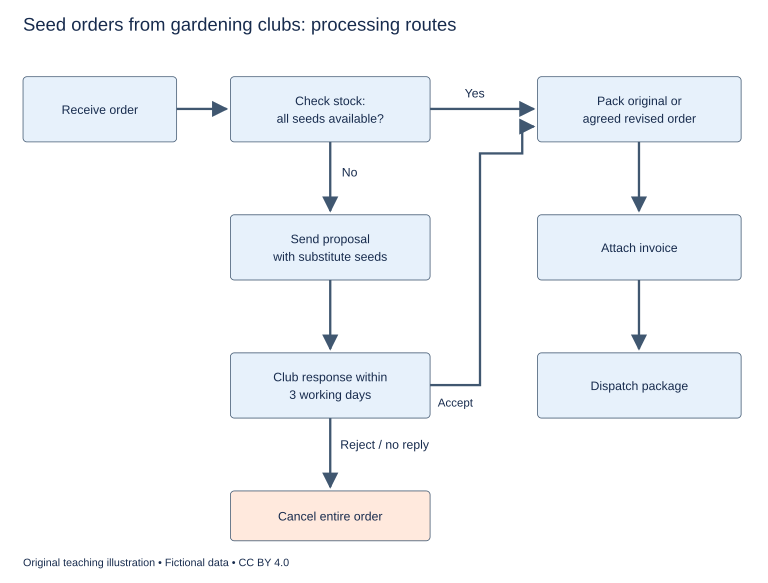

# U17 第10周：长篇阅读、写作与口语

本页为已独立核验的原创文字课程。先完成学生题目，再展开对应参考。非真题、非标准化模考，不换算雅思分数。听力尚未补齐，本页不代表全科课程已完成。

每周选A或G类Task 1一题，加Task 2及三次口语。参考范文不是学生已完成作业，仍须提交初稿、录音和重写，独立真人评分另行安排。

阅读每周180分钟（60分钟首次限时、120分钟证据精读与延迟复测），写作180分钟、口语120分钟。词汇60分钟、听力180分钟另列；新增完整听力未验收，不能勾整周完成。

W12限时复盘按实际错因与延迟复测记录调整；本页原创技能卷不能充当正式陌生卷。后续周数与达标规则见 [U04](u04-exam-preparation.md)。

## 阅读：首答不查词

### R-W10-01 · How Familiar Should a Translation Feel?

W10｜正文 865 词｜13 题｜篇章：作者论证：两种主张、反例与有限结论（6段）

本课必做60分钟：首答20、证据复盘20、词汇长句10、48小时后复测10。每周三课180分钟，合卷首答替代单课首答，不重复计算。开放短文选做另加15分钟。

本项目原创虚构教学情境，人物、地点、历史事件和案例数据均非真实研究或史料。科学解释只讨论文内说明的模型与条件。非雅思真题或标准化模考；正确数不换算雅思等级。许可：CC BY 4.0 — RayXBuilds and contributors。

能力点：识别论证关系、区分作者与引述者、条件与因果、精确定位。初读不查词，完成后打开独立答案页。

#### Passage

**A** A fictional publisher commissions a new translation of a short novel about families living around a shared courtyard. The translator, Ilen, encounters a word used for an evening gathering that combines conversation, practical help and a small exchange of food. No single word in the target language covers exactly that arrangement. One editor proposes party, which is immediately recognisable. Another proposes leaving the original word unchanged. The choice looks like a contest between ease and faithfulness, but those terms conceal more than they explain. A familiar word can suggest relationships absent from the scene, while an unfamiliar word can become an unexplained obstacle. The writer argues that a translation should be evaluated through the distinctions a passage needs, rather than through a general demand that it always sound either foreign or completely at home. Neither surface smoothness nor visible strangeness is proof of accuracy.

**B** The editor favouring party has a practical concern. A reader interrupted by unfamiliar vocabulary may lose the movement of the story. The gathering is described during an argument, and a long explanation could make the characters seem to pause while a lecturer addresses the audience. Ilen accepts this concern without accepting the proposed word. In the source passage, attendance carries an expectation of helping a neighbour with a task. Party could encourage readers to imagine an optional celebration. That difference affects the argument between the characters, not just the atmosphere of the setting. A word that keeps the sentence moving while changing the reason for a person's anger has not solved the translator's problem. Fluency has to be assessed alongside the inferences it invites, especially where those inferences explain what happens next in the narrative.

**C** The editor favouring the original term points to its cultural specificity. Retaining it could remind readers that the social arrangement is not identical to one they already know. But the bare term does not explain the obligation either. A reader might simply skip it or treat it as a decorative name. The writer therefore rejects the notion that leaving a word untranslated automatically preserves its meaning. Meaning depends partly on what the surrounding passage enables the reader to infer. In this scene, Ilen adds a brief reference to the work expected at the gathering and then uses the original term. The solution is not offered as a formula for every novel. It is a local response to a distinction that matters at this particular moment, with a cost in length that the translator judges small enough to accept.

**D** A later scene creates the opposite problem. A character uses an exaggerated title to tease a close friend. Keeping the formal title word for word makes the exchange sound respectful in the target language, losing the humour established by the relationship. Here Ilen chooses a familiar teasing expression rather than retaining the unusual phrase. The apparent inconsistency is defensible because the relevant function has changed. The earlier scene needed readers to notice an unfamiliar obligation; this one needs them to recognise affectionate mockery. A rule based only on whether individual words remain visible would treat the two decisions as contradictory. A rule concerned with the scene's action can explain why they differ. This does not give translators permission to rewrite anything they dislike. Their choices still need to answer to evidence in the passage and to its wider pattern of relationships.

**E** To make those choices inspectable, Ilen keeps a decision notebook containing the disputed phrase, possible versions and the reasons for rejecting each. A scene map identifies who is speaking, to whom and under what pressure. These records are not inserted wholesale into the novel. They allow the editor to examine a choice without relying entirely on the translator's confidence. Where a word recurs, a term list helps identify whether the same social meaning remains relevant or whether its function has shifted. Consistency is useful when it preserves a connection, but mechanical consistency can hide a change. The writer would rather see a justified difference than an identical rendering that makes two unlike uses seem the same. Explanation, not repetition alone, is what makes the work accountable to another careful reader.

**F** The publisher finally asks two readers to describe what they think happens in the courtyard scene. One version leads both to expect entertainment; another leads them to notice the obligation to help. This is a useful check on interpretation, not a vote that can settle every literary choice. Readers can disagree for reasons unrelated to the translation, and a small test cannot represent every future audience. Ilen records their comments on a reader sheet and revises a transition that had obscured who was expected to work. The finished book includes a short translator's note explaining the treatment of the recurring term. Its aim is not to certify the translation as beyond dispute. It gives readers a way to understand a deliberate choice. Good translation, in this account, is neither invisible replacement nor a display of difficult words. It is reasoned attention to what readers need to recognise and which differences a passage cannot afford to lose. That attention may produce smooth sentences in one place and a deliberately unfamiliar expression in another, without abandoning a coherent purpose.

#### Questions

**Do the following statements agree with the writer's views? Write YES, NO or NOT GIVEN. YES = the writer agrees; NO = the writer expresses the opposite view; NOT GIVEN = the writer's view is not stated. Do not use outside knowledge.**

1. An untranslated term automatically preserves its meaning.

2. Different renderings can be justified when a term’s function changes.

3. Translators may freely rewrite passages merely because they dislike them.

4. The writer thinks translated novels should always be sold more cheaply.

**Choose ONE answer, A, B, C or D.**

5. The opening challenges the assumption that

   A. all languages have identical words
   B. courtyard scenes cannot be translated
   C. publishers never influence translation
   D. familiarity or strangeness alone proves accuracy

6. Why is party inadequate in the first scene?

   A. It identifies the wrong speaker
   B. It has no meaning
   C. It changes the implied social obligation
   D. It is too long to print

7. Why use a familiar expression in the teasing scene?

   A. To avoid all editorial discussion
   B. To make the friend seem superior
   C. To remove every cultural difference
   D. To preserve the affectionate function of the exchange

8. The reader test is presented as

   A. a definitive vote
   B. a census of every audience
   C. a substitute for reading the source
   D. a limited check on interpretation

**Complete the sentences. Choose NO MORE THAN 3 WORDS FROM THE PASSAGE for each answer. Do not change word forms.**

9. Disputed alternatives and reasons are kept in a ______.

10. Speaker relationships and pressures are laid out on a ______.

11. Recurring expressions are checked through a ______.

12. The comments from the two readers are written on a ______.

13. The book explains the recurring term in a short ______.

#### 本周重点

立场：分别标出作者、引述者和被反驳观点；保留 may、only、all 等范围词。

#### 复盘

必做：给每道错题标记“定位/作者立场/范围/语法/词数”，抄最短证据；用一行箭头概括本文论证或过程。48小时后重做错题与两道正确题，检查是否仍能指出证据。

选做（15分钟，80–100词）：Explain why two different translation strategies can be justified in one novel.

R-W10-01 答案、证据与精读（首答后展开）

### R-W10-01 · 独立答案与证据

来源与许可同学生页。先完成再核对。可接受答案由 accepted_answers 明确列出；只忽略大小写和首尾空格，不自行删词。开放复盘不计入客观正确数。

1. **NO**｜段落 C｜证据：“rejects the notion”

   直述反对。

2. **YES**｜段落 E｜证据：“rather see a justified difference”

   作者支持有据的差异。

3. **NO**｜段落 D｜证据：“does not give translators permission”

   明确反对。

4. **NOT GIVEN**｜段落 F｜证据：“The finished book includes”

   未讨论价格。

5. **D**｜段落 A｜证据：“Neither surface smoothness nor visible strangeness is proof”

   作者反对表层判准。

6. **C**｜段落 B｜证据：“an optional celebration”

   改变人物行为原因。

7. **D**｜段落 D｜证据：“recognise affectionate mockery”

   场景作用不同，不是随意偏好。

8. **D**｜段落 F｜证据：“not a vote that can settle every literary choice”

   明确保留测试限度。

9. **decision notebook / notebook**｜段落 E｜证据：“keeps a decision notebook”

   notebook为合理短答。

10. **scene map / map**｜段落 E｜证据：“A scene map identifies”

   term list不记录人物关系。

11. **term list / list**｜段落 E｜证据：“a term list helps identify”

   list可接受；不同功能不强求同一译法。

12. **reader sheet / sheet**｜段落 F｜证据：“on a reader sheet”

   sheet为可接受载体。

13. **translator's note / note**｜段落 F｜证据：“a short translator's note”

   note为中心词；译者说明不宣称权威终结争论。

#### 词汇与长句

- **rendering**：译法
- **obligation**：义务或应履行的期待
- **mockery**：戏谑；嘲弄
- **accountable**：可向他人说明理由并接受审查的

> Fluency has to be assessed alongside the inferences it invites, especially where those inferences explain what happens next in the narrative.

it指fluency；where说明特别重要的语境。

> Consistency is useful when it preserves a connection, but mechanical consistency can hide a change.

when限定一致性的价值；but转折并非反对所有一致性。

#### 开放任务参考

B义务与D戏谑功能不同；E选择需有文本理由，不能等同随意改写。

标准：观点有文内依据，保留条件和范围，推断明确标注；不存在唯一措辞。

### R-W10-02 · The Shop Between Two Tenants

W10｜正文 998 词｜13 题｜篇章：论证：临时使用的收益、负担与条件（9段）

本课必做60分钟：首答20、证据复盘20、词汇长句10、48小时后复测10。每周三课180分钟，合卷首答替代单课首答，不重复计算。开放短文选做另加15分钟。

本项目原创虚构教学情境，人物、地点、历史事件和案例数据均非真实研究或史料。科学解释只讨论文内说明的模型与条件。非雅思真题或标准化模考；正确数不换算雅思等级。许可：CC BY 4.0 — RayXBuilds and contributors。

能力点：识别论证关系、区分作者与引述者、条件与因果、精确定位。初读不查词，完成后打开独立答案页。

#### Passage

**A** An empty shop in the fictional town of Bellan becomes the centre of an argument about temporary use. A group wants to run a repair exhibition there while the owner searches for a long-term tenant. Supporters describe an obvious improvement: activity would replace a blank window, and visitors would learn practical skills. Critics worry that a short arrangement may be celebrated as a lasting solution to commercial decline. The writer considers both concerns legitimate but incomplete. The useful question is not whether temporary occupation is good in itself. It is which benefits depend on its temporary nature, which costs persist after it ends, and whether the people accepting those costs understand the arrangement before work begins.

**B** The exhibition organiser, Sera, values the short lease because it permits an experiment that could not support a permanent shop. Volunteers want to test demonstrations and discover which subjects attract questions. A fixed ending can encourage them to define a manageable programme rather than promise indefinite service. Sera does not claim that the exhibition will replace lost businesses. Her argument is narrower: unused space can support a worthwhile activity without first acquiring a permanent purpose. The writer agrees that judging every experiment by whether it becomes permanent would discard useful forms of learning. Permanence is one possible outcome, not the only evidence that a short project has achieved something of value.

**C** The owner, Cal, welcomes someone maintaining the interior but wants the shop available quickly if a tenant appears. This creates a difference between a short lease with a known final date and an arrangement that can end at uncertain notice. Volunteers may invest time in fitting shelves or adapting displays without knowing how long those changes will be useful. Describing both arrangements merely as temporary hides a major distinction. The writer regards predictable notice as part of the practical offer, not a minor detail that can be settled after people commit themselves. A cheap space with an unpredictable ending can impose costs that do not appear in its monthly rent.

**D** Neighbouring trader Min worries about expectations. Visitors attracted by the exhibition may return after it has closed and assume that the town failed to sustain it. A celebration announcing a new community hub would encourage that interpretation. Min recommends public information that gives the closing date from the beginning and explains what is being tested. This does not require making the project sound unimportant. It allows its success to be described against the promise actually made. The writer supports that distinction. A temporary activity should not need the appearance of permanence to justify attention, especially when inflated promises can make a planned ending look like an embarrassing collapse.

**E** Practical preparation also matters. The building has storage rooms and narrow circulation routes left by its previous occupant. The organisers cannot assume that an attractive front window makes the interior suitable for every demonstration. In this fictional planning exercise, they prepare a use plan showing visitor movement, equipment and areas that will remain closed. Specialist requirements are left for the relevant building professionals to assess; the passage does not provide technical instructions for public premises. Its point is that suitability depends on the proposed activity. A room appropriate for displaying small objects may not be appropriate for crowded sessions involving moving equipment, even when the lease and the publicity describe both simply as an exhibition.

**F** The agreement eventually includes an exit inventory. It lists which shelves belong to the owner, which objects belong to volunteers and which changes must be reversed. This is discussed before installation rather than during a hurried departure. The project also maintains a booking calendar with a visibly marked final week. Demonstrations that depend on follow-up are scheduled early enough for that follow-up to occur before closing. These records connect the end of the project with its design. Treating departure as an exceptional interruption would be misleading when departure was built into the arrangement from the start. Planning for it makes the temporary activity more credible, not less ambitious within its stated limits.

**G** The exhibition attracts questions about repairing household objects, but the organisers avoid counting every visitor as a person who has learned a skill. They distinguish attendance, participation and later use of the method. A brief visitor card asks what someone tried and what remained unclear. It is optional, and the team records that respondents may differ from people who leave without completing it. These modest records cannot establish the town's economic recovery. They can help assess whether particular demonstrations worked as intended. The writer would rather see a limited claim supported by relevant evidence than a much larger claim assembled by attaching a hopeful interpretation to every person who passed through the doorway.

**H** When the exhibition closes, volunteers hold a handover session at which useful materials are offered to an existing local workshop. Not every object is retained, and no new permanent organisation is announced. Some visitors are disappointed, while others understand the ending because it has been visible throughout the programme. The closing event is not proof that temporary projects always transfer their benefits successfully. It shows one way to make continuity a concrete question: which resources, skills or relationships can another activity actually use? Simply asserting that the project leaves a legacy would not answer that question without identifying something that remains available after the keys have been returned.

**I** Bellan's experience supports a conditional defence of temporary use. A short project can make room for experimentation and provide a valuable service, but only if its commitments fit its duration and its costs are not hidden by the enthusiasm of its opening. Empty space is an opportunity, not an argument that any proposed use must be beneficial. The test is whether the project makes an honest promise, provides the conditions needed to fulfil it and prepares for the point at which the promise ends. A planned ending can then be part of a successful design rather than a fact that publicity tries not to mention.

#### Questions

**Which paragraph contains the following information? Write a letter, A–I. You may use any letter more than once.**

1. a distinction between a fixed end date and an uncertain period of notice

2. a warning that front-window appearance does not establish interior suitability

3. a record assigning ownership and responsibilities for removing installations

4. a proposed transfer of remaining materials to an existing organisation

**Do the following statements agree with the writer's views? Write YES, NO or NOT GIVEN. YES = the writer agrees; NO = the writer expresses the opposite view; NOT GIVEN = the writer's view is not stated. Do not use outside knowledge.**

5. Every worthwhile temporary project must become permanent.

6. Predictable notice is a meaningful part of the offer to organisers.

7. A temporary project needs exaggerated permanence claims to deserve attention.

8. The writer believes Cal should sell the property to Sera.

**Complete the summary. Choose NO MORE THAN 3 WORDS FROM THE PASSAGE for each answer. Do not change word forms.**

The organisers mapped the activity in a (9) ______. Responsibilities at departure were listed in an (10) ______. The final week appeared on a (11) ______. Feedback could be provided on a (12) ______. Materials were later offered to a workshop during a (13) ______.

#### 本周重点

立场：分别标出作者、引述者和被反驳观点；保留 may、only、all 等范围词。

#### 复盘

必做：给每道错题标记“定位/作者立场/范围/语法/词数”，抄最短证据；用一行箭头概括本文论证或过程。48小时后重做错题与两道正确题，检查是否仍能指出证据。

选做（15分钟，80–100词）：Define success for a project that closes on its announced date.

R-W10-02 答案、证据与精读（首答后展开）

### R-W10-02 · 独立答案与证据

来源与许可同学生页。先完成再核对。可接受答案由 accepted_answers 明确列出；只忽略大小写和首尾空格，不自行删词。开放复盘不计入客观正确数。

1. **C**｜段落 C｜证据：“a known final date”

   C两类临时性，不是D宣传日期。

2. **E**｜段落 E｜证据：“an attractive front window”

   E功能与空间匹配。

3. **F**｜段落 F｜证据：“which changes must be reversed”

   exit inventory明确归属与撤除。

4. **H**｜段落 H｜证据：“offered to an existing local workshop”

   H实际移交，非空泛legacy。

5. **NO**｜段落 B｜证据：“Permanence is one possible outcome”

   作者明确同意窄用途。

6. **YES**｜段落 C｜证据：“part of the practical offer”

   非租金外无关细节。

7. **NO**｜段落 D｜证据：“should not need the appearance of permanence”

   作者反对。

8. **NOT GIVEN**｜段落 C｜证据：“wants the shop available quickly”

   未给产权转让立场。

9. **use plan / plan**｜段落 E｜证据：“prepare a use plan”

   plan可接受，空间动线而非租期。

10. **exit inventory / inventory**｜段落 F｜证据：“includes an exit inventory”

   exit inventory 与 inventory 都以元音音素开头，可接 an；两者均指离场责任清单。

11. **booking calendar / calendar**｜段落 F｜证据：“maintains a booking calendar”

   终周标注的预约记录。

12. **visitor card / brief visitor card / card**｜段落 G｜证据：“A brief visitor card”

   原文 brief visitor card 为三词，题干没有重复 brief；该完整词组、visitor card 和 card 均接受。

13. **handover session / session**｜段落 H｜证据：“hold a handover session”

   移交活动名称，可接受中心词。

#### 词汇与长句

- **notice**：提前通知期
- **premises**：用于活动的建筑或场所
- **inventory**：物品及责任清单
- **continuity**：延续性

> A cheap space with an unpredictable ending can impose costs that do not appear in its monthly rent.

that修饰costs；租金不覆盖全部成本。

> A temporary activity should not need the appearance of permanence to justify attention, especially when inflated promises can make a planned ending look like an embarrassing collapse.

should not表达作者立场；不是说所有永久活动无价值。

#### 开放任务参考

B实验学习、G参与效果、H可具体移交资源；不以永久化作唯一指标。

标准：观点有文内依据，保留条件和范围，推断明确标注；不存在唯一措辞。

### R-W10-03 · Why the Jury Chose No Overall Winner

W10｜正文 881 词｜14 题｜篇章：论证：竞争标准与不可直接相加的判断（7段）

本课必做60分钟：首答20、证据复盘20、词汇长句10、48小时后复测10。每周三课180分钟，合卷首答替代单课首答，不重复计算。开放短文选做另加15分钟。

本项目原创虚构教学情境，人物、地点、历史事件和案例数据均非真实研究或史料。科学解释只讨论文内说明的模型与条件。非雅思真题或标准化模考；正确数不换算雅思等级。许可：CC BY 4.0 — RayXBuilds and contributors。

能力点：识别论证关系、区分作者与引述者、条件与因果、精确定位。初读不查词，完成后打开独立答案页。

#### Passage

**A** The fictional design school of Neth runs a competition for a portable reading light. Entries must be easy to carry, pleasant to use and straightforward to repair. The jury expects to choose a single winner, but the strongest entries excel in different ways. One is exceptionally light, another illuminates a wide page evenly, and a third can be opened using an ordinary tool. A sponsor suggests adding scores for the three qualities and selecting the highest total. That seems impartial because every entry would pass through the same calculation. The writer argues that equal treatment in a calculation does not make the choices behind the calculation disappear. Before adding numbers, the jury must understand what the numbers represent and what tradeoffs the addition would permit.

**B** The first problem concerns scales. Weight is recorded in a physical unit, while comfort is judged through a short description and a rating. Converting both to marks out of ten makes them look comparable without establishing that a one-point difference has the same meaning in each category. An improvement from a painful grip to a tolerable one may matter differently from an improvement between two already comfortable grips. Nor is a small reduction in weight necessarily valuable to every user. The jury should not confuse the shared appearance of the scores with a shared interpretation. A numerical table can organise judgement, but it cannot create equivalence merely by placing quantities in adjacent columns and giving them the same maximum possible score.

**C** The sponsor then proposes weights: perhaps repairability should count twice as much as portability. This makes the preference visible, which is an improvement over concealing it in the choice of scale. Yet weighting still allows compensation. Under a weighted total, an excellent result in one category can offset a poor result in another. Sometimes that is acceptable; sometimes it conflicts with the purpose of the product. A lamp that is easy to carry but cannot light the page adequately should not win simply by being extremely light. The writer therefore favours minimum requirements for qualities without which the device cannot perform its basic task. Above those requirements, tradeoffs can be discussed rather than silently encoded as though every quality were infinitely exchangeable for another.

**D** Different users also bring different circumstances. A person carrying the lamp each day may value its weight more than someone keeping it beside a chair. A repair workshop may care about the availability of replacement parts, whereas a traveller may care about how securely the lamp folds. These are not necessarily disagreements about facts. They may be reasonable differences about what matters in a particular use. The competition brief did not identify one primary setting, so the jury cannot retrospectively pretend that all entrants were designing for the same narrow situation. It can either clarify the intended purpose for a future competition or report how the current designs perform under several explicitly stated uses. Selecting a universal winner without acknowledging the ambiguity would make the result easier to announce and harder to interpret.

**E** The jury tests the lamps through a task sequence: opening, positioning, reading, closing and replacing a component. Observers record where participants hesitate or ask for help. A repair sheet lists the tools and steps needed for the replacement. A portability record gives the folded size as well as the mass. These records support more specific discussion than a general impression of quality. They do not settle the choice automatically. A participant's hesitation may come from unfamiliarity rather than a persistent design problem, and a quick repair using a prepared part does not establish that the part will remain available. The writer supports testing because it improves the questions the jury can ask, not because a short demonstration can remove every uncertainty about future use.

**F** After reviewing the evidence, the jury publishes three awards linked to different purposes instead of one overall prize. It also states the minimum requirements every award recipient met. The sponsor worries that this will look indecisive. The writer disagrees: a decision can be definite without pretending that every dimension has been collapsed into a single ordering. The jury has chosen which designs to recognise and has explained the grounds. Its report includes a comparison matrix showing strengths, limitations and unresolved questions. Readers who care about a particular use can inspect the relevant evidence. This is more informative than a solitary rank that leaves them unable to tell whether the leading design performs well on the dimension that matters most to them.

**G** None of this means that totals are always inappropriate or that institutions should never choose a single product. A buyer may have a clearly defined task, a budget and genuine minimum requirements, allowing a defensible choice among acceptable options. The point is to make the decision rule answer to the purpose rather than treating the existence of a formula as its justification. If weights are used, their consequences should be explained; if some shortcomings cannot be compensated, the rule should say so. Neth's jury did not abandon judgement. It exposed the judgements that a neat total would otherwise have hidden. The useful lesson for readers is to ask what an overall score permits a strong result to cancel, and whether that cancellation is appropriate for the service the object is supposed to provide.

#### Questions

**Which paragraph contains the following information? Write a letter, A–G. You may use any letter more than once.**

1. an example contrasting a daily carrier with a stationary user

2. a discussion of nonlinear differences within comfort ratings

3. a sequence of practical tasks used during testing

4. a concern that multiple awards will appear indecisive

5. a statement that weighted scores allow one strength to offset a weakness

**Do the following statements agree with the writer's views? Write YES, NO or NOT GIVEN. YES = the writer agrees; NO = the writer expresses the opposite view; NOT GIVEN = the writer's view is not stated. Do not use outside knowledge.**

6. Numerical totals are inappropriate in every purchasing decision.

7. A decision can be definite without a universal ranking.

8. Testing a repair with a prepared part proves future supply.

9. The sponsor should be forbidden to fund future competitions.

10. Decision rules should be justified in relation to purpose.

**Choose ONE answer, A, B, C or D.**

11. The proposed calculation initially appears impartial because

   A. it treats every entry with the same procedure
   B. it avoids all value choices
   C. all qualities use physical units
   D. the sponsor has no preferences

12. A common ten-point scale does not establish

   A. that mass can be measured
   B. that tables can be printed
   C. that ratings exist
   D. equal meaning for a one-point difference

13. Minimum requirements address the danger that

   A. judges will need descriptions
   B. strength in one area offsets failure of a basic function
   C. every category receives the same weight
   D. no design can be measured

14. Why offer several awards?

   A. To avoid any decision
   B. To recognise suitability for different purposes
   C. To deny all shortcomings
   D. To ignore the brief

#### 本周重点

立场：分别标出作者、引述者和被反驳观点；保留 may、only、all 等范围词。

#### 复盘

必做：给每道错题标记“定位/作者立场/范围/语法/词数”，抄最短证据；用一行箭头概括本文论证或过程。48小时后重做错题与两道正确题，检查是否仍能指出证据。

选做（15分钟，80–100词）：Give one minimum requirement and one tradeoff for a reading light.

R-W10-03 答案、证据与精读（首答后展开）

### R-W10-03 · 独立答案与证据

来源与许可同学生页。先完成再核对。可接受答案由 accepted_answers 明确列出；只忽略大小写和首尾空格，不自行删词。开放复盘不计入客观正确数。

1. **D**｜段落 D｜证据：“someone keeping it beside a chair”

   D使用情境。

2. **B**｜段落 B｜证据：“a painful grip to a tolerable one”

   B不同区间的同分差。

3. **E**｜段落 E｜证据：“opening, positioning, reading, closing”

   E操作观察。

4. **F**｜段落 F｜证据：“this will look indecisive”

   反方担忧而非作者观点。

5. **C**｜段落 C｜证据：“weighting still allows compensation”

   C补偿规则，非G一般总结。

6. **NO**｜段落 G｜证据：“None of this means that totals are always inappropriate”

   作者限定批评。

7. **YES**｜段落 F｜证据：“can be definite without pretending”

   明确肯定。

8. **NO**｜段落 E｜证据：“does not establish that the part will remain available”

   当次演示不证明长期供应。

9. **NOT GIVEN**｜段落 F｜证据：“The sponsor worries”

   未给禁资建议。

10. **YES**｜段落 G｜证据：“make the decision rule answer to the purpose”

   作者结论。

11. **A**｜段落 A｜证据：“same calculation”

   B是被反驳结论，C/D无据。

12. **D**｜段落 B｜证据：“a one-point difference has the same meaning”

   外观可比不等于含义等值。

13. **B**｜段落 C｜证据：“without which the device cannot perform its basic task”

   防止不当补偿。

14. **B**｜段落 F｜证据：“three awards linked to different purposes”

   仍有明确决定和证据。

#### 词汇与长句

- **equivalence**：等值性
- **compensation**：一项优势抵消另一项不足
- **portability**：便携性
- **matrix**：按维度排列的比较表

> A numerical table can organise judgement, but it cannot create equivalence merely by placing quantities in adjacent columns and giving them the same maximum possible score.

but限定数字作用，by后两个并列动名词。

> a decision can be definite without pretending that every dimension has been collapsed into a single ordering.

without后接动名词；definite不等于唯一综合排名。

#### 开放任务参考

C照明基本功能可设门槛，D便携与修理取决用户；不可把喜好冒充事实。

标准：观点有文内依据，保留条件和范围，推断明确标注；不存在唯一措辞。

## 写作与口语：Task 1双分支择一

### WS-W10-T1A 学生页：园艺种子订单处理流程

周次 W10｜题型 T1A｜能力点：流程分支与准确顺序

Task 1 的 A/G 分支二选一，另一分支不计入本周作业。

#### 使用与记录

原创教学练习，非真题、非标准化模拟，难度未校准。先完成本页再打开参考页。人物、机构、经历与数据均为教学虚构。不要背诵示例。自评和 AI 反馈不能代替独立真人评分，未获得真人评阅时标记“分数未确认”。

保存：任务ID、实际日期、用时、初稿或原始录音、证据化反馈、重写/重答、三条修改理由。没有学生提交物，不得填写“已批改”或“已完成训练”。

#### 完整题干

The diagram shows how a seed supplier processes orders placed by gardening clubs. Summarise the information by selecting and reporting the main features, and make comparisons where relevant.

Write at least 150 words. Spend about 20 minutes on this task.

教学虚构业务流程。收单→查库存；全部有货→打包→附账单→发货。部分缺货→向园艺社团发送替代种子提议→等待最多3个工作日：接受→按修改订单打包并合流附账单/发货；拒绝或到期无回复→取消整个订单。图未提供付款、退款、运输时间或回流路径。

#### 任务预算（含首次审题，不额外加时）

初稿20分钟（审题规划3、写作15、检查2）；诊断15；反馈阅读与证据核查10；完整重写25；对照归档5。合计75分钟。

#### 初稿后自评清单

- [ ] 达到最低字数；全文连贯成段，没有用项目符号代替作文。
- [ ] 概述给主要特征；数据、阶段或方位都与题图逐项相符，不推断未提供的原因。
- [ ] 每段可写出一个功能标签；例子或数据与该段要点相连。
- [ ] 圈出两处词汇搭配和两处句法疑点，先自行修正再查询或求反馈。
- [ ] 记录一项最影响理解的问题和原句证据，不填写自猜分数。

#### 反馈与重写

打开 独立参考页（本节下方展开参考），按逐段检查和通用协议核验。重写任务：完整重写至少150词；用if条件句准确区分三种结果，写完沿箭头各走一次，不增加任何付款或运输时长。

#### 本周听读能力迁移（包含在既有预算）

在本题诊断时段内用3分钟：列出题图的“条件→动作”配对，核对有货/缺货、接受/拒绝/无回复各路径；另记付款安排和运输时间为“未提供”，不补原因或时长。对应U04 W10区分已知信息与需澄清信息。

这是本地写说步骤，不依赖音频已交付。若另有合法听读材料，只在该科原定复盘时段使用；没有材料则标待补，不宣称完成听力。

W10 T1A 示例、反馈与重练（首答后展开）

### WS-W10-T1A 独立参考页

只在初稿完成后阅读；不是唯一答案，也没有官方分数。以下是对原创示例的教学讲评，不是对学生尚未提交作文的已完成批改。

#### 思路拆解

概述共同起终点与缺货分支；先主路径再替代路径；三工作日只作用于回复，不推总配送时间。

#### 原创示例

The diagram illustrates how a seed supplier handles orders from gardening clubs, from receiving a request to dispatching the package or cancelling the order. It includes a decision about whether all requested seeds are available.

Overall, orders for items already in stock follow a short route directly to packing. Orders containing unavailable items require an additional proposal and a response from the club. Only orders that can be fulfilled, either as originally requested or in an agreed revised form, proceed to dispatch.

First, the supplier receives an order and checks its stock. If all the requested seeds are available, staff pack the original order. They then attach an invoice and send the package to the club. No separate approval stage is shown for this route.

If some seeds are unavailable, the supplier sends the club a proposal listing possible substitutes. The club is given three working days to respond. An accepted proposal leads to packing the revised order, followed by the same invoicing and dispatch stages used for fully available orders. If the club rejects the proposal, or does not respond within the stated period, the order is cancelled. The diagram shows no further action after cancellation.

示例正文词数：197（本项目正则计数；书信不含称呼、结束语与署名；连字符词作一词）。

#### 逐段反馈与迁移

- P1 终点有发货和取消两种；没有称为循环。

- P2 有货直接打包，缺货须提议及回复；不把所有订单都写成需再次同意。

- P3 查库存→打包→附账单→发货，invoice不是已付款证明。

- P4 接受改订后合流；拒绝或三工作日无回复取消，不是保留部分发货。

#### 常见失误

将三个工作日当成到货保证；忽略无回复分支；擅自补退款或付款节点。

#### 可执行反馈步骤

1. 先把自己的段落标为引入、概述/论点、支持、收束；分段可不同于示例，按功能核查，不照抄段数。
2. 对照上方逐段检查，逐项标“已有证据/缺失/不适用”。每条意见必须附自己的原句或缺失位置。
3. 按 [反馈协议](u20-feedback.md) 的四维表记录；有争议的 AI 意见回题干、数据或语法依据核验。
4. 只选两项最高优先级问题执行整篇重写；保留原稿，禁止把示例替换为自己的作业。

#### 重写任务

完整重写至少150词；用if条件句准确区分三种结果，写完沿箭头各走一次，不增加任何付款或运输时长。

完成后重新勾选 学生页（见本节上方学生题） 清单；将一处改前/改后及理由交给独立评阅者核查。真人评阅状态目前为“待安排”，不是已完成。

### WS-W10-T1G 学生页：向社团组织者澄清志愿岗位

周次 W10｜题型 T1G｜能力点：书信目的、要点与语气

Task 1 的 A/G 分支二选一，另一分支不计入本周作业。

#### 使用与记录

原创教学练习，非真题、非标准化模拟，难度未校准。先完成本页再打开参考页。人物、机构、经历与数据均为教学虚构。不要背诵示例。自评和 AI 反馈不能代替独立真人评分，未获得真人评阅时标记“分数未确认”。

保存：任务ID、实际日期、用时、初稿或原始录音、证据化反馈、重写/重答、三条修改理由。没有学生提交物，不得填写“已批改”或“已完成训练”。

#### 完整题干

You volunteered to help at a neighbourhood gardening day, but the information about your role is unclear. Write to the organiser, Ms Brown. In your letter:
- explain what you understood your role to be
- describe the information that has caused confusion
- ask for clarification and explain what work you can do.
Begin your letter: Dear Ms Brown,

Write at least 150 words. You do not need to write any addresses. Spend about 20 minutes on this task.

#### 任务预算（含首次审题，不额外加时）

初稿20分钟（审题规划3、写作15、检查2）；诊断15；反馈阅读与证据核查10；完整重写25；对照归档5。合计75分钟。

#### 初稿后自评清单

- [ ] 达到最低字数；全文连贯成段，没有用项目符号代替作文。
- [ ] 三个要点均展开；称呼、目的、语气和结束语适合收信人。
- [ ] 每段可写出一个功能标签；例子或数据与该段要点相连。
- [ ] 圈出两处词汇搭配和两处句法疑点，先自行修正再查询或求反馈。
- [ ] 记录一项最影响理解的问题和原句证据，不填写自猜分数。

#### 反馈与重写

打开 独立参考页（本节下方展开参考），按逐段检查和通用协议核验。重写任务：完整重写至少150词；分别用过去理解和当前文件定位冲突，再以两条明确请求结束，保留半正式语气。

#### 本周听读能力迁移（包含在既有预算）

在本题诊断时段内用3分钟：分列“原理解→新排班信息→待确认事项”，用初稿或题干证据定位角色与时间的冲突；组织者为何调整未说明，标为“未知”，不猜理由。对应U04 W10准确转述与澄清。

这是本地写说步骤，不依赖音频已交付。若另有合法听读材料，只在该科原定复盘时段使用；没有材料则标待补，不宣称完成听力。

W10 T1G 示例、反馈与重练（首答后展开）

### WS-W10-T1G 独立参考页

只在初稿完成后阅读；不是唯一答案，也没有官方分数。以下是对原创示例的教学讲评，不是对学生尚未提交作文的已完成批改。

#### 思路拆解

半正式澄清；区分自己原理解与后来材料，不直接指责组织者；明确能力边界并提出可做工作。

#### 原创示例

Dear Ms Brown,

Thank you for including me in the neighbourhood gardening day next Saturday. When we spoke last week, I understood that I would be helping at the registration table from nine until midday. I was expecting to welcome volunteers, check their names and direct them to the appropriate part of the garden.

However, the schedule sent out yesterday lists me as the leader of the planting group. It also gives my starting time as eight in the morning. I am not sure whether this is an intentional change or whether my name has been placed in the wrong section. As I have very little gardening experience, I would not feel confident giving other volunteers instructions about planting.

Could you please confirm which role and starting time you would like me to follow? I am happy to manage registration or help distribute tools after a brief explanation. I can arrive at eight if necessary, but I would appreciate knowing in advance so that I can arrange transport. Please let me know whether there is any preparation I should complete before the day.

Best wishes,
Alex Chen

示例正文词数：180（本项目正则计数；书信不含称呼、结束语与署名；连字符词作一词）。

#### 逐段反馈与迁移

- P1 原理解包括工作与时间，可与新表对比。

- P2 新角色/新时间带来两处歧义，承认可能是安排变化而非断言错误。

- P3 询问两处并说明可选岗位、交通和准备；没有假装具备园艺指导资质。

#### 常见失误

含糊问what should I do却不说明冲突；语气变成责备；只说不能做不提供可做事项。

#### 可执行反馈步骤

1. 先把自己的段落标为引入、概述/论点、支持、收束；分段可不同于示例，按功能核查，不照抄段数。
2. 对照上方逐段检查，逐项标“已有证据/缺失/不适用”。每条意见必须附自己的原句或缺失位置。
3. 按 [反馈协议](u20-feedback.md) 的四维表记录；有争议的 AI 意见回题干、数据或语法依据核验。
4. 只选两项最高优先级问题执行整篇重写；保留原稿，禁止把示例替换为自己的作业。

#### 重写任务

完整重写至少150词；分别用过去理解和当前文件定位冲突，再以两条明确请求结束，保留半正式语气。

完成后重新勾选 学生页（见本节上方学生题） 清单；将一处改前/改后及理由交给独立评阅者核查。真人评阅状态目前为“待安排”，不是已完成。

### WS-W10-T2 学生页：社区花园还是儿童游乐场

周次 W10｜题型 T2｜能力点：观点展开与任务回应

A/G 共用本题。

#### 使用与记录

原创教学练习，非真题、非标准化模拟，难度未校准。先完成本页再打开参考页。人物、机构、经历与数据均为教学虚构。不要背诵示例。自评和 AI 反馈不能代替独立真人评分，未获得真人评阅时标记“分数未确认”。

保存：任务ID、实际日期、用时、初稿或原始录音、证据化反馈、重写/重答、三条修改理由。没有学生提交物，不得填写“已批改”或“已完成训练”。

#### 完整题干

Some people think unused land in residential areas should become community gardens. Others believe it should be used for children’s playgrounds. Discuss both views and give your own opinion. Give reasons and include relevant examples.

Write at least 250 words. Spend about 40 minutes on this task.

#### 任务预算（含首次审题，不额外加时）

初稿40分钟（审题规划5、写作30、检查5）；诊断15；反馈阅读与证据核查10；完整重写35；对照归档5。合计105分钟。

#### 初稿后自评清单

- [ ] 达到最低字数；全文连贯成段，没有用项目符号代替作文。
- [ ] 直接回答题目的所有问句，有始终一致的立场。
- [ ] 每段可写出一个功能标签；例子或数据与该段要点相连。
- [ ] 圈出两处词汇搭配和两处句法疑点，先自行修正再查询或求反馈。
- [ ] 记录一项最影响理解的问题和原句证据，不填写自猜分数。

#### 反馈与重写

打开 独立参考页（本节下方展开参考），按逐段检查和通用协议核验。重写任务：完整重写至少250词；选两个相反的社区条件测试你的判断，说明在何种情况下优先选择会改变。

#### 本周听读能力迁移（包含在既有预算）

在本题诊断/回听时段内用3分钟：将两个立场分别转述为“谁主张什么、理由是什么”，不混淆说话者；口语遇到范围不清可先作简短澄清再回答。对应U04 W10立场与澄清。

这是本地写说步骤，不依赖音频已交付。若另有合法听读材料，只在该科原定复盘时段使用；没有材料则标待补，不宣称完成听力。

W10 T2 示例、反馈与重练（首答后展开）

### WS-W10-T2 独立参考页

只在初稿完成后阅读；不是唯一答案，也没有官方分数。以下是对原创示例的教学讲评，不是对学生尚未提交作文的已完成批改。

#### 思路拆解

公平比较同一块土地的两用途；每方讲受益者与条件；自己的意见用周边缺口而非一概折中。

#### 原创示例

Unused land in residential areas could provide space either for community gardening or for children’s play. Both uses can improve local life, but I do not think the same choice is appropriate everywhere. The decision should reflect which facilities residents currently lack and who would be able to use the site.

Community gardens can give people without private outdoor space an opportunity to grow plants and meet neighbours. Working on shared beds provides a practical reason for residents to return regularly and exchange advice. Older people who prefer a quieter activity may find this especially attractive. A garden can also include simple tasks for children, such as watering or observing insects. However, these benefits depend on continuing participation. If only a few people take responsibility, the garden may become difficult to maintain or feel like a private space controlled by one group.

Playgrounds meet a different need. In a neighbourhood where families live in small flats, a nearby place to run and climb can be important. Parents may find a local playground easier to visit than a distant park, especially when they have limited time. Nevertheless, a playground designed only for very young children may serve a narrower group than supporters expect. Its usefulness will also depend on appropriate equipment, maintenance and access, rather than simply installing a few structures on empty land.

I would therefore begin by examining the surrounding area and asking residents about missing facilities. If there is already a well-used playground nearby but little space for gardening, a community garden may offer greater additional value. Where children have no accessible place to play, their needs may take priority. A sufficiently large site could include both, but dividing a very small plot might leave neither activity with enough room.

Overall, neither proposal is universally superior. Comparing unmet needs, practical access and long-term maintenance provides a stronger basis for a decision than favouring one activity in every neighbourhood.

示例正文词数：320（本项目正则计数；书信不含称呼、结束语与署名；连字符词作一词）。

#### 逐段反馈与迁移

- P1 提供选择标准，不把depends当作不表态。

- P2 花园社交机制具体，并承认维护与排他风险；没有假定人人爱种植。

- P3 游乐场的空间需求与可达性解释充分；限制并非否定儿童需求。

- P4 用现有配套构成反例，反对每块地都同一种用途；混合方案受面积限制。

- P5 重申缺口、可达和维护三标准，无新的无关理由。

#### 常见失误

两方使用不同标准作不公平比较；认定老人只需要花园儿童只需要游乐场；认为任何小地都可两用。

#### 可执行反馈步骤

1. 先把自己的段落标为引入、概述/论点、支持、收束；分段可不同于示例，按功能核查，不照抄段数。
2. 对照上方逐段检查，逐项标“已有证据/缺失/不适用”。每条意见必须附自己的原句或缺失位置。
3. 按 [反馈协议](u20-feedback.md) 的四维表记录；有争议的 AI 意见回题干、数据或语法依据核验。
4. 只选两项最高优先级问题执行整篇重写；保留原稿，禁止把示例替换为自己的作业。

#### 重写任务

完整重写至少250词；选两个相反的社区条件测试你的判断，说明在何种情况下优先选择会改变。

完成后重新勾选 学生页（见本节上方学生题） 清单；将一处改前/改后及理由交给独立评阅者核查。真人评阅状态目前为“待安排”，不是已完成。

### WS-W10-S1 学生页

周次W10｜Part 1专项｜能力点：澄清问题范围，准确转述不同立场｜30分钟

#### 使用与记录

原创教学练习，非真题、非标准化模拟，难度未校准。先完成本页再打开参考页。人物、机构、经历与数据均为教学虚构。不要背诵示例。自评和 AI 反馈不能代替独立真人评分，未获得真人评阅时标记“分数未确认”。

保存：任务ID、实际日期、用时、初稿或原始录音、证据化反馈、重写/重答、三条修改理由。没有学生提交物，不得填写“已批改”或“已完成训练”。

#### 操作与预算

设备与审题3分钟；首答录音6；回听及局部转写7；示例和诊断5；不看稿重答6；归档3。共30分钟。

#### Part 1专项题

1. Do you enjoy growing plants?
2. Do you have any plants at home?
3. Would you like access to a shared garden?
4. What do you usually do when you do not understand an instruction?

追问：

- What kind of help would be useful?
- Can you describe a time you asked for clarification?

#### 录音回听清单

- [ ] 保留首答原音，记录实际时长、是否中断、是否看稿；只报真实完成状态。
- [ ] 流利与连贯：标出两处时间戳，区分构思停顿与重复搜词，检查是否偏离问句。
- [ ] 词汇：找一处模糊词或重复表达，先解释原意再替换；不为难词改变意思。
- [ ] 语法：核对经历与习惯的时态；局部转写并更正两处妨碍理解的问题。
- [ ] 发音：不看转写听30秒，标听不清的词尾、重音或断句；没有音频不能判断发音。
- [ ] 展开：主要回答有具体情境或理由；追问后第一句回应追问的新角度。

#### 重答要求

选择两个只有笼统判断的答案，先直接回应再加具体情境；重答一条追问，检查是否真正回应其新角度。

首答回听后才打开独立参考页（本节下方展开参考）。按[反馈协议](u20-feedback.md)填至少三个时间戳，不以文字转写替代音频评阅。

#### 本周听读能力迁移（包含在既有预算）

在本题回听时段内用3分钟：从自己的首答选一个需澄清的表达，写“模糊点→具体澄清问句→已得到的答复或仍未知”；若首答没有这种情境，可将一条可能误解的问句标为“假设练习”，答复标“待询问”，不编造对方意见。对应U04 W10澄清与展开。

没有已交付听力的假设；以本题原音或文字做迁移，不记录为额外听力完成。

W10 S1 示例、反馈与重练（首答后展开）

### WS-W10-S1 独立参考页

原创教学示例，非真题或评分结果。未收到学生音频；以下是示例分析与待执行反馈，不能登记为已完成学生批改。

#### 展开示例

##### 直接回应→原因→具体情境的展开示例

If an instruction is unclear, I usually repeat what I think it means and ask whether I have understood correctly. For example, when a neighbour asked me to water her plants regularly, I asked how often she meant. It was a small question, but it was more useful than pretending that regularly meant the same thing to both of us.

纯口答示例词数：60；只计MODEL标记内实际英文口答，不含标题、标签、说明。词数不能证明录音时长或流利度。

#### 展开与反馈

本周能力：澄清问题范围，准确转述不同立场。

1. 示例先表态，再说明偏好理由，最后提供条件或场景。检查自己是否用一个词回答后就结束。
2. 找到一个具体细节：物品、动作、对话或地点。用自己的经历替换，保持与题卡相关，不照搬示例身份与经历。
3. 追问要重新回应，不能继续背长答。首句先回答追问，再用一条理由支持。
4. 标出一处听不清或语法影响理解的原音时间戳；先尝试最小修正。不要把自然停顿一概当成错误，或用加快语速掩盖逻辑断裂。

#### 常见失误

空泛形容词替代具体过程；给了经历却没解释为什么重要；Part 3只有个人故事没有一般解释；AI只看转写就判断发音。逐项回原音核对，不能凭范例推断自己已达到某个分数。

#### 可执行重答与反馈

选择两个只有笼统判断的答案，先直接回应再加具体情境；重答一条追问，检查是否真正回应其新角度。

填写[反馈协议](u20-feedback.md)四维表，附三个时间戳和原话证据。选一个内容问题与一个语言问题先修；重答后并排听两段，记录改善与仍未解决之处。自评与AI不能替代独立真人评分；独立评阅目前待安排，分数未确认。

### WS-W10-S2 学生页

周次W10｜Part 2专项｜能力点：澄清问题范围，准确转述不同立场｜30分钟

#### 使用与记录

原创教学练习，非真题、非标准化模拟，难度未校准。先完成本页再打开参考页。人物、机构、经历与数据均为教学虚构。不要背诵示例。自评和 AI 反馈不能代替独立真人评分，未获得真人评阅时标记“分数未确认”。

保存：任务ID、实际日期、用时、初稿或原始录音、证据化反馈、重写/重答、三条修改理由。没有学生提交物，不得填写“已批改”或“已完成训练”。

#### 操作与预算

准备、首答录音及追问5分钟；回听及局部转写8；示例与诊断5；关键词重组3；重答及追问5；归档4。共30分钟。

#### Part 2专项任务卡

Describe a time you needed to clarify some information. Say what the situation was, what was unclear, how you asked for clarification, and explain how the answer helped you.

准备1分钟，说1～2分钟。只记5个关键词，不预写句子。

收尾追问：

- Was the other person willing to explain?
- Would you ask the same question in a similar situation?

#### 录音回听清单

- [ ] 保留首答原音，记录实际时长、是否中断、是否看稿；只报真实完成状态。
- [ ] 流利与连贯：标出两处时间戳，区分构思停顿与重复搜词，检查是否偏离问句。
- [ ] 词汇：找一处模糊词或重复表达，先解释原意再替换；不为难词改变意思。
- [ ] 语法：核对经历与习惯的时态；局部转写并更正两处妨碍理解的问题。
- [ ] 发音：不看转写听30秒，标听不清的词尾、重音或断句；没有音频不能判断发音。
- [ ] 展开：主要回答有具体情境或理由；追问后第一句回应追问的新角度。

#### 重答要求

用五个关键词重答完整任务卡1～2分钟，再答两条追问；补一处具体行动或细节并删一处无关背景。比较首答与重答，不背示例。

首答回听后才打开独立参考页（本节下方展开参考）。按[反馈协议](u20-feedback.md)填至少三个时间戳，不以文字转写替代音频评阅。

#### 本周听读能力迁移（包含在既有预算）

在本题回听时段内用3分钟：只用自己刚讲的澄清经历，列“模糊点→实际澄清问句→已得到的答复或仍未知”；未述及的答复标“未知/待补述”，不猜对方理由，也不强行构造两方立场。对应U04 W10澄清与展开。

没有已交付听力的假设；以本题原音或文字做迁移，不记录为额外听力完成。

W10 S2 示例、反馈与重练（首答后展开）

### WS-W10-S2 独立参考页

原创教学示例，非真题或评分结果。未收到学生音频；以下是示例分析与待执行反馈，不能登记为已完成学生批改。

#### 展开示例

##### 原创长答示例（时长须以个人实际录音测量）

I once needed to clarify instructions for a volunteer afternoon at a community garden. The message said that we should bring suitable equipment, but it did not explain what that included. I had no gardening tools and wondered whether I should buy some.

I wrote to the organiser and explained that this would be my first visit. Instead of simply saying that I was confused, I asked whether volunteers needed their own tools or only gloves and suitable shoes.

She replied that the garden supplied tools, but that we should bring gloves if we had them. She also explained that beginners would be paired with experienced volunteers. That answered another concern I had not expressed clearly: whether I would be expected to know what to do immediately.

The reply helped me arrive prepared without spending money unnecessarily. It also made the day less intimidating. I learned that asking a precise question can save both people time, especially when a short instruction assumes experience that a newcomer does not have.

纯口答示例词数：169；只计MODEL标记内实际英文口答，不含标题、标签、说明。词数不能证明录音时长或流利度。

#### 展开与反馈

本周能力：澄清问题范围，准确转述不同立场。

1. 长答示例按背景、行动/观察、变化与意义组织。每段都推进内容；检查自己是否只有背景而没有具体事件。
2. 找到一个具体细节：物品、动作、对话或地点。用自己的经历替换，保持与题卡相关，不照搬示例身份与经历。
3. 追问要重新回应，不能继续背长答。首句先回答追问，再用一条理由支持。
4. 标出一处听不清或语法影响理解的原音时间戳；先尝试最小修正。不要把自然停顿一概当成错误，或用加快语速掩盖逻辑断裂。

#### 常见失误

空泛形容词替代具体过程；给了经历却没解释为什么重要；Part 3只有个人故事没有一般解释；AI只看转写就判断发音。逐项回原音核对，不能凭范例推断自己已达到某个分数。

#### 可执行重答与反馈

用五个关键词重答完整任务卡1～2分钟，再答两条追问；补一处具体行动或细节并删一处无关背景。比较首答与重答，不背示例。

填写[反馈协议](u20-feedback.md)四维表，附三个时间戳和原话证据。选一个内容问题与一个语言问题先修；重答后并排听两段，记录改善与仍未解决之处。自评与AI不能替代独立真人评分；独立评阅目前待安排，分数未确认。

### WS-W10-S3 学生页

周次W10｜三部分全流程｜能力点：澄清问题范围，准确转述不同立场｜60分钟

#### 使用与记录

原创教学练习，非真题、非标准化模拟，难度未校准。先完成本页再打开参考页。人物、机构、经历与数据均为教学虚构。不要背诵示例。自评和 AI 反馈不能代替独立真人评分，未获得真人评阅时标记“分数未确认”。

保存：任务ID、实际日期、用时、初稿或原始录音、证据化反馈、重写/重答、三条修改理由。没有学生提交物，不得填写“已批改”或“已完成训练”。

#### 操作与预算

D5：设备与流程准备2分钟，连续首答11～14分钟，余14～17分钟完整回听标记，共30分钟。D6：局部转写诊断10，阅读示例与调整5，重答与新追问10，对照归档5，共30分钟。合计60分钟。

#### 连续三部分全流程（首答不可看参考）

找同伴读题，或独练逐题揭示。完整首答11～14分钟，中途不暂停纠错。模拟同伴不是认证考官；自行读题的练习记录不能冒充真实面试。

##### Part 1：4～5分钟

1. Do you like making arrangements with friends?
2. How do you usually confirm a meeting time?
3. Do you prefer spoken or written instructions?
4. What kinds of messages do you answer quickly?
5. Do you enjoy working with others?
6. What can make teamwork difficult?

可按回答追加 Why? / Can you give an example? 到时转下部分，不强行说完全部备用问题。

##### Part 2：3～4分钟（含准备）

Describe a time when people in a group had different ideas. Say what the group was doing, what the different ideas were, how a decision was made, and explain what you learned.

准备1分钟，连续说1～2分钟。收尾追问：

- Were you satisfied with the decision?
- Would the same decision suit a different group?

##### Part 3：4～5分钟

1. Why do people interpret the same message differently?
2. When is it useful to ask for clarification?
3. Should a group always choose the option supported by most members?
4. How can a leader represent different opinions fairly?

根据回答追加追问：

- What if a minority has a need rather than a preference?
- Could asking too many questions delay a decision?

#### 录音回听清单

- [ ] 保留首答原音，记录实际时长、是否中断、是否看稿；只报真实完成状态。
- [ ] 流利与连贯：标出两处时间戳，区分构思停顿与重复搜词，检查是否偏离问句。
- [ ] 词汇：找一处模糊词或重复表达，先解释原意再替换；不为难词改变意思。
- [ ] 语法：核对经历与习惯的时态；局部转写并更正两处妨碍理解的问题。
- [ ] 发音：不看转写听30秒，标听不清的词尾、重音或断句；没有音频不能判断发音。
- [ ] 展开：主要回答有具体情境或理由；追问后第一句回应追问的新角度。

#### 重答要求

重答最弱的一个Part 1问题、完整Part 2及一个Part 3问题，再答一条未用追问。用不同细节或补一个例外，确认不是复述范例；局部重答不另计全流程。

首答回听后才打开独立参考页（本节下方展开参考）。按[反馈协议](u20-feedback.md)填至少三个时间戳，不以文字转写替代音频评阅。

#### 本周听读能力迁移（包含在既有预算）

在本题诊断/回听时段内用3分钟：将两个立场分别转述为“谁主张什么、理由是什么”，不混淆说话者；口语遇到范围不清可先作简短澄清再回答。对应U04 W10立场与澄清。

没有已交付听力的假设；以本题原音或文字做迁移，不记录为额外听力完成。

W10 S3 示例、反馈与重练（首答后展开）

### WS-W10-S3 独立参考页

原创教学示例，非真题或评分结果。未收到学生音频；以下是示例分析与待执行反馈，不能登记为已完成学生批改。

#### 展开示例

##### Part 2原创展开示例（个人语速不同，不能以词数推录音时长）

A group I belonged to had different ideas about a shared lunch at work. Some colleagues wanted to order food from a restaurant, while others preferred bringing dishes from home. I was helping organise the lunch, so I needed to understand what mattered to each person.

At first, the discussion sounded like a disagreement about food. When I asked a few questions, the reasons became clearer. People working late did not have time to cook, while others wanted to avoid spending much money.

We decided that bringing something would be optional. Anyone who wanted restaurant food could join a separate order, and we would all eat together in the same room. We also checked that people did not feel expected to contribute twice.

I was satisfied because the decision preserved the shared lunch without forcing everyone to prepare in the same way. I learned to distinguish a person’s preferred solution from the reason behind it. Once those reasons were clear, the disagreement became easier to resolve.

##### Part 3观点→理由→条件展开示例

A majority vote is useful for ordinary preferences, such as choosing between two convenient meeting times. It may be less appropriate when the decision prevents a few people from participating at all. I would first ask whether the disagreement concerns preference or access. That distinction can reveal a solution that respects the majority without ignoring an important minority need.

纯口答示例词数：225；只计MODEL标记内实际英文口答，不含标题、标签、说明。词数不能证明录音时长或流利度。

#### 展开与反馈

本周能力：澄清问题范围，准确转述不同立场。

1. 长答示例按背景、行动/观察、变化与意义组织。每段都推进内容；检查自己是否只有背景而没有具体事件。
2. 找到一个具体细节：物品、动作、对话或地点。用自己的经历替换，保持与题卡相关，不照搬示例身份与经历。
3. Part 3示例不把个人选择强加给所有人；先讲机制，再说明条件或例外。检查自己的追问答案是否直接回应新问题。
4. 标出一处听不清或语法影响理解的原音时间戳；先尝试最小修正。不要把自然停顿一概当成错误，或用加快语速掩盖逻辑断裂。

#### 常见失误

空泛形容词替代具体过程；给了经历却没解释为什么重要；Part 3只有个人故事没有一般解释；AI只看转写就判断发音。逐项回原音核对，不能凭范例推断自己已达到某个分数。

#### 可执行重答与反馈

重答最弱的一个Part 1问题、完整Part 2及一个Part 3问题，再答一条未用追问。用不同细节或补一个例外，确认不是复述范例；局部重答不另计全流程。

填写[反馈协议](u20-feedback.md)四维表，附三个时间戳和原话证据。选一个内容问题与一个语言问题先修；重答后并排听两段，记录改善与仍未解决之处。自评与AI不能替代独立真人评分；独立评阅目前待安排，分数未确认。

## 许可

原创文字：RayXBuilds and contributors，CC BY 4.0。此页由已验收分课汇编，调整了标题和导航；题干、正文和答案内容保留。公开第三方音频未包含。
