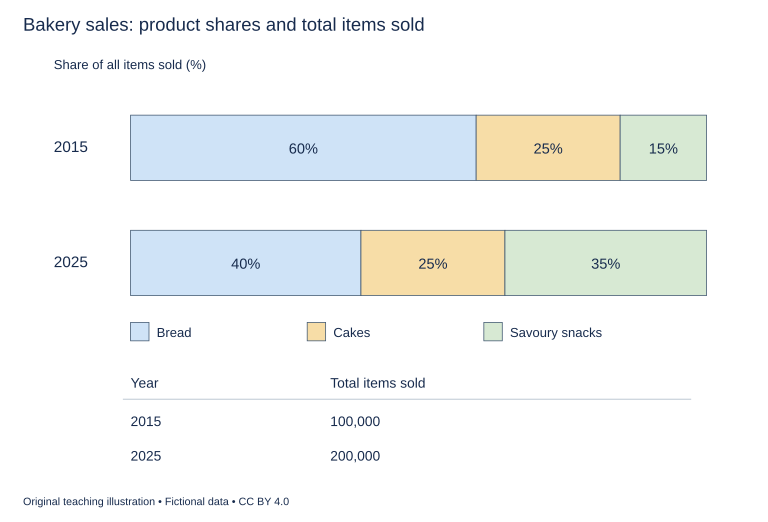

# U18 第11周：长篇阅读、写作与口语

本页为已独立核验的原创文字课程。先完成学生题目，再展开对应参考。非真题、非标准化模考，不换算雅思分数。听力尚未补齐，本页不代表全科课程已完成。

每周选A或G类Task 1一题，加Task 2及三次口语。参考范文不是学生已完成作业，仍须提交初稿、录音和重写，独立真人评分另行安排。

阅读每周180分钟（60分钟首次限时、120分钟证据精读与延迟复测），写作180分钟、口语120分钟。词汇60分钟、听力180分钟另列；新增完整听力未验收，不能勾整周完成。

W12限时复盘按实际错因与延迟复测记录调整；本页原创技能卷不能充当正式陌生卷。后续周数与达标规则见 [U04](u04-exam-preparation.md)。

## 阅读：首答不查词

### R-W11-01 · The Model That Predicted the Wrong Afternoon

W11｜正文 858 词｜13 题｜篇章：学术结构：预测失配—机制分解—新检验（6段）

本课必做60分钟：首答20、证据复盘20、词汇长句10、48小时后复测10。每周三课180分钟，合卷首答替代单课首答，不重复计算。开放短文选做另加15分钟。

本项目原创虚构教学情境，人物、地点、历史事件和案例数据均非真实研究或史料。科学解释只讨论文内说明的模型与条件。非雅思真题或标准化模考；正确数不换算雅思等级。许可：CC BY 4.0 — RayXBuilds and contributors。

能力点：识别论证关系、区分作者与引述者、条件与因果、精确定位。初读不查词，完成后打开独立答案页。

#### Passage

**A** In a fictional mountain classroom, students build a model to predict when water will reach a collecting tray below a patch of melting model snow. Their first model treats the patch as a store that releases water at a rate determined by the heat supplied above it. A lamp provides the heat, and a channel carries water towards the tray. The prediction is simple enough to write before the experiment begins: stronger heating should produce an earlier and larger arrival. During one trial, however, the tray fills later than expected even though the lamp setting is unchanged. The tempting responses are to blame the equipment or add a correction factor that forces the prediction to match. The instructor asks for something more useful: identify which part of the proposed chain might have been represented incorrectly. A wrong prediction can reveal a question if its construction remains visible.

**B** The class separates three processes: the production of liquid water, its temporary storage within the patch, and its movement along the channel. The first model had effectively treated these as one operation. Yet water can be produced without immediately appearing in the tray. A small depression can hold it, and a narrow route can delay its passage. The collecting tray measures arrival, not the moment of melting everywhere in the patch. That distinction changes the interpretation of the failure. The late arrival does not by itself demonstrate that heating produced less liquid. It may show that the connection between production and arrival was too simple. The students redraw their diagram with separate boxes, making clear where observations would be needed to distinguish these alternatives rather than merely attaching a more impressive name to the original single-box explanation.

**C** To examine storage, they insert a shallow reservoir into the channel while keeping the heating arrangement unchanged. Water must fill this hollow before overflowing towards the tray. The observed delay is consistent with the proposed storage mechanism. It does not prove that the earlier trial contained an identical hollow, and the students are told not to confuse reproducing an effect with identifying its original cause. Several mechanisms may create a similar delay. The reservoir experiment establishes that storage can generate the pattern under the tested conditions. An explanation of the earlier event still requires evidence about what was present then. This distinction is central to experimental reasoning: demonstrating that a mechanism is sufficient in a constructed example is not automatically demonstrating that it operated in the case one originally wanted to explain.

**D** The class next marks the channel with a distance strip and records the passage of a harmless coloured drop. A travel record lists when the drop passes each mark. They can now examine whether a delay is concentrated at one point or spread along the route. The marker is a tool for studying movement, not a guarantee that every portion of water behaves identically. The students repeat the observation under several channel arrangements and note changes in the flow. They resist choosing only the trial whose curve resembles the earlier failure. Selecting a convenient resemblance after many attempts would make the final account sound more decisive than the investigation actually was. A mechanism gains support when it explains relevant observations and survives attempts to expose where its prediction should fail, not merely when one demonstration looks persuasive.

**E** A revised model includes both a release rule and a storage term. It fits the original observations better, but the instructor keeps a second set of trials aside before the students adjust the new values. This test set asks whether the revised model works beyond the observations used to shape it. A flexible model can imitate an existing record while offering poor guidance about a new one. The students therefore report performance on the held-back trials separately from performance on the fitting trials. They also list the assumptions that remain simplified, including the treatment of the channel surface. The revision has not made those assumptions vanish. It has made one part of the explanation more explicit, allowing readers to see which improvement is being claimed and which difficulties have merely been left outside the current model.

**F** The final report opens with the failed prediction rather than hiding it in a footnote. A mechanism chart shows the revised chain, and an assumption list describes what each box leaves out. The students explain which observations support storage as a possible contributor and which evidence would be needed to identify the cause of the earlier delay more confidently. Their conclusion is not that every model must become as complicated as the system it represents. Complexity can obscure reasoning just as simplicity can omit a necessary process. The aim is a model whose distinctions answer the question being asked and whose limitations can be checked. In this sense, the wrong afternoon becomes a useful result: it forces the class to distinguish the timing of an outcome from the processes that lead to it, and to replace a convenient fit with a more demanding account of why the water arrived when it did. Another group can now ask targeted questions instead of deciding whether the whole model simply looks convincing.

#### Questions

**Choose ONE answer, A, B, C or D.**

1. Why retain the failed prediction?

   A. It reveals where the explanatory chain can be examined
   B. It removes the need for experiments
   C. It proves all models fail
   D. It makes the report longer

2. The tray directly measures

   A. water arrival
   B. all internal storage
   C. melting at every point
   D. the lamp’s temperature

3. What does the reservoir experiment establish?

   A. Every delay has one cause
   B. Storage can produce delay under tested conditions
   C. The channel can be ignored
   D. The original trial definitely had the same hollow

4. Why retain a test set?

   A. To hide inconvenient results
   B. To ensure a perfect score
   C. To replace all fitting data
   D. To assess predictions beyond data used for adjustment

**Do the following statements agree with the writer's views? Write YES, NO or NOT GIVEN. YES = the writer agrees; NO = the writer expresses the opposite view; NOT GIVEN = the writer's view is not stated. Do not use outside knowledge.**

5. A reproduced effect automatically identifies the cause of the original event.

6. Adding complexity always improves a scientific model.

7. A model’s assumptions should remain inspectable after revision.

8. The writer thinks natural snow always melts faster than model snow.

**Complete the sentences. Choose NO MORE THAN 3 WORDS FROM THE PASSAGE for each answer. Do not change word forms.**

9. Positions along the channel are marked by a ______.

10. Passage times at the marks are entered in a ______.

11. Trials reserved before adjustment form a ______.

12. The revised process is drawn in a ______.

13. What the boxes omit is described in an ______.

#### 本周重点

学术结构：为每段写功能标签，画出主张—机制—证据—限制链条。

#### 复盘

必做：给每道错题标记“定位/作者立场/范围/语法/词数”，抄最短证据；用一行箭头概括本文论证或过程。48小时后重做错题与两道正确题，检查是否仍能指出证据。

选做（15分钟，80–100词）：Distinguish demonstrating a possible mechanism from identifying the original cause.

R-W11-01 答案、证据与精读（首答后展开）

### R-W11-01 · 独立答案与证据

来源与许可同学生页。先完成再核对。可接受答案由 accepted_answers 明确列出；只忽略大小写和首尾空格，不自行删词。开放复盘不计入客观正确数。

1. **A**｜段落 A｜证据：“identify which part of the proposed chain”

   结构透明才可诊断。

2. **A**｜段落 B｜证据：“measures arrival”

   输出不等于内部各过程。

3. **B**｜段落 C｜证据：“storage can generate the pattern”

   充分机制演示不等于个案因果确认。

4. **D**｜段落 E｜证据：“beyond the observations used to shape it”

   检验泛化，不强求完美。

5. **NO**｜段落 C｜证据：“not automatically demonstrating that it operated”

   明确反对。

6. **NO**｜段落 F｜证据：“Complexity can obscure reasoning”

   两端都有限制。

7. **YES**｜段落 E｜证据：“list the assumptions that remain simplified”

   作者认可。

8. **NOT GIVEN**｜段落 A｜证据：“melting model snow”

   未与天然雪比较。

9. **distance strip / strip**｜段落 D｜证据：“with a distance strip”

   strip可接受。

10. **travel record / record**｜段落 D｜证据：“A travel record lists”

   records movement not arrival total。

11. **test set / second set / set of trials / set**｜段落 E｜证据：“This test set asks”

   E 的 second set of trials 与 test set 回指同一预留试验；上限三词，接受 test set、second set、set of trials、set，不接受四词的 second set of trials。

12. **mechanism chart / chart / diagram**｜段落 F｜证据：“A mechanism chart shows”

   mechanism chart、chart 和 diagram 均接受。B 的 The students redraw their diagram with separate boxes 已描述修订过程；题干未限定最终报告，不能排除该原文回指。

13. **assumption list**｜段落 F｜证据：“an assumption list describes”

   list单独不能接an。

#### 词汇与长句

- **sufficient**：足以产生结果的
- **reservoir**：暂存水的容器或区域
- **held-back**：预留未用于调整的
- **fit**：与已有数据相符的程度

> water can be produced without immediately appearing in the tray.

without区分生成与抵达时点，不能从晚抵达反推少融化。

> A flexible model can imitate an existing record while offering poor guidance about a new one.

while对比拟合与新预测；灵活性不等于可迁移性。

#### 开放任务参考

C新构造产生相同模式只证可能性；原事件须有当时结构证据，E需独立测试。

标准：观点有文内依据，保留条件和范围，推断明确标注；不存在唯一措辞。

### R-W11-02 · From a Cabinet of Curiosities to a Working Collection

W11｜正文 983 词｜13 题｜篇章：虚构历史：分类体系与异常标本（8段）

本课必做60分钟：首答20、证据复盘20、词汇长句10、48小时后复测10。每周三课180分钟，合卷首答替代单课首答，不重复计算。开放短文选做另加15分钟。

本项目原创虚构教学情境，人物、地点、历史事件和案例数据均非真实研究或史料。科学解释只讨论文内说明的模型与条件。非雅思真题或标准化模考；正确数不换算雅思等级。许可：CC BY 4.0 — RayXBuilds and contributors。

能力点：识别论证关系、区分作者与引述者、条件与因果、精确定位。初读不查词，完成后打开独立答案页。

#### Passage

**A** The fictional naturalist Tavin begins a collection of shoreline objects in a cabinet beside his window. Shells, fragments of wood and unusual stones are arranged by colour and size. Visitors admire the display, and Tavin can remember where he found his favourite pieces. At this stage, the cabinet's organisation serves viewing and conversation. It is not useless because it lacks a later scientific arrangement. But a new question exposes its limits: a visiting teacher asks whether two similar shells came from the same stretch of coast. Tavin remembers one location clearly and the other only vaguely. Appearance can guide the eye across the cabinet, but it cannot supply a history that was never recorded alongside the objects themselves.

**B** Tavin starts attaching a collection label to each new object. The label gives a date, a place and a brief description of the circumstances in which it was found. Older pieces receive labels only where their histories can still be established. He refuses a friend's suggestion to fill the remaining gaps with the most likely beach. That choice leaves an untidy mixture of detailed and incomplete entries. It also preserves the difference between known information and a convenient guess. A collection becomes more trustworthy not when every field appears complete, but when the basis of each entry can be examined. The absence of a location is a limitation, yet a falsely confident location would create a different and potentially more damaging problem for anyone comparing patterns later.

**C** The teacher then proposes grouping the shells by structural features rather than colour. Two shells with different colours may share the same arrangement of openings, while similar colours may conceal different structures. Tavin makes a comparison board on which selected examples can be placed beside one another. The board changes what visitors notice. Instead of asking which object looks most striking, they begin asking which features occur together. This is not a simple replacement of subjective beauty by objective truth. Any grouping requires decisions about which features matter for a purpose. The new arrangement is useful because it makes certain similarities and differences easier to inspect, not because a cabinet can be reorganised once into a final order that answers every possible question.

**D** An unusually worn shell creates a difficulty. Its surface no longer shows a feature used to distinguish two groups. Tavin could assign it to whichever group leaves the display looking balanced, or exclude it from the collection as inconvenient. He does neither. The object receives an uncertainty tag and remains available for inspection. The teacher suggests comparing less exposed parts and looking for other features that usually accompany the missing one. The result may narrow the possibilities without resolving them completely. The purpose of classification is not to remove every awkward object from view. Cases that fit poorly can reveal the limits of a rule, especially when ordinary examples made the rule appear more decisive than the available evidence justifies.

**E** The catalogue now separates an object number from its current group name. This matters when a later visitor proposes moving a shell into another category. Its number remains unchanged, so earlier notes can still be found even after the grouping is revised. If identity had depended entirely on the category, a new interpretation could have broken the link to older observations. The catalogue also records the reason for each move. A later reader can distinguish a change based on new evidence from one made merely to simplify the arrangement. Stable reference and revisable interpretation perform different jobs. Keeping them separate allows the collection to change its account of an object without losing track of which physical object people have been discussing across different versions of the catalogue.

**F** Tavin soon receives objects through exchange with collectors elsewhere. A polished specimen arrives with a dramatic description of a remote coast but no precise account of where it was collected. Another arrives scratched and ordinary-looking, accompanied by detailed notes. For comparative work, the less attractive object may be more useful. This does not prove that every damaged specimen is scientifically valuable or that beauty must be treated with suspicion. It shows that research value depends partly on the questions an object can help answer. The exchange record therefore lists the supplied information as well as the object's appearance. Tavin does not allow a memorable travel story to substitute silently for a documented collecting location, however much visitors enjoy hearing the story repeated.

**G** As the collection grows, the original cabinet can no longer display everything. A finding list connects object numbers with storage drawers, while a selection remains on view. Some visitors assume that hidden objects have been judged unimportant. Tavin explains that display and storage solve different problems. A clear exhibition may require a few examples, whereas comparison may require many less distinctive pieces. Keeping all of them in one crowded case would not necessarily make the evidence more accessible. The finding list allows an interested reader to request a specific object without requiring every visitor to inspect the entire collection at once. Accessibility depends on a route to the material, not simply on whether every item occupies the most visible shelf.

**H** The working collection that emerges is therefore more than a set of objects placed in a clever order. It includes histories, labels, uncertainties, stable identifiers and ways to recover earlier interpretations. Its organisation remains open to revision because the questions asked of it can change. The writer sees this as a strength, provided that revision does not erase the evidence of how previous claims were made. A collection organised for research need not abandon beauty or public enjoyment. It must, however, distinguish what a pleasing arrangement shows from what the associated records establish. Tavin's cabinet has become useful in new ways because objects can now be compared through traceable information, including information about what remains unknown, rather than through visual resemblance and the collector's memory alone.

#### Questions

**Complete the summary. Choose NO MORE THAN 3 WORDS FROM THE PASSAGE for each answer. Do not change word forms.**

New objects received a (1) ______ with date and place details. Selected shells were put on a (2) ______ for structural comparison. To signal unresolved classification, the worn specimen was given an (3) ______. Information arriving with traded objects entered the (4) ______. Storage drawers could be located through a (5) ______.

**Which paragraph contains the following information? Write a letter, A–H. You may use any letter more than once.**

6. a refusal to replace unknown locations with plausible guesses

7. a reason for keeping identifiers independent of category names

8. an example in which a less attractive specimen provides better research information

9. a distinction between what is displayed and what remains available for study

**Do the following statements agree with the writer's views? Write YES, NO or NOT GIVEN. YES = the writer agrees; NO = the writer expresses the opposite view; NOT GIVEN = the writer's view is not stated. Do not use outside knowledge.**

10. A full-looking catalogue is necessarily more trustworthy than one with gaps.

11. Classification should hide objects that do not fit its categories neatly.

12. A research collection can retain aesthetic and public value.

13. The writer considers collecting shells morally preferable to collecting wood.

#### 本周重点

学术结构：为每段写功能标签，画出主张—机制—证据—限制链条。

#### 复盘

必做：给每道错题标记“定位/作者立场/范围/语法/词数”，抄最短证据；用一行箭头概括本文论证或过程。48小时后重做错题与两道正确题，检查是否仍能指出证据。

选做（15分钟，80–100词）：Explain why an unchanged object number can coexist with a changed classification.

R-W11-02 答案、证据与精读（首答后展开）

### R-W11-02 · 独立答案与证据

来源与许可同学生页。先完成再核对。可接受答案由 accepted_answers 明确列出；只忽略大小写和首尾空格，不自行删词。开放复盘不计入客观正确数。

1. **collection label / label**｜段落 B｜证据：“attaching a collection label”

   label可接受，给新物记时地。

2. **comparison board / board**｜段落 C｜证据：“makes a comparison board”

   板上并排比较。

3. **uncertainty tag**｜段落 D｜证据：“an uncertainty tag”

   tag单独不能接an；保留不确定性。

4. **exchange record / record**｜段落 F｜证据：“The exchange record”

   交换来物信息的记录。

5. **finding list / list**｜段落 G｜证据：“A finding list connects”

   查询编号与抽屉的对应表。

6. **B**｜段落 B｜证据：“fill the remaining gaps with the most likely beach”

   B明确拒绝猜填。

7. **E**｜段落 E｜证据：“object number from its current group name”

   E变更解释仍可追溯。

8. **F**｜段落 F｜证据：“the less attractive object may be more useful”

   F两份交换物对照。

9. **G**｜段落 G｜证据：“display and storage solve different problems”

   G保留并可找寻。

10. **NO**｜段落 B｜证据：“not when every field appears complete”

   要区分已知与猜测。

11. **NO**｜段落 D｜证据：“not to remove every awkward object”

   异常可揭示规则限制。

12. **YES**｜段落 H｜证据：“need not abandon beauty or public enjoyment”

   作者兼容两类用途。

13. **NOT GIVEN**｜段落 A｜证据：“Shells, fragments of wood and unusual stones”

   没有道德排序。

#### 词汇与长句

- **specimen**：标本
- **traceable**：可追溯的
- **identifier**：稳定识别码
- **revisable**：可据新证据修订的

> Stable reference and revisable interpretation perform different jobs.

稳定指代与可修订解释分工不同，不能随类别改动丢对象身份。

> Accessibility depends on a route to the material, not simply on whether every item occupies the most visible shelf.

depends on并列比较，获得途径不等于全部摆在眼前。

#### 开放任务参考

E编号保对象身份、类别保当前解释；B/D不确定记录防止修订抹去依据。

标准：观点有文内依据，保留条件和范围，推断明确标注；不存在唯一措辞。

### R-W11-03 · Why a Control Is Not an Explanation

W11｜正文 854 词｜14 题｜篇章：学术论证：对照结果、机制与外推边界（5段）

本课必做60分钟：首答20、证据复盘20、词汇长句10、48小时后复测10。每周三课180分钟，合卷首答替代单课首答，不重复计算。开放短文选做另加15分钟。

本项目原创虚构教学情境，人物、地点、历史事件和案例数据均非真实研究或史料。科学解释只讨论文内说明的模型与条件。非雅思真题或标准化模考；正确数不换算雅思等级。许可：CC BY 4.0 — RayXBuilds and contributors。

能力点：识别论证关系、区分作者与引述者、条件与因果、精确定位。初读不查词，完成后打开独立答案页。

#### Passage

**A** In a fictional laboratory exercise, students compare two containers of model material. One receives a treatment called Sol, and the other does not. After a fixed period, the treated material changes colour while the untreated material appears unchanged. Several students write that the control has proved how Sol works. Their conclusion goes beyond the comparison. The experiment may support a claim that the treatment, as administered, contributed to the difference under the tested conditions. It does not by itself reveal the internal process that produced the colour. A control is a comparison designed to answer a particular question, not a universal explanation attached to an experiment. The writer begins with this distinction because the language of good method can become a substitute for thinking about what a result actually establishes. Saying that a study had a control is useful only when a reader knows what differed between the groups, what was held comparable and which alternative explanation the comparison was intended to address. The presence of an untreated container is a beginning for that account, not its conclusion.

**B** Looking more closely, the students find that Sol was stirred into the treated container while the other container was left alone. The observed difference could therefore reflect the substance, the stirring or their combination. A revised comparison includes material stirred in the same way without Sol. This addresses the additional action, but it still does not explain the chemical or physical route to the colour change in the model. The class next proposes measurements at intermediate times. If one explanation predicts a brief early change followed by fading and another predicts a gradual increase, those records could distinguish the proposed processes. Merely taking a photograph at the final moment might allow both accounts to fit. The important improvement is not that the revised exercise contains more objects and more observations. It is that the new comparisons are connected to specific differences between explanations. A control becomes informative through that connection, just as a measurement becomes informative through the question it can help answer rather than through the prestige of the instrument used to collect it.

**C** Another group asks whether the person judging colour knew which container had received Sol. An observer expecting a change might interpret an uncertain shade differently, even without intending to favour a result. The class therefore uses coded labels and a scoring guide describing the comparison of colours. This reduces one route by which expectation could influence the observation. It does not make the containers physically identical, guarantee that every judgement is correct or eliminate differences in lighting. Nor is it evidence that the original students were dishonest. Methods that limit the influence of expectation are valuable precisely because ordinary careful people can still be influenced by what they anticipate. The writer rejects the idea that methodological safeguards are accusations against individual character. They are ways of making a claim less dependent on who happened to inspect the result. Their value can be discussed without assuming either that all observers are unreliable or that a sincere observer needs no support from a well-designed procedure.

**D** The improved exercise produces a repeatable difference, but a new question remains: would the same result occur with a different batch of model material or in a different room? Repeating the procedure under its original conditions tests one kind of stability. Varying relevant conditions tests another. The students should not treat either as a complete substitute for the other. A result that cannot be reproduced under the original arrangement is difficult to interpret; a result reproduced only under one narrow arrangement may still have a restricted scope. The report therefore separates the conditions actually examined from the settings mentioned as possible future applications. This is not an admission that the work has no value. A narrow, well-supported claim can be a sound basis for a later investigation. What would be misleading is to advertise a broad conclusion while leaving readers unaware that the evidence came from one carefully constrained classroom model whose materials and measurements were chosen for demonstration rather than for representing every real-world situation.

**E** The final report is organised around questions rather than around a list of impressive method words. It first asks whether the difference persists when stirring is made comparable. It then asks whether the pattern over time distinguishes the suggested processes, and whether coded scoring produces a similar judgement. Finally, it lists the conditions not yet tested. The students include a comparison chart linking each procedure to the uncertainty it addresses. They also retain a residual question that none of the current observations settles: which proposed internal process best accounts for a small change visible before the main colour shift? That question is not hidden because the report already contains the word control. It identifies the next useful observation. The writer's conclusion is that strong experimental reasoning is cumulative and specific. One comparison can remove one doubt while leaving another intact. Progress consists in knowing which uncertainty has been reduced, which claim has become more defensible and which attractive explanation remains only a candidate, however orderly the apparatus looks on the laboratory bench.

#### Questions

**Do the following statements agree with the writer's views? Write YES, NO or NOT GIVEN. YES = the writer agrees; NO = the writer expresses the opposite view; NOT GIVEN = the writer's view is not stated. Do not use outside knowledge.**

1. Having a control automatically explains an internal mechanism.

2. Expectation safeguards imply that the original observers were dishonest.

3. A sincere observer can still benefit from methodological safeguards.

4. The writer thinks Sol should be sold commercially next year.

5. A comparison can resolve one uncertainty while leaving others open.

**Choose ONE answer, A, B, C or D.**

6. The students initially confuse

   A. the colour of two labels
   B. a classroom with a laboratory
   C. evidence of an effect with an explanation of its mechanism
   D. a container with a guide

7. Why add a stirred container without Sol?

   A. To avoid measuring any colour
   B. To remove all internal processes
   C. To guarantee a desired outcome
   D. To examine stirring as an alternative cause

8. Intermediate-time observations are useful when

   A. final photographs are illegal
   B. competing processes predict different trajectories
   C. all explanations predict the same pattern
   D. the scoring guide is missing

9. Why separate tested conditions from future applications?

   A. To hide narrowness
   B. To keep the claim’s scope aligned with evidence
   C. To avoid future studies
   D. To imply the experiment had no value

**Which paragraph contains the following information? Write a letter, A–E. You may use any letter more than once.**

10. a problem caused by treating only one container with an additional physical action

11. a procedure designed to reduce the influence of observer expectations

12. a distinction between repetition under unchanged conditions and variation across settings

13. an unresolved question about a small change preceding the main colour shift

14. a requirement to disclose three design details: how the groups differed, what was kept comparable and which alternative explanation the comparison was meant to address

#### 本周重点

学术结构：为每段写功能标签，画出主张—机制—证据—限制链条。

#### 复盘

必做：给每道错题标记“定位/作者立场/范围/语法/词数”，抄最短证据；用一行箭头概括本文论证或过程。48小时后重做错题与两道正确题，检查是否仍能指出证据。

选做（15分钟，80–100词）：Explain the different questions answered by a stirring control and coded scoring.

R-W11-03 答案、证据与精读（首答后展开）

### R-W11-03 · 独立答案与证据

来源与许可同学生页。先完成再核对。可接受答案由 accepted_answers 明确列出；只忽略大小写和首尾空格，不自行删词。开放复盘不计入客观正确数。

1. **NO**｜段落 A｜证据：“not a universal explanation”

   明确否定。

2. **NO**｜段落 C｜证据：“Nor is it evidence that the original students were dishonest.”

   方法保护不等于人格指控。

3. **YES**｜段落 C｜证据：“ordinary careful people can still be influenced”

   作者直接理由。

4. **NOT GIVEN**｜段落 D｜证据：“possible future applications”

   未涉及商业计划。

5. **YES**｜段落 E｜证据：“One comparison can remove one doubt”

   总结作者观点。

6. **C**｜段落 A｜证据：“does not by itself reveal the internal process”

   效果与机制层次不同。

7. **D**｜段落 B｜证据：“the substance, the stirring or their combination”

   对照针对额外动作。

8. **B**｜段落 B｜证据：“those records could distinguish the proposed processes”

   关键可区分预测。

9. **B**｜段落 D｜证据：“separates the conditions actually examined”

   有限结论可有价值。

10. **B**｜段落 B｜证据：“Sol was stirred into the treated container”

   B额外搅拌。

11. **C**｜段落 C｜证据：“uses coded labels and a scoring guide”

   C盲标签与评分标准。

12. **D**｜段落 D｜证据：“tests one kind of stability”

   D两种稳定性。

13. **E**｜段落 E｜证据：“before the main colour shift”

   E保留残余问题。

14. **A**｜段落 A｜证据：“what differed between the groups, what was held comparable and which alternative explanation the comparison was intended to address”

   A 明确列出理解对照所需的三项设计信息。E 讨论各检验仍留下哪些疑问，没有提出题干所指的这组三项披露要求；不能因同样谈 control 就选 E。

#### 词汇与长句

- **administered**：被实施或施加的
- **intermediate**：处于过程之间阶段的
- **safeguard**：减少偏差的程序保障
- **residual**：仍然剩余的

> Methods that limit the influence of expectation are valuable precisely because ordinary careful people can still be influenced by what they anticipate.

because给方法价值的理由，不是指控不诚实。

> One comparison can remove one doubt while leaving another intact.

while表示同时存在，intact为未改变；认识进展有具体边界。

#### 开放任务参考

B解决附加处理混杂，C解决观察期待；都不自动确认内部机制。

标准：观点有文内依据，保留条件和范围，推断明确标注；不存在唯一措辞。

## 写作与口语：Task 1双分支择一

### WS-W11-T1A 学生页：面包店销售构成与总量

周次 W11｜题型 T1A｜能力点：比例与总量区别

Task 1 的 A/G 分支二选一，另一分支不计入本周作业。

#### 使用与记录

原创教学练习，非真题、非标准化模拟，难度未校准。先完成本页再打开参考页。人物、机构、经历与数据均为教学虚构。不要背诵示例。自评和 AI 反馈不能代替独立真人评分，未获得真人评阅时标记“分数未确认”。

保存：任务ID、实际日期、用时、初稿或原始录音、证据化反馈、重写/重答、三条修改理由。没有学生提交物，不得填写“已批改”或“已完成训练”。

#### 完整题干

The charts show the proportions of three product types sold by a bakery in 2015 and 2025. The table gives the total number of items sold in each year. Summarise the information by selecting and reporting the main features, and make comparisons where relevant.

Write at least 150 words. Spend about 20 minutes on this task.

教学虚构，三类互斥且覆盖全部售出件数。2015：Bread60%、Cakes25%、Savoury snacks15%，总计100,000件；2025：Bread40%、Cakes25%、Savoury snacks35%，总计200,000件。无价格/收入数据；由总件数与比例可计算类别件数。

#### 任务预算（含首次审题，不额外加时）

初稿20分钟（审题规划3、写作15、检查2）；诊断15；反馈阅读与证据核查10；完整重写25；对照归档5。合计75分钟。

#### 初稿后自评清单

- [ ] 达到最低字数；全文连贯成段，没有用项目符号代替作文。
- [ ] 概述给主要特征；数据、阶段或方位都与题图逐项相符，不推断未提供的原因。
- [ ] 每段可写出一个功能标签；例子或数据与该段要点相连。
- [ ] 圈出两处词汇搭配和两处句法疑点，先自行修正再查询或求反馈。
- [ ] 记录一项最影响理解的问题和原句证据，不填写自猜分数。

#### 反馈与重写

打开 独立参考页（本节下方展开参考），按逐段检查和通用协议核验。重写任务：完整重写至少150词；保留两组比例与绝对量的对照，用英文一句明确说明占比和数量出现相反方向。

#### 本周听读能力迁移（包含在既有预算）

在本题诊断/回听时段内用3分钟：给解释标出背景→主张/阶段→支持→限制的结构，并核对两处动词搭配和一处从句。对应U04 W11独白结构与句法。

这是本地写说步骤，不依赖音频已交付。若另有合法听读材料，只在该科原定复盘时段使用；没有材料则标待补，不宣称完成听力。

W11 T1A 示例、反馈与重练（首答后展开）

### WS-W11-T1A 独立参考页

只在初稿完成后阅读；不是唯一答案，也没有官方分数。以下是对原创示例的教学讲评，不是对学生尚未提交作文的已完成批改。

#### 思路拆解

读总量后才能算类别件数；比例下降不代表绝对销量下降；概述必须兼顾构成与总量。

#### 原创示例

The charts compare the proportions of bread, cakes and savoury snacks sold by a bakery in 2015 and 2025, while the table provides the total number of items sold in each year.

Overall, bread remained the largest category, although its share of sales fell substantially. Savoury snacks gained a larger share, whereas cakes accounted for the same proportion in both years. The bakery’s total sales volume doubled over the period.

In 2015, bread represented 60% of the 100,000 items sold, equivalent to 60,000 items. Cakes accounted for a quarter of sales, or 25,000 items, while savoury snacks made up the remaining 15%, representing 15,000 items. Bread was therefore more common than the other two categories combined.

By 2025, total sales had reached 200,000 items. Bread’s share had declined to 40%, but the corresponding quantity rose to 80,000 items. Cakes remained at 25%, meaning that their quantity doubled to 50,000. Savoury snacks increased to 35%, or 70,000 items, bringing this category much closer to bread. Its share was only five percentage points below bread’s in 2025, compared with a gap of forty-five points in 2015.

示例正文词数：192（本项目正则计数；书信不含称呼、结束语与署名；连字符词作一词）。

#### 逐段反馈与迁移

- P1 items是件数，不是收入；不能替换revenue。

- P2 bread占比降、snacks升、cakes不变，总件数翻倍。

- P3 100千×60/25/15%=60/25/15千；bread60%高于其余40%。

- P4 200千×40/25/35%=80/50/70千；bread份额降但件数升，差距45→5个百分点。

#### 常见失误

说面包卖得更少只看百分比；将价格/收入写入无价格图；饼干等新类别混入三类。

#### 可执行反馈步骤

1. 先把自己的段落标为引入、概述/论点、支持、收束；分段可不同于示例，按功能核查，不照抄段数。
2. 对照上方逐段检查，逐项标“已有证据/缺失/不适用”。每条意见必须附自己的原句或缺失位置。
3. 按 [反馈协议](u20-feedback.md) 的四维表记录；有争议的 AI 意见回题干、数据或语法依据核验。
4. 只选两项最高优先级问题执行整篇重写；保留原稿，禁止把示例替换为自己的作业。

#### 重写任务

完整重写至少150词；保留两组比例与绝对量的对照，用英文一句明确说明占比和数量出现相反方向。

完成后重新勾选 学生页（见本节上方学生题） 清单；将一处改前/改后及理由交给独立评阅者核查。真人评阅状态目前为“待安排”，不是已完成。

### WS-W11-T1G 学生页：给朋友说明聚餐准备

周次 W11｜题型 T1G｜能力点：书信目的、要点与语气

Task 1 的 A/G 分支二选一，另一分支不计入本周作业。

#### 使用与记录

原创教学练习，非真题、非标准化模拟，难度未校准。先完成本页再打开参考页。人物、机构、经历与数据均为教学虚构。不要背诵示例。自评和 AI 反馈不能代替独立真人评分，未获得真人评阅时标记“分数未确认”。

保存：任务ID、实际日期、用时、初稿或原始录音、证据化反馈、重写/重答、三条修改理由。没有学生提交物，不得填写“已批改”或“已完成训练”。

#### 完整题干

Your friend Jamie has offered to bring food to a small dinner you are hosting. Write a letter to Jamie. In your letter:
- describe the dinner arrangements
- suggest what Jamie could bring and explain why
- explain what you will prepare yourself.
Begin your letter: Dear Jamie,

Write at least 150 words. You do not need to write any addresses. Spend about 20 minutes on this task.

#### 任务预算（含首次审题，不额外加时）

初稿20分钟（审题规划3、写作15、检查2）；诊断15；反馈阅读与证据核查10；完整重写25；对照归档5。合计75分钟。

#### 初稿后自评清单

- [ ] 达到最低字数；全文连贯成段，没有用项目符号代替作文。
- [ ] 三个要点均展开；称呼、目的、语气和结束语适合收信人。
- [ ] 每段可写出一个功能标签；例子或数据与该段要点相连。
- [ ] 圈出两处词汇搭配和两处句法疑点，先自行修正再查询或求反馈。
- [ ] 记录一项最影响理解的问题和原句证据，不填写自猜分数。

#### 反馈与重写

打开 独立参考页（本节下方展开参考），按逐段检查和通用协议核验。重写任务：完整重写至少150词；把request写成友好可选安排，解释一个具体理由，并让双方准备内容互补。

#### 本周听读能力迁移（包含在既有预算）

在本题诊断/回听时段内用3分钟：给解释标出背景→主张/阶段→支持→限制的结构，并核对两处动词搭配和一处从句。对应U04 W11独白结构与句法。

这是本地写说步骤，不依赖音频已交付。若另有合法听读材料，只在该科原定复盘时段使用；没有材料则标待补，不宣称完成听力。

W11 T1G 示例、反馈与重练（首答后展开）

### WS-W11-T1G 独立参考页

只在初稿完成后阅读；不是唯一答案，也没有官方分数。以下是对原创示例的教学讲评，不是对学生尚未提交作文的已完成批改。

#### 思路拆解

私人友好说明；时间人数、带什么及原因、自备什么三个目的；饮食偏好按情境说不扩成医疗建议。

#### 原创示例

Dear Jamie,

Thanks for offering to bring something for dinner on Friday. There will be six of us, and I am planning to serve the meal at about seven thirty. You are welcome to come a little earlier if you would like to catch up before everyone else arrives. We will eat in the kitchen, as the weather may be too cool to sit outside.

Could you bring a simple fruit dessert? One of our friends does not eat dairy products, so a fruit salad would be something everyone could share. You do not need to make a large amount, because I expect the main course to be quite filling. If you are short of time, just bring some fresh fruit and we can prepare it together here.

I will make a vegetable curry and rice, with a mild sauce on the side for anyone who wants it. I will also provide drinks and some bread to have while we are waiting. Please do not feel you have to spend much money or bring anything else. I am mainly looking forward to seeing you and enjoying an evening together.

See you Friday,
Alex

示例正文词数：187（本项目正则计数；书信不含称呼、结束语与署名；连字符词作一词）。

#### 逐段反馈与迁移

- P1 六人、周五7:30和可早到明确；不是正式邀请公函。

- P2 水果甜点理由为兼顾不吃奶制品者，给省时替代；不要求额外大笔花费。

- P3 主食、饮料面包与朋友分工清晰；语气避免像向服务商下订单。

#### 常见失误

只写喜欢什么不交代安排；建议含奶甜点又称适合不吃奶者；私人信使用强硬命令。

#### 可执行反馈步骤

1. 先把自己的段落标为引入、概述/论点、支持、收束；分段可不同于示例，按功能核查，不照抄段数。
2. 对照上方逐段检查，逐项标“已有证据/缺失/不适用”。每条意见必须附自己的原句或缺失位置。
3. 按 [反馈协议](u20-feedback.md) 的四维表记录；有争议的 AI 意见回题干、数据或语法依据核验。
4. 只选两项最高优先级问题执行整篇重写；保留原稿，禁止把示例替换为自己的作业。

#### 重写任务

完整重写至少150词；把request写成友好可选安排，解释一个具体理由，并让双方准备内容互补。

完成后重新勾选 学生页（见本节上方学生题） 清单；将一处改前/改后及理由交给独立评阅者核查。真人评阅状态目前为“待安排”，不是已完成。

### WS-W11-T2 学生页：家庭食物浪费原因与解决

周次 W11｜题型 T2｜能力点：观点展开与任务回应

A/G 共用本题。

#### 使用与记录

原创教学练习，非真题、非标准化模拟，难度未校准。先完成本页再打开参考页。人物、机构、经历与数据均为教学虚构。不要背诵示例。自评和 AI 反馈不能代替独立真人评分，未获得真人评阅时标记“分数未确认”。

保存：任务ID、实际日期、用时、初稿或原始录音、证据化反馈、重写/重答、三条修改理由。没有学生提交物，不得填写“已批改”或“已完成训练”。

#### 完整题干

In many households, edible food is thrown away. What are the main reasons for this, and what could households and food retailers do to reduce the problem? Give reasons and include relevant examples.

Write at least 250 words. Spend about 40 minutes on this task.

#### 任务预算（含首次审题，不额外加时）

初稿40分钟（审题规划5、写作30、检查5）；诊断15；反馈阅读与证据核查10；完整重写35；对照归档5。合计105分钟。

#### 初稿后自评清单

- [ ] 达到最低字数；全文连贯成段，没有用项目符号代替作文。
- [ ] 直接回答题目的所有问句，有始终一致的立场。
- [ ] 每段可写出一个功能标签；例子或数据与该段要点相连。
- [ ] 圈出两处词汇搭配和两处句法疑点，先自行修正再查询或求反馈。
- [ ] 记录一项最影响理解的问题和原句证据，不填写自猜分数。

#### 反馈与重写

打开 独立参考页（本节下方展开参考），按逐段检查和通用协议核验。重写任务：完整重写至少250词；为每项措施标出对应原因，用一个反例说明为何某措施必须附加条件。

#### 本周听读能力迁移（包含在既有预算）

在本题诊断/回听时段内用3分钟：给解释标出背景→主张/阶段→支持→限制的结构，并核对两处动词搭配和一处从句。对应U04 W11独白结构与句法。

这是本地写说步骤，不依赖音频已交付。若另有合法听读材料，只在该科原定复盘时段使用；没有材料则标待补，不宣称完成听力。

W11 T2 示例、反馈与重练（首答后展开）

### WS-W11-T2 独立参考页

只在初稿完成后阅读；不是唯一答案，也没有官方分数。以下是对原创示例的教学讲评，不是对学生尚未提交作文的已完成批改。

#### 思路拆解

原因对措施；明确家庭与零售两行动者，不把问题全归个人道德；论证条件与限制。

#### 原创示例

Edible food can be discarded because households buy more than they use and lose track of what they already have. Retail practices can reinforce these habits. Better planning at home and more flexible selling arrangements would address important causes of the problem, although neither can eliminate waste entirely.

One cause is a mismatch between purchases and daily routines. People may shop with an ambitious plan to cook every evening, then work late or accept an invitation to eat elsewhere. Fresh ingredients remain unused while additional purchases arrive. Food can also be forgotten at the back of a crowded cupboard or refrigerator. These situations suggest that waste is not always a result of indifference; sometimes people lack a clear view of their supplies or make plans that do not fit their week.

Households could begin by checking existing ingredients before shopping and planning a small number of realistic meals. Keeping items that need attention in a visible place can make them easier to use. For example, someone who notices unused vegetables before buying more may choose a meal that includes them. Plans should still be flexible, and people should not assume that every leftover is suitable to eat. The goal is to prevent unnecessary surplus, rather than encourage unsafe choices.

Retailers also influence how much people purchase. Large fixed packs and offers that reward buying several items can make it difficult for a small household to buy only what it needs. Shops could provide smaller packs or loose produce and make unit prices easy to compare. Reductions on items approaching their selling deadline may help, but only if customers buy quantities they can realistically use. Otherwise, waste merely moves from the shop to the home.

In conclusion, household food waste often results from poor coordination between buying, storage and actual demand. Practical planning and purchasing options suited to different household sizes would be more useful than simply telling everyone to care more about waste.

示例正文词数：323（本项目正则计数；书信不含称呼、结束语与署名；连字符词作一词）。

#### 逐段反馈与迁移

- P1 两原因与零售影响，避免宣称单一原因解释所有浪费。

- P2 计划与实际偏离、看不见库存分别展开；不把常识当实测数据。

- P3 检库存和现实计划对应原因；安全边界只作限制，不提供保存食用诊断。

- P4 包装/促销→超买→小份与单价；打折可能转移浪费，是检验措施的反例。

- P5 回到需求协调；没有引入新的政府刑罚方案。

#### 常见失误

只论环境后果不答原因措施；遗漏零售商；把降价视为无条件减少浪费。

#### 可执行反馈步骤

1. 先把自己的段落标为引入、概述/论点、支持、收束；分段可不同于示例，按功能核查，不照抄段数。
2. 对照上方逐段检查，逐项标“已有证据/缺失/不适用”。每条意见必须附自己的原句或缺失位置。
3. 按 [反馈协议](u20-feedback.md) 的四维表记录；有争议的 AI 意见回题干、数据或语法依据核验。
4. 只选两项最高优先级问题执行整篇重写；保留原稿，禁止把示例替换为自己的作业。

#### 重写任务

完整重写至少250词；为每项措施标出对应原因，用一个反例说明为何某措施必须附加条件。

完成后重新勾选 学生页（见本节上方学生题） 清单；将一处改前/改后及理由交给独立评阅者核查。真人评阅状态目前为“待安排”，不是已完成。

### WS-W11-S1 学生页

周次W11｜Part 1专项｜能力点：按结构展开解释，核查搭配与因果连接｜30分钟

#### 使用与记录

原创教学练习，非真题、非标准化模拟，难度未校准。先完成本页再打开参考页。人物、机构、经历与数据均为教学虚构。不要背诵示例。自评和 AI 反馈不能代替独立真人评分，未获得真人评阅时标记“分数未确认”。

保存：任务ID、实际日期、用时、初稿或原始录音、证据化反馈、重写/重答、三条修改理由。没有学生提交物，不得填写“已批改”或“已完成训练”。

#### 操作与预算

设备与审题3分钟；首答录音6；回听及局部转写7；示例和诊断5；不看稿重答6；归档3。共30分钟。

#### Part 1专项题

1. Do you plan meals in advance?
2. How often do you buy groceries?
3. Do you enjoy trying new recipes?
4. What makes cooking convenient for you?

追问：

- Does your approach change during a busy week?
- Can you give an example of a useful habit?

#### 录音回听清单

- [ ] 保留首答原音，记录实际时长、是否中断、是否看稿；只报真实完成状态。
- [ ] 流利与连贯：标出两处时间戳，区分构思停顿与重复搜词，检查是否偏离问句。
- [ ] 词汇：找一处模糊词或重复表达，先解释原意再替换；不为难词改变意思。
- [ ] 语法：核对经历与习惯的时态；局部转写并更正两处妨碍理解的问题。
- [ ] 发音：不看转写听30秒，标听不清的词尾、重音或断句；没有音频不能判断发音。
- [ ] 展开：主要回答有具体情境或理由；追问后第一句回应追问的新角度。

#### 重答要求

选择两个只有笼统判断的答案，先直接回应再加具体情境；重答一条追问，检查是否真正回应其新角度。

首答回听后才打开独立参考页（本节下方展开参考）。按[反馈协议](u20-feedback.md)填至少三个时间戳，不以文字转写替代音频评阅。

#### 本周听读能力迁移（包含在既有预算）

在本题诊断/回听时段内用3分钟：给解释标出背景→主张/阶段→支持→限制的结构，并核对两处动词搭配和一处从句。对应U04 W11独白结构与句法。

没有已交付听力的假设；以本题原音或文字做迁移，不记录为额外听力完成。

W11 S1 示例、反馈与重练（首答后展开）

### WS-W11-S1 独立参考页

原创教学示例，非真题或评分结果。未收到学生音频；以下是示例分析与待执行反馈，不能登记为已完成学生批改。

#### 展开示例

##### 直接回应→原因→具体情境的展开示例

I plan a few meals rather than every meal for the whole week. That gives me a shopping list, but leaves room for changes if I eat with friends. I used to buy ingredients for several unfamiliar recipes at once. Now I try one new dish and use familiar meals for the rest of the week.

纯口答示例词数：56；只计MODEL标记内实际英文口答，不含标题、标签、说明。词数不能证明录音时长或流利度。

#### 展开与反馈

本周能力：按结构展开解释，核查搭配与因果连接。

1. 示例先表态，再说明偏好理由，最后提供条件或场景。检查自己是否用一个词回答后就结束。
2. 找到一个具体细节：物品、动作、对话或地点。用自己的经历替换，保持与题卡相关，不照搬示例身份与经历。
3. 追问要重新回应，不能继续背长答。首句先回答追问，再用一条理由支持。
4. 标出一处听不清或语法影响理解的原音时间戳；先尝试最小修正。不要把自然停顿一概当成错误，或用加快语速掩盖逻辑断裂。

#### 常见失误

空泛形容词替代具体过程；给了经历却没解释为什么重要；Part 3只有个人故事没有一般解释；AI只看转写就判断发音。逐项回原音核对，不能凭范例推断自己已达到某个分数。

#### 可执行重答与反馈

选择两个只有笼统判断的答案，先直接回应再加具体情境；重答一条追问，检查是否真正回应其新角度。

填写[反馈协议](u20-feedback.md)四维表，附三个时间戳和原话证据。选一个内容问题与一个语言问题先修；重答后并排听两段，记录改善与仍未解决之处。自评与AI不能替代独立真人评分；独立评阅目前待安排，分数未确认。

### WS-W11-S2 学生页

周次W11｜Part 2专项｜能力点：按结构展开解释，核查搭配与因果连接｜30分钟

#### 使用与记录

原创教学练习，非真题、非标准化模拟，难度未校准。先完成本页再打开参考页。人物、机构、经历与数据均为教学虚构。不要背诵示例。自评和 AI 反馈不能代替独立真人评分，未获得真人评阅时标记“分数未确认”。

保存：任务ID、实际日期、用时、初稿或原始录音、证据化反馈、重写/重答、三条修改理由。没有学生提交物，不得填写“已批改”或“已完成训练”。

#### 操作与预算

准备、首答录音及追问5分钟；回听及局部转写8；示例与诊断5；关键词重组3；重答及追问5；归档4。共30分钟。

#### Part 2专项任务卡

Describe a useful method you use to organise something at home. Say what you organise, how the method works, when you started using it, and explain why it is useful.

准备1分钟，说1～2分钟。只记5个关键词，不预写句子。

收尾追问：

- Does anyone else in your home use the method?
- Is there anything you would change about it?

#### 录音回听清单

- [ ] 保留首答原音，记录实际时长、是否中断、是否看稿；只报真实完成状态。
- [ ] 流利与连贯：标出两处时间戳，区分构思停顿与重复搜词，检查是否偏离问句。
- [ ] 词汇：找一处模糊词或重复表达，先解释原意再替换；不为难词改变意思。
- [ ] 语法：核对经历与习惯的时态；局部转写并更正两处妨碍理解的问题。
- [ ] 发音：不看转写听30秒，标听不清的词尾、重音或断句；没有音频不能判断发音。
- [ ] 展开：主要回答有具体情境或理由；追问后第一句回应追问的新角度。

#### 重答要求

用五个关键词重答完整任务卡1～2分钟，再答两条追问；补一处具体行动或细节并删一处无关背景。比较首答与重答，不背示例。

首答回听后才打开独立参考页（本节下方展开参考）。按[反馈协议](u20-feedback.md)填至少三个时间戳，不以文字转写替代音频评阅。

#### 本周听读能力迁移（包含在既有预算）

在本题诊断/回听时段内用3分钟：给解释标出背景→主张/阶段→支持→限制的结构，并核对两处动词搭配和一处从句。对应U04 W11独白结构与句法。

没有已交付听力的假设；以本题原音或文字做迁移，不记录为额外听力完成。

W11 S2 示例、反馈与重练（首答后展开）

### WS-W11-S2 独立参考页

原创教学示例，非真题或评分结果。未收到学生音频；以下是示例分析与待执行反馈，不能登记为已完成学生批改。

#### 展开示例

##### 原创长答示例（时长须以个人实际录音测量）

A method I use at home is keeping a small list of food that needs to be used soon. I started doing this after noticing that I repeatedly bought vegetables similar to ones already in the refrigerator.

The list is on a reusable board near the kitchen door. Before shopping, I check what is available and write down a few ingredients that I should plan around. I do not record every item, because maintaining a complete inventory would take more effort than I would realistically give it.

During the week, I look at the board when deciding what to cook. If I use an ingredient, I remove it from the list. Sometimes my housemate adds something, which helps us avoid making separate purchases without knowing what the other person has bought.

The method is useful because it makes a small amount of relevant information visible. It has not eliminated waste, and occasionally we forget to update it. Still, it has made our shopping decisions more deliberate without creating a complicated system that we would soon abandon.

纯口答示例词数：176；只计MODEL标记内实际英文口答，不含标题、标签、说明。词数不能证明录音时长或流利度。

#### 展开与反馈

本周能力：按结构展开解释，核查搭配与因果连接。

1. 长答示例按背景、行动/观察、变化与意义组织。每段都推进内容；检查自己是否只有背景而没有具体事件。
2. 找到一个具体细节：物品、动作、对话或地点。用自己的经历替换，保持与题卡相关，不照搬示例身份与经历。
3. 追问要重新回应，不能继续背长答。首句先回答追问，再用一条理由支持。
4. 标出一处听不清或语法影响理解的原音时间戳；先尝试最小修正。不要把自然停顿一概当成错误，或用加快语速掩盖逻辑断裂。

#### 常见失误

空泛形容词替代具体过程；给了经历却没解释为什么重要；Part 3只有个人故事没有一般解释；AI只看转写就判断发音。逐项回原音核对，不能凭范例推断自己已达到某个分数。

#### 可执行重答与反馈

用五个关键词重答完整任务卡1～2分钟，再答两条追问；补一处具体行动或细节并删一处无关背景。比较首答与重答，不背示例。

填写[反馈协议](u20-feedback.md)四维表，附三个时间戳和原话证据。选一个内容问题与一个语言问题先修；重答后并排听两段，记录改善与仍未解决之处。自评与AI不能替代独立真人评分；独立评阅目前待安排，分数未确认。

### WS-W11-S3 学生页

周次W11｜三部分全流程｜能力点：按结构展开解释，核查搭配与因果连接｜60分钟

#### 使用与记录

原创教学练习，非真题、非标准化模拟，难度未校准。先完成本页再打开参考页。人物、机构、经历与数据均为教学虚构。不要背诵示例。自评和 AI 反馈不能代替独立真人评分，未获得真人评阅时标记“分数未确认”。

保存：任务ID、实际日期、用时、初稿或原始录音、证据化反馈、重写/重答、三条修改理由。没有学生提交物，不得填写“已批改”或“已完成训练”。

#### 操作与预算

D5：设备与流程准备2分钟，连续首答11～14分钟，余14～17分钟完整回听标记，共30分钟。D6：局部转写诊断10，阅读示例与调整5，重答与新追问10，对照归档5，共30分钟。合计60分钟。

#### 连续三部分全流程（首答不可看参考）

找同伴读题，或独练逐题揭示。完整首答11～14分钟，中途不暂停纠错。模拟同伴不是认证考官；自行读题的练习记录不能冒充真实面试。

##### Part 1：4～5分钟

1. Do you like keeping your room tidy?
2. Where do you keep things you use every day?
3. Have you ever lost something important at home?
4. Do you prefer simple or detailed plans?
5. How do you remember a new word?
6. Do you write reminders for yourself?

可按回答追加 Why? / Can you give an example? 到时转下部分，不强行说完全部备用问题。

##### Part 2：3～4分钟（含准备）

Describe a time you explained how to do something. Say who you explained it to, what the task was, how you organised your explanation, and explain whether it was successful.

准备1分钟，连续说1～2分钟。收尾追问：

- Did the person ask any questions?
- Would you explain the task differently next time?

##### Part 3：4～5分钟

1. What makes an explanation easy to follow?
2. When are examples more useful than general descriptions?
3. Can simplifying information make it misleading?
4. How can someone check whether an explanation has been understood?

根据回答追加追问：

- Would the same explanation work for a beginner and an expert?
- What details should never be left out?

#### 录音回听清单

- [ ] 保留首答原音，记录实际时长、是否中断、是否看稿；只报真实完成状态。
- [ ] 流利与连贯：标出两处时间戳，区分构思停顿与重复搜词，检查是否偏离问句。
- [ ] 词汇：找一处模糊词或重复表达，先解释原意再替换；不为难词改变意思。
- [ ] 语法：核对经历与习惯的时态；局部转写并更正两处妨碍理解的问题。
- [ ] 发音：不看转写听30秒，标听不清的词尾、重音或断句；没有音频不能判断发音。
- [ ] 展开：主要回答有具体情境或理由；追问后第一句回应追问的新角度。

#### 重答要求

重答最弱的一个Part 1问题、完整Part 2及一个Part 3问题，再答一条未用追问。用不同细节或补一个例外，确认不是复述范例；局部重答不另计全流程。

首答回听后才打开独立参考页（本节下方展开参考）。按[反馈协议](u20-feedback.md)填至少三个时间戳，不以文字转写替代音频评阅。

#### 本周听读能力迁移（包含在既有预算）

在本题诊断/回听时段内用3分钟：给解释标出背景→主张/阶段→支持→限制的结构，并核对两处动词搭配和一处从句。对应U04 W11独白结构与句法。

没有已交付听力的假设；以本题原音或文字做迁移，不记录为额外听力完成。

W11 S3 示例、反馈与重练（首答后展开）

### WS-W11-S3 独立参考页

原创教学示例，非真题或评分结果。未收到学生音频；以下是示例分析与待执行反馈，不能登记为已完成学生批改。

#### 展开示例

##### Part 2原创展开示例（个人语速不同，不能以词数推录音时长）

I explained how to use a shared booking calendar to a new colleague. The calendar was used to reserve a small meeting room, and several people had accidentally booked overlapping times before we introduced a common system.

I began by explaining the purpose: everyone needed to see when the room was available. Then I showed her how to choose a date, check existing reservations and enter a new booking. I used an example for the following afternoon rather than describing every possible setting at once.

After the demonstration, I asked her to make a practice booking and then remove it. She asked whether the finishing time included setting up the room. That was a useful question, and I clarified that the booking should cover all the time she needed.

The explanation was successful because she could complete the task herself afterwards. I also learned that a clear sequence is not enough if an important convention remains unstated. Next time, I would mention setup time before demonstrating the steps.

##### Part 3观点→理由→条件展开示例

An example is useful when it makes an abstract idea concrete, but it should not hide important limits. If someone explains a rule using only a very easy case, a learner may assume that the rule works everywhere. I would show the main case first and then add one exception or boundary, so that the explanation remains manageable without becoming misleading.

纯口答示例词数：229；只计MODEL标记内实际英文口答，不含标题、标签、说明。词数不能证明录音时长或流利度。

#### 展开与反馈

本周能力：按结构展开解释，核查搭配与因果连接。

1. 长答示例按背景、行动/观察、变化与意义组织。每段都推进内容；检查自己是否只有背景而没有具体事件。
2. 找到一个具体细节：物品、动作、对话或地点。用自己的经历替换，保持与题卡相关，不照搬示例身份与经历。
3. Part 3示例不把个人选择强加给所有人；先讲机制，再说明条件或例外。检查自己的追问答案是否直接回应新问题。
4. 标出一处听不清或语法影响理解的原音时间戳；先尝试最小修正。不要把自然停顿一概当成错误，或用加快语速掩盖逻辑断裂。

#### 常见失误

空泛形容词替代具体过程；给了经历却没解释为什么重要；Part 3只有个人故事没有一般解释；AI只看转写就判断发音。逐项回原音核对，不能凭范例推断自己已达到某个分数。

#### 可执行重答与反馈

重答最弱的一个Part 1问题、完整Part 2及一个Part 3问题，再答一条未用追问。用不同细节或补一个例外，确认不是复述范例；局部重答不另计全流程。

填写[反馈协议](u20-feedback.md)四维表，附三个时间戳和原话证据。选一个内容问题与一个语言问题先修；重答后并排听两段，记录改善与仍未解决之处。自评与AI不能替代独立真人评分；独立评阅目前待安排，分数未确认。

## 许可

原创文字：RayXBuilds and contributors，CC BY 4.0。此页由已验收分课汇编，调整了标题和导航；题干、正文和答案内容保留。公开第三方音频未包含。
