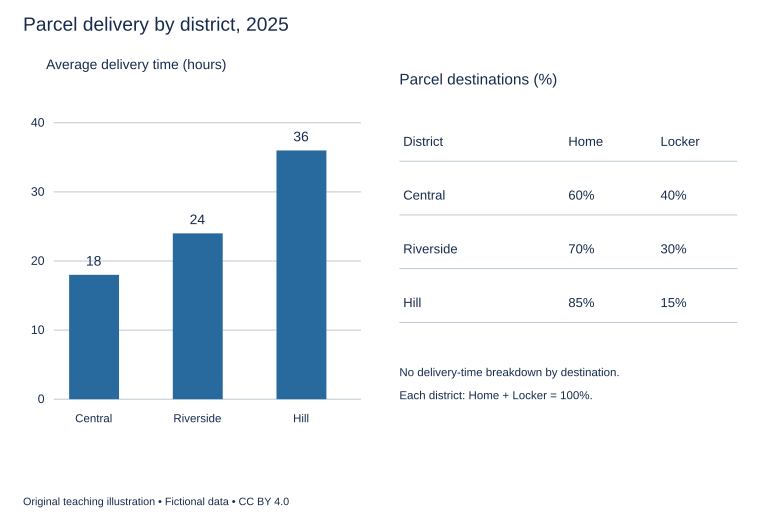

# U19 第12周：长篇阅读、写作与口语

本页为已独立核验的原创文字课程。先完成学生题目，再展开对应参考。非真题、非标准化模考，不换算雅思分数。听力尚未补齐，本页不代表全科课程已完成。

每周选A或G类Task 1一题，加Task 2及三次口语。参考范文不是学生已完成作业，仍须提交初稿、录音和重写，独立真人评分另行安排。

阅读每周180分钟（60分钟首次限时、120分钟证据精读与延迟复测），写作180分钟、口语120分钟。词汇60分钟、听力180分钟另列；新增完整听力未验收，不能勾整周完成。

W12限时复盘按实际错因与延迟复测记录调整；本页原创技能卷不能充当正式陌生卷。后续周数与达标规则见 [U04](u04-exam-preparation.md)。

## 阅读：首答不查词

### R-W12-01 · Two Ways to Learn from a Miniature Bridge

W12｜正文 922 词｜13 题｜篇章：过程比较：实物模型与计算表示（7段）

本课必做60分钟：首答20、证据复盘20、词汇长句10、48小时后复测10。每周三课180分钟，合卷首答替代单课首答，不重复计算。开放短文选做另加15分钟。

本项目原创虚构教学情境，人物、地点、历史事件和案例数据均非真实研究或史料。科学解释只讨论文内说明的模型与条件。非雅思真题或标准化模考；正确数不换算雅思等级。许可：CC BY 4.0 — RayXBuilds and contributors。

能力点：识别论证关系、区分作者与引述者、条件与因果、精确定位。初读不查词，完成后打开独立答案页。

#### Passage

**A** A fictional design class receives the same question in two forms. One team builds a small bridge from strips of card; another represents a bridge as connected lines in a simple computer model. Both must investigate what happens when a load is placed away from the centre. The class is not designing a real structure for public use, and its conclusions are restricted to the teaching models described here. At first, the physical team accuses the computer team of studying something that does not exist, while the computer team calls the card bridge an imprecise toy. The instructor rejects both dismissals. Each representation makes some relationships easier to examine and leaves others simplified. The useful comparison concerns what can be learned through each method and which assumptions must accompany that learning.

**B** The card bridge makes movement visible. When the load shifts, one side bends more than the other, and a loose connection may open. Students can observe a result they did not anticipate when drawing the structure. But the model's behaviour depends on properties of the card, the folds and the glue. Making its overall shape resemble a larger bridge does not make every mechanical relationship scale in the same way. A thick glued joint may contribute disproportionately to the small model's stiffness. The team therefore describes the construction rather than treating visual resemblance as proof of representativeness. A photograph of the bridge is useful, but it cannot tell a later reader how firmly each joint was made or whether two apparently identical versions would behave alike under the same load.

**C** The computer model has different strengths. A student can change one parameter while keeping the others numerically fixed, then compare the predicted movement. This makes a proposed relationship easy to explore. Yet the predicted result follows the relationships built into the model. If a connection is represented as perfectly rigid, the calculation will not spontaneously reveal that a real glued joint might loosen. The absence of a predicted problem may therefore reflect an assumption rather than a robust design. The instructor asks students to list what the model permits to change and what it holds constant. Such a list is not an apology for using computation. It is part of explaining why a result appears and what kind of evidence could show that the chosen representation is inadequate for a particular question.

**D** The teams agree on a loading sequence so that they can discuss comparable situations. They place the load at the centre, near one side and near the other, keeping its specified amount unchanged. The physical team marks movement against a reference line and records observations on a deflection sheet. The computer team produces predictions for the corresponding positions. Agreement at one position is encouraging but insufficient to establish that the models describe the same behaviour throughout. A difference at another position can be particularly useful because it directs attention towards a relationship that the earlier comparison did not test. The instructor wants the class to investigate that discrepancy instead of averaging the results into a single figure that makes the two methods appear closer than they are.

**E** In one trial, the card bridge moves unexpectedly near a joint. The computing team offers to adjust a stiffness value until the predicted movement matches. That may improve the fit, but it does not identify the reason for the original discrepancy. The physical team first examines the joint and discovers that one strip was not attached as intended. The class records this in a construction note. A model adjusted to reproduce an accidental construction difference might predict that particular object well while describing the planned arrangement badly. This does not mean adjustments are forbidden. It means the purpose of an adjustment must be stated: is the team representing the object actually built, the design intended on paper, or a broader class of possible objects? Those are related questions, but they do not require identical answers.

**F** The revised exercise uses an assumption register for both methods. The physical entry describes material choices and joint construction; the computing entry describes permitted motion and assigned properties. A comparison table links each tested load position with observed and predicted movement. Where observations are uncertain, the table preserves that uncertainty rather than printing extra digits to make the record appear precise. Students also repeat the physical construction once to see how much variation the making process introduces. Two card bridges cannot reveal every possible variation, but their difference can warn against treating a single handmade object as a perfectly stable standard. Likewise, running one calculation twice is not a new independent test if the inputs and the computational rules remain exactly unchanged.

**G** By the final discussion, the teams no longer ask which method is inherently more real. The physical model provides encounters with material behaviour, including unintended features; the computer model allows explicit manipulation of selected relationships. Each becomes more useful when its assumptions can be compared with those of the other. The class writes separate conclusions about the two representations and a shared list of questions still unanswered. It does not infer that a real bridge is safe from the behaviour of either teaching model. The lasting lesson is about interpreting agreement and disagreement. Similar outputs may arise for different reasons, while a mismatch may expose something worth learning. A model earns confidence through a clear connection between its purpose, its assumptions and the observations used to challenge it, not merely through resemblance to an object or the authority associated with a particular kind of tool.

#### Questions

**Choose ONE answer, A, B, C or D.**

1. The instructor rejects the opening dismissals because

   A. card is always better than computation
   B. each method exposes and simplifies different relationships
   C. computation has no assumptions
   D. both methods represent all details

2. Why is visual similarity insufficient for a physical model?

   A. Card has no properties
   B. Mechanical relationships may not scale identically
   C. All larger bridges have the same joints
   D. Photographs cannot be taken

3. An absent predicted joint problem may reflect

   A. an improved physical joint
   B. a removed load
   C. the assumption of a rigid connection
   D. an independent real-world test

4. Why inspect the joint before fitting a new stiffness value?

   A. To produce more digits
   B. To distinguish unintended construction from the intended design
   C. To replace the loading sequence
   D. To avoid every adjustment

**Complete the sentences. Choose NO MORE THAN 3 WORDS FROM THE PASSAGE for each answer. Do not change word forms.**

5. Both teams follow the same ______ for applying loads.

6. Physical movement is recorded on a ______.

7. The unintended attachment is documented in a ______.

8. Both methods describe their simplifications in an ______.

9. Observed and predicted values appear together in a ______.

**Do the following statements agree with the writer's views? Write YES, NO or NOT GIVEN. YES = the writer agrees; NO = the writer expresses the opposite view; NOT GIVEN = the writer's view is not stated. Do not use outside knowledge.**

10. Agreement in one loading position establishes agreement in all positions.

11. Re-running unchanged inputs is automatically an independent test.

12. The writer prefers one particular commercial modelling program.

13. A mismatch between models can reveal something useful.

#### 本周重点

限时复发：首答记录每组耗时；延迟复测先遮住解释，比较是否重复同类错误。

#### 复盘

必做：给每道错题标记“定位/作者立场/范围/语法/词数”，抄最短证据；用一行箭头概括本文论证或过程。48小时后重做错题与两道正确题，检查是否仍能指出证据。

选做（15分钟，80–100词）：Explain why fitting one observed result may not explain the discrepancy that produced it.

R-W12-01 答案、证据与精读（首答后展开）

### R-W12-01 · 独立答案与证据

来源与许可同学生页。先完成再核对。可接受答案由 accepted_answers 明确列出；只忽略大小写和首尾空格，不自行删词。开放复盘不计入客观正确数。

1. **B**｜段落 A｜证据：“some relationships easier to examine”

   两者有不同用途边界。

2. **B**｜段落 B｜证据：“does not make every mechanical relationship scale”

   形状相似不保证机制比例相同。

3. **C**｜段落 C｜证据：“represented as perfectly rigid”

   计算结果受规则限制。

4. **B**｜段落 E｜证据：“not attached as intended”

   拟合偶然误差不等于解释设计。

5. **loading sequence / sequence**｜段落 D｜证据：“agree on a loading sequence”

   sequence可接受，规定位置次序。

6. **deflection sheet / sheet / comparison table / table**｜段落 D｜证据：“on a deflection sheet”

   D 的 deflection sheet / sheet 记录实测移动；F 的 comparison table / table 也记录实测移动并与预测对应。题干未限定首次记录，四种原文形式均接受。

7. **construction note / note**｜段落 E｜证据：“a construction note”

   note合理短答。

8. **assumption register**｜段落 F｜证据：“an assumption register”

   register单独不可接an。

9. **comparison table / table**｜段落 F｜证据：“A comparison table links”

   table为合理短答。

10. **NO**｜段落 D｜证据：“insufficient to establish”

   作者明确限制。

11. **NO**｜段落 F｜证据：“not a new independent test”

   重复执行不增加独立证据。

12. **NOT GIVEN**｜段落 C｜证据：“The computer model”

   无软件品牌偏好。

13. **YES**｜段落 G｜证据：“a mismatch may expose something worth learning”

   作者结论。

#### 词汇与长句

- **rigid**：被视作不变形或不转动的
- **deflection**：受力后的偏移
- **stiffness**：抵抗变形的程度
- **discrepancy**：观察与预期之间的不一致

> The absence of a predicted problem may therefore reflect an assumption rather than a robust design.

may限定推断；rather than对比问题缺席的不同来源。

> A model adjusted to reproduce an accidental construction difference might predict that particular object well while describing the planned arrangement badly.

adjusted后置修饰；while对比拟合对象与 intended design。

#### 开放任务参考

E先区分偶然制造差异与设计，再决定拟合目的；F/G须跨条件检验。

标准：观点有文内依据，保留条件和范围，推断明确标注；不存在唯一措辞。

### R-W12-02 · How One Report Became Five Sources

W12｜正文 1053 词｜13 题｜篇章：虚构历史：引用链、独立性与证据回溯（9段）

本课必做60分钟：首答20、证据复盘20、词汇长句10、48小时后复测10。每周三课180分钟，合卷首答替代单课首答，不重复计算。开放短文选做另加15分钟。

本项目原创虚构教学情境，人物、地点、历史事件和案例数据均非真实研究或史料。科学解释只讨论文内说明的模型与条件。非雅思真题或标准化模考；正确数不换算雅思等级。许可：CC BY 4.0 — RayXBuilds and contributors。

能力点：识别论证关系、区分作者与引述者、条件与因果、精确定位。初读不查词，完成后打开独立答案页。

#### Passage

**A** A fictional historian investigating the town of Harl discovers five accounts of a night when the old harbour bell supposedly rang without anyone touching it. The accounts appear in a diary, a newspaper, a local history, a museum label and a walking guide. Their agreement looks impressive. Yet the number of documents is not necessarily the number of independent witnesses. The historian's task is to discover how the statement travelled before deciding what its repetition supports. This does not begin with assuming that the bell story is false. It begins with a narrower question: are five authors reporting separate observations, or are several of them repeating a statement whose original basis may be quite limited?

**B** The diary is the earliest dated document. Its writer, Elva, was away from the harbour that night and records what a neighbour told her the next morning. She writes that the bell was heard, but she does not claim to have inspected the tower or watched the rope. This matters because later versions describe an observation that no one touched the bell. Hearing a sound and establishing the absence of an action are different claims. The diary can document that a story circulated soon after the event. Without further evidence, it cannot establish every detail that later writers attach to that story. The historian therefore records both the content and the writer's stated relationship to the reported event.

**C** The newspaper publishes a short item several days later. Its wording closely follows the diary, including an unusual phrase about the harbour being wrapped in sleep. The historian finds a letter in which Elva says she sent the account to an editor. This makes dependence much more plausible than coincidence. The newspaper is a second physical document, but it is not necessarily a second observation. Its value has not vanished: it shows when the story reached a wider audience and how it was presented publicly. What changes is the inference that can be drawn from agreement. Repetition across the diary and newspaper does not provide the same kind of corroboration as two accounts produced without borrowing from one another.

**D** Decades later, a local history quotes the newspaper but removes Elva's reference to hearing the story from a neighbour. Its author may have shortened the passage to improve readability rather than intending to deceive. Nevertheless, the omission changes the apparent distance between the report and the event. The history also adds that the bell rang at midnight, although the surviving earlier documents give only a broad description of the night. The historian marks this as a later addition rather than quietly reading it back into the diary. A detail can become familiar through repetition without becoming better supported. The task is to follow each claim, not to treat an account as a single package that must be accepted or rejected in its entirety.

**E** The museum label draws on the local history and describes the incident as a well-attested mystery. Visitors see a concise statement beside an old bell and may reasonably assume that the institution has checked the evidence. The label gives no source, so its confident wording obscures the path by which the claim arrived. This is not an argument against short museum texts. It is an argument for matching the strength of their wording to the support available. A brief label can say that a story was recorded without claiming that every element of the story has been independently established. Concision does not require collapsing the difference between an event, a report about it and a later interpretation of the report.

**F** The walking guide cites the museum as confirmation of the local history. The two sources appear to reinforce one another, but both lead back through the same chain. The historian draws a citation tree with arrows showing the direction of borrowing. This exposes a loop of apparent authority: the guide treats an institutional presentation as new confirmation, although the institution used the account already cited by the guide. Counting the branches without examining their origin would overstate the evidence. The tree does not determine whether the bell sounded. It reveals why the existence of several confident retellings cannot by itself settle that factual question or identify the physical cause of the reported sound.

**G** The historian searches for other records, including maintenance notes and letters written by people who were at the harbour. A repair entry mentions work on the tower during the same month but does not connect that work with the reported night. It is tempting to use this as an explanation for the ringing. The historian resists: temporal proximity is a clue worth investigating, not a demonstrated cause. Likewise, the absence of the incident from one resident's letter does not prove that it never happened. A writer may omit an event for many reasons. The significance of silence depends on what the document was meant to record and whether the writer would reasonably have been expected to mention the matter.

**H** The final account uses a claim table separating the reported sound, the absence of human action and the precise hour. Each row identifies its earliest surviving support and any later changes. A source register describes the documents and their relationships, while a quotation file preserves the relevant wording so readers can check the analysis. The historian leaves the cause unresolved. That is not the same as concluding that every version is equally likely. Some details have stronger documentary support than others, and some apparent corroboration can be shown to be borrowed. The result is a more differentiated account of uncertainty, not merely a shorter list of facts or a declaration that the past can never be known.

**I** Harl's bell story illustrates why evidence reading needs attention to transmission. A document can be valuable for one question while weak for another: the newspaper may reveal publicity, the museum label institutional interpretation and the diary early circulation. None must be discarded simply because it is not an independent eyewitness account. But their distinct contributions should not be collapsed into a misleading vote. The strongest historical explanation identifies where a statement originated, how its wording changed and what each surviving source can actually support. Five documents may tell a rich history of one story without becoming five separate reasons to believe every detail of the event that story describes.

#### Questions

**Do the following statements agree with the writer's views? Write YES, NO or NOT GIVEN. YES = the writer agrees; NO = the writer expresses the opposite view; NOT GIVEN = the writer's view is not stated. Do not use outside knowledge.**

1. Five documents necessarily amount to five independent witnesses.

2. A borrowed account becomes useless for every historical question.

3. A short label can distinguish a recorded story from an established event.

4. The writer believes the museum staff knowingly used wording that overstated the available evidence.

**Which paragraph contains the following information? Write a letter, A–I. You may use any letter more than once.**

5. an explicit link showing that the diarist sent her account to the newspaper

6. a precise hour appearing only in a later retelling

7. a circular appearance of confirmation between institutional and published accounts

8. a warning that an event omitted from a letter need not have failed to occur

**Complete the summary. Choose NO MORE THAN 3 WORDS FROM THE PASSAGE for each answer. Do not change word forms.**

The historian mapped borrowing in a (9) ______. Individual assertions were separated in a (10) ______. Descriptions of the documents themselves, as well as their relationships, went into a (11) ______, while exact wording was preserved in a (12) ______. One (13) ______ mentioned tower work during the month but did not establish the cause of the ringing.

#### 本周重点

限时复发：首答记录每组耗时；延迟复测先遮住解释，比较是否重复同类错误。

#### 复盘

必做：给每道错题标记“定位/作者立场/范围/语法/词数”，抄最短证据；用一行箭头概括本文论证或过程。48小时后重做错题与两道正确题，检查是否仍能指出证据。

选做（15分钟，80–100词）：Explain what a dependent source can still establish.

R-W12-02 答案、证据与精读（首答后展开）

### R-W12-02 · 独立答案与证据

来源与许可同学生页。先完成再核对。可接受答案由 accepted_answers 明确列出；只忽略大小写和首尾空格，不自行删词。开放复盘不计入客观正确数。

1. **NO**｜段落 A｜证据：“not necessarily the number of independent witnesses”

   明确否定。

2. **NO**｜段落 C｜证据：“Its value has not vanished”

   可研究传播。

3. **YES**｜段落 E｜证据：“A brief label can say that a story was recorded”

   作者认可简洁且准确限定。

4. **NOT GIVEN**｜段落 E｜证据：“The museum label draws on the local history and describes the incident as a well-attested mystery.”

   E 说明馆牌沿用地方史及措辞显得过于确定，但未交代馆方是否明知证据不足而仍使用该措辞。题干只问作者对知情状态的判断，不声称故事由馆方发明；没有相反知情判断，故不是 NO。

5. **C**｜段落 C｜证据：“a letter in which Elva says she sent the account”

   C直接证明传播，非仅相似措辞。

6. **D**｜段落 D｜证据：“adds that the bell rang at midnight”

   D新增午夜细节。

7. **F**｜段落 F｜证据：“a loop of apparent authority”

   F馆牌与导览借引。

8. **G**｜段落 G｜证据：“does not prove that it never happened”

   G沉默证据边界。

9. **citation tree / tree**｜段落 F｜证据：“draws a citation tree”

   tree可接受，箭头显示引用。

10. **claim table / table**｜段落 H｜证据：“uses a claim table”

   逐主张，而非整文件全盘判断。

11. **source register / register**｜段落 H｜证据：“A source register describes”

   题干同时要求文件本身的描述与关系；H 的 source register / register 满足。F 的 citation tree 只标借引方向，不描述文献本身，故不能替代。

12. **quotation file / file**｜段落 H｜证据：“a quotation file preserves”

   保留原措辞供查核。

13. **repair entry / entry**｜段落 G｜证据：“A repair entry mentions”

   repair entry 与 entry 均为原文，题干用 One 避免 a entry 的冠词冲突；该记录仅同月维修，不支持具体因果。

#### 词汇与长句

- **corroboration**：独立证据的印证
- **transmission**：信息传播过程
- **eyewitness**：亲眼观察事件的人
- **proximity**：时间或位置接近

> A detail can become familiar through repetition without becoming better supported.

without区分熟悉感与证据强度。

> Five documents may tell a rich history of one story without becoming five separate reasons to believe every detail of the event that story describes.

两层story/event区分：故事传播史与事件真实性。

#### 开放任务参考

C传播时间、E机构解释、H具体措辞变化；不能计作新增独立目击。

标准：观点有文内依据，保留条件和范围，推断明确标注；不存在唯一措辞。

### R-W12-03 · What the Last Page of a Report Must Preserve

W12｜正文 851 词｜14 题｜篇章：学术综合：结论压缩与证据范围（6段）

本课必做60分钟：首答20、证据复盘20、词汇长句10、48小时后复测10。每周三课180分钟，合卷首答替代单课首答，不重复计算。开放短文选做另加15分钟。

本项目原创虚构教学情境，人物、地点、历史事件和案例数据均非真实研究或史料。科学解释只讨论文内说明的模型与条件。非雅思真题或标准化模考；正确数不换算雅思等级。许可：CC BY 4.0 — RayXBuilds and contributors。

能力点：识别论证关系、区分作者与引述者、条件与因果、精确定位。初读不查词，完成后打开独立答案页。

#### Passage

**A** The fictional research office of Pel receives a report on a new appointment system used by three neighbourhood workshops. The full document describes shorter waits at two sites and longer waits at the third, changes in staffing and several missing records. Its final page announces that the system improves access. That sentence is easy to repeat, but it does not reveal which part of the evidence supports it or what access means. The writer argues that a conclusion should compress an investigation without changing the kind of claim the investigation can justify. A summary cannot reproduce every observation, yet brevity is not a licence to turn a conditional pattern into a universal result. The challenge is to preserve the distinctions a reader needs in order to use the conclusion responsibly, even when only a small amount of space remains for explaining what happened and why it matters.

**B** The first distinction concerns the outcome. Waiting time measures one part of an appointment experience. It does not directly show whether people could obtain a suitable slot, whether they attended or whether their problem was addressed. The report contains information on all these stages, but its headline takes a reduction in one measure as evidence of improvement in the entire service. The writer rejects that substitution. A narrow measure can be useful without standing for every desirable result. If the intended claim concerns shorter waits among people who attended, it should say so. That wording may sound less impressive than improved access, but it allows readers to see what remains unknown about people who could not book, cancelled or never arrived. Defining the outcome precisely is not an exercise in diminishing success; it is a way of ensuring that the reported success belongs to the question actually investigated.

**C** The second distinction concerns variation. The two improving workshops introduced the system while receiving temporary staff, whereas the third did not. The report cannot simply attribute every difference to the appointment software. This does not prove that the software had no effect. It means that the contribution of staffing remains a plausible competing explanation. The full report includes the relevant staffing notes, but the final page omits them. A reader who sees only that page is therefore invited to make a stronger causal inference than the investigators' own records support. The writer favours a short qualifying sentence that names the uncertainty. A qualification is useful when it changes how the claim should be interpreted; it is not merely a ritual phrase added to protect the author while leaving the main impression untouched and misleading.

**D** Missing records introduce a third problem. At one site, busy sessions were less likely to have complete timing information. If the summary treats the available observations as though they represent every session equally, it may understate the very delays that were hardest to record. The investigators cannot reconstruct every missing value after the fact. They can report where the gaps occurred and examine how different plausible assumptions would affect the conclusion. A sensitivity check does not recover the lost observations or establish that its assumed values are true. It asks whether the interpretation depends strongly on choices made in the absence of evidence. If a modest change in an assumption reverses the apparent result, a confident headline should be reconsidered. That is a reason to make the dependence visible, not a reason to choose whichever assumption preserves the most favourable sentence.

**E** The revised final page separates observation, interpretation and recommendation. It reports the measured waiting patterns, notes staffing changes and missing timing data, and then recommends a further trial with a more consistent recording procedure. The recommendation is not presented as another finding. It is a proposed action based on the evidence and on a judgement about what the office needs to learn next. The report also includes a decision note stating what would count as a reason to continue, revise or stop the trial. This makes the next stage less vulnerable to choosing a convenient criterion after results appear. The writer does not demand that every future decision be locked into a rule regardless of events. Unexpected circumstances may require revision, but the reason for changing a criterion should be distinguishable from the result that made the change attractive.

**F** The strongest version of the conclusion is consequently not the one that sounds most certain. It is the one that lets a reader connect its confidence to the evidence, recognise the limits of its scope and understand the status of the proposed next action. Pel's revised report is still short. It does not list every appointment or reproduce the entire analysis. Instead, it preserves the few distinctions that would materially change a decision: which outcome improved, for whom, under which conditions and with what uncertainty. This approach is demanding because it requires knowing which details matter rather than merely deleting words until a page fits. A conclusion can be concise and cautious without becoming evasive. Its job is to carry the investigation's meaning into a smaller space, not to leave the complications behind and carry only the most convenient impression of success.

#### Questions

**Which paragraph contains the following information? Write a letter, A–F. You may use any letter more than once.**

1. a reason why missing timing data may disproportionately concern long waits

2. a proposed criterion for continuing, revising or stopping later work

3. examples of service stages not directly measured by waiting time

4. a warning that qualifiers must affect the reader’s interpretation rather than act as ritual

5. a description of concise writing as preserving decision-relevant distinctions

**Choose ONE answer, A, B, C or D.**

6. The initial conclusion is problematic mainly because

   A. it names all three sites
   B. it recommends further recording
   C. it implies more than its stated evidence supports
   D. it contains too many measurements

7. Why is waiting time not identical to access?

   A. It is never measurable
   B. It describes staffing alone
   C. It always rises when access improves
   D. It covers only one stage of the service

8. Staffing changes are relevant because they

   A. remove the need for any further trial
   B. provide a competing explanation for differences
   C. are always the sole cause
   D. prove software useless

9. A sensitivity check examines

   A. the exact true missing values
   B. whether the software has feelings
   C. the number of report pages
   D. dependence on assumptions about unavailable evidence

**Do the following statements agree with the writer's views? Write YES, NO or NOT GIVEN. YES = the writer agrees; NO = the writer expresses the opposite view; NOT GIVEN = the writer's view is not stated. Do not use outside knowledge.**

10. A summary may remove all conditions simply because space is limited.

11. More precise outcome wording can improve the usefulness of a conclusion.

12. The presence of a staffing difference proves the software had no effect.

13. The writer thinks the third workshop should dismiss its manager.

14. A recommendation and an observed finding should be distinguished.

#### 本周重点

限时复发：首答记录每组耗时；延迟复测先遮住解释，比较是否重复同类错误。

#### 复盘

必做：给每道错题标记“定位/作者立场/范围/语法/词数”，抄最短证据；用一行箭头概括本文论证或过程。48小时后重做错题与两道正确题，检查是否仍能指出证据。

选做（15分钟，80–100词）：Rewrite “the system improves access” as a conclusion limited to the evidence described.

R-W12-03 答案、证据与精读（首答后展开）

### R-W12-03 · 独立答案与证据

来源与许可同学生页。先完成再核对。可接受答案由 accepted_answers 明确列出；只忽略大小写和首尾空格，不自行删词。开放复盘不计入客观正确数。

1. **D**｜段落 D｜证据：“busy sessions were less likely to have complete timing information”

   缺失非随机可能偏向繁忙时段。

2. **E**｜段落 E｜证据：“what would count as a reason to continue”

   E预先决策标准。

3. **B**｜段落 B｜证据：“whether people could obtain a suitable slot”

   B预约、到场、解决。

4. **C**｜段落 C｜证据：“not merely a ritual phrase”

   C限定语实质作用。

5. **F**｜段落 F｜证据：“distinctions that would materially change a decision”

   F总结压缩原则。

6. **C**｜段落 A｜证据：“which part of the evidence supports it”

   范围与根据未交代。

7. **D**｜段落 B｜证据：“one part of an appointment experience”

   窄指标可用但不等同全流程。

8. **B**｜段落 C｜证据：“plausible competing explanation”

   混杂不证明零效应。

9. **D**｜段落 D｜证据：“depends strongly on choices made in the absence of evidence”

   不恢复真实缺失值。

10. **NO**｜段落 A｜证据：“brevity is not a licence”

   作者明确反对。

11. **YES**｜段落 B｜证据：“allows readers to see what remains unknown”

   准确措辞支持判断。

12. **NO**｜段落 C｜证据：“does not prove that the software had no effect”

   直接反对过度否定。

13. **NOT GIVEN**｜段落 C｜证据：“the third did not”

   没有人事建议。

14. **YES**｜段落 E｜证据：“not presented as another finding”

   作者区分证据与下一步判断。

#### 词汇与长句

- **qualification**：范围或条件限定
- **sensitivity**：结论对假设变化的敏感性
- **evasive**：回避关键问题的
- **scope**：结论所涵盖的对象与条件

> A narrow measure can be useful without standing for every desirable result.

without限制代表性，不是否定窄指标价值。

> A sensitivity check does not recover the lost observations or establish that its assumed values are true.

两个并列否定：不补出事实，也不证明假设为真。

#### 开放任务参考

应注明两站到场者等待缩短、员工变化与缺失记录；不宣称独立因果或全体可及性改善。

标准：观点有文内依据，保留条件和范围，推断明确标注；不存在唯一措辞。

## 写作与口语：Task 1双分支择一

### WS-W12-T1A 学生页：三个地区快递方式与配送时间

周次 W12｜题型 T1A｜能力点：分组比较与限时筛选

Task 1 的 A/G 分支二选一，另一分支不计入本周作业。

#### 使用与记录

原创教学练习，非真题、非标准化模拟，难度未校准。先完成本页再打开参考页。人物、机构、经历与数据均为教学虚构。不要背诵示例。自评和 AI 反馈不能代替独立真人评分，未获得真人评阅时标记“分数未确认”。

保存：任务ID、实际日期、用时、初稿或原始录音、证据化反馈、重写/重答、三条修改理由。没有学生提交物，不得填写“已批改”或“已完成训练”。

#### 完整题干

The bar chart shows the average delivery time for parcels in three districts in 2025. The table shows the percentages delivered to homes and to collection lockers in each district that year. Summarise the information by selecting and reporting the main features, and make comparisons where relevant.

Write at least 150 words. Spend about 20 minutes on this task.

教学虚构。2025地区平均配送时间：Central18小时，Riverside24，Hill36。投递地点占比：到家/柜机分别60/40%、70/30%、85/15%。各区两类别互斥合100%，未给分地点平均时长或个人选择原因。

#### 任务预算（含首次审题，不额外加时）

初稿20分钟（审题规划3、写作15、检查2）；诊断15；反馈阅读与证据核查10；完整重写25；对照归档5。合计75分钟。

#### 初稿后自评清单

- [ ] 达到最低字数；全文连贯成段，没有用项目符号代替作文。
- [ ] 概述给主要特征；数据、阶段或方位都与题图逐项相符，不推断未提供的原因。
- [ ] 每段可写出一个功能标签；例子或数据与该段要点相连。
- [ ] 圈出两处词汇搭配和两处句法疑点，先自行修正再查询或求反馈。
- [ ] 记录一项最影响理解的问题和原句证据，不填写自猜分数。

#### 反馈与重写

打开 独立参考页（本节下方展开参考），按逐段检查和通用协议核验。重写任务：完整重写至少150词；用两句跨图描述模式，但不推因果或个体偏好，最后核对全部单位和比较对象。

#### 本周听读能力迁移（包含在既有预算）

在本题归档时段内用3分钟：记录是否按时完成、初稿与重答是否复发同类问题，选一个下轮优先项；不可凭完成率推分。对应U04 W12限时与复发问题复盘。

这是本地写说步骤，不依赖音频已交付。若另有合法听读材料，只在该科原定复盘时段使用；没有材料则标待补，不宣称完成听力。

W12 T1A 示例、反馈与重练（首答后展开）

### WS-W12-T1A 独立参考页

只在初稿完成后阅读；不是唯一答案，也没有官方分数。以下是对原创示例的教学讲评，不是对学生尚未提交作文的已完成批改。

#### 思路拆解

不同指标并列比较，不能把地区相关模式当柜机导致快；不以交付比例推个人偏好或满意度。

#### 原创示例

The bar chart compares average parcel delivery times in three districts in 2025, while the table gives the proportions delivered to homes and collection lockers in each district. Time is measured in hours, and the delivery locations are shown as percentages.

Overall, Central had the shortest average delivery time and the highest proportion of parcels sent to lockers. Hill had the longest delivery time and the lowest locker share. Home delivery was more common than locker delivery in all three districts.

Parcels took an average of 18 hours to arrive in Central, compared with 24 hours in Riverside and 36 hours in Hill. Hill’s average was therefore twice Central’s, while Riverside’s figure was six hours above Central’s and twelve hours below Hill’s. The difference between the fastest and slowest districts was eighteen hours.

In Central, 60% of parcels went to homes and 40% to lockers. Riverside had a slightly larger home-delivery share of 70%, leaving 30% for lockers. Hill had the highest share of parcels delivered to homes, with respective shares of 85% and 15%. Its locker share was twenty-five percentage points below Central’s. These figures describe district patterns, but do not show delivery times separately for the two delivery locations.

示例正文词数：201（本项目正则计数；书信不含称呼、结束语与署名；连字符词作一词）。

#### 逐段反馈与迁移

- P1 小时与比例单位分开，平均值不是每件都准时到达的承诺。

- P2 最短/最长与柜机份额模式准确，所有地区到家均过半。

- P3 36/18=2，差6/12/18小时；faster不应粗写成速度翻倍。

- P4 每区两项合100；柜机差25点；必须保留未分目的地提供时长的边界。

#### 常见失误

将柜机高比例推为顾客更喜欢或柜机造成更快；平均18小时写成所有包裹18小时；混淆小时与百分点。

#### 可执行反馈步骤

1. 先把自己的段落标为引入、概述/论点、支持、收束；分段可不同于示例，按功能核查，不照抄段数。
2. 对照上方逐段检查，逐项标“已有证据/缺失/不适用”。每条意见必须附自己的原句或缺失位置。
3. 按 [反馈协议](u20-feedback.md) 的四维表记录；有争议的 AI 意见回题干、数据或语法依据核验。
4. 只选两项最高优先级问题执行整篇重写；保留原稿，禁止把示例替换为自己的作业。

#### 重写任务

完整重写至少150词；用两句跨图描述模式，但不推因果或个体偏好，最后核对全部单位和比较对象。

完成后重新勾选 学生页（见本节上方学生题） 清单；将一处改前/改后及理由交给独立评阅者核查。真人评阅状态目前为“待安排”，不是已完成。

### WS-W12-T1G 学生页：向客服请求调整配送

周次 W12｜题型 T1G｜能力点：书信目的、要点与语气

Task 1 的 A/G 分支二选一，另一分支不计入本周作业。

#### 使用与记录

原创教学练习，非真题、非标准化模拟，难度未校准。先完成本页再打开参考页。人物、机构、经历与数据均为教学虚构。不要背诵示例。自评和 AI 反馈不能代替独立真人评分，未获得真人评阅时标记“分数未确认”。

保存：任务ID、实际日期、用时、初稿或原始录音、证据化反馈、重写/重答、三条修改理由。没有学生提交物，不得填写“已批改”或“已完成训练”。

#### 完整题干

You ordered an item for home delivery, but the proposed delivery time is no longer suitable. Write to the company’s customer service department. In your letter:
- give the details of your order
- explain why the proposed delivery arrangement is unsuitable
- request a specific alternative arrangement.
Begin your letter: Dear Sir or Madam,

Write at least 150 words. You do not need to write any addresses. Spend about 20 minutes on this task.

#### 任务预算（含首次审题，不额外加时）

初稿20分钟（审题规划3、写作15、检查2）；诊断15；反馈阅读与证据核查10；完整重写25；对照归档5。合计75分钟。

#### 初稿后自评清单

- [ ] 达到最低字数；全文连贯成段，没有用项目符号代替作文。
- [ ] 三个要点均展开；称呼、目的、语气和结束语适合收信人。
- [ ] 每段可写出一个功能标签；例子或数据与该段要点相连。
- [ ] 圈出两处词汇搭配和两处句法疑点，先自行修正再查询或求反馈。
- [ ] 记录一项最影响理解的问题和原句证据，不填写自猜分数。

#### 反馈与重写

打开 独立参考页（本节下方展开参考），按逐段检查和通用协议核验。重写任务：完整重写至少150词；将首选与备选条件分清，用礼貌请求并明确需要客服确认什么。

#### 本周听读能力迁移（包含在既有预算）

在本题归档时段内用3分钟：记录是否按时完成、初稿与重答是否复发同类问题，选一个下轮优先项；不可凭完成率推分。对应U04 W12限时与复发问题复盘。

这是本地写说步骤，不依赖音频已交付。若另有合法听读材料，只在该科原定复盘时段使用；没有材料则标待补，不宣称完成听力。

W12 T1G 示例、反馈与重练（首答后展开）

### WS-W12-T1G 独立参考页

只在初稿完成后阅读；不是唯一答案，也没有官方分数。以下是对原创示例的教学讲评，不是对学生尚未提交作文的已完成批改。

#### 思路拆解

正式服务请求；订单信息与原安排、冲突原因、首选与备选方案；区分提议和已经确认。

#### 原创示例

Dear Sir or Madam,

I am writing about order number RC482, which is for a desk lamp purchased from your website on Monday. I received a message yesterday confirming that delivery to my home is planned for this Thursday between ten in the morning and two in the afternoon. The address listed in the message is correct.

Unfortunately, I now have to attend a training session at work throughout that period, so nobody will be at home to receive the parcel. The entrance to my building opens directly onto a busy street, and I would prefer the package not to be left outside. I also cannot ask a neighbour to accept it, as the people I know in the building will be away that day.

Could you please change the delivery to Friday afternoon, when I will be at home? If that is not possible, I would be happy to collect the parcel from your High Street collection point on Saturday. Please confirm which option you can arrange and let me know whether there is any additional charge before making the change.

Yours faithfully,
Alex Chen

示例正文词数：178（本项目正则计数；书信不含称呼、结束语与署名；连字符词作一词）。

#### 逐段反馈与迁移

- P1 虚构订单号用于定位而非真实交易；时间地址信息足够客服查找。

- P2 不能签收且不能安全放门外的原因清楚，无须夸张投诉。

- P3 首选周五、备选周六自取并请求确认费用；没有替公司承诺免费。

#### 常见失误

不写订单或原时段；更改原因和替代时间冲突；把请求写成已获同意。

#### 可执行反馈步骤

1. 先把自己的段落标为引入、概述/论点、支持、收束；分段可不同于示例，按功能核查，不照抄段数。
2. 对照上方逐段检查，逐项标“已有证据/缺失/不适用”。每条意见必须附自己的原句或缺失位置。
3. 按 [反馈协议](u20-feedback.md) 的四维表记录；有争议的 AI 意见回题干、数据或语法依据核验。
4. 只选两项最高优先级问题执行整篇重写；保留原稿，禁止把示例替换为自己的作业。

#### 重写任务

完整重写至少150词；将首选与备选条件分清，用礼貌请求并明确需要客服确认什么。

完成后重新勾选 学生页（见本节上方学生题） 清单；将一处改前/改后及理由交给独立评阅者核查。真人评阅状态目前为“待安排”，不是已完成。

### WS-W12-T2 学生页：网上购物对当地商店的影响

周次 W12｜题型 T2｜能力点：观点展开与任务回应

A/G 共用本题。

#### 使用与记录

原创教学练习，非真题、非标准化模拟，难度未校准。先完成本页再打开参考页。人物、机构、经历与数据均为教学虚构。不要背诵示例。自评和 AI 反馈不能代替独立真人评分，未获得真人评阅时标记“分数未确认”。

保存：任务ID、实际日期、用时、初稿或原始录音、证据化反馈、重写/重答、三条修改理由。没有学生提交物，不得填写“已批改”或“已完成训练”。

#### 完整题干

More people are buying everyday goods online rather than from local shops. Do the advantages of this development outweigh the disadvantages? Give reasons and include relevant examples.

Write at least 250 words. Spend about 40 minutes on this task.

#### 任务预算（含首次审题，不额外加时）

初稿40分钟（审题规划5、写作30、检查5）；诊断15；反馈阅读与证据核查10；完整重写35；对照归档5。合计105分钟。

#### 初稿后自评清单

- [ ] 达到最低字数；全文连贯成段，没有用项目符号代替作文。
- [ ] 直接回答题目的所有问句，有始终一致的立场。
- [ ] 每段可写出一个功能标签；例子或数据与该段要点相连。
- [ ] 圈出两处词汇搭配和两处句法疑点，先自行修正再查询或求反馈。
- [ ] 记录一项最影响理解的问题和原句证据，不填写自猜分数。

#### 反馈与重写

打开 独立参考页（本节下方展开参考），按逐段检查和通用协议核验。重写任务：完整重写至少250词；用一对可比较的购买情境检验利弊，明确一个会削弱你结论的条件。

#### 本周听读能力迁移（包含在既有预算）

在本题归档时段内用3分钟：记录是否按时完成、初稿与重答是否复发同类问题，选一个下轮优先项；不可凭完成率推分。对应U04 W12限时与复发问题复盘。

这是本地写说步骤，不依赖音频已交付。若另有合法听读材料，只在该科原定复盘时段使用；没有材料则标待补，不宣称完成听力。

W12 T2 示例、反馈与重练（首答后展开）

### WS-W12-T2 独立参考页

只在初稿完成后阅读；不是唯一答案，也没有官方分数。以下是对原创示例的教学讲评，不是对学生尚未提交作文的已完成批改。

#### 思路拆解

利弊比较在相同条件下展开；避免把更多网购偷换成全部商店消失；用产品可判断性和使用者条件限定结论。

#### 原创示例

Buying everyday goods online can save time and widen the range of products available. However, it can also weaken local shopping services and create difficulties when products do not meet expectations. I believe the advantages can outweigh the disadvantages, provided that online shopping complements rather than completely replaces accessible local options.

The strongest advantage is convenience for people whose schedules or locations make shopping difficult. A person who works changing shifts may be able to place an order when nearby shops are closed. Someone living in a small settlement can compare products that are not stocked locally. For standard items that the buyer already knows, such as a familiar brand of stationery, this can reduce the time spent searching without greatly increasing uncertainty about the purchase. The benefit is therefore particularly clear when choice is limited and the product is easy to assess from a description.

There are nevertheless costs. If enough routine purchases move online, some local shops may no longer attract sufficient business. Residents who cannot use digital services easily could then lose a convenient place to buy basic goods. Online buyers may also order unsuitable products because they cannot examine them directly. Returning an item takes time and can partly cancel the convenience gained from avoiding a shopping trip. These drawbacks matter most where alternatives are scarce or where fit and physical quality are difficult to judge remotely.

On balance, I consider the gains greater when customers can choose the channel suited to each purchase. Local businesses may offer online ordering alongside collection, allowing people to check items or ask questions in person. Buyers can use delivery for predictable purchases while retaining nearby services for goods that need examination. This combination does not remove every difficulty, but it makes the benefits more widely accessible than either channel could alone.

In conclusion, online shopping offers substantial advantages, especially in access and convenience. Their value is greatest when local alternatives remain available, so the case for online growth is stronger than the case for replacing local shops entirely.

示例正文词数：339（本项目正则计数；书信不含称呼、结束语与署名；连字符词作一词）。

#### 逐段反馈与迁移

- P1 选择有条件利大于弊，后文须解释条件而非仅喊混合最好。

- P2 特定班次/位置/熟悉商品说明谁受益及为何，避免人人无条件省时。

- P3 线下服务流失与退货成本承认充分；不假定所有网购都会退货。

- P4 同一购买可在不同渠道选择，给网订自取例子说明为何成本可减。

- P5 回应题意的增长而非完全替代；范围与引言一致。

#### 常见失误

只列便利与失业没有权衡；把个人一次糟糕购物推广到所有网购；将相关趋势写成所有地方商店必定关闭。

#### 可执行反馈步骤

1. 先把自己的段落标为引入、概述/论点、支持、收束；分段可不同于示例，按功能核查，不照抄段数。
2. 对照上方逐段检查，逐项标“已有证据/缺失/不适用”。每条意见必须附自己的原句或缺失位置。
3. 按 [反馈协议](u20-feedback.md) 的四维表记录；有争议的 AI 意见回题干、数据或语法依据核验。
4. 只选两项最高优先级问题执行整篇重写；保留原稿，禁止把示例替换为自己的作业。

#### 重写任务

完整重写至少250词；用一对可比较的购买情境检验利弊，明确一个会削弱你结论的条件。

完成后重新勾选 学生页（见本节上方学生题） 清单；将一处改前/改后及理由交给独立评阅者核查。真人评阅状态目前为“待安排”，不是已完成。

### WS-W12-S1 学生页

周次W12｜Part 1专项｜能力点：限时作答、比较条件与复发问题检查｜30分钟

#### 使用与记录

原创教学练习，非真题、非标准化模拟，难度未校准。先完成本页再打开参考页。人物、机构、经历与数据均为教学虚构。不要背诵示例。自评和 AI 反馈不能代替独立真人评分，未获得真人评阅时标记“分数未确认”。

保存：任务ID、实际日期、用时、初稿或原始录音、证据化反馈、重写/重答、三条修改理由。没有学生提交物，不得填写“已批改”或“已完成训练”。

#### 操作与预算

设备与审题3分钟；首答录音6；回听及局部转写7；示例和诊断5；不看稿重答6；归档3。共30分钟。

#### Part 1专项题

1. Do you enjoy shopping for everyday items?
2. When do you prefer buying something in person?
3. Have you ever collected an online order from a shop?
4. What information do you check before buying something?

追问：

- Would your choice depend on the product?
- Has your shopping routine changed recently?

#### 录音回听清单

- [ ] 保留首答原音，记录实际时长、是否中断、是否看稿；只报真实完成状态。
- [ ] 流利与连贯：标出两处时间戳，区分构思停顿与重复搜词，检查是否偏离问句。
- [ ] 词汇：找一处模糊词或重复表达，先解释原意再替换；不为难词改变意思。
- [ ] 语法：核对经历与习惯的时态；局部转写并更正两处妨碍理解的问题。
- [ ] 发音：不看转写听30秒，标听不清的词尾、重音或断句；没有音频不能判断发音。
- [ ] 展开：主要回答有具体情境或理由；追问后第一句回应追问的新角度。

#### 重答要求

选择两个只有笼统判断的答案，先直接回应再加具体情境；重答一条追问，检查是否真正回应其新角度。

首答回听后才打开独立参考页（本节下方展开参考）。按[反馈协议](u20-feedback.md)填至少三个时间戳，不以文字转写替代音频评阅。

#### 本周听读能力迁移（包含在既有预算）

在本题归档时段内用3分钟：记录是否按时完成、初稿与重答是否复发同类问题，选一个下轮优先项；不可凭完成率推分。对应U04 W12限时与复发问题复盘。

没有已交付听力的假设；以本题原音或文字做迁移，不记录为额外听力完成。

W12 S1 示例、反馈与重练（首答后展开）

### WS-W12-S1 独立参考页

原创教学示例，非真题或评分结果。未收到学生音频；以下是示例分析与待执行反馈，不能登记为已完成学生批改。

#### 展开示例

##### 直接回应→原因→具体情境的展开示例

I buy familiar items online when I know exactly what I want. For shoes, I usually prefer a shop because trying them on can save the trouble of returning them. The important difference for me is how easy the item is to judge before buying, rather than whether one shopping method is always better.

纯口答示例词数：54；只计MODEL标记内实际英文口答，不含标题、标签、说明。词数不能证明录音时长或流利度。

#### 展开与反馈

本周能力：限时作答、比较条件与复发问题检查。

1. 示例先表态，再说明偏好理由，最后提供条件或场景。检查自己是否用一个词回答后就结束。
2. 找到一个具体细节：物品、动作、对话或地点。用自己的经历替换，保持与题卡相关，不照搬示例身份与经历。
3. 追问要重新回应，不能继续背长答。首句先回答追问，再用一条理由支持。
4. 标出一处听不清或语法影响理解的原音时间戳；先尝试最小修正。不要把自然停顿一概当成错误，或用加快语速掩盖逻辑断裂。

#### 常见失误

空泛形容词替代具体过程；给了经历却没解释为什么重要；Part 3只有个人故事没有一般解释；AI只看转写就判断发音。逐项回原音核对，不能凭范例推断自己已达到某个分数。

#### 可执行重答与反馈

选择两个只有笼统判断的答案，先直接回应再加具体情境；重答一条追问，检查是否真正回应其新角度。

填写[反馈协议](u20-feedback.md)四维表，附三个时间戳和原话证据。选一个内容问题与一个语言问题先修；重答后并排听两段，记录改善与仍未解决之处。自评与AI不能替代独立真人评分；独立评阅目前待安排，分数未确认。

### WS-W12-S2 学生页

周次W12｜Part 2专项｜能力点：限时作答、比较条件与复发问题检查｜30分钟

#### 使用与记录

原创教学练习，非真题、非标准化模拟，难度未校准。先完成本页再打开参考页。人物、机构、经历与数据均为教学虚构。不要背诵示例。自评和 AI 反馈不能代替独立真人评分，未获得真人评阅时标记“分数未确认”。

保存：任务ID、实际日期、用时、初稿或原始录音、证据化反馈、重写/重答、三条修改理由。没有学生提交物，不得填写“已批改”或“已完成训练”。

#### 操作与预算

准备、首答录音及追问5分钟；回听及局部转写8；示例与诊断5；关键词重组3；重答及追问5；归档4。共30分钟。

#### Part 2专项任务卡

Describe a purchase you considered carefully. Say what you wanted to buy, what options you compared, what information you used, and explain why you chose the final option.

准备1分钟，说1～2分钟。只记5个关键词，不预写句子。

收尾追问：

- Were you satisfied after using the item?
- Would you use the same comparison method again?

#### 录音回听清单

- [ ] 保留首答原音，记录实际时长、是否中断、是否看稿；只报真实完成状态。
- [ ] 流利与连贯：标出两处时间戳，区分构思停顿与重复搜词，检查是否偏离问句。
- [ ] 词汇：找一处模糊词或重复表达，先解释原意再替换；不为难词改变意思。
- [ ] 语法：核对经历与习惯的时态；局部转写并更正两处妨碍理解的问题。
- [ ] 发音：不看转写听30秒，标听不清的词尾、重音或断句；没有音频不能判断发音。
- [ ] 展开：主要回答有具体情境或理由；追问后第一句回应追问的新角度。

#### 重答要求

用五个关键词重答完整任务卡1～2分钟，再答两条追问；补一处具体行动或细节并删一处无关背景。比较首答与重答，不背示例。

首答回听后才打开独立参考页（本节下方展开参考）。按[反馈协议](u20-feedback.md)填至少三个时间戳，不以文字转写替代音频评阅。

#### 本周听读能力迁移（包含在既有预算）

在本题归档时段内用3分钟：记录是否按时完成、初稿与重答是否复发同类问题，选一个下轮优先项；不可凭完成率推分。对应U04 W12限时与复发问题复盘。

没有已交付听力的假设；以本题原音或文字做迁移，不记录为额外听力完成。

W12 S2 示例、反馈与重练（首答后展开）

### WS-W12-S2 独立参考页

原创教学示例，非真题或评分结果。未收到学生音频；以下是示例分析与待执行反馈，不能登记为已完成学生批改。

#### 展开示例

##### 原创长答示例（时长须以个人实际录音测量）

A purchase I considered carefully was a desk chair for my room. I had been using a dining chair, and I wanted something that would fit the desk and be easy to adjust. There were many options online, but the descriptions were difficult to compare.

I first measured the space under the desk and decided how much I could spend. That removed several chairs from consideration. Then I made a short list and visited a shop where I could try similar models. I discovered that a chair with many features was not necessarily the most comfortable for me.

I eventually chose a fairly simple model with adjustable height and a seat that fitted the available space. I also checked the return arrangements before paying, because a brief trial in a shop is different from using a chair at home.

I was satisfied with the choice. More importantly, I had compared the options against my own requirements instead of assuming that the most expensive product would be best. I would use that approach for another substantial purchase.

纯口答示例词数：176；只计MODEL标记内实际英文口答，不含标题、标签、说明。词数不能证明录音时长或流利度。

#### 展开与反馈

本周能力：限时作答、比较条件与复发问题检查。

1. 长答示例按背景、行动/观察、变化与意义组织。每段都推进内容；检查自己是否只有背景而没有具体事件。
2. 找到一个具体细节：物品、动作、对话或地点。用自己的经历替换，保持与题卡相关，不照搬示例身份与经历。
3. 追问要重新回应，不能继续背长答。首句先回答追问，再用一条理由支持。
4. 标出一处听不清或语法影响理解的原音时间戳；先尝试最小修正。不要把自然停顿一概当成错误，或用加快语速掩盖逻辑断裂。

#### 常见失误

空泛形容词替代具体过程；给了经历却没解释为什么重要；Part 3只有个人故事没有一般解释；AI只看转写就判断发音。逐项回原音核对，不能凭范例推断自己已达到某个分数。

#### 可执行重答与反馈

用五个关键词重答完整任务卡1～2分钟，再答两条追问；补一处具体行动或细节并删一处无关背景。比较首答与重答，不背示例。

填写[反馈协议](u20-feedback.md)四维表，附三个时间戳和原话证据。选一个内容问题与一个语言问题先修；重答后并排听两段，记录改善与仍未解决之处。自评与AI不能替代独立真人评分；独立评阅目前待安排，分数未确认。

### WS-W12-S3 学生页

周次W12｜三部分全流程｜能力点：限时作答、比较条件与复发问题检查｜60分钟

#### 使用与记录

原创教学练习，非真题、非标准化模拟，难度未校准。先完成本页再打开参考页。人物、机构、经历与数据均为教学虚构。不要背诵示例。自评和 AI 反馈不能代替独立真人评分，未获得真人评阅时标记“分数未确认”。

保存：任务ID、实际日期、用时、初稿或原始录音、证据化反馈、重写/重答、三条修改理由。没有学生提交物，不得填写“已批改”或“已完成训练”。

#### 操作与预算

D5：设备与流程准备2分钟，连续首答11～14分钟，余14～17分钟完整回听标记，共30分钟。D6：局部转写诊断10，阅读示例与调整5，重答与新追问10，对照归档5，共30分钟。合计60分钟。

#### 连续三部分全流程（首答不可看参考）

找同伴读题，或独练逐题揭示。完整首答11～14分钟，中途不暂停纠错。模拟同伴不是认证考官；自行读题的练习记录不能冒充真实面试。

##### Part 1：4～5分钟

1. Do you enjoy receiving parcels?
2. Where do you usually have things delivered?
3. Do you prefer planning ahead or making quick decisions?
4. What do you do if you need something urgently?
5. Do you read instructions before using a new item?
6. Who do you ask when a product is confusing?

可按回答追加 Why? / Can you give an example? 到时转下部分，不强行说完全部备用问题。

##### Part 2：3～4分钟（含准备）

Describe a service that made an everyday task easier. Say what the service was, when you used it, how it worked, and explain why it was helpful.

准备1分钟，连续说1～2分钟。收尾追问：

- Would you use that service again?
- Was there any part of the service that could be improved?

##### Part 3：4～5分钟

1. How do delivery services change shopping habits?
2. Should convenience always be the main priority when choosing a service?
3. How can services meet the needs of different customers?
4. What is a fair way to compare two services?

根据回答追加追问：

- Would a cheaper service always offer better value?
- What could make a service suitable for one person but unsuitable for another?

#### 录音回听清单

- [ ] 保留首答原音，记录实际时长、是否中断、是否看稿；只报真实完成状态。
- [ ] 流利与连贯：标出两处时间戳，区分构思停顿与重复搜词，检查是否偏离问句。
- [ ] 词汇：找一处模糊词或重复表达，先解释原意再替换；不为难词改变意思。
- [ ] 语法：核对经历与习惯的时态；局部转写并更正两处妨碍理解的问题。
- [ ] 发音：不看转写听30秒，标听不清的词尾、重音或断句；没有音频不能判断发音。
- [ ] 展开：主要回答有具体情境或理由；追问后第一句回应追问的新角度。

#### 重答要求

重答最弱的一个Part 1问题、完整Part 2及一个Part 3问题，再答一条未用追问。用不同细节或补一个例外，确认不是复述范例；局部重答不另计全流程。

首答回听后才打开独立参考页（本节下方展开参考）。按[反馈协议](u20-feedback.md)填至少三个时间戳，不以文字转写替代音频评阅。

#### 本周听读能力迁移（包含在既有预算）

在本题归档时段内用3分钟：记录是否按时完成、初稿与重答是否复发同类问题，选一个下轮优先项；不可凭完成率推分。对应U04 W12限时与复发问题复盘。

没有已交付听力的假设；以本题原音或文字做迁移，不记录为额外听力完成。

W12 S3 示例、反馈与重练（首答后展开）

### WS-W12-S3 独立参考页

原创教学示例，非真题或评分结果。未收到学生音频；以下是示例分析与待执行反馈，不能登记为已完成学生批改。

#### 展开示例

##### Part 2原创展开示例（个人语速不同，不能以词数推录音时长）

A service that made an everyday task easier was a parcel collection point in a small shop near my home. I used it when I ordered a desk accessory and knew I would be away during normal delivery hours.

At checkout, I selected the collection point instead of my home address. When the parcel arrived, I received a message with a collection code and the shop’s opening times. I went there on my way home, showed the code and collected the package from the person at the counter.

The main benefit was that I did not have to wait at home or ask someone else to receive the parcel. I could choose a time within the shop’s opening hours. However, it would not have been as convenient for a very heavy item or if the shop had been far away.

I would use the service again for a small package. The opening times were clear, although a better sign inside the shop would have helped me find the collection counter more quickly on my first visit.

##### Part 3观点→理由→条件展开示例

A fair comparison starts with the task the customer needs to complete. A cheaper service may be good value for a flexible delivery, but less useful when an item is needed at a specific time. I would compare cost, reliability and access under similar conditions. Otherwise, the services may appear different simply because they are being used for different purposes.

纯口答示例词数：236；只计MODEL标记内实际英文口答，不含标题、标签、说明。词数不能证明录音时长或流利度。

#### 展开与反馈

本周能力：限时作答、比较条件与复发问题检查。

1. 长答示例按背景、行动/观察、变化与意义组织。每段都推进内容；检查自己是否只有背景而没有具体事件。
2. 找到一个具体细节：物品、动作、对话或地点。用自己的经历替换，保持与题卡相关，不照搬示例身份与经历。
3. Part 3示例不把个人选择强加给所有人；先讲机制，再说明条件或例外。检查自己的追问答案是否直接回应新问题。
4. 标出一处听不清或语法影响理解的原音时间戳；先尝试最小修正。不要把自然停顿一概当成错误，或用加快语速掩盖逻辑断裂。

#### 常见失误

空泛形容词替代具体过程；给了经历却没解释为什么重要；Part 3只有个人故事没有一般解释；AI只看转写就判断发音。逐项回原音核对，不能凭范例推断自己已达到某个分数。

#### 可执行重答与反馈

重答最弱的一个Part 1问题、完整Part 2及一个Part 3问题，再答一条未用追问。用不同细节或补一个例外，确认不是复述范例；局部重答不另计全流程。

填写[反馈协议](u20-feedback.md)四维表，附三个时间戳和原话证据。选一个内容问题与一个语言问题先修；重答后并排听两段，记录改善与仍未解决之处。自评与AI不能替代独立真人评分；独立评阅目前待安排，分数未确认。

## 许可

原创文字：RayXBuilds and contributors，CC BY 4.0。此页由已验收分课汇编，调整了标题和导航；题干、正文和答案内容保留。公开第三方音频未包含。
