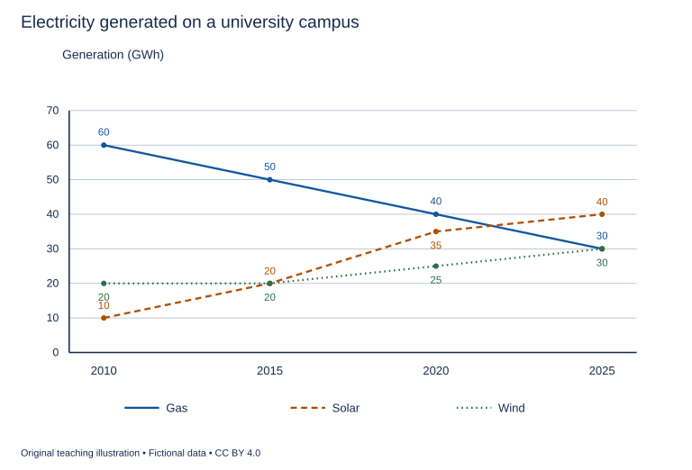

# U21 第13周：长篇阅读、写作与口语

本页为已独立核验的原创文字课程。先完成学生题目，再展开对应参考。非真题、非标准化模考，不换算雅思分数。听力尚未补齐，本页不代表全科课程已完成。

每周选A或G类Task 1一题，加Task 2及三次口语。参考范文不是学生已完成作业，仍须提交初稿、录音和重写，独立真人评分另行安排。

阅读每周180分钟（60分钟首次限时、120分钟证据精读与延迟复测），写作180分钟、口语120分钟。词汇60分钟、听力180分钟另列；新增完整听力未验收，不能勾整周完成。

W16原创阶段检查按实际证据复盘；正式T16陌生整卷及真人评分另记，本页原创技能卷不能代替正式模拟。后续周数与达标规则见 [U04](u04-exam-preparation.md)。

## 阅读：首答不查词

### R-W13-01 · Why a Queue Moves in Bursts

W13｜正文 861 词｜13 题｜篇章：机制解释：平均速度、波动与反馈（6段）

本课必做60分钟：首答20、证据复盘20、词汇长句10、48小时后复测10。每周三课180分钟，合卷首答替代单课首答，不重复计算。开放短文选做另加15分钟。

本项目原创虚构教学情境，人物、地点、历史事件和案例数据均非真实研究或史料。科学解释只讨论文内说明的模型与条件。非雅思真题或标准化模考；正确数不换算雅思等级。许可：CC BY 4.0 — RayXBuilds and contributors。

能力点：识别论证关系、区分作者与引述者、条件与因果、精确定位。初读不查词，完成后打开独立答案页。

#### Passage

**A** At the fictional ferry terminal of Olen, a queue sometimes remains still for several minutes and then advances rapidly. Visitors describe this as evidence that the ticket clerks are working irregularly. The explanation sounds reasonable because the movement of the queue is visible while activity behind the counter is not. Yet a queue is the combined result of arrivals, service and the way people move into newly available space. Its visible rhythm need not reproduce the rhythm of any one clerk. To explore this distinction, the terminal uses a tabletop demonstration with counters representing travellers. The exercise is not intended to predict a real terminal precisely. It shows how a perfectly regular service process can coexist with uneven waiting, and how several small sources of variation can combine into a pattern that seems more mysterious than any of its components viewed separately.

**B** The first demonstration admits one counter at a time and removes counters at a steady interval. If arrivals are spaced more widely than removals, the line usually disappears between customers. If several arrive together, however, a queue forms even when the average arrival rate across the whole demonstration remains low. Later quiet periods may give the clerk enough time to clear it, but that does not remove the waiting already experienced by the group. An average taken over a long period cannot describe every person's encounter with the service. The class therefore distinguishes a system's ability to handle its total demand from the waiting created by the timing of that demand. These are connected quantities, but improving one description does not automatically improve the other, particularly when boats and buses deliver people in groups rather than in a smoothly spaced stream.

**C** Service times can vary as well. A traveller buying a familiar ticket may finish quickly, while someone arranging a complicated journey may need a longer conversation. Even if the mean service time stays unchanged, concentrating several long transactions together creates a temporary blockage. In the demonstration, coloured counters identify the longer tasks before the run begins. The operator is not permitted to move them to convenient positions after observing the queue. Their order matters because a long task near the start affects people who arrive behind it. This does not establish that complicated customers deserve blame. Their needs are part of the service the terminal has offered. The practical question is how to accommodate different tasks without mistaking the convenience of the simplest transaction for a complete account of what the counter is supposed to do.

**D** The terminal considers two arrangements. Separate lines for each clerk allow travellers to choose a queue but expose them to the chance of selecting one behind an unexpectedly long task. A common line feeding the next available clerk can distribute that risk differently. It does not necessarily reduce the time required for any individual transaction, and its advantages depend on the layout and the rules for allocating customers. The writer rejects the claim that one arrangement must be best everywhere. A common line that obstructs a narrow entrance may create a different problem, while separate lines may suit genuinely different services. Comparison requires specifying both the work being offered and the experience being evaluated. A system can look faster because some requests have been moved elsewhere, without becoming faster at serving the same range of needs.

**E** To observe the demonstration, students use an arrival strip marked with the intended entry times and a service deck that specifies transaction durations. They record each counter's departure on a time sheet. The same sequence can then be tested under different queue arrangements without quietly replacing difficult tasks with easier ones. The class also uses a queue map showing the positions people could occupy without blocking the doorway. These devices answer complementary questions: the time sheet records waiting and departure, while the map concerns physical space. A short line is not automatically a comfortable line, and a long-looking line may move more predictably than several small ones. The terminal's plan therefore includes information about expected stages so that a traveller can understand what is happening even during a period when their own position does not visibly change.

**F** The last demonstration introduces a feedback effect. When people see a long queue, some delay joining it, then return together after it appears to have shortened. Their response can create another surge rather than a smooth reduction in demand. The class records these decisions in a return log and compares the resulting pattern with one in which entry times were fixed beforehand. It would be a mistake to describe the second pattern as the queue's natural behaviour and the first as an irrelevant disturbance. People respond to the service they encounter, and that response can become part of the service's operation. Olen's lesson is consequently broader than a recommendation about lines. Waiting emerges from timing, task differences, space and expectations. Before attributing every visible pause to an idle clerk, a careful observer should ask which of those processes could have produced the pause and what evidence would distinguish the alternatives. The answer may require watching arrivals as carefully as watching the counter, especially when demand follows a timetable elsewhere.

#### Questions

**Choose ONE answer, A, B, C or D.**

1. The opening warns that queue movement

   A. does not necessarily mirror one clerk’s activity
   B. cannot be observed
   C. depends only on the doorway
   D. always reveals staff effort

2. Why can a low average arrival rate coexist with waiting?

   A. Arrivals may occur in groups
   B. The average is never calculable
   C. Nobody leaves
   D. All transactions are identical

3. Why must task order be fixed before a run?

   A. To stop complicated work
   B. To guarantee no queue
   C. To make every clerk slower
   D. To prevent favourable rearrangement after seeing results

4. A common line is presented as

   A. always physically shorter
   B. a conditional way to distribute waiting risk
   C. universally superior
   D. a way to eliminate complex tasks

**Do the following statements agree with the writer's views? Write YES, NO or NOT GIVEN. YES = the writer agrees; NO = the writer expresses the opposite view; NOT GIVEN = the writer's view is not stated. Do not use outside knowledge.**

5. Quiet periods erase the waiting experienced by earlier groups.

6. Complex requests should be excluded simply because they take longer.

7. The writer believes Olen’s clerks receive excessive wages.

8. Customers’ responses can themselves change the queue’s pattern.

**Complete the sentences. Choose NO MORE THAN 3 WORDS FROM THE PASSAGE for each answer. Do not change word forms.**

9. Intended entry times are marked on an ______.

10. Transaction durations are supplied by a ______.

11. Departures are entered on a ______.

12. Positions that avoid blocking the doorway appear on a ______.

13. Decisions to come back later are entered in a ______.

#### 本周重点

时间分配：首答记录每题组起止分钟，遇到停滞题先标记再推进，最后按证据回看。

#### 复盘

必做：给每道错题标记“定位/作者立场/范围/语法/词数”，抄最短证据；用一行箭头概括本文论证或过程。48小时后重做错题与两道正确题，检查是否仍能指出证据。

选做（15分钟，80–100词）：Explain one way a short-looking queue could still provide a poor experience.

R-W13-01 答案、证据与精读（首答后展开）

### R-W13-01 · 独立答案与证据

来源与许可同学生页。先完成再核对。可接受答案由 accepted_answers 明确列出；只忽略大小写和首尾空格，不自行删词。开放复盘不计入客观正确数。

1. **A**｜段落 A｜证据：“need not reproduce the rhythm of any one clerk”

   其余绝对化或与可观察场景不符。

2. **A**｜段落 B｜证据：“If several arrive together”

   时序不同于长期总量。

3. **D**｜段落 C｜证据：“not permitted to move them to convenient positions”

   保持比较输入而非预定结论。

4. **B**｜段落 D｜证据：“distribute that risk differently”

   作者同时说明空间与服务条件。

5. **NO**｜段落 B｜证据：“does not remove the waiting already experienced”

   过去经历不能由后来的空闲取消。

6. **NO**｜段落 C｜证据：“Their needs are part of the service”

   作者反对按简单交易定义全部服务。

7. **NOT GIVEN**｜段落 A｜证据：“ticket clerks”

   全文未评价薪酬，不能从排队推工资立场。

8. **YES**｜段落 F｜证据：“that response can become part”

   明确反馈机制。

9. **arrival strip**｜段落 E｜证据：“an arrival strip”

   strip单独不能接an；完整名称才符合冠词。

10. **service deck / deck**｜段落 E｜证据：“a service deck”

   deck为合理短答。

11. **time sheet / sheet**｜段落 E｜证据：“on a time sheet”

   sheet可接受；entry times为另一记录。

12. **queue map / map**｜段落 E｜证据：“a queue map”

   map可接受，描述空间而非耗时。

13. **return log / log**｜段落 F｜证据：“in a return log”

   log为合理中心词。

#### 词汇与长句

- **surge**：短时间内集中到达
- **allocate**：分配
- **transaction**：一次服务事项
- **feedback**：反应再次改变原系统的过程

> A system can look faster because some requests have been moved elsewhere, without becoming faster at serving the same range of needs.

because解释表面提速，without限定并未改善同一任务集合。

> People respond to the service they encounter, and that response can become part of the service's operation.

that response回指顾客反应，说明双向因果。

#### 开放任务参考

D服务任务被转走或入口受阻，E视觉长度不等于等待；须说清评价维度。

标准：观点有文内依据，保留条件和范围，推断明确标注；不存在唯一措辞。

### R-W13-02 · The Street That Acquired a Roof

W13｜正文 944 词｜13 题｜篇章：虚构历史：商业连廊与城市边界（8段）

本课必做60分钟：首答20、证据复盘20、词汇长句10、48小时后复测10。每周三课180分钟，合卷首答替代单课首答，不重复计算。开放短文选做另加15分钟。

本项目原创虚构教学情境，人物、地点、历史事件和案例数据均非真实研究或史料。科学解释只讨论文内说明的模型与条件。非雅思真题或标准化模考；正确数不换算雅思等级。许可：CC BY 4.0 — RayXBuilds and contributors。

能力点：识别论证关系、区分作者与引述者、条件与因果、精确定位。初读不查词，完成后打开独立答案页。

#### Passage

**A** In the fictional northern town of Varen, the first covered passage began as a practical agreement between two shopkeepers. They placed a light roof over the narrow space separating their entrances so that customers could cross without stepping into winter rain. The structure was not conceived as a new kind of public street. It was a small extension of the shops, maintained by their owners and closed when they went home. Yet its usefulness changed what neighbours expected of the space. People began using it to reach a lane behind the buildings, and the distinction between a private shelter and a public route became harder to maintain through habit alone.

**B** A third trader extended the roof towards the market square. The resulting passage offered a continuous sheltered walk, but the separate sections differed in height and width. Carts could enter at one end and become trapped at a narrow point farther along. The town's first passage sketch recorded entrances, changes in level and places where two people could not easily pass. It was drawn to solve movement problems rather than to advertise an architectural style. The sketch revealed that linking several useful fragments did not automatically create a useful whole. A route could fail at its smallest obstruction even when every owner considered their own section adequate for the customers immediately outside their door.

**C** During the next winter, traders installed lamps beneath the roof. Evening use increased, and stalls remained open later. This made the passage commercially attractive but also changed the work required to keep it operating. Someone had to replace fuel, clean surfaces and decide when lighting would stop. The owners began sharing costs through a maintenance account, contributing according to the length of frontage they controlled. That formula was easy to calculate, but it did not precisely reflect who benefited most. A small shop near the busiest entrance could receive more visitors than a larger one in a quiet corner. An apparently neutral rule for dividing costs therefore contained an assumption about how location and commercial advantage were related.

**D** The passage gradually attracted activities that depended on lingering rather than simply moving through. A seller displayed illustrated books; a craft worker demonstrated a technique beside a window. Visitors paused, talked and watched. The roof had changed the rhythm of the space, not merely the amount of rain reaching the pavement. However, this success created conflict. People stopping at a demonstration could obstruct those trying to reach the rear lane. Shopkeepers who benefited from an audience wanted room for displays, while others wanted a clear corridor. The town did not resolve the issue by declaring all stopping undesirable. It marked places where activity could expand without consuming the route's minimum usable width.

**E** Ownership became more contentious when a new proprietor closed a gate across the rear exit. The owner argued that the passage crossed private land; regular users replied that years of daily access had made it part of their normal route. The fictional council's response was to negotiate an access agreement specifying opening hours and responsibilities. This account makes no claim about the legal rules of any real jurisdiction. Its historical point is that physical connection and accepted use can develop before a stable agreement about control. A roof can be built quickly, while the expectations surrounding the route beneath it may take much longer to become explicit or to accommodate the interests of people who did not pay for its construction.

**F** Later improvements made the passage look more uniform. Roof sections were replaced, and a common colour was used on the supports. A decorative print showed the result as a single elegant design. That image concealed the uneven sequence through which the space had grown. Visitors seeing only the finished view might assume that circulation, lighting and access had all been settled by one architect from the beginning. The council preserved a change register recording additions and alterations, including sections removed after causing difficulties. The register offered a less polished but more informative history than the print. It showed decisions responding to earlier consequences, rather than a perfect plan gradually becoming visible without disagreement or revision.

**G** When a new open road diverted some traffic away from the covered route, traders proposed measuring success by comparing visitor totals. The keeper of the records suggested another question: what kinds of use still depended on the passage? Some customers continued choosing it for shelter, while others came specifically for demonstrations and conversation. A reduction in through-traffic did not necessarily mean every function had weakened. The town collected short descriptions in a use diary, noting whether visitors were crossing, shopping or staying to watch. The entries were incomplete and could not account for everyone. They nevertheless prevented the discussion from treating all footsteps as identical units of value or all visitors as people with the same reason for entering.

**H** Varen's covered street ultimately belonged to several histories at once: a response to weather, a commercial experiment, a route through private plots and a place for public attention. None of these accounts alone explains why it took its final form. The writer cautions against reading the decorative print as the story of an idea fully formed before construction. The more revealing story lies in the interactions between additions, uses and negotiated limits. A sheltered connection invited new behaviour; that behaviour created costs and conflicts; agreements and alterations then reshaped the connection. The passage became a shared environment through this continuing process, even though its physical parts remained linked to separate owners. Its roof was easy to see, but the arrangements that made the space workable were just as important to understanding what had been built.

#### Questions

**Which paragraph contains the following information? Write a letter, A–H. You may use any letter more than once.**

1. a cart becoming obstructed after entering a passage that initially seemed wide enough

2. a cost-sharing formula based on frontage rather than actual benefit

3. a conflict following the closure of a previously used rear exit

4. a comparison between a decorative print and a change register that records sections later removed after causing difficulties

**Complete the summary. Choose NO MORE THAN 3 WORDS FROM THE PASSAGE for each answer. Do not change word forms.**

The route’s movement problems were recorded in a (5) ______. Shared lighting costs passed through the (6) ______. Opening hours were specified in an (7) ______. Later alterations entered a (8) ______. Different reasons for visiting were described in a (9) ______.

**Do the following statements agree with the writer's views? Write YES, NO or NOT GIVEN. YES = the writer agrees; NO = the writer expresses the opposite view; NOT GIVEN = the writer's view is not stated. Do not use outside knowledge.**

10. Connecting individually useful sections guarantees a fully usable route.

11. Every person stopping in the passage should have been prevented from doing so.

12. A fall in through-traffic necessarily reduces every function of the passage.

13. The writer thinks covered streets should be built in all towns.

#### 本周重点

时间分配：首答记录每题组起止分钟，遇到停滞题先标记再推进，最后按证据回看。

#### 复盘

必做：给每道错题标记“定位/作者立场/范围/语法/词数”，抄最短证据；用一行箭头概括本文论证或过程。48小时后重做错题与两道正确题，检查是否仍能指出证据。

选做（15分钟，80–100词）：Explain why a finished architectural image may omit important parts of a place’s history.

R-W13-02 答案、证据与精读（首答后展开）

### R-W13-02 · 独立答案与证据

来源与许可同学生页。先完成再核对。可接受答案由 accepted_answers 明确列出；只忽略大小写和首尾空格，不自行删词。开放复盘不计入客观正确数。

1. **B**｜段落 B｜证据：“become trapped at a narrow point”

   B具体移动反例；D为驻足拥堵。

2. **C**｜段落 C｜证据：“length of frontage they controlled”

   C费用计算依据。

3. **E**｜段落 E｜证据：“closed a gate across the rear exit”

   E使用与控制冲突。

4. **F**｜段落 F｜证据：“The council preserved a change register recording additions and alterations, including sections removed after causing difficulties.”

   F 将装饰图与change register对照，后者明确包含因造成问题而拆除的部分。H 只提醒不要把装饰图误读为预先完整的构想，没有登记册或拆除记录，不满足新题干的复合条件。

5. **passage sketch / first passage sketch / sketch**｜段落 B｜证据：“first passage sketch”

   first passage sketch 恰好三词，题干未给 first；完整描述、passage sketch 和 sketch 都接纳。

6. **maintenance account / account**｜段落 C｜证据：“through a maintenance account”

   题干用 the，maintenance account 与 account 都合语法；账目记录共同维护费用，不应因中心词为元音开头而误判。

7. **access agreement / agreement**｜段落 E｜证据：“an access agreement”

   两者均元音开头可接an。

8. **change register / register**｜段落 F｜证据：“a change register”

   register为合理短答。

9. **use diary / diary**｜段落 G｜证据：“in a use diary”

   diary可接受，按使用目的记述。

10. **NO**｜段落 B｜证据：“did not automatically create a useful whole”

   作者反对简单加总。

11. **NO**｜段落 D｜证据：“did not resolve the issue by declaring all stopping undesirable”

   保留活动空间且保护通路。

12. **NO**｜段落 G｜证据：“did not necessarily mean every function had weakened”

   不同使用目的不能一概而论。

13. **NOT GIVEN**｜段落 H｜证据：“several histories at once”

   分析本例，不作普遍建设建议。

#### 词汇与长句

- **frontage**：临街或沿通道的门面长度
- **corridor**：通行走廊
- **incremental**：逐步增加形成的
- **through-traffic**：仅穿行而过的人流或交通

> The roof had changed the rhythm of the space, not merely the amount of rain reaching the pavement.

not merely强调新增功能，不否定遮雨。

> A reduction in through-traffic did not necessarily mean every function had weakened.

not necessarily与every限制推断，穿行减少不代表全部用途下降。

#### 开放任务参考

F美化统一外观隐藏建设顺序，C/E成本与通行协议看不见但影响使用。

标准：观点有文内依据，保留条件和范围，推断明确标注；不存在唯一措辞。

### R-W13-03 · The Unwritten Grammar of a Shared Meal

W13｜正文 913 词｜14 题｜篇章：议论：社会惯例、身份与条件解释（7段）

本课必做60分钟：首答20、证据复盘20、词汇长句10、48小时后复测10。每周三课180分钟，合卷首答替代单课首答，不重复计算。开放短文选做另加15分钟。

本项目原创虚构教学情境，人物、地点、历史事件和案例数据均非真实研究或史料。科学解释只讨论文内说明的模型与条件。非雅思真题或标准化模考；正确数不换算雅思等级。许可：CC BY 4.0 — RayXBuilds and contributors。

能力点：识别论证关系、区分作者与引述者、条件与因果、精确定位。初读不查词，完成后打开独立答案页。

#### Passage

**A** A visitor to the fictional community house of Nima is told that everyone helps with the evening meal. The instruction sounds complete until the visitor sees people doing very different things. Some cook, some bring ingredients, some wash dishes, and an elderly neighbour simply sits near the door and greets arrivals. Nobody asks her to take a turn at the sink. The visitor wonders whether the rule is inconsistently enforced. The writer suggests a different possibility: the short instruction compresses a set of expectations that residents have learned through participation. Understanding the practice requires asking what counts as help, how contributions are recognised and which circumstances change what someone is expected to do. A rule stated in familiar words may still depend on knowledge that the words alone do not supply to a newcomer.

**B** One resident explains the meal as an exchange. People contribute work or food because they expect to share the result. That account illuminates part of the arrangement, but it can make the practice sound more exact than it is. Contributions are not weighed against portions, and someone arriving after an exhausting day may eat before being asked to do anything. Help can also take a form that is not immediately visible. The neighbour at the door remembers who needs assistance carrying dishes and who may not recognise other guests. Her presence supports the gathering even though it does not resemble food preparation. The writer rejects the assumption that fairness must require identical actions by every participant. The question is whether differences in contribution are intelligible and open to discussion, not whether every person performs the same observable task.

**C** Another resident calls the meal a gift, emphasising that nobody receives a bill. This description captures the absence of a formal price but risks hiding expectations that still exist. A regular participant who never contributes and never explains why may eventually encounter resentment. The lack of a written charge does not prove that the meal is free of obligation. Nor does the presence of obligation make every gesture a concealed commercial transaction. The writer finds both extremes inadequate. The gathering combines generosity, reciprocity and attention to circumstances. To identify those elements is not to expose a secret motive behind every kind act. It is to describe how a shared activity can be sustained without fitting neatly into either a market exchange or an entirely unconditional donation.

**D** Newcomers discover these distinctions unevenly. A confident guest may ask where help is needed, while someone uncertain about language or custom may wait to be invited. Silence can then be misread as unwillingness. The organisers introduce a welcome round in which a host explains available tasks and explicitly says that people may ask for another role. This does not eliminate every misunderstanding, but it makes some expectations accessible without requiring the guest to guess correctly. The writer supports this change because an informal practice should not depend entirely on possessing the confidence to question it. Local knowledge may make coordination efficient among familiar participants while becoming a barrier when the group wants to include people who have not yet learned its conventions.

**E** The organisers also face disagreements about repetition. Should a person who cooks skilfully always cook, or should everyone have opportunities to learn? Assigning tasks solely by existing skill can make the meal run smoothly while preserving a narrow division of work. Rotating every task mechanically can create frustration when people have different capacities or limited time. Nima therefore tries a flexible pairing arrangement: an experienced participant can work beside someone who wants to learn, while other roles remain available. This is a compromise directed at a stated purpose, not a universal formula for communal life. Its value depends on whether it expands participation without making the meal so difficult to organise that the people carrying most of the work become unable or unwilling to continue.

**F** A dispute over washing dishes shows why exceptions need explanation. One participant regularly leaves before cleaning because of an agreed responsibility elsewhere. Another begins leaving at the same time, assuming the departure establishes a general right. The organisers clarify that the first arrangement responds to a particular constraint and does not automatically create an identical exemption for everyone. Yet they also invite the second person to describe any constraint of their own. The writer sees this as stronger than either refusing all exceptions or allowing an unexplained exception to become the only visible rule. Consistency can lie in how circumstances are considered, even when the resulting assignments differ. The important question is whether comparable reasons receive comparable attention rather than whether every outcome looks identical from across the room.

**G** Nima's meal should not be romanticised as a community without conflict. Its continuation requires work, negotiation and a way to notice burdens that friendly language can conceal. Neither should it be dismissed because its rules are not fully written down. Many useful practices rely on judgement that no short checklist can exhaust. The lesson for an outside observer is to resist treating a compressed instruction as a complete account of its social meaning. Helping may involve skill, presence, learning or adjustment to another person's limits. A careful interpretation looks for the relationships between these forms rather than counting only the most visible actions. It also asks whether people affected by the expectations can understand and question them. That is a more demanding standard of fairness than either identical chores or cheerful claims that everyone naturally knows what to do.

#### Questions

**Do the following statements agree with the writer's views? Write YES, NO or NOT GIVEN. YES = the writer agrees; NO = the writer expresses the opposite view; NOT GIVEN = the writer's view is not stated. Do not use outside knowledge.**

1. Fairness necessarily requires identical visible tasks from everyone.

2. An absence of bills proves an absence of social obligation.

3. Comparable reasons can be treated consistently even when outcomes differ.

4. The writer believes the visitor intentionally avoided helping.

5. Informal expectations should be understandable and open to challenge.

**Choose ONE answer, A, B, C or D.**

6. The visitor’s difficulty initially arises because

   A. all expectations are written
   B. the meal has no food
   C. every participant cooks
   D. a brief rule omits shared background knowledge

7. The neighbour at the door illustrates

   A. a requirement that nobody wash dishes
   B. a contribution not resembling food preparation
   C. a formal payment system
   D. a ban on older participants working

8. Why introduce a welcome round?

   A. To make every guest cook
   B. To remove all traditions
   C. To charge for instruction
   D. To make expectations accessible without confident questioning

9. Flexible pairing aims to

   A. combine learning opportunities with workable preparation
   B. eliminate experienced participants
   C. preserve all current divisions
   D. rotate every job without exceptions

**Which paragraph contains the following information? Write a letter, A–G. You may use any letter more than once.**

10. a warning that assigning tasks only by existing ability can preserve divisions

11. a second person mistaking a specific arrangement for a general exemption

12. a contrast between a gift description and obligations that still exist

13. a description of a host explicitly allowing guests to request another role

14. a final rejection of both romanticising and dismissing an unwritten practice

#### 本周重点

时间分配：首答记录每题组起止分钟，遇到停滞题先标记再推进，最后按证据回看。

#### 复盘

必做：给每道错题标记“定位/作者立场/范围/语法/词数”，抄最短证据；用一行箭头概括本文论证或过程。48小时后重做错题与两道正确题，检查是否仍能指出证据。

选做（15分钟，80–100词）：Explain a fair way to handle an exception without turning it into an unexplained privilege.

R-W13-03 答案、证据与精读（首答后展开）

### R-W13-03 · 独立答案与证据

来源与许可同学生页。先完成再核对。可接受答案由 accepted_answers 明确列出；只忽略大小写和首尾空格，不自行删词。开放复盘不计入客观正确数。

1. **NO**｜段落 B｜证据：“rejects the assumption”

   明确否定。

2. **NO**｜段落 C｜证据：“does not prove that the meal is free of obligation”

   无价格不等于无期待。

3. **YES**｜段落 F｜证据：“Consistency can lie in how circumstances are considered”

   作者给出的条件式一致性。

4. **NOT GIVEN**｜段落 A｜证据：“The visitor wonders”

   只交代疑问，未述故意逃避；无相反意图证据。

5. **YES**｜段落 G｜证据：“understand and question them”

   作者评价标准。

6. **D**｜段落 A｜证据：“knowledge that the words alone do not supply”

   不等于不存在规则。

7. **B**｜段落 B｜证据：“does not resemble food preparation”

   贡献形式多样，不可推禁止劳动。

8. **D**｜段落 D｜证据：“without requiring the guest to guess correctly”

   降低隐性门槛。

9. **A**｜段落 E｜证据：“work beside someone who wants to learn”

   服务具体目标，不宣称普遍最优。

10. **E**｜段落 E｜证据：“solely by existing skill”

   E技能与学习机会。

11. **F**｜段落 F｜证据：“assuming the departure establishes a general right”

   F具体误读事件，不是D一般新客不理解。

12. **C**｜段落 C｜证据：“a gift”

   C两种极端解释。

13. **D**｜段落 D｜证据：“people may ask for another role”

   D欢迎活动的具体内容。

14. **G**｜段落 G｜证据：“Neither should it be dismissed”

   G双向限定总结。

#### 词汇与长句

- **reciprocity**：相互回应与回馈
- **exemption**：基于条件的免除
- **convention**：共同学习形成的惯例
- **intelligible**：能被理解和解释的

> Local knowledge may make coordination efficient among familiar participants while becoming a barrier when the group wants to include people who have not yet learned its conventions.

while对比同一知识对熟人与新人的作用，may限制泛化。

> Consistency can lie in how circumstances are considered, even when the resulting assignments differ.

how从句说明一致性所在，even when承认结果不同。

#### 开放任务参考

F说明条件、允许他人表达可比理由；B不同贡献须可解释，不能只要求表面相同。

标准：观点有文内依据，保留条件和范围，推断明确标注；不存在唯一措辞。

## 写作与口语：Task 1双分支择一

### WS-W13-T1A 学生页：校园电力来源趋势

周次 W13｜题型 T1A｜能力点：多序列趋势与限时筛选

Task 1 的 A/G 分支二选一，另一分支不计入本周作业。

#### 使用与记录

原创教学练习，非真题、非标准化模拟，难度未校准。先完成本页再打开参考页。人物、机构、经历与数据均为教学虚构。不要背诵示例。自评和 AI 反馈不能代替独立真人评分，未获得真人评阅时标记“分数未确认”。

保存：任务ID、实际日期、用时、初稿或原始录音、证据化反馈、重写/重答、三条修改理由。没有学生提交物，不得填写“已批改”或“已完成训练”。

#### 完整题干

The line graph shows electricity generated from three sources on a university campus in selected years from 2010 to 2025. Summarise the information by selecting and reporting the main features, and make comparisons where relevant.

Write at least 150 words. Spend about 20 minutes on this task.

教学虚构。年份2010/2015/2020/2025；单位GWh。Gas60/50/40/30，Solar10/20/35/40，Wind20/20/25/30；仅这三来源发电量，不给消耗、成本、排放或中间年份实测值。

#### 任务预算（含首次审题，不额外加时）

初稿20分钟（审题规划3、写作15、检查2）；诊断15；反馈阅读与证据核查10；完整重写25；对照归档5。合计75分钟。

#### 初稿后自评清单

- [ ] 达到最低字数；全文连贯成段，没有用项目符号代替作文。
- [ ] 概述给主要特征；数据、阶段或方位都与题图逐项相符，不推断未提供的原因。
- [ ] 每段可写出一个功能标签；例子或数据与该段要点相连。
- [ ] 圈出两处词汇搭配和两处句法疑点，先自行修正再查询或求反馈。
- [ ] 记录一项最影响理解的问题和原句证据，不填写自猜分数。

#### 反馈与重写

打开 独立参考页（本节下方展开参考），按逐段检查和通用协议核验。重写任务：完整重写至少150词；先用2分钟选两项主变化，在20分钟初稿记录实际结束点；重写把冗余逐点列数改为比较，不省关键概述。

#### 本周重点操作（已含原预算）

本周D3将所选Task 1与Task 2连续做60分钟。本题20分钟含审题写作检查；在第20分钟标记完成位置，转Task 2，不暂停计时。用本题原有15分钟诊断中的3分钟记录计划/实际耗时及剩余内容，未完成如实标记。

W13 T1A 示例、反馈与重练（首答后展开）

### WS-W13-T1A 独立参考页

只在初稿完成后阅读；不是唯一答案，也没有官方分数。以下是对原创示例的教学讲评，不是对学生尚未提交作文的已完成批改。

#### 思路拆解

限时先选主变化：gas降、solar升并末年领先、wind较缓；单位是发电量，不是占比或消耗；概述与分组优先于罗列。

#### 原创示例

The line graph compares electricity generated from gas, solar power and wind on a university campus in four selected years between 2010 and 2025. Generation is measured in gigawatt-hours.

Overall, gas was the largest source initially, but its output declined in every interval shown. Solar generation rose substantially and became the largest source in 2025, while wind power increased more gradually. Total generation increased slightly between the beginning and end of the period.

In 2010, gas produced 60 gigawatt-hours, compared with 10 from solar power and 20 from wind. Gas output then fell to 50 in 2015 and 40 in 2020, before reaching 30 in 2025. Solar generation followed the opposite pattern, rising to 20, 35 and finally 40 gigawatt-hours. It was still below gas in 2020 but exceeded it by ten gigawatt-hours in the final year.

Wind generation remained at 20 gigawatt-hours in both 2010 and 2015, then increased to 25 in 2020 and 30 in 2025. Wind and gas therefore produced equal amounts at the end. The combined output of all three sources was 90 gigawatt-hours in 2010 and 100 in 2025, alongside the considerable change in its composition.

示例正文词数：191（本项目正则计数；书信不含称呼、结束语与署名；连字符词作一词）。

#### 逐段反馈与迁移

- P1 GWh为发电量，校园三来源而非全国或总用电需求。

- P2 末年solar40最大；首年合90、末年合100，不能写首尾相同或每个区间均上升。

- P3 gas60/50/40/30；solar10/20/35/40，2020仍未超过，不猜具体交叉年。

- P4 wind20/20/25/30，起初不变；末年wind=gas，三来源合计100；首年合计90。

#### 常见失误

将来源输出当百分比；写太阳能始终最多；为赶时间取消概述或猜原因。

#### 可执行反馈步骤

1. 先把自己的段落标为引入、概述/论点、支持、收束；分段可不同于示例，按功能核查，不照抄段数。
2. 对照上方逐段检查，逐项标“已有证据/缺失/不适用”。每条意见必须附自己的原句或缺失位置。
3. 按 [反馈协议](u25-feedback.md) 的四维表记录；有争议的 AI 意见回题干、数据或语法依据核验。
4. 只选两项最高优先级问题执行整篇重写；保留原稿，禁止把示例替换为自己的作业。

#### 重写任务

完整重写至少150词；先用2分钟选两项主变化，在20分钟初稿记录实际结束点；重写把冗余逐点列数改为比较，不省关键概述。

完成后重新勾选 学生页（见本节上方学生题） 清单；将一处改前/改后及理由交给独立评阅者核查。真人评阅状态目前为“待安排”，不是已完成。

### WS-W13-T1G 学生页：取消杂志续订

周次 W13｜题型 T1G｜能力点：书信目的、要点与语气

Task 1 的 A/G 分支二选一，另一分支不计入本周作业。

#### 使用与记录

原创教学练习，非真题、非标准化模拟，难度未校准。先完成本页再打开参考页。人物、机构、经历与数据均为教学虚构。不要背诵示例。自评和 AI 反馈不能代替独立真人评分，未获得真人评阅时标记“分数未确认”。

保存：任务ID、实际日期、用时、初稿或原始录音、证据化反馈、重写/重答、三条修改理由。没有学生提交物，不得填写“已批改”或“已完成训练”。

#### 完整题干

You have decided not to renew a magazine subscription, but you have received a renewal notice. Write to the magazine’s customer service team. In your letter:
- give details of your subscription
- explain why you do not want to renew
- ask for confirmation of the cancellation and clarify what should happen to the remaining issues.
Begin your letter: Dear Sir or Madam,

Write at least 150 words. You do not need to write any addresses. Spend about 20 minutes on this task.

#### 任务预算（含首次审题，不额外加时）

初稿20分钟（审题规划3、写作15、检查2）；诊断15；反馈阅读与证据核查10；完整重写25；对照归档5。合计75分钟。

#### 初稿后自评清单

- [ ] 达到最低字数；全文连贯成段，没有用项目符号代替作文。
- [ ] 三个要点均展开；称呼、目的、语气和结束语适合收信人。
- [ ] 每段可写出一个功能标签；例子或数据与该段要点相连。
- [ ] 圈出两处词汇搭配和两处句法疑点，先自行修正再查询或求反馈。
- [ ] 记录一项最影响理解的问题和原句证据，不填写自猜分数。

#### 反馈与重写

打开 独立参考页（本节下方展开参考），按逐段检查和通用协议核验。重写任务：完整重写至少150词；在首段明确取消对象，末段写两项确认要求，不能将请求写成已完成操作。

#### 本周重点操作（已含原预算）

本周D3将所选Task 1与Task 2连续做60分钟。本题20分钟含审题写作检查；在第20分钟标记完成位置，转Task 2，不暂停计时。用本题原有15分钟诊断中的3分钟记录计划/实际耗时及剩余内容，未完成如实标记。

W13 T1G 示例、反馈与重练（首答后展开）

### WS-W13-T1G 独立参考页

只在初稿完成后阅读；不是唯一答案，也没有官方分数。以下是对原创示例的教学讲评，不是对学生尚未提交作文的已完成批改。

#### 思路拆解

正式请求，区分停止未来续订与取消当前剩余配送；先给定位信息再说目的；不编造收费已经发生。

#### 原创示例

Dear Sir or Madam,

I am writing about my subscription to Garden Life, under reference GL318. My current subscription runs until the end of August, and I received a notice yesterday stating that it would renew automatically for another year. I would like to prevent that renewal while keeping the issues already included in my current subscription.

I have enjoyed the practical articles, but I am moving to a smaller flat next month and will no longer have a garden. I also have several unread copies, so renewing now would give me more material than I can reasonably use. My decision is therefore about my circumstances rather than a complaint about the magazine’s quality.

Could you please confirm in writing that no new subscription period will begin in September and that no renewal payment will be taken? I would still like the remaining issues from my current subscription to be delivered as usual. My delivery address will stay valid until August, so there is no need to change it. Please let me know if you require any further information to complete this request.

Yours faithfully,
Alex Chen

示例正文词数：179（本项目正则计数；书信不含称呼、结束语与署名；连字符词作一词）。

#### 逐段反馈与迁移

- P1 到期8月底，自动新周期9月，当前与未来范围清楚。

- P2 原因与订阅选择相关，不泛写服务差。

- P3 书面确认不续费并照送当前剩余期数，地址有效期一致。

#### 常见失误

仅说cancel而不区分剩余期；未给订阅信息；假装客服已确认退款。

#### 可执行反馈步骤

1. 先把自己的段落标为引入、概述/论点、支持、收束；分段可不同于示例，按功能核查，不照抄段数。
2. 对照上方逐段检查，逐项标“已有证据/缺失/不适用”。每条意见必须附自己的原句或缺失位置。
3. 按 [反馈协议](u25-feedback.md) 的四维表记录；有争议的 AI 意见回题干、数据或语法依据核验。
4. 只选两项最高优先级问题执行整篇重写；保留原稿，禁止把示例替换为自己的作业。

#### 重写任务

完整重写至少150词；在首段明确取消对象，末段写两项确认要求，不能将请求写成已完成操作。

完成后重新勾选 学生页（见本节上方学生题） 清单；将一处改前/改后及理由交给独立评阅者核查。真人评阅状态目前为“待安排”，不是已完成。

### WS-W13-T2 学生页：大学是否优先投资节能

周次 W13｜题型 T2｜能力点：观点展开与任务回应

A/G 共用本题。

#### 使用与记录

原创教学练习，非真题、非标准化模拟，难度未校准。先完成本页再打开参考页。人物、机构、经历与数据均为教学虚构。不要背诵示例。自评和 AI 反馈不能代替独立真人评分，未获得真人评阅时标记“分数未确认”。

保存：任务ID、实际日期、用时、初稿或原始录音、证据化反馈、重写/重答、三条修改理由。没有学生提交物，不得填写“已批改”或“已完成训练”。

#### 完整题干

Universities should spend more money improving the energy efficiency of existing buildings than constructing impressive new buildings. To what extent do you agree or disagree? Give reasons and include relevant examples.

Write at least 250 words. Spend about 40 minutes on this task.

#### 任务预算（含首次审题，不额外加时）

初稿40分钟（审题规划5、写作30、检查5）；诊断15；反馈阅读与证据核查10；完整重写35；对照归档5。合计105分钟。

#### 初稿后自评清单

- [ ] 达到最低字数；全文连贯成段，没有用项目符号代替作文。
- [ ] 直接回答题目的所有问句，有始终一致的立场。
- [ ] 每段可写出一个功能标签；例子或数据与该段要点相连。
- [ ] 圈出两处词汇搭配和两处句法疑点，先自行修正再查询或求反馈。
- [ ] 记录一项最影响理解的问题和原句证据，不填写自猜分数。

#### 反馈与重写

打开 独立参考页（本节下方展开参考），按逐段检查和通用协议核验。重写任务：完整重写至少250词；主体一处具体比较、一处合理例外；记录40分钟结束时完成情况，超时如实记，不靠删结论伪装完成。

#### 本周重点操作（已含原预算）

接Task 1连续作答40分钟，整组计60分钟。第35分钟检查是否有结论、最后5分钟优先补任务遗漏并核关键语言；结束后用原有诊断中的3分钟记录实际完成位置。不是额外再做一套，不能用示例时间替代实测。

W13 T2 示例、反馈与重练（首答后展开）

### WS-W13-T2 独立参考页

只在初稿完成后阅读；不是唯一答案，也没有官方分数。以下是对原创示例的教学讲评，不是对学生尚未提交作文的已完成批改。

#### 思路拆解

优先级题不是禁止所有新建；比较日常收益、机会成本与教育需求例外；20/40时间预算内先定边界。

#### 原创示例

Universities often face a choice between improving existing facilities and investing in prominent new buildings. I generally agree that energy efficiency should receive priority over impressive construction. However, this does not mean that every old building should be preserved regardless of whether it still meets educational needs.

Improving an existing building can benefit the people who use it every day. Better insulation and more effective controls may make rooms easier to heat or cool without wasting as much energy. A lecture room that is uncomfortable for much of the year needs practical attention even if its exterior looks attractive. Such improvements can also reduce ongoing operating demands, leaving more resources available for teaching and maintenance. The benefits are less visible than a new entrance hall, but they directly concern the quality and cost of using the campus.

There is also a question of priorities. Money spent mainly to create an impressive appearance cannot be spent on other needs at the same time. For example, improving several heavily used teaching buildings may serve more students than constructing a prestigious reception building used only occasionally. Universities should therefore compare projects according to their long-term usefulness rather than assume that new architecture will automatically improve education or reputation.

Nevertheless, a new building can sometimes be the more reasonable option. An existing laboratory may be too small or unsuitable for modern equipment, and repeated alterations may not solve that problem. In such a case, the university should compare renovation with replacement, including how efficiently the new facility would operate. The distinction is between necessary construction and construction driven mainly by appearance, not simply between old and new.

In conclusion, universities should normally address the practical performance of their existing buildings before funding impressive additions. Exceptions are justified when replacement meets a clear educational need that renovation cannot reasonably satisfy.

示例正文词数：305（本项目正则计数；书信不含称呼、结束语与署名；连字符词作一词）。

#### 逐段反馈与迁移

- P1 generally agree与例外同时明确，避免立场绝对化。

- P2 舒适和能源需求具体，不给未经核实节能百分比。

- P3 同一经费下比较使用范围，而非仅说money important。

- P4 实验室例外挑战“旧必优”，但没有推翻反对纯外观项目的主张。

- P5 收束为教育需要与可行改造，不添加新理由。

#### 常见失误

泛写保护环境无大学情境；把新建等同浪费；无比较只罗列节能优点。

#### 可执行反馈步骤

1. 先把自己的段落标为引入、概述/论点、支持、收束；分段可不同于示例，按功能核查，不照抄段数。
2. 对照上方逐段检查，逐项标“已有证据/缺失/不适用”。每条意见必须附自己的原句或缺失位置。
3. 按 [反馈协议](u25-feedback.md) 的四维表记录；有争议的 AI 意见回题干、数据或语法依据核验。
4. 只选两项最高优先级问题执行整篇重写；保留原稿，禁止把示例替换为自己的作业。

#### 重写任务

完整重写至少250词；主体一处具体比较、一处合理例外；记录40分钟结束时完成情况，超时如实记，不靠删结论伪装完成。

完成后重新勾选 学生页（见本节上方学生题） 清单；将一处改前/改后及理由交给独立评阅者核查。真人评阅状态目前为“待安排”，不是已完成。

### WS-W13-S1 学生页

周次W13｜Part 1专项｜能力点：时间分配与完整回应｜30分钟

#### 使用与记录

原创教学练习，非真题、非标准化模拟，难度未校准。先完成本页再打开参考页。人物、机构、经历与数据均为教学虚构。不要背诵示例。自评和 AI 反馈不能代替独立真人评分，未获得真人评阅时标记“分数未确认”。

保存：任务ID、实际日期、用时、初稿或原始录音、证据化反馈、重写/重答、三条修改理由。没有学生提交物，不得填写“已批改”或“已完成训练”。

#### 操作与预算

设备与审题3分钟；首答录音6；回听及局部转写7；示例和诊断5；不看稿重答6；归档3。共30分钟。

#### Part 1专项题

1. Do you prefer bright or softly lit rooms?
2. Where do you spend most time at home?
3. Do you notice the temperature in public buildings?
4. Would you like to change anything about your study space?

追问：

- What difference would that change make?
- Can you give a specific example?

#### 录音回听清单

- [ ] 保留首答原音，记录实际时长、是否中断、是否看稿；只报真实完成状态。
- [ ] 流利与连贯：标出两处时间戳，区分构思停顿与重复搜词，检查是否偏离问句。
- [ ] 词汇：找一处模糊词或重复表达，先解释原意再替换；不为难词改变意思。
- [ ] 语法：核对经历与习惯的时态；局部转写并更正两处妨碍理解的问题。
- [ ] 发音：不看转写听30秒，标听不清的词尾、重音或断句；没有音频不能判断发音。
- [ ] 展开：主要回答有具体情境或理由；追问后第一句回应追问的新角度。

#### 重答要求

选择两个只有笼统判断的答案，先直接回应再加具体情境；重答一条追问，检查是否真正回应其新角度。

首答回听后才打开独立参考页（本节下方展开参考）。按[反馈协议](u25-feedback.md)填至少三个时间戳，不以文字转写替代音频评阅。

#### 本周重点操作（已含原预算）

首答使用本页既定录音时段；在原有回听中的3分钟记录每次回答是否直接切题、哪里用太多时间交代背景。重答时删一处无关开场，保留题目要求；不增加录音任务次数。

W13 S1 示例、反馈与重练（首答后展开）

### WS-W13-S1 独立参考页

原创教学示例，非真题或评分结果。未收到学生音频；以下是示例分析与待执行反馈，不能登记为已完成学生批改。

#### 展开示例

##### 直接回应→原因→具体情境的展开示例

I would like to move my desk nearer the window. At the moment, I use a lamp even in the afternoon because the desk is in a dark corner. Moving it might make the room more pleasant to work in, although I would need to check that sunlight did not reflect directly on my screen.

纯口答示例词数：55；只计MODEL标记内实际英文口答，不含标题、标签、说明。词数不能证明录音时长或流利度。

#### 展开与反馈

本周能力：时间分配与完整回应。

1. 示例先表态，再说明偏好理由，最后提供条件或场景。检查自己是否用一个词回答后就结束。
2. 找到一个具体细节：物品、动作、对话或地点。用自己的经历替换，保持与题卡相关，不照搬示例身份与经历。
3. 追问要重新回应，不能继续背长答。首句先回答追问，再用一条理由支持。
4. 标出一处听不清或语法影响理解的原音时间戳；先尝试最小修正。不要把自然停顿一概当成错误，或用加快语速掩盖逻辑断裂。

#### 常见失误

空泛形容词替代具体过程；给了经历却没解释为什么重要；Part 3只有个人故事没有一般解释；AI只看转写就判断发音。逐项回原音核对，不能凭范例推断自己已达到某个分数。

#### 可执行重答与反馈

选择两个只有笼统判断的答案，先直接回应再加具体情境；重答一条追问，检查是否真正回应其新角度。

填写[反馈协议](u25-feedback.md)四维表，附三个时间戳和原话证据。选一个内容问题与一个语言问题先修；重答后并排听两段，记录改善与仍未解决之处。自评与AI不能替代独立真人评分；独立评阅目前待安排，分数未确认。

### WS-W13-S2 学生页

周次W13｜Part 2专项｜能力点：时间分配与完整回应｜30分钟

#### 使用与记录

原创教学练习，非真题、非标准化模拟，难度未校准。先完成本页再打开参考页。人物、机构、经历与数据均为教学虚构。不要背诵示例。自评和 AI 反馈不能代替独立真人评分，未获得真人评阅时标记“分数未确认”。

保存：任务ID、实际日期、用时、初稿或原始录音、证据化反馈、重写/重答、三条修改理由。没有学生提交物，不得填写“已批改”或“已完成训练”。

#### 操作与预算

准备、首答录音及追问5分钟；回听及局部转写8；示例与诊断5；关键词重组3；重答及追问5；归档4。共30分钟。

#### Part 2专项任务卡

Describe a building where you have spent a lot of time. Say what the building is, why you go there, which part you use most, and explain what works well or badly for you there.

准备1分钟，说1～2分钟。只记5个关键词，不预写句子。

收尾追问：

- Would you change one feature of the building?
- Do other people use it in the same way?

#### 录音回听清单

- [ ] 保留首答原音，记录实际时长、是否中断、是否看稿；只报真实完成状态。
- [ ] 流利与连贯：标出两处时间戳，区分构思停顿与重复搜词，检查是否偏离问句。
- [ ] 词汇：找一处模糊词或重复表达，先解释原意再替换；不为难词改变意思。
- [ ] 语法：核对经历与习惯的时态；局部转写并更正两处妨碍理解的问题。
- [ ] 发音：不看转写听30秒，标听不清的词尾、重音或断句；没有音频不能判断发音。
- [ ] 展开：主要回答有具体情境或理由；追问后第一句回应追问的新角度。

#### 重答要求

用五个关键词重答完整任务卡1～2分钟，再答两条追问；补一处具体行动或细节并删一处无关背景。比较首答与重答，不背示例。

首答回听后才打开独立参考页（本节下方展开参考）。按[反馈协议](u25-feedback.md)填至少三个时间戳，不以文字转写替代音频评阅。

#### 本周重点操作（已含原预算）

首答使用本页既定录音时段；在原有回听中的3分钟记录每次回答是否直接切题、哪里用太多时间交代背景。重答时删一处无关开场，保留题目要求；不增加录音任务次数。

W13 S2 示例、反馈与重练（首答后展开）

### WS-W13-S2 独立参考页

原创教学示例，非真题或评分结果。未收到学生音频；以下是示例分析与待执行反馈，不能登记为已完成学生批改。

#### 展开示例

##### 原创长答示例（时长须以个人实际录音测量）

A building where I have spent a lot of time is a college study centre near my home. I used it regularly during a period when I was preparing for a professional course. My flat was noisy during the day, so the centre gave me somewhere more predictable to work.

I usually sat in a room on the first floor. It had long tables, several power sockets and large windows facing a courtyard. The light was pleasant, and I could leave my books open without feeling that I was taking up someone’s dining space.

The main problem was that the room became warm on sunny afternoons. People opened the windows, but noise from the courtyard sometimes made concentration difficult. I began arriving earlier and using the quieter morning hours for demanding work.

Overall, the building worked well for me because it supported a regular routine. If I could change one thing, I would improve the way the room stayed comfortable in warm weather, rather than add more decorative features to the entrance.

纯口答示例词数：172；只计MODEL标记内实际英文口答，不含标题、标签、说明。词数不能证明录音时长或流利度。

#### 展开与反馈

本周能力：时间分配与完整回应。

1. 长答示例按背景、行动/观察、变化与意义组织。每段都推进内容；检查自己是否只有背景而没有具体事件。
2. 找到一个具体细节：物品、动作、对话或地点。用自己的经历替换，保持与题卡相关，不照搬示例身份与经历。
3. 追问要重新回应，不能继续背长答。首句先回答追问，再用一条理由支持。
4. 标出一处听不清或语法影响理解的原音时间戳；先尝试最小修正。不要把自然停顿一概当成错误，或用加快语速掩盖逻辑断裂。

#### 常见失误

空泛形容词替代具体过程；给了经历却没解释为什么重要；Part 3只有个人故事没有一般解释；AI只看转写就判断发音。逐项回原音核对，不能凭范例推断自己已达到某个分数。

#### 可执行重答与反馈

用五个关键词重答完整任务卡1～2分钟，再答两条追问；补一处具体行动或细节并删一处无关背景。比较首答与重答，不背示例。

填写[反馈协议](u25-feedback.md)四维表，附三个时间戳和原话证据。选一个内容问题与一个语言问题先修；重答后并排听两段，记录改善与仍未解决之处。自评与AI不能替代独立真人评分；独立评阅目前待安排，分数未确认。

### WS-W13-S3 学生页

周次W13｜三部分全流程｜能力点：时间分配与完整回应｜60分钟

#### 使用与记录

原创教学练习，非真题、非标准化模拟，难度未校准。先完成本页再打开参考页。人物、机构、经历与数据均为教学虚构。不要背诵示例。自评和 AI 反馈不能代替独立真人评分，未获得真人评阅时标记“分数未确认”。

保存：任务ID、实际日期、用时、初稿或原始录音、证据化反馈、重写/重答、三条修改理由。没有学生提交物，不得填写“已批改”或“已完成训练”。

#### 操作与预算

D5：设备与流程准备2分钟，连续首答11～14分钟，余14～17分钟完整回听标记，共30分钟。D6：局部转写诊断10，阅读示例与调整5，重答与新追问10，对照归档5，共30分钟。合计60分钟。

#### 连续三部分全流程（首答不可看参考）

找同伴读题，或独练逐题揭示。完整首答11～14分钟，中途不暂停纠错。模拟同伴不是认证考官；自行读题的练习记录不能冒充真实面试。

##### Part 1：4～5分钟

1. Do you like arriving early for appointments?
2. How do you organise a busy morning?
3. What helps you concentrate?
4. Do you take regular breaks?
5. How do you decide which task to do first?
6. What happens when you run out of time?

可按回答追加 Why? / Can you give an example? 到时转下部分，不强行说完全部备用问题。

##### Part 2：3～4分钟（含准备）

Describe a task you completed within a limited time. Say what the task was, why there was a time limit, how you organised the work, and explain what you learned.

准备1分钟，连续说1～2分钟。收尾追问：

- Were you satisfied with the result?
- Would you divide the time differently next time?

##### Part 3：4～5分钟

1. Why do people underestimate how long tasks will take?
2. Is it better to finish quickly or aim for the best possible result?
3. How can organisations help people manage deadlines?
4. When should a deadline be changed?

根据回答追加追问：

- Would your answer differ for a safety-critical task?
- Can extra time sometimes make planning worse?

#### 录音回听清单

- [ ] 保留首答原音，记录实际时长、是否中断、是否看稿；只报真实完成状态。
- [ ] 流利与连贯：标出两处时间戳，区分构思停顿与重复搜词，检查是否偏离问句。
- [ ] 词汇：找一处模糊词或重复表达，先解释原意再替换；不为难词改变意思。
- [ ] 语法：核对经历与习惯的时态；局部转写并更正两处妨碍理解的问题。
- [ ] 发音：不看转写听30秒，标听不清的词尾、重音或断句；没有音频不能判断发音。
- [ ] 展开：主要回答有具体情境或理由；追问后第一句回应追问的新角度。

#### 重答要求

重答最弱的一个Part 1问题、完整Part 2及一个Part 3问题，再答一条未用追问。用不同细节或补一个例外，确认不是复述范例；局部重答不另计全流程。

首答回听后才打开独立参考页（本节下方展开参考）。按[反馈协议](u25-feedback.md)填至少三个时间戳，不以文字转写替代音频评阅。

#### 本周重点操作（已含原预算）

在原有首答中记录Part 1/2/3转段时间，保持11～14分钟连续流程；用回听中的3分钟定位哪部分超时或发展不足。结束时未覆盖的部分如实记，不重录首答伪装一次完成。

W13 S3 示例、反馈与重练（首答后展开）

### WS-W13-S3 独立参考页

原创教学示例，非真题或评分结果。未收到学生音频；以下是示例分析与待执行反馈，不能登记为已完成学生批改。

#### 展开示例

##### Part 2原创展开示例（个人语速不同，不能以词数推录音时长）

A task I completed within a limited time was preparing a short presentation for a team meeting. I had only one afternoon because another speaker had become unavailable. I knew the topic, but I had not prepared any slides.

I first wrote down the three points the audience actually needed. Then I divided the afternoon into planning, preparing examples and practising. I deliberately left the design simple because choosing colours could easily have used time without improving the explanation.

During practice, I discovered that the second example took too long. I removed a minor detail and used a simpler comparison. That left enough time to explain the conclusion rather than rush through it at the end.

I was reasonably satisfied with the presentation. It was not as polished as something prepared over a week, but the main ideas were clear. I learned that a time limit makes it especially important to distinguish essential content from improvements that are merely attractive. Next time, I would start the practice run slightly earlier.

##### Part 3观点→理由→条件展开示例

The right balance depends on the consequences of an error. A short internal update may not need perfect wording, so finishing on time can matter more than polishing every sentence. A task where mistakes could seriously harm people needs a different approach. In that case, changing the deadline or adding qualified support may be more responsible than simply working faster.

纯口答示例词数：230；只计MODEL标记内实际英文口答，不含标题、标签、说明。词数不能证明录音时长或流利度。

#### 展开与反馈

本周能力：时间分配与完整回应。

1. 长答示例按背景、行动/观察、变化与意义组织。每段都推进内容；检查自己是否只有背景而没有具体事件。
2. 找到一个具体细节：物品、动作、对话或地点。用自己的经历替换，保持与题卡相关，不照搬示例身份与经历。
3. Part 3示例不把个人选择强加给所有人；先讲机制，再说明条件或例外。检查自己的追问答案是否直接回应新问题。
4. 标出一处听不清或语法影响理解的原音时间戳；先尝试最小修正。不要把自然停顿一概当成错误，或用加快语速掩盖逻辑断裂。

#### 常见失误

空泛形容词替代具体过程；给了经历却没解释为什么重要；Part 3只有个人故事没有一般解释；AI只看转写就判断发音。逐项回原音核对，不能凭范例推断自己已达到某个分数。

#### 可执行重答与反馈

重答最弱的一个Part 1问题、完整Part 2及一个Part 3问题，再答一条未用追问。用不同细节或补一个例外，确认不是复述范例；局部重答不另计全流程。

填写[反馈协议](u25-feedback.md)四维表，附三个时间戳和原话证据。选一个内容问题与一个语言问题先修；重答后并排听两段，记录改善与仍未解决之处。自评与AI不能替代独立真人评分；独立评阅目前待安排，分数未确认。

## 许可

原创文字：RayXBuilds and contributors，CC BY 4.0。此页由已验收分课汇编，调整了标题和导航；题干、正文和答案内容保留。公开第三方音频未包含。
