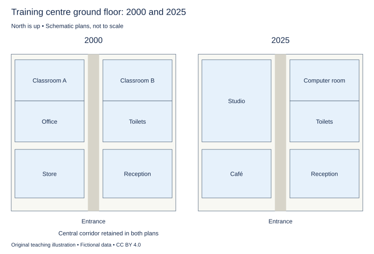

# U22 第14周：长篇阅读、写作与口语

本页为已独立核验的原创文字课程。先完成学生题目，再展开对应参考。非真题、非标准化模考，不换算雅思分数。听力尚未补齐，本页不代表全科课程已完成。

每周选A或G类Task 1一题，加Task 2及三次口语。参考范文不是学生已完成作业，仍须提交初稿、录音和重写，独立真人评分另行安排。

阅读每周180分钟（60分钟首次限时、120分钟证据精读与延迟复测），写作180分钟、口语120分钟。词汇60分钟、听力180分钟另列；新增完整听力未验收，不能勾整周完成。

W16原创阶段检查按实际证据复盘；正式T16陌生整卷及真人评分另记，本页原创技能卷不能代替正式模拟。后续周数与达标规则见 [U04](u04-exam-preparation.md)。

## 阅读：首答不查词

### R-W14-01 · Must Every Performance Leave a Recording?

W14｜正文 854 词｜13 题｜篇章：议论：保存、体验与授权范围（6段）

本课必做60分钟：首答20、证据复盘20、词汇长句10、48小时后复测10。每周三课180分钟，合卷首答替代单课首答，不重复计算。开放短文选做另加15分钟。

本项目原创虚构教学情境，人物、地点、历史事件和案例数据均非真实研究或史料。科学解释只讨论文内说明的模型与条件。非雅思真题或标准化模考；正确数不换算雅思等级。许可：CC BY 4.0 — RayXBuilds and contributors。

能力点：识别论证关系、区分作者与引述者、条件与因果、精确定位。初读不查词，完成后打开独立答案页。

#### Passage

**A** A fictional arts centre called Sile proposes recording every performance in its small theatre. Supporters argue that a recording allows people who could not attend to encounter the work and leaves something available after the final curtain. These are substantial benefits. Yet the proposal uses one word, recording, for several different projects: an internal rehearsal record, an edited public film and a long-term archive are not the same object or the same promise. The writer's concern is not to defend disappearance as an artistic virtue in every case. It is to ask which purpose a recording is meant to serve and whether its design fits that purpose. A camera placed in the auditorium can preserve visible action while changing the way the action is encountered, and the resulting file may remain technically available without remaining intelligible to someone who lacks the context of the performance.

**B** A rehearsal record can be useful even when it is visually plain. Performers may want to check timing, entrances or the relationship between movement and sound. A fixed view of the whole stage may serve that task better than close shots selected for dramatic effect. An audience film has different needs. Small gestures may disappear in a distant view, and a viewer at home cannot freely turn towards another part of the stage if the editor has chosen one face. Editing can make the work more accessible on screen, but it also directs attention. The writer rejects both the claim that editing necessarily betrays a performance and the claim that any attractive film transparently reproduces it. The film is a particular account of the event, made through choices that deserve to be recognised rather than hidden behind the assertion that everything was simply captured.

**C** The live audience is part of this difference. In Sile's theatre, a performer sometimes waits for laughter or adjusts a pause when the room is unusually quiet. A recording can include the resulting timing, but a later viewer does not participate in causing it in the same way. This does not make later viewing worthless or necessarily less enjoyable. It means that access to a record and participation in the original event are different opportunities. The writer would support either when its value is described honestly. The argument becomes misleading when the availability of a video is used to claim that no one has lost anything by being unable to enter the theatre, or when the distinctive experience of being present is used to dismiss everyone who encounters the work through another medium.

**D** Practical choices also influence who benefits from recording. Additional equipment requires space, labour and coordination. A camera position that provides an unobstructed image may block a seat or restrict an entrance used by performers. The arts centre therefore develops a camera plan for each production rather than assuming that the same location will always work. It also distinguishes agreement to be recorded for internal review from agreement to distribute a performance publicly. In this fictional administrative arrangement, participants can discuss each proposed use separately. The passage is not a statement about legal requirements in any jurisdiction. Its point is that consent to one purpose should not silently be treated as consent to every later purpose merely because the recording already exists and another use has become convenient.

**E** For the archive, the centre prepares a context sheet naming the production, describing the stage arrangement and noting significant changes during the run. A version label distinguishes a continuous rehearsal record from an edited film. The archive also keeps a cue list identifying major entrances and changes of scene, making it easier to find a passage without assuming that every user will watch from beginning to end. These additions do not recreate the evening, but they help a future viewer understand what the file represents. A perfectly preserved sequence of images can still be poorly described. Preservation therefore involves decisions about explanation as well as decisions about storage. The writer considers that work essential whenever the centre claims to be maintaining an archive rather than merely accumulating files that happen not to have been deleted.

**F** Sile eventually records some performances in more than one form and leaves others unrecorded when the agreed purpose cannot justify the required disruption. It publishes a short access note explaining which material is available and what kind of record it is. The writer sees this as a more defensible policy than either automatic recording or a universal prohibition. The presence of a camera is not by itself evidence that access has improved, and the absence of one is not by itself proof that the centre disregards future audiences. The useful questions concern what can be seen, what has been selected, whose participation made the record possible and how later viewers can understand its limits. A recording can extend the life of a performance without becoming the performance itself. Recognising that distinction allows preservation and live experience to be valued without requiring one to erase the claims of the other. The policy remains open to revision when a new production changes the balance between useful documentation and interference with the event.

#### Questions

**Do the following statements agree with the writer's views? Write YES, NO or NOT GIVEN. YES = the writer agrees; NO = the writer expresses the opposite view; NOT GIVEN = the writer's view is not stated. Do not use outside knowledge.**

1. Editing a performance necessarily betrays it.

2. Video access proves that inability to attend causes no loss of opportunity.

3. Internal review permission should automatically extend to all later public uses.

4. The writer believes Sile’s performers privately dislike all cameras.

**Choose ONE answer, A, B, C or D.**

5. The opening distinguishes recording projects mainly by

   A. the number of seats alone
   B. the camera’s colour
   C. their intended purposes
   D. the age of the theatre

6. A fixed wide view may be especially useful for

   A. checking rehearsal timing and entrances
   B. replacing storage information
   C. choosing dramatic close shots
   D. eliminating all editing decisions

7. Why does later viewing differ from live attendance?

   A. Later viewers cannot enjoy art
   B. Every live audience reacts identically
   C. The recording contains no timing
   D. Later viewers do not shape the original pause in the same way

8. Sile’s final policy is

   A. prohibiting every camera
   B. selecting formats according to purpose and disruption
   C. treating all recorded material identically
   D. recording every event automatically

**Complete the sentences. Choose NO MORE THAN 3 WORDS FROM THE PASSAGE for each answer. Do not change word forms.**

9. Equipment positions for each production are arranged in a ______.

10. Production background accompanies the archived file on a ______.

11. The type of recording is identified by a ______.

12. Major entrances and scene changes are located through a ______.

13. The centre explains availability through a short ______.

#### 本周重点

问题回应与限制词：先明确题目问什么，再标出only、some、unless、not necessarily等范围与条件。

#### 复盘

必做：给每道错题标记“定位/作者立场/范围/语法/词数”，抄最短证据；用一行箭头概括本文论证或过程。48小时后重做错题与两道正确题，检查是否仍能指出证据。

选做（15分钟，80–100词）：Choose a recording format for one purpose and identify what it cannot replace.

R-W14-01 答案、证据与精读（首答后展开）

### R-W14-01 · 独立答案与证据

来源与许可同学生页。先完成再核对。可接受答案由 accepted_answers 明确列出；只忽略大小写和首尾空格，不自行删词。开放复盘不计入客观正确数。

1. **NO**｜段落 B｜证据：“rejects both the claim that editing necessarily betrays”

   明确否定。

2. **NO**｜段落 C｜证据：“used to claim that no one has lost anything”

   作者反对等同。

3. **NO**｜段落 D｜证据：“should not silently be treated as consent to every later purpose”

   目的范围不可偷换。

4. **NOT GIVEN**｜段落 D｜证据：“participants can discuss each proposed use separately”

   只说可讨论用途，未述私人偏好；没有反向偏好证据。

5. **C**｜段落 A｜证据：“not the same object or the same promise”

   同一术语不代表同一用途。

6. **A**｜段落 B｜证据：“check timing, entrances”

   排练任务与观众电影不同。

7. **D**｜段落 C｜证据：“does not participate in causing it in the same way”

   区别参与机制，不贬低价值。

8. **B**｜段落 F｜证据：“when the agreed purpose cannot justify”

   有条件决定。

9. **camera plan / plan**｜段落 D｜证据：“a camera plan”

   plan可接受；camera单独不是规划载体。

10. **context sheet / sheet**｜段落 E｜证据：“a context sheet”

   sheet可接受。

11. **version label / label**｜段落 E｜证据：“A version label distinguishes”

   label为合理短答。

12. **cue list / list**｜段落 E｜证据：“a cue list”

   list可接受；context sheet描述背景非定位提示。

13. **access note / note**｜段落 F｜证据：“a short access note”

   short已在题干，接受access note或note，不重复short。

#### 词汇与长句

- **auditorium**：观众席空间
- **cue**：提示演出行动或变化的信号
- **distribution**：对外传播
- **continuous**：未被剪辑中断的连续记录

> Editing can make the work more accessible on screen, but it also directs attention.

but并列收益与选择作用，非全盘否定剪辑。

> A perfectly preserved sequence of images can still be poorly described.

perfectly preserved修饰技术状态，poorly described说明语境可能缺失。

#### 开放任务参考

B排练远景或观众剪辑，C不能复刻共同生成的现场参与，E需标明记录类型。

标准：观点有文内依据，保留条件和范围，推断明确标注；不存在唯一措辞。

### R-W14-02 · An Island with Three Calendars

W14｜正文 1034 词｜13 题｜篇章：虚构历史：不同时间制度的协调（9段）

本课必做60分钟：首答20、证据复盘20、词汇长句10、48小时后复测10。每周三课180分钟，合卷首答替代单课首答，不重复计算。开放短文选做另加15分钟。

本项目原创虚构教学情境，人物、地点、历史事件和案例数据均非真实研究或史料。科学解释只讨论文内说明的模型与条件。非雅思真题或标准化模考；正确数不换算雅思等级。许可：CC BY 4.0 — RayXBuilds and contributors。

能力点：识别论证关系、区分作者与引述者、条件与因果、精确定位。初读不查词，完成后打开独立答案页。

#### Passage

**A** On the imaginary island of Ero, an old harbour office displays three calendars. One organises shipping visits by numbered dates, another records the sequence of agricultural tasks, and a third lists community gatherings whose timing has traditionally been negotiated among households. A visitor assumes that the island has not yet settled on a modern system. The islanders see a different problem: each calendar answers a different question. A ship needs an appointment that can be communicated to people far away. A grower needs to know whether conditions are suitable for a task. A gathering needs the people required to prepare it. The coexistence of three systems is therefore not evidence that residents cannot tell the date.

**B** The shipping calendar arrived with a regular mainland service. Before it, boats often appeared when weather and cargo made a visit worthwhile. The new operator announced intended arrivals several weeks ahead, allowing shops to order supplies and travellers to plan connections. The dates were useful even though storms could still cause delays. A schedule stated an intention and a basis for coordination, not a guarantee that wind and water would follow it. The harbour clerk kept an arrival book with both expected and actual dates. This allowed residents to distinguish a late voyage from a change in the published plan rather than allowing every disruption to disappear into a vague memory of an unreliable service.

**C** The farming calendar had a different form. Instead of assigning every task a fixed date, it linked actions to conditions noticed in the fields. A particular stage of growth might indicate that one task should begin; the condition of the ground could delay another. These signs were interpreted through experience and discussion. They were not automatically precise or immune to disagreement. Nevertheless, replacing them with fixed dates would not necessarily improve the timing of work. A calendar can be dependable because it responds to a relevant condition, rather than because it always places an action in the same numbered box. The useful comparison concerns whether it supports the activity, not whether it resembles the calendar already familiar to an observer.

**D** Community gatherings introduced a third pattern. The preparation of a large meal required several households to contribute equipment and labour. In some years, the event moved because a family was away or because an urgent repair occupied the people needed to organise it. Outsiders sometimes interpreted these changes as lack of commitment. Residents often understood them as an effort to preserve participation. That interpretation does not make every postponement wise. Repeated changes can burden people who arrange travel or set aside time. The writer argues that flexibility should be assessed through the responsibilities it serves and the burdens it creates, rather than praised or criticised simply because the date is not fixed far in advance.

**E** The three calendars began to conflict when island produce was sold through the mainland service. A harvest organised around field conditions had to connect with a vessel organised around an announced departure. The grower could not solve the problem by declaring either calendar more authentic. Goods might be ready after one departure but deteriorate before the next, while shipping plans could not be altered independently for every producer. The harbour office therefore introduced a readiness board on which growers indicated likely availability within a range of days. The board did not turn uncertain growth into a precise appointment. It made that uncertainty visible early enough for people to discuss storage, packing and which voyage might offer the most workable connection.

**F** A later visitor proposed combining everything into one large wall chart. Residents accepted the chart as a shared display but resisted using the same symbol for every kind of entry. They distinguished a confirmed appointment, an estimated window and a decision still awaiting agreement. The legend explained those categories beside the chart. Without this distinction, a person seeing a date might assume a level of commitment that nobody had actually made. Putting information in one place can help coordination, but common presentation should not erase differences in meaning. The writer supports the combined display precisely because it preserves those differences rather than treating visual tidiness as a reason to make all entries look equally definite.

**G** Records of changes also became important. A revision note beside the chart explained which entry had moved and whether the reason was weather, readiness or household availability. It did not name people in order to assign blame. The aim was to help anyone affected decide what else needed to change. An altered departure could require new packing arrangements; a postponed gathering might release equipment for another use. The note therefore connected the calendars through consequences rather than merely announcing that yesterday's information was now wrong. It gave users a way to reconstruct the current plan without needing to ask every person who had participated in the conversation that produced it.

**H** The harbour office eventually added a coordination meeting before the busiest part of the season. Growers, boat operators and event organisers compared likely demands, identifying periods when the same people or equipment would be needed in several places. The meeting could not remove every conflict or forecast every storm. It could reveal collisions that would otherwise be discovered only when there was little time to respond. A shared future was produced through this discussion without requiring the activities to become identical. The shipping service still used appointments, field work still responded to conditions, and gatherings still depended on participation, but each could now take some account of the constraints facing the others.

**I** Ero's three calendars offer a useful correction to the idea that standardisation always means reducing several systems to one. Sometimes coordination improves when different kinds of information remain distinct but can be related clearly. A fixed date, a readiness estimate and a negotiated event can all be meaningful without being interchangeable. The writer does not recommend multiplying calendars wherever a single system already works. The argument is narrower: before replacing a practice in the name of order, identify the problem it helps people manage. Apparent inconsistency may reflect the fact that different activities face different uncertainties, and a successful shared display may need to communicate those differences rather than conceal them.

#### Questions

**Complete the summary. Choose NO MORE THAN 3 WORDS FROM THE PASSAGE for each answer. Do not change word forms.**

Expected and actual voyages were compared in the (1) ______. Growers posted likely availability on a (2) ______. A (3) ______ explained the three kinds of chart entry. Changes and their reasons appeared in a (4) ______. Resource conflicts were discussed at a (5) ______ before the busy season.

**Do the following statements agree with the writer's views? Write YES, NO or NOT GIVEN. YES = the writer agrees; NO = the writer expresses the opposite view; NOT GIVEN = the writer's view is not stated. Do not use outside knowledge.**

6. The use of several calendars proves that islanders cannot tell the date.

7. A schedule is necessarily a guarantee that the physical world will follow it.

8. Flexible event timing should be judged by both the duties it supports and the burdens it creates.

9. The writer thinks residents secretly dislike the mainland operator.

**Which paragraph contains the following information? Write a letter, A–I. You may use any letter more than once.**

10. a record containing both planned and actual shipping dates

11. tasks triggered by field conditions instead of fixed numbered dates

12. a proposal to distinguish three commitment levels on one display

13. a pre-season discussion about competing demands for the same resources

#### 本周重点

问题回应与限制词：先明确题目问什么，再标出only、some、unless、not necessarily等范围与条件。

#### 复盘

必做：给每道错题标记“定位/作者立场/范围/语法/词数”，抄最短证据；用一行箭头概括本文论证或过程。48小时后重做错题与两道正确题，检查是否仍能指出证据。

选做（15分钟，80–100词）：Explain why one shared chart may still need different symbols for time commitments.

R-W14-02 答案、证据与精读（首答后展开）

### R-W14-02 · 独立答案与证据

来源与许可同学生页。先完成再核对。可接受答案由 accepted_answers 明确列出；只忽略大小写和首尾空格，不自行删词。开放复盘不计入客观正确数。

1. **arrival book / book**｜段落 B｜证据：“an arrival book”

   题干使用 the，arrival book 与 book 均可；该簿同时记预计与实际日期，区别于只说明变更原因的 revision note。

2. **readiness board / board**｜段落 E｜证据：“a readiness board”

   board可接受，日期范围非固定承诺。

3. **legend**｜段落 F｜证据：“The legend explained those categories”

   类别图例，不是日期本身。

4. **revision note / note**｜段落 G｜证据：“A revision note”

   说明改动与原因。

5. **coordination meeting / meeting**｜段落 H｜证据：“a coordination meeting”

   meeting可接受，繁忙季前会议。

6. **NO**｜段落 A｜证据：“not evidence that residents cannot tell the date”

   明确否定。

7. **NO**｜段落 B｜证据：“not a guarantee”

   承诺协调基准不等于自然保证。

8. **YES**｜段落 D｜证据：“responsibilities it serves and the burdens it creates”

   作者明确双向条件。

9. **NOT GIVEN**｜段落 B｜证据：“The dates were useful”

   服务安排可见，私人情绪未述；不能由延期推恶感。

10. **B**｜段落 B｜证据：“both expected and actual dates”

   B到港簿的双日期；G变更说明不记录实际到港。

11. **C**｜段落 C｜证据：“linked actions to conditions noticed in the fields”

   C农业时间逻辑。

12. **F**｜段落 F｜证据：“a confirmed appointment, an estimated window and a decision still awaiting agreement”

   F完整三分类，其他段不列这组三类。

13. **H**｜段落 H｜证据：“same people or equipment”

   H协调会议。

#### 词汇与长句

- **readiness**：就绪程度
- **negotiated**：经参与者商定的
- **commitment**：明确承诺的程度
- **interchangeable**：可互相替代而不改变意义的

> A calendar can be dependable because it responds to a relevant condition, rather than because it always places an action in the same numbered box.

两个because比较可靠性的不同来源；不必等于固定日期。

> Putting information in one place can help coordination, but common presentation should not erase differences in meaning.

but限制统一展示的边界。

#### 开放任务参考

F区分确定、估计、待定；E生长与航班的不确定性不同，不能用同一视觉符号制造同等承诺。

标准：观点有文内依据，保留条件和范围，推断明确标注；不存在唯一措辞。

### R-W14-03 · A Promise of Quiet

W14｜正文 891 词｜14 题｜篇章：议论：共同目标下的多种需求与例外（7段）

本课必做60分钟：首答20、证据复盘20、词汇长句10、48小时后复测10。每周三课180分钟，合卷首答替代单课首答，不重复计算。开放短文选做另加15分钟。

本项目原创虚构教学情境，人物、地点、历史事件和案例数据均非真实研究或史料。科学解释只讨论文内说明的模型与条件。非雅思真题或标准化模考；正确数不换算雅思等级。许可：CC BY 4.0 — RayXBuilds and contributors。

能力点：识别论证关系、区分作者与引述者、条件与因果、精确定位。初读不查词，完成后打开独立答案页。

#### Passage

**A** The fictional residential court of Lune announces a plan to become a quiet place. Residents agree quickly, then discover that they have promised different things. One wants uninterrupted sleep, another wants to hear birds from a balcony, and a third wants fewer unpredictable bursts of sound while working at home. These aims overlap, but they are not identical. A steady low sound can trouble one activity while a brief, much louder sound disrupts another. The writer argues that a useful quiet policy must identify the experiences it intends to protect. Merely choosing an appealing adjective allows agreement to remain effortless until somebody asks which everyday activity must change and whose inconvenience should count when that activity produces a sound.

**B** The court first considers a single rule based on maximum loudness. Such a rule would be simple to explain, but it would overlook timing, duration and meaning. A short warning signal and a prolonged rehearsal might reach a similar maximum while performing very different roles. Conversely, a repeated sound below the proposed limit could still interrupt concentration. This does not show that measurements are useless. It shows that a number describing one feature cannot automatically represent the whole experience. The writer supports using measurements where they answer a defined question, while rejecting the idea that a single threshold can eliminate every judgement about living together. Choosing the threshold itself would already involve a decision about which forms of disturbance the community considered most important to prevent.

**C** A resident who repairs furniture proposes protected working periods in the afternoon. Predictability, she argues, would help neighbours arrange their own activities, and it would allow her to concentrate noisy tasks rather than spreading them throughout the week. Another resident works night shifts and sleeps during that period. Neither person's routine can simply be treated as the normal one against which all others must justify themselves. The court therefore asks participants to describe the activities they need to protect before debating specific hours. This changes the discussion from competing declarations of annoyance to a comparison of constraints. It does not make every request compatible, but it reveals conflicts that a quick majority vote about preferred times might leave unexplained or permanently assign to a smaller group.

**D** The physical route of sound complicates responsibility. In the court's simplified demonstration, sound from a small speaker reaches one room directly through an open doorway and another through a connecting corridor. Closing one opening changes what is heard without changing the original source. Residents are reminded that perceived disturbance cannot always identify which person is responsible or which intervention would help. A complaint can be entirely sincere while its explanation of the route is mistaken. The writer cautions against treating a report of annoyance as either a complete technical diagnosis or a statement that must be dismissed until the reporter supplies one. A useful process can take the experience seriously and still investigate how the sound reaches the affected place before assigning a remedy or blame.

**E** The eventual proposal separates routine activity from unusual events. Regular repairs receive agreed periods and a way to request changes when a neighbour faces an exceptional need. A small celebration can be announced in advance with an expected ending. The court does not promise that advance notice makes every disturbance acceptable. Notice gives others information; permission and practical accommodation remain separate questions. This distinction prevents a familiar mistake in which someone treats announcing an activity as equivalent to receiving agreement for it. Residents also retain a route for reporting an event that differs substantially from what was described. A rule about predictable exceptions is only useful if people can recognise the exception, understand its limits and raise a concern when those limits are not respected.

**F** To evaluate the policy, the court records examples of interrupted activities rather than only counts of complaints. A decline in complaints might mean improvement, but it might also mean that residents have stopped expecting a response. The records therefore include what action followed a report and whether the affected person considered the issue resolved. These accounts do not establish one objective scale on which every experience can be ranked. They can reveal recurring patterns, such as interruptions concentrated at a particular time or difficulties associated with one sound path. The writer favours this specific learning over a public competition to identify the most sensitive resident or the noisiest household. Personal rankings would encourage defensive arguments while giving little guidance about which arrangement should be changed to protect a stated activity.

**G** Lune's final promise is narrower than the original slogan. It commits to protecting named activities, making routine sound more predictable, investigating disputed pathways and explaining the conditions of exceptions. Some conflict remains, and some residents would choose different priorities. The writer does not present compromise as proof that every outcome is equally fair. Decisions still need reasons, and burdens that repeatedly fall on the same people deserve scrutiny. But a limited promise that can be examined is more useful than an absolute promise that everyone interprets differently. Quiet, in this account, is not merely a measurable absence. It is a relationship between sound, place, timing and what people are trying to do. A policy improves when it can describe and revise that relationship rather than relying on the hope that an agreeable word has already settled the difficult questions.

#### Questions

**Which paragraph contains the following information? Write a letter, A–G. You may use any letter more than once.**

1. a contrast between a warning signal and a rehearsal with similar peak loudness

2. a conflict involving daytime sleep after night work

3. a physical change that alters reception while leaving the sound source unchanged

4. a proposed record of actions taken after a complaint and whether the issue was resolved

5. the distinction between announcing an activity and obtaining agreement for it

**Choose ONE answer, A, B, C or D.**

6. The initial agreement is unstable because

   A. all sound is unmeasurable
   B. residents assign different meanings to quiet
   C. everyone dislikes birds
   D. nobody has daily routines

7. A maximum-loudness rule omits

   A. the ability to explain rules
   B. every form of loudness
   C. timing, duration and the role of sound
   D. whether numbers exist

8. Why describe protected activities before choosing hours?

   A. To remove minority concerns
   B. To reveal different constraints before voting
   C. To guarantee all requests can be satisfied
   D. To establish one normal routine

9. The sound-path demonstration shows that

   A. annoyance is always imaginary
   B. a genuine experience may have an incorrect causal explanation
   C. the loudest household is always responsible
   D. complainants must be engineers

**Do the following statements agree with the writer's views? Write YES, NO or NOT GIVEN. YES = the writer agrees; NO = the writer expresses the opposite view; NOT GIVEN = the writer's view is not stated. Do not use outside knowledge.**

10. Advance notice automatically grants permission for a disturbance.

11. Fewer complaints necessarily mean the policy has improved conditions.

12. A limited and inspectable promise can be more useful than an ambiguous absolute one.

13. The writer thinks the furniture repairer knowingly disturbs her neighbours for enjoyment.

14. Repeatedly imposing burdens on the same people deserves examination.

#### 本周重点

问题回应与限制词：先明确题目问什么，再标出only、some、unless、not necessarily等范围与条件。

#### 复盘

必做：给每道错题标记“定位/作者立场/范围/语法/词数”，抄最短证据；用一行箭头概括本文论证或过程。48小时后重做错题与两道正确题，检查是否仍能指出证据。

选做（15分钟，80–100词）：Draft a quiet-policy promise that specifies an activity and a clear exception boundary.

R-W14-03 答案、证据与精读（首答后展开）

### R-W14-03 · 独立答案与证据

来源与许可同学生页。先完成再核对。可接受答案由 accepted_answers 明确列出；只忽略大小写和首尾空格，不自行删词。开放复盘不计入客观正确数。

1. **B**｜段落 B｜证据：“A short warning signal and a prolonged rehearsal”

   B具体声音类别比较。

2. **C**｜段落 C｜证据：“works night shifts”

   C生活时序例外。

3. **D**｜段落 D｜证据：“without changing the original source”

   D关闭开口示范。

4. **F**｜段落 F｜证据：“what action followed a report”

   F效果追踪而非单纯计数。

5. **E**｜段落 E｜证据：“equivalent to receiving agreement”

   E通知与同意概念。

6. **B**｜段落 A｜证据：“they have promised different things”

   共同词汇不保证共同目标。

7. **C**｜段落 B｜证据：“timing, duration and meaning”

   不是说最大值本身无意义。

8. **B**｜段落 C｜证据：“a comparison of constraints”

   看清冲突而非预设标准。

9. **B**｜段落 D｜证据：“entirely sincere while its explanation of the route is mistaken”

   区分体验与诊断。

10. **NO**｜段落 E｜证据：“permission and practical accommodation remain separate”

   明确区分。

11. **NO**｜段落 F｜证据：“might also mean that residents have stopped expecting a response”

   存在不同解释。

12. **YES**｜段落 G｜证据：“more useful than an absolute promise”

   作者结论。

13. **NOT GIVEN**｜段落 C｜证据：“proposes protected working periods”

   未述知情恶意或享乐动机；工作提案不说明私人意图。

14. **YES**｜段落 G｜证据：“deserve scrutiny”

   作者明确要求。

#### 词汇与长句

- **threshold**：预设判断界限
- **accommodation**：为不同需要作出的实际调整
- **pathway**：声音或影响传播的路径
- **scrutiny**：细致审查

> A complaint can be entirely sincere while its explanation of the route is mistaken.

while允许体验真实与原因判断错误同时成立。

> Notice gives others information; permission and practical accommodation remain separate questions.

分号并列区分告知、许可、实际调整，不可互相替代。

#### 开放任务参考

应说保护何活动/何时，E通知不自动获准，G能核验且可改；不要承诺绝对无声。

标准：观点有文内依据，保留条件和范围，推断明确标注；不存在唯一措辞。

## 写作与口语：Task 1双分支择一

### WS-W14-T1A 学生页：培训中心平面改造

周次 W14｜题型 T1A｜能力点：空间变化与准确任务回应

Task 1 的 A/G 分支二选一，另一分支不计入本周作业。

#### 使用与记录

原创教学练习，非真题、非标准化模拟，难度未校准。先完成本页再打开参考页。人物、机构、经历与数据均为教学虚构。不要背诵示例。自评和 AI 反馈不能代替独立真人评分，未获得真人评阅时标记“分数未确认”。

保存：任务ID、实际日期、用时、初稿或原始录音、证据化反馈、重写/重答、三条修改理由。没有学生提交物，不得填写“已批改”或“已完成训练”。

#### 完整题干

The plans show the ground floor of a training centre in 2000 and after changes in 2025. Summarise the information by selecting and reporting the main features, and make comparisons where relevant.

Write at least 150 words. Spend about 20 minutes on this task.

教学虚构示意图，北向上，非比例尺实测。南中央入口与中央南北走廊两年不变。2000西侧自北向南：Classroom A、Office、Store；东侧：Classroom B、Toilets、Reception。2025西侧前两房拆中间隔墙合为Studio，Store原界内改Café；东侧Classroom B原界内改Computer room，Toilets/Reception不变；外围轮廓不变。

#### 任务预算（含首次审题，不额外加时）

初稿20分钟（审题规划3、写作15、检查2）；诊断15；反馈阅读与证据核查10；完整重写25；对照归档5。合计75分钟。

#### 初稿后自评清单

- [ ] 达到最低字数；全文连贯成段，没有用项目符号代替作文。
- [ ] 概述给主要特征；数据、阶段或方位都与题图逐项相符，不推断未提供的原因。
- [ ] 每段可写出一个功能标签；例子或数据与该段要点相连。
- [ ] 圈出两处词汇搭配和两处句法疑点，先自行修正再查询或求反馈。
- [ ] 记录一项最影响理解的问题和原句证据，不填写自猜分数。

#### 反馈与重写

打开 独立参考页（本节下方展开参考），按逐段检查和通用协议核验。重写任务：完整重写至少150词；删掉任何不能在图上指出位置的评价，把至少一处空泛变化替换为具体房间、方位与动作。

#### 本周重点操作（已含原预算）

用原有诊断中的3分钟给初稿每句找图示位置；圈出无图示支持的评价，删去或改成准确的房间/方位/变化。没有这种问题则记录一处证据完整的句子，不强造错误。

W14 T1A 示例、反馈与重练（首答后展开）

### WS-W14-T1A 独立参考页

只在初稿完成后阅读；不是唯一答案，也没有官方分数。以下是对原创示例的教学讲评，不是对学生尚未提交作文的已完成批改。

#### 思路拆解

只报告图示变化；概述用途变化与隔墙删除；西侧合并/改用，东侧改用/保留；不推教学质量。

#### 原创示例

The plans compare the ground-floor layout of a training centre in 2000 and 2025. Both show an entrance in the middle of the southern wall and a central corridor extending northwards through the building.

Overall, the centre acquired more specialised teaching and visitor facilities. Two rooms on the western side were combined to form a larger studio, while the northeastern classroom became a computer room. The reception area and the central corridor remained in their original positions.

In 2000, the western side contained a classroom in the north and a separate office immediately to its south. By 2025, the wall between them had been removed and the whole area had become a single studio. Further south, the former storeroom was converted into a café, with no change shown to the room’s outer boundaries.

On the eastern side, the northern classroom was replaced by a computer room occupying the same space. The toilets below it stayed where they were, as did reception in the southeastern corner beside the entrance. Thus, most of the changes involved altering the use of existing rooms, although combining the two western rooms also changed the internal division of the building.

示例正文词数：194（本项目正则计数；书信不含称呼、结束语与署名；连字符词作一词）。

#### 逐段反馈与迁移

- P1 ground floor与入口方向准确，不能写全楼扩建。

- P2 更专用设施指电脑室/工作室；保留项有位置依据。

- P3 两房合并说明隔墙去掉，储藏室外边界不变，仅变咖啡馆。

- P4 东北教室变电脑室、厕所/接待不变；不将用途改变写成面积扩大。

#### 常见失误

写modern and convenient而无空间信息；想当然补楼梯或停车场；漏两个西房合并。

#### 可执行反馈步骤

1. 先把自己的段落标为引入、概述/论点、支持、收束；分段可不同于示例，按功能核查，不照抄段数。
2. 对照上方逐段检查，逐项标“已有证据/缺失/不适用”。每条意见必须附自己的原句或缺失位置。
3. 按 [反馈协议](u25-feedback.md) 的四维表记录；有争议的 AI 意见回题干、数据或语法依据核验。
4. 只选两项最高优先级问题执行整篇重写；保留原稿，禁止把示例替换为自己的作业。

#### 重写任务

完整重写至少150词；删掉任何不能在图上指出位置的评价，把至少一处空泛变化替换为具体房间、方位与动作。

完成后重新勾选 学生页（见本节上方学生题） 清单；将一处改前/改后及理由交给独立评阅者核查。真人评阅状态目前为“待安排”，不是已完成。

### WS-W14-T1G 学生页：邀请表亲短住

周次 W14｜题型 T1G｜能力点：书信目的、要点与语气

Task 1 的 A/G 分支二选一，另一分支不计入本周作业。

#### 使用与记录

原创教学练习，非真题、非标准化模拟，难度未校准。先完成本页再打开参考页。人物、机构、经历与数据均为教学虚构。不要背诵示例。自评和 AI 反馈不能代替独立真人评分，未获得真人评阅时标记“分数未确认”。

保存：任务ID、实际日期、用时、初稿或原始录音、证据化反馈、重写/重答、三条修改理由。没有学生提交物，不得填写“已批改”或“已完成训练”。

#### 完整题干

Your cousin is coming to your town for a short course. Write a letter inviting your cousin to stay with you. In your letter:
- explain what accommodation you can offer
- describe how your cousin can travel to the course venue
- suggest something you could do together outside class time.
Begin your letter: Dear Robin,

Write at least 150 words. You do not need to write any addresses. Spend about 20 minutes on this task.

#### 任务预算（含首次审题，不额外加时）

初稿20分钟（审题规划3、写作15、检查2）；诊断15；反馈阅读与证据核查10；完整重写25；对照归档5。合计75分钟。

#### 初稿后自评清单

- [ ] 达到最低字数；全文连贯成段，没有用项目符号代替作文。
- [ ] 三个要点均展开；称呼、目的、语气和结束语适合收信人。
- [ ] 每段可写出一个功能标签；例子或数据与该段要点相连。
- [ ] 圈出两处词汇搭配和两处句法疑点，先自行修正再查询或求反馈。
- [ ] 记录一项最影响理解的问题和原句证据，不填写自猜分数。

#### 反馈与重写

打开 独立参考页（本节下方展开参考），按逐段检查和通用协议核验。重写任务：完整重写至少150词；给每句标住宿/交通/活动/必要衔接，删掉不能服务三要点的空泛城市赞美。

#### 本周重点操作（已含原预算）

用原有诊断中的3分钟将句子标为住宿、交通、课外活动或必要衔接；圈一处不服务任何要点的空话并删改。若无空话，记录一处具体支持和一处仍可更清楚的表达。

W14 T1G 示例、反馈与重练（首答后展开）

### WS-W14-T1G 独立参考页

只在初稿完成后阅读；不是唯一答案，也没有官方分数。以下是对原创示例的教学讲评，不是对学生尚未提交作文的已完成批改。

#### 思路拆解

私人邀请三要点均服务来上课的表亲；住宿可用信息、具体交通、课外活动兼顾对方情况。

#### 原创示例

Dear Robin,

It was great to hear that your course will be held here next month. Why not stay with me while you are in town? My flat has a small spare room with a single bed and a desk. It is not especially large, but you would have somewhere quiet to study, and you would be welcome to use the kitchen whenever you need it.

The training centre you mentioned is easy to reach from my building. You can take the number eight bus from the stop opposite the bakery. It runs directly to the centre, and the journey usually takes about twenty minutes. I can walk with you to the stop on your first morning so that you know where to catch it.

If your classes finish early on Friday, we could visit the food market by the river. It has several stalls selling dishes from different parts of the country, and I remember that you enjoy trying unfamiliar food. We could also have a quiet evening at home if you feel tired after the course. Let me know your dates, and I will get the room ready.

Love,
Alex

示例正文词数：188（本项目正则计数；书信不含称呼、结束语与署名；连字符词作一词）。

#### 逐段反馈与迁移

- P1 空间、床桌厨房具体，不能只写comfortable；邀请非代做订房。

- P2 8路、上车点、直达与约20分钟连贯；虚构路线不冒真实旅游信息。

- P3 活动关联朋友兴趣并留疲倦备选，最后索要日期可执行。

#### 常见失误

大篇介绍城市历史漏住宿；只有come anytime而无交通；课程安排未知却替对方安排所有晚上。

#### 可执行反馈步骤

1. 先把自己的段落标为引入、概述/论点、支持、收束；分段可不同于示例，按功能核查，不照抄段数。
2. 对照上方逐段检查，逐项标“已有证据/缺失/不适用”。每条意见必须附自己的原句或缺失位置。
3. 按 [反馈协议](u25-feedback.md) 的四维表记录；有争议的 AI 意见回题干、数据或语法依据核验。
4. 只选两项最高优先级问题执行整篇重写；保留原稿，禁止把示例替换为自己的作业。

#### 重写任务

完整重写至少150词；给每句标住宿/交通/活动/必要衔接，删掉不能服务三要点的空泛城市赞美。

完成后重新勾选 学生页（见本节上方学生题） 清单；将一处改前/改后及理由交给独立评阅者核查。真人评阅状态目前为“待安排”，不是已完成。

### WS-W14-T2 学生页：校园住宿与城镇租房

周次 W14｜题型 T2｜能力点：观点展开与任务回应

A/G 共用本题。

#### 使用与记录

原创教学练习，非真题、非标准化模拟，难度未校准。先完成本页再打开参考页。人物、机构、经历与数据均为教学虚构。不要背诵示例。自评和 AI 反馈不能代替独立真人评分，未获得真人评阅时标记“分数未确认”。

保存：任务ID、实际日期、用时、初稿或原始录音、证据化反馈、重写/重答、三条修改理由。没有学生提交物，不得填写“已批改”或“已完成训练”。

#### 完整题干

Some people think university students should live in campus accommodation, while others prefer students to rent homes in the surrounding town. Discuss both views and give your own opinion. Give reasons and include relevant examples.

Write at least 250 words. Spend about 40 minutes on this task.

#### 任务预算（含首次审题，不额外加时）

初稿40分钟（审题规划5、写作30、检查5）；诊断15；反馈阅读与证据核查10；完整重写35；对照归档5。合计105分钟。

#### 初稿后自评清单

- [ ] 达到最低字数；全文连贯成段，没有用项目符号代替作文。
- [ ] 直接回答题目的所有问句，有始终一致的立场。
- [ ] 每段可写出一个功能标签；例子或数据与该段要点相连。
- [ ] 圈出两处词汇搭配和两处句法疑点，先自行修正再查询或求反馈。
- [ ] 记录一项最影响理解的问题和原句证据，不填写自猜分数。

#### 反馈与重写

打开 独立参考页（本节下方展开参考），按逐段检查和通用协议核验。重写任务：完整重写至少250词；每段删掉一条与住宿选择无直接关系的套话，再补明确的居住安排→影响→例子链。

#### 本周重点操作（已含原预算）

用原有诊断中的3分钟检查每段是否解释住宿选择的实际影响；删一处可套在任何大学话题上的泛论，补与住宿相关的机制或例子。若原稿无此问题，以证据标记通过。

W14 T2 示例、反馈与重练（首答后展开）

### WS-W14-T2 独立参考页

只在初稿完成后阅读；不是唯一答案，也没有官方分数。以下是对原创示例的教学讲评，不是对学生尚未提交作文的已完成批改。

#### 思路拆解

任务只问学生住哪里；每方用实际居住机制支持；观点按阶段和个人条件选择，不写泛泛教育重要性。

#### 原创示例

Where university students live can affect their daily routines and opportunities to meet others. Campus accommodation offers convenient access to university life, while renting in the surrounding town can provide greater independence. I believe campus housing is often helpful at the start of university, but students should be able to choose according to their circumstances.

Living on campus can make the transition to university easier. Students are close to classes and facilities, so they spend less time finding transport or organising complicated journeys. Shared spaces also create opportunities to meet other students during ordinary activities such as cooking or studying. A newcomer who knows nobody may find these repeated informal encounters useful. However, these advantages depend on accommodation being reasonably managed; a noisy residence can interfere with study rather than support it.

Renting in town offers a different kind of experience. Students may have more control over whom they live with and how they organise the household. They can also become familiar with the wider community instead of spending nearly all their time within the university. Nevertheless, arranging bills, dealing with maintenance and travelling to classes require time and attention. Greater independence is an advantage only when the student has the resources and confidence to manage these responsibilities.

My preference is therefore for accessible campus accommodation to be available, particularly to new students, without making it compulsory. An older student with a partner may need a different arrangement from someone leaving home for the first time. Equally, a student who already lives nearby may gain little by moving into a residence. Advice about costs and practical obligations would help students make a realistic choice between the options.

In conclusion, campus living can ease entry into university life, while town housing can support independence and different personal needs. Providing informed choice is more sensible than requiring all students to follow one residential pattern.

示例正文词数：312（本项目正则计数；书信不含称呼、结束语与署名；连字符词作一词）。

#### 逐段反馈与迁移

- P1 双方+明确初入学校园常有帮助但可选择；不是无观点both good。

- P2 近设施/日常重复相遇如何帮助新人具体；承认噪声条件。

- P3 自主与社区接触，同时对应账单维修通勤负担。

- P4 年长伴侣和本地学生例子支持差异化选择，不应假装所有人都同年龄。

- P5 回扣住宅模式；不突然讨论专业选择或就业排名。

#### 常见失误

正文泛写大学锻炼能力却无住宿因果；一方只有一句；将住城镇等同完全孤立。

#### 可执行反馈步骤

1. 先把自己的段落标为引入、概述/论点、支持、收束；分段可不同于示例，按功能核查，不照抄段数。
2. 对照上方逐段检查，逐项标“已有证据/缺失/不适用”。每条意见必须附自己的原句或缺失位置。
3. 按 [反馈协议](u25-feedback.md) 的四维表记录；有争议的 AI 意见回题干、数据或语法依据核验。
4. 只选两项最高优先级问题执行整篇重写；保留原稿，禁止把示例替换为自己的作业。

#### 重写任务

完整重写至少250词；每段删掉一条与住宿选择无直接关系的套话，再补明确的居住安排→影响→例子链。

完成后重新勾选 学生页（见本节上方学生题） 清单；将一处改前/改后及理由交给独立评阅者核查。真人评阅状态目前为“待安排”，不是已完成。

### WS-W14-S1 学生页

周次W14｜Part 1专项｜能力点：具体细节与任务回应，删空泛表述｜30分钟

#### 使用与记录

原创教学练习，非真题、非标准化模拟，难度未校准。先完成本页再打开参考页。人物、机构、经历与数据均为教学虚构。不要背诵示例。自评和 AI 反馈不能代替独立真人评分，未获得真人评阅时标记“分数未确认”。

保存：任务ID、实际日期、用时、初稿或原始录音、证据化反馈、重写/重答、三条修改理由。没有学生提交物，不得填写“已批改”或“已完成训练”。

#### 操作与预算

设备与审题3分钟；首答录音6；回听及局部转写7；示例和诊断5；不看稿重答6；归档3。共30分钟。

#### Part 1专项题

1. Do you enjoy having visitors?
2. What do you usually prepare for a guest?
3. Do you prefer staying with relatives or in a hotel?
4. What makes a place comfortable for you?

追问：

- Which detail matters most to you?
- Can you explain with a recent occasion?

#### 录音回听清单

- [ ] 保留首答原音，记录实际时长、是否中断、是否看稿；只报真实完成状态。
- [ ] 流利与连贯：标出两处时间戳，区分构思停顿与重复搜词，检查是否偏离问句。
- [ ] 词汇：找一处模糊词或重复表达，先解释原意再替换；不为难词改变意思。
- [ ] 语法：核对经历与习惯的时态；局部转写并更正两处妨碍理解的问题。
- [ ] 发音：不看转写听30秒，标听不清的词尾、重音或断句；没有音频不能判断发音。
- [ ] 展开：主要回答有具体情境或理由；追问后第一句回应追问的新角度。

#### 重答要求

选择两个只有笼统判断的答案，先直接回应再加具体情境；重答一条追问，检查是否真正回应其新角度。

首答回听后才打开独立参考页（本节下方展开参考）。按[反馈协议](u25-feedback.md)填至少三个时间戳，不以文字转写替代音频评阅。

#### 本周重点操作（已含原预算）

用原有回听中的3分钟转写一句笼统评价（如nice/useful）；补自己首答中可支持它的具体情境，或说明真实缺失的细节待补。没有空泛句则记录一条具体回应证据；不编造他人反应。

W14 S1 示例、反馈与重练（首答后展开）

### WS-W14-S1 独立参考页

原创教学示例，非真题或评分结果。未收到学生音频；以下是示例分析与待执行反馈，不能登记为已完成学生批改。

#### 展开示例

##### 直接回应→原因→具体情境的展开示例

A comfortable place needs somewhere quiet to sleep and enough space to put my things down. I do not need expensive decorations. When I stayed with my cousin recently, a small desk was particularly useful because I could finish some work without sitting on the bed. That mattered more than the size of the room.

纯口答示例词数：55；只计MODEL标记内实际英文口答，不含标题、标签、说明。词数不能证明录音时长或流利度。

#### 展开与反馈

本周能力：具体细节与任务回应，删空泛表述。

1. 示例先表态，再说明偏好理由，最后提供条件或场景。检查自己是否用一个词回答后就结束。
2. 找到一个具体细节：物品、动作、对话或地点。用自己的经历替换，保持与题卡相关，不照搬示例身份与经历。
3. 追问要重新回应，不能继续背长答。首句先回答追问，再用一条理由支持。
4. 标出一处听不清或语法影响理解的原音时间戳；先尝试最小修正。不要把自然停顿一概当成错误，或用加快语速掩盖逻辑断裂。

#### 常见失误

空泛形容词替代具体过程；给了经历却没解释为什么重要；Part 3只有个人故事没有一般解释；AI只看转写就判断发音。逐项回原音核对，不能凭范例推断自己已达到某个分数。

#### 可执行重答与反馈

选择两个只有笼统判断的答案，先直接回应再加具体情境；重答一条追问，检查是否真正回应其新角度。

填写[反馈协议](u25-feedback.md)四维表，附三个时间戳和原话证据。选一个内容问题与一个语言问题先修；重答后并排听两段，记录改善与仍未解决之处。自评与AI不能替代独立真人评分；独立评阅目前待安排，分数未确认。

### WS-W14-S2 学生页

周次W14｜Part 2专项｜能力点：具体细节与任务回应，删空泛表述｜30分钟

#### 使用与记录

原创教学练习，非真题、非标准化模拟，难度未校准。先完成本页再打开参考页。人物、机构、经历与数据均为教学虚构。不要背诵示例。自评和 AI 反馈不能代替独立真人评分，未获得真人评阅时标记“分数未确认”。

保存：任务ID、实际日期、用时、初稿或原始录音、证据化反馈、重写/重答、三条修改理由。没有学生提交物，不得填写“已批改”或“已完成训练”。

#### 操作与预算

准备、首答录音及追问5分钟；回听及局部转写8；示例与诊断5；关键词重组3；重答及追问5；归档4。共30分钟。

#### Part 2专项任务卡

Describe a place where you stayed for a short time. Say where it was, why you stayed there, what facilities you used, and explain how well it suited your needs.

准备1分钟，说1～2分钟。只记5个关键词，不预写句子。

收尾追问：

- Would you stay there again?
- Who else might find it suitable?

#### 录音回听清单

- [ ] 保留首答原音，记录实际时长、是否中断、是否看稿；只报真实完成状态。
- [ ] 流利与连贯：标出两处时间戳，区分构思停顿与重复搜词，检查是否偏离问句。
- [ ] 词汇：找一处模糊词或重复表达，先解释原意再替换；不为难词改变意思。
- [ ] 语法：核对经历与习惯的时态；局部转写并更正两处妨碍理解的问题。
- [ ] 发音：不看转写听30秒，标听不清的词尾、重音或断句；没有音频不能判断发音。
- [ ] 展开：主要回答有具体情境或理由；追问后第一句回应追问的新角度。

#### 重答要求

用五个关键词重答完整任务卡1～2分钟，再答两条追问；补一处具体行动或细节并删一处无关背景。比较首答与重答，不背示例。

首答回听后才打开独立参考页（本节下方展开参考）。按[反馈协议](u25-feedback.md)填至少三个时间戳，不以文字转写替代音频评阅。

#### 本周重点操作（已含原预算）

用原有回听中的3分钟转写一句笼统评价（如nice/useful）；补自己首答中可支持它的具体情境，或说明真实缺失的细节待补。没有空泛句则记录一条具体回应证据；不编造他人反应。

W14 S2 示例、反馈与重练（首答后展开）

### WS-W14-S2 独立参考页

原创教学示例，非真题或评分结果。未收到学生音频；以下是示例分析与待执行反馈，不能登记为已完成学生批改。

#### 展开示例

##### 原创长答示例（时长须以个人实际录音测量）

I stayed in a small guest room at a friend’s flat while attending a weekend course. The flat was about fifteen minutes from the course venue, which was the main reason I accepted her invitation rather than look for a hotel elsewhere.

The room contained a single bed, a narrow desk and a shelf. I used the desk each evening to organise the notes I had taken during the day. There was also a kitchen where I could make breakfast before leaving, so I did not have to search for somewhere open early.

One disadvantage was that the room faced a busy street. I noticed traffic when I first went to bed, although it became quieter later. My friend had warned me about this, so it was not an unexpected problem.

The place suited my needs because it made the short trip simple. I would not describe it as luxurious, but that was not what I required. Having a convenient location and a usable work surface was more valuable to me than a large room or elaborate facilities.

纯口答示例词数：178；只计MODEL标记内实际英文口答，不含标题、标签、说明。词数不能证明录音时长或流利度。

#### 展开与反馈

本周能力：具体细节与任务回应，删空泛表述。

1. 长答示例按背景、行动/观察、变化与意义组织。每段都推进内容；检查自己是否只有背景而没有具体事件。
2. 找到一个具体细节：物品、动作、对话或地点。用自己的经历替换，保持与题卡相关，不照搬示例身份与经历。
3. 追问要重新回应，不能继续背长答。首句先回答追问，再用一条理由支持。
4. 标出一处听不清或语法影响理解的原音时间戳；先尝试最小修正。不要把自然停顿一概当成错误，或用加快语速掩盖逻辑断裂。

#### 常见失误

空泛形容词替代具体过程；给了经历却没解释为什么重要；Part 3只有个人故事没有一般解释；AI只看转写就判断发音。逐项回原音核对，不能凭范例推断自己已达到某个分数。

#### 可执行重答与反馈

用五个关键词重答完整任务卡1～2分钟，再答两条追问；补一处具体行动或细节并删一处无关背景。比较首答与重答，不背示例。

填写[反馈协议](u25-feedback.md)四维表，附三个时间戳和原话证据。选一个内容问题与一个语言问题先修；重答后并排听两段，记录改善与仍未解决之处。自评与AI不能替代独立真人评分；独立评阅目前待安排，分数未确认。

### WS-W14-S3 学生页

周次W14｜三部分全流程｜能力点：具体细节与任务回应，删空泛表述｜60分钟

#### 使用与记录

原创教学练习，非真题、非标准化模拟，难度未校准。先完成本页再打开参考页。人物、机构、经历与数据均为教学虚构。不要背诵示例。自评和 AI 反馈不能代替独立真人评分，未获得真人评阅时标记“分数未确认”。

保存：任务ID、实际日期、用时、初稿或原始录音、证据化反馈、重写/重答、三条修改理由。没有学生提交物，不得填写“已批改”或“已完成训练”。

#### 操作与预算

D5：设备与流程准备2分钟，连续首答11～14分钟，余14～17分钟完整回听标记，共30分钟。D6：局部转写诊断10，阅读示例与调整5，重答与新追问10，对照归档5，共30分钟。合计60分钟。

#### 连续三部分全流程（首答不可看参考）

找同伴读题，或独练逐题揭示。完整首答11～14分钟，中途不暂停纠错。模拟同伴不是认证考官；自行读题的练习记录不能冒充真实面试。

##### Part 1：4～5分钟

1. Do you prefer small or large rooms?
2. What do you keep on your desk?
3. Do you like rearranging furniture?
4. Is there a room you would like to improve?
5. Do you enjoy giving recommendations?
6. What information do you need before recommending a place?

可按回答追加 Why? / Can you give an example? 到时转下部分，不强行说完全部备用问题。

##### Part 2：3～4分钟（含准备）

Describe a recommendation you gave someone. Say who you advised, what they needed, what you recommended, and explain why your recommendation was suitable.

准备1分钟，连续说1～2分钟。收尾追问：

- Did the person follow your recommendation?
- Would you recommend the same thing to everyone?

##### Part 3：4～5分钟

1. What makes advice useful rather than merely encouraging?
2. Why do people sometimes make claims without giving examples?
3. Should recommendations always mention disadvantages?
4. How can people check whether a description is relevant to them?

根据回答追加追问：

- Could too much detail make advice harder to use?
- When might a popular choice be unsuitable for one person?

#### 录音回听清单

- [ ] 保留首答原音，记录实际时长、是否中断、是否看稿；只报真实完成状态。
- [ ] 流利与连贯：标出两处时间戳，区分构思停顿与重复搜词，检查是否偏离问句。
- [ ] 词汇：找一处模糊词或重复表达，先解释原意再替换；不为难词改变意思。
- [ ] 语法：核对经历与习惯的时态；局部转写并更正两处妨碍理解的问题。
- [ ] 发音：不看转写听30秒，标听不清的词尾、重音或断句；没有音频不能判断发音。
- [ ] 展开：主要回答有具体情境或理由；追问后第一句回应追问的新角度。

#### 重答要求

重答最弱的一个Part 1问题、完整Part 2及一个Part 3问题，再答一条未用追问。用不同细节或补一个例外，确认不是复述范例；局部重答不另计全流程。

首答回听后才打开独立参考页（本节下方展开参考）。按[反馈协议](u25-feedback.md)填至少三个时间戳，不以文字转写替代音频评阅。

#### 本周重点操作（已含原预算）

用原有回听中的3分钟转写一句笼统评价（如nice/useful）；补自己首答中可支持它的具体情境，或说明真实缺失的细节待补。没有空泛句则记录一条具体回应证据；不编造他人反应。

W14 S3 示例、反馈与重练（首答后展开）

### WS-W14-S3 独立参考页

原创教学示例，非真题或评分结果。未收到学生音频；以下是示例分析与待执行反馈，不能登记为已完成学生批改。

#### 展开示例

##### Part 2原创展开示例（个人语速不同，不能以词数推录音时长）

I recommended a quiet café to a friend who needed somewhere to work between two appointments. She asked me for a place near the station, but she also needed a reliable internet connection and enough space for a laptop.

Instead of listing every café I knew, I suggested one on a side street about five minutes from the station. I had worked there once before and remembered a long table near the back. I also told her that it became busy at lunchtime, so it would be less suitable during that period.

She went in the middle of the morning and later said that it had worked well. She could finish a document before walking to her next appointment. I did not claim it was the best café in the town; I explained why it matched her particular situation.

The experience reminded me that useful advice needs a reason connected to the other person’s needs. Saying that somewhere is nice or popular would not have answered her actual question about getting work done between appointments.

##### Part 3观点→理由→条件展开示例

A recommendation should explain why an option fits the person’s needs. Popularity may be relevant, but it does not tell a traveller whether a place is quiet or close to an appointment. I would mention the most important benefit and one limitation. That gives the listener something to compare with their own requirements without overwhelming them with unrelated details.

纯口答示例词数：234；只计MODEL标记内实际英文口答，不含标题、标签、说明。词数不能证明录音时长或流利度。

#### 展开与反馈

本周能力：具体细节与任务回应，删空泛表述。

1. 长答示例按背景、行动/观察、变化与意义组织。每段都推进内容；检查自己是否只有背景而没有具体事件。
2. 找到一个具体细节：物品、动作、对话或地点。用自己的经历替换，保持与题卡相关，不照搬示例身份与经历。
3. Part 3示例不把个人选择强加给所有人；先讲机制，再说明条件或例外。检查自己的追问答案是否直接回应新问题。
4. 标出一处听不清或语法影响理解的原音时间戳；先尝试最小修正。不要把自然停顿一概当成错误，或用加快语速掩盖逻辑断裂。

#### 常见失误

空泛形容词替代具体过程；给了经历却没解释为什么重要；Part 3只有个人故事没有一般解释；AI只看转写就判断发音。逐项回原音核对，不能凭范例推断自己已达到某个分数。

#### 可执行重答与反馈

重答最弱的一个Part 1问题、完整Part 2及一个Part 3问题，再答一条未用追问。用不同细节或补一个例外，确认不是复述范例；局部重答不另计全流程。

填写[反馈协议](u25-feedback.md)四维表，附三个时间戳和原话证据。选一个内容问题与一个语言问题先修；重答后并排听两段，记录改善与仍未解决之处。自评与AI不能替代独立真人评分；独立评阅目前待安排，分数未确认。

## 许可

原创文字：RayXBuilds and contributors，CC BY 4.0。此页由已验收分课汇编，调整了标题和导航；题干、正文和答案内容保留。公开第三方音频未包含。
