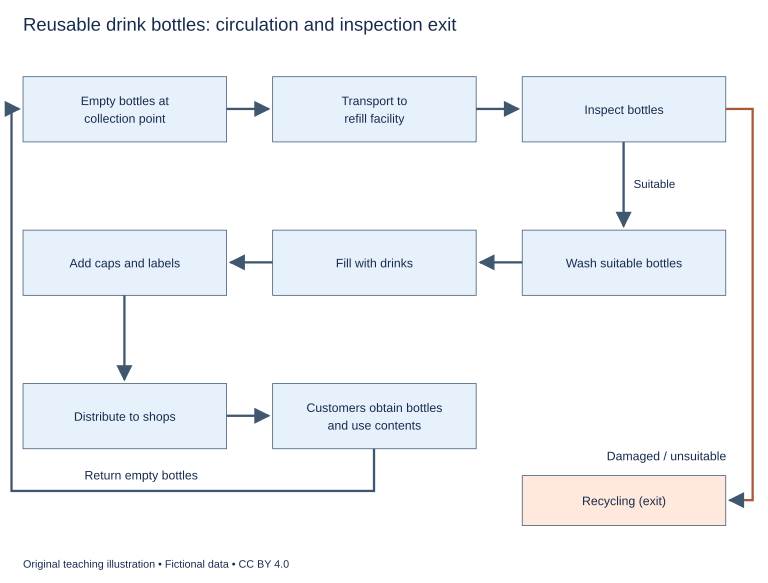

# U23 第15周：长篇阅读、写作与口语

本页为已独立核验的原创文字课程。先完成学生题目，再展开对应参考。非真题、非标准化模考，不换算雅思分数。听力尚未补齐，本页不代表全科课程已完成。

每周选A或G类Task 1一题，加Task 2及三次口语。参考范文不是学生已完成作业，仍须提交初稿、录音和重写，独立真人评分另行安排。

阅读每周180分钟（60分钟首次限时、120分钟证据精读与延迟复测），写作180分钟、口语120分钟。词汇60分钟、听力180分钟另列；新增完整听力未验收，不能勾整周完成。

W16原创阶段检查按实际证据复盘；正式T16陌生整卷及真人评分另记，本页原创技能卷不能代替正式模拟。后续周数与达标规则见 [U04](u04-exam-preparation.md)。

## 阅读：首答不查词

### R-W15-01 · Why the Shortest Path Became the Muddiest

W15｜正文 856 词｜13 题｜篇章：机制解释：路径选择、累积损耗与条件例外（6段）

本课必做60分钟：首答20、证据复盘20、词汇长句10、48小时后复测10。每周三课180分钟，合卷首答替代单课首答，不重复计算。开放短文选做另加15分钟。

本项目原创虚构教学情境，人物、地点、历史事件和案例数据均非真实研究或史料。科学解释只讨论文内说明的模型与条件。非雅思真题或标准化模考；正确数不换算雅思等级。许可：CC BY 4.0 — RayXBuilds and contributors。

能力点：识别论证关系、区分作者与引述者、条件与因果、精确定位。初读不查词，完成后打开独立答案页。

#### Passage

**A** In a fictional park-planning exercise, two paths connect the same entrances. One crosses a grassy hollow directly; the other follows a longer raised edge. On a dry morning, most walkers choose the hollow because it saves time. After repeated use and several wet days, that path becomes difficult to cross, and people spread onto the grass beside it. The widening strip appears to show that walkers dislike following paths. A more useful explanation begins with the relation between individual choices and the surface those choices collectively create. Each person chooses under conditions partly produced by earlier walkers, while their own journey contributes to the conditions facing later ones. The resulting route is not simply the original design plus a fixed amount of wear. It can change through feedback between movement, ground condition and the alternatives people perceive as available at that moment.

**B** The class represents the ground with a simplified board divided into cells. Each cell has an initial resistance value that falls when a counter passes across it under the model's wet condition. This is a teaching rule, not a claim that real soil can be fully described by one number. The rule allows students to trace a consequence: repeated movement can make a once-attractive route less attractive later. The shortest route remains geometrically short, but its practical cost changes if walkers must slow down, avoid puddles or risk dirty shoes. Calling the later detour irrational would compare it with the wrong version of the original route. The relevant alternatives are the ones available when the decision is made, not the dry paths remembered from the first morning of the exercise.

**C** A second effect can move in the opposite direction. On a lightly used dry surface, repeated passage may create a visible track that makes the route easier to recognise. A newcomer can then follow it without inspecting the whole field. In this version of the model, earlier choices reduce uncertainty for later walkers and attract more use. The class therefore distinguishes feedback that discourages further travel from feedback that reinforces it. The word feedback alone does not specify which pattern will occur. The outcome depends on the surface rule and on what walkers are assumed to notice. A trail may become more legible while also becoming less comfortable. These changes need not cancel neatly into a single visible sign, and different people may respond to different parts of the resulting situation.

**D** The planners try placing a barrier beside the muddy strip. This prevents one detour but does not remove the need to reach the other entrance. Walkers may take the raised path, create a new opening or stop using the park for that journey. Observing fewer people in the hollow is therefore insufficient to show that the original problem has been solved. The class uses a route tally that includes completed crossings by each route and journeys abandoned altogether. The comparison asks whether the intervention improves usable access, not just whether one patch looks tidier. The writer rejects a solution defined solely by the disappearance of an inconvenient visible symptom. A successful intervention must be judged against the activity the park is supposed to support as well as against the condition of a particular piece of ground.

**E** Next, the class compares a temporary surface laid across the hollow with a clearer sign directing walkers towards the raised edge. The surface changes the cost of the direct route; the sign changes information about an alternative. Their effects should not be interpreted as though they were the same kind of intervention. Students keep a crossing log listing the chosen route and the condition in which the choice was made. A surface card records when the temporary covering was installed or removed. A weather marker identifies which rounds used the model's wet rule. The records let students compare like conditions rather than attributing a quiet dry period to a barrier or a sign introduced at the same time. They also make exceptions visible, such as walkers who still prefer the longer edge because it suits a purpose not captured by shortest-distance reasoning.

**F** The exercise ends with a decision map showing when each intervention appears useful under the stated assumptions. It offers no universal instruction to pave every informal path or to block every shortcut. Some direct routes may deserve support; others may create costs that justify guiding people elsewhere. The important lesson is that a route's attractiveness is not a permanent property given at the start. It can be produced and altered by use, weather and information, and an exception may reveal a missing purpose rather than a failure of common sense. The writer considers a model valuable when it helps distinguish these processes and suggests observations that could test them. If all departures from the planned path are labelled disobedience, the explanation ends before it begins. If every emerging track is treated as a perfect expression of need, the costs imposed on later users can disappear from view. Careful comparison keeps both possibilities open long enough to investigate them. It also makes clear which observed change would justify revising the plan rather than merely defending it.

#### Questions

**Choose ONE answer, A, B, C or D.**

1. The route’s later attractiveness changes because

   A. the entrances disappear
   B. earlier use changes the conditions of choosing it
   C. its geometric distance always increases
   D. all walkers share one preference

2. Why might a detour be rational after rain?

   A. The longer path becomes physically shorter
   B. The practical cost of the short route has changed
   C. The original route never existed
   D. Every walker ignores time

3. The visible-track example shows feedback that

   A. eliminates wet weather
   B. can attract further use through legibility
   C. proves every route should be paved
   D. always discourages walking

4. Why count abandoned journeys?

   A. They reveal access lost rather than merely relocated
   B. They eliminate measurement error
   C. They are identical to completed crossings
   D. They prove the barrier is attractive

**Do the following statements agree with the writer's views? Write YES, NO or NOT GIVEN. YES = the writer agrees; NO = the writer expresses the opposite view; NOT GIVEN = the writer's view is not stated. Do not use outside knowledge.**

5. Feedback necessarily makes a route less attractive.

6. A tidier patch alone proves that an access problem has been solved.

7. The writer favours charging an entrance fee to fund improvements to the raised route.

8. An exception to shortest-distance choice can reveal a purpose omitted from the model.

**Complete the sentences. Choose NO MORE THAN 3 WORDS FROM THE PASSAGE for each answer. Do not change word forms.**

9. Completed crossings and abandoned journeys are counted in a ______.

10. Route choice and the conditions of each choice appear in a ______.

11. Installation and removal of the covering are documented on a ______.

12. Rounds using the wet rule are identified by a ______.

13. The final comparison of when interventions help is shown on a ______.

#### 本周重点

因果、比较与例外：区分共变与机制，核对比较基准，说明例外否定的是全称还是有限规则。

#### 复盘

必做：给每道错题标记“定位/作者立场/范围/语法/词数”，抄最短证据；用一行箭头概括本文论证或过程。48小时后重做错题与两道正确题，检查是否仍能指出证据。

选做（15分钟，80–100词）：Compare a surface change with an information change as solutions to muddy shortcuts.

R-W15-01 答案、证据与精读（首答后展开）

### R-W15-01 · 独立答案与证据

来源与许可同学生页。先完成再核对。可接受答案由 accepted_answers 明确列出；只忽略大小写和首尾空格，不自行删词。开放复盘不计入客观正确数。

1. **B**｜段落 A｜证据：“conditions partly produced by earlier walkers”

   选择与路况共同演化。

2. **B**｜段落 B｜证据：“its practical cost changes”

   比较实际条件，不偷换几何距离。

3. **B**｜段落 C｜证据：“attract more use”

   正向吸引与损耗反向反馈不同。

4. **A**｜段落 D｜证据：“journeys abandoned altogether”

   防止把消失人流当成功。

5. **NO**｜段落 C｜证据：“reinforces it”

   明确相反机制也存在。

6. **NO**｜段落 D｜证据：“insufficient to show”

   不能单看局部症状。

7. **NOT GIVEN**｜段落 F｜证据：“Some direct routes may deserve support”

   作者讨论路线干预，但未提出收费或资金来源建议；没有支持或相反立场。

8. **YES**｜段落 F｜证据：“may reveal a missing purpose”

   作者明确指出。

9. **route tally / tally**｜段落 D｜证据：“a route tally”

   tally可接受，不是只看局部人数。

10. **crossing log / log**｜段落 E｜证据：“a crossing log”

   log可接受。

11. **surface card / card**｜段落 E｜证据：“A surface card”

   card为记录载体，不是覆盖物本身。

12. **weather marker / marker**｜段落 E｜证据：“A weather marker”

   marker可接受。

13. **decision map / map**｜段落 F｜证据：“a decision map”

   map可接受，条件化结果而非普遍指令。

#### 词汇与长句

- **legible**：容易识别和理解的
- **detour**：绕行路线
- **resistance**：抵抗变化的程度
- **reinforce**：强化既有趋势

> The shortest route remains geometrically short, but its practical cost changes if walkers must slow down, avoid puddles or risk dirty shoes.

but区分距离与实际代价，if列条件。

> A trail may become more legible while also becoming less comfortable.

while说明同时存在两种方向不同的变化，不能用单一指标概括。

#### 开放任务参考

E覆盖改变实际成本，标识改变对替代路径的认识；D核对完整出行是否仍可完成。

标准：观点有文内依据，保留条件和范围，推断明确标注；不存在唯一措辞。

### R-W15-02 · The Price of a Spare Seat

W15｜正文 958 词｜13 题｜篇章：过程比较：容量利用与服务可靠性（8段）

本课必做60分钟：首答20、证据复盘20、词汇长句10、48小时后复测10。每周三课180分钟，合卷首答替代单课首答，不重复计算。开放短文选做另加15分钟。

本项目原创虚构教学情境，人物、地点、历史事件和案例数据均非真实研究或史料。科学解释只讨论文内说明的模型与条件。非雅思真题或标准化模考；正确数不换算雅思等级。许可：CC BY 4.0 — RayXBuilds and contributors。

能力点：识别论证关系、区分作者与引述者、条件与因果、精确定位。初读不查词，完成后打开独立答案页。

#### Passage

**A** A fictional minibus cooperative in Arlen faces criticism because some vehicles leave with empty seats. A local commentator calculates the average number of passengers and concludes that smaller buses would reduce waste. The arithmetic may be correct while the recommendation remains incomplete. Seats are provided before the cooperative knows exactly who will travel on a particular journey. A spare seat is unused capacity on one departure, but it may also be part of a service designed to accommodate variation across departures. The writer does not claim that every empty seat is valuable. The question is which uncertainty the capacity is intended to absorb and whether the benefit of that flexibility is worth its cost for the routes and passengers actually served.

**B** Demand on one route is relatively predictable. Most passengers travel to a workshop with a fixed start time, and reservations are made in advance. Another route serves a clinic, a market and several villages, with passengers joining at different stops. An average taken across the two routes hides this contrast. The same mean occupancy could describe a consistently half-full bus or a bus that alternates between being almost empty and turning people away. Those patterns have different consequences for travellers and for vehicle choice. The cooperative therefore separates its records by route and departure rather than treating the mean as a complete description of demand. Variation is not a minor technical detail when the proposed change concerns how much of an uncertain peak the service can accommodate.

**C** A smaller vehicle can reduce some operating requirements, but the comparison changes if it requires extra journeys. Suppose the vehicle fills at an early stop and must return for passengers waiting farther along. The extra trip uses time and may interfere with later scheduled work. A seemingly efficient departure can therefore be part of a less efficient sequence. The cooperative draws a vehicle cycle showing what each bus does before and after the departure being discussed. This prevents the analysis from ending at the point where a small vehicle looks most favourable. It also reveals cases where additional journeys are feasible because spare time already exists, rather than assuming that every extra trip is either impossible or costless under all circumstances.

**D** Passengers experience uncertainty differently from operators. A traveller who does not know whether there will be a seat may leave earlier, avoid carrying goods or arrange a more expensive alternative. These costs can exist even on a day when a seat happens to be available. The writer argues that service reliability includes the ability to plan around it, not simply the eventual count of people carried. This does not make unlimited spare capacity sensible. It requires the comparison to acknowledge the practical value of a reasonable chance of boarding. A system can raise its average occupancy while becoming less useful if the people who most need predictable access respond by abandoning it before their unmet needs appear in the operator's ticket totals.

**E** The cooperative tests several changes instead of comparing only large and small vehicles. Reservations could make demand more visible, but a strict booking requirement might exclude spontaneous trips or people without convenient access to the booking channel. A larger vehicle at selected times could address concentrated demand without changing every departure. Sharing a vehicle between routes might help if their busy periods differ, but not if both require it at once. Each option responds to a different source of uncertainty. The writer rejects the idea that the existence of one successful arrangement proves the same arrangement should be copied throughout the network. The route's purposes, timing and users remain part of the explanation for why a particular choice works.

**F** To examine the trial, drivers complete a boarding record that includes people left behind as well as those carried. A demand profile shows how requests vary across departures, and a cycle sheet records whether an added trip delays the vehicle's next assignment. The cooperative also invites passengers to describe journeys they decided not to attempt because they expected difficulty boarding. Those accounts are not assumed to measure all discouraged travel, since people willing to respond may differ from others. They nevertheless reveal a category absent from ordinary sales records. A count of completed journeys can answer how much the service carried without answering how much travel people wanted or how confidently they could rely on obtaining a place.

**G** At the end of the trial, the predictable workshop route uses reservations and a smaller bus on selected departures. The mixed-purpose route retains more spare capacity during uncertain periods and uses a larger vehicle for a particular recurring peak. Neither result is presented as a victory for emptiness or fullness in general. The cooperative publishes a capacity note explaining the different decisions, including the costs it has chosen to accept. Its account distinguishes an intentionally retained margin from unused capacity that has no clear purpose. That distinction is necessary if spare seats are to be justified rather than defended automatically whenever anyone asks whether resources could be used differently or whether a route has changed since its original schedule was designed.

**H** Arlen's case suggests a broader principle about services that must be ready before demand is fully known. Perfect utilisation at every moment can be a misleading aim when readiness itself is part of what people need. Equally, uncertainty should not become a convenient excuse for preserving any amount of capacity without examination. The strongest argument identifies the variation being accommodated, the consequence of being unable to respond and the alternatives available at an acceptable cost. Average occupancy remains useful information within that argument. It becomes misleading only when it is asked to decide questions about timing, reliability and excluded demand that its single number cannot settle on its own.

#### Questions

**Do the following statements agree with the writer's views? Write YES, NO or NOT GIVEN. YES = the writer agrees; NO = the writer expresses the opposite view; NOT GIVEN = the writer's view is not stated. Do not use outside knowledge.**

1. Every unused seat is automatically worth retaining.

2. Higher average occupancy can coexist with a less useful service.

3. One successful arrangement establishes the best choice for the entire network.

4. The writer recommends paying drivers according to passenger totals.

**Which paragraph contains the following information? Write a letter, A–H. You may use any letter more than once.**

5. two routes whose demand differs in predictability despite being summarised together

6. an example where a smaller vehicle causes extra travel affecting later work

7. costs to passengers that can arise even when a seat eventually exists

8. a warning that shared vehicles help only when peaks do not coincide

**Complete the summary. Choose NO MORE THAN 3 WORDS FROM THE PASSAGE for each answer. Do not change word forms.**

The sequence before and after each trip was drawn as a (9) ______. Drivers counted carried and rejected passengers in a (10) ______. Variation across departures appeared in a (11) ______. Effects on later vehicle assignments were entered on a (12) ______. The cooperative explained its final choices in a (13) ______.

#### 本周重点

因果、比较与例外：区分共变与机制，核对比较基准，说明例外否定的是全称还是有限规则。

#### 复盘

必做：给每道错题标记“定位/作者立场/范围/语法/词数”，抄最短证据；用一行箭头概括本文论证或过程。48小时后重做错题与两道正确题，检查是否仍能指出证据。

选做（15分钟，80–100词）：Explain one benefit and one limit of retaining spare seats.

R-W15-02 答案、证据与精读（首答后展开）

### R-W15-02 · 独立答案与证据

来源与许可同学生页。先完成再核对。可接受答案由 accepted_answers 明确列出；只忽略大小写和首尾空格，不自行删词。开放复盘不计入客观正确数。

1. **NO**｜段落 A｜证据：“does not claim that every empty seat is valuable”

   明确否定。

2. **YES**｜段落 D｜证据：“raise its average occupancy while becoming less useful”

   作者明确指出。

3. **NO**｜段落 E｜证据：“rejects the idea”

   作者反对无条件复制。

4. **NOT GIVEN**｜段落 F｜证据：“drivers complete a boarding record”

   记录要求不等于薪酬建议，未讨论相反制度。

5. **B**｜段落 B｜证据：“workshop with a fixed start time”

   B对比提前预订与多站混合需求。

6. **C**｜段落 C｜证据：“return for passengers waiting farther along”

   C回程与后续任务。

7. **D**｜段落 D｜证据：“even on a day when a seat happens to be available”

   D预期不确定的行为成本。

8. **E**｜段落 E｜证据：“not if both require it at once”

   E共享容量具体前提。

9. **vehicle cycle / cycle**｜段落 C｜证据：“a vehicle cycle”

   cycle为合理短答，覆盖单趟前后。

10. **boarding record / record**｜段落 F｜证据：“a boarding record”

   record可接受，包含未上车人数。

11. **demand profile / profile**｜段落 F｜证据：“A demand profile”

   profile可接受。

12. **cycle sheet / sheet**｜段落 F｜证据：“a cycle sheet”

   sheet可接受，记录额外旅次对下一任务影响。

13. **capacity note / note**｜段落 G｜证据：“a capacity note”

   note可接受，解释按路区别决策。

#### 词汇与长句

- **occupancy**：容量实际被占用的比例
- **margin**：为不确定需求保留的余量
- **coincide**：同时发生
- **discouraged demand**：因预期困难而未实际提出的需求

> A spare seat is unused capacity on one departure, but it may also be part of a service designed to accommodate variation across departures.

but补充跨时段功能，may不保证每个空位都有价值。

> Perfect utilisation at every moment can be a misleading aim when readiness itself is part of what people need.

when限定判断，不是反对所有效率目标。

#### 开放任务参考

D可规划的搭乘机会，G需清楚容量用途与成本；B须看峰值模式而非平均。

标准：观点有文内依据，保留条件和范围，推断明确标注；不存在唯一措辞。

### R-W15-03 · When an Exception Changes the Rule

W15｜正文 860 词｜14 题｜篇章：学术议论：语言规律、反例与修订范围（5段）

本课必做60分钟：首答20、证据复盘20、词汇长句10、48小时后复测10。每周三课180分钟，合卷首答替代单课首答，不重复计算。开放短文选做另加15分钟。

本项目原创虚构教学情境，人物、地点、历史事件和案例数据均非真实研究或史料。科学解释只讨论文内说明的模型与条件。非雅思真题或标准化模考；正确数不换算雅思等级。许可：CC BY 4.0 — RayXBuilds and contributors。

能力点：识别论证关系、区分作者与引述者、条件与因果、精确定位。初读不查词，完成后打开独立答案页。

#### Passage

**A** In a fictional language workshop, learners are shown several sentences from an invented language called Neri. In each example, a word describing colour follows the object it describes. The class proposes a rule: descriptions follow objects. The next card contains a word describing size before its object, and a student declares that the language has no rules. Another insists that the new card must be wrong. Both responses protect an all-or-nothing view of knowledge. The first abandons every pattern when one statement fails; the second protects the statement by rejecting inconvenient evidence. The writer proposes a more careful question: which part of the rule has the new example actually challenged? A counterexample to an unrestricted claim may require a narrower rule, not the conclusion that regularity is impossible. The original examples still need explaining, just as the new example does. Good revision should account for both rather than treating whichever appeared last as the only evidence worth remembering when the class writes its next confident sentence about the language.

**B** The instructor asks learners to sort the descriptive words by function. The initial cards all concerned colour, whereas the new one concerned size. A revised proposal places colour after the object and size before it. This fits the available cards, but fitting does not prove that the division will hold for every unseen sentence. The class therefore predicts the order of a new size description before turning the next card over. This makes the difference between explaining examples already available and anticipating an example not used to invent the rule. The prediction succeeds in the fictional exercise. That success supports the revised account within the examples tested; it does not eliminate every possible alternative. Another distinction, such as whether a description introduces new information, might also explain the same small set. The writer considers the prediction useful because it creates an opportunity for failure that a rule rewritten after every answer would avoid. The value lies in exposing the proposal to a relevant challenge, not in celebrating one successful guess as the final discovery of Neri grammar.

**C** A later card contains the same colour word before the object in an emphatic reply. The class now has to consider context. The instructor supplies the preceding question and a description of the contrast the speaker intends. The unusual order marks a correction, not the ordinary presentation used on the earlier cards. Learners may therefore distinguish a default order from an order associated with emphasis. This does not mean that context can be invoked to rescue any rule from any example. A contextual explanation must identify a feature that can be recognised independently and predict when the alternative pattern should appear. If emphasis is merely whatever the instructor says after seeing an inconvenient sentence, the explanation has no clear test. The writer rejects that kind of unlimited flexibility. A useful rule can include conditions and exceptions while remaining vulnerable to evidence showing that its conditions have been wrongly specified or that its supposed exception occurs in situations where the explanation predicts it should not.

**D** The workshop also distinguishes what speakers commonly do from what an exercise asks learners to practise. A textbook may choose one regular pattern first because it is useful for beginners, without claiming that every other pattern is impossible. Problems arise when a teaching sequence is presented as a complete description of the language. Learners who later encounter variation may then think they were taught nothing reliable, although the original pattern remains useful in its intended setting. Conversely, a teacher cannot excuse an inaccurate universal claim merely by calling it simple. Simplification needs a stated scope and a route towards a richer account. The class keeps a rule history showing each proposal, the evidence that prompted it and the condition added during revision. This allows learners to see continuity in their understanding: they are preserving a working pattern while identifying more precisely when it applies. Revision becomes a form of learning rather than an embarrassing event that requires every earlier page to be torn out of the notebook.

**E** At the end, the learners receive a mixed set of new sentences with enough context to make the relevant distinctions. They must choose an order and explain which condition supports it. Correct answers without explanations may result from memorising surface examples, while a sensible explanation paired with an incorrect answer can reveal a specific misunderstanding worth addressing. The exercise is not a standardised measure of language proficiency. It is an original demonstration of reasoning about generalisations. The final discussion returns to the first exception: it did not prove the absence of order, but it did disprove the unrestricted rule as stated. Later examples then distinguished an ordinary pattern from one used in a particular communicative setting. The writer's conclusion is that exceptions are informative only in relation to a claim precise enough to be challenged. A vague statement that everything depends on context predicts too little, while an absolute statement protected from every counterexample learns too little. Between them lies the harder work of stating a rule, testing its range and revising the smallest part necessary to explain what the evidence now requires.

#### Questions

**Which paragraph contains the following information? Write a letter, A–E. You may use any letter more than once.**

1. a colour word appearing before its object in a corrective reply

2. a proposal to sort descriptive words by colour and size before a fresh prediction

3. a record preserving successive rules and the evidence behind revisions

4. an assessment task requiring both an ordering choice and its supporting condition

5. two opposite initial responses that either abandon rules or reject the new card

**Do the following statements agree with the writer's views? Write YES, NO or NOT GIVEN. YES = the writer agrees; NO = the writer expresses the opposite view; NOT GIVEN = the writer's view is not stated. Do not use outside knowledge.**

6. One exception proves that a language has no regularities.

7. Any contrary example can legitimately be dismissed by invoking unspecified context.

8. Simplification should have a stated range of application.

9. The writer favours teaching Neri through paid private lessons.

10. A counterexample should be interpreted against the exact claim being tested.

**Choose ONE answer, A, B, C or D.**

11. The first size example directly challenges

   A. the unrestricted claim about all descriptions
   B. the possibility of sorting words
   C. the existence of every regularity
   D. the accuracy of all earlier cards

12. Why predict before revealing a new card?

   A. To avoid all errors
   B. To make context irrelevant
   C. To test beyond examples used to form the rule
   D. To prove every future sentence

13. A contextual explanation remains testable when

   A. only the teacher may apply it
   B. context means any excuse
   C. the condition is independently recognisable and predicts usage
   D. all contrary cards are deleted

14. A beginner teaching sequence is not necessarily

   A. a complete description of the language
   B. selective
   C. ordered
   D. useful

#### 本周重点

因果、比较与例外：区分共变与机制，核对比较基准，说明例外否定的是全称还是有限规则。

#### 复盘

必做：给每道错题标记“定位/作者立场/范围/语法/词数”，抄最短证据；用一行箭头概括本文论证或过程。48小时后重做错题与两道正确题，检查是否仍能指出证据。

选做（15分钟，80–100词）：Explain how one exception can reject a universal rule while preserving a useful narrower pattern.

R-W15-03 答案、证据与精读（首答后展开）

### R-W15-03 · 独立答案与证据

来源与许可同学生页。先完成再核对。可接受答案由 accepted_answers 明确列出；只忽略大小写和首尾空格，不自行删词。开放复盘不计入客观正确数。

1. **C**｜段落 C｜证据：“an emphatic reply”

   C具体语境反例，非A大小词位置。

2. **B**｜段落 B｜证据：“sort the descriptive words by function”

   B双类划分。

3. **D**｜段落 D｜证据：“a rule history”

   D规则历史记录。

4. **E**｜段落 E｜证据：“choose an order and explain”

   E混合新例与理由。

5. **A**｜段落 A｜证据：“Both responses protect an all-or-nothing view”

   A首次相反反应组合，其他段讨论修订方法。

6. **NO**｜段落 A｜证据：“not the conclusion that regularity is impossible”

   作者明确否定。

7. **NO**｜段落 C｜证据：“rejects that kind of unlimited flexibility”

   拒绝不可证伪解释。

8. **YES**｜段落 D｜证据：“Simplification needs a stated scope”

   作者明确主张。

9. **NOT GIVEN**｜段落 D｜证据：“useful for beginners”

   没有收费或授课机构建议。

10. **YES**｜段落 E｜证据：“in relation to a claim precise enough”

   结论强调陈述精度。

11. **A**｜段落 A｜证据：“counterexample to an unrestricted claim”

   只否定全称，不否定已观察颜色规律。

12. **C**｜段落 B｜证据：“not used to invent the rule”

   预先预测创造失败机会。

13. **C**｜段落 C｜证据：“recognised independently and predict”

   不能结果已知后任意命名条件。

14. **A**｜段落 D｜证据：“as a complete description”

   有限教学顺序不等于无用。

#### 词汇与长句

- **counterexample**：能反驳特定全称主张的例子
- **default**：在未出现特殊条件时采用的
- **emphatic**：带强调或纠正作用的
- **scope**：规则适用的对象和情境范围

> A counterexample to an unrestricted claim may require a narrower rule, not the conclusion that regularity is impossible.

may表示可能需要，not区分局部修订与全盘否定。

> Simplification needs a stated scope and a route towards a richer account.

两个并列要求：当下边界与后续扩展。

#### 开放任务参考

A/B大小反例限制颜色规律范围；C独立语境可进一步限定，但不能任意救规则。

标准：观点有文内依据，保留条件和范围，推断明确标注；不存在唯一措辞。

## 写作与口语：Task 1双分支择一

### WS-W15-T1A 学生页：可回收循环瓶系统

周次 W15｜题型 T1A｜能力点：循环流程与条件分支

Task 1 的 A/G 分支二选一，另一分支不计入本周作业。

#### 使用与记录

原创教学练习，非真题、非标准化模拟，难度未校准。先完成本页再打开参考页。人物、机构、经历与数据均为教学虚构。不要背诵示例。自评和 AI 反馈不能代替独立真人评分，未获得真人评阅时标记“分数未确认”。

保存：任务ID、实际日期、用时、初稿或原始录音、证据化反馈、重写/重答、三条修改理由。没有学生提交物，不得填写“已批改”或“已完成训练”。

#### 完整题干

The diagram shows the circulation of reusable drink bottles in a local refill scheme. Summarise the information by selecting and reporting the main features, and make comparisons where relevant.

Write at least 150 words. Spend about 20 minutes on this task.

教学虚构简化流程，非生产或卫生操作指南。客户返空瓶至收集点→运至补充装设施→检查；不合格/损坏→回收（退出，无返回箭头）。合格→清洗→灌装→加盖与标签→送商店→客户取用饮料→空瓶返收集点。未给回收后处理、循环次数、返还率或时间温度。

#### 任务预算（含首次审题，不额外加时）

初稿20分钟（审题规划3、写作15、检查2）；诊断15；反馈阅读与证据核查10；完整重写25；对照归档5。合计75分钟。

#### 初稿后自评清单

- [ ] 达到最低字数；全文连贯成段，没有用项目符号代替作文。
- [ ] 概述给主要特征；数据、阶段或方位都与题图逐项相符，不推断未提供的原因。
- [ ] 每段可写出一个功能标签；例子或数据与该段要点相连。
- [ ] 圈出两处词汇搭配和两处句法疑点，先自行修正再查询或求反馈。
- [ ] 记录一项最影响理解的问题和原句证据，不填写自猜分数。

#### 反馈与重写

打开 独立参考页（本节下方展开参考），按逐段检查和通用协议核验。重写任务：完整重写至少150词；分别沿合格与损坏路径核验，明确循环起点与退出端；不为丰富词汇改变工序。

#### 本周重点操作（已含原预算）

用原有诊断中的3分钟对照合格与损坏两路，指出分流条件及各自后果；再标一项图未提供的信息。比较的是流程路径，不要求写图外原因或虚构两方观点。

W15 T1A 示例、反馈与重练（首答后展开）

### WS-W15-T1A 独立参考页

只在初稿完成后阅读；不是唯一答案，也没有官方分数。以下是对原创示例的教学讲评，不是对学生尚未提交作文的已完成批改。

#### 思路拆解

概述主循环与损坏退出；按返还检查、合格后生产消费分段；不把回收重熔接回原循环。

#### 原创示例

The diagram illustrates a local scheme in which drink bottles circulate between customers and a refill facility. It also shows what happens to returned bottles that are unsuitable for further use.

Overall, bottles that pass inspection follow a repeated cycle of washing, refilling, distribution, use and return. Inspection creates an exit from this cycle for damaged bottles, which are sent for recycling. No route back from recycling is shown.

The process begins when customers return empty bottles to a collection point. These bottles are transported to the refill facility and inspected for damage. Bottles judged unsuitable are separated from the others and sent to recycling, rather than continuing through the washing and refilling stages.

The remaining bottles are washed and then filled with drinks. Caps and labels are added before the bottles are distributed to local shops. Customers obtain the filled bottles from these shops and use the contents. Once empty, the bottles can be returned to a collection point, bringing them back to the beginning of the same sequence. The diagram provides no information about how long a bottle remains in use or how many times it can complete the cycle.

示例正文词数：192（本项目正则计数；书信不含称呼、结束语与署名；连字符词作一词）。

#### 逐段反馈与迁移

- P1 local refill scheme并非全部瓶子工业制造流程；没有原料生产节点。

- P2 主循环回到collection；recycling是退出，图没有再生瓶回来。

- P3 检查后不合格直接回收，不先洗所有瓶子。

- P4 洗→填充→盖标签→商店→使用→返还；不添加消毒温度或循环次数。

#### 常见失误

把recycling与reuse混为同一路；说所有购买瓶必然被返还；补不在图中的熔化制造步骤。

#### 可执行反馈步骤

1. 先把自己的段落标为引入、概述/论点、支持、收束；分段可不同于示例，按功能核查，不照抄段数。
2. 对照上方逐段检查，逐项标“已有证据/缺失/不适用”。每条意见必须附自己的原句或缺失位置。
3. 按 [反馈协议](u25-feedback.md) 的四维表记录；有争议的 AI 意见回题干、数据或语法依据核验。
4. 只选两项最高优先级问题执行整篇重写；保留原稿，禁止把示例替换为自己的作业。

#### 重写任务

完整重写至少150词；分别沿合格与损坏路径核验，明确循环起点与退出端；不为丰富词汇改变工序。

完成后重新勾选 学生页（见本节上方学生题） 清单；将一处改前/改后及理由交给独立评阅者核查。真人评阅状态目前为“待安排”，不是已完成。

### WS-W15-T1G 学生页：向供应商询问补充装方案

周次 W15｜题型 T1G｜能力点：书信目的、要点与语气

Task 1 的 A/G 分支二选一，另一分支不计入本周作业。

#### 使用与记录

原创教学练习，非真题、非标准化模拟，难度未校准。先完成本页再打开参考页。人物、机构、经历与数据均为教学虚构。不要背诵示例。自评和 AI 反馈不能代替独立真人评分，未获得真人评阅时标记“分数未确认”。

保存：任务ID、实际日期、用时、初稿或原始录音、证据化反馈、重写/重答、三条修改理由。没有学生提交物，不得填写“已批改”或“已完成训练”。

#### 完整题干

You help organise refreshments at a small community venue and are considering a reusable-bottle service. Write to the supplier. In your letter:
- describe your venue’s needs
- ask how delivery and empty-bottle collection would work
- ask for information about costs and the trial period.
Begin your letter: Dear Sir or Madam,

Write at least 150 words. You do not need to write any addresses. Spend about 20 minutes on this task.

#### 任务预算（含首次审题，不额外加时）

初稿20分钟（审题规划3、写作15、检查2）；诊断15；反馈阅读与证据核查10；完整重写25；对照归档5。合计75分钟。

#### 初稿后自评清单

- [ ] 达到最低字数；全文连贯成段，没有用项目符号代替作文。
- [ ] 三个要点均展开；称呼、目的、语气和结束语适合收信人。
- [ ] 每段可写出一个功能标签；例子或数据与该段要点相连。
- [ ] 圈出两处词汇搭配和两处句法疑点，先自行修正再查询或求反馈。
- [ ] 记录一项最影响理解的问题和原句证据，不填写自猜分数。

#### 反馈与重写

打开 独立参考页（本节下方展开参考），按逐段检查和通用协议核验。重写任务：完整重写至少150词；每个请求对应一个场地需求，区分已知条件与需要供应商回复的未知条款。

#### 本周重点操作（已含原预算）

用原有诊断中的3分钟把三项询问分别连到场地已给的需求；将供应商未回复的费用/试用条款标为未知。只检查请求的理由与条件，不捏造服务方立场。

W15 T1G 示例、反馈与重练（首答后展开）

### WS-W15-T1G 独立参考页

只在初稿完成后阅读；不是唯一答案，也没有官方分数。以下是对原创示例的教学讲评，不是对学生尚未提交作文的已完成批改。

#### 思路拆解

正式信息请求；说明用量情境，再问物流，最后成本与试用；未知条款只能提问不能捏造。

#### 原创示例

Dear Sir or Madam,

I help organise refreshments at the Willow Community Hall, and we are interested in your reusable-bottle service. We hold two evening events each week, usually attended by around thirty people. At present, we provide individual bottled drinks, but we would like to explore an arrangement that would reduce the number of containers we throw away.

Could you explain how deliveries and collections would be scheduled for a venue of our size? Our events take place on Tuesdays and Thursdays, and someone is normally available at the hall on Monday mornings to receive supplies. We have limited storage space, so it would be helpful to know whether empty bottles could be collected when the next delivery arrives.

Please also send details of the charges, including any deposit for bottles and any minimum order requirement. We would prefer to test the service before making a longer commitment. Do you offer a trial period, and what would happen if we decided not to continue afterwards? A written estimate based on our usual attendance would help us discuss the proposal at our next committee meeting.

Yours faithfully,
Alex Chen

示例正文词数：181（本项目正则计数；书信不含称呼、结束语与署名；连字符词作一词）。

#### 逐段反馈与迁移

- P1 两晚各约30人是估计规模，不等同确定订60瓶。

- P2 周一可收与两场活动关系自洽，存储有限支持同送同收询问。

- P3 押金最低单和试用退出均为问题；没有宣称供应商免费提供。

#### 常见失误

直接下单但信息未明；给出不存在的服务价格；只谈环保而忘具体问题。

#### 可执行反馈步骤

1. 先把自己的段落标为引入、概述/论点、支持、收束；分段可不同于示例，按功能核查，不照抄段数。
2. 对照上方逐段检查，逐项标“已有证据/缺失/不适用”。每条意见必须附自己的原句或缺失位置。
3. 按 [反馈协议](u25-feedback.md) 的四维表记录；有争议的 AI 意见回题干、数据或语法依据核验。
4. 只选两项最高优先级问题执行整篇重写；保留原稿，禁止把示例替换为自己的作业。

#### 重写任务

完整重写至少150词；每个请求对应一个场地需求，区分已知条件与需要供应商回复的未知条款。

完成后重新勾选 学生页（见本节上方学生题） 清单；将一处改前/改后及理由交给独立评阅者核查。真人评阅状态目前为“待安排”，不是已完成。

### WS-W15-T2 学生页：减少包装废弃物

周次 W15｜题型 T2｜能力点：观点展开与任务回应

A/G 共用本题。

#### 使用与记录

原创教学练习，非真题、非标准化模拟，难度未校准。先完成本页再打开参考页。人物、机构、经历与数据均为教学虚构。不要背诵示例。自评和 AI 反馈不能代替独立真人评分，未获得真人评阅时标记“分数未确认”。

保存：任务ID、实际日期、用时、初稿或原始录音、证据化反馈、重写/重答、三条修改理由。没有学生提交物，不得填写“已批改”或“已完成训练”。

#### 完整题干

Many products are sold with more packaging than is necessary. Why does this happen, and what could producers and consumers do to reduce unnecessary packaging? Give reasons and include relevant examples.

Write at least 250 words. Spend about 40 minutes on this task.

#### 任务预算（含首次审题，不额外加时）

初稿40分钟（审题规划5、写作30、检查5）；诊断15；反馈阅读与证据核查10；完整重写35；对照归档5。合计105分钟。

#### 初稿后自评清单

- [ ] 达到最低字数；全文连贯成段，没有用项目符号代替作文。
- [ ] 直接回答题目的所有问句，有始终一致的立场。
- [ ] 每段可写出一个功能标签；例子或数据与该段要点相连。
- [ ] 圈出两处词汇搭配和两处句法疑点，先自行修正再查询或求反馈。
- [ ] 记录一项最影响理解的问题和原句证据，不填写自猜分数。

#### 反馈与重写

打开 独立参考页（本节下方展开参考），按逐段检查和通用协议核验。重写任务：完整重写至少250词；写一条原因链、一处生产者/消费者比较、一项可能后果和一个例外，各自服务题目问句。

#### 本周重点操作（已含原预算）

用原有诊断中的3分钟在自己的论证中标原因、生产者/消费者比较、可能后果和例外；若某项欠缺，在重写原定时间内补入且必须回应包装题，不另写新文章。

W15 T2 示例、反馈与重练（首答后展开）

### WS-W15-T2 独立参考页

只在初稿完成后阅读；不是唯一答案，也没有官方分数。以下是对原创示例的教学讲评，不是对学生尚未提交作文的已完成批改。

#### 思路拆解

原因与双行动者对策；比较控制范围，讲后果并用脆弱商品作例外，不把减少材料作为唯一标准。

#### 原创示例

Excessive packaging often results from efforts to attract attention and simplify handling, rather than from the needs of the product alone. Reducing it requires both producers and consumers to distinguish useful protection from material that adds little practical value.

One reason for extra packaging is competition for customers. A large box may make a small product seem more substantial, while several layers can create an impression of quality when the item is opened. Producers may also prefer standard packages that fit a distribution system even when they leave considerable empty space around a particular product. These decisions can be convenient for the seller, but they do not necessarily provide a corresponding benefit to the buyer.

Producers could review packaging according to its function. They might reduce empty space, remove decorative layers or offer refills where the original container remains suitable for use. For example, a durable dispenser may not need to be replaced every time its contents run out. However, the alternative must still protect the product adequately. Removing packaging from fragile goods without testing the result could increase damage and waste, so a simple rule that less material is always better would be misleading.

Consumers can contribute by choosing less heavily packaged versions when those alternatives are practical and by telling retailers why they prefer them. This can give producers a clearer signal than general complaints about waste. Yet consumers cannot select an option that is not offered, and refills may be inconvenient where collection points are distant. Producers therefore have greater control over design, while consumers influence demand within the choices actually available to them.

In conclusion, unnecessary packaging is encouraged by marketing and routine handling decisions. Producers should remove material that serves little purpose and develop workable alternatives, while consumers can support those options. Protection, access and product differences must remain part of the decision rather than being ignored in pursuit of the smallest possible package.

示例正文词数：319（本项目正则计数；书信不含称呼、结束语与署名；连字符词作一词）。

#### 逐段反馈与迁移

- P1 unnecessary与必要保护区分，回应题目范围。

- P2 营销与标准化搬运两个机制，不编百分比调查。

- P3 设计调整给具体例；易碎商品反例说明为什么需测试保护效果。

- P4 消费选择受可得性约束，比较生产者设计控制与消费者需求信号。

- P5 原因与措施回扣，并保留保护/可达条件。

#### 常见失误

只写环境污染后果不答原因；只要求消费者负责；认为一切包装均多余。

#### 可执行反馈步骤

1. 先把自己的段落标为引入、概述/论点、支持、收束；分段可不同于示例，按功能核查，不照抄段数。
2. 对照上方逐段检查，逐项标“已有证据/缺失/不适用”。每条意见必须附自己的原句或缺失位置。
3. 按 [反馈协议](u25-feedback.md) 的四维表记录；有争议的 AI 意见回题干、数据或语法依据核验。
4. 只选两项最高优先级问题执行整篇重写；保留原稿，禁止把示例替换为自己的作业。

#### 重写任务

完整重写至少250词；写一条原因链、一处生产者/消费者比较、一项可能后果和一个例外，各自服务题目问句。

完成后重新勾选 学生页（见本节上方学生题） 清单；将一处改前/改后及理由交给独立评阅者核查。真人评阅状态目前为“待安排”，不是已完成。

### WS-W15-S1 学生页

周次W15｜Part 1专项｜能力点：Part 3原因、比较、后果与例外｜30分钟

#### 使用与记录

原创教学练习，非真题、非标准化模拟，难度未校准。先完成本页再打开参考页。人物、机构、经历与数据均为教学虚构。不要背诵示例。自评和 AI 反馈不能代替独立真人评分，未获得真人评阅时标记“分数未确认”。

保存：任务ID、实际日期、用时、初稿或原始录音、证据化反馈、重写/重答、三条修改理由。没有学生提交物，不得填写“已批改”或“已完成训练”。

#### 操作与预算

设备与审题3分钟；首答录音6；回听及局部转写7；示例和诊断5；不看稿重答6；归档3。共30分钟。

#### Part 1专项题

1. Do you carry a reusable bottle?
2. What makes you remember to take useful items with you?
3. Do you prefer small or large containers?
4. Have your habits changed in recent years?

追问：

- Why is that habit easy or difficult to maintain?
- When would you choose a different option?

#### 录音回听清单

- [ ] 保留首答原音，记录实际时长、是否中断、是否看稿；只报真实完成状态。
- [ ] 流利与连贯：标出两处时间戳，区分构思停顿与重复搜词，检查是否偏离问句。
- [ ] 词汇：找一处模糊词或重复表达，先解释原意再替换；不为难词改变意思。
- [ ] 语法：核对经历与习惯的时态；局部转写并更正两处妨碍理解的问题。
- [ ] 发音：不看转写听30秒，标听不清的词尾、重音或断句；没有音频不能判断发音。
- [ ] 展开：主要回答有具体情境或理由；追问后第一句回应追问的新角度。

#### 重答要求

选择两个只有笼统判断的答案，先直接回应再加具体情境；重答一条追问，检查是否真正回应其新角度。

首答回听后才打开独立参考页（本节下方展开参考）。按[反馈协议](u25-feedback.md)填至少三个时间戳，不以文字转写替代音频评阅。

#### 本周重点操作（已含原预算）

用原有回听中的3分钟检查本页why与when追问：首答是否给原因和适用例外。用自己的真实条件重答；没有例外可解释为何暂未想到，不编造经历。

W15 S1 示例、反馈与重练（首答后展开）

### WS-W15-S1 独立参考页

原创教学示例，非真题或评分结果。未收到学生音频；以下是示例分析与待执行反馈，不能登记为已完成学生批改。

#### 展开示例

##### 直接回应→原因→具体情境的展开示例

I carry a reusable bottle when I expect to be out for several hours. It saves me looking for a drink, but I sometimes leave it at home on a very short trip because I do not want to carry a bag. So it is a useful habit for me, rather than a rule I follow in every situation.

纯口答示例词数：59；只计MODEL标记内实际英文口答，不含标题、标签、说明。词数不能证明录音时长或流利度。

#### 展开与反馈

本周能力：Part 3原因、比较、后果与例外。

1. 示例先表态，再说明偏好理由，最后提供条件或场景。检查自己是否用一个词回答后就结束。
2. 找到一个具体细节：物品、动作、对话或地点。用自己的经历替换，保持与题卡相关，不照搬示例身份与经历。
3. 追问要重新回应，不能继续背长答。首句先回答追问，再用一条理由支持。
4. 标出一处听不清或语法影响理解的原音时间戳；先尝试最小修正。不要把自然停顿一概当成错误，或用加快语速掩盖逻辑断裂。

#### 常见失误

空泛形容词替代具体过程；给了经历却没解释为什么重要；Part 3只有个人故事没有一般解释；AI只看转写就判断发音。逐项回原音核对，不能凭范例推断自己已达到某个分数。

#### 可执行重答与反馈

选择两个只有笼统判断的答案，先直接回应再加具体情境；重答一条追问，检查是否真正回应其新角度。

填写[反馈协议](u25-feedback.md)四维表，附三个时间戳和原话证据。选一个内容问题与一个语言问题先修；重答后并排听两段，记录改善与仍未解决之处。自评与AI不能替代独立真人评分；独立评阅目前待安排，分数未确认。

### WS-W15-S2 学生页

周次W15｜Part 2专项｜能力点：Part 3原因、比较、后果与例外｜30分钟

#### 使用与记录

原创教学练习，非真题、非标准化模拟，难度未校准。先完成本页再打开参考页。人物、机构、经历与数据均为教学虚构。不要背诵示例。自评和 AI 反馈不能代替独立真人评分，未获得真人评阅时标记“分数未确认”。

保存：任务ID、实际日期、用时、初稿或原始录音、证据化反馈、重写/重答、三条修改理由。没有学生提交物，不得填写“已批改”或“已完成训练”。

#### 操作与预算

准备、首答录音及追问5分钟；回听及局部转写8；示例与诊断5；关键词重组3；重答及追问5；归档4。共30分钟。

#### Part 2专项任务卡

Describe a habit you changed to use fewer resources. Say what you used to do, what you changed, why you made the change, and explain any difficulties or benefits you noticed.

准备1分钟，说1～2分钟。只记5个关键词，不预写句子。

收尾追问：

- Have you continued the new habit?
- Would the same change be practical for other people?

#### 录音回听清单

- [ ] 保留首答原音，记录实际时长、是否中断、是否看稿；只报真实完成状态。
- [ ] 流利与连贯：标出两处时间戳，区分构思停顿与重复搜词，检查是否偏离问句。
- [ ] 词汇：找一处模糊词或重复表达，先解释原意再替换；不为难词改变意思。
- [ ] 语法：核对经历与习惯的时态；局部转写并更正两处妨碍理解的问题。
- [ ] 发音：不看转写听30秒，标听不清的词尾、重音或断句；没有音频不能判断发音。
- [ ] 展开：主要回答有具体情境或理由；追问后第一句回应追问的新角度。

#### 重答要求

用五个关键词重答完整任务卡1～2分钟，再答两条追问；补一处具体行动或细节并删一处无关背景。比较首答与重答，不背示例。

首答回听后才打开独立参考页（本节下方展开参考）。按[反馈协议](u25-feedback.md)填至少三个时间戳，不以文字转写替代音频评阅。

#### 本周重点操作（已含原预算）

用原有回听中的3分钟从本题习惯改变中找前后差别及观察到的结果；回答“他人是否适用”时补一个限制条件。未亲见的后果用假设表达，与自己经历分开。

W15 S2 示例、反馈与重练（首答后展开）

### WS-W15-S2 独立参考页

原创教学示例，非真题或评分结果。未收到学生音频；以下是示例分析与待执行反馈，不能登记为已完成学生批改。

#### 展开示例

##### 原创长答示例（时长须以个人实际录音测量）

A habit I changed was printing every document that I needed to read for work. I used to feel that a paper copy would help me concentrate, even when I only needed to check a few details. After a while, I noticed how many pages I had printed and barely used.

I decided to read short documents on screen first. If a document needed careful comparison or detailed notes, I could still print selected pages. This was a more manageable change than promising never to print anything again.

At first, I found it awkward to keep track of comments on screen. A colleague showed me how to use a simple annotation tool, and I began saving marked copies in one folder. That made the habit easier to maintain.

The benefit was less paper on my desk and fewer unnecessary copies. I would not claim the approach works for every task or every person. Some long documents are still easier for me to examine on paper. The useful change was choosing deliberately instead of printing automatically.

纯口答示例词数：175；只计MODEL标记内实际英文口答，不含标题、标签、说明。词数不能证明录音时长或流利度。

#### 展开与反馈

本周能力：Part 3原因、比较、后果与例外。

1. 长答示例按背景、行动/观察、变化与意义组织。每段都推进内容；检查自己是否只有背景而没有具体事件。
2. 找到一个具体细节：物品、动作、对话或地点。用自己的经历替换，保持与题卡相关，不照搬示例身份与经历。
3. 追问要重新回应，不能继续背长答。首句先回答追问，再用一条理由支持。
4. 标出一处听不清或语法影响理解的原音时间戳；先尝试最小修正。不要把自然停顿一概当成错误，或用加快语速掩盖逻辑断裂。

#### 常见失误

空泛形容词替代具体过程；给了经历却没解释为什么重要；Part 3只有个人故事没有一般解释；AI只看转写就判断发音。逐项回原音核对，不能凭范例推断自己已达到某个分数。

#### 可执行重答与反馈

用五个关键词重答完整任务卡1～2分钟，再答两条追问；补一处具体行动或细节并删一处无关背景。比较首答与重答，不背示例。

填写[反馈协议](u25-feedback.md)四维表，附三个时间戳和原话证据。选一个内容问题与一个语言问题先修；重答后并排听两段，记录改善与仍未解决之处。自评与AI不能替代独立真人评分；独立评阅目前待安排，分数未确认。

### WS-W15-S3 学生页

周次W15｜三部分全流程｜能力点：Part 3原因、比较、后果与例外｜60分钟

#### 使用与记录

原创教学练习，非真题、非标准化模拟，难度未校准。先完成本页再打开参考页。人物、机构、经历与数据均为教学虚构。不要背诵示例。自评和 AI 反馈不能代替独立真人评分，未获得真人评阅时标记“分数未确认”。

保存：任务ID、实际日期、用时、初稿或原始录音、证据化反馈、重写/重答、三条修改理由。没有学生提交物，不得填写“已批改”或“已完成训练”。

#### 操作与预算

D5：设备与流程准备2分钟，连续首答11～14分钟，余14～17分钟完整回听标记，共30分钟。D6：局部转写诊断10，阅读示例与调整5，重答与新追问10，对照归档5，共30分钟。合计60分钟。

#### 连续三部分全流程（首答不可看参考）

找同伴读题，或独练逐题揭示。完整首答11～14分钟，中途不暂停纠错。模拟同伴不是认证考官；自行读题的练习记录不能冒充真实面试。

##### Part 1：4～5分钟

1. Do you reuse bags or containers?
2. What do you do with things you no longer need?
3. Do you find it easy to change a routine?
4. Who influences your everyday habits?
5. Do you like trying services that work differently?
6. What makes you continue using a new service?

可按回答追加 Why? / Can you give an example? 到时转下部分，不强行说完全部备用问题。

##### Part 2：3～4分钟（含准备）

Describe a service or arrangement that encouraged you to change a habit. Say what it was, how you discovered it, what you changed, and explain why the arrangement helped.

准备1分钟，连续说1～2分钟。收尾追问：

- Do you still use that arrangement?
- Was any part of it inconvenient?

##### Part 3：4～5分钟

1. Why do convenient options often influence people’s habits?
2. How is an individual habit different from a rule applied to a whole organisation?
3. What could happen if a reuse scheme were difficult to access?
4. When might a reusable product be impractical?

根据回答追加追问：

- Would information alone solve the access problem?
- How could an organiser test whether the arrangement works for different users?

#### 录音回听清单

- [ ] 保留首答原音，记录实际时长、是否中断、是否看稿；只报真实完成状态。
- [ ] 流利与连贯：标出两处时间戳，区分构思停顿与重复搜词，检查是否偏离问句。
- [ ] 词汇：找一处模糊词或重复表达，先解释原意再替换；不为难词改变意思。
- [ ] 语法：核对经历与习惯的时态；局部转写并更正两处妨碍理解的问题。
- [ ] 发音：不看转写听30秒，标听不清的词尾、重音或断句；没有音频不能判断发音。
- [ ] 展开：主要回答有具体情境或理由；追问后第一句回应追问的新角度。

#### 重答要求

重答最弱的一个Part 1问题、完整Part 2及一个Part 3问题，再答一条未用追问。用不同细节或补一个例外，确认不是复述范例；局部重答不另计全流程。

首答回听后才打开独立参考页（本节下方展开参考）。按[反馈协议](u25-feedback.md)填至少三个时间戳，不以文字转写替代音频评阅。

#### 本周重点操作（已含原预算）

用原有回听中的3分钟将Part 3四题分别标为原因、比较、后果、例外；从原音各找一句回应，欠缺处标待重答。追加追问时说明条件，不把假设后果说成已发生事实。

W15 S3 示例、反馈与重练（首答后展开）

### WS-W15-S3 独立参考页

原创教学示例，非真题或评分结果。未收到学生音频；以下是示例分析与待执行反馈，不能登记为已完成学生批改。

#### 展开示例

##### Part 2原创展开示例（个人语速不同，不能以词数推录音时长）

An arrangement that encouraged me to change a habit was a shared shelf for reusable cups at a small office. Before it was introduced, people often took disposable cups when they bought a drink from the café downstairs. Bringing a cup from home required remembering it each morning.

A colleague suggested keeping a few clearly marked cups near the office entrance. Anyone could borrow one, provided they washed it and returned it to the shelf. We discussed how to keep the cups clean and who would notice if the supply became too small.

I began using the shelf because it made the alternative visible at exactly the moment I was leaving to buy a drink. I did not have to make a separate plan the night before. The main inconvenience was remembering to wash the cup promptly when I returned.

The arrangement helped because it removed a small practical obstacle. It did not prove that everyone was strongly committed to changing habits; it simply made the preferred action easier. I think that distinction is useful when considering why some schemes attract participation and others do not.

##### Part 3观点→理由→条件展开示例

If a reuse scheme is difficult to access, even people who support its aim may continue using disposable products. Compared with an individual promise, a workplace arrangement can make the alternative easier to find and maintain. However, a rule that ignores practical exceptions may create resistance. For example, someone travelling without access to washing facilities may need a different option for that occasion.

纯口答示例词数：249；只计MODEL标记内实际英文口答，不含标题、标签、说明。词数不能证明录音时长或流利度。

#### 展开与反馈

本周能力：Part 3原因、比较、后果与例外。

1. 长答示例按背景、行动/观察、变化与意义组织。每段都推进内容；检查自己是否只有背景而没有具体事件。
2. 找到一个具体细节：物品、动作、对话或地点。用自己的经历替换，保持与题卡相关，不照搬示例身份与经历。
3. Part 3示例不把个人选择强加给所有人；先讲机制，再说明条件或例外。检查自己的追问答案是否直接回应新问题。
4. 标出一处听不清或语法影响理解的原音时间戳；先尝试最小修正。不要把自然停顿一概当成错误，或用加快语速掩盖逻辑断裂。

#### 常见失误

空泛形容词替代具体过程；给了经历却没解释为什么重要；Part 3只有个人故事没有一般解释；AI只看转写就判断发音。逐项回原音核对，不能凭范例推断自己已达到某个分数。

#### 可执行重答与反馈

重答最弱的一个Part 1问题、完整Part 2及一个Part 3问题，再答一条未用追问。用不同细节或补一个例外，确认不是复述范例；局部重答不另计全流程。

填写[反馈协议](u25-feedback.md)四维表，附三个时间戳和原话证据。选一个内容问题与一个语言问题先修；重答后并排听两段，记录改善与仍未解决之处。自评与AI不能替代独立真人评分；独立评阅目前待安排，分数未确认。

## 许可

原创文字：RayXBuilds and contributors，CC BY 4.0。此页由已验收分课汇编，调整了标题和导航；题干、正文和答案内容保留。公开第三方音频未包含。
