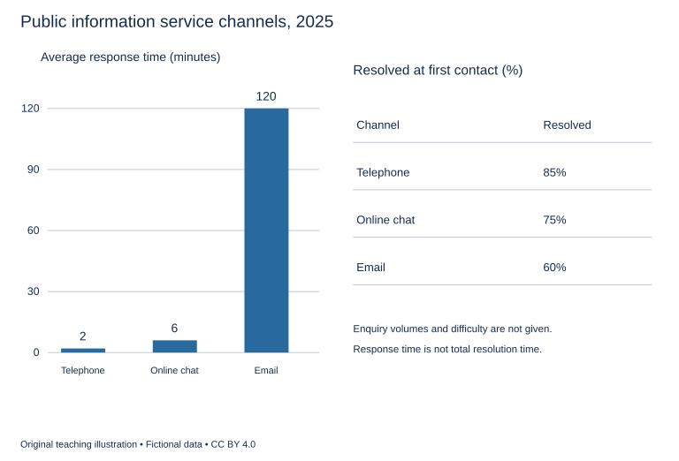

# U24 第16周：长篇阅读、写作与口语

本页为已独立核验的原创文字课程。先完成学生题目，再展开对应参考。非真题、非标准化模考，不换算雅思分数。听力尚未补齐，本页不代表全科课程已完成。

每周选A或G类Task 1一题，加Task 2及三次口语。参考范文不是学生已完成作业，仍须提交初稿、录音和重写，独立真人评分另行安排。

阅读每周180分钟（60分钟首次限时、120分钟证据精读与延迟复测），写作180分钟、口语120分钟。词汇60分钟、听力180分钟另列；新增完整听力未验收，不能勾整周完成。

W16原创阶段检查按实际证据复盘；正式T16陌生整卷及真人评分另记，本页原创技能卷不能代替正式模拟。后续周数与达标规则见 [U04](u04-exam-preparation.md)。

## 阅读：首答不查词

### R-W16-01 · A Roof That Holds the Rain

W16｜正文 854 词｜13 题｜篇章：机制解释：暂存、流出与恢复条件（6段）

本课必做60分钟：首答20、证据复盘20、词汇长句10、48小时后复测10。每周三课180分钟，合卷首答替代单课首答，不重复计算。开放短文选做另加15分钟。

本项目原创虚构教学情境，人物、地点、历史事件和案例数据均非真实研究或史料。科学解释只讨论文内说明的模型与条件。非雅思真题或标准化模考；正确数不换算雅思等级。许可：CC BY 4.0 — RayXBuilds and contributors。

能力点：识别论证关系、区分作者与引述者、条件与因果、精确定位。初读不查词，完成后打开独立答案页。

#### Passage

**A** A fictional environmental design class compares two shallow trays under an artificial shower. One has a smooth base that directs water immediately towards an outlet. The other contains a layer that can hold some water before releasing it. The second tray produces a smaller early flow, and a student announces that it has eliminated part of the rain. The instructor asks where the water has gone. Some remains in the tray, some has already left, and some may later evaporate under the conditions of the model. A reduced outflow at one moment is not the same claim as a reduced total volume across an entire period. This distinction is central to understanding a roof designed to delay runoff. Its function may be to alter the timing of water reaching another system, even when much of that water eventually leaves the roof rather than disappearing permanently.

**B** The class first applies a brief shower to both dry trays. The holding layer absorbs water until its available storage becomes limited, after which the outlet carries more of the incoming flow. The timing depends on how much space was initially available and how quickly water can enter or leave it. A label giving the layer's maximum storage does not describe its remaining capacity at the start of every storm. If it is already wet, a new shower meets a different condition. The class therefore weighs each tray before the run and records whether it has recently been used. This prevents a comparison between a dry holding tray and an already wet one from being interpreted as evidence that the material has unpredictably changed its properties when the relevant difference is its starting state.

**C** Outlet design produces another tradeoff. A narrow outlet can slow release, extending the time over which stored water leaves. But if incoming water exceeds the combined ability to store and release it, the system needs somewhere else for the excess to go. In the classroom model, an overflow channel makes that route visible. Students are not allowed to ignore overflow simply because it bypasses the measuring cup placed beneath the ordinary outlet. Doing so would make the tray appear more effective by excluding part of its discharge. The exercise treats overflow as a part of system behaviour to observe, not as an inconvenient exception outside the accounting. Any claim about total outflow must include all routes by which water leaves the boundary chosen for the comparison.

**D** A long period of gentle input can produce a different result from a short intense shower with the same total volume. During gentle input, some stored water may leave while new water arrives, making room available again. During a rapid burst, the layer may fill before sufficient release occurs. The class uses a rainfall card specifying both the total input and its distribution over time. It compares the resulting discharge curves without treating equal totals as identical conditions. This does not establish that one tray is best for every possible pattern. It shows why a design intended to reduce a short peak should be evaluated against the timing of that peak, while a claim about total retained water requires a different account of what remains after an appropriately defined observation period.

**E** Recovery between showers matters for the same reason. The class allows one holding tray to drain for a long interval and subjects another to a second shower soon after the first. The second begins with less available storage. A performance figure from a single dry-start trial would not reveal this difference. Students keep a recovery log and a storage sheet linking each trial with the tray's starting condition. A flow graph records the measured output over time, while a balance table lists input, water remaining and water leaving by each route. The records describe related aspects of the experiment, but none is a universal substitute for all the others. A low early peak can coexist with little final retention, just as high retention at one time can leave limited capacity for the next event.

**F** The final comparison asks which service each tray provides under the specified sequence of showers. Delaying water may be useful when the receiving system is busiest during a short period, but a delayed flow could still coincide with another source later. The class therefore avoids describing every delay as an improvement independent of context. Its conclusion identifies the input pattern, the initial storage and the time window over which the result was measured. The teaching model is not a construction specification for a real building, whose requirements would extend far beyond the tray. Its value lies in making distinct claims visible: reducing a peak, retaining a volume and preparing for a subsequent event are different achievements. A careful reader should ask which one a performance statement actually describes before treating a low number at the outlet as a complete account of what the roof has done with the rain. Extending the observation window may change the reported retained amount without changing the physical tray at all. For that reason, comparisons must state when measurement ends as clearly as they state when the shower begins.

#### Questions

**Choose ONE answer, A, B, C or D.**

1. The initial reduced flow demonstrates most directly

   A. that some water never existed
   B. that both trays retain equally
   C. that all rain evaporated
   D. a change in the timing of outflow

2. Why record starting wetness?

   A. It prevents all overflow
   B. It replaces measuring input
   C. It affects available storage
   D. It proves all materials identical

3. Why measure overflow as well as the main outlet?

   A. To reduce the shower rate
   B. To avoid excluding an exit route from total discharge
   C. To guarantee zero retention
   D. To make the narrow outlet wider

4. Equal total inputs may differ because

   A. the distribution of input over time differs
   B. each shower has no duration
   C. storage never recovers
   D. totals cannot be measured

**Complete the sentences. Choose NO MORE THAN 3 WORDS FROM THE PASSAGE for each answer. Do not change word forms.**

5. The model’s extra discharge route is an ______.

6. Total input and its timing are specified on a ______.

7. The interval between showers is documented in a ______.

8. Measured output over time appears in a ______.

9. Input, retained water and exit routes are combined in a ______.

**Do the following statements agree with the writer's views? Write YES, NO or NOT GIVEN. YES = the writer agrees; NO = the writer expresses the opposite view; NOT GIVEN = the writer's view is not stated. Do not use outside knowledge.**

10. Maximum storage equals available storage before every event.

11. Every delay in discharge improves the receiving system regardless of context.

12. A lower early peak can occur alongside little final retention.

13. The writer favours subsidies based on total retention rather than reduction of peak discharge.

#### 本周重点

原创阶段检查：60分钟合卷与48小时延迟复测配套；不换算雅思分数，不能替代正式T16陌生卷。

#### 复盘

必做：给每道错题标记“定位/作者立场/范围/语法/词数”，抄最短证据；用一行箭头概括本文论证或过程。48小时后重做错题与两道正确题，检查是否仍能指出证据。

选做（15分钟，80–100词）：Distinguish reducing a peak from retaining water across an entire period.

R-W16-01 答案、证据与精读（首答后展开）

### R-W16-01 · 独立答案与证据

来源与许可同学生页。先完成再核对。可接受答案由 accepted_answers 明确列出；只忽略大小写和首尾空格，不自行删词。开放复盘不计入客观正确数。

1. **D**｜段落 A｜证据：“alter the timing of water”

   不能从单时点推总消失量。

2. **C**｜段落 B｜证据：“remaining capacity at the start”

   初始状态是条件。

3. **B**｜段落 C｜证据：“include all routes”

   完整边界核算。

4. **A**｜段落 D｜证据：“distribution over time”

   速率和历时可改变峰值。

5. **overflow channel / overflow**｜段落 C｜证据：“an overflow channel”

   overflow channel 是完整路线名，overflow 在本段亦用作该溢流的回指简称，两者可接 an。单独 channel 不能接 an。

6. **rainfall card / card**｜段落 D｜证据：“a rainfall card”

   card可接受。

7. **recovery log / log**｜段落 E｜证据：“a recovery log”

   log可接受；starting condition另有storage sheet。

8. **flow graph / graph**｜段落 E｜证据：“A flow graph records”

   graph可接受；这是出流随时间的曲线记录，不是步骤流程图。

9. **balance table / table**｜段落 E｜证据：“a balance table lists”

   table可接受；flow graph没有完整水量构成。

10. **NO**｜段落 B｜证据：“does not describe its remaining capacity”

   上限不等于当前余量。

11. **NO**｜段落 F｜证据：“avoids describing every delay as an improvement”

   可能与其他来源后续重叠。

12. **YES**｜段落 E｜证据：“can coexist with little final retention”

   作者直接说明两指标可分离。

13. **NOT GIVEN**｜段落 F｜证据：“different achievements”

   作者区分不同水文服务，没有提出补贴依据或财政优先项。

#### 词汇与长句

- **runoff**：流离接收表面的水
- **retention**：在指定时段仍被保留的水量
- **discharge**：离开系统边界的出流
- **capacity**：可用于储存或处理的容量

> A reduced outflow at one moment is not the same claim as a reduced total volume across an entire period.

at one moment与across an entire period对照时间尺度。

> A low early peak can coexist with little final retention, just as high retention at one time can leave limited capacity for the next event.

just as类比两个并存关系，不能用一指标替代所有功能。

#### 开放任务参考

A/D/E峰值是时序量、保留量需定义期末与全部出口；F要看接收系统。

标准：观点有文内依据，保留条件和范围，推断明确标注；不存在唯一措辞。

### R-W16-02 · The Journey of a Borrowed Tune

W16｜正文 1063 词｜13 题｜篇章：虚构文化史：音乐传播、改编与归属（9段）

本课必做60分钟：首答20、证据复盘20、词汇长句10、48小时后复测10。每周三课180分钟，合卷首答替代单课首答，不重复计算。开放短文选做另加15分钟。

本项目原创虚构教学情境，人物、地点、历史事件和案例数据均非真实研究或史料。科学解释只讨论文内说明的模型与条件。非雅思真题或标准化模考；正确数不换算雅思等级。许可：CC BY 4.0 — RayXBuilds and contributors。

能力点：识别论证关系、区分作者与引述者、条件与因果、精确定位。初读不查词，完成后打开独立答案页。

#### Passage

**A** The fictional harbour town of Avel has a song that residents describe as their own. It accompanies a yearly procession, appears in school concerts and is played when ships return after a long absence. A visiting musician recognises part of its melody from a dance performed on another island. Some residents treat this resemblance as a threat: if the tune came from elsewhere, they ask, can it still belong to the town? The question combines several meanings of belonging. It may concern who first composed a phrase, who carried it between places, who changed it or which community now uses it to express shared experience. These questions can be related without having the same answer.

**B** The earliest written version in Avel is a melody sketch copied by a travelling instrument seller. The page gives a sequence of notes but no words, and it does not identify a composer. A later owner wrote the harbour's name across the top. That addition shows an association at the time it was made, not necessarily the place where the tune originated. The historian studying the song separates the date of the copy from the date and hand of the added heading. Without that distinction, a label attached during later use could be mistaken for information supplied by the original writer. The document is valuable, but its different layers need to be read as different acts rather than as one statement made at one moment.

**C** Oral accounts supply another part of the history. An older resident remembers hearing the melody at a family celebration, but her recollection does not establish the earliest performance in the town. A sailor recalls introducing a related phrase after a voyage. These accounts identify possible routes of transmission without automatically forming a complete chain. The historian keeps an interview ledger noting who spoke, what they claimed to remember directly and what they had heard from someone else. A vivid memory and a carefully dated document are not interchangeable kinds of evidence. Neither should be discarded merely because it cannot answer every question about the song's beginnings or because another account contains details that seem easier to place on a calendar.

**D** The tune also changed through use. A dance rhythm suited to quick turning steps did not fit a slow procession through narrow streets. Musicians lengthened some notes and repeated a phrase so that walkers could continue at a steady pace. The change was not simply damage done to a perfect original. It enabled the music to perform a different task. The historian prepares a rhythm comparison showing where versions diverge, but avoids treating the earliest surviving notation as the only authentic form. Survival is uneven: an earlier performance may have left no written trace, and a later copy may preserve a pattern learned long before the page was made. The chronology of documents and the chronology of musical practice therefore cannot be assumed to coincide exactly.

**E** Words arrived later. A schoolteacher wrote verses about the harbour and taught them to children, who carried the song into family gatherings. The new text named local places and events, giving the melody a particular relationship with Avel's public memory. This did not prove that the underlying tune had been composed there. It did show why residents could reasonably experience it as part of local life. The writer rejects the choice between describing the song as entirely indigenous and dismissing its local meaning as fraudulent. Cultural attachment can develop through use and transformation, even when some material has travelled. An honest account can acknowledge that history without pretending that every claim about origin follows from the depth of present attachment.

**F** Printed programmes helped stabilise one version. When the procession organisers distributed the same words each year, singers became less likely to substitute verses remembered from other occasions. Yet the musicians continued varying the introduction and the length of instrumental passages. A programme sheet recorded the printed text, while a performance note described choices made on a particular occasion. Those records distinguish a relatively stable public version from the flexibility of actual performance. A published text can influence practice without determining every sound that an audience hears. To infer complete uniformity from identical programmes would overlook the work through which performers fit a familiar song to a route, a crowd or an unexpectedly slow movement through the town.

**G** A later festival brings musicians from the neighbouring island. They recognise the shared phrase but perform a version with different accents and an unfamiliar ending. The exchange does not settle which community was first. Instead, it makes the relationship audible and creates an opportunity to compare what each version does. A version chart lists shared phrases, altered rhythms and different words without ranking one community's use as a degraded copy of the other. The writer supports this comparative approach because a historical question can become less clear when every similarity is treated as a claim of ownership and every difference as proof of complete independence. Musical relationships may include borrowing, shared inheritance and later adaptation, and the available records may not distinguish all of these possibilities.

**H** The town's revised concert programme credits the schoolteacher's words, describes the melody's known links and states that its earlier origin remains unresolved. This is not a declaration that nobody contributed anything distinctive. It gives different kinds of contribution their own place: composing words, transporting a phrase, adapting a rhythm and sustaining a practice are not identical achievements. The programme also avoids turning uncertainty into an accusation against another community. A missing name does not prove deliberate concealment. Where the evidence cannot identify an individual creator, the account should preserve that limit rather than filling the space with whichever story is most satisfying to the people currently presenting the music on stage.

**I** Avel's tune remains meaningful after its history becomes more complicated. Residents can sing about their harbour while recognising that the melody connects them with people beyond it. The writer does not propose that questions of attribution should be abandoned in favour of pleasant stories about exchange. Specific claims still need evidence, and identifiable contributions should be described accurately. The narrower lesson is that origin, adaptation and present significance should not be collapsed into one contest for a single label. A cultural object can travel, change and become locally important without all those processes being reducible to the question of who possessed it first.

#### Questions

**Which paragraph contains the following information? Write a letter, A–I. You may use any letter more than once.**

1. a heading added by someone other than the writer of the earliest surviving notation

2. changes made to fit a slow procession rather than a fast dance

3. an explicit distinction between printed words and flexible performance decisions

4. a statement that an unidentified creator does not establish intentional concealment

**Do the following statements agree with the writer's views? Write YES, NO or NOT GIVEN. YES = the writer agrees; NO = the writer expresses the opposite view; NOT GIVEN = the writer's view is not stated. Do not use outside knowledge.**

5. Local cultural meaning requires proof that every musical element originated locally.

6. The earliest surviving notation necessarily represents the first musical practice.

7. Identical printed programmes guarantee identical performances.

8. The writer favours paying the neighbouring island for every Avel performance.

**Complete the summary. Choose NO MORE THAN 3 WORDS FROM THE PASSAGE for each answer. Do not change word forms.**

The earliest local notation was a (9) ______ without lyrics. The historian recorded direct and indirect memories in the (10) ______. The historian first prepared a (11) ______ to show the rhythm changes made for the procession. Choices on a particular occasion went into a (12) ______. Shared phrases, altered rhythms and different words across the two communities were listed in a (13) ______.

#### 本周重点

原创阶段检查：60分钟合卷与48小时延迟复测配套；不换算雅思分数，不能替代正式T16陌生卷。

#### 复盘

必做：给每道错题标记“定位/作者立场/范围/语法/词数”，抄最短证据；用一行箭头概括本文论证或过程。48小时后重做错题与两道正确题，检查是否仍能指出证据。

选做（15分钟，80–100词）：Explain how a borrowed melody can acquire a distinctive local role without proving a local origin.

R-W16-02 答案、证据与精读（首答后展开）

### R-W16-02 · 独立答案与证据

来源与许可同学生页。先完成再核对。可接受答案由 accepted_answers 明确列出；只忽略大小写和首尾空格，不自行删词。开放复盘不计入客观正确数。

1. **B**｜段落 B｜证据：“A later owner wrote the harbour's name”

   B文献层次。

2. **D**｜段落 D｜证据：“lengthened some notes”

   D改节奏服务动作。

3. **F**｜段落 F｜证据：“relatively stable public version”

   F节目文本与实际演奏。

4. **H**｜段落 H｜证据：“does not prove deliberate concealment”

   H不从缺失姓名推恶意。

5. **NO**｜段落 E｜证据：“Cultural attachment can develop through use and transformation”

   作者反对二选一。

6. **NO**｜段落 D｜证据：“earlier performance may have left no written trace”

   存世最早不等于实践起点。

7. **NO**｜段落 F｜证据：“infer complete uniformity”

   作者明确指出会遗漏演奏选择。

8. **NOT GIVEN**｜段落 G｜证据：“does not settle which community was first”

   未评价报酬制度；文化关联不推出收费立场。

9. **melody sketch / sketch / written version / version / page / sequence of notes / sequence / copy / document**｜段落 B｜证据：“a melody sketch”

   B 以 earliest written version、melody sketch、page、copy 和 document 指同一最早存世的本地无歌词文献，并说它给出 a sequence of notes。date of the copy 与 The document is valuable 是同段回指；copy/document 均为原文单数一词，可接 a，必须接受。其余原已登记形式保留；不接受复数 notes 单独接 a。

10. **interview ledger / ledger**｜段落 C｜证据：“an interview ledger”

   题干使用 the，interview ledger 与 ledger 均接受；oral accounts 是访谈材料来源，不是供史家登记的载体。

11. **rhythm comparison / comparison**｜段落 D｜证据：“a rhythm comparison”

   D 最先为游行改编准备 rhythm comparison；G 的 version chart 是后来节庆交流中的跨社区对照，时间和用途不同。comparison 可接受。

12. **performance note / note**｜段落 F｜证据：“a performance note”

   note可接受，特定场次选择。

13. **version chart / chart**｜段落 G｜证据：“A version chart”

   G 的 version chart 同时列出共享旋律句、改动节奏和不同歌词，D 的 rhythm comparison 只比较游行适配节奏，不能覆盖题干三项。chart 可接受。

#### 词汇与长句

- **attribution**：贡献或创作的归属说明
- **notation**：书写下来的音乐符号
- **indigenous**：在当地起源或形成的
- **transmission**：传播与传承过程

> The chronology of documents and the chronology of musical practice therefore cannot be assumed to coincide exactly.

并列两种时间线，cannot be assumed限制从文献到实际历史的推断。

> A published text can influence practice without determining every sound that an audience hears.

without区分影响与完全决定，every是重要范围词。

#### 开放任务参考

D节奏适配、E地方歌词赋义；B/H仍须区分来源证据与当前归属体验。

标准：观点有文内依据，保留条件和范围，推断明确标注；不存在唯一措辞。

### R-W16-03 · What Counts as Returning Home?

W16｜正文 992 词｜14 题｜篇章：社会议论：概念区分、比较与例外（8段）

本课必做60分钟：首答20、证据复盘20、词汇长句10、48小时后复测10。每周三课180分钟，合卷首答替代单课首答，不重复计算。开放短文选做另加15分钟。

本项目原创虚构教学情境，人物、地点、历史事件和案例数据均非真实研究或史料。科学解释只讨论文内说明的模型与条件。非雅思真题或标准化模考；正确数不换算雅思等级。许可：CC BY 4.0 — RayXBuilds and contributors。

能力点：识别论证关系、区分作者与引述者、条件与因果、精确定位。初读不查词，完成后打开独立答案页。

#### Passage

**A** In a fictional oral-history project, three former residents of the town of Vela are asked whether they have returned home. Mara moved back into the house where she grew up. Jon lives elsewhere but spends several months each year caring for a relative in Vela. Esi has not revisited the town, yet participates in its community meetings from a distance and helps organise support for people there. A questionnaire offering only yes and no would place these experiences into a simple pair of categories. The simplicity might be useful for one narrow question about residence, but it would not capture every meaning of return. The writer argues that a category becomes informative when its purpose is clear, not merely when every person can be placed somewhere inside or outside it.

**B** Physical return is the most visible interpretation. A person leaves one location and later arrives there again. Even this apparently straightforward description contains choices. Does a short visit count, or only a change in usual residence? Does returning to a neighbouring district count if the original house no longer exists? These questions do not make location meaningless. They show that a count requires a defined unit and an interval of observation. A travel record might establish that someone crossed a boundary, while a housing record might show where they usually live. The two records can both be accurate without producing the same answer to an unqualified question about whether the person has returned home. The disagreement may concern the definition being used rather than the honesty of the records.

**C** Mara's experience complicates the idea that physical arrival restores an earlier life. The house remains, but neighbours have changed, familiar work has disappeared and several routines from childhood no longer fit the present town. She describes being both familiar with the place and required to learn it again. This does not mean that her return is somehow false. It means that return in space is not automatically return to an unchanged set of relationships. The writer rejects the expectation that a meaningful homecoming must recreate the past. Such an expectation can turn ordinary change into apparent failure, leaving a person to judge a present life against a condition that no longer exists and may never have existed exactly as it is remembered.

**D** Jon's repeated stays raise a different issue. His paid work remains elsewhere, but responsibilities in Vela require regular presence. A residence-based count may classify him as absent, while a study of care would need to recognise his continuing role. Neither classification is necessarily a mistake if its purpose is stated. Trouble begins when one is used to answer the other's question. A local service planning support for carers could underestimate demand by counting only permanent residents. Conversely, a study of occupied housing should not treat every continuing emotional or practical connection as a change in usual residence. The writer favours keeping these measures distinguishable, even when an individual case reminds us that several forms of connection can coexist within one person's life.

**E** Esi's participation shows why distance does not settle every question about belonging. She contributes to decisions and maintains relationships while remaining physically elsewhere. Those activities may matter to the community, but they do not remove the constraints of distance. She cannot provide every kind of practical help that requires presence, and a remote conversation is not identical to sharing the town's everyday spaces. The writer avoids both dismissing distant participation as unreal and treating it as a complete substitute for being there. A useful account identifies what the connection enables and what it leaves difficult. It should not force Esi to claim that she has physically returned in order for her contribution to be recognised, or pretend that recognition requires denying the limitations of the arrangement.

**F** The oral-history team revises its questions accordingly. It asks separately about where participants live, what activities bring them to Vela, which responsibilities connect them to it and how their sense of familiarity has changed. Interviewees can explain why they use the word home without having that explanation converted automatically into a residential category. The team also distinguishes the date of a move from the period during which someone began to feel settled. These may coincide, but they need not. Separating the questions makes the interviews longer, yet it prevents a short answer from appearing to settle several different matters. The resulting accounts can be compared by theme while retaining enough context to show why similar words describe different trajectories and different words sometimes describe comparable experiences.

**G** A planner worries that these distinctions will make the results unusable. Public services sometimes need a count rather than a long account of every life. The writer accepts the need for operational categories but rejects the conclusion that broader accounts must therefore be discarded. A count can be produced using an explicit residence definition while the interviews remain available for questions about care, attachment or participation. The report should explain what the count leaves outside its scope. This is not a demand that every administrative decision wait until every aspect of belonging is understood. It is a demand that a number answering one practical question should not acquire authority over all the other questions simply because it is easier to put into a chart.

**H** Vela's project ends with several findings rather than a single proportion of people who have come home. The team can describe changes of residence, repeated visits, responsibilities across distance and experiences of renewed familiarity. It cannot reduce those forms to one ranking of authentic and inauthentic return. The writer's conclusion is that clear distinctions can respect complex experience without abandoning useful comparison. Precision does not always mean choosing the narrowest possible category and forgetting the rest. It can mean stating exactly which aspect a claim concerns, using evidence suited to that aspect and preserving the possibility that a different question will require a different account of the same person's connection with a place.

#### Questions

**Do the following statements agree with the writer's views? Write YES, NO or NOT GIVEN. YES = the writer agrees; NO = the writer expresses the opposite view; NOT GIVEN = the writer's view is not stated. Do not use outside knowledge.**

1. A meaningful homecoming must restore the past exactly.

2. Remote participation is a complete substitute for physical presence.

3. Administrative categories can be useful when their limits are stated.

4. The writer favours giving all former residents equal voting rights in Vela.

5. Different questions may require different accounts of the same person’s connection.

**Which paragraph contains the following information? Write a letter, A–H. You may use any letter more than once.**

6. a person whose work is elsewhere but whose care responsibilities require repeated stays

7. a distinction between moving date and the period of beginning to feel settled

8. examples involving a short visit and the loss of an original house

9. a planner’s objection that complex accounts may obstruct practical use

10. a final rejection of ranking kinds of return as authentic or inauthentic

**Choose ONE answer, A, B, C or D.**

11. A yes/no return category is most defensible when

   A. it ignores residence
   B. its narrow purpose is specified
   C. it claims to capture all belonging
   D. it ranks authenticity

12. Why can travel and housing records disagree without either being false?

   A. One always records emotions
   B. Both omit all dates
   C. Physical travel never happens
   D. They measure different aspects of location

13. Mara’s experience challenges the expectation that

   A. towns contain neighbours
   B. a house can remain standing
   C. people can remember places
   D. spatial return recreates unchanged relationships

14. The writer’s response to the planner is to

   A. make every decision wait indefinitely
   B. use explicit counts while preserving other evidence for other questions
   C. abandon all counts
   D. discard interviews

#### 本周重点

原创阶段检查：60分钟合卷与48小时延迟复测配套；不换算雅思分数，不能替代正式T16陌生卷。

#### 复盘

必做：给每道错题标记“定位/作者立场/范围/语法/词数”，抄最短证据；用一行箭头概括本文论证或过程。48小时后重做错题与两道正确题，检查是否仍能指出证据。

选做（15分钟，80–100词）：Define a return measure for one service-planning question and name an experience it leaves outside.

R-W16-03 答案、证据与精读（首答后展开）

### R-W16-03 · 独立答案与证据

来源与许可同学生页。先完成再核对。可接受答案由 accepted_answers 明确列出；只忽略大小写和首尾空格，不自行删词。开放复盘不计入客观正确数。

1. **NO**｜段落 C｜证据：“rejects the expectation”

   作者明确否定。

2. **NO**｜段落 E｜证据：“not identical to sharing”

   作者同时认可贡献与限制。

3. **YES**｜段落 G｜证据：“accepts the need for operational categories”

   作者条件性认可。

4. **NOT GIVEN**｜段落 E｜证据：“contributes to decisions”

   只描述远程参与，未主张全体前居民拥有何种投票权；不能从参与事实推政策立场。

5. **YES**｜段落 H｜证据：“a different question will require a different account”

   结论明确。

6. **D**｜段落 D｜证据：“His paid work remains elsewhere”

   D Jon具体双地点责任。

7. **F**｜段落 F｜证据：“date of a move from the period”

   F采访设计细节。

8. **B**｜段落 B｜证据：“if the original house no longer exists”

   B定义边界示例组合。

9. **G**｜段落 G｜证据：“these distinctions will make the results unusable”

   G明确反方声音。

10. **H**｜段落 H｜证据：“one ranking of authentic and inauthentic return”

   H总结拒绝单一真实性等级，非A最初分类问题。

11. **B**｜段落 A｜证据：“useful for one narrow question about residence”

   用途明确是条件。

12. **D**｜段落 B｜证据：“definition being used rather than the honesty”

   测量对象不同。

13. **D**｜段落 C｜证据：“not automatically return to an unchanged set”

   反对复原过去的要求。

14. **B**｜段落 G｜证据：“while the interviews remain available”

   有限操作分类与丰富材料可并存。

#### 词汇与长句

- **trajectory**：随时间发展的个人历程
- **operational**：为实际统计或决策明确规定的
- **attachment**：情感或关系上的连接
- **residence**：通常居住地

> It means that return in space is not automatically return to an unchanged set of relationships.

not automatically限制空间与关系的等同；that从句说明此例的含义。

> A count can be produced using an explicit residence definition while the interviews remain available for questions about care, attachment or participation.

while说明两种材料可并行，而非二择一。

#### 开放任务参考

D照护需求不能仅依常住，G住宅统计可用居住定义但不能代表全部归属；限定对象与证据。

标准：观点有文内依据，保留条件和范围，推断明确标注；不存在唯一措辞。

## 写作与口语：Task 1双分支择一

### WS-W16-T1A 学生页：公共服务窗口与数字渠道

周次 W16｜题型 T1A｜能力点：混合数据与阶段核查

Task 1 的 A/G 分支二选一，另一分支不计入本周作业。

#### 使用与记录

原创教学练习，非真题、非标准化模拟，难度未校准。先完成本页再打开参考页。人物、机构、经历与数据均为教学虚构。不要背诵示例。自评和 AI 反馈不能代替独立真人评分，未获得真人评阅时标记“分数未确认”。

保存：任务ID、实际日期、用时、初稿或原始录音、证据化反馈、重写/重答、三条修改理由。没有学生提交物，不得填写“已批改”或“已完成训练”。

#### 完整题干

The bar chart compares average response times for three channels used by a town’s public information service in 2025. The table shows the percentage of enquiries resolved at the first contact through each channel. Summarise the information by selecting and reporting the main features, and make comparisons where relevant.

Write at least 150 words. Spend about 20 minutes on this task.

教学虚构。2025首次回复平均分钟数：Telephone2、Online chat6、Email120。首次接触即解决比例：85%、75%、60%。未给各渠道件数、问题难度、最终解决耗时或用户人口特征；不能推绝对件数或因果。

#### 任务预算（含首次审题，不额外加时）

初稿20分钟（审题规划3、写作15、检查2）；诊断15；反馈阅读与证据核查10；完整重写25；对照归档5。合计75分钟。

#### 初稿后自评清单

- [ ] 达到最低字数；全文连贯成段，没有用项目符号代替作文。
- [ ] 概述给主要特征；数据、阶段或方位都与题图逐项相符，不推断未提供的原因。
- [ ] 每段可写出一个功能标签；例子或数据与该段要点相连。
- [ ] 圈出两处词汇搭配和两处句法疑点，先自行修正再查询或求反馈。
- [ ] 记录一项最影响理解的问题和原句证据，不填写自猜分数。

#### 反馈与重写

打开 独立参考页（本节下方展开参考），按逐段检查和通用协议核验。重写任务：完整重写至少150词；先列两个单位再写，结束时用1分钟逐一核对倍数与百分点；保留信息不足的边界。

#### 本周重点操作（已含原预算）

用原有归档5分钟中的3分钟核对题干要点、最低词数、实际初稿时间，记录两项待评问题。若有先前自己的初稿，用一处原句比对复发情况；没有则作为本次记录，不捏造进步或分数。T16正式陌生卷与真人评阅另行登记。

W16 T1A 示例、反馈与重练（首答后展开）

### WS-W16-T1A 独立参考页

只在初稿完成后阅读；不是唯一答案，也没有官方分数。以下是对原创示例的教学讲评，不是对学生尚未提交作文的已完成批改。

#### 思路拆解

限时筛两个指标的排序与差距；分钟尺度0～120注意短柱可读；不得把结果归因于员工能力，题面无难度/数量。

#### 原创示例

The bar chart shows average response times for enquiries made through three channels of a town’s public information service in 2025. The accompanying table reports the percentage resolved at the first contact through each channel.

Overall, the telephone had the shortest response time and the highest first-contact resolution rate. Email was the slowest channel and had the lowest resolution rate. The online chat service occupied the middle position for both measures.

Telephone enquiries received a response after an average of two minutes, compared with six minutes for online chat. Email responses took an average of 120 minutes, making this channel considerably slower than the other two. Its average was twenty times the figure for online chat, while chat users waited three times as long as telephone users on average.

The telephone service resolved 85% of enquiries at the first contact. The corresponding proportion was 75% for online chat and 60% for email. The gap between telephone and email was therefore twenty-five percentage points, while chat exceeded email by fifteen points. These results compare the channels, but the information does not show whether they received enquiries of similar difficulty or the same number of enquiries.

示例正文词数：194（本项目正则计数；书信不含称呼、结束语与署名；连字符词作一词）。

#### 逐段反馈与迁移

- P1 response time非解决总耗时；resolved at first contact为另一比例指标。

- P2 三项排序两指标一致，但不证明方式造成结果。

- P3 120/6=20，6/2=3；所有时间单位分钟，平均不等于每一件。

- P4 85/75/60差25和15点；不根据百分比算解决件数，未给询问总数。

#### 常见失误

混分钟小时；把首次回复等于全部解决；只因邮件低就批评职员或复杂问题。

#### 可执行反馈步骤

1. 先把自己的段落标为引入、概述/论点、支持、收束；分段可不同于示例，按功能核查，不照抄段数。
2. 对照上方逐段检查，逐项标“已有证据/缺失/不适用”。每条意见必须附自己的原句或缺失位置。
3. 按 [反馈协议](u25-feedback.md) 的四维表记录；有争议的 AI 意见回题干、数据或语法依据核验。
4. 只选两项最高优先级问题执行整篇重写；保留原稿，禁止把示例替换为自己的作业。

#### 重写任务

完整重写至少150词；先列两个单位再写，结束时用1分钟逐一核对倍数与百分点；保留信息不足的边界。

完成后重新勾选 学生页（见本节上方学生题） 清单；将一处改前/改后及理由交给独立评阅者核查。真人评阅状态目前为“待安排”，不是已完成。

### WS-W16-T1G 学生页：向公共服务中心反馈网页信息

周次 W16｜题型 T1G｜能力点：书信目的、要点与语气

Task 1 的 A/G 分支二选一，另一分支不计入本周作业。

#### 使用与记录

原创教学练习，非真题、非标准化模拟，难度未校准。先完成本页再打开参考页。人物、机构、经历与数据均为教学虚构。不要背诵示例。自评和 AI 反馈不能代替独立真人评分，未获得真人评阅时标记“分数未确认”。

保存：任务ID、实际日期、用时、初稿或原始录音、证据化反馈、重写/重答、三条修改理由。没有学生提交物，不得填写“已批改”或“已完成训练”。

#### 完整题干

You used a town information website but found the instructions for booking a community room unclear. Write to the information officer, Ms Lee. In your letter:
- describe the information you were looking for
- explain which part of the website was unclear
- suggest an improvement and request the information you still need.
Begin your letter: Dear Ms Lee,

Write at least 150 words. You do not need to write any addresses. Spend about 20 minutes on this task.

#### 任务预算（含首次审题，不额外加时）

初稿20分钟（审题规划3、写作15、检查2）；诊断15；反馈阅读与证据核查10；完整重写25；对照归档5。合计75分钟。

#### 初稿后自评清单

- [ ] 达到最低字数；全文连贯成段，没有用项目符号代替作文。
- [ ] 三个要点均展开；称呼、目的、语气和结束语适合收信人。
- [ ] 每段可写出一个功能标签；例子或数据与该段要点相连。
- [ ] 圈出两处词汇搭配和两处句法疑点，先自行修正再查询或求反馈。
- [ ] 记录一项最影响理解的问题和原句证据，不填写自猜分数。

#### 反馈与重写

打开 独立参考页（本节下方展开参考），按逐段检查和通用协议核验。重写任务：完整重写至少150词；给每个问题配一项建议和一项待确认问题，检查词数与时间但不填未经完成的评分。

#### 本周重点操作（已含原预算）

用原有归档5分钟中的3分钟核对题干要点、最低词数、实际初稿时间，记录两项待评问题。若有先前自己的初稿，用一处原句比对复发情况；没有则作为本次记录，不捏造进步或分数。T16正式陌生卷与真人评阅另行登记。

W16 T1G 示例、反馈与重练（首答后展开）

### WS-W16-T1G 独立参考页

只在初稿完成后阅读；不是唯一答案，也没有官方分数。以下是对原创示例的教学讲评，不是对学生尚未提交作文的已完成批改。

#### 思路拆解

半正式反馈给已知职员；所需信息→具体不清之处→改进与仍需答复，两项结尾均不可漏。

#### 原创示例

Dear Ms Lee,

I recently used the town information website to find out how to book a community room for a small discussion group. We expect around twelve people and would like to meet on a weekday evening next month. I was looking for information about available rooms, booking arrangements and the total cost of using one for two hours.

The page lists an hourly room charge, but a separate section mentions a service fee without explaining whether it applies to every booking. I was therefore unable to work out the full amount we would need to pay. The page also asks users to submit a request form, but I could not find a link to that form beside the instructions.

It would be helpful to show a worked example of the total cost and place a clearly labelled form link on the same page. Could you also confirm whether the service fee would apply to our group and tell me where to obtain the request form? Once I have that information, I can discuss the booking with the other members.

Yours sincerely,
Alex Chen

示例正文词数：178（本项目正则计数；书信不含称呼、结束语与署名；连字符词作一词）。

#### 逐段反馈与迁移

- P1 人数时段用途和两小时给查询背景，非已完成预订。

- P2 hourly/service fee范围不明及form link缺位是可定位问题，不能泛说网站糟糕。

- P3 工作示例/同页链接对应问题，再问本组费用与表格位置；不假定费用豁免。

#### 常见失误

只提改善却未请求仍缺信息；把未找到链接说成网站绝对没有表格；编造已缴费。

#### 可执行反馈步骤

1. 先把自己的段落标为引入、概述/论点、支持、收束；分段可不同于示例，按功能核查，不照抄段数。
2. 对照上方逐段检查，逐项标“已有证据/缺失/不适用”。每条意见必须附自己的原句或缺失位置。
3. 按 [反馈协议](u25-feedback.md) 的四维表记录；有争议的 AI 意见回题干、数据或语法依据核验。
4. 只选两项最高优先级问题执行整篇重写；保留原稿，禁止把示例替换为自己的作业。

#### 重写任务

完整重写至少150词；给每个问题配一项建议和一项待确认问题，检查词数与时间但不填未经完成的评分。

完成后重新勾选 学生页（见本节上方学生题） 清单；将一处改前/改后及理由交给独立评阅者核查。真人评阅状态目前为“待安排”，不是已完成。

### WS-W16-T2 学生页：公共服务全面数字化利弊

周次 W16｜题型 T2｜能力点：观点展开与任务回应

A/G 共用本题。

#### 使用与记录

原创教学练习，非真题、非标准化模拟，难度未校准。先完成本页再打开参考页。人物、机构、经历与数据均为教学虚构。不要背诵示例。自评和 AI 反馈不能代替独立真人评分，未获得真人评阅时标记“分数未确认”。

保存：任务ID、实际日期、用时、初稿或原始录音、证据化反馈、重写/重答、三条修改理由。没有学生提交物，不得填写“已批改”或“已完成训练”。

#### 完整题干

Many local authorities are moving services such as applications and appointments online. Do the advantages of this development outweigh the disadvantages? Give reasons and include relevant examples.

Write at least 250 words. Spend about 40 minutes on this task.

#### 任务预算（含首次审题，不额外加时）

初稿40分钟（审题规划5、写作30、检查5）；诊断15；反馈阅读与证据核查10；完整重写35；对照归档5。合计105分钟。

#### 初稿后自评清单

- [ ] 达到最低字数；全文连贯成段，没有用项目符号代替作文。
- [ ] 直接回答题目的所有问句，有始终一致的立场。
- [ ] 每段可写出一个功能标签；例子或数据与该段要点相连。
- [ ] 圈出两处词汇搭配和两处句法疑点，先自行修正再查询或求反馈。
- [ ] 记录一项最影响理解的问题和原句证据，不填写自猜分数。

#### 反馈与重写

打开 独立参考页（本节下方展开参考），按逐段检查和通用协议核验。重写任务：完整重写至少250词；用同一标准比较便利与排除风险。记录初稿20/40分配和两项复发错误，待真人反馈再判评分，不能从示例推分。

#### 本周重点操作（已含原预算）

用原有归档5分钟中的3分钟核对题干要点、最低词数、实际初稿时间，记录两项待评问题。若有先前自己的初稿，用一处原句比对复发情况；没有则作为本次记录，不捏造进步或分数。T16正式陌生卷与真人评阅另行登记。

W16 T2 示例、反馈与重练（首答后展开）

### WS-W16-T2 独立参考页

只在初稿完成后阅读；不是唯一答案，也没有官方分数。以下是对原创示例的教学讲评，不是对学生尚未提交作文的已完成批改。

#### 思路拆解

利弊权衡条件为有支持、不是全取消线下；常规与例外情境比较；W16核回应/证据/时间，非推分。

#### 原创示例

Moving local services online can make routine tasks easier for residents and reduce repeated administrative work. I believe the advantages generally outweigh the disadvantages when digital access is added alongside suitable support. Replacing all other routes, however, would create barriers that weaken that case.

Online services can remove the need to visit an office for every straightforward request. Someone applying for a routine appointment may be able to choose a time and check the required documents outside office hours. Staff can also receive information in a consistent format, reducing the need to enter the same details repeatedly. For residents with long journeys or inflexible working hours, avoiding an unnecessary visit can be a substantial benefit. The gain is strongest where the task is clearly defined and the instructions are easy to follow.

The disadvantages concern access and the handling of unusual situations. Some residents lack a reliable connection or the confidence to complete a digital form. Others may have a case that does not fit the available options. A form that is efficient for most applicants can still be frustrating when there is no way to explain an exception. These difficulties should not be dismissed simply because the majority complete the process successfully; essential public services must remain usable by people with different circumstances.

In my view, these problems can be limited through assisted access and a clear route to a person. Libraries or service centres could help residents complete routine applications, while telephone or in-person appointments could remain available for complex cases. Authorities should also test instructions with ordinary users rather than assume that a technically functioning website is understandable. Such support has a cost, but it allows the convenience of digital services to reach more people.

Overall, online access offers greater benefits than drawbacks when it reduces unnecessary effort without excluding residents who need help. The appropriate goal is a reliable range of ways to complete a task, rather than digital delivery for its own sake.

示例正文词数：328（本项目正则计数；书信不含称呼、结束语与署名；连字符词作一词）。

#### 逐段反馈与迁移

- P1 online增加与替代所有渠道区分，立场清楚。

- P2 定时申请、资料一致如何省往返/录入具体，未编成本下降数。

- P3 连接/信心/特殊情境分别展示边界，不能只靠多数满意否定少数障碍。

- P4 支持与真人路线对应问题，明确也有成本；不是无成本完美解决。

- P5 总体判断与条件一致，不声称所有数字项目有益。

#### 常见失误

只泛写科技改变世界；忽略公共服务必须可达；既说全面取代又靠线下例外但不说明条件。

#### 可执行反馈步骤

1. 先把自己的段落标为引入、概述/论点、支持、收束；分段可不同于示例，按功能核查，不照抄段数。
2. 对照上方逐段检查，逐项标“已有证据/缺失/不适用”。每条意见必须附自己的原句或缺失位置。
3. 按 [反馈协议](u25-feedback.md) 的四维表记录；有争议的 AI 意见回题干、数据或语法依据核验。
4. 只选两项最高优先级问题执行整篇重写；保留原稿，禁止把示例替换为自己的作业。

#### 重写任务

完整重写至少250词；用同一标准比较便利与排除风险。记录初稿20/40分配和两项复发错误，待真人反馈再判评分，不能从示例推分。

完成后重新勾选 学生页（见本节上方学生题） 清单；将一处改前/改后及理由交给独立评阅者核查。真人评阅状态目前为“待安排”，不是已完成。

### WS-W16-S1 学生页

周次W16｜Part 1专项｜能力点：完整流程与证据化阶段检查｜30分钟

#### 使用与记录

原创教学练习，非真题、非标准化模拟，难度未校准。先完成本页再打开参考页。人物、机构、经历与数据均为教学虚构。不要背诵示例。自评和 AI 反馈不能代替独立真人评分，未获得真人评阅时标记“分数未确认”。

保存：任务ID、实际日期、用时、初稿或原始录音、证据化反馈、重写/重答、三条修改理由。没有学生提交物，不得填写“已批改”或“已完成训练”。

#### 操作与预算

设备与审题3分钟；首答录音6；回听及局部转写7；示例和诊断5；不看稿重答6；归档3。共30分钟。

#### Part 1专项题

1. Do you prefer asking questions by phone or in writing?
2. What information do you check before contacting a service?
3. Do you find online forms easy to use?
4. What do you do if a reply does not answer your question?

追问：

- Would your choice depend on how urgent the question was?
- Can you give a specific example?

#### 录音回听清单

- [ ] 保留首答原音，记录实际时长、是否中断、是否看稿；只报真实完成状态。
- [ ] 流利与连贯：标出两处时间戳，区分构思停顿与重复搜词，检查是否偏离问句。
- [ ] 词汇：找一处模糊词或重复表达，先解释原意再替换；不为难词改变意思。
- [ ] 语法：核对经历与习惯的时态；局部转写并更正两处妨碍理解的问题。
- [ ] 发音：不看转写听30秒，标听不清的词尾、重音或断句；没有音频不能判断发音。
- [ ] 展开：主要回答有具体情境或理由；追问后第一句回应追问的新角度。

#### 重答要求

选择两个只有笼统判断的答案，先直接回应再加具体情境；重答一条追问，检查是否真正回应其新角度。

首答回听后才打开独立参考页（本节下方展开参考）。按[反馈协议](u25-feedback.md)填至少三个时间戳，不以文字转写替代音频评阅。

#### 本周重点操作（已含原预算）

用原有归档时段中的3分钟记录首答实际时长、题目覆盖、一个内容问题和一个语言/发音待评点（须原音证据）。有旧录音才作证据比较，没有就保留本次基线。原创建材不是正式T16模考或真人评分完成。

W16 S1 示例、反馈与重练（首答后展开）

### WS-W16-S1 独立参考页

原创教学示例，非真题或评分结果。未收到学生音频；以下是示例分析与待执行反馈，不能登记为已完成学生批改。

#### 展开示例

##### 直接回应→原因→具体情境的展开示例

I prefer writing when I need to include dates or reference numbers, because I can check them before sending the message. For an urgent question, I may phone instead. If a written reply misses the point, I usually repeat the exact question and explain which information is still missing, rather than send the whole original message again.

纯口答示例词数：57；只计MODEL标记内实际英文口答，不含标题、标签、说明。词数不能证明录音时长或流利度。

#### 展开与反馈

本周能力：完整流程与证据化阶段检查。

1. 示例先表态，再说明偏好理由，最后提供条件或场景。检查自己是否用一个词回答后就结束。
2. 找到一个具体细节：物品、动作、对话或地点。用自己的经历替换，保持与题卡相关，不照搬示例身份与经历。
3. 追问要重新回应，不能继续背长答。首句先回答追问，再用一条理由支持。
4. 标出一处听不清或语法影响理解的原音时间戳；先尝试最小修正。不要把自然停顿一概当成错误，或用加快语速掩盖逻辑断裂。

#### 常见失误

空泛形容词替代具体过程；给了经历却没解释为什么重要；Part 3只有个人故事没有一般解释；AI只看转写就判断发音。逐项回原音核对，不能凭范例推断自己已达到某个分数。

#### 可执行重答与反馈

选择两个只有笼统判断的答案，先直接回应再加具体情境；重答一条追问，检查是否真正回应其新角度。

填写[反馈协议](u25-feedback.md)四维表，附三个时间戳和原话证据。选一个内容问题与一个语言问题先修；重答后并排听两段，记录改善与仍未解决之处。自评与AI不能替代独立真人评分；独立评阅目前待安排，分数未确认。

### WS-W16-S2 学生页

周次W16｜Part 2专项｜能力点：完整流程与证据化阶段检查｜30分钟

#### 使用与记录

原创教学练习，非真题、非标准化模拟，难度未校准。先完成本页再打开参考页。人物、机构、经历与数据均为教学虚构。不要背诵示例。自评和 AI 反馈不能代替独立真人评分，未获得真人评阅时标记“分数未确认”。

保存：任务ID、实际日期、用时、初稿或原始录音、证据化反馈、重写/重答、三条修改理由。没有学生提交物，不得填写“已批改”或“已完成训练”。

#### 操作与预算

准备、首答录音及追问5分钟；回听及局部转写8；示例与诊断5；关键词重组3；重答及追问5；归档4。共30分钟。

#### Part 2专项任务卡

Describe a time you obtained useful information from a service. Say what you needed to know, how you contacted the service, what answer you received, and explain how it helped you.

准备1分钟，说1～2分钟。只记5个关键词，不预写句子。

收尾追问：

- Was the information easy to understand?
- Would you contact the same service again?

#### 录音回听清单

- [ ] 保留首答原音，记录实际时长、是否中断、是否看稿；只报真实完成状态。
- [ ] 流利与连贯：标出两处时间戳，区分构思停顿与重复搜词，检查是否偏离问句。
- [ ] 词汇：找一处模糊词或重复表达，先解释原意再替换；不为难词改变意思。
- [ ] 语法：核对经历与习惯的时态；局部转写并更正两处妨碍理解的问题。
- [ ] 发音：不看转写听30秒，标听不清的词尾、重音或断句；没有音频不能判断发音。
- [ ] 展开：主要回答有具体情境或理由；追问后第一句回应追问的新角度。

#### 重答要求

用五个关键词重答完整任务卡1～2分钟，再答两条追问；补一处具体行动或细节并删一处无关背景。比较首答与重答，不背示例。

首答回听后才打开独立参考页（本节下方展开参考）。按[反馈协议](u25-feedback.md)填至少三个时间戳，不以文字转写替代音频评阅。

#### 本周重点操作（已含原预算）

用原有归档时段中的3分钟记录首答实际时长、题目覆盖、一个内容问题和一个语言/发音待评点（须原音证据）。有旧录音才作证据比较，没有就保留本次基线。原创建材不是正式T16模考或真人评分完成。

W16 S2 示例、反馈与重练（首答后展开）

### WS-W16-S2 独立参考页

原创教学示例，非真题或评分结果。未收到学生音频；以下是示例分析与待执行反馈，不能登记为已完成学生批改。

#### 展开示例

##### 原创长答示例（时长须以个人实际录音测量）

I obtained useful information from a community centre when I was helping plan a small discussion meeting. We needed a room for about twelve people, but the website did not make it clear whether chairs and a screen were included in the charge.

I sent an email describing the size of the group and the length of the meeting. I asked specifically which equipment was included and whether we would need time before the booking to arrange the room. Writing the questions down helped me notice what I actually needed to confirm.

The reply listed the available equipment and explained that setup time had to be included in the booking. It also offered an earlier slot that would give us enough time to prepare without rushing.

The information helped us choose a realistic booking period and explain the cost to the rest of the group. I appreciated that the answer addressed our questions directly rather than simply sending the website link again. I would use the service another time, while checking the current arrangements rather than assuming they never change.

纯口答示例词数：180；只计MODEL标记内实际英文口答，不含标题、标签、说明。词数不能证明录音时长或流利度。

#### 展开与反馈

本周能力：完整流程与证据化阶段检查。

1. 长答示例按背景、行动/观察、变化与意义组织。每段都推进内容；检查自己是否只有背景而没有具体事件。
2. 找到一个具体细节：物品、动作、对话或地点。用自己的经历替换，保持与题卡相关，不照搬示例身份与经历。
3. 追问要重新回应，不能继续背长答。首句先回答追问，再用一条理由支持。
4. 标出一处听不清或语法影响理解的原音时间戳；先尝试最小修正。不要把自然停顿一概当成错误，或用加快语速掩盖逻辑断裂。

#### 常见失误

空泛形容词替代具体过程；给了经历却没解释为什么重要；Part 3只有个人故事没有一般解释；AI只看转写就判断发音。逐项回原音核对，不能凭范例推断自己已达到某个分数。

#### 可执行重答与反馈

用五个关键词重答完整任务卡1～2分钟，再答两条追问；补一处具体行动或细节并删一处无关背景。比较首答与重答，不背示例。

填写[反馈协议](u25-feedback.md)四维表，附三个时间戳和原话证据。选一个内容问题与一个语言问题先修；重答后并排听两段，记录改善与仍未解决之处。自评与AI不能替代独立真人评分；独立评阅目前待安排，分数未确认。

### WS-W16-S3 学生页

周次W16｜三部分全流程｜能力点：完整流程与证据化阶段检查｜60分钟

#### 使用与记录

原创教学练习，非真题、非标准化模拟，难度未校准。先完成本页再打开参考页。人物、机构、经历与数据均为教学虚构。不要背诵示例。自评和 AI 反馈不能代替独立真人评分，未获得真人评阅时标记“分数未确认”。

保存：任务ID、实际日期、用时、初稿或原始录音、证据化反馈、重写/重答、三条修改理由。没有学生提交物，不得填写“已批改”或“已完成训练”。

#### 操作与预算

D5：设备与流程准备2分钟，连续首答11～14分钟，余14～17分钟完整回听标记，共30分钟。D6：局部转写诊断10，阅读示例与调整5，重答与新追问10，对照归档5，共30分钟。合计60分钟。

#### 连续三部分全流程（首答不可看参考）

找同伴读题，或独练逐题揭示。完整首答11～14分钟，中途不暂停纠错。模拟同伴不是认证考官；自行读题的练习记录不能冒充真实面试。

##### Part 1：4～5分钟

1. Do you like checking your progress when learning?
2. How do you keep track of tasks?
3. Do you prefer getting feedback immediately or later?
4. What do you do when the same problem happens again?
5. Do you often ask for help?
6. What makes feedback useful to you?

可按回答追加 Why? / Can you give an example? 到时转下部分，不强行说完全部备用问题。

##### Part 2：3～4分钟（含准备）

Describe a time you used feedback to improve something. Say what you were working on, who or what gave you feedback, what you changed, and explain how you checked the result.

准备1分钟，连续说1～2分钟。收尾追问：

- Was every suggestion useful?
- Is there anything you would still like to improve?

##### Part 3：4～5分钟

1. Why is it useful to check progress at intervals?
2. What are the limitations of judging your own performance?
3. How should feedback influence future practice?
4. Can one successful attempt prove that a skill has been mastered?

根据回答追加追问：

- Why might performance differ on an unfamiliar task?
- What should someone do if evidence and confidence do not match?

#### 录音回听清单

- [ ] 保留首答原音，记录实际时长、是否中断、是否看稿；只报真实完成状态。
- [ ] 流利与连贯：标出两处时间戳，区分构思停顿与重复搜词，检查是否偏离问句。
- [ ] 词汇：找一处模糊词或重复表达，先解释原意再替换；不为难词改变意思。
- [ ] 语法：核对经历与习惯的时态；局部转写并更正两处妨碍理解的问题。
- [ ] 发音：不看转写听30秒，标听不清的词尾、重音或断句；没有音频不能判断发音。
- [ ] 展开：主要回答有具体情境或理由；追问后第一句回应追问的新角度。

#### 重答要求

重答最弱的一个Part 1问题、完整Part 2及一个Part 3问题，再答一条未用追问。用不同细节或补一个例外，确认不是复述范例；局部重答不另计全流程。

首答回听后才打开独立参考页（本节下方展开参考）。按[反馈协议](u25-feedback.md)填至少三个时间戳，不以文字转写替代音频评阅。

#### 本周重点操作（已含原预算）

用原有归档时段中的3分钟记录首答实际时长、题目覆盖、一个内容问题和一个语言/发音待评点（须原音证据）。有旧录音才作证据比较，没有就保留本次基线。原创建材不是正式T16模考或真人评分完成。

W16 S3 示例、反馈与重练（首答后展开）

### WS-W16-S3 独立参考页

原创教学示例，非真题或评分结果。未收到学生音频；以下是示例分析与待执行反馈，不能登记为已完成学生批改。

#### 展开示例

##### Part 2原创展开示例（个人语速不同，不能以词数推录音时长）

I used feedback to improve a short guide for new volunteers at a local event. I had written instructions for setting up the registration desk, and I thought they were clear because I knew the process well.

Before the event, I asked a new volunteer to read the guide and explain what she would do first. She was unsure where the materials were stored and whether she should arrange the signs before opening the boxes. Those details had seemed obvious to me, so I had left them out.

I revised the guide to begin with the storage location and then listed the actions in order. I also removed a paragraph about the history of the event, which did not help anyone set up the desk.

To check the change, I asked another volunteer to follow the revised instructions during a practice setup. He completed the task with fewer questions, although one sign still needed a clearer label. The experience taught me to look for evidence that feedback has helped, rather than assume that a longer or more polished document is automatically better.

##### Part 3观点→理由→条件展开示例

One successful attempt is useful evidence, but it may reflect familiarity with the task or unusually helpful conditions. I would look for similar performance on several different tasks and ask someone else to identify weaknesses I might miss. Confidence matters because it affects willingness to try, but it should not replace evidence about whether the task was actually completed well.

纯口答示例词数：242；只计MODEL标记内实际英文口答，不含标题、标签、说明。词数不能证明录音时长或流利度。

#### 展开与反馈

本周能力：完整流程与证据化阶段检查。

1. 长答示例按背景、行动/观察、变化与意义组织。每段都推进内容；检查自己是否只有背景而没有具体事件。
2. 找到一个具体细节：物品、动作、对话或地点。用自己的经历替换，保持与题卡相关，不照搬示例身份与经历。
3. Part 3示例不把个人选择强加给所有人；先讲机制，再说明条件或例外。检查自己的追问答案是否直接回应新问题。
4. 标出一处听不清或语法影响理解的原音时间戳；先尝试最小修正。不要把自然停顿一概当成错误，或用加快语速掩盖逻辑断裂。

#### 常见失误

空泛形容词替代具体过程；给了经历却没解释为什么重要；Part 3只有个人故事没有一般解释；AI只看转写就判断发音。逐项回原音核对，不能凭范例推断自己已达到某个分数。

#### 可执行重答与反馈

重答最弱的一个Part 1问题、完整Part 2及一个Part 3问题，再答一条未用追问。用不同细节或补一个例外，确认不是复述范例；局部重答不另计全流程。

填写[反馈协议](u25-feedback.md)四维表，附三个时间戳和原话证据。选一个内容问题与一个语言问题先修；重答后并排听两段，记录改善与仍未解决之处。自评与AI不能替代独立真人评分；独立评阅目前待安排，分数未确认。

## 许可

原创文字：RayXBuilds and contributors，CC BY 4.0。此页由已验收分课汇编，调整了标题和导航；题干、正文和答案内容保留。公开第三方音频未包含。
