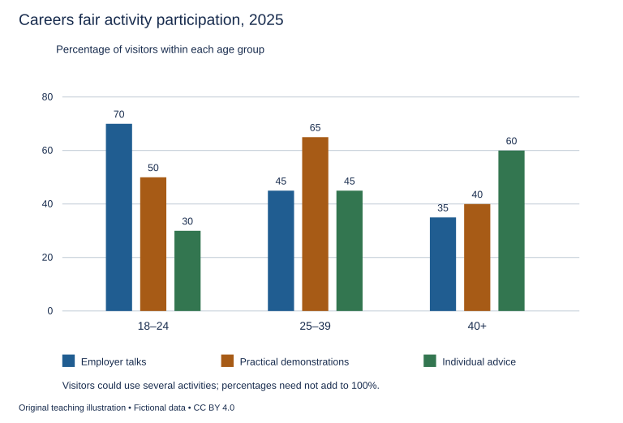

# U26 第17周：长篇阅读、写作与口语

本页为已独立核验的原创文字课程。先完成学生题目，再展开对应参考。非真题、非标准化模考，不换算雅思分数。听力尚未补齐，本页不代表全科课程已完成。

每周选A或G类Task 1一题，加Task 2及三次口语。参考范文不是学生已完成作业，仍须提交初稿、录音和重写，独立真人评分另行安排。

阅读每周180分钟（60分钟首次限时、120分钟证据精读与延迟复测），写作180分钟、口语120分钟。词汇60分钟、听力180分钟另列；新增完整听力未验收，不能勾整周完成。

W20原创阶段检查按实际证据复盘；正式T20陌生整卷及真人评分另记，缺少目标或真实证据时不能据此判断报考/延长，本页原创技能卷不能代替正式模拟。后续周数与达标规则见 [U04](u04-exam-preparation.md)。

## 阅读：首答不查词

### R-W17-01 · Why the Package Is Hard to Open

W17｜正文 856 词｜13 题｜篇章：过程比较：运输保护与使用入口（6段）

本课必做60分钟：首答20、证据复盘20、词汇长句10、48小时后复测10。每周三课180分钟，合卷首答替代单课首答，不重复计算。开放短文选做另加15分钟。

本项目原创虚构教学情境，人物、地点、历史事件和案例数据均非真实研究或史料。科学解释只讨论文内说明的模型与条件。非雅思真题或标准化模考；正确数不换算雅思等级。许可：CC BY 4.0 — RayXBuilds and contributors。

能力点：识别论证关系、区分作者与引述者、条件与因果、精确定位。初读不查词，完成后打开独立答案页。

#### Passage

**A** At the fictional design firm Leto, a package for a fragile ceramic ornament survives every delivery trial but frustrates many recipients. Some cut through a hidden fastening, while others pull at a decorative fold that was never intended to open. The delivery team calls the package successful because the ornament arrives intact. The customer team calls it unsuccessful because reaching the object feels like solving a puzzle. Neither observation needs to be false. The package performs a sequence of jobs, and success at one stage can create difficulty at another. Its design must hold an object securely during movement, communicate where access begins and release it without demanding actions the user is unlikely to anticipate. Looking only at the final condition of the ornament leaves part of that sequence outside the account of performance.

**B** The first design uses a continuous sleeve around an inner box. This distributes pressure during handling and prevents the lid from lifting accidentally. However, the sleeve's printed pattern crosses the opening line, making the boundary visually difficult to identify. The designers initially add the word open beside a decorative curve. That instruction gives a goal without making the required movement clear. A user still has to decide whether to slide, lift or tear. The team therefore distinguishes an instruction from a visible opportunity for action. Words can help, but they cannot always compensate for a shape that suggests the wrong movement. The revised design adds a pull tab whose position and direction correspond to the motion actually needed to remove the sleeve, rather than relying on the user to infer an invisible mechanical relationship from a general invitation.

**C** Testing the tab reveals a second problem. It works for someone holding the package firmly on a table, but bends when the package is held with one hand. The designer's own demonstration had silently supplied support that ordinary users might not have. This does not mean that every package must work in every imaginable posture. It means that the conditions of the test should resemble the circumstances the design claims to serve. The team identifies likely situations before changing the fastening again: opening at a desk, opening while standing, and opening after the outer wrapper has become slightly damaged. A result from one carefully arranged demonstration is not treated as evidence of universal ease. Nor is one difficult attempt used to declare the entire design hopeless without examining which part of the action created the difficulty.

**D** The inner protection presents another tradeoff. A close-fitting insert prevents the ornament from moving, but leaves little space for fingers to lift it. The team considers adding a ribbon beneath the object so that lifting the ribbon raises the ornament evenly. This changes the sequence of opening and must therefore be made visible at the right moment. If the ribbon looks like part of the decoration, a user may ignore it; if it protrudes outside the closed package, it may catch during transport. The useful question is not whether more guidance is always better. It is when a cue becomes relevant and whether it can be perceived without interfering with the earlier stage of the package's life. Design for access cannot be separated completely from design for restraint, even though the two aims sometimes pull in opposite directions.

**E** Observers record each attempt on an opening sheet. The sheet has explicit fields for the first part touched, the action attempted and any request for help. A movement diagram separately shows the intended order of sliding the sleeve, lifting the lid and using the ribbon. Comparing the two records reveals where the imagined sequence and the user's sequence diverge. The team also keeps a damage log recording what is torn or bent during opening, including damage that does not affect the ornament. This matters because a package intended to be reused may have a different acceptable outcome from one intended only to protect a single delivery. The observers do not count every torn piece as failure without reference to the stated purpose, but they also do not exclude it merely because the valuable object itself remains intact.

**F** The final prototype includes a small reuse card explaining how the parts fit together again. Users who are not expected to keep the box can ignore it without losing information needed to open the package. A transport label, used only by the testing team, records which handling trial each prototype has completed. These additions keep different kinds of information attached to the stage where they are useful. The designers still refuse to describe the package as effortless for everyone. Instead, they can explain which situations were tested, where assistance was needed and what changed as a result. Leto's example illustrates a broader lesson about everyday objects: apparent simplicity often depends on arranging a sequence so that the next action becomes understandable when it is needed. A container that resists accidental opening during travel must eventually invite deliberate opening, and that transition deserves as much attention as the protective shell that first made it look secure. Otherwise, the effort saved during delivery can simply reappear as unnecessary work for the person receiving the object.

#### Questions

**Complete the sentences. Choose NO MORE THAN 3 WORDS FROM THE PASSAGE for each answer. Do not change word forms.**

1. First touches, attempted actions and requests for help are entered on an ______.

2. The intended sequence of sliding, lifting and using the ribbon is shown in a ______.

3. Tears and bends are documented in a ______.

4. Reassembly instructions appear on a small ______.

5. Completed handling trials are identified by a ______ used only by testers.

**Choose ONE answer, A, B, C or D.**

6. Why can the two teams reach different judgements without contradiction?

   A. One never sees the ornament
   B. Opening always destroys the contents
   C. Transport has no relevance
   D. They evaluate different stages of the package’s use

7. The original word open is inadequate because

   A. it guarantees tearing
   B. all written instructions fail
   C. it names a material
   D. it does not specify the required action

8. What did the designer’s demonstration unintentionally supply?

   A. A different ornament
   B. Physical support unavailable in some ordinary situations
   C. A new instruction language
   D. Proof of universal ease

9. The ribbon example emphasises

   A. an inevitable conflict with all protection
   B. the uselessness of inserts
   C. the need to expose every cue during transport
   D. the timing and visibility of a useful cue

**Do the following statements agree with the writer's views? Write YES, NO or NOT GIVEN. YES = the writer agrees; NO = the writer expresses the opposite view; NOT GIVEN = the writer's view is not stated. Do not use outside knowledge.**

10. Every torn piece should be judged a failure regardless of the package’s purpose.

11. A single supported demonstration establishes ease in all likely situations.

12. The writer recommends charging recipients for replacement packaging.

13. Understanding the transition from protection to deliberate access matters to design.

#### 本周重点

依据实际错题选至多两类重点：先填写可核验题号、原答案及错因；无记录则待诊断，不自行虚构弱项。

#### 复盘

必做：给每道错题标记“定位/作者立场/范围/语法/词数”，抄最短证据；用一行箭头概括本文论证或过程。48小时后重做错题与两道正确题，检查是否仍能指出证据。

选做（15分钟，80–100词）：Explain one reason why protection and access need to be designed as a sequence.

R-W17-01 答案、证据与精读（首答后展开）

### R-W17-01 · 独立答案与证据

来源与许可同学生页。先完成再核对。可接受答案由 accepted_answers 明确列出；只忽略大小写和首尾空格，不自行删词。开放复盘不计入客观正确数。

1. **opening sheet**｜段落 E｜证据：“an opening sheet”

   sheet不能单独接an。

2. **movement diagram / diagram**｜段落 E｜证据：“A movement diagram separately shows”

   diagram为合理短答；记录实测尝试的sheet没有意图动作序列。

3. **damage log / log**｜段落 E｜证据：“a damage log recording what is torn or bent”

   log可接受，字段明确。

4. **reuse card / card**｜段落 F｜证据：“a small reuse card”

   small已给，不重复；card可接受。

5. **transport label / label**｜段落 F｜证据：“A transport label, used only by the testing team”

   label可接受。

6. **D**｜段落 A｜证据：“success at one stage can create difficulty at another”

   保护与可打开性是不同阶段要求。

7. **D**｜段落 B｜证据：“whether to slide, lift or tear”

   目标不等于动作线索。

8. **B**｜段落 C｜证据：“silently supplied support”

   桌面支撑是隐藏条件。

9. **D**｜段落 D｜证据：“when a cue becomes relevant”

   线索须匹配阶段。

10. **NO**｜段落 E｜证据：“do not count every torn piece as failure”

   作者明确目的相关。

11. **NO**｜段落 C｜证据：“not treated as evidence of universal ease”

   反对范围扩大。

12. **NOT GIVEN**｜段落 F｜证据：“a small reuse card”

   未讨论收费政策；重用信息不意味着费用主张。

13. **YES**｜段落 F｜证据：“that transition deserves as much attention”

   结论明确。

#### 词汇与长句

- **restraint**：阻止不希望发生的移动
- **cue**：提示下一动作的线索
- **prototype**：用于检验设计的样品
- **fastening**：固定或闭合部件

> If the ribbon looks like part of the decoration, a user may ignore it; if it protrudes outside the closed package, it may catch during transport.

两个if给出相反风险，may表示可能而非必然。

> The observers do not count every torn piece as failure without reference to the stated purpose, but they also do not exclude it merely because the valuable object itself remains intact.

but连接两项限制；不一概判失败，也不一概忽略。

#### 开放任务参考

B/D动作线索应按阶段出现，E成功标准需包括打开和重用，不只物品完好。

标准：观点有文内依据，保留条件和范围，推断明确标注；不存在唯一措辞。

### R-W17-02 · The Street with Several Names

W17｜正文 981 词｜13 题｜篇章：虚构历史：地名、使用群体与标准化（8段）

本课必做60分钟：首答20、证据复盘20、词汇长句10、48小时后复测10。每周三课180分钟，合卷首答替代单课首答，不重复计算。开放短文选做另加15分钟。

本项目原创虚构教学情境，人物、地点、历史事件和案例数据均非真实研究或史料。科学解释只讨论文内说明的模型与条件。非雅思真题或标准化模考；正确数不换算雅思等级。许可：CC BY 4.0 — RayXBuilds and contributors。

能力点：识别论证关系、区分作者与引述者、条件与因果、精确定位。初读不查词，完成后打开独立答案页。

#### Passage

**A** In the fictional port of Senna, an alley appears under four names in surviving documents. Traders call it Rope Lane, residents call it Lower Passage, a shipping office records it as Dock Approach, and an old song refers to the same route as Lantern Way. A modern researcher initially assumes that the names belong to different periods and will form a simple sequence. The documents complicate that expectation: several names were used at the same time. Their coexistence reflected different ways of encountering the place rather than a town repeatedly forgetting its own geography. Before deciding which name was correct, the researcher had to ask who used each one, for what activity and in conversation with which other people.

**B** Rope Lane first appears in accounts kept by a merchant whose workshop stood near the entrance. For his customers, the trade was an obvious landmark. The name allowed people to locate an activity without knowing the individual houses along the route. Yet the workshop later moved, while the name remained in some family correspondence. A place name can outlive the feature that made it intelligible. This does not mean its users are necessarily making a factual claim that ropes are still produced there. They may be using an inherited label whose practical reference has become stable even as its original explanation fades. Confusing a name's continued use with a description of present conditions would make ordinary linguistic continuity appear to be a series of geographical mistakes.

**C** Lower Passage belonged to residents moving between their homes and a higher road. It described a relation useful within that part of town. To a newcomer arriving from the harbour, however, lower did not identify what the passage was lower than. The shipping office preferred Dock Approach because it linked the route with the destination important to its workers. Neither term was fully informative without context. Their usefulness depended on shared points of reference. The researcher therefore avoids judging every name by whether it could guide a stranger through the whole town unaided. A label may work well inside one network of activity while needing explanation when transferred into another, just as a direction can be clear to two neighbours and confusing to someone who does not share their starting point.

**D** Lantern Way presents a different kind of evidence. The song associates the route with a night procession, but it does not establish that this was the normal name used in everyday directions. A memorable phrase can become prominent in later retellings because it is attractive to quote. The researcher finds that a commemorative booklet calls Lantern Way the original name, although it supplies no earlier source for that claim. She records the phrase's documented use without accepting its supposed priority. This distinction preserves the song as evidence of cultural association while resisting a stronger historical assertion that the available material cannot support. A source does not have to answer every question about a place in order to tell us something important about how people represented it.

**E** The town eventually introduces numbered addresses to improve deliveries. Officials select Dock Approach for the sign at each end and print the numbers beside it. Residents continue using their familiar names, sometimes adding the official one when speaking to a delivery worker. The reform does not instantly replace local language. It adds a common reference for a particular administrative task. The researcher argues that this outcome should not be described either as complete failure of standardisation or as total victory over confusion. Deliveries can become more reliable while several names remain in ordinary speech. Different forms of coordination can coexist, provided people have a way to connect them when a task crosses from one group of users to another.

**F** To study that connection, the researcher constructs a name table. It has separate columns for the wording, the document in which it appears and the group using it. A location sketch shows entrances and landmarks, allowing references to be checked against the same physical route. The table does not force each name into a single period when the documents overlap. A date register distinguishes the date a document was written from a later date on which a copy or annotation was made. These records prevent two common errors: treating simultaneous names as successive replacements and treating a later heading as if it belonged to the original writer. Their value comes from keeping different kinds of information separate until the relationship between them can be established with reasons.

**G** An exhibition about the alley uses a reference card listing the official address beside the other documented names. Visitors can follow the physical route while learning how its meanings differed across activities. A quotation panel gives short extracts from the merchant's account, residents' letters and the song, identifying the source of each. The panel does not arrange the extracts as a contest in which the most vivid wording must become the truest name. It shows that a place can be practically located, commercially described and culturally remembered through different expressions. The display also identifies the unsupported claim that Lantern Way came first, so that repetition in the exhibition does not accidentally give the booklet's assertion a new appearance of independent authority.

**H** Senna's alley illustrates why naming history is not always a story of one word replacing another. Labels can persist, overlap and change their practical role as the people using them change. A single official address may be necessary for a delivery system without exhausting the social meanings attached to the route. Equally, recognising those meanings does not require abandoning a common reference wherever coordination needs one. The useful question is what each name enables someone to do or say and what evidence supports its history. Answering that question makes the alley more intelligible than selecting a favourite expression and treating every other form as a mistake that should disappear from the record.

#### Questions

**Which paragraph contains the following information? Write a letter, A–H. You may use any letter more than once.**

1. a place name remaining after the trade that inspired it has moved away

2. a booklet claiming priority for a poetic name without supplying an earlier source

3. an administrative address being added without immediately replacing everyday names

4. two explicitly identified dating errors prevented by separating kinds of record information

**Do the following statements agree with the writer's views? Write YES, NO or NOT GIVEN. YES = the writer agrees; NO = the writer expresses the opposite view; NOT GIVEN = the writer's view is not stated. Do not use outside knowledge.**

5. Continued use of a trade-based name necessarily claims that the trade is still present.

6. A song must prove the earliest name in order to have any historical value.

7. Reliable deliveries can coexist with several names in ordinary speech.

8. The writer considers one official address sufficient to exhaust every social meaning of the route.

**Complete the summary. Choose NO MORE THAN 3 WORDS FROM THE PASSAGE for each answer. Do not change word forms.**

Wording, source documents and user groups were listed in a (9) ______. Entrances and landmarks appeared in a (10) ______. Original and later document dates were separated in a (11) ______. An exhibition (12) ______ linked the official address with the alternatives, while a (13) ______ displayed sourced extracts.

#### 本周重点

依据实际错题选至多两类重点：先填写可核验题号、原答案及错因；无记录则待诊断，不自行虚构弱项。

#### 复盘

必做：给每道错题标记“定位/作者立场/范围/语法/词数”，抄最短证据；用一行箭头概括本文论证或过程。48小时后重做错题与两道正确题，检查是否仍能指出证据。

选做（15分钟，80–100词）：Explain why simultaneous names should not automatically be arranged as historical replacements.

R-W17-02 答案、证据与精读（首答后展开）

### R-W17-02 · 独立答案与证据

来源与许可同学生页。先完成再核对。可接受答案由 accepted_answers 明确列出；只忽略大小写和首尾空格，不自行删词。开放复盘不计入客观正确数。

1. **B**｜段落 B｜证据：“the workshop later moved”

   B名称与来源特征不同步。

2. **D**｜段落 D｜证据：“the original name”

   D无据的最早命名主张。

3. **E**｜段落 E｜证据：“It adds a common reference”

   E标准化与地方用语并存。

4. **F**｜段落 F｜证据：“two common errors”

   F同时名误作更替、后题误作原文的组合独有。

5. **NO**｜段落 B｜证据：“does not mean its users are necessarily making a factual claim”

   明确否定。

6. **NO**｜段落 D｜证据：“evidence of cultural association”

   不同问题的证据价值可分。

7. **YES**｜段落 E｜证据：“Deliveries can become more reliable”

   作者明确允许并存。

8. **NO**｜段落 H｜证据：“without exhausting the social meanings attached to the route”

   H指出行政地址不能穷尽路线的社会意义，直接否定题干。

9. **name table / table**｜段落 F｜证据：“constructs a name table”

   table可接受，三列明确。

10. **location sketch / sketch**｜段落 F｜证据：“A location sketch shows entrances and landmarks”

   sketch可接受。

11. **date register / register**｜段落 F｜证据：“A date register distinguishes”

   register可接受，原写作与后来复制/注释日期。

12. **reference card / card**｜段落 G｜证据：“a reference card listing the official address”

   card可接受。

13. **quotation panel / panel**｜段落 G｜证据：“A quotation panel gives short extracts”

   panel可接受，原文节录及来源。

#### 词汇与长句

- **annotation**：后来附加的批注
- **coexist**：同时存在
- **priority**：历史先后中的最早地位
- **inherited**：沿用先前形成的

> A label may work well inside one network of activity while needing explanation when transferred into another, just as a direction can be clear to two neighbours and confusing to someone who does not share their starting point.

while和just as建立对比与类比；名称的可理解性依赖共同语境。

> A single official address may be necessary for a delivery system without exhausting the social meanings attached to the route.

without区分行政充分性与社会意义，不是否定统一地址。

#### 开放任务参考

A/F证据显示不同群体同期使用；E官方名只是增加跨群体参照，不证明所有旧名消失。

标准：观点有文内依据，保留条件和范围，推断明确标注；不存在唯一措辞。

### R-W17-03 · Can a Museum Exhibit a Smell?

W17｜正文 897 词｜14 题｜篇章：议论：感官重现、解释与选择（7段）

本课必做60分钟：首答20、证据复盘20、词汇长句10、48小时后复测10。每周三课180分钟，合卷首答替代单课首答，不重复计算。开放短文选做另加15分钟。

本项目原创虚构教学情境，人物、地点、历史事件和案例数据均非真实研究或史料。科学解释只讨论文内说明的模型与条件。非雅思真题或标准化模考；正确数不换算雅思等级。许可：CC BY 4.0 — RayXBuilds and contributors。

能力点：识别论证关系、区分作者与引述者、条件与因果、精确定位。初读不查词，完成后打开独立答案页。

#### Passage

**A** The fictional museum of Orin plans an exhibition about a former harbour warehouse. Photographs show the walls, inventories list the goods and letters describe days spent unloading cargo. A designer proposes adding a smell to make the room feel more immediate. The idea promises access to an aspect of the past that images cannot supply directly. Yet the question is not simply whether a scented room would be memorable. The writer asks what visitors would be entitled to infer from the experience. A present mixture of smells can suggest a historical setting without reproducing every condition of that setting. If the exhibit presents the sensation as a recovered piece of the past, its apparent vividness may encourage a degree of certainty that the surviving evidence does not support.

**B** The warehouse held different goods at different times. A merchant's letter complains about damp sacks during one season, while a worker remembers the strong smell of a particular cargo years later. Combining those descriptions into a single atmosphere could create a plausible harbour smell, but it would also combine occasions that did not necessarily occur together. The writer does not object to imaginative reconstruction as such. The objection is to leaving its choices invisible. An exhibit can say that it offers an interpretation based on selected accounts, identify which accounts were used and distinguish documented features from additions made for presentation. That explanation gives visitors a reason to ask questions instead of treating sensory intensity as a substitute for a clear account of how the display was made.

**C** Smell also has an unusual relation to boundaries. A picture can remain on one wall while a visitor looks elsewhere, but a smell may spread beyond the space where someone deliberately chooses to encounter it. The designer's plan therefore includes a small enclosure that visitors can enter voluntarily, with an alternative route through the same historical material. The writer supports this arrangement because declining the sensory experience should not require abandoning the subject. The issue is one of meaningful choice, not an assumption that every visitor will respond in the same way. Some may find the smell helpful, others distracting, and some may prefer to engage through description. A single sensory format should not be treated as the complete or compulsory form of understanding available in the exhibition.

**D** The team considers how words influence the experience. A label reading harbour in winter may lead visitors to organise the same smell differently from a label reading storage room after a delivery. Neither label is a neutral frame that leaves perception untouched. The writer argues that this does not make interpretation impossible; it makes the relationship between the sensation and its explanation part of the exhibit's design. A visitor encountering an unfamiliar smell without context may not recognise what the museum intends, while a confident label may suggest a specificity that the material cannot establish. The aim should be a productive connection between experience and explanation, rather than a competition in which either words or sensation are expected to communicate the whole historical argument alone.

**E** During a trial, visitors are asked what they believe the smell tells them. Some describe a general setting, while others assume that the museum has recreated one precisely documented day. The difference matters because the trial is testing an interpretation, not merely whether the mixture is noticeable. The writer would regard the second assumption as a reason to revise the display's wording if the museum lacks evidence for that day. It would not be enough to say that the exhibit was successful because people remembered it afterwards. A memorable misunderstanding can persist more readily than a careful qualification. The museum's responsibility is therefore to consider the claim visitors take away, including claims suggested by the combination of atmosphere, institutional setting and confident presentation rather than explicitly written on a label.

**F** The revised exhibit contains a source panel separating contemporaneous descriptions from later recollections. A reconstruction note explains that the mixture is a present interpretation of selected materials, not a preserved sample from the warehouse. The team keeps a recipe record listing the components used in each version and the date of any adjustment. This record allows staff to know whether visitors in different trial sessions encountered the same mixture. The enclosure has a choice sign explaining the optional route, and an account sheet beside the exit invites visitors to state what they inferred. Each item has a defined task: showing evidence, explaining reconstruction, tracking versions, supporting choice or recording interpretation. Merely adding more labels would not improve the exhibition if those labels failed to address the particular misunderstanding the trial had revealed.

**G** Orin's proposal remains worthwhile after its claims become narrower. A smell can prompt questions about labour, storage and the bodily conditions of a place, even when it cannot transport a visitor into an unchanged past. The writer rejects both the automatic celebration of sensory realism and the dismissal of every reconstruction as deception. The relevant distinction is between an interpretation that exposes its basis and one that borrows authority from the visitor's immediate experience while concealing how that experience was assembled. A museum can invite imagination without presenting imagination as recovered fact. When visitors can choose how to engage, inspect the sources and recognise what remains uncertain, the sensory element becomes one route into historical enquiry rather than an apparently final answer delivered through the nose.

#### Questions

**Choose ONE answer, A, B, C or D.**

1. The opening’s main concern is

   A. whether the smell will be memorable
   B. what historical claim visitors infer from it
   C. whether letters can exist
   D. how to remove all photographs

2. Combining descriptions from different years risks

   A. making a composite scene appear contemporaneous
   B. removing every smell
   C. eliminating interpretation
   D. proving a single day exactly

3. Why provide an alternative route?

   A. To allow access to the history without accepting the smell
   B. To hide the source material
   C. To make the enclosure compulsory
   D. To force a uniform response

4. The trial primarily tests

   A. whether every visitor likes museums
   B. whether labels can be printed
   C. the meaning visitors attribute to the sensation
   D. the price of the mixture

**Do the following statements agree with the writer's views? Write YES, NO or NOT GIVEN. YES = the writer agrees; NO = the writer expresses the opposite view; NOT GIVEN = the writer's view is not stated. Do not use outside knowledge.**

5. Imaginative reconstruction is necessarily deceptive.

6. A vivid memory of the exhibit is sufficient evidence of accurate understanding.

7. Visitors should be able to decline a sensory format without losing access to the subject.

8. The writer favours charging a separate admission fee for the scented enclosure.

9. A reconstruction can be useful when its evidential basis and limits are visible.

**Which paragraph contains the following information? Write a letter, A–G. You may use any letter more than once.**

10. a comparison between two labels that frame the same sensation differently

11. records specifying component changes and their dates across versions

12. letters and memories describing cargos at different historical moments

13. some trial visitors assuming that one precisely documented day has been recreated

14. a statement that smell may travel beyond a visitor’s chosen encounter area

#### 本周重点

依据实际错题选至多两类重点：先填写可核验题号、原答案及错因；无记录则待诊断，不自行虚构弱项。

#### 复盘

必做：给每道错题标记“定位/作者立场/范围/语法/词数”，抄最短证据；用一行箭头概括本文论证或过程。48小时后重做错题与两道正确题，检查是否仍能指出证据。

选做（15分钟，80–100词）：Write one label that acknowledges the reconstruction’s basis without claiming to reproduce one exact day.

R-W17-03 答案、证据与精读（首答后展开）

### R-W17-03 · 独立答案与证据

来源与许可同学生页。先完成再核对。可接受答案由 accepted_answers 明确列出；只忽略大小写和首尾空格，不自行删词。开放复盘不计入客观正确数。

1. **B**｜段落 A｜证据：“what visitors would be entitled to infer”

   体验与证据主张的关系。

2. **A**｜段落 B｜证据：“occasions that did not necessarily occur together”

   不反对重构，反对隐藏选择。

3. **A**｜段落 C｜证据：“should not require abandoning the subject”

   拒绝感官形式不等于退出主题。

4. **C**｜段落 E｜证据：“testing an interpretation”

   非仅可察觉性或记忆率。

5. **NO**｜段落 G｜证据：“dismissal of every reconstruction as deception”

   作者明确拒绝该极端。

6. **NO**｜段落 E｜证据：“A memorable misunderstanding can persist”

   记住不等于理解正确。

7. **YES**｜段落 C｜证据：“declining the sensory experience”

   明确支持选择。

8. **NOT GIVEN**｜段落 C｜证据：“enter voluntarily”

   自愿选择未涉及收费建议。

9. **YES**｜段落 G｜证据：“an interpretation that exposes its basis”

   作者有条件肯定。

10. **D**｜段落 D｜证据：“harbour in winter”

   D双标签与解释作用。

11. **F**｜段落 F｜证据：“components used in each version”

   F recipe record明确字段。

12. **B**｜段落 B｜证据：“years later”

   B时间拼接风险。

13. **E**｜段落 E｜证据：“one precisely documented day”

   E具体误读，不是A总体担忧。

14. **C**｜段落 C｜证据：“spread beyond the space”

   C感官边界。

#### 词汇与长句

- **contemporaneous**：与所述事件同一时期的
- **reconstruction**：依据选定材料制作的重现
- **qualification**：对结论适用范围的说明
- **infer**：根据材料作出理解或推断

> If the exhibit presents the sensation as a recovered piece of the past, its apparent vividness may encourage a degree of certainty that the surviving evidence does not support.

if条件与may可能性必须保留；that从句限定证据不能支持的确定程度。

> A museum can invite imagination without presenting imagination as recovered fact.

without区分允许想象与把想象冒充史实，不是拒绝所有重构。

#### 开放任务参考

B/F说明选材时代与现配混合，G允许引发问题但不把体验等同保存的历史样本。

标准：观点有文内依据，保留条件和范围，推断明确标注；不存在唯一措辞。

## 写作与口语：Task 1双分支择一

### WS-W17-T1A 学生页：招聘活动参与情况

周次 W17｜题型 T1A｜能力点：分组数据与证据诊断

Task 1 的 A/G 分支二选一，另一分支不计入本周作业。

#### 使用与记录

原创教学练习，非真题、非标准化模拟，难度未校准。先完成本页再打开参考页。人物、机构、经历与数据均为教学虚构。不要背诵示例。自评和 AI 反馈不能代替独立真人评分，未获得真人评阅时标记“分数未确认”。

保存：任务ID、实际日期、用时、初稿或原始录音、证据化反馈、重写/重答、三条修改理由。没有学生提交物，不得填写“已批改”或“已完成训练”。

#### 完整题干

The chart shows the percentages of visitors in three age groups who used three activities at a careers fair in 2025. Summarise the information by selecting and reporting the main features, and make comparisons where relevant.

Write at least 150 words. Spend about 20 minutes on this task.

教学虚构。各组内参与比例：18–24，Employer talks70%、Practical demonstrations50%、Individual advice30%；25–39为45/65/45%；40+为35/40/60%。可选多项，组内和不必100%；各组访客人数未知。

#### 任务预算（含首次审题，不额外加时）

初稿20分钟（审题规划3、写作15、检查2）；诊断15；反馈阅读与证据核查10；完整重写25；对照归档5。合计75分钟。

#### 初稿后自评清单

- [ ] 达到最低字数；全文连贯成段，没有用项目符号代替作文。
- [ ] 概述给主要特征；数据、阶段或方位都与题图逐项相符，不推断未提供的原因。
- [ ] 每段可写出一个功能标签；例子或数据与该段要点相连。
- [ ] 核查两处词汇搭配和两处句法；如有疑点先试改再核实，无问题则记录通过证据。
- [ ] 如有影响理解的问题，记录原句；否则记通过或待核查，不填写自猜分数。

#### 反馈与重写

打开 独立参考页（本节下方展开参考），按逐段检查和通用协议核验。重写任务：完整重写至少150词；先查自身是否有分母/互斥误读，如有则改并记原句；如无则核查一项组织或语言问题，没有证据不强造错误。

#### 本周重点操作（已含原预算）

用原有诊断/回听中的3分钟，按分母/多选解释、概述与比较、语言逐项找原句或时间戳证据。只选出现次数最多或最妨碍理解的至多两类；没有可靠证据就标“待核查”，不要猜失分或凑两类。用本题原定重写/重答验证所选点；如已清楚则保留并记通过证据。见W17证据选择表。

记录表见[阶段证据表](u30-feedback.md)，只在上述原时段填写相关行。

W17 T1A 示例、反馈与重练（首答后展开）

### WS-W17-T1A 独立参考页

只在初稿完成后阅读；不是唯一答案，也没有官方分数。以下是对原创示例的教学讲评，不是对学生尚未提交作文的已完成批改。

#### 思路拆解

分母是各年龄组访客；可多选不合100，不以人数解释百分比；概述三组首位与两种年龄方向。

#### 原创示例

The chart compares participation in employer talks, practical demonstrations and individual advice sessions among three age groups at a careers fair in 2025. The figures are percentages of visitors within each group, and visitors could use more than one activity.

Overall, employer talks attracted the highest proportion of the youngest visitors, whereas individual advice was most popular among those aged forty or over. Practical demonstrations ranked first in the middle age group. Participation in talks was lower in each successively older group, while the opposite pattern applied to individual advice.

Among visitors aged eighteen to twenty-four, 70% attended employer talks, compared with 50% using demonstrations and 30% receiving individual advice. In the twenty-five to thirty-nine group, demonstrations led at 65%. Talks and advice each attracted 45%, leaving a gap of twenty percentage points between demonstrations and either of the other activities.

For visitors aged forty and above, advice sessions had the highest participation rate, at 60%. Demonstrations attracted 40%, while talks were used by 35%. The advice figure was therefore twice the corresponding proportion in the youngest group. By contrast, participation in employer talks among the oldest visitors was half the rate recorded for the youngest group.

示例正文词数：197（本项目正则计数；书信不含称呼、结束语与署名；连字符词作一词）。

#### 逐段反馈与迁移

- P1 明确可多项参与，不把三个项目当互斥；年龄组样本数未知。

- P2 年龄分组静态比较，不是同一人老去后的变化。

- P3 25～39演示65，另两项45并列，差20点。

- P4 40+建议60对18～24的30翻倍；讲座35是70的一半，不能推出参与人数比例。

#### 常见失误

将多选百分比错误归一到100%；把40+说成40岁；把年龄规律解释为所有老年人偏好。

#### 可执行反馈步骤

1. 先把自己的段落标为引入、概述/论点、支持、收束；分段可不同于示例，按功能核查，不照抄段数。
2. 对照上方逐段检查，逐项标“已有证据/缺失/不适用”。每条意见必须附自己的原句或缺失位置。
3. 按 [反馈协议](u30-feedback.md) 的四维表记录；有争议的 AI 意见回题干、数据或语法依据核验。
4. 只选至多两项有证据的优先点执行整篇重写；如未发现问题，可改变组织或表达练迁移，但不把它标成纠错；保留原稿，禁止把示例替换为自己的作业。

#### 重写任务

完整重写至少150词；先查自身是否有分母/互斥误读，如有则改并记原句；如无则核查一项组织或语言问题，没有证据不强造错误。

完成后重新勾选 学生页（见本节上方学生题） 清单；将一处改前/改后及理由交给独立评阅者核查。真人评阅状态目前为“待安排”，不是已完成。

### WS-W17-T1G 学生页：请求补发培训证明

周次 W17｜题型 T1G｜能力点：书信目的、要点与语气

Task 1 的 A/G 分支二选一，另一分支不计入本周作业。

#### 使用与记录

原创教学练习，非真题、非标准化模拟，难度未校准。先完成本页再打开参考页。人物、机构、经历与数据均为教学虚构。不要背诵示例。自评和 AI 反馈不能代替独立真人评分，未获得真人评阅时标记“分数未确认”。

保存：任务ID、实际日期、用时、初稿或原始录音、证据化反馈、重写/重答、三条修改理由。没有学生提交物，不得填写“已批改”或“已完成训练”。

#### 完整题干

You completed a short training course, but you have not received the completion certificate. Write to the course administrator. In your letter:
- give details of the course you completed
- explain why you need the certificate
- ask what should be done to provide it.
Begin your letter: Dear Sir or Madam,

Write at least 150 words. You do not need to write any addresses. Spend about 20 minutes on this task.

#### 任务预算（含首次审题，不额外加时）

初稿20分钟（审题规划3、写作15、检查2）；诊断15；反馈阅读与证据核查10；完整重写25；对照归档5。合计75分钟。

#### 初稿后自评清单

- [ ] 达到最低字数；全文连贯成段，没有用项目符号代替作文。
- [ ] 三个要点均展开；称呼、目的、语气和结束语适合收信人。
- [ ] 每段可写出一个功能标签；例子或数据与该段要点相连。
- [ ] 核查两处词汇搭配和两处句法；如有疑点先试改再核实，无问题则记录通过证据。
- [ ] 如有影响理解的问题，记录原句；否则记通过或待核查，不填写自猜分数。

#### 反馈与重写

打开 独立参考页（本节下方展开参考），按逐段检查和通用协议核验。重写任务：完整重写至少150词；如有遗漏则补课程/用途/行动点，如无则检查称呼和条件请求。记录两项有原句证据的优先检查点，不捏造已收到证明。

#### 本周重点操作（已含原预算）

用原有诊断/回听中的3分钟，按三要点覆盖、语气与目的、语言逐项找原句或时间戳证据。只选出现次数最多或最妨碍理解的至多两类；没有可靠证据就标“待核查”，不要猜失分或凑两类。用本题原定重写/重答验证所选点；如已清楚则保留并记通过证据。见W17证据选择表。

记录表见[阶段证据表](u30-feedback.md)，只在上述原时段填写相关行。

W17 T1G 示例、反馈与重练（首答后展开）

### WS-W17-T1G 独立参考页

只在初稿完成后阅读；不是唯一答案，也没有官方分数。以下是对原创示例的教学讲评，不是对学生尚未提交作文的已完成批改。

#### 思路拆解

正式追询；课程定位、用途时限、查证/补发/延迟替代分别展开；不假定管理方已经丢失文件。

#### 原创示例

Dear Sir or Madam,

I am writing about the completion certificate for the introductory bookkeeping course that finished on 18 April. I attended the Tuesday evening group at the North Street centre, and my registration reference was BK206. At the final session, we were told that certificates would be sent by email within two weeks, but I have not received mine.

I need the certificate to confirm my recent training when applying for an administrative position. The employer has asked me to provide the relevant documents by next Friday. I have checked my email folders, including the folder for unwanted messages, and could not find any communication containing the certificate.

Could you please check whether it has been issued and confirm that the email address on my registration is correct? If it has already been sent, I would appreciate another copy. If there is a delay, please let me know when I can expect it and whether you could provide a short letter confirming that I completed the course. That would help me explain the situation to the employer before the deadline.

Yours faithfully,
Alex Chen

示例正文词数：178（本项目正则计数；书信不含称呼、结束语与署名；连字符词作一词）。

#### 逐段反馈与迁移

- P1 课程日期组别编号和原承诺完整，未收不等于未发送。

- P2 雇主时限说明紧迫，已查文件夹支持请求。

- P3 分已发/延迟两种情形请求行动，确认信为询问而非已取得。

#### 常见失误

缺课程信息导致无法定位；直接责备未发而无证据；只写急需没有请求。

#### 可执行反馈步骤

1. 先把自己的段落标为引入、概述/论点、支持、收束；分段可不同于示例，按功能核查，不照抄段数。
2. 对照上方逐段检查，逐项标“已有证据/缺失/不适用”。每条意见必须附自己的原句或缺失位置。
3. 按 [反馈协议](u30-feedback.md) 的四维表记录；有争议的 AI 意见回题干、数据或语法依据核验。
4. 只选至多两项有证据的优先点执行整篇重写；如未发现问题，可改变组织或表达练迁移，但不把它标成纠错；保留原稿，禁止把示例替换为自己的作业。

#### 重写任务

完整重写至少150词；如有遗漏则补课程/用途/行动点，如无则检查称呼和条件请求。记录两项有原句证据的优先检查点，不捏造已收到证明。

完成后重新勾选 学生页（见本节上方学生题） 清单；将一处改前/改后及理由交给独立评阅者核查。真人评阅状态目前为“待安排”，不是已完成。

### WS-W17-T2 学生页：招聘时经验与资格

周次 W17｜题型 T2｜能力点：观点展开与任务回应

A/G 共用本题。

#### 使用与记录

原创教学练习，非真题、非标准化模拟，难度未校准。先完成本页再打开参考页。人物、机构、经历与数据均为教学虚构。不要背诵示例。自评和 AI 反馈不能代替独立真人评分，未获得真人评阅时标记“分数未确认”。

保存：任务ID、实际日期、用时、初稿或原始录音、证据化反馈、重写/重答、三条修改理由。没有学生提交物，不得填写“已批改”或“已完成训练”。

#### 完整题干

Employers should give more importance to practical experience than to formal qualifications when choosing staff. To what extent do you agree or disagree? Give reasons and include relevant examples.

Write at least 250 words. Spend about 40 minutes on this task.

#### 任务预算（含首次审题，不额外加时）

初稿40分钟（审题规划5、写作30、检查5）；诊断15；反馈阅读与证据核查10；完整重写35；对照归档5。合计105分钟。

#### 初稿后自评清单

- [ ] 达到最低字数；全文连贯成段，没有用项目符号代替作文。
- [ ] 直接回答题目的所有问句，有始终一致的立场。
- [ ] 每段可写出一个功能标签；例子或数据与该段要点相连。
- [ ] 核查两处词汇搭配和两处句法；如有疑点先试改再核实，无问题则记录通过证据。
- [ ] 如有影响理解的问题，记录原句；否则记通过或待核查，不填写自猜分数。

#### 反馈与重写

打开 独立参考页（本节下方展开参考），按逐段检查和通用协议核验。重写任务：完整重写至少250词；按真实初稿选择任务回应/论据展开/组织/语言中证据最多的至多两项。如未见问题，记录通过证据与待核查点，不假称已诊断失分。

#### 本周重点操作（已含原预算）

用原有诊断/回听中的3分钟，按招聘题回应与立场、理由/例子、组织与语言逐项找原句或时间戳证据。只选出现次数最多或最妨碍理解的至多两类；没有可靠证据就标“待核查”，不要猜失分或凑两类。用本题原定重写/重答验证所选点；如已清楚则保留并记通过证据。见W17证据选择表。

记录表见[阶段证据表](u30-feedback.md)，只在上述原时段填写相关行。

W17 T2 示例、反馈与重练（首答后展开）

### WS-W17-T2 独立参考页

只在初稿完成后阅读；不是唯一答案，也没有官方分数。以下是对原创示例的教学讲评，不是对学生尚未提交作文的已完成批改。

#### 思路拆解

部分同意按岗位责任限定；不是学历无用；比较证据质量而非只比年数；对新人机会提出边界。

#### 原创示例

Practical experience can show how someone performs in a workplace, while formal qualifications indicate completion of a course of study. I partly agree that experience deserves greater attention, but the appropriate balance depends on the responsibilities of the job rather than on a general preference for one type of evidence.

For many roles, previous work provides information that a certificate alone cannot supply. An applicant who has managed busy customer enquiries may be able to explain how they prioritised requests and dealt with misunderstandings. Such examples allow an employer to explore the applicant’s decisions, not simply the subjects they studied. A practical task during recruitment can offer further evidence. For example, asking someone to organise a sample schedule may reveal relevant ability more directly than comparing the names of their courses.

However, experience is not automatically reliable evidence of competence. Someone may have spent years repeating an inefficient method or working in a situation very different from the new role. Qualifications can provide a common foundation of knowledge, especially where mistakes have serious consequences or where the job requires specialised understanding. Employers should therefore examine the quality and relevance of experience rather than use the number of years worked as a substitute for assessment.

There is also a fairness issue for people entering the workforce. If every employer demands extensive experience, capable beginners may have little opportunity to acquire it. For suitable entry-level roles, a qualification, a carefully designed task and evidence of willingness to learn may be a reasonable combination. More senior positions can justifiably require stronger evidence from previous work, because the person may need to make decisions with less support.

In conclusion, practical experience should carry considerable weight, but it should not consistently override qualifications. Employers should seek evidence that matches the actual work and assess both experienced applicants and newcomers in ways appropriate to the position.

示例正文词数：310（本项目正则计数；书信不含称呼、结束语与署名；连字符词作一词）。

#### 逐段反馈与迁移

- P1 给明确条件标准，避免只说both important。

- P2 用询问处理/排班任务展示能力证据，不臆测所有学历持有者能力差。

- P3 经验可能不相关是合理反例；不列未经核实职业法律资格要求。

- P4 入门/高阶职责不同，机会与评估关联题目。

- P5 结论和岗位适配一致，不突然全盘反对。

#### 常见失误

把工作年限当能力本身；无条件否定学历；写教育制度而不谈招聘选择。

#### 可执行反馈步骤

1. 先把自己的段落标为引入、概述/论点、支持、收束；分段可不同于示例，按功能核查，不照抄段数。
2. 对照上方逐段检查，逐项标“已有证据/缺失/不适用”。每条意见必须附自己的原句或缺失位置。
3. 按 [反馈协议](u30-feedback.md) 的四维表记录；有争议的 AI 意见回题干、数据或语法依据核验。
4. 只选至多两项有证据的优先点执行整篇重写；如未发现问题，可改变组织或表达练迁移，但不把它标成纠错；保留原稿，禁止把示例替换为自己的作业。

#### 重写任务

完整重写至少250词；按真实初稿选择任务回应/论据展开/组织/语言中证据最多的至多两项。如未见问题，记录通过证据与待核查点，不假称已诊断失分。

完成后重新勾选 学生页（见本节上方学生题） 清单；将一处改前/改后及理由交给独立评阅者核查。真人评阅状态目前为“待安排”，不是已完成。

### WS-W17-S1 学生页

周次W17｜Part 1专项｜能力点：按真实证据选择至多两个问题类别｜30分钟

#### 使用与记录

原创教学练习，非真题、非标准化模拟，难度未校准。先完成本页再打开参考页。人物、机构、经历与数据均为教学虚构。不要背诵示例。自评和 AI 反馈不能代替独立真人评分，未获得真人评阅时标记“分数未确认”。

保存：任务ID、实际日期、用时、初稿或原始录音、证据化反馈、重写/重答、三条修改理由。没有学生提交物，不得填写“已批改”或“已完成训练”。

#### 操作与预算

设备与审题3分钟；首答录音6；回听及局部转写7；示例和诊断5；不看稿重答6；归档3。共30分钟。

#### Part 1专项题

1. What skills do you use in your work or studies?
2. How do you decide what to learn next?
3. Do you enjoy practical tasks?
4. When do you ask someone to check your work?

追问：

- Can you give an example of that skill?
- What evidence would show that you had improved?

#### 录音回听清单

- [ ] 保留首答原音，记录实际时长、是否中断、是否看稿；只报真实完成状态。
- [ ] 流利与连贯：标出两处时间戳，区分构思停顿与重复搜词，检查是否偏离问句。
- [ ] 词汇：找一处模糊词或重复表达，先解释原意再替换；不为难词改变意思。
- [ ] 语法：核对经历与习惯的时态；局部转写核查；如存在妨碍理解的问题才更正，无则记通过。
- [ ] 发音：不看转写听30秒，标听不清的词尾、重音或断句；没有音频不能判断发音。
- [ ] 展开：主要回答有具体情境或理由；追问后第一句回应追问的新角度。

#### 重答要求

如有笼统判断，选择至多两个答案补具体情境；如没有，选择两题换角度重答并保留切题证据；重答一条追问，检查是否真正回应其新角度。

首答回听后才打开独立参考页（本节下方展开参考）。按[反馈协议](u30-feedback.md)填至少三个时间戳，不以文字转写替代音频评阅。

#### 本周重点操作（已含原预算）

用原有诊断/回听中的3分钟，按回答切题与展开、流利连贯、词汇语法、可理解发音（必须听原音）逐项找原句或时间戳证据。只选出现次数最多或最妨碍理解的至多两类；没有可靠证据就标“待核查”，不要猜失分或凑两类。用本题原定重写/重答验证所选点；如已清楚则保留并记通过证据。见W17证据选择表。

记录表见[阶段证据表](u30-feedback.md)，只在上述原时段填写相关行。

W17 S1 示例、反馈与重练（首答后展开）

### WS-W17-S1 独立参考页

原创教学示例，非真题或评分结果。未收到学生音频；以下是示例分析与待执行反馈，不能登记为已完成学生批改。

#### 展开示例

##### 直接回应→原因→具体情境的展开示例

I use planning skills quite often because several small tasks can arrive at the same time. I make a short list and check which task affects other people first. I would judge improvement by whether I finish the important tasks without forgetting details, rather than simply by how organised the list looks.

纯口答示例词数：52；只计MODEL标记内实际英文口答，不含标题、标签、说明。词数不能证明录音时长或流利度。

#### 展开与反馈

本周能力：按真实证据选择至多两个问题类别。

1. 示例先表态，再说明偏好理由，最后提供条件或场景。检查自己是否用一个词回答后就结束。
2. 找到一个具体细节：物品、动作、对话或地点。用自己的经历替换，保持与题卡相关，不照搬示例身份与经历。
3. 追问要重新回应，不能继续背长答。首句先回答追问，再用一条理由支持。
4. 如存在听不清或语法影响理解处，标原音时间戳；否则标一处清楚的原音证据；先尝试最小修正。不要把自然停顿一概当成错误，或用加快语速掩盖逻辑断裂。

#### 常见失误

空泛形容词替代具体过程；给了经历却没解释为什么重要；Part 3只有个人故事没有一般解释；AI只看转写就判断发音。逐项回原音核对，不能凭范例推断自己已达到某个分数。

#### 可执行重答与反馈

如有笼统判断，选择至多两个答案补具体情境；如没有，选择两题换角度重答并保留切题证据；重答一条追问，检查是否真正回应其新角度。

填写[反馈协议](u30-feedback.md)四维表，附三个时间戳和原话证据。如存在，选至多一个内容问题与一个语言问题先修；否则记录清楚的证据并做迁移重答；重答后并排听两段，记录改善与仍未解决之处。自评与AI不能替代独立真人评分；独立评阅目前待安排，分数未确认。

### WS-W17-S2 学生页

周次W17｜Part 2专项｜能力点：按真实证据选择至多两个问题类别｜30分钟

#### 使用与记录

原创教学练习，非真题、非标准化模拟，难度未校准。先完成本页再打开参考页。人物、机构、经历与数据均为教学虚构。不要背诵示例。自评和 AI 反馈不能代替独立真人评分，未获得真人评阅时标记“分数未确认”。

保存：任务ID、实际日期、用时、初稿或原始录音、证据化反馈、重写/重答、三条修改理由。没有学生提交物，不得填写“已批改”或“已完成训练”。

#### 操作与预算

准备、首答录音及追问5分钟；回听及局部转写8；示例与诊断5；关键词重组3；重答及追问5；归档4。共30分钟。

#### Part 2专项任务卡

Describe a skill you would like to develop further. Say what it is, why it matters to you, what you can already do, and explain how you would check your progress.

准备1分钟，说1～2分钟。只记5个关键词，不预写句子。

收尾追问：

- Who could give you useful feedback?
- What would be a realistic first step?

#### 录音回听清单

- [ ] 保留首答原音，记录实际时长、是否中断、是否看稿；只报真实完成状态。
- [ ] 流利与连贯：标出两处时间戳，区分构思停顿与重复搜词，检查是否偏离问句。
- [ ] 词汇：找一处模糊词或重复表达，先解释原意再替换；不为难词改变意思。
- [ ] 语法：核对经历与习惯的时态；局部转写核查；如存在妨碍理解的问题才更正，无则记通过。
- [ ] 发音：不看转写听30秒，标听不清的词尾、重音或断句；没有音频不能判断发音。
- [ ] 展开：主要回答有具体情境或理由；追问后第一句回应追问的新角度。

#### 重答要求

用五个关键词重答完整任务卡1～2分钟，再答两条追问；如缺具体细节则补、如有无关背景则删；若已清楚，换表达但保持事实。比较首答与重答，不背示例。

首答回听后才打开独立参考页（本节下方展开参考）。按[反馈协议](u30-feedback.md)填至少三个时间戳，不以文字转写替代音频评阅。

#### 本周重点操作（已含原预算）

用原有诊断/回听中的3分钟，按回答切题与展开、流利连贯、词汇语法、可理解发音（必须听原音）逐项找原句或时间戳证据。只选出现次数最多或最妨碍理解的至多两类；没有可靠证据就标“待核查”，不要猜失分或凑两类。用本题原定重写/重答验证所选点；如已清楚则保留并记通过证据。见W17证据选择表。

记录表见[阶段证据表](u30-feedback.md)，只在上述原时段填写相关行。

W17 S2 示例、反馈与重练（首答后展开）

### WS-W17-S2 独立参考页

原创教学示例，非真题或评分结果。未收到学生音频；以下是示例分析与待执行反馈，不能登记为已完成学生批改。

#### 展开示例

##### 原创长答示例（时长须以个人实际录音测量）

A skill I would like to develop further is explaining information clearly in short presentations. I can usually prepare the material, but I sometimes include more background than the audience needs. I want to become better at selecting the main point.

This matters because I occasionally give updates at work. People need to understand what has changed and what they should do next. They do not necessarily need every detail of how I gathered the information.

My first step would be to prepare a two-minute explanation of a familiar task. I would ask a colleague to tell me the main message afterwards, without looking at my notes. If the colleague understood a different message, I would need to examine the structure rather than assume that speaking more confidently would solve the problem.

I would also keep the first recording and compare it with a later attempt on another topic. One good presentation would be encouraging, but I would want evidence that I could communicate clearly in more than one situation before deciding that the skill had improved.

纯口答示例词数：177；只计MODEL标记内实际英文口答，不含标题、标签、说明。词数不能证明录音时长或流利度。

#### 展开与反馈

本周能力：按真实证据选择至多两个问题类别。

1. 长答示例按背景、行动/观察、变化与意义组织。每段都推进内容；检查自己是否只有背景而没有具体事件。
2. 找到一个具体细节：物品、动作、对话或地点。用自己的经历替换，保持与题卡相关，不照搬示例身份与经历。
3. 追问要重新回应，不能继续背长答。首句先回答追问，再用一条理由支持。
4. 如存在听不清或语法影响理解处，标原音时间戳；否则标一处清楚的原音证据；先尝试最小修正。不要把自然停顿一概当成错误，或用加快语速掩盖逻辑断裂。

#### 常见失误

空泛形容词替代具体过程；给了经历却没解释为什么重要；Part 3只有个人故事没有一般解释；AI只看转写就判断发音。逐项回原音核对，不能凭范例推断自己已达到某个分数。

#### 可执行重答与反馈

用五个关键词重答完整任务卡1～2分钟，再答两条追问；如缺具体细节则补、如有无关背景则删；若已清楚，换表达但保持事实。比较首答与重答，不背示例。

填写[反馈协议](u30-feedback.md)四维表，附三个时间戳和原话证据。如存在，选至多一个内容问题与一个语言问题先修；否则记录清楚的证据并做迁移重答；重答后并排听两段，记录改善与仍未解决之处。自评与AI不能替代独立真人评分；独立评阅目前待安排，分数未确认。

### WS-W17-S3 学生页

周次W17｜三部分全流程｜能力点：按真实证据选择至多两个问题类别｜60分钟

#### 使用与记录

原创教学练习，非真题、非标准化模拟，难度未校准。先完成本页再打开参考页。人物、机构、经历与数据均为教学虚构。不要背诵示例。自评和 AI 反馈不能代替独立真人评分，未获得真人评阅时标记“分数未确认”。

保存：任务ID、实际日期、用时、初稿或原始录音、证据化反馈、重写/重答、三条修改理由。没有学生提交物，不得填写“已批改”或“已完成训练”。

#### 操作与预算

D5：设备与流程准备2分钟，连续首答11～14分钟，余14～17分钟完整回听标记，共30分钟。D6：局部转写诊断10，阅读示例与调整5，重答与新追问10，对照归档5，共30分钟。合计60分钟。

#### 连续三部分全流程（首答不可看参考）

找同伴读题，或独练逐题揭示。完整首答11～14分钟，中途不暂停纠错。模拟同伴不是认证考官；自行读题的练习记录不能冒充真实面试。

##### Part 1：4～5分钟

1. Do you like receiving advice?
2. How do you choose whom to ask for help?
3. Do you keep records of things you learn?
4. What makes a practice session useful?
5. Do you prefer working alone or with others?
6. How do you respond when something is difficult?

可按回答追加 Why? / Can you give an example? 到时转下部分，不强行说完全部备用问题。

##### Part 2：3～4分钟（含准备）

Describe a time you checked the quality of something you had done. Say what the task was, how you checked it, what you discovered, and explain what you did next.

准备1分钟，连续说1～2分钟。收尾追问：

- Did the check reveal any problem?
- Would you use the same checking method again?

##### Part 3：4～5分钟

1. Why is it important to identify a problem before practising?
2. Can confidence be a reliable measure of ability?
3. How can people choose between conflicting pieces of feedback?
4. Should practice focus on weaknesses or strengths?

根据回答追加追问：

- What if there is not enough evidence to identify a weakness?
- Can trying to fix too many things at once be unhelpful?

#### 录音回听清单

- [ ] 保留首答原音，记录实际时长、是否中断、是否看稿；只报真实完成状态。
- [ ] 流利与连贯：标出两处时间戳，区分构思停顿与重复搜词，检查是否偏离问句。
- [ ] 词汇：找一处模糊词或重复表达，先解释原意再替换；不为难词改变意思。
- [ ] 语法：核对经历与习惯的时态；局部转写核查；如存在妨碍理解的问题才更正，无则记通过。
- [ ] 发音：不看转写听30秒，标听不清的词尾、重音或断句；没有音频不能判断发音。
- [ ] 展开：主要回答有具体情境或理由；追问后第一句回应追问的新角度。

#### 重答要求

重答最弱的一个Part 1问题、完整Part 2及一个Part 3问题，再答一条未用追问。用不同细节或补一个例外，确认不是复述范例；局部重答不另计全流程。

首答回听后才打开独立参考页（本节下方展开参考）。按[反馈协议](u30-feedback.md)填至少三个时间戳，不以文字转写替代音频评阅。

#### 本周重点操作（已含原预算）

用原有诊断/回听中的3分钟，按回答切题与展开、流利连贯、词汇语法、可理解发音（必须听原音）逐项找原句或时间戳证据。只选出现次数最多或最妨碍理解的至多两类；没有可靠证据就标“待核查”，不要猜失分或凑两类。用本题原定重写/重答验证所选点；如已清楚则保留并记通过证据。见W17证据选择表。

记录表见[阶段证据表](u30-feedback.md)，只在上述原时段填写相关行。

W17 S3 示例、反馈与重练（首答后展开）

### WS-W17-S3 独立参考页

原创教学示例，非真题或评分结果。未收到学生音频；以下是示例分析与待执行反馈，不能登记为已完成学生批改。

#### 展开示例

##### Part 2原创展开示例（个人语速不同，不能以词数推录音时长）

I checked the quality of a set of instructions I had written for booking equipment in a shared office. I wanted to make sure that someone unfamiliar with the system could follow them, so I asked a colleague who had not used it before to try.

I watched without explaining each step. The colleague completed most of the process but paused when the guide said to confirm the dates. It was unclear whether that meant saving the form or sending an email to the person responsible for the equipment.

I changed that sentence to name the actual action and added a small example of the confirmation message. I did not rewrite every part of the guide, because the earlier steps had worked as intended.

The check was useful because it gave me a specific problem to address. I could have spent the same time making the document look more attractive without noticing the unclear instruction. Afterwards, I asked another person to try the revised step so that I could see whether the change had solved the problem.

##### Part 3观点→理由→条件展开示例

Feedback is more useful when it points to something that can be observed. If two people disagree, I would ask each for an example and consider whether they are judging the same task. Sometimes both comments are relevant in different situations. If the evidence is insufficient, it is better to collect another sample than to invent a diagnosis and practise the wrong thing.

纯口答示例词数：240；只计MODEL标记内实际英文口答，不含标题、标签、说明。词数不能证明录音时长或流利度。

#### 展开与反馈

本周能力：按真实证据选择至多两个问题类别。

1. 长答示例按背景、行动/观察、变化与意义组织。每段都推进内容；检查自己是否只有背景而没有具体事件。
2. 找到一个具体细节：物品、动作、对话或地点。用自己的经历替换，保持与题卡相关，不照搬示例身份与经历。
3. Part 3示例不把个人选择强加给所有人；先讲机制，再说明条件或例外。检查自己的追问答案是否直接回应新问题。
4. 如存在听不清或语法影响理解处，标原音时间戳；否则标一处清楚的原音证据；先尝试最小修正。不要把自然停顿一概当成错误，或用加快语速掩盖逻辑断裂。

#### 常见失误

空泛形容词替代具体过程；给了经历却没解释为什么重要；Part 3只有个人故事没有一般解释；AI只看转写就判断发音。逐项回原音核对，不能凭范例推断自己已达到某个分数。

#### 可执行重答与反馈

重答最弱的一个Part 1问题、完整Part 2及一个Part 3问题，再答一条未用追问。用不同细节或补一个例外，确认不是复述范例；局部重答不另计全流程。

填写[反馈协议](u30-feedback.md)四维表，附三个时间戳和原话证据。如存在，选至多一个内容问题与一个语言问题先修；否则记录清楚的证据并做迁移重答；重答后并排听两段，记录改善与仍未解决之处。自评与AI不能替代独立真人评分；独立评阅目前待安排，分数未确认。

## 许可

原创文字：RayXBuilds and contributors，CC BY 4.0。此页由已验收分课汇编，调整了标题和导航；题干、正文和答案内容保留。公开第三方音频未包含。
