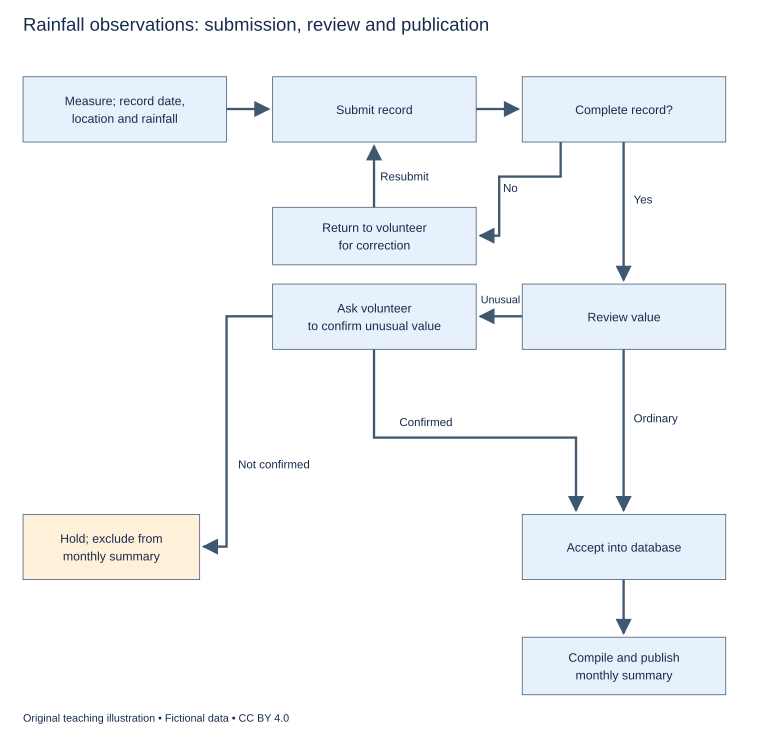

# U27 第18周：长篇阅读、写作与口语

本页为已独立核验的原创文字课程。先完成学生题目，再展开对应参考。非真题、非标准化模考，不换算雅思分数。听力尚未补齐，本页不代表全科课程已完成。

每周选A或G类Task 1一题，加Task 2及三次口语。参考范文不是学生已完成作业，仍须提交初稿、录音和重写，独立真人评分另行安排。

阅读每周180分钟（60分钟首次限时、120分钟证据精读与延迟复测），写作180分钟、口语120分钟。词汇60分钟、听力180分钟另列；新增完整听力未验收，不能勾整周完成。

W20原创阶段检查按实际证据复盘；正式T20陌生整卷及真人评分另记，缺少目标或真实证据时不能据此判断报考/延长，本页原创技能卷不能代替正式模拟。后续周数与达标规则见 [U04](u04-exam-preparation.md)。

## 阅读：首答不查词

### R-W18-01 · The Colour beside the Colour

W18｜正文 854 词｜13 题｜篇章：解释性论证：背景、比较与条件从句（6段）

本课必做60分钟：首答20、证据复盘20、词汇长句10、48小时后复测10。每周三课180分钟，合卷首答替代单课首答，不重复计算。开放短文选做另加15分钟。

本项目原创虚构教学情境，人物、地点、历史事件和案例数据均非真实研究或史料。科学解释只讨论文内说明的模型与条件。非雅思真题或标准化模考；正确数不换算雅思等级。许可：CC BY 4.0 — RayXBuilds and contributors。

能力点：识别论证关系、区分作者与引述者、条件与因果、精确定位。初读不查词，完成后打开独立答案页。

#### Passage

**A** The fictional design studio of Naro receives a complaint that a set of printed cards has changed colour. The supplier checks the production record and finds no intended change in the ink mixture. On a neutral board, two samples appear closely matched; placed inside different packages, they appear less alike to several observers. The studio could dismiss the complaint because the samples match in one arrangement, or blame production because the difference is visible in another. Both responses would settle the question too quickly. A perceived colour belongs to a viewing situation as well as to a material. The task is to separate possible changes in the object from changes in lighting, surrounding surfaces and the way an observer compares one sample with another. Agreement under one condition is evidence about that condition, not automatic proof that every later encounter will produce the same experience.

**B** The studio begins with a simple demonstration using identical grey squares against lighter and darker borders. In its fictional observation session, several participants describe the squares differently until the borders are removed. The point is not that everyone must report precisely the same illusion. It is that the surrounding arrangement can affect the comparison even when the central pieces have not been replaced. Saying that one participant has seen a different colour may refer to an experience produced by the arrangement, rather than to evidence that the material itself has changed. This distinction does not make the experience unreal. It changes the explanation being proposed for it. The studio must therefore avoid using a physical identity claim to dismiss an experiential difference or using the experiential difference alone to establish a particular physical cause.

**C** Lighting introduces another source of variation. The cards are viewed near a window in one room and beneath a lamp in another. A useful comparison should not change the surrounding package and the illumination at the same time if the question concerns the package alone. The team uses a lighting schedule that specifies which source is used for each observation and when samples are moved. The schedule is not a claim that there is one setting appropriate for every customer. It is a way to make the immediate comparison interpretable. A controlled condition can help identify a relationship while still differing from ordinary use. The next task is to decide which additional situations matter for the intended product, not to declare that only the controlled room contains the correct experience of the colour.

**D** The team also notices a problem with memory. Some observers compare the new sample with a card seen earlier in another place, while others compare two cards side by side. These are different tasks. In the exercise, the studio uses a pairing board that holds the samples next to one another at a fixed separation. A position record identifies which sample was placed on each side, allowing the team to reverse the arrangement deliberately. If the judgement changes when positions are exchanged, the team has another reason to examine the viewing arrangement before attributing the whole difference to the identity of the printed sample on either side. The purpose is not to prove that memory should never be used. It is to distinguish a judgement based on a remembered impression from one made with both objects available. Without that distinction, two answers may seem contradictory even though the observers have been asked, in practical terms, to solve different comparison problems under different conditions.

**E** To document the process, the studio keeps a border sheet listing the surrounding colour used in each arrangement and an observation form containing the viewer's description. The form distinguishes what the person reported from the team's explanation of the report. Someone may say that a square looks warmer; that wording does not, by itself, establish a changed ink formula, a lighting effect or a difference between packages. Those are hypotheses to be compared with the arrangements actually used. The team retains reports that do not follow the most common pattern rather than silently editing them into agreement. A variation between observers can be relevant to designing a product used by many people, even when a single average description would make the presentation simpler and the conclusion easier to state in a short message to the supplier.

**F** Naro eventually writes a viewing note for its own staff, identifying the conditions under which samples should first be compared and the additional product settings in which appearance should be checked. The note does not promise that colour can be detached from context. It provides a repeatable starting point and a route towards investigating differences that remain. The writer regards this as stronger than the assertion that one party is correct because it used instruments or that another must be correct because the mismatch was immediately visible. Material measurements and perceptual reports answer connected but distinct questions. A careful account says which comparison was made, what remained constant and what changed. Although that account is longer than the phrase the colours do not match, it can turn a dispute about conflicting certainty into an investigation of the conditions that made each observation possible.

#### Questions

**Choose ONE answer, A, B, C or D.**

1. The opening shows that matching in one arrangement

   A. proves matching everywhere
   B. makes other reports dishonest
   C. is evidence limited to that viewing condition
   D. eliminates illumination

2. Removing the borders helps show that

   A. every person sees exactly alike
   B. the ink must be faulty
   C. surroundings can affect judgements without replacing the centre
   D. light can be ignored

3. Why hold illumination constant when comparing packages?

   A. To declare all lamps incorrect
   B. To imitate all customers simultaneously
   C. To avoid changing two possible causes at once
   D. To prevent any judgement

4. The distinction between report and explanation prevents

   A. all recording
   B. side-by-side viewing
   C. unusual responses
   D. a description being mistaken for proof of a particular cause

**Do the following statements agree with the writer's views? Write YES, NO or NOT GIVEN. YES = the writer agrees; NO = the writer expresses the opposite view; NOT GIVEN = the writer's view is not stated. Do not use outside knowledge.**

5. A perceived difference can matter even if the material is unchanged.

6. The controlled room provides the only correct experience for every customer.

7. Reports outside the most common pattern should be removed to improve clarity.

8. The writer favours compensating every complainant with a replacement set.

**Complete the sentences. Choose NO MORE THAN 3 WORDS FROM THE PASSAGE for each answer. Do not change word forms.**

9. Sources of light and sample moves are specified in a ______.

10. Two samples are held at a fixed separation on a ______.

11. Which sample appears on which side is entered in a ______.

12. The surrounding colour of each arrangement is listed on a ______.

13. Staff receive comparison instructions in a ______.

#### 本周重点

句法与衔接：还原主从句、指代和连接词，说明让步、条件、因果或对比怎样限制作者结论。

#### 复盘

必做：给每道错题标记“定位/作者立场/范围/语法/词数”，抄最短证据；用一行箭头概括本文论证或过程。48小时后重做错题与两道正确题，检查是否仍能指出证据。

选做（15分钟，80–100词）：Explain how changing although or while to because would alter one sentence’s reasoning.

R-W18-01 答案、证据与精读（首答后展开）

### R-W18-01 · 独立答案与证据

来源与许可同学生页。先完成再核对。可接受答案由 accepted_answers 明确列出；只忽略大小写和首尾空格，不自行删词。开放复盘不计入客观正确数。

1. **C**｜段落 A｜证据：“evidence about that condition”

   范围不能扩大。

2. **C**｜段落 B｜证据：“central pieces have not been replaced”

   不把虚构观察推广为人人一致。

3. **C**｜段落 C｜证据：“at the same time”

   分离原因。

4. **D**｜段落 E｜证据：“does not, by itself, establish”

   现象词不直接确认机制。

5. **YES**｜段落 B｜证据：“does not make the experience unreal”

   作者明确保留体验价值。

6. **NO**｜段落 C｜证据：“not to declare that only the controlled room”

   明确拒绝。

7. **NO**｜段落 E｜证据：“retains reports that do not follow”

   反对删异常。

8. **NOT GIVEN**｜段落 F｜证据：“a route towards investigating differences”

   未提出赔偿政策；调查过程不代表支持或反对赔偿。

9. **lighting schedule / schedule**｜段落 C｜证据：“a lighting schedule that specifies”

   schedule可接受。

10. **pairing board / board**｜段落 D｜证据：“a pairing board that holds”

   board可接受，明确用途。

11. **position record / record**｜段落 D｜证据：“A position record identifies”

   record可接受。

12. **border sheet / sheet**｜段落 E｜证据：“a border sheet listing”

   sheet可接受，区别观察描述表。

13. **viewing note / note**｜段落 F｜证据：“a viewing note for its own staff”

   note可接受，提供起点及后续检查。

#### 词汇与长句

- **illumination**：照明条件
- **perceptual**：与感知经验有关的
- **hypothesis**：待比较检验的解释
- **neutral**：用作不强调某一对比的参照背景

> A controlled condition can help identify a relationship while still differing from ordinary use.

while让步共存；控制的解释价值不证明完全代表日常。

> Although that account is longer than the phrase the colours do not match, it can turn a dispute about conflicting certainty into an investigation of the conditions that made each observation possible.

Although承认表达更长，主句给出益处；that限定使各观察成立的条件。

#### 开放任务参考

句法复盘应指出让步/并存并非因果；不能把受控环境不同当成其解释价值的原因。

标准：观点有文内依据，保留条件和范围，推断明确标注；不存在唯一措辞。

### R-W18-02 · The Footnote That Changed the Argument

W18｜正文 977 词｜13 题｜篇章：虚构文献史：引语压缩、指代与让步（8段）

本课必做60分钟：首答20、证据复盘20、词汇长句10、48小时后复测10。每周三课180分钟，合卷首答替代单课首答，不重复计算。开放短文选做另加15分钟。

本项目原创虚构教学情境，人物、地点、历史事件和案例数据均非真实研究或史料。科学解释只讨论文内说明的模型与条件。非雅思真题或标准化模考；正确数不换算雅思等级。许可：CC BY 4.0 — RayXBuilds and contributors。

能力点：识别论证关系、区分作者与引述者、条件与因果、精确定位。初读不查词，完成后打开独立答案页。

#### Passage

**A** In the fictional archive of Rell, a researcher finds a familiar sentence attributed to an early organiser of public gardens: every unused field should become a garden. The sentence appears on a commemorative plaque and in several later essays. It sounds like a clear demand for universal conversion. The surviving speech from which it was taken is less simple. The speaker introduced the phrase as a proposal that some supporters had made, then explained why it could not apply without qualification. A small footnote in an old printed edition points towards the relevant passage. Following it changes the question from whether the organiser supported gardens to what, exactly, the organiser was prepared to claim about land that appeared unused.

**B** The speech begins by describing the attraction of gardens to people living in crowded streets. It then introduces an objection: a field may look empty at one time while serving another purpose during a different season. The organiser says that public benefit depends on recognising those uses before deciding what should change. This does not amount to opposition to all gardens. It places a condition on the argument for them. A later summary removes the discussion of seasonal use and keeps only the attractive proposal. The shortened text becomes easier to remember, but its grammar of commitment has changed. Words originally assigned to some supporters begin to look like the speaker's own unrestricted conclusion, and a reason for caution disappears from the account of what the audience was invited to consider.

**C** The researcher compares two printed versions. In the earlier version, the sentence after the proposal begins however. In the later one, that sentence is omitted, so the turn in the argument is no longer visible. The importance of the connector lies in the relation it establishes, not in the word's presence as an ornament. However directs readers to reconsider the reach of the preceding claim. If it is removed along with the qualification, a reader may reasonably interpret the surviving passage as continuing the proposal rather than restricting it. The researcher therefore records omitted links as well as omitted facts. An argument can change even when every retained sentence is copied accurately, because the relations among sentences help determine what each one is doing.

**D** Pronouns create another difficulty. In one passage, the speaker says that these should be examined before any decision is made. The nearest plural noun in a shortened quotation is gardens, but the full speech makes clear that these refers to existing uses of the land. When the intervening material is removed, the reference seems to move. A later commentator consequently describes the organiser as demanding an inspection of every proposed garden design, which is a different procedural claim. The researcher does not assume that the commentator intended to mislead. The example shows how an edited extract can make a mistaken reading easier even for someone trying to interpret the words carefully. Reference depends on a structure that may extend beyond the small section selected for quotation.

**E** The archive's first task is to establish which wording belongs to which version. A version table gives the publication date and the passages present or absent in each edition. A connector list records the linking expressions removed or retained around the disputed sentence. The researcher also prepares a reference map in which arrows connect pronouns with their antecedents in the complete speech. These aids do not settle whether the organiser's proposal was politically wise. They address an earlier question about what position the speech actually expressed. Interpretation can reasonably remain contested after wording and reference are clarified, but a debate based on a sentence assigned to the wrong speaker or stripped of its stated condition begins from a different object.

**F** The plaque presents a practical challenge because its space is limited. Reproducing the whole speech would defeat the purpose of a short public inscription. The researcher proposes a brief quotation followed by a scope note explaining that the speaker supported gardens where existing uses and local circumstances allowed. The note would not substitute for the full text, but it would prevent the inscription from presenting an absolute demand that the speech had explicitly restricted. The writer supports this solution because brevity and fidelity need not be enemies. A short quotation can remain responsible if its selection preserves the distinction on which the argument turns, or if the omitted condition is stated clearly enough for readers not to infer the opposite.

**G** A reading group tests the proposed wording by asking participants to paraphrase the organiser's position. Some still describe an unconditional demand, while others notice the qualification. Their answers are entered on an interpretation sheet alongside the exact text each person saw. The purpose is not to settle the historical meaning by a vote. It is to discover what the new presentation makes easy or difficult to infer. If the inscription repeatedly encourages a reading that the source cannot sustain, the archive has a reason to revise its wording. The original speech remains the evidence for the historical claim; the reading group supplies evidence about the effect of the proposed modern display on its current audience.

**H** Rell's footnote matters because it reconnects a memorable sentence with the argument that gave it a role. The writer does not conclude that no short extract should ever be trusted or that every quotation needs a page of commentary. The lesson is more precise: check who is speaking, what a connector changes, where a pronoun points and which conditions limit the claim. These are not decorative features added after the real content. They are part of the content that enables a reader to distinguish endorsement from reported opinion, a general rule from a qualified proposal and a reason for action from a reason to pause before acting. Reading them carefully can restore an argument without requiring the reader to agree with it.

#### Questions

**Do the following statements agree with the writer's views? Write YES, NO or NOT GIVEN. YES = the writer agrees; NO = the writer expresses the opposite view; NOT GIVEN = the writer's view is not stated. Do not use outside knowledge.**

1. A qualification about seasonal uses amounts to rejecting every public garden.

2. An argument can change even if the retained sentences are accurately copied.

3. Limited inscription space makes fidelity necessarily impossible.

4. The writer recommends retaining the original spelling in every later edition of the speech.

**Which paragraph contains the following information? Write a letter, A–H. You may use any letter more than once.**

5. an omitted contrast marker that made a restriction disappear

6. a plural pronoun that seems to acquire a different referent in an extract

7. an explicit separation between evidence about the old speech and evidence about the new display’s effect

8. three analytical aids recording versions, connectors and pronoun links

**Complete the summary. Choose NO MORE THAN 3 WORDS FROM THE PASSAGE for each answer. Do not change word forms.**

Edition dates and missing passages were set out in a (9) ______. Linking expressions were logged in a (10) ______. Pronouns were connected to antecedents on a (11) ______. The proposed inscription added a (12) ______. Readers’ paraphrases and the wording they saw were recorded on an (13) ______.

#### 本周重点

句法与衔接：还原主从句、指代和连接词，说明让步、条件、因果或对比怎样限制作者结论。

#### 复盘

必做：给每道错题标记“定位/作者立场/范围/语法/词数”，抄最短证据；用一行箭头概括本文论证或过程。48小时后重做错题与两道正确题，检查是否仍能指出证据。

选做（15分钟，80–100词）：Trace one pronoun and one connector in the passage, explaining how losing either could change the argument.

R-W18-02 答案、证据与精读（首答后展开）

### R-W18-02 · 独立答案与证据

来源与许可同学生页。先完成再核对。可接受答案由 accepted_answers 明确列出；只忽略大小写和首尾空格，不自行删词。开放复盘不计入客观正确数。

1. **NO**｜段落 B｜证据：“does not amount to opposition to all gardens”

   限定不等于全盘反对。

2. **YES**｜段落 C｜证据：“every retained sentence is copied accurately”

   连接关系与被删内容仍影响立场。

3. **NO**｜段落 F｜证据：“brevity and fidelity need not be enemies”

   作者给出可行限定方式。

4. **NOT GIVEN**｜段落 E｜证据：“A version table gives the publication date”

   全文讨论版本、删节和语义忠实，未提出保留原拼写的编辑政策。

5. **C**｜段落 C｜证据：“begins however”

   C连接词与段落转向。

6. **D**｜段落 D｜证据：“the reference seems to move”

   D删节后的these指代。

7. **G**｜段落 G｜证据：“the reading group supplies evidence”

   G两类证据用途的对照。

8. **E**｜段落 E｜证据：“A version table”

   E同时列三种工具，其他段无这套组合。

9. **version table / table**｜段落 E｜证据：“A version table gives the publication date”

   table可接受，版本及缺失片段。

10. **connector list / list**｜段落 E｜证据：“A connector list records”

   list可接受，链接表达。

11. **reference map / map**｜段落 E｜证据：“a reference map in which arrows connect pronouns”

   map可接受，代词与先行项。

12. **scope note / note**｜段落 F｜证据：“a scope note explaining”

   note可接受，说明条件而非改写来源。

13. **interpretation sheet**｜段落 G｜证据：“an interpretation sheet”

   sheet单独不能接an。

#### 词汇与长句

- **antecedent**：代词所指的先行项
- **endorsement**：认可并作为自身立场提出
- **qualification**：限制普遍程度或适用条件
- **fidelity**：忠实保留原意

> If it is removed along with the qualification, a reader may reasonably interpret the surviving passage as continuing the proposal rather than restricting it.

it指however；if条件下may表达可发生的阅读，rather than对照不同语篇功能。

> A short quotation can remain responsible if its selection preserves the distinction on which the argument turns, or if the omitted condition is stated clearly enough for readers not to infer the opposite.

两个if提供替代充分路径，on which指决定论证的区别；删条件可能引出相反理解。

#### 开放任务参考

D these指现存用途；C however限定前述支持者主张，去除后误当作者无条件结论。

标准：观点有文内依据，保留条件和范围，推断明确标注；不存在唯一措辞。

### R-W18-03 · A Festival with Two Audiences

W18｜正文 904 词｜14 题｜篇章：议论：让步、目的与受益范围（7段）

本课必做60分钟：首答20、证据复盘20、词汇长句10、48小时后复测10。每周三课180分钟，合卷首答替代单课首答，不重复计算。开放短文选做另加15分钟。

本项目原创虚构教学情境，人物、地点、历史事件和案例数据均非真实研究或史料。科学解释只讨论文内说明的模型与条件。非雅思真题或标准化模考；正确数不换算雅思等级。许可：CC BY 4.0 — RayXBuilds and contributors。

能力点：识别论证关系、区分作者与引述者、条件与因果、精确定位。初读不查词，完成后打开独立答案页。

#### Passage

**A** The fictional town of Daven holds a lantern festival that began as a neighbourhood gathering. Residents made simple displays, shared food and walked a short route through familiar streets. Years later, the event attracts visitors and supports temporary work for local businesses. A planning meeting asks whether the programme should become larger and more spectacular. Supporters point to the income visitors bring; critics worry that residents will become spectators at an event they once made together. The writer considers the opposition between residents and visitors too simple. A festival can serve both, but only if the relationship between their experiences is examined rather than assumed. The existence of two audiences does not itself create a conflict, just as an increase in attendance does not itself establish that both audiences have benefited in the same way.

**B** A larger display may give residents access to performances they would not otherwise encounter. Visitor income may also support equipment used by local groups during the rest of the year. These possibilities weaken the claim that every change directed towards outsiders must take something away from residents. However, they remain possibilities that need to be connected to actual arrangements. If new income is spent entirely on attracting the next group of visitors, the promised year-round benefit may never appear. The writer therefore supports asking where resources go, rather than treating the word tourism as either a guarantee of prosperity or a sufficient explanation of cultural loss. A useful discussion follows the proposed connection from visitor spending to the particular opportunity residents are supposed to gain.

**C** Participation provides a second test. In the older festival, making a lantern could be as important as seeing the procession. A programme built around professional displays might improve visual quality while reducing opportunities for residents to contribute. That tradeoff is not automatically unacceptable, but it should be named. A better view of a performance does not necessarily replace the experience of making something with neighbours. The organisers consider reserving part of the route for locally made displays and offering workshops before the event. These proposals do not prove that every resident wants to participate. They preserve a route into making for those who do, instead of assuming that a larger audience is a complete substitute for a broader range of roles within the event.

**D** Timing can distribute benefits and burdens unevenly. An evening programme may suit visitors staying overnight but make participation difficult for residents who work early the next day. Extending the festival over several nights could relieve pressure on one evening while prolonging disruption for people living along the route. The same change can therefore solve one problem and intensify another. The writer would not label the extension successful merely because the largest crowd becomes smaller. The relevant question is whose experience improves, whose becomes harder and whether those effects follow from the same part of the plan. This is why an evaluation that reports only the busiest night can be less informative than an account of the whole period during which residents must arrange ordinary life around the festival.

**E** The organisers also debate language in publicity. Calling the event an untouched local tradition would conceal the new performances and changed route. Calling it entirely new would ignore the work and memories that connect it with earlier gatherings. The writer favours describing both continuity and change rather than selecting whichever story seems most marketable. An honest description need not list every difference since the festival began. It should avoid promising an experience based on features the organisers have deliberately removed. If visitors are invited to witness neighbourhood participation, then that participation must have a real place in the programme, rather than appearing only in photographs from a previous year that no longer represent how the event is organised.

**F** The trial programme includes a participation record distinguishing makers, volunteers, performers and spectators. A resource statement shows which visitor-related income supports activities beyond the festival dates. A resident diary collects descriptions of benefits and disruption, with the understanding that contributors do not represent every household. These records answer different questions and should not be compressed into a single popularity score. The organisers also compare the programme with its own stated purpose: an event advertised as a collaborative gathering should be judged partly by the opportunities it offers for collaboration. The writer does not demand that every festival have that purpose. The demand is that the evaluation answer the claim actually made, rather than silently substituting a more flattering measure after the event has finished and attention turns to the next publicity campaign.

**G** Daven decides to expand some performances while protecting workshops and a section of the procession for residents' work. It also states which disruptions remain and how people can raise concerns before the following year. The result is not a final solution to every disagreement about belonging, business or public space. It is a plan whose tradeoffs have become more explicit. The writer's conclusion is conditional: growth can enrich a local event provided that the opportunities and burdens it creates are examined in relation to the event's purpose. Neither nostalgia for a supposedly unchanged past nor confidence in a larger audience can perform that examination alone. A festival remains a shared undertaking when the people who contribute to it and live around it can recognise their place in its changing design, even when they do not agree about every performance on the programme.

#### Questions

**Which paragraph contains the following information? Write a letter, A–G. You may use any letter more than once.**

1. an example where spreading crowds over nights may prolong residential disruption

2. a proposal to preserve opportunities for residents to make displays

3. a warning against publicity using old photographs to imply participation that no longer occurs

4. three distinct records covering roles, resource allocation and resident experiences

5. a decision to expand some performances while retaining workshops and residents’ procession work

**Choose ONE answer, A, B, C or D.**

6. The writer challenges the idea that

   A. residents and visitors must always have opposing interests
   B. festivals have audiences
   C. programmes can change
   D. businesses can earn income

7. Visitor income supports the claimed local benefit only if

   A. the old festival disappears
   B. every performance is professional
   C. resources reach the promised opportunities
   D. attendance is large enough to hide costs

8. Professional displays may create a tradeoff between

   A. visitor language and ticket prices
   B. weather and lantern colour
   C. all work and all rest
   D. visual quality and residents’ making opportunities

9. Why examine the whole festival period?

   A. To ignore the busiest night
   B. To include prolonged effects outside the peak evening
   C. To avoid asking residents
   D. To prove longer is always better

**Do the following statements agree with the writer's views? Write YES, NO or NOT GIVEN. YES = the writer agrees; NO = the writer expresses the opposite view; NOT GIVEN = the writer's view is not stated. Do not use outside knowledge.**

10. Every visitor-oriented change necessarily harms residents.

11. Watching a better performance necessarily replaces the experience of making one.

12. Publicity should acknowledge relevant continuity and change.

13. The writer favours granting permanent free admission to all former volunteers.

14. Evaluation should address the purpose the event actually claimed.

#### 本周重点

句法与衔接：还原主从句、指代和连接词，说明让步、条件、因果或对比怎样限制作者结论。

#### 复盘

必做：给每道错题标记“定位/作者立场/范围/语法/词数”，抄最短证据；用一行箭头概括本文论证或过程。48小时后重做错题与两道正确题，检查是否仍能指出证据。

选做（15分钟，80–100词）：Identify one concession and one condition in the argument, then explain how omitting either changes the writer’s position.

R-W18-03 答案、证据与精读（首答后展开）

### R-W18-03 · 独立答案与证据

来源与许可同学生页。先完成再核对。可接受答案由 accepted_answers 明确列出；只忽略大小写和首尾空格，不自行删词。开放复盘不计入客观正确数。

1. **D**｜段落 D｜证据：“prolonging disruption”

   D延长时段的双向影响。

2. **C**｜段落 C｜证据：“reserving part of the route”

   C参与路径。

3. **E**｜段落 E｜证据：“photographs from a previous year”

   E具体宣传误导。

4. **F**｜段落 F｜证据：“A resource statement”

   F三记录组合独有。

5. **G**｜段落 G｜证据：“expand some performances while protecting workshops”

   G最终混合方案，不是C早期单项建议。

6. **A**｜段落 A｜证据：“the opposition between residents and visitors too simple”

   作者允许条件下共同受益。

7. **C**｜段落 B｜证据：“connected to actual arrangements”

   因果链需实际落实。

8. **D**｜段落 C｜证据：“improve visual quality while reducing opportunities”

   同时收益/损失而非单维好坏。

9. **B**｜段落 D｜证据：“whole period during which residents must arrange ordinary life”

   峰值下降不等于总负担减轻。

10. **NO**｜段落 B｜证据：“weaken the claim that every change”

   明确否定全称。

11. **NO**｜段落 C｜证据：“does not necessarily replace”

   角色体验不等同。

12. **YES**｜段落 E｜证据：“describing both continuity and change”

   作者明确主张。

13. **NOT GIVEN**｜段落 F｜证据：“makers, volunteers, performers and spectators”

   记录角色不涉及票价或永久待遇建议。

14. **YES**｜段落 F｜证据：“answer the claim actually made”

   不可事后偷换较好看的指标。

#### 词汇与长句

- **collaborative**：由多方共同参与制作的
- **nostalgia**：对过去的怀念
- **allocation**：资源的具体分配
- **tradeoff**：获得某项益处时承担的代价

> If visitors are invited to witness neighbourhood participation, then that participation must have a real place in the programme, rather than appearing only in photographs from a previous year that no longer represent how the event is organised.

if/then建立承诺条件；rather than排除仅靠旧照片替代实际参与。

> growth can enrich a local event provided that the opportunities and burdens it creates are examined in relation to the event's purpose.

provided that限定作者支持；去掉条件会误读为无条件赞成扩张。

#### 开放任务参考

B承认外来资源可使居民受益；G增长有检验条件，删除便误成全反对或全赞成。

标准：观点有文内依据，保留条件和范围，推断明确标注；不存在唯一措辞。

## 写作与口语：Task 1双分支择一

### WS-W18-T1A 学生页：雨量观察提交流程

周次 W18｜题型 T1A｜能力点：顺序流程与句法衔接

Task 1 的 A/G 分支二选一，另一分支不计入本周作业。

#### 使用与记录

原创教学练习，非真题、非标准化模拟，难度未校准。先完成本页再打开参考页。人物、机构、经历与数据均为教学虚构。不要背诵示例。自评和 AI 反馈不能代替独立真人评分，未获得真人评阅时标记“分数未确认”。

保存：任务ID、实际日期、用时、初稿或原始录音、证据化反馈、重写/重答、三条修改理由。没有学生提交物，不得填写“已批改”或“已完成训练”。

#### 完整题干

The diagram shows how rainfall observations submitted by volunteers are processed by a local project. Summarise the information by selecting and reporting the main features, and make comparisons where relevant.

Write at least 150 words. Spend about 20 minutes on this task.

教学虚构数据工作流。测量并记录日期地点雨量→提交→完整性检查；缺信息退回纠正后重新提交；完整→数值复核。普通值→接受入库；异常值→请求确认，确认则入库，不能确认则暂存且不进入月度汇总。入库→汇编并发布月度汇总。未给阈值、等待时长或暂存后的处理。

#### 任务预算（含首次审题，不额外加时）

初稿20分钟（审题规划3、写作15、检查2）；诊断15；反馈阅读与证据核查10；完整重写25；对照归档5。合计75分钟。

#### 初稿后自评清单

- [ ] 达到最低字数；全文连贯成段，没有用项目符号代替作文。
- [ ] 概述给主要特征；数据、阶段或方位都与题图逐项相符，不推断未提供的原因。
- [ ] 每段可写出一个功能标签；例子或数据与该段要点相连。
- [ ] 核查两处词汇搭配和两处句法；如有疑点先试改再核实，无问题则记录通过证据。
- [ ] 如有影响理解的问题，记录原句；否则记通过或待核查，不填写自猜分数。

#### 反馈与重写

打开 独立参考页（本节下方展开参考），按逐段检查和通用协议核验。重写任务：完整重写至少150词；如发现指代/条件连接含混，重写对应句并沿流程核验含义未变；若原句清楚，保留并解释为何无需改。

#### 本周重点操作（已含原预算）

用原有诊断中的3分钟选一处条件句和一处指代，沿图核对它们连接的对象/分支；如含混才改。重写后逐路核验，确认没有把异常值直接判错或把暂存改成删除。

记录表见[阶段证据表](u30-feedback.md)，只在上述原时段填写相关行。

W18 T1A 示例、反馈与重练（首答后展开）

### WS-W18-T1A 独立参考页

只在初稿完成后阅读；不是唯一答案，也没有官方分数。以下是对原创示例的教学讲评，不是对学生尚未提交作文的已完成批改。

#### 思路拆解

两个检查不同：完整性与数值复核；不完整回改再提交；异常需确认，不能确认暂存而非判假。

#### 原创示例

The diagram illustrates the processing of rainfall observations sent by volunteers to a local project. It begins with a daily measurement and ends either with publication in a monthly summary or with the record being held outside the published dataset.

Overall, each submission is checked for completeness and then reviewed for unusual values. Incomplete records are returned for correction, while unusual readings require confirmation. Only complete records that either pass the review or receive confirmation are included in the project’s database.

First, a volunteer measures rainfall and records the date, location and amount. The record is submitted to the project, where its completeness is checked. If information is missing, it is returned to the volunteer. After correction, the record is submitted again and undergoes the same check.

Complete records move to a review of the reported value. An ordinary value is accepted into the database directly. An unusual value prompts a request for confirmation from the volunteer. Confirmed readings are also accepted, whereas readings that cannot be confirmed are placed on hold and excluded from the monthly summary. Finally, the project compiles the accepted records and publishes that summary. No further treatment of the held records is shown.

示例正文词数：198（本项目正则计数；书信不含称呼、结束语与署名；连字符词作一词）。

#### 逐段反馈与迁移

- P1 两终点，hold不等于永久删除；不写雨量预测。

- P2 only complete且普通或确认后才入库，概述筛选逻辑。

- P3 date/location/amount齐全；纠正后回提交而非跳复核。

- P4 unusual不等于错误，confirmed入库，unconfirmed暂存；monthly summary仅已接受记录。

#### 常见失误

代词it指代记录/志愿者混乱；将异常直接删；将补完整与确认数值合并。

#### 可执行反馈步骤

1. 先把自己的段落标为引入、概述/论点、支持、收束；分段可不同于示例，按功能核查，不照抄段数。
2. 对照上方逐段检查，逐项标“已有证据/缺失/不适用”。每条意见必须附自己的原句或缺失位置。
3. 按 [反馈协议](u30-feedback.md) 的四维表记录；有争议的 AI 意见回题干、数据或语法依据核验。
4. 只选至多两项有证据的优先点执行整篇重写；如未发现问题，可改变组织或表达练迁移，但不把它标成纠错；保留原稿，禁止把示例替换为自己的作业。

#### 重写任务

完整重写至少150词；如发现指代/条件连接含混，重写对应句并沿流程核验含义未变；若原句清楚，保留并解释为何无需改。

完成后重新勾选 学生页（见本节上方学生题） 清单；将一处改前/改后及理由交给独立评阅者核查。真人评阅状态目前为“待安排”，不是已完成。

### WS-W18-T1G 学生页：调整志愿排班

周次 W18｜题型 T1G｜能力点：书信目的、要点与语气

Task 1 的 A/G 分支二选一，另一分支不计入本周作业。

#### 使用与记录

原创教学练习，非真题、非标准化模拟，难度未校准。先完成本页再打开参考页。人物、机构、经历与数据均为教学虚构。不要背诵示例。自评和 AI 反馈不能代替独立真人评分，未获得真人评阅时标记“分数未确认”。

保存：任务ID、实际日期、用时、初稿或原始录音、证据化反馈、重写/重答、三条修改理由。没有学生提交物，不得填写“已批改”或“已完成训练”。

#### 完整题干

You volunteer at a local organisation, but a change at work means you cannot attend your usual sessions. Write to the volunteer coordinator, Ms Evans. In your letter:
- explain the change in your availability
- describe how this affects your current duties
- suggest an arrangement that would allow you to continue helping.
Begin your letter: Dear Ms Evans,

Write at least 150 words. You do not need to write any addresses. Spend about 20 minutes on this task.

#### 任务预算（含首次审题，不额外加时）

初稿20分钟（审题规划3、写作15、检查2）；诊断15；反馈阅读与证据核查10；完整重写25；对照归档5。合计75分钟。

#### 初稿后自评清单

- [ ] 达到最低字数；全文连贯成段，没有用项目符号代替作文。
- [ ] 三个要点均展开；称呼、目的、语气和结束语适合收信人。
- [ ] 每段可写出一个功能标签；例子或数据与该段要点相连。
- [ ] 核查两处词汇搭配和两处句法；如有疑点先试改再核实，无问题则记录通过证据。
- [ ] 如有影响理解的问题，记录原句；否则记通过或待核查，不填写自猜分数。

#### 反馈与重写

打开 独立参考页（本节下方展开参考），按逐段检查和通用协议核验。重写任务：完整重写至少150词；如存在长句串联或含混this/it则拆分或改指代，逐句确认不改原意；记录改前改后功能，清楚句不为变化而变化。

#### 本周重点操作（已含原预算）

用原有诊断中的3分钟选一处时间关系和一处条件请求；如指代或长句含混才改。整篇重写后检查可出席时间、待批准条件和交接是否仍与原意一致。

记录表见[阶段证据表](u30-feedback.md)，只在上述原时段填写相关行。

W18 T1G 示例、反馈与重练（首答后展开）

### WS-W18-T1G 独立参考页

只在初稿完成后阅读；不是唯一答案，也没有官方分数。以下是对原创示例的教学讲评，不是对学生尚未提交作文的已完成批改。

#### 思路拆解

半正式协调；新时间与现任务影响、继续帮忙方案相连；条件从句避免未经批准远程操作。

#### 原创示例

Dear Ms Evans,

I am writing to let you know about a change to my working hours next month. My employer has moved our weekly team meeting to Wednesday afternoon, so I will no longer be able to attend the Wednesday volunteer session at the community office. I expect this arrangement to continue for at least the next three months.

At present, I help prepare information packs for new visitors and update the list of available activities. Missing the session would leave these tasks unfinished unless someone else took them over. I wanted to tell you early so that we could agree on a replacement arrangement before the new schedule begins.

Would it be possible for me to help on Monday evenings instead? I could prepare the packs in advance and leave them ready for Wednesday. I could also update the activity list from home, provided that you are happy with that arrangement and can confirm which information I should use. If another volunteer needs to cover part of my role, I would be pleased to explain the routine during my final Wednesday session this month.

Best wishes,
Alex Chen

示例正文词数：183（本项目正则计数；书信不含称呼、结束语与署名；连字符词作一词）。

#### 逐段反馈与迁移

- P1 新会占周三下午，期限至少三月，事实范围明确。

- P2 两任务及交接需求具体；this arrangement指新安排可读。

- P3 周一预做/批准后远程/最后一周交接，各条件和时间明确。

#### 常见失误

只说忙不说明影响；一个长句串三个请求造成歧义；把未批准方案写成既成事实。

#### 可执行反馈步骤

1. 先把自己的段落标为引入、概述/论点、支持、收束；分段可不同于示例，按功能核查，不照抄段数。
2. 对照上方逐段检查，逐项标“已有证据/缺失/不适用”。每条意见必须附自己的原句或缺失位置。
3. 按 [反馈协议](u30-feedback.md) 的四维表记录；有争议的 AI 意见回题干、数据或语法依据核验。
4. 只选至多两项有证据的优先点执行整篇重写；如未发现问题，可改变组织或表达练迁移，但不把它标成纠错；保留原稿，禁止把示例替换为自己的作业。

#### 重写任务

完整重写至少150词；如存在长句串联或含混this/it则拆分或改指代，逐句确认不改原意；记录改前改后功能，清楚句不为变化而变化。

完成后重新勾选 学生页（见本节上方学生题） 清单；将一处改前/改后及理由交给独立评阅者核查。真人评阅状态目前为“待安排”，不是已完成。

### WS-W18-T2 学生页：公众难以了解研究

周次 W18｜题型 T2｜能力点：观点展开与任务回应

A/G 共用本题。

#### 使用与记录

原创教学练习，非真题、非标准化模拟，难度未校准。先完成本页再打开参考页。人物、机构、经历与数据均为教学虚构。不要背诵示例。自评和 AI 反馈不能代替独立真人评分，未获得真人评阅时标记“分数未确认”。

保存：任务ID、实际日期、用时、初稿或原始录音、证据化反馈、重写/重答、三条修改理由。没有学生提交物，不得填写“已批改”或“已完成训练”。

#### 完整题干

Research findings are often difficult for the general public to understand. Why does this happen, and what could researchers and public information services do to improve understanding? Give reasons and include relevant examples.

Write at least 250 words. Spend about 40 minutes on this task.

#### 任务预算（含首次审题，不额外加时）

初稿40分钟（审题规划5、写作30、检查5）；诊断15；反馈阅读与证据核查10；完整重写35；对照归档5。合计105分钟。

#### 初稿后自评清单

- [ ] 达到最低字数；全文连贯成段，没有用项目符号代替作文。
- [ ] 直接回答题目的所有问句，有始终一致的立场。
- [ ] 每段可写出一个功能标签；例子或数据与该段要点相连。
- [ ] 核查两处词汇搭配和两处句法；如有疑点先试改再核实，无问题则记录通过证据。
- [ ] 如有影响理解的问题，记录原句；否则记通过或待核查，不填写自猜分数。

#### 反馈与重写

打开 独立参考页（本节下方展开参考），按逐段检查和通用协议核验。重写任务：完整重写至少250词；如有连接词或指代错误，先写两句实际关系再选连接方式；以改后段落验证含义与论证强度不变，勿只换同义词。

#### 本周重点操作（已含原预算）

用原有诊断中的3分钟给一段标实际关系（原因/对比/条件），再核连接词与指代。如有不匹配才修；重写后让该段回答同一问题，不能为流畅删研究限制。

记录表见[阶段证据表](u30-feedback.md)，只在上述原时段填写相关行。

W18 T2 示例、反馈与重练（首答后展开）

### WS-W18-T2 独立参考页

只在初稿完成后阅读；不是唯一答案，也没有官方分数。以下是对原创示例的教学讲评，不是对学生尚未提交作文的已完成批改。

#### 思路拆解

原因对应专业前提与压缩失真；研究者/传播服务双方措施；清楚连接observed与inferred但不引用虚构研究。

#### 原创示例

Research findings can be difficult to understand because they are produced for specialist audiences and because their limitations are hard to communicate briefly. Improving public understanding requires clearer explanations from researchers and careful presentation by the services that share their work.

One difficulty is the gap in assumed knowledge. A report may use technical terms efficiently for experts while leaving other readers unsure what was measured or why it matters. Even familiar words can have a precise meaning within a study that differs from everyday usage. A reader who misses that distinction may misunderstand the conclusion despite recognising most of the vocabulary. Simply replacing a few difficult words is therefore not always enough; the purpose and method may also need explanation.

Another problem arises when findings are compressed into a short headline. An observed relationship may be presented as a definite cause, or a result from one setting may appear to apply everywhere. Qualifications that seem minor to a writer can be essential to interpreting the result. For example, a comparison between two small groups cannot automatically establish what will happen in every community. The challenge is to remain concise without creating more certainty than the evidence supports.

Researchers could provide short summaries that explain the question, the main finding and one important limitation in ordinary language. Public information services could use a worked example or a simple diagram, while clearly separating what was observed from what is inferred. They should also link to fuller explanations for readers who want detail. Testing a summary with people outside the specialist field would reveal misunderstandings that its author might not notice.

In conclusion, both specialist assumptions and excessive simplification can obstruct understanding. Clear structure, concrete explanations and visible limits would make research more accessible without turning uncertain findings into misleading promises.

示例正文词数：299（本项目正则计数；书信不含称呼、结束语与署名；连字符词作一词）。

#### 逐段反馈与迁移

- P1 两原因对应解决方向，不用technology发展作无关开场。

- P2 词义/方法前提影响理解，例子作为一般推理非实证结论。

- P3 相关误写因果、局部误写全体是不同范围问题。

- P4 summaries/example/limits/测试分别对应问题；保持原研究不确定性。

- P5 不将简化等同删掉所有限制。

#### 常见失误

只抱怨术语，不讨论传播压缩；用therefore连接实际无因果两句；为流畅删限定导致断言过强。

#### 可执行反馈步骤

1. 先把自己的段落标为引入、概述/论点、支持、收束；分段可不同于示例，按功能核查，不照抄段数。
2. 对照上方逐段检查，逐项标“已有证据/缺失/不适用”。每条意见必须附自己的原句或缺失位置。
3. 按 [反馈协议](u30-feedback.md) 的四维表记录；有争议的 AI 意见回题干、数据或语法依据核验。
4. 只选至多两项有证据的优先点执行整篇重写；如未发现问题，可改变组织或表达练迁移，但不把它标成纠错；保留原稿，禁止把示例替换为自己的作业。

#### 重写任务

完整重写至少250词；如有连接词或指代错误，先写两句实际关系再选连接方式；以改后段落验证含义与论证强度不变，勿只换同义词。

完成后重新勾选 学生页（见本节上方学生题） 清单；将一处改前/改后及理由交给独立评阅者核查。真人评阅状态目前为“待安排”，不是已完成。

### WS-W18-S1 学生页

周次W18｜Part 1专项｜能力点：句法与衔接，重答检验含义｜30分钟

#### 使用与记录

原创教学练习，非真题、非标准化模拟，难度未校准。先完成本页再打开参考页。人物、机构、经历与数据均为教学虚构。不要背诵示例。自评和 AI 反馈不能代替独立真人评分，未获得真人评阅时标记“分数未确认”。

保存：任务ID、实际日期、用时、初稿或原始录音、证据化反馈、重写/重答、三条修改理由。没有学生提交物，不得填写“已批改”或“已完成训练”。

#### 操作与预算

设备与审题3分钟；首答录音6；回听及局部转写7；示例和诊断5；不看稿重答6；归档3。共30分钟。

#### Part 1专项题

1. Do you enjoy explaining things?
2. Do you prefer diagrams or written instructions?
3. How do you learn an unfamiliar word?
4. What do you do when you cannot express an idea clearly?

追问：

- Can you show how you would explain it another way?
- When would a diagram be less useful?

#### 录音回听清单

- [ ] 保留首答原音，记录实际时长、是否中断、是否看稿；只报真实完成状态。
- [ ] 流利与连贯：标出两处时间戳，区分构思停顿与重复搜词，检查是否偏离问句。
- [ ] 词汇：找一处模糊词或重复表达，先解释原意再替换；不为难词改变意思。
- [ ] 语法：核对经历与习惯的时态；局部转写核查；如存在妨碍理解的问题才更正，无则记通过。
- [ ] 发音：不看转写听30秒，标听不清的词尾、重音或断句；没有音频不能判断发音。
- [ ] 展开：主要回答有具体情境或理由；追问后第一句回应追问的新角度。

#### 重答要求

如有笼统判断，选择至多两个答案补具体情境；如没有，选择两题换角度重答并保留切题证据；重答一条追问，检查是否真正回应其新角度。

首答回听后才打开独立参考页（本节下方展开参考）。按[反馈协议](u30-feedback.md)填至少三个时间戳，不以文字转写替代音频评阅。

#### 本周重点操作（已含原预算）

用原有回听中的3分钟转写一处时间/条件/指代关系，若含混才改；重答不读稿，再听确认听者能分清谁做什么、先后与条件。无问题则记录清楚的句子，不强造错误。

记录表见[阶段证据表](u30-feedback.md)，只在上述原时段填写相关行。

W18 S1 示例、反馈与重练（首答后展开）

### WS-W18-S1 独立参考页

原创教学示例，非真题或评分结果。未收到学生音频；以下是示例分析与待执行反馈，不能登记为已完成学生批改。

#### 展开示例

##### 直接回应→原因→具体情境的展开示例

If I cannot explain an idea clearly, I try a concrete example before searching for a more difficult word. For instance, instead of saying that two tasks depend on each other, I might explain that the second cannot start until the first is finished. That helps me check whether I understand the relationship myself.

纯口答示例词数：54；只计MODEL标记内实际英文口答，不含标题、标签、说明。词数不能证明录音时长或流利度。

#### 展开与反馈

本周能力：句法与衔接，重答检验含义。

1. 示例先表态，再说明偏好理由，最后提供条件或场景。检查自己是否用一个词回答后就结束。
2. 找到一个具体细节：物品、动作、对话或地点。用自己的经历替换，保持与题卡相关，不照搬示例身份与经历。
3. 追问要重新回应，不能继续背长答。首句先回答追问，再用一条理由支持。
4. 如存在听不清或语法影响理解处，标原音时间戳；否则标一处清楚的原音证据；先尝试最小修正。不要把自然停顿一概当成错误，或用加快语速掩盖逻辑断裂。

#### 常见失误

空泛形容词替代具体过程；给了经历却没解释为什么重要；Part 3只有个人故事没有一般解释；AI只看转写就判断发音。逐项回原音核对，不能凭范例推断自己已达到某个分数。

#### 可执行重答与反馈

如有笼统判断，选择至多两个答案补具体情境；如没有，选择两题换角度重答并保留切题证据；重答一条追问，检查是否真正回应其新角度。

填写[反馈协议](u30-feedback.md)四维表，附三个时间戳和原话证据。如存在，选至多一个内容问题与一个语言问题先修；否则记录清楚的证据并做迁移重答；重答后并排听两段，记录改善与仍未解决之处。自评与AI不能替代独立真人评分；独立评阅目前待安排，分数未确认。

### WS-W18-S2 学生页

周次W18｜Part 2专项｜能力点：句法与衔接，重答检验含义｜30分钟

#### 使用与记录

原创教学练习，非真题、非标准化模拟，难度未校准。先完成本页再打开参考页。人物、机构、经历与数据均为教学虚构。不要背诵示例。自评和 AI 反馈不能代替独立真人评分，未获得真人评阅时标记“分数未确认”。

保存：任务ID、实际日期、用时、初稿或原始录音、证据化反馈、重写/重答、三条修改理由。没有学生提交物，不得填写“已批改”或“已完成训练”。

#### 操作与预算

准备、首答录音及追问5分钟；回听及局部转写8；示例与诊断5；关键词重组3；重答及追问5；归档4。共30分钟。

#### Part 2专项任务卡

Describe a time you had to explain a process. Say what the process was, who needed the explanation, what steps you included, and explain how you made the sequence clear.

准备1分钟，说1～2分钟。只记5个关键词，不预写句子。

收尾追问：

- Did you need to change your explanation?
- Which step was most important to make clear?

#### 录音回听清单

- [ ] 保留首答原音，记录实际时长、是否中断、是否看稿；只报真实完成状态。
- [ ] 流利与连贯：标出两处时间戳，区分构思停顿与重复搜词，检查是否偏离问句。
- [ ] 词汇：找一处模糊词或重复表达，先解释原意再替换；不为难词改变意思。
- [ ] 语法：核对经历与习惯的时态；局部转写核查；如存在妨碍理解的问题才更正，无则记通过。
- [ ] 发音：不看转写听30秒，标听不清的词尾、重音或断句；没有音频不能判断发音。
- [ ] 展开：主要回答有具体情境或理由；追问后第一句回应追问的新角度。

#### 重答要求

用五个关键词重答完整任务卡1～2分钟，再答两条追问；如缺具体细节则补、如有无关背景则删；若已清楚，换表达但保持事实。比较首答与重答，不背示例。

首答回听后才打开独立参考页（本节下方展开参考）。按[反馈协议](u30-feedback.md)填至少三个时间戳，不以文字转写替代音频评阅。

#### 本周重点操作（已含原预算）

用原有回听中的3分钟转写一处时间/条件/指代关系，若含混才改；重答不读稿，再听确认听者能分清谁做什么、先后与条件。无问题则记录清楚的句子，不强造错误。

记录表见[阶段证据表](u30-feedback.md)，只在上述原时段填写相关行。

W18 S2 示例、反馈与重练（首答后展开）

### WS-W18-S2 独立参考页

原创教学示例，非真题或评分结果。未收到学生音频；以下是示例分析与待执行反馈，不能登记为已完成学生批改。

#### 展开示例

##### 原创长答示例（时长须以个人实际录音测量）

I once explained how to submit a short report to a colleague who had just joined a project. The process had only a few steps, but the draft and final versions went to different places, which could easily cause confusion.

I began by showing where to save the draft and who would review it. Then I explained that the final version should be uploaded only after the reviewer had confirmed the changes. I used a small diagram with arrows rather than describing everything in one long sentence.

When my colleague asked what would happen if the reviewer wanted more changes, I added a return arrow to the draft stage. That made an important condition visible: the process did not always move straight to completion.

The explanation became clearer when I named each version instead of repeatedly saying it or that document. I also asked my colleague to describe the steps back to me. This showed that the sequence made sense and helped me notice one place where my original wording had been too vague.

纯口答示例词数：174；只计MODEL标记内实际英文口答，不含标题、标签、说明。词数不能证明录音时长或流利度。

#### 展开与反馈

本周能力：句法与衔接，重答检验含义。

1. 长答示例按背景、行动/观察、变化与意义组织。每段都推进内容；检查自己是否只有背景而没有具体事件。
2. 找到一个具体细节：物品、动作、对话或地点。用自己的经历替换，保持与题卡相关，不照搬示例身份与经历。
3. 追问要重新回应，不能继续背长答。首句先回答追问，再用一条理由支持。
4. 如存在听不清或语法影响理解处，标原音时间戳；否则标一处清楚的原音证据；先尝试最小修正。不要把自然停顿一概当成错误，或用加快语速掩盖逻辑断裂。

#### 常见失误

空泛形容词替代具体过程；给了经历却没解释为什么重要；Part 3只有个人故事没有一般解释；AI只看转写就判断发音。逐项回原音核对，不能凭范例推断自己已达到某个分数。

#### 可执行重答与反馈

用五个关键词重答完整任务卡1～2分钟，再答两条追问；如缺具体细节则补、如有无关背景则删；若已清楚，换表达但保持事实。比较首答与重答，不背示例。

填写[反馈协议](u30-feedback.md)四维表，附三个时间戳和原话证据。如存在，选至多一个内容问题与一个语言问题先修；否则记录清楚的证据并做迁移重答；重答后并排听两段，记录改善与仍未解决之处。自评与AI不能替代独立真人评分；独立评阅目前待安排，分数未确认。

### WS-W18-S3 学生页

周次W18｜三部分全流程｜能力点：句法与衔接，重答检验含义｜60分钟

#### 使用与记录

原创教学练习，非真题、非标准化模拟，难度未校准。先完成本页再打开参考页。人物、机构、经历与数据均为教学虚构。不要背诵示例。自评和 AI 反馈不能代替独立真人评分，未获得真人评阅时标记“分数未确认”。

保存：任务ID、实际日期、用时、初稿或原始录音、证据化反馈、重写/重答、三条修改理由。没有学生提交物，不得填写“已批改”或“已完成训练”。

#### 操作与预算

D5：设备与流程准备2分钟，连续首答11～14分钟，余14～17分钟完整回听标记，共30分钟。D6：局部转写诊断10，阅读示例与调整5，重答与新追问10，对照归档5，共30分钟。合计60分钟。

#### 连续三部分全流程（首答不可看参考）

找同伴读题，或独练逐题揭示。完整首答11～14分钟，中途不暂停纠错。模拟同伴不是认证考官；自行读题的练习记录不能冒充真实面试。

##### Part 1：4～5分钟

1. Do you write many messages during the day?
2. When is a short message enough?
3. Do you check messages before sending them?
4. What makes a message confusing?
5. Do you like learning how systems work?
6. How do you remember several steps?

可按回答追加 Why? / Can you give an example? 到时转下部分，不强行说完全部备用问题。

##### Part 2：3～4分钟（含准备）

Describe a misunderstanding that was resolved. Say what was misunderstood, how you noticed the problem, what was clarified, and explain what you learned.

准备1分钟，连续说1～2分钟。收尾追问：

- Could the misunderstanding have been prevented?
- Did it change how you communicate?

##### Part 3：4～5分钟

1. Why can small wording differences cause misunderstandings?
2. When should complex information be divided into shorter parts?
3. Can a simple explanation still be inaccurate?
4. How can people check that a revision has improved a message?

根据回答追加追问：

- Could removing details change the meaning?
- Would the same wording suit every audience?

#### 录音回听清单

- [ ] 保留首答原音，记录实际时长、是否中断、是否看稿；只报真实完成状态。
- [ ] 流利与连贯：标出两处时间戳，区分构思停顿与重复搜词，检查是否偏离问句。
- [ ] 词汇：找一处模糊词或重复表达，先解释原意再替换；不为难词改变意思。
- [ ] 语法：核对经历与习惯的时态；局部转写核查；如存在妨碍理解的问题才更正，无则记通过。
- [ ] 发音：不看转写听30秒，标听不清的词尾、重音或断句；没有音频不能判断发音。
- [ ] 展开：主要回答有具体情境或理由；追问后第一句回应追问的新角度。

#### 重答要求

重答最弱的一个Part 1问题、完整Part 2及一个Part 3问题，再答一条未用追问。用不同细节或补一个例外，确认不是复述范例；局部重答不另计全流程。

首答回听后才打开独立参考页（本节下方展开参考）。按[反馈协议](u30-feedback.md)填至少三个时间戳，不以文字转写替代音频评阅。

#### 本周重点操作（已含原预算）

用原有回听中的3分钟转写一处时间/条件/指代关系，若含混才改；重答不读稿，再听确认听者能分清谁做什么、先后与条件。无问题则记录清楚的句子，不强造错误。

记录表见[阶段证据表](u30-feedback.md)，只在上述原时段填写相关行。

W18 S3 示例、反馈与重练（首答后展开）

### WS-W18-S3 独立参考页

原创教学示例，非真题或评分结果。未收到学生音频；以下是示例分析与待执行反馈，不能登记为已完成学生批改。

#### 展开示例

##### Part 2原创展开示例（个人语速不同，不能以词数推录音时长）

A misunderstanding was resolved when I was helping arrange a small workshop. I sent a message saying that the room would be ready after the equipment arrived. A colleague understood this to mean that the equipment had already arrived and that the room was almost ready.

I noticed the problem when she suggested inviting participants to come early. I explained that the equipment was still expected that afternoon and that we needed time to set it up afterwards. The original message had not made the timing explicit enough.

I then sent a clearer update with two separate statements: the expected arrival time and the time when participants could enter. I also asked the colleague to confirm which time she would put in the invitation.

The incident taught me that a sentence can sound reasonable to its writer while leaving an important relationship unclear to the reader. Since then, I have tried to name dates, actions and conditions directly when a message affects other people’s plans, rather than rely on vague phrases such as soon or after that.

##### Part 3观点→理由→条件展开示例

Dividing information into shorter parts can help when one sentence contains several actions and conditions. However, the relationship between those parts must remain clear. If a revision removes the condition that makes an instruction valid, it may be easier to read but less accurate. I would ask a reader to explain what they would do, rather than judge the revision only by its length.

纯口答示例词数：241；只计MODEL标记内实际英文口答，不含标题、标签、说明。词数不能证明录音时长或流利度。

#### 展开与反馈

本周能力：句法与衔接，重答检验含义。

1. 长答示例按背景、行动/观察、变化与意义组织。每段都推进内容；检查自己是否只有背景而没有具体事件。
2. 找到一个具体细节：物品、动作、对话或地点。用自己的经历替换，保持与题卡相关，不照搬示例身份与经历。
3. Part 3示例不把个人选择强加给所有人；先讲机制，再说明条件或例外。检查自己的追问答案是否直接回应新问题。
4. 如存在听不清或语法影响理解处，标原音时间戳；否则标一处清楚的原音证据；先尝试最小修正。不要把自然停顿一概当成错误，或用加快语速掩盖逻辑断裂。

#### 常见失误

空泛形容词替代具体过程；给了经历却没解释为什么重要；Part 3只有个人故事没有一般解释；AI只看转写就判断发音。逐项回原音核对，不能凭范例推断自己已达到某个分数。

#### 可执行重答与反馈

重答最弱的一个Part 1问题、完整Part 2及一个Part 3问题，再答一条未用追问。用不同细节或补一个例外，确认不是复述范例；局部重答不另计全流程。

填写[反馈协议](u30-feedback.md)四维表，附三个时间戳和原话证据。如存在，选至多一个内容问题与一个语言问题先修；否则记录清楚的证据并做迁移重答；重答后并排听两段，记录改善与仍未解决之处。自评与AI不能替代独立真人评分；独立评阅目前待安排，分数未确认。

## 许可

原创文字：RayXBuilds and contributors，CC BY 4.0。此页由已验收分课汇编，调整了标题和导航；题干、正文和答案内容保留。公开第三方音频未包含。
