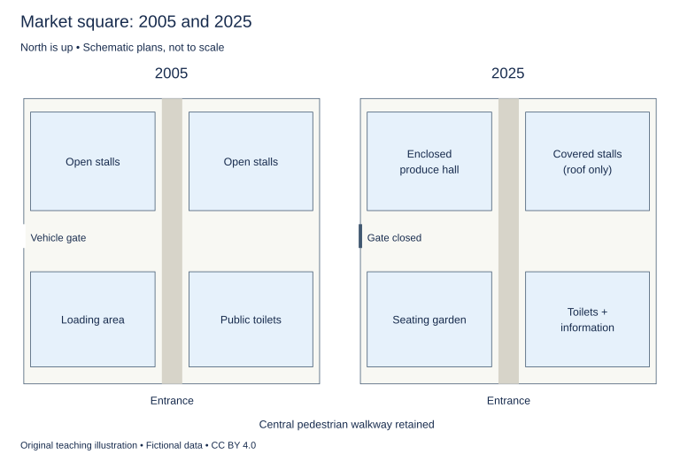

# U28 第19周：长篇阅读、写作与口语

本页为已独立核验的原创文字课程。先完成学生题目，再展开对应参考。非真题、非标准化模考，不换算雅思分数。听力尚未补齐，本页不代表全科课程已完成。

每周选A或G类Task 1一题，加Task 2及三次口语。参考范文不是学生已完成作业，仍须提交初稿、录音和重写，独立真人评分另行安排。

阅读每周180分钟（60分钟首次限时、120分钟证据精读与延迟复测），写作180分钟、口语120分钟。词汇60分钟、听力180分钟另列；新增完整听力未验收，不能勾整周完成。

W20原创阶段检查按实际证据复盘；正式T20陌生整卷及真人评分另记，缺少目标或真实证据时不能据此判断报考/延长，本页原创技能卷不能代替正式模拟。后续周数与达标规则见 [U04](u04-exam-preparation.md)。

## 阅读：首答不查词

### R-W19-01 · A Chamber between Two Water Levels

W19｜正文 852 词｜13 题｜篇章：科学过程：状态转换与操作顺序（6段）

本课必做60分钟：首答20、证据复盘20、词汇长句10、48小时后复测10。每周三课180分钟，合卷首答替代单课首答，不重复计算。开放短文选做另加15分钟。

本项目原创虚构教学情境，人物、地点、历史事件和案例数据均非真实研究或史料。科学解释只讨论文内说明的模型与条件。非雅思真题或标准化模考；正确数不换算雅思等级。许可：CC BY 4.0 — RayXBuilds and contributors。

能力点：识别论证关系、区分作者与引述者、条件与因果、精确定位。初读不查词，完成后打开独立答案页。

#### Passage

**A** In the fictional classroom canal of Tern, a model boat must move between two stretches of water at different heights. Pulling it directly across the intervening barrier would avoid the water problem but change the kind of journey being modelled. The class instead uses a chamber bounded by a gate at each end. The chamber's water level can be changed while the boat remains inside it. In this passage, the word lock refers to that water-filled chamber and its associated gates, not to a device securing a door. The model is deliberately simplified and is not an operating guide for any real canal. Its purpose is to show how a journey that appears continuous can depend on a sequence of distinct states, each of which makes a later movement possible without requiring all parts of the route to remain at the same height.

**B** To begin an upward journey, the chamber is brought to the level of the lower stretch. The lower gate can then be opened in the model, allowing the boat to enter. After that gate is closed, water is admitted through a separate opening connected with the higher side. As the chamber fills, the boat rises with its surface. The important change is the level of the water supporting the boat, not a mechanism lifting the hull directly. Once the chamber and the upper stretch reach matching levels, the upper gate is opened and the boat can leave. The class follows this specified sequence rather than treating the two gates as interchangeable entrances that may be opened whenever movement would be convenient. The chamber connects the two stretches through time without making them one permanently open body of water.

**C** A downward journey uses the same general principle with a different starting condition. The boat enters when the chamber matches the upper level. Water is then allowed to leave towards the lower side until the chamber matches it. The boat descends with the water and exits through the lower gate. The model therefore helps distinguish the direction of boat travel from the mechanism that supports it. In both directions, changing the chamber's level changes the boat's level. A description that says the lock simply raises boats would omit half the task. Equally, describing it only as a gate would omit the changing space between the gates that makes the sequence work. Understanding unfamiliar vocabulary here requires following the relationships explained in the passage rather than importing the most familiar everyday meaning of the word.

**D** The class next compares two arrivals. In one case, the chamber already matches the side from which the next boat will enter. In the other, its level must first be changed. Identical boats can therefore experience different waiting times before beginning the same journey. The delay is not necessarily evidence that the boat itself moves more slowly or that the operator has become less efficient. It may reflect the state left by the preceding movement. The students record chamber level before each arrival, rather than beginning their timing only after entry has become possible. They retain both observations in their comparison. That choice makes preparation visible. Otherwise, a comparison could make one trip appear faster simply by excluding the part of the sequence needed to make it possible under its particular starting conditions.

**E** Several records support the demonstration. A level scale on the chamber wall shows water height, while a gate checklist records whether each gate is open or closed at every named stage. An event strip gives the times of arrival, entry and departure, preserving the distinction between waiting outside and moving through the chamber. A state diagram shows which condition must be reached before the next stage begins. These are not decorative names: each record has a different field and purpose. The class can use the strip to compare waiting, the scale to compare levels and the checklist to reconstruct the gate sequence. A complete explanation needs their relationships, but a question about one quantity should not be answered merely by naming whichever record happens to sound most technical or appears nearest the end of the paragraph.

**F** Finally, the students arrange a succession of model boats approaching from alternating sides and then a succession approaching from the same side. They use a sequence board to record the arrival order before running the demonstration. The resulting preparation requirements differ because the level left by one movement may or may not suit the next. The exercise does not establish the best operating policy for a real waterway, where constraints outside the model would matter. It establishes a narrower point about systems that move through states: the time required for one action can depend on the actions that came before it. A useful comparison identifies the initial condition, the required transitions and the point at which timing begins. The lock becomes easier to understand when it is described as a controlled sequence connecting two levels, rather than as a mysterious object that somehow carries a boat uphill. That understanding can then transfer to other unfamiliar processes in which apparent delay is preparation for a necessary change of state.

#### Questions

**Do the following statements agree with the writer's views? Write YES, NO or NOT GIVEN. YES = the writer agrees; NO = the writer expresses the opposite view; NOT GIVEN = the writer's view is not stated. Do not use outside knowledge.**

1. The lock’s role is completely described by saying it raises boats.

2. A longer wait necessarily means that the boat itself moves more slowly.

3. The writer recommends imposing higher fees on downward journeys.

4. The duration of an action can depend on preceding actions.

**Choose ONE answer, A, B, C or D.**

5. The passage defines a lock as

   A. a permanently open channel
   B. only a door-securing device
   C. a chamber and gates connecting different water levels
   D. a rope pulling a hull uphill

6. What raises the boat in the model?

   A. The rising water surface supporting it
   B. The lower gate pushing it
   C. An unchanged water level
   D. A direct hull-lifting mechanism

7. Different waiting times for identical boats may arise from

   A. the chamber’s initial state
   B. universal operator failure
   C. a different meaning of boat
   D. a change in hull material

8. Why specify when timing begins?

   A. To hide preparation
   B. To guarantee equal durations
   C. To avoid recording arrival
   D. To prevent unequal inclusion of necessary preparation

**Complete the sentences. Choose NO MORE THAN 3 WORDS FROM THE PASSAGE for each answer. Do not change word forms.**

9. Water height can be read from a ______ on the chamber wall.

10. Open and closed gate states are written on a ______.

11. Arrival, entry and departure times appear on an ______.

12. Conditions required before the next stage are shown in a ______.

13. The predetermined order of boat arrivals is written on a ______.

#### 本周重点

陌生主题迁移：先根据文内定义、段落功能和逻辑关系作答，避免用熟悉主题的常识替代证据。

#### 复盘

必做：给每道错题标记“定位/作者立场/范围/语法/词数”，抄最短证据；用一行箭头概括本文论证或过程。48小时后重做错题与两道正确题，检查是否仍能指出证据。

选做（15分钟，80–100词）：Apply the initial-state principle to another process without importing unsupported canal facts.

R-W19-01 答案、证据与精读（首答后展开）

### R-W19-01 · 独立答案与证据

来源与许可同学生页。先完成再核对。可接受答案由 accepted_answers 明确列出；只忽略大小写和首尾空格，不自行删词。开放复盘不计入客观正确数。

1. **NO**｜段落 C｜证据：“would omit half the task”

   也支持下降。

2. **NO**｜段落 D｜证据：“not necessarily evidence”

   状态准备可影响等待。

3. **NOT GIVEN**｜段落 C｜证据：“a different starting condition”

   描述方向机制，未提费率政策。

4. **YES**｜段落 F｜证据：“depend on the actions that came before it”

   结论明确。

5. **C**｜段落 A｜证据：“water-filled chamber and its associated gates”

   需采用文内定义而非熟悉义。

6. **A**｜段落 B｜证据：“not a mechanism lifting the hull directly”

   明确机制。

7. **A**｜段落 D｜证据：“state left by the preceding movement”

   条件不同可解释，不能直接归因效率。

8. **D**｜段落 D｜证据：“excluding the part of the sequence”

   同一比较边界。

9. **level scale / scale**｜段落 E｜证据：“A level scale on the chamber wall shows water height”

   scale可接受。

10. **gate checklist / checklist**｜段落 E｜证据：“a gate checklist records”

   字段明确，checklist可接受。

11. **event strip**｜段落 E｜证据：“An event strip gives the times”

   strip单独不能接an。

12. **state diagram / diagram**｜段落 E｜证据：“A state diagram shows which condition”

   diagram可接受。

13. **sequence board / board**｜段落 F｜证据：“a sequence board to record the arrival order”

   board可接受，区别实际事件时刻。

#### 词汇与长句

- **chamber**：有边界、可改变内部水位的空间
- **transition**：状态转换
- **preceding**：发生在当前动作之前的
- **hull**：船体

> Identical boats can therefore experience different waiting times before beginning the same journey.

therefore承接初始水位差异；identical不保证所处系统状态相同。

> The resulting preparation requirements differ because the level left by one movement may or may not suit the next.

because给因果，left过去分词修饰level；may or may not避免无条件结论。

#### 开放任务参考

可用设备预热/房间准备作个人类比，明确是迁移推断；D/F支持前一动作改变下一动作起点。

标准：观点有文内依据，保留条件和范围，推断明确标注；不存在唯一措辞。

### R-W19-02 · The Ledger of a Travelling Theatre

W19｜正文 949 词｜13 题｜篇章：虚构历史：巡演承诺与运输条件（8段）

本课必做60分钟：首答20、证据复盘20、词汇长句10、48小时后复测10。每周三课180分钟，合卷首答替代单课首答，不重复计算。开放短文选做另加15分钟。

本项目原创虚构教学情境，人物、地点、历史事件和案例数据均非真实研究或史料。科学解释只讨论文内说明的模型与条件。非雅思真题或标准化模考；正确数不换算雅思等级。许可：CC BY 4.0 — RayXBuilds and contributors。

能力点：识别论证关系、区分作者与引述者、条件与因果、精确定位。初读不查词，完成后打开独立答案页。

#### Passage

**A** In the imagined province of Orel, a small travelling theatre leaves behind a ledger that seems, at first, to be a straightforward account of money. Names of towns appear beside sums received, and an early researcher uses the entries to draw a route. Yet the order of the pages does not consistently match the order of performances. Some payments arrived before a visit, others afterwards, and one town paid for a performance that never occurred. The ledger is evidence of exchanges, but those exchanges cannot automatically be translated into a completed itinerary. To reconstruct the season, the researcher must distinguish what the company promised, what it prepared and what audiences actually saw. These categories overlap without being identical, and each leaves different traces in the surviving material.

**B** The company originally transported a heavy painted backdrop that required a broad, level space behind the actors. In two towns, the available halls could accommodate the audience but lacked room for that structure. The manager's letters describe replacing it with several narrow hanging panels. These panels could be rearranged to suggest different locations while leaving more space for movement. The change was not evidence that the company had abandoned scenery or become unable to afford paint. It responded to the dimensions of rooms along the route. A drawing made after the alteration still shows the old backdrop in a promotional scene. The researcher treats that image as a representation of the company's identity, rather than assuming that every pictured object continued to travel with it.

**C** Transport created a different constraint. A cart used for scenery also carried benches, costumes and tools. Loading it more efficiently could reduce the number of journeys between a lodging house and a hall, but the last item loaded was often the first available on arrival. The workers therefore had to consider the order in which materials would be needed, not simply the total space they occupied. A packing diagram identifies where each case sits in the cart. Beside it, a numbered assembly list states which components must be placed before others can be attached. Comparing the documents reveals why a compact load could nevertheless delay preparation: something needed early might be buried beneath objects needed only at the end.

**D** The records also separate a reserved evening from a completed performance. A host in the town of Ved sent a deposit to secure a date. When repairs closed the hall, the company returned part of the money and agreed to provide a shorter outdoor programme later. The original payment remained in the ledger, while a letter explained the altered arrangement. Reading only the payment would falsely place the full indoor play in Ved on the first date. Reading only the later letter might hide the earlier commitment and the reason for the refund. Neither source is useless. Their relationship makes the sequence intelligible and prevents the same financial entry from being treated as direct proof of an event it only helped to arrange.

**E** At the season's end, the manager compared expected receipts with the cost of moving between towns. One village offered little money but provided lodging and storage beside the hall. Another paid more but required an additional cart journey each day. The researcher does not conclude that the first visit was necessarily more profitable, because several relevant costs are missing. She does conclude that the amount received at the door is insufficient by itself to rank the visits. An itinerary is a set of connected movements, and a convenient stop can affect preparation for the next town. The account must therefore attend both to individual engagements and to the consequences of placing them in a particular order.

**F** To keep these distinctions visible, the researcher builds a booking register with columns for promised date, programme and deposit. A performance diary separately lists events confirmed by reports written after they happened. A payment ledger records amounts and the dates on which money changed hands. These three records allow a reader to ask different questions without confusing the evidence required for each. A blank in the diary does not prove that nothing happened; it means that this reconstruction lacks a confirming report. Conversely, a filled booking entry does not establish that the promised event took place. The separation makes uncertainty explicit instead of hiding it inside a route drawn with equally confident lines between every town.

**G** For an exhibition, the researcher adds a route map that marks confirmed journeys with solid lines and proposed journeys with broken lines. Visitors can follow the season without assuming that every segment has equal support. She also displays the replacement panels beside a reproduction of the promotional drawing. This pairing explains why the attractive image and the practical equipment need not tell the same story. The exhibition does not ask viewers to distrust all pictures or accept all written accounts. It asks them to identify the task for which each source was made before deciding what claim the source can support about the company's movements and performances.

**H** The resulting history is less tidy than a list of towns and ticket sales, but it explains more of the company's work. A performance depended on commitments, equipment, room dimensions and sequences of preparation as well as on actors and audiences. Surviving accounts illuminate some of these relationships while leaving others uncertain. The reader gains little by turning every uncertainty into an invented event or every gap into evidence of failure. A stronger reconstruction states what is known, shows how the pieces connect and preserves the difference between an intention and its fulfilment. That discipline applies even when the unfamiliar vocabulary of touring initially makes the records appear more mysterious than the practical problems they describe.

#### Questions

**Which paragraph contains the following information? Write a letter, A–H. You may use any letter more than once.**

1. a promotional picture retaining scenery that had already been replaced

2. a compact arrangement that could obstruct access to items needed first

3. a reserved indoor performance changed to a later outdoor programme

4. a visual distinction between journeys with different levels of confirmation

**Do the following statements agree with the writer's views? Write YES, NO or NOT GIVEN. YES = the writer agrees; NO = the writer expresses the opposite view; NOT GIVEN = the writer's view is not stated. Do not use outside knowledge.**

5. The amount received at the door alone is sufficient to rank the visits.

6. A missing confirming report proves that a performance did not occur.

7. The writer recommends a present-day visit to every town before reconstructing the season.

8. A reconstruction should preserve the difference between a commitment and its fulfilment.

**Complete the summary. Choose NO MORE THAN 3 WORDS FROM THE PASSAGE for each answer. Do not change word forms.**

The position of cases is shown in a (9) ______, while construction order appears in the (10) ______. Promised dates, programmes and deposits enter a (11) ______. Events supported by reports written afterwards appear in a (12) ______. Amounts and dates of financial exchanges are recorded in a (13) ______.

#### 本周重点

陌生主题迁移：先根据文内定义、段落功能和逻辑关系作答，避免用熟悉主题的常识替代证据。

#### 复盘

必做：给每道错题标记“定位/作者立场/范围/语法/词数”，抄最短证据；用一行箭头概括本文论证或过程。48小时后重做错题与两道正确题，检查是否仍能指出证据。

选做（15分钟，80–100词）：Explain how you can reconstruct part of a touring season without already knowing theatre history.

R-W19-02 答案、证据与精读（首答后展开）

### R-W19-02 · 独立答案与证据

来源与许可同学生页。先完成再核对。可接受答案由 accepted_answers 明确列出；只忽略大小写和首尾空格，不自行删词。开放复盘不计入客观正确数。

1. **B**｜段落 B｜证据：“still shows the old backdrop”

   B旧宣传图与实际设备差异。

2. **C**｜段落 C｜证据：“buried beneath objects needed only at the end”

   C装载与使用顺序。

3. **D**｜段落 D｜证据：“a shorter outdoor programme later”

   D具体变更。

4. **G**｜段落 G｜证据：“solid lines and proposed journeys with broken lines”

   G线型独有。

5. **NO**｜段落 E｜证据：“insufficient by itself to rank the visits”

   明确否定单指标。

6. **NO**｜段落 F｜证据：“does not prove that nothing happened”

   缺证不等于反证。

7. **NOT GIVEN**｜段落 H｜证据：“A stronger reconstruction states what is known”

   全文未提当代实地走访是否为重建必要步骤。

8. **YES**｜段落 H｜证据：“preserves the difference between an intention and its fulfilment”

   结论明确。

9. **packing diagram / diagram**｜段落 C｜证据：“A packing diagram identifies where each case sits”

   diagram可接a；说明空间位置。

10. **numbered assembly list / assembly list / list**｜段落 C｜证据：“a numbered assembly list states which components”

   the后可接三词完整短语、assembly list或中心词list；numbered list不是连续原文。

11. **booking register / register**｜段落 F｜证据：“a booking register with columns”

   register可接a。

12. **performance diary / diary**｜段落 F｜证据：“A performance diary separately lists events”

   diary可接受，事后确认。

13. **payment ledger / ledger**｜段落 F｜证据：“A payment ledger records amounts”

   ledger可接受，金额及收付日期。

#### 词汇与长句

- **itinerary**：按顺序安排的行程
- **deposit**：为预约支付的订金
- **fulfilment**：承诺的实际履行
- **backdrop**：舞台后方的背景布景

> A blank in the diary does not prove that nothing happened; it means that this reconstruction lacks a confirming report.

分号区分事件未发生和重建中缺乏确认。

> The workers therefore had to consider the order in which materials would be needed, not simply the total space they occupied.

in which限定使用顺序；not simply限制仅按体积解释。

#### 开放任务参考

依文内定义先区分预订、实演、收付款，再用D连接变更；不要把背景知识当作记录。

标准：观点有文内依据，保留条件和范围，推断明确标注；不存在唯一措辞。

### R-W19-03 · Why a Greeting Takes Three Turns

W19｜正文 864 词｜14 题｜篇章：语言与社会：陌生交际规则的条件（7段）

本课必做60分钟：首答20、证据复盘20、词汇长句10、48小时后复测10。每周三课180分钟，合卷首答替代单课首答，不重复计算。开放短文选做另加15分钟。

本项目原创虚构教学情境，人物、地点、历史事件和案例数据均非真实研究或史料。科学解释只讨论文内说明的模型与条件。非雅思真题或标准化模考；正确数不换算雅思等级。许可：CC BY 4.0 — RayXBuilds and contributors。

能力点：识别论证关系、区分作者与引述者、条件与因果、精确定位。初读不查词，完成后打开独立答案页。

#### Passage

**A** A visitor to the fictional island community of Neri learns a greeting that appears unusually long. One speaker asks whether the other has arrived by the eastern path, the second names a feature of the journey, and the first acknowledges that feature before ordinary conversation begins. The visitor memorises the three turns and initially treats them as a miniature questionnaire about travel. Local speakers explain that, in the situations described here, the exchange also establishes whether the two people are ready to speak at length. The meaning of a turn depends partly on what came before it and what response follows. This invented example is not a description of any real language. It offers a way to examine how an unfamiliar conversational practice can become understandable without reducing it to a list of translated words.

**B** The opening question does not always request new geographical information. Two neighbours may both know which path was used, having watched each other approach. In that situation, the question publicly recognises the arrival and offers a place for the newcomer to respond. The second turn supplies a small detail, such as a muddy crossing or a flowering tree. Its importance is not measured only by how much unknown information it provides. Choosing and offering a detail accepts the invitation to begin an exchange. A response can therefore perform a social action while still containing ordinary descriptive words. Treating every question as a test of what the questioner does not know would miss part of the practice that the visitor is trying to learn.

**C** The third turn acknowledges the detail rather than immediately changing the subject. If the newcomer mentions mud, the first speaker might comment on the recent rain. This shows that the offered contribution has been heard and provides a bridge to further talk. However, a short acknowledgement followed by a glance towards a waiting group can indicate that a longer conversation must be postponed. The sequence does not mechanically guarantee a lengthy encounter. Its interpretation depends on accompanying actions and on the practical situation. A person already carrying a heavy basket may respond differently from someone sitting outside with no immediate task. The form supplies a shared opening, while the participants still negotiate how far the encounter can continue.

**D** The visitor's first mistake is to repeat the entire greeting after failing to hear the journey detail. The local speaker becomes puzzled because arrival has already been recognised. A more useful repair is to ask for the missed detail again, leaving the completed parts of the exchange in place. The example separates a problem with hearing from a failure to begin the interaction. It also shows why memorising a sequence without understanding its parts can make recovery difficult. If every uncertainty triggers a complete restart, the speaker treats an ongoing encounter as though nothing has happened. Recognising the function of each turn allows a smaller adjustment that preserves what the participants have already established together.

**E** An observer compares several recorded encounters in the imagined community. One recording contains the full three turns between friends who then continue talking. Another contains a shortened exchange between workers passing in opposite directions. A third begins with a direct warning about a fallen branch, followed only later by a greeting. The observer does not rank them from correct to incorrect according to their resemblance to the memorised model. The urgent warning changes what needs to happen first. Likewise, a shortened form may fit a brief encounter without showing that the speakers have forgotten their customary practice. The comparison makes conditions visible: a pattern can be recognisable without being obligatory in every situation where two people meet.

**F** For the visitor's lessons, the recordings are displayed as paired columns. One gives the words, and the other describes pauses, gestures and nearby activities. An arrow connects each response to the contribution it addresses. This layout prevents a translated sentence from appearing as an isolated expression with one permanent purpose. The visitor can see that similar words may occupy different places in the sequence and that a response can refer to an action as well as to a spoken phrase. The teacher also leaves a space for alternative interpretations when the recording does not make the situation clear. Guessing confidently about a speaker's intention would add apparent precision without adding evidence. The incomplete record should remain incomplete at the points where it cannot support a stronger account.

**G** The lesson is not that literal meanings are irrelevant, nor that every greeting conceals a complex code inaccessible to outsiders. Words remain part of the evidence, but their role becomes clearer when connected with sequence and circumstance. Learning an unfamiliar practice requires noticing what participants make possible for one another, including how they respond when something goes wrong. A fixed script can be a useful starting point, provided it is not mistaken for a complete account of competent participation. The visitor eventually learns both the customary opening and ways to shorten, repair or postpone it when the situation calls for a change. Understanding has grown when the learner can explain those choices through the encounter itself, rather than labelling every departure from the first memorised version as a failure.

#### Questions

**Choose ONE answer, A, B, C or D.**

1. Why is the greeting more than a travel questionnaire?

   A. It always tests unknown routes
   B. It hides all literal meaning
   C. It helps establish readiness for conversation
   D. It prohibits further conversation

2. The opening question between neighbours can

   A. prove that the route is unknown
   B. replace every practical action
   C. require a full geographical report
   D. recognise arrival despite shared route knowledge

3. Why is asking again for the missed detail preferable to restarting?

   A. It preserves already completed parts of the interaction
   B. The second turn has no function
   C. Arrival must be denied
   D. The greeting must become longer

4. The paired columns are designed to

   A. remove all gestures
   B. rank speakers by length
   C. establish hidden intentions with certainty
   D. connect words with actions and circumstances

**Which paragraph contains the following information? Write a letter, A–G. You may use any letter more than once.**

5. a gesture towards a waiting group that can help postpone further conversation

6. a hearing difficulty leading a learner to repeat an unnecessarily large part of an exchange

7. an urgent warning delivered before a greeting

8. a teaching display that reserves room for uncertainty about interpretations

9. two neighbours using a route question despite having observed each other arrive

**Do the following statements agree with the writer's views? Write YES, NO or NOT GIVEN. YES = the writer agrees; NO = the writer expresses the opposite view; NOT GIVEN = the writer's view is not stated. Do not use outside knowledge.**

10. The three-turn sequence always guarantees an extended conversation.

11. An urgent practical need can justify changing the usual order.

12. Learning a fixed script can provide a useful beginning.

13. The writer recommends that children begin these lessons before their fifth birthday.

14. Literal word meanings should be excluded from the evidence.

#### 本周重点

陌生主题迁移：先根据文内定义、段落功能和逻辑关系作答，避免用熟悉主题的常识替代证据。

#### 复盘

必做：给每道错题标记“定位/作者立场/范围/语法/词数”，抄最短证据；用一行箭头概括本文论证或过程。48小时后重做错题与两道正确题，检查是否仍能指出证据。

选做（15分钟，80–100词）：Use two examples to explain why a memorised pattern should be interpreted through its context.

R-W19-03 答案、证据与精读（首答后展开）

### R-W19-03 · 独立答案与证据

来源与许可同学生页。先完成再核对。可接受答案由 accepted_answers 明确列出；只忽略大小写和首尾空格，不自行删词。开放复盘不计入客观正确数。

1. **C**｜段落 A｜证据：“ready to speak at length”

   交际功能来自序列。

2. **D**｜段落 B｜证据：“publicly recognises the arrival”

   熟知路线不消除提问的社会功能。

3. **A**｜段落 D｜证据：“leaving the completed parts of the exchange in place”

   局部修复保留已有进展。

4. **D**｜段落 F｜证据：“pauses, gestures and nearby activities”

   上下文与话语共同阅读。

5. **C**｜段落 C｜证据：“a glance towards a waiting group”

   C具体手势。

6. **D**｜段落 D｜证据：“repeat the entire greeting after failing to hear”

   D局部问题全重启。

7. **E**｜段落 E｜证据：“direct warning about a fallen branch”

   E具体次序。

8. **F**｜段落 F｜证据：“leaves a space for alternative interpretations”

   F版式措施。

9. **B**｜段落 B｜证据：“having watched each other approach”

   B共知场景。

10. **NO**｜段落 C｜证据：“does not mechanically guarantee a lengthy encounter”

   范围绝对化。

11. **YES**｜段落 E｜证据：“urgent warning changes what needs to happen first”

   具体情景支持。

12. **YES**｜段落 G｜证据：“A fixed script can be a useful starting point”

   有条件支持。

13. **NOT GIVEN**｜段落 F｜证据：“For the visitor's lessons”

   全文未提年龄政策。

14. **NO**｜段落 G｜证据：“Words remain part of the evidence”

   直接反向。

#### 词汇与长句

- **acknowledgement**：表明已听见并接续对方贡献的回应
- **repair**：修复交际中局部听取或理解问题
- **obligatory**：在规定情境中必须的
- **sequence**：有前后关系的连续步骤

> A fixed script can be a useful starting point, provided it is not mistaken for a complete account of competent participation.

provided限定脚本用途，不能从有用起点推出足够。

> If every uncertainty triggers a complete restart, the speaker treats an ongoing encounter as though nothing has happened.

if提出做法条件，as though揭示错误隐含假设。

#### 开放任务参考

C延迟、D局部修复、E急迫警示任选两项；不推断现实文化通用规则。

标准：观点有文内依据，保留条件和范围，推断明确标注；不存在唯一措辞。

## 写作与口语：Task 1双分支择一

### WS-W19-T1A 学生页：市场广场改造

周次 W19｜题型 T1A｜能力点：陌生图示与比较迁移

Task 1 的 A/G 分支二选一，另一分支不计入本周作业。

#### 使用与记录

原创教学练习，非真题、非标准化模拟，难度未校准。先完成本页再打开参考页。人物、机构、经历与数据均为教学虚构。不要背诵示例。自评和 AI 反馈不能代替独立真人评分，未获得真人评阅时标记“分数未确认”。

保存：任务ID、实际日期、用时、初稿或原始录音、证据化反馈、重写/重答、三条修改理由。没有学生提交物，不得填写“已批改”或“已完成训练”。

#### 完整题干

The plans show a market square in 2005 and after redevelopment in 2025. Summarise the information by selecting and reporting the main features, and make comparisons where relevant.

Write at least 150 words. Spend about 20 minutes on this task.

教学虚构，北向上，示意不按比例。2005西北/东北Open stalls，西南Loading area，东南Public toilets；南中央入口和中央南北步道；西边有Vehicle gate。2025西北Enclosed produce hall，东北Covered stalls（仅加顶）；西南Seating garden，东南Toilets + information；西门封闭；南入口与步道不变。

#### 任务预算（含首次审题，不额外加时）

初稿20分钟（审题规划3、写作15、检查2）；诊断15；反馈阅读与证据核查10；完整重写25；对照归档5。合计75分钟。

#### 初稿后自评清单

- [ ] 达到最低字数；全文连贯成段，没有用项目符号代替作文。
- [ ] 概述给主要特征；数据、阶段或方位都与题图逐项相符，不推断未提供的原因。
- [ ] 每段可写出一个功能标签；例子或数据与该段要点相连。
- [ ] 核查两处词汇搭配和两处句法；如有疑点先试改再核实，无问题则记录通过证据。
- [ ] 如有影响理解的问题，记录原句；否则记通过或待核查，不填写自猜分数。

#### 反馈与重写

打开 独立参考页（本节下方展开参考），按逐段检查和通用协议核验。重写任务：完整重写至少150词；先不用范例写四个本图专属关键词，再检查原稿是否误套旧题事实。如无套话错误，保留准确句并换一种分组重写。

#### 本周重点操作（已含原预算）

用原有诊断中的3分钟对照本图列四个专属事实，检查是否套入旧图的房间/道路或原因；如有才改。重写只看题图，不看范例；分组可迁移，事实不可照搬。

记录表见[阶段证据表](u30-feedback.md)，只在上述原时段填写相关行。

W19 T1A 示例、反馈与重练（首答后展开）

### WS-W19-T1A 独立参考页

只在初稿完成后阅读；不是唯一答案，也没有官方分数。以下是对原创示例的教学讲评，不是对学生尚未提交作文的已完成批改。

#### 思路拆解

陌生布局先读方位与图例，不背旧地图报告；区分封闭hall与仅加顶stalls；gate封闭不推区域禁车政策。

#### 原创示例

The plans compare a market square in 2005 and 2025. Both show an entrance on the southern side and a central north-south walkway dividing the main trading areas.

Overall, the square changed from a mainly outdoor market into a site with more permanent facilities. A produce hall replaced the western open stalls, and the eastern stalls became covered trading spaces. The entrance and central walkway remained, while vehicle access was reduced.

In 2005, open stalls occupied the northern areas on both sides of the walkway. By 2025, the western group had been replaced by an enclosed produce hall. The eastern group stayed in the same position but gained a roof, becoming covered stalls rather than a fully enclosed hall.

The southern part also changed. A loading area in the southwest was replaced by a seating garden, while the old public toilets in the southeast were altered within the same area to include an information desk. A vehicle gate in the western boundary was closed, leaving the southern entrance as the only entrance shown. Despite these alterations, the main pedestrian route through the centre of the square retained its original position.

示例正文词数：190（本项目正则计数；书信不含称呼、结束语与署名；连字符词作一词）。

#### 逐段反馈与迁移

- P1 南入口/中央路径两图一致，描述square不是整座城市。

- P2 outdoor到永久设施，vehicle access reduced来自西门关闭，非全城车流减少。

- P3 西替换，东原址加顶，不能把二者都写成新大厅。

- P4 装卸区变座椅花园，厕所原区增问讯；只说图示唯一入口，不猜其他未画道路。

#### 常见失误

套用旧图房间词导致张冠李戴；把covered当enclosed；猜改造提高收入或交通安全。

#### 可执行反馈步骤

1. 先把自己的段落标为引入、概述/论点、支持、收束；分段可不同于示例，按功能核查，不照抄段数。
2. 对照上方逐段检查，逐项标“已有证据/缺失/不适用”。每条意见必须附自己的原句或缺失位置。
3. 按 [反馈协议](u30-feedback.md) 的四维表记录；有争议的 AI 意见回题干、数据或语法依据核验。
4. 只选至多两项有证据的优先点执行整篇重写；如未发现问题，可改变组织或表达练迁移，但不把它标成纠错；保留原稿，禁止把示例替换为自己的作业。

#### 重写任务

完整重写至少150词；先不用范例写四个本图专属关键词，再检查原稿是否误套旧题事实。如无套话错误，保留准确句并换一种分组重写。

完成后重新勾选 学生页（见本节上方学生题） 清单；将一处改前/改后及理由交给独立评阅者核查。真人评阅状态目前为“待安排”，不是已完成。

### WS-W19-T1G 学生页：邀请朋友参加手作体验

周次 W19｜题型 T1G｜能力点：书信目的、要点与语气

Task 1 的 A/G 分支二选一，另一分支不计入本周作业。

#### 使用与记录

原创教学练习，非真题、非标准化模拟，难度未校准。先完成本页再打开参考页。人物、机构、经历与数据均为教学虚构。不要背诵示例。自评和 AI 反馈不能代替独立真人评分，未获得真人评阅时标记“分数未确认”。

保存：任务ID、实际日期、用时、初稿或原始录音、证据化反馈、重写/重答、三条修改理由。没有学生提交物，不得填写“已批改”或“已完成训练”。

#### 完整题干

You are planning to attend a craft workshop and would like a friend to join you. Write a letter to your friend, Taylor. In your letter:
- describe the workshop
- explain why you think your friend would enjoy it
- suggest how you could organise the visit together.
Begin your letter: Dear Taylor,

Write at least 150 words. You do not need to write any addresses. Spend about 20 minutes on this task.

#### 任务预算（含首次审题，不额外加时）

初稿20分钟（审题规划3、写作15、检查2）；诊断15；反馈阅读与证据核查10；完整重写25；对照归档5。合计75分钟。

#### 初稿后自评清单

- [ ] 达到最低字数；全文连贯成段，没有用项目符号代替作文。
- [ ] 三个要点均展开；称呼、目的、语气和结束语适合收信人。
- [ ] 每段可写出一个功能标签；例子或数据与该段要点相连。
- [ ] 核查两处词汇搭配和两处句法；如有疑点先试改再核实，无问题则记录通过证据。
- [ ] 如有影响理解的问题，记录原句；否则记通过或待核查，不填写自猜分数。

#### 反馈与重写

打开 独立参考页（本节下方展开参考），按逐段检查和通用协议核验。重写任务：完整重写至少150词；如有旧题不适用内容则替换为编织/时间/预订事实；重写只看要点不看示例，完成后复核三点。

#### 本周重点操作（已含原预算）

用原有诊断中的3分钟分别用自己的话复述活动、推荐理由与共同安排；如有旧信细节混入则删改。重写只看本题三要点，不背整封信。

记录表见[阶段证据表](u30-feedback.md)，只在上述原时段填写相关行。

W19 T1G 示例、反馈与重练（首答后展开）

### WS-W19-T1G 独立参考页

只在初稿完成后阅读；不是唯一答案，也没有官方分数。以下是对原创示例的教学讲评，不是对学生尚未提交作文的已完成批改。

#### 思路拆解

私人邀请与本题编织活动紧扣；介绍、对方兴趣理由、共同出行与未订状态清楚。

#### 原创示例

Dear Taylor,

I have found a workshop that I think we would enjoy together. It is a beginner session on making simple woven baskets at the craft centre near the old market. The session runs from ten until one on the first Saturday of next month, and the organiser says that materials are included in the fee.

I thought of you because you enjoyed the small weaving activity we tried at the summer fair. This workshop would give us more time to practise, with someone available to explain each step. We would each make a small basket to take home, so it would be a chance to create something useful rather than just watch a demonstration. No previous experience is required.

If you are interested, we could meet at the station at nine fifteen and walk to the centre together. I suggest checking the available places this week before making any booking. Afterwards, we could have lunch in the market and compare our finished baskets. Let me know whether that Saturday suits you, and we can decide whether to reserve two places.

Best,
Alex

示例正文词数：180（本项目正则计数；书信不含称呼、结束语与署名；连字符词作一词）。

#### 逐段反馈与迁移

- P1 活动时间材料范围齐全；fee未给金额不乱补价格。

- P2 过往体验关联推荐，初学者无需技能，非承诺一定成大师。

- P3 9:15到10点衔接合理；先问可否再预订，未声称已支付。

#### 常见失误

背旧聚餐邀请却漏工作坊信息；把materials included改成免费课程；未经朋友答复写已订。

#### 可执行反馈步骤

1. 先把自己的段落标为引入、概述/论点、支持、收束；分段可不同于示例，按功能核查，不照抄段数。
2. 对照上方逐段检查，逐项标“已有证据/缺失/不适用”。每条意见必须附自己的原句或缺失位置。
3. 按 [反馈协议](u30-feedback.md) 的四维表记录；有争议的 AI 意见回题干、数据或语法依据核验。
4. 只选至多两项有证据的优先点执行整篇重写；如未发现问题，可改变组织或表达练迁移，但不把它标成纠错；保留原稿，禁止把示例替换为自己的作业。

#### 重写任务

完整重写至少150词；如有旧题不适用内容则替换为编织/时间/预订事实；重写只看要点不看示例，完成后复核三点。

完成后重新勾选 学生页（见本节上方学生题） 清单；将一处改前/改后及理由交给独立评阅者核查。真人评阅状态目前为“待安排”，不是已完成。

### WS-W19-T2 学生页：传统工艺公共支持

周次 W19｜题型 T2｜能力点：观点展开与任务回应

A/G 共用本题。

#### 使用与记录

原创教学练习，非真题、非标准化模拟，难度未校准。先完成本页再打开参考页。人物、机构、经历与数据均为教学虚构。不要背诵示例。自评和 AI 反馈不能代替独立真人评分，未获得真人评阅时标记“分数未确认”。

保存：任务ID、实际日期、用时、初稿或原始录音、证据化反馈、重写/重答、三条修改理由。没有学生提交物，不得填写“已批改”或“已完成训练”。

#### 完整题干

Some people believe public money should support traditional crafts that attract few buyers. Others think this money should be spent on essential local services. Discuss both views and give your own opinion. Give reasons and include relevant examples.

Write at least 250 words. Spend about 40 minutes on this task.

#### 任务预算（含首次审题，不额外加时）

初稿40分钟（审题规划5、写作30、检查5）；诊断15；反馈阅读与证据核查10；完整重写35；对照归档5。合计105分钟。

#### 初稿后自评清单

- [ ] 达到最低字数；全文连贯成段，没有用项目符号代替作文。
- [ ] 直接回答题目的所有问句，有始终一致的立场。
- [ ] 每段可写出一个功能标签；例子或数据与该段要点相连。
- [ ] 核查两处词汇搭配和两处句法；如有疑点先试改再核实，无问题则记录通过证据。
- [ ] 如有影响理解的问题，记录原句；否则记通过或待核查，不填写自猜分数。

#### 反馈与重写

打开 独立参考页（本节下方展开参考），按逐段检查和通用协议核验。重写任务：完整重写至少250词；不用示例句，先写本题的公共目的、竞争用途、有限支持三个关键词。如旧论据能迁移，必须重建与本题的因果联系。

#### 本周重点操作（已含原预算）

用原有诊断中的3分钟写本题双方最强理由及自己的选择条件，再检查旧论据是否真正支持工艺与基本服务之争；如不相关才替换。完整重写不看范例。

记录表见[阶段证据表](u30-feedback.md)，只在上述原时段填写相关行。

W19 T2 示例、反馈与重练（首答后展开）

### WS-W19-T2 独立参考页

只在初稿完成后阅读；不是唯一答案，也没有官方分数。以下是对原创示例的教学讲评，不是对学生尚未提交作文的已完成批改。

#### 思路拆解

陌生文化预算话题用题干概念，不硬套教育/环保文；双方价值与机会成本比较，意见为基本服务优先且有限例外。

#### 原创示例

Traditional crafts may have cultural value even when they attract few customers. However, public budgets also have to support services that residents use every day. I believe essential services should normally take priority, while limited support for crafts can be justified when it has a clear public purpose.

Supporters of craft funding argue that skills can disappear when experienced makers have nobody to teach. A craft is not simply a finished object; it can include techniques and knowledge connected with a community’s history. A small teaching programme might allow those skills to be documented and passed on even if commercial demand is weak. Public demonstrations can also let residents encounter work they would not otherwise see. These benefits explain why sales alone may be an incomplete measure of a craft’s value.

The opposing argument concerns opportunity cost. Money spent on a craft programme is not available for other uses, and a community may have urgent needs such as maintaining shared facilities or improving access to basic information. Residents who rarely attend craft events may reasonably question a large subsidy when everyday services are unreliable. The fact that an activity has cultural significance does not remove the need to compare its benefits with those of competing priorities.

My view is that funding should be proportionate and reviewed against explicit aims. Supporting a short apprenticeship or recording a technique is different from paying indefinitely for a business that has no realistic plan to attract customers. A modest programme with public access could preserve knowledge without requiring a large permanent commitment. Where essential provision is seriously inadequate, however, that need should be addressed first.

In conclusion, traditional crafts can merit some support beyond what the market provides, but essential local services generally have the stronger claim. Clear goals, limited commitments and attention to current needs would make any cultural funding easier to justify.

示例正文词数：310（本项目正则计数；书信不含称呼、结束语与署名；连字符词作一词）。

#### 逐段反馈与迁移

- P1 两方和优先条件明确，不用universal模板回避资金分配。

- P2 技能传承与公开接触是公共目的，销量不是唯一但仍 relevant。

- P3 opportunity cost落实到竞争用途，不需要假造当地财政统计。

- P4 传授/记录与无限补贴商业区分，提供限度。

- P5 不突然要求全面禁止工艺资助。

#### 常见失误

背文化好处却不谈essential services；少买家推为没价值；支持资金但无边界。

#### 可执行反馈步骤

1. 先把自己的段落标为引入、概述/论点、支持、收束；分段可不同于示例，按功能核查，不照抄段数。
2. 对照上方逐段检查，逐项标“已有证据/缺失/不适用”。每条意见必须附自己的原句或缺失位置。
3. 按 [反馈协议](u30-feedback.md) 的四维表记录；有争议的 AI 意见回题干、数据或语法依据核验。
4. 只选至多两项有证据的优先点执行整篇重写；如未发现问题，可改变组织或表达练迁移，但不把它标成纠错；保留原稿，禁止把示例替换为自己的作业。

#### 重写任务

完整重写至少250词；不用示例句，先写本题的公共目的、竞争用途、有限支持三个关键词。如旧论据能迁移，必须重建与本题的因果联系。

完成后重新勾选 学生页（见本节上方学生题） 清单；将一处改前/改后及理由交给独立评阅者核查。真人评阅状态目前为“待安排”，不是已完成。

### WS-W19-S1 学生页

周次W19｜Part 1专项｜能力点：陌生话题即时迁移，不背全文｜30分钟

#### 使用与记录

原创教学练习，非真题、非标准化模拟，难度未校准。先完成本页再打开参考页。人物、机构、经历与数据均为教学虚构。不要背诵示例。自评和 AI 反馈不能代替独立真人评分，未获得真人评阅时标记“分数未确认”。

保存：任务ID、实际日期、用时、初稿或原始录音、证据化反馈、重写/重答、三条修改理由。没有学生提交物，不得填写“已批改”或“已完成训练”。

#### 操作与预算

设备与审题3分钟；首答录音6；回听及局部转写7；示例和诊断5；不看稿重答6；归档3。共30分钟。

#### Part 1专项题

1. Do you enjoy looking at handmade objects?
2. Have you ever watched someone making something?
3. Do you prefer practical or decorative gifts?
4. What makes an unfamiliar object interesting?

追问：

- How would you describe it without knowing its name?
- Would your preference change for a particular person?

#### 录音回听清单

- [ ] 保留首答原音，记录实际时长、是否中断、是否看稿；只报真实完成状态。
- [ ] 流利与连贯：标出两处时间戳，区分构思停顿与重复搜词，检查是否偏离问句。
- [ ] 词汇：找一处模糊词或重复表达，先解释原意再替换；不为难词改变意思。
- [ ] 语法：核对经历与习惯的时态；局部转写核查；如存在妨碍理解的问题才更正，无则记通过。
- [ ] 发音：不看转写听30秒，标听不清的词尾、重音或断句；没有音频不能判断发音。
- [ ] 展开：主要回答有具体情境或理由；追问后第一句回应追问的新角度。

#### 重答要求

如有笼统判断，选择至多两个答案补具体情境；如没有，选择两题换角度重答并保留切题证据；重答一条追问，检查是否真正回应其新角度。

首答回听后才打开独立参考页（本节下方展开参考）。按[反馈协议](u30-feedback.md)填至少三个时间戳，不以文字转写替代音频评阅。

#### 本周重点操作（已含原预算）

首答和读示例后，在原有重答时段打开参考页“即时迁移卡”，仅用关键词回答指定新问或任务。不得另加录音次数/时段，不背示例全文；不知道的名称可描述特征，未知事实明确说不知道。

记录表见[阶段证据表](u30-feedback.md)，只在上述原时段填写相关行。

W19 S1 示例、反馈与重练（首答后展开）

### WS-W19-S1 独立参考页

原创教学示例，非真题或评分结果。未收到学生音频；以下是示例分析与待执行反馈，不能登记为已完成学生批改。

#### 展开示例

##### 直接回应→原因→具体情境的展开示例

An unfamiliar object interests me when I can see signs of how it was used. If I do not know its name, I would describe its shape, material and moving parts. I might then suggest what it could be for, but I would make clear that this was a guess rather than something I knew.

纯口答示例词数：55；只计MODEL标记内实际英文口答，不含标题、标签、说明。词数不能证明录音时长或流利度。

#### 展开与反馈

本周能力：陌生话题即时迁移，不背全文。

1. 示例先表态，再说明偏好理由，最后提供条件或场景。检查自己是否用一个词回答后就结束。
2. 找到一个具体细节：物品、动作、对话或地点。用自己的经历替换，保持与题卡相关，不照搬示例身份与经历。
3. 追问要重新回应，不能继续背长答。首句先回答追问，再用一条理由支持。
4. 如存在听不清或语法影响理解处，标原音时间戳；否则标一处清楚的原音证据；先尝试最小修正。不要把自然停顿一概当成错误，或用加快语速掩盖逻辑断裂。

#### 常见失误

空泛形容词替代具体过程；给了经历却没解释为什么重要；Part 3只有个人故事没有一般解释；AI只看转写就判断发音。逐项回原音核对，不能凭范例推断自己已达到某个分数。

#### 可执行重答与反馈

如有笼统判断，选择至多两个答案补具体情境；如没有，选择两题换角度重答并保留切题证据；重答一条追问，检查是否真正回应其新角度。

填写[反馈协议](u30-feedback.md)四维表，附三个时间戳和原话证据。如存在，选至多一个内容问题与一个语言问题先修；否则记录清楚的证据并做迁移重答；重答后并排听两段，记录改善与仍未解决之处。自评与AI不能替代独立真人评分；独立评阅目前待安排，分数未确认。

#### 即时迁移卡（重答开始时才看）

由同伴临时选A或B；独练只在计时开始时查看一项。A: When might a familiar-looking object work differently from what you expect? Follow-up: How would you check? / B: How would you describe an unfamiliar service without knowing its name? Follow-up: What would you avoid claiming?

本节替换原重答时段中的两题：准备30秒，各答30～45秒并答追问，余时对照。

这里只检验组织/描述方法是否能迁移，不能编造事实或把背过的范文改几个名词当即兴回答；未完成如实记录。

### WS-W19-S2 学生页

周次W19｜Part 2专项｜能力点：陌生话题即时迁移，不背全文｜30分钟

#### 使用与记录

原创教学练习，非真题、非标准化模拟，难度未校准。先完成本页再打开参考页。人物、机构、经历与数据均为教学虚构。不要背诵示例。自评和 AI 反馈不能代替独立真人评分，未获得真人评阅时标记“分数未确认”。

保存：任务ID、实际日期、用时、初稿或原始录音、证据化反馈、重写/重答、三条修改理由。没有学生提交物，不得填写“已批改”或“已完成训练”。

#### 操作与预算

准备、首答录音及追问5分钟；回听及局部转写8；示例与诊断5；关键词重组3；重答及追问5；归档4。共30分钟。

#### Part 2专项任务卡

Describe an object made by hand that caught your attention. Say what it looked like, where you saw it, what you knew about how it was made, and explain why it interested you.

准备1分钟，说1～2分钟。只记5个关键词，不预写句子。

收尾追问：

- Would you like to learn how to make it?
- Was it designed to be used or displayed?

#### 录音回听清单

- [ ] 保留首答原音，记录实际时长、是否中断、是否看稿；只报真实完成状态。
- [ ] 流利与连贯：标出两处时间戳，区分构思停顿与重复搜词，检查是否偏离问句。
- [ ] 词汇：找一处模糊词或重复表达，先解释原意再替换；不为难词改变意思。
- [ ] 语法：核对经历与习惯的时态；局部转写核查；如存在妨碍理解的问题才更正，无则记通过。
- [ ] 发音：不看转写听30秒，标听不清的词尾、重音或断句；没有音频不能判断发音。
- [ ] 展开：主要回答有具体情境或理由；追问后第一句回应追问的新角度。

#### 重答要求

用五个关键词重答完整任务卡1～2分钟，再答两条追问；如缺具体细节则补、如有无关背景则删；若已清楚，换表达但保持事实。比较首答与重答，不背示例。

首答回听后才打开独立参考页（本节下方展开参考）。按[反馈协议](u30-feedback.md)填至少三个时间戳，不以文字转写替代音频评阅。

#### 本周重点操作（已含原预算）

首答和读示例后，在原有重答时段打开参考页“即时迁移卡”，仅用关键词回答指定新问或任务。不得另加录音次数/时段，不背示例全文；不知道的名称可描述特征，未知事实明确说不知道。

记录表见[阶段证据表](u30-feedback.md)，只在上述原时段填写相关行。

W19 S2 示例、反馈与重练（首答后展开）

### WS-W19-S2 独立参考页

原创教学示例，非真题或评分结果。未收到学生音频；以下是示例分析与待执行反馈，不能登记为已完成学生批改。

#### 展开示例

##### 原创长答示例（时长须以个人实际录音测量）

An object made by hand that caught my attention was a small wooden box at a weekend market. It had a plain shape, but the lid fitted so neatly that I could hardly see the join when it was closed.

The maker invited me to pick it up and showed me how the lid slid along a narrow groove. I do not know enough about woodwork to name every tool involved, but I could see that the surface had been carefully smoothed and that the parts had to fit accurately.

What interested me was the combination of simplicity and precision. There were no bright decorations to draw attention, yet using the lid felt satisfying. The maker explained that the box could hold sewing materials or small stationery items.

I did not buy it that day because I had not planned to spend much money. Still, I remembered it afterwards. It made me notice that a handmade object can be interesting because of an ordinary practical detail, not only because it is rare, expensive or visually elaborate.

纯口答示例词数：176；只计MODEL标记内实际英文口答，不含标题、标签、说明。词数不能证明录音时长或流利度。

#### 展开与反馈

本周能力：陌生话题即时迁移，不背全文。

1. 长答示例按背景、行动/观察、变化与意义组织。每段都推进内容；检查自己是否只有背景而没有具体事件。
2. 找到一个具体细节：物品、动作、对话或地点。用自己的经历替换，保持与题卡相关，不照搬示例身份与经历。
3. 追问要重新回应，不能继续背长答。首句先回答追问，再用一条理由支持。
4. 如存在听不清或语法影响理解处，标原音时间戳；否则标一处清楚的原音证据；先尝试最小修正。不要把自然停顿一概当成错误，或用加快语速掩盖逻辑断裂。

#### 常见失误

空泛形容词替代具体过程；给了经历却没解释为什么重要；Part 3只有个人故事没有一般解释；AI只看转写就判断发音。逐项回原音核对，不能凭范例推断自己已达到某个分数。

#### 可执行重答与反馈

用五个关键词重答完整任务卡1～2分钟，再答两条追问；如缺具体细节则补、如有无关背景则删；若已清楚，换表达但保持事实。比较首答与重答，不背示例。

填写[反馈协议](u30-feedback.md)四维表，附三个时间戳和原话证据。如存在，选至多一个内容问题与一个语言问题先修；否则记录清楚的证据并做迁移重答；重答后并排听两段，记录改善与仍未解决之处。自评与AI不能替代独立真人评分；独立评阅目前待安排，分数未确认。

#### 即时迁移卡（重答开始时才看）

由同伴临时选A或B；独练只在计时开始时查看一项。A: Describe a tool whose purpose was not immediately clear. Say where you saw it, what it looked like, how you tried to understand it, and explain what remained uncertain. / B: Describe a demonstration of an unfamiliar activity. Say where it was, what you observed, what you understood, and explain what you would still need to learn.

本节替换原Part 2重答：准备1分钟、说1～2分钟，余时简答本次经历中的未知点并归入同一重答记录。

这里只检验组织/描述方法是否能迁移，不能编造事实或把背过的范文改几个名词当即兴回答；未完成如实记录。

### WS-W19-S3 学生页

周次W19｜三部分全流程｜能力点：陌生话题即时迁移，不背全文｜60分钟

#### 使用与记录

原创教学练习，非真题、非标准化模拟，难度未校准。先完成本页再打开参考页。人物、机构、经历与数据均为教学虚构。不要背诵示例。自评和 AI 反馈不能代替独立真人评分，未获得真人评阅时标记“分数未确认”。

保存：任务ID、实际日期、用时、初稿或原始录音、证据化反馈、重写/重答、三条修改理由。没有学生提交物，不得填写“已批改”或“已完成训练”。

#### 操作与预算

D5：设备与流程准备2分钟，连续首答11～14分钟，余14～17分钟完整回听标记，共30分钟。D6：局部转写诊断10，阅读示例与调整5，重答与新追问10，对照归档5，共30分钟。合计60分钟。

#### 连续三部分全流程（首答不可看参考）

找同伴读题，或独练逐题揭示。完整首答11～14分钟，中途不暂停纠错。模拟同伴不是认证考官；自行读题的练习记录不能冒充真实面试。

##### Part 1：4～5分钟

1. Do you like visiting markets?
2. What do you notice when entering a new place?
3. Do you ask questions when something is unfamiliar?
4. Do you enjoy trying activities you have not done before?
5. What makes you remember an unusual object?
6. Do you prefer learning by watching or trying?

可按回答追加 Why? / Can you give an example? 到时转下部分，不强行说完全部备用问题。

##### Part 2：3～4分钟（含准备）

Describe something unfamiliar that you learned about recently. Say what it was, where you encountered it, how you found out more, and explain what surprised you.

准备1分钟，连续说1～2分钟。收尾追问：

- Would you like to learn more about it?
- How would you explain it to a friend?

##### Part 3：4～5分钟

1. Why do people sometimes avoid unfamiliar activities?
2. How can existing knowledge help with a new topic?
3. What are the risks of assuming two unfamiliar things work in the same way?
4. Should explanations begin with technical names or familiar comparisons?

根据回答追加追问：

- When might a familiar comparison be misleading?
- How could someone acknowledge uncertainty without stopping the conversation?

#### 录音回听清单

- [ ] 保留首答原音，记录实际时长、是否中断、是否看稿；只报真实完成状态。
- [ ] 流利与连贯：标出两处时间戳，区分构思停顿与重复搜词，检查是否偏离问句。
- [ ] 词汇：找一处模糊词或重复表达，先解释原意再替换；不为难词改变意思。
- [ ] 语法：核对经历与习惯的时态；局部转写核查；如存在妨碍理解的问题才更正，无则记通过。
- [ ] 发音：不看转写听30秒，标听不清的词尾、重音或断句；没有音频不能判断发音。
- [ ] 展开：主要回答有具体情境或理由；追问后第一句回应追问的新角度。

#### 重答要求

重答最弱的一个Part 1问题、完整Part 2及一个Part 3问题，再答一条未用追问。用不同细节或补一个例外，确认不是复述范例；局部重答不另计全流程。

首答回听后才打开独立参考页（本节下方展开参考）。按[反馈协议](u30-feedback.md)填至少三个时间戳，不以文字转写替代音频评阅。

#### 本周重点操作（已含原预算）

首答和读示例后，在原有重答时段打开参考页“即时迁移卡”，仅用关键词回答指定新问或任务。不得另加录音次数/时段，不背示例全文；不知道的名称可描述特征，未知事实明确说不知道。

记录表见[阶段证据表](u30-feedback.md)，只在上述原时段填写相关行。

W19 S3 示例、反馈与重练（首答后展开）

### WS-W19-S3 独立参考页

原创教学示例，非真题或评分结果。未收到学生音频；以下是示例分析与待执行反馈，不能登记为已完成学生批改。

#### 展开示例

##### Part 2原创展开示例（个人语速不同，不能以词数推录音时长）

Something unfamiliar I learned about recently was a simple hand loom used for weaving narrow strips of fabric. I saw one during a demonstration at a community event. Before that, I had only seen photographs of much larger weaving equipment.

The person demonstrating it showed how one set of threads was held in place while another thread passed across them. I asked a few questions because I could not initially understand how the pattern changed. Watching the sequence slowly helped much more than trying to remember the names of all the parts.

What surprised me was how a small change in the order of the threads could affect the visible pattern. I had assumed that a decorative design was added afterwards, but in this example it developed as the fabric was made.

I could not now reproduce the whole process independently, so I would not claim to have learned the skill. However, I gained enough understanding to describe the basic idea and explain why the demonstration interested me. I would enjoy another opportunity to try a few steps myself.

##### Part 3观点→理由→条件展开示例

A familiar comparison can give someone a starting point, but it should not be treated as a complete explanation. Two objects may look similar while working differently. I would use the comparison to explain one feature and then say where it stops being useful. Acknowledging that limit is better than confidently transferring details that have not been checked.

纯口答示例词数：237；只计MODEL标记内实际英文口答，不含标题、标签、说明。词数不能证明录音时长或流利度。

#### 展开与反馈

本周能力：陌生话题即时迁移，不背全文。

1. 长答示例按背景、行动/观察、变化与意义组织。每段都推进内容；检查自己是否只有背景而没有具体事件。
2. 找到一个具体细节：物品、动作、对话或地点。用自己的经历替换，保持与题卡相关，不照搬示例身份与经历。
3. Part 3示例不把个人选择强加给所有人；先讲机制，再说明条件或例外。检查自己的追问答案是否直接回应新问题。
4. 如存在听不清或语法影响理解处，标原音时间戳；否则标一处清楚的原音证据；先尝试最小修正。不要把自然停顿一概当成错误，或用加快语速掩盖逻辑断裂。

#### 常见失误

空泛形容词替代具体过程；给了经历却没解释为什么重要；Part 3只有个人故事没有一般解释；AI只看转写就判断发音。逐项回原音核对，不能凭范例推断自己已达到某个分数。

#### 可执行重答与反馈

重答最弱的一个Part 1问题、完整Part 2及一个Part 3问题，再答一条未用追问。用不同细节或补一个例外，确认不是复述范例；局部重答不另计全流程。

填写[反馈协议](u30-feedback.md)四维表，附三个时间戳和原话证据。如存在，选至多一个内容问题与一个语言问题先修；否则记录清楚的证据并做迁移重答；重答后并排听两段，记录改善与仍未解决之处。自评与AI不能替代独立真人评分；独立评阅目前待安排，分数未确认。

#### 即时迁移卡（重答开始时才看）

由同伴临时选A或B；独练只在计时开始时查看一项。A: Why might a comparison that helps beginners become misleading later? Follow-up: Can you give a hypothetical example and state its limit? / B: How can people respond to an unfamiliar question without pretending to know facts? Follow-up: Is uncertainty always a weakness?

本节替换原Part 3重答及其追加追问，合计最多3分钟；其余原定Part 1/2重答保持，全部在10分钟内。

这里只检验组织/描述方法是否能迁移，不能编造事实或把背过的范文改几个名词当即兴回答；未完成如实记录。

## 许可

原创文字：RayXBuilds and contributors，CC BY 4.0。此页由已验收分课汇编，调整了标题和导航；题干、正文和答案内容保留。公开第三方音频未包含。
