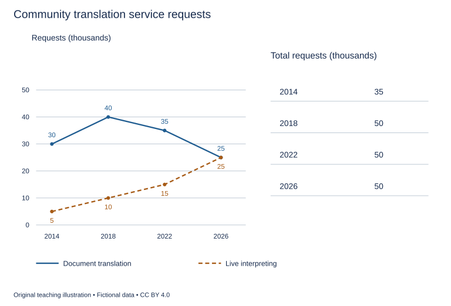

# U29 第20周：长篇阅读、写作与口语

本页为已独立核验的原创文字课程。先完成学生题目，再展开对应参考。非真题、非标准化模考，不换算雅思分数。听力尚未补齐，本页不代表全科课程已完成。

每周选A或G类Task 1一题，加Task 2及三次口语。参考范文不是学生已完成作业，仍须提交初稿、录音和重写，独立真人评分另行安排。

阅读每周180分钟（60分钟首次限时、120分钟证据精读与延迟复测），写作180分钟、口语120分钟。词汇60分钟、听力180分钟另列；新增完整听力未验收，不能勾整周完成。

W20原创阶段检查按实际证据复盘；正式T20陌生整卷及真人评分另记，缺少目标或真实证据时不能据此判断报考/延长，本页原创技能卷不能代替正式模拟。后续周数与达标规则见 [U04](u04-exam-preparation.md)。

## 阅读：首答不查词

### R-W20-01 · The Paper That Changed Shape

W20｜正文 854 词｜13 题｜篇章：简化科学模型：材料响应与测量边界（6段）

本课必做60分钟：首答20、证据复盘20、词汇长句10、48小时后复测10。每周三课180分钟，合卷首答替代单课首答，不重复计算。开放短文选做另加15分钟。

本项目原创虚构教学情境，人物、地点、历史事件和案例数据均非真实研究或史料。科学解释只讨论文内说明的模型与条件。非雅思真题或标准化模考；正确数不换算雅思等级。许可：CC BY 4.0 — RayXBuilds and contributors。

能力点：识别论证关系、区分作者与引述者、条件与因果、精确定位。初读不查词，完成后打开独立答案页。

#### Passage

**A** In a fictional materials workshop, students find that a paper strip bends after one face has been lightly moistened. Their first explanation is that wet paper always curls in the same direction. The teacher offers a more limited model. In this exercise, the two faces do not change length equally, and the strip bends as the attached parts accommodate that difference. The account deliberately leaves out many properties of real papers, inks and coatings. It is a model for reasoning about unequal change in connected layers, not a universal prediction for every sheet exposed to moisture. The distinction matters because an attractive demonstration can encourage a claim broader than the conditions actually examined. Before generalising, the students need to identify which material was used, how moisture was applied and what aspect of the resulting shape was observed.

**B** The class prepares strips from the same sheet and marks the face that will receive moisture. Each strip is supported at one end so that the rest can move. One group records only whether the free end rises or falls. Another traces the whole curve against a grid. These observations answer different questions. Two strips can place their free ends at similar heights while bending differently along their lengths. Conversely, a strip can change its end position because the support moves, even if its own curvature changes little. The class therefore fixes the support before comparing results and records both the end position and the outline. Choosing an easily visible measurement does not make it a complete description of the object's response. The distinction remains important even when both measurements appear straightforward.

**C** The students next join two paper layers and moisten only the exposed face of one. In the simplified account used for the exercise, the layers would change by different amounts if they were free. Because they are attached, neither can simply take its independent shape while ignoring the other. Bending is one possible response to their connection. The teacher asks the class to compare this arrangement with two loose strips placed side by side. Those strips can change separately and need not produce the same combined movement. The comparison concerns connection, not merely the presence of two pieces of paper. Counting layers without describing how they are joined would leave out the relationship responsible for the behaviour being modelled. The students also note that the explanation applies only while the connection remains intact; separation would change the system they are trying to describe.

**D** Time introduces another complication. The outline observed immediately after moistening may differ from the outline observed later. A photograph taken at one moment cannot by itself show whether the shape has stabilised or is still changing. The students use a timing strip to record the interval between applying moisture and tracing the outline. They compare observations taken at matching intervals before discussing differences between samples. This does not mean that the earliest or latest observation is always the most useful. It means that the choice must correspond to the question being asked. A study of the first response and a study of a later condition can both be legitimate, but their results should not be compared as though the observation times were interchangeable. The interval is part of the conditions, even when it is not visible in a photograph.

**E** The workshop uses several simple records. A treatment card identifies the marked face and the amount of moisture applied. A support sketch shows the position and angle of the clamp holding the strip. A profile sheet preserves successive outlines against the same grid, with each outline linked to its observation time. A connection log states whether the joined layers remain attached throughout each trial. These records make different possible explanations inspectable. If an end moves, the support sketch helps check whether the clamp changed; if a curve changes over time, the profile sheet preserves that development. The connection log prevents a separated pair from being silently compared with an intact pair as though both represented the same arrangement. The records are useful because their contents correspond to particular questions, rather than because adding documentation automatically makes a demonstration convincing.

**F** By the end, the students have replaced a sweeping claim about wet paper with a conditional account of the model. They can describe a connected arrangement, an unequal response and an observed shape under specified treatment and timing. They still cannot predict every paper product from the classroom results. That limitation does not make the exercise pointless. A model can teach a relationship while deliberately setting aside other influences, provided those boundaries remain visible when the explanation is used. The class now asks what changed, what was connected and what was held constant before treating two visible curves as instances of the same process. Its progress lies partly in making fewer unsupported claims. A striking bend has become a question that can be examined through comparisons, and an ordinary material has become a way to practise distinguishing observation from the broader interpretation attached to it. Any later extension would require checking whether the new arrangement preserves the conditions on which the present explanation depends.

#### Questions

**Complete the sentences. Choose NO MORE THAN 3 WORDS FROM THE PASSAGE for each answer. Do not change word forms.**

1. The time between moistening and tracing is recorded on a ______.

2. The treated face and applied moisture amount are identified on a ______.

3. The clamp’s position and angle are shown in a ______.

4. Successive outlines on a common grid are preserved on a ______.

5. Whether the joined layers stay attached is stated in a ______.

**Do the following statements agree with the writer's views? Write YES, NO or NOT GIVEN. YES = the writer agrees; NO = the writer expresses the opposite view; NOT GIVEN = the writer's view is not stated. Do not use outside knowledge.**

6. Recording only an easily visible quantity necessarily describes the complete response.

7. An explanation based on attached layers must reconsider the system if they separate.

8. The writer favours charging students for materials used in unsuccessful trials.

9. A limited model may still teach a useful relationship.

**Choose ONE answer, A, B, C or D.**

10. The teacher’s account is intended to explain

   A. unequal change in connected parts under limited conditions
   B. the chemistry of all inks
   C. every commercial paper product
   D. why moisture always bends paper identically

11. Why record an outline as well as end height?

   A. The same end height can accompany different curves
   B. Outlines remove the need for time records
   C. All supports are identical
   D. End height never changes

12. The loose-strip comparison isolates the importance of

   A. the number of students
   B. the relationship created by attachment
   C. the colour of the grid
   D. the photograph size

13. A photograph at one moment cannot alone establish

   A. that any image exists
   B. which outline was photographed
   C. whether the shape has stopped changing
   D. that the support is visible

#### 本周重点

原创阶段检查：60分钟合卷与延迟复测分开记录；不能替代正式T20，也不能据原创正确数判定报考或保分。

#### 复盘

必做：给每道错题标记“定位/作者立场/范围/语法/词数”，抄最短证据；用一行箭头概括本文论证或过程。48小时后重做错题与两道正确题，检查是否仍能指出证据。

选做（15分钟，80–100词）：Identify a measurement limitation and an explanatory limitation, using different paragraphs.

R-W20-01 答案、证据与精读（首答后展开）

### R-W20-01 · 独立答案与证据

来源与许可同学生页。先完成再核对。可接受答案由 accepted_answers 明确列出；只忽略大小写和首尾空格，不自行删词。开放复盘不计入客观正确数。

1. **timing strip / strip**｜段落 D｜证据：“a timing strip to record the interval”

   strip可接a，字段明确。

2. **treatment card / card**｜段落 E｜证据：“A treatment card identifies”

   card可接受。

3. **support sketch / sketch**｜段落 E｜证据：“A support sketch shows the position and angle”

   sketch可接受。

4. **profile sheet / sheet**｜段落 E｜证据：“A profile sheet preserves successive outlines”

   sheet可接受。

5. **connection log / log**｜段落 E｜证据：“A connection log states whether”

   log可接受。

6. **NO**｜段落 B｜证据：“does not make it a complete description”

   明确反对必要充分夸大。

7. **YES**｜段落 C｜证据：“separation would change the system”

   连接是模型条件。

8. **NOT GIVEN**｜段落 F｜证据：“That limitation does not make the exercise pointless”

   全文未提收费。

9. **YES**｜段落 F｜证据：“A model can teach a relationship”

   边界不等于无用。

10. **A**｜段落 A｜证据：“unequal change in connected layers”

   受限定的模型。

11. **A**｜段落 B｜证据：“similar heights while bending differently”

   同一单点值不代表完整形状。

12. **B**｜段落 C｜证据：“The comparison concerns connection”

   比较因素为连接。

13. **C**｜段落 D｜证据：“whether the shape has stabilised”

   单时点不能给时间进展。

#### 词汇与长句

- **curvature**：曲线弯曲的程度或形态特征
- **clamp**：固定样条的夹具
- **intact**：仍完整相连的
- **conditional**：只有在指定条件下成立的

> Because they are attached, neither can simply take its independent shape while ignoring the other.

because给连接约束；neither指两层中的任一层。

> A model can teach a relationship while deliberately setting aside other influences, provided those boundaries remain visible when the explanation is used.

while允许简化；provided要求使用时保留边界。

#### 开放任务参考

B/D测量不完整或时间边界；A/C/F模型适用条件；分清观察与解释。

标准：观点有文内依据，保留条件和范围，推断明确标注；不存在唯一措辞。

### R-W20-02 · A Photograph with Two Dates

W20｜正文 939 词｜13 题｜篇章：虚构历史：摄影材料与日期证据（8段）

本课必做60分钟：首答20、证据复盘20、词汇长句10、48小时后复测10。每周三课180分钟，合卷首答替代单课首答，不重复计算。开放短文选做另加15分钟。

本项目原创虚构教学情境，人物、地点、历史事件和案例数据均非真实研究或史料。科学解释只讨论文内说明的模型与条件。非雅思真题或标准化模考；正确数不换算雅思等级。许可：CC BY 4.0 — RayXBuilds and contributors。

能力点：识别论证关系、区分作者与引述者、条件与因果、精确定位。初读不查词，完成后打开独立答案页。

#### Passage

**A** A photograph in the fictional Bellmere collection carries two dates. One is written on the back of the print, while the other appears in a catalogue produced much later. Both have been described as the date of the photograph, although they refer to different events. The earlier date is associated with the exposure that produced the image, and the later one with a printing of it. The distinction changes the question a researcher can answer. A print made decades after an exposure can show an earlier scene without being an object manufactured at that earlier time. The collection's curator begins by separating the history of the depicted moment from the history of the physical object that now represents it.

**B** The scene shows a square with a temporary wooden platform in front of the town hall. A handwritten note calls it the opening ceremony for a new bridge. A later exhibition label describes the platform as election seating. Neither description is visible simply by looking at the structure. The curator searches for supporting documents rather than selecting whichever story makes the picture more interesting. A programme for the bridge opening mentions a platform in the square, but does not identify this particular image. It makes the first interpretation plausible without proving it. The curator keeps the proposed identification separate from what can be directly described: people, a platform and the surrounding buildings. A convincing narrative still needs a defensible connection between the event and the surviving image.

**C** A second print of the same view introduces a further difficulty. It includes more of the street at the left edge, where a shop sign can be read. The exhibition copy has been cropped, removing that sign and making the platform seem more central. The alteration does not necessarily falsify the visible people or buildings, but it changes their relationships within the frame. Someone who sees only the cropped version might assume that the photographer originally excluded the street. The curator therefore compares the edges before drawing conclusions about the initial composition. The two objects share an image source while presenting different selections from it. Treating them as visually interchangeable would hide a decision made after the exposure rather than at the moment the scene was recorded.

**D** The back of the later print bears a stamp from a studio that operated after the earliest proposed event date. This need not prove that the scene itself is later. The studio may have produced a new print from older image material. At the same time, the stamp does not establish the exposure date by itself. It supports a claim about the physical print and the business associated with it, within the limits of the evidence available. The curator resists turning every date into a competing answer to one question. Some dates can coexist because they describe different stages in the object's history. The problem is less a contradiction between numbers than a failure to name the event to which each number belongs.

**E** A newspaper reproduction adds another stage. It was published during a later anniversary and accompanied by a caption written for that occasion. The publication date establishes when that reproduction appeared, not when the people stood in the square. Its caption may preserve useful information, but it is also an interpretation written at a distance from the depicted event. The curator examines whether it cites an earlier source or merely repeats a familiar local story. Repetition can make an identification widely known without independently confirming it. Five later captions derived from one unsupported statement do not provide five separate witnesses. Counting descriptions without tracing their relationships would exaggerate the amount of evidence available for the event's identity.

**F** The catalogue is revised using distinct records. An exposure register lists proposed dates for the depicted moment and gives the evidence for each. A print record describes the paper object, including the studio stamp and inscriptions. A cropping diagram compares the visible boundaries of the two prints. A publication table lists each newspaper appearance, its date and its accompanying caption. These records do not settle every uncertainty, but they prevent one kind of date or description from silently standing in for another. They also allow a later researcher to disagree with an interpretation while retaining the observations on which it was based. The catalogue becomes easier to revise because the claim and its supporting material are recorded separately.

**G** For visitors, the curator writes a source note explaining that the bridge-opening identification remains provisional. The display places the wider print beside the cropped one and labels exposure, printing and publication dates as different kinds of information. This presentation asks more attention than a single confident caption, but the curator considers that attention justified when the evidence itself is layered. Uncertainty does not require leaving the object unexplained. It requires stating which parts of the explanation are directly supported, which are inferred and what further material could change the inference. Visitors can still recognise the scene's interest without being offered certainty that the collection cannot defend.

**H** The photograph consequently acquires several connected histories: the event before the camera, the production of particular prints, the selection of a frame and the later circulation of reproductions. None is automatically the most important for every investigation. A historian studying a public gathering may ask a different question from a researcher studying how the town represented its past. What matters is that the question and the evidence belong to the same stage. The object becomes more informative when its dates are given names, and less reliable when the convenient phrase date of the photograph conceals the differences that the researcher needs to understand.

#### Questions

**Which paragraph contains the following information? Write a letter, A–H. You may use any letter more than once.**

1. a document that makes an event identification plausible without confirming the particular image

2. removal of a shop sign changing the apparent emphasis of an image

3. a business stamp that can date a print without dating the depicted scene

4. several later descriptions sharing one unsupported source rather than independent confirmation

**Do the following statements agree with the writer's views? Write YES, NO or NOT GIVEN. YES = the writer agrees; NO = the writer expresses the opposite view; NOT GIVEN = the writer's view is not stated. Do not use outside knowledge.**

5. All dates attached to an image must compete as answers to the same question.

6. One stage of the photograph’s history must always be the most important for every investigation.

7. The writer recommends preventing visitors from making personal copies of the display.

8. A provisional identification can be explained without claiming certainty.

**Complete the summary. Choose NO MORE THAN 3 WORDS FROM THE PASSAGE for each answer. Do not change word forms.**

Proposed dates and evidence for the depicted moment enter the (9) ______. Details of the physical paper object appear in a (10) ______. The boundaries of two versions are compared in a (11) ______. Newspaper dates and captions are collected in a (12) ______. Visitors learn about the provisional event identification from a (13) ______.

#### 本周重点

原创阶段检查：60分钟合卷与延迟复测分开记录；不能替代正式T20，也不能据原创正确数判定报考或保分。

#### 复盘

必做：给每道错题标记“定位/作者立场/范围/语法/词数”，抄最短证据；用一行箭头概括本文论证或过程。48小时后重做错题与两道正确题，检查是否仍能指出证据。

选做（15分钟，80–100词）：Choose two dates and explain the different questions they can answer.

R-W20-02 答案、证据与精读（首答后展开）

### R-W20-02 · 独立答案与证据

来源与许可同学生页。先完成再核对。可接受答案由 accepted_answers 明确列出；只忽略大小写和首尾空格，不自行删词。开放复盘不计入客观正确数。

1. **B**｜段落 B｜证据：“does not identify this particular image”

   B节目单限制。

2. **C**｜段落 C｜证据：“removing that sign and making the platform seem more central”

   C裁切具体变化。

3. **D**｜段落 D｜证据：“supports a claim about the physical print”

   D印章作用。

4. **E**｜段落 E｜证据：“do not provide five separate witnesses”

   E证据依赖。

5. **NO**｜段落 D｜证据：“Some dates can coexist”

   不同事件日期可共存。

6. **NO**｜段落 H｜证据：“None is automatically the most important for every investigation”

   H明确否定所有调查都优先同一个历史阶段。

7. **NOT GIVEN**｜段落 G｜证据：“For visitors, the curator writes a source note”

   未提个人复制政策。

8. **YES**｜段落 G｜证据：“Uncertainty does not require leaving the object unexplained”

   可解释但标证据边界。

9. **exposure register / register**｜段落 F｜证据：“An exposure register lists proposed dates”

   register可接the。

10. **print record / record**｜段落 F｜证据：“A print record describes the paper object”

   record可接受。

11. **cropping diagram / diagram**｜段落 F｜证据：“A cropping diagram compares the visible boundaries”

   diagram可接受。

12. **publication table / table**｜段落 F｜证据：“A publication table lists each newspaper appearance”

   table可接受。

13. **source note / note**｜段落 G｜证据：“a source note explaining”

   note可接受。

#### 词汇与长句

- **exposure**：本文指相机记录画面的成像事件
- **provisional**：仍可能随新证据修正的
- **inscription**：物体上的文字题记
- **reproduction**：由先前图像制作的复制呈现

> A print made decades after an exposure can show an earlier scene without being an object manufactured at that earlier time.

made修饰print；without区分画面时间和物体制作时间。

> Five later captions derived from one unsupported statement do not provide five separate witnesses.

derived限定五个说明的共同来源；数量不能替代独立性。

#### 开放任务参考

曝光关联场景、印制关联物体、刊登关联传播；别把更晚物体日期当场景反证。

标准：观点有文内依据，保留条件和范围，推断明确标注；不存在唯一措辞。

### R-W20-03 · Who Is the Audience for a Scientific Explanation?

W20｜正文 878 词｜14 题｜篇章：作者论证：科学解释的受众、精度与适用范围（7段）

本课必做60分钟：首答20、证据复盘20、词汇长句10、48小时后复测10。每周三课180分钟，合卷首答替代单课首答，不重复计算。开放短文选做另加15分钟。

本项目原创虚构教学情境，人物、地点、历史事件和案例数据均非真实研究或史料。科学解释只讨论文内说明的模型与条件。非雅思真题或标准化模考；正确数不换算雅思等级。许可：CC BY 4.0 — RayXBuilds and contributors。

能力点：识别论证关系、区分作者与引述者、条件与因果、精确定位。初读不查词，完成后打开独立答案页。

#### Passage

**A** At a fictional science centre, two versions of an explanation are tested beside the same working model. One uses specialist terms and equations; the other uses a short analogy about water moving between containers. A visitor understands the second immediately but applies it to a situation in which the analogy fails. Another visitor can read the equations yet cannot explain why one variable has been held constant. The staff realise that the contrast between difficult language and easy language does not settle the question of understanding. An explanation has to support the task its audience is expected to perform. Recognising a term, following a demonstration and deciding whether a conclusion applies elsewhere are related achievements, but they are not interchangeable signs that the same lesson has been learned.

**B** A simple analogy can provide an entry point by connecting an unfamiliar relationship with an experience the audience already recognises. That connection is useful precisely because it does not reproduce every property of the original system. However, the omitted properties may become important when the explanation is extended. The science centre therefore labels both the relationship illustrated by the water analogy and a condition under which the comparison should not be used. This does not destroy the analogy's value. It gives the visitor a way to use it responsibly. An explanation can be accessible without pretending that resemblance in one respect establishes identity in every other respect. The boundary is part of the explanation, rather than a technical apology to be hidden at the end.

**C** Specialist language presents a different problem. A technical term can compress a distinction that would otherwise require a long description. Removing it may therefore make an account longer or less precise. Yet displaying the term does not guarantee that a reader knows which distinction it preserves. One draft at the centre defines a word and then uses it in a comparison between two cases. Another merely adds the word in parentheses after an everyday expression. The first gives the term work to do; the second risks turning it into a badge of authority. The staff keep terminology where it helps organise a relationship and explain that relationship through the example, rather than assuming that either inclusion or exclusion of technical vocabulary automatically produces understanding.

**D** The intended task changes the amount and kind of detail required. A visitor deciding which button starts the model needs an instruction different from that needed by a student comparing its behaviour under two settings. A researcher evaluating the model's assumptions requires further information again. These are not simply three levels on a ladder from ignorance to intelligence. They are different activities, and the same person may move among them during one visit. Giving every reader every detail at the first encounter can obscure the action or relationship currently at issue. Withholding a relevant assumption from someone evaluating a conclusion creates the opposite problem. Selection should follow purpose, while routes to further information should remain available when that purpose changes.

**E** To examine understanding, staff ask visitors to predict what will happen after one setting changes and to explain the reason for their prediction. They also present a case outside the analogy's stated boundary and ask whether the earlier explanation applies. A correct prediction alone may result from a remembered pattern or a lucky choice. The reason supplied and the response to the boundary case reveal something different. These tasks do not measure every possible form of understanding, nor do they provide a permanent ranking of visitors. They offer evidence about whether this explanation supports these particular uses. Staff revise a display when its wording encourages a recurring unsupported extension, even if visitors report that the display felt clear and enjoyable.

**F** The centre ultimately designs an explanation with several connected parts. A short opening identifies the question and the central relationship. A worked example shows that relationship in use. A visible limitation describes where the example stops being a reliable guide, and a further section states the assumptions needed for a more detailed account. Readers can follow the part relevant to their task while seeing how it connects to the rest. The design is not successful merely because it contains more panels. Its value depends on whether the connections help readers find the next explanation they need. The staff also check that the short opening makes no claim contradicted by qualifications placed in the later material; access to detail should deepen an account rather than quietly reverse it.

**G** Good scientific explanation is therefore neither the elimination of all difficulty nor the display of as much expertise as possible. It is a choice of relationships, examples and limits suited to a stated use. Some effort may be necessary because the idea itself requires a distinction that the reader has not previously made. The communicator's responsibility is to make that effort purposeful and to avoid creating confidence unsupported by the explanation. A visitor who can state both what the model helps explain and where it ceases to guide a judgement has learned more than a visitor who simply remembers that the demonstration was easy. Accessibility and precision can support each other when the audience is given a usable path through the argument, including the conditions that keep its conclusion within reach of the evidence.

#### Questions

**Do the following statements agree with the writer's views? Write YES, NO or NOT GIVEN. YES = the writer agrees; NO = the writer expresses the opposite view; NOT GIVEN = the writer's view is not stated. Do not use outside knowledge.**

1. An analogy is valuable only if it reproduces every property of the original.

2. Different information needs necessarily place people at different intelligence levels.

3. A short opening should avoid claims contradicted by later qualifications.

4. The writer recommends making the centre’s most detailed section available only to paying visitors.

5. Some effort may be necessary to grasp an unfamiliar distinction.

**Choose ONE answer, A, B, C or D.**

6. The initial comparison suggests that understanding should be judged in relation to

   A. the task the audience needs to perform
   B. whether all visitors enjoy the analogy
   C. the length of an explanation only
   D. how many equations are displayed

7. Why label the boundary of an analogy?

   A. To eliminate every unfamiliar term
   B. To guide its application without erasing its value
   C. To make it identical to the original
   D. To make all analogies useless

8. What distinguishes a useful technical term from a badge of authority?

   A. Its unfamiliar spelling
   B. Its role in organising an explained distinction
   C. Its replacement of every example
   D. Its appearance in parentheses alone

9. Why ask for the reason behind a correct prediction?

   A. To lengthen every visit
   B. The answer alone could reflect recall or chance
   C. To eliminate all uncertainty
   D. To rank visitors permanently

**Which paragraph contains the following information? Write a letter, A–G. You may use any letter more than once.**

10. an analogy about movement between containers used alongside an equation-based version

11. a term defined and used in a comparison contrasted with a parenthetical addition

12. three tasks requiring instructions, setting comparisons and evaluation of assumptions

13. a display being revised despite reports of clarity and enjoyment

14. an opening, example, limitation and detailed section deliberately linked together

#### 本周重点

原创阶段检查：60分钟合卷与延迟复测分开记录；不能替代正式T20，也不能据原创正确数判定报考或保分。

#### 复盘

必做：给每道错题标记“定位/作者立场/范围/语法/词数”，抄最短证据；用一行箭头概括本文论证或过程。48小时后重做错题与两道正确题，检查是否仍能指出证据。

选做（15分钟，80–100词）：Evaluate your answers by separating a missing definition, a missed logical limit and unsupported outside knowledge.

R-W20-03 答案、证据与精读（首答后展开）

### R-W20-03 · 独立答案与证据

来源与许可同学生页。先完成再核对。可接受答案由 accepted_answers 明确列出；只忽略大小写和首尾空格，不自行删词。开放复盘不计入客观正确数。

1. **NO**｜段落 B｜证据：“does not reproduce every property”

   相反，部分映射有用。

2. **NO**｜段落 D｜证据：“not simply three levels on a ladder from ignorance to intelligence”

   任务不同不等于能力等级。

3. **YES**｜段落 F｜证据：“makes no claim contradicted by qualifications”

   明确要求一致。

4. **NOT GIVEN**｜段落 F｜证据：“a further section states the assumptions”

   未提付费访问安排。

5. **YES**｜段落 G｜证据：“Some effort may be necessary”

   作者明确承认。

6. **A**｜段落 A｜证据：“the task its audience is expected to perform”

   理解表现与用途对应。

7. **B**｜段落 B｜证据：“a way to use it responsibly”

   边界支持恰当使用。

8. **B**｜段落 C｜证据：“where it helps organise a relationship”

   术语需发挥区分关系的作用。

9. **B**｜段落 E｜证据：“a remembered pattern or a lucky choice”

   结果不充分说明推理。

10. **A**｜段落 A｜证据：“water moving between containers”

   A初始两版展示。

11. **C**｜段落 C｜证据：“in parentheses after an everyday expression”

   C两草案具体比较。

12. **D**｜段落 D｜证据：“which button starts the model”

   D三用途组合。

13. **E**｜段落 E｜证据：“felt clear and enjoyable”

   E依据误用而修改。

14. **F**｜段落 F｜证据：“several connected parts”

   F最终结构组合。

#### 词汇与长句

- **analogy**：仅在部分关系上作对应的类比
- **qualification**：限制前述判断范围的说明
- **assumption**：推理或模型所依赖的前提
- **accessible**：目标读者能够进入并使用的

> Giving every reader every detail at the first encounter can obscure the action or relationship currently at issue.

giving动名词主语；can表可能，当前任务限定判断。

> The staff also check that the short opening makes no claim contradicted by qualifications placed in the later material; access to detail should deepen an account rather than quietly reverse it.

contradicted修饰claim；分号后明确详略必须一致。

#### 开放任务参考

按实际答卷分类并列证据；没有实做数据不填写诊断或成绩；本课不支持报考建议。

标准：观点有文内依据，保留条件和范围，推断明确标注；不存在唯一措辞。

## 写作与口语：Task 1双分支择一

### WS-W20-T1A 学生页：社区翻译服务请求趋势

周次 W20｜题型 T1A｜能力点：趋势和总量的阶段核查

Task 1 的 A/G 分支二选一，另一分支不计入本周作业。

#### 使用与记录

原创教学练习，非真题、非标准化模拟，难度未校准。先完成本页再打开参考页。人物、机构、经历与数据均为教学虚构。不要背诵示例。自评和 AI 反馈不能代替独立真人评分，未获得真人评阅时标记“分数未确认”。

保存：任务ID、实际日期、用时、初稿或原始录音、证据化反馈、重写/重答、三条修改理由。没有学生提交物，不得填写“已批改”或“已完成训练”。

#### 完整题干

The graph shows requests for two types of support from a community translation service in selected years from 2014 to 2026. The table shows the total number of requests in each year. Summarise the information by selecting and reporting the main features, and make comparisons where relevant.

Write at least 150 words. Spend about 20 minutes on this task.

教学虚构，单位千次请求。2014/2018/2022/2026：Document translation30/40/35/25；Live interpreting5/10/15/25；Total35/50/50/50。两类互斥且覆盖所有请求，未给独立用户数、完结率或等待时间。

#### 任务预算（含首次审题，不额外加时）

初稿20分钟（审题规划3、写作15、检查2）；诊断15；反馈阅读与证据核查10；完整重写25；对照归档5。合计75分钟。

#### 初稿后自评清单

- [ ] 达到最低字数；全文连贯成段，没有用项目符号代替作文。
- [ ] 概述给主要特征；数据、阶段或方位都与题图逐项相符，不推断未提供的原因。
- [ ] 每段可写出一个功能标签；例子或数据与该段要点相连。
- [ ] 核查两处词汇搭配和两处句法；如有疑点先试改再核实，无问题则记录通过证据。
- [ ] 如有影响理解的问题，记录原句；否则记通过或待核查，不填写自猜分数。

#### 反馈与重写

打开 独立参考页（本节下方展开参考），按逐段检查和通用协议核验。重写任务：完整重写至少150词；如存在范围或比较误述，回图修正并保留改前证据；如无则记录通过项和真实待核查点。将初稿时长与完成情况纳入W20证据表，不填虚构分数。

#### 本周重点操作（已含原预算）

用原有归档5分钟中的3分钟填W20证据表的本题行：真实初稿用时、要点/词数、重复问题证据、独立真人反馈是否已有。没有结果写未知；只凭本题不能判达到目标或必须延长。正式T20与真人评分另登记。

记录表见[阶段证据表](u30-feedback.md)，只在上述原时段填写相关行。

W20 T1A 示例、反馈与重练（首答后展开）

### WS-W20-T1A 独立参考页

只在初稿完成后阅读；不是唯一答案，也没有官方分数。以下是对原创示例的教学讲评，不是对学生尚未提交作文的已完成批改。

#### 思路拆解

趋势与合计核验；平稳总量可以掩盖构成变化；末年并列需在概述限定“前面年份较多”。

#### 原创示例

The graph compares requests for document translation and live interpreting at a community service in four selected years from 2014 to 2026. The table gives the combined total, and all figures are expressed in thousands of requests.

Overall, document translation was more frequently requested in the first three years shown, although its figure declined after a peak in 2018; the two services were equal in 2026. Demand for live interpreting rose throughout the period. The total number of requests increased initially and then remained unchanged in the final three years shown.

Document translation accounted for 30,000 requests in 2014 and climbed to 40,000 in 2018. It then fell to 35,000 in 2022 and 25,000 in 2026. Live interpreting followed a different pattern, increasing from 5,000 to 10,000, then to 15,000 and finally 25,000. The two services therefore had equal figures in the last year.

The combined total rose from 35,000 requests in 2014 to 50,000 in 2018 and stayed at that level in 2022 and 2026. Thus, the stable total after 2018 concealed a change in composition: the decline in document requests was exactly offset by growth in interpreting requests. By 2026, each type represented half of all requests.

示例正文词数：209（本项目正则计数；书信不含称呼、结束语与署名；连字符词作一词）。

#### 逐段反馈与迁移

- P1 千次请求非客户人数或服务已完成数；不把request写成获批准量。

- P2 文档仅前三个观测点较多，末年相等；total2018后50不变。

- P3 文档峰40后35/25；口译5/10/15/25；逐项与图对回。

- P4 总35/50/50/50；末各25占50%，减少/增加净额相抵，无原因信息。

#### 常见失误

概述称文档始终最多而漏并列；将总数稳定写成两类型都稳定；把请求数当人数或处理成功数。

#### 可执行反馈步骤

1. 先把自己的段落标为引入、概述/论点、支持、收束；分段可不同于示例，按功能核查，不照抄段数。
2. 对照上方逐段检查，逐项标“已有证据/缺失/不适用”。每条意见必须附自己的原句或缺失位置。
3. 按 [反馈协议](u30-feedback.md) 的四维表记录；有争议的 AI 意见回题干、数据或语法依据核验。
4. 只选至多两项有证据的优先点执行整篇重写；如未发现问题，可改变组织或表达练迁移，但不把它标成纠错；保留原稿，禁止把示例替换为自己的作业。

#### 重写任务

完整重写至少150词；如存在范围或比较误述，回图修正并保留改前证据；如无则记录通过项和真实待核查点。将初稿时长与完成情况纳入W20证据表，不填虚构分数。

完成后重新勾选 学生页（见本节上方学生题） 清单；将一处改前/改后及理由交给独立评阅者核查。真人评阅状态目前为“待安排”，不是已完成。

### WS-W20-T1G 学生页：向社团负责人提出新成员信息改进

周次 W20｜题型 T1G｜能力点：书信目的、要点与语气

Task 1 的 A/G 分支二选一，另一分支不计入本周作业。

#### 使用与记录

原创教学练习，非真题、非标准化模拟，难度未校准。先完成本页再打开参考页。人物、机构、经历与数据均为教学虚构。不要背诵示例。自评和 AI 反馈不能代替独立真人评分，未获得真人评阅时标记“分数未确认”。

保存：任务ID、实际日期、用时、初稿或原始录音、证据化反馈、重写/重答、三条修改理由。没有学生提交物，不得填写“已批改”或“已完成训练”。

#### 完整题干

You recently joined a local club and found it difficult to obtain information about its activities. Write to the club secretary, Mr Reed. In your letter:
- describe the information you needed
- explain the difficulty you experienced
- suggest how the club could help new members in future.
Begin your letter: Dear Mr Reed,

Write at least 150 words. You do not need to write any addresses. Spend about 20 minutes on this task.

#### 任务预算（含首次审题，不额外加时）

初稿20分钟（审题规划3、写作15、检查2）；诊断15；反馈阅读与证据核查10；完整重写25；对照归档5。合计75分钟。

#### 初稿后自评清单

- [ ] 达到最低字数；全文连贯成段，没有用项目符号代替作文。
- [ ] 三个要点均展开；称呼、目的、语气和结束语适合收信人。
- [ ] 每段可写出一个功能标签；例子或数据与该段要点相连。
- [ ] 核查两处词汇搭配和两处句法；如有疑点先试改再核实，无问题则记录通过证据。
- [ ] 如有影响理解的问题，记录原句；否则记通过或待核查，不填写自猜分数。

#### 反馈与重写

打开 独立参考页（本节下方展开参考），按逐段检查和通用协议核验。重写任务：完整重写至少150词；有问题才改，没有则保存具体通过证据；归档实际时间、任务覆盖和一项待评疑点，供阶段证据表使用。

#### 本周重点操作（已含原预算）

用原有归档5分钟中的3分钟填W20证据表的本题行：真实初稿用时、要点/词数、重复问题证据、独立真人反馈是否已有。没有结果写未知；只凭本题不能判达到目标或必须延长。正式T20与真人评分另登记。

记录表见[阶段证据表](u30-feedback.md)，只在上述原时段填写相关行。

W20 T1G 示例、反馈与重练（首答后展开）

### WS-W20-T1G 独立参考页

只在初稿完成后阅读；不是唯一答案，也没有官方分数。以下是对原创示例的教学讲评，不是对学生尚未提交作文的已完成批改。

#### 思路拆解

半正式具体反馈，信息需求与入口不连贯造成困难，两个建议分别解决定位与加入。

#### 原创示例

Dear Mr Reed,

I joined the walking club earlier this month and was pleased to meet several members at the introductory evening. Before attending my first weekend walk, I wanted to check the meeting point, the expected distance and whether I needed to bring any particular equipment. These details would help me choose an outing suitable for my current experience.

I found a list of dates on the noticeboard, but it did not include a starting location or a contact name. Another member kindly directed me to the club’s online group. However, I had not yet received an invitation to join it, so I could not read the full description there. I eventually obtained the details by asking several people individually, but the process was rather confusing for a newcomer.

Could the club provide a short welcome sheet explaining where activity details are published and whom new members should contact? It would also help to send the online group invitation when membership is confirmed. I would be happy to check a draft welcome sheet from a new member’s perspective if that would be useful.

Yours sincerely,
Alex Chen

示例正文词数：181（本项目正则计数；书信不含称呼、结束语与署名；连字符词作一词）。

#### 逐段反馈与迁移

- P1 起点/距离/装备服务于新成员选活动，非批评活动本身。

- P2 noticeboard只日期，group需邀请，两条事实构成困难；未说从未获得信息。

- P3 welcome sheet和确认时邀请对应原因；提出审阅帮助但不冒称已做。

#### 常见失误

将过去不便夸大成所有会员不满意；只投诉无建议；给信息请求却漏将来帮助新会员。

#### 可执行反馈步骤

1. 先把自己的段落标为引入、概述/论点、支持、收束；分段可不同于示例，按功能核查，不照抄段数。
2. 对照上方逐段检查，逐项标“已有证据/缺失/不适用”。每条意见必须附自己的原句或缺失位置。
3. 按 [反馈协议](u30-feedback.md) 的四维表记录；有争议的 AI 意见回题干、数据或语法依据核验。
4. 只选至多两项有证据的优先点执行整篇重写；如未发现问题，可改变组织或表达练迁移，但不把它标成纠错；保留原稿，禁止把示例替换为自己的作业。

#### 重写任务

完整重写至少150词；有问题才改，没有则保存具体通过证据；归档实际时间、任务覆盖和一项待评疑点，供阶段证据表使用。

完成后重新勾选 学生页（见本节上方学生题） 清单；将一处改前/改后及理由交给独立评阅者核查。真人评阅状态目前为“待安排”，不是已完成。

### WS-W20-T2 学生页：成年人频繁更换职业

周次 W20｜题型 T2｜能力点：观点展开与任务回应

A/G 共用本题。

#### 使用与记录

原创教学练习，非真题、非标准化模拟，难度未校准。先完成本页再打开参考页。人物、机构、经历与数据均为教学虚构。不要背诵示例。自评和 AI 反馈不能代替独立真人评分，未获得真人评阅时标记“分数未确认”。

保存：任务ID、实际日期、用时、初稿或原始录音、证据化反馈、重写/重答、三条修改理由。没有学生提交物，不得填写“已批改”或“已完成训练”。

#### 完整题干

More adults are changing to a different type of career during their working lives. Do the advantages of this development outweigh the disadvantages? Give reasons and include relevant examples.

Write at least 250 words. Spend about 40 minutes on this task.

#### 任务预算（含首次审题，不额外加时）

初稿40分钟（审题规划5、写作30、检查5）；诊断15；反馈阅读与证据核查10；完整重写35；对照归档5。合计105分钟。

#### 初稿后自评清单

- [ ] 达到最低字数；全文连贯成段，没有用项目符号代替作文。
- [ ] 直接回答题目的所有问句，有始终一致的立场。
- [ ] 每段可写出一个功能标签；例子或数据与该段要点相连。
- [ ] 核查两处词汇搭配和两处句法；如有疑点先试改再核实，无问题则记录通过证据。
- [ ] 如有影响理解的问题，记录原句；否则记通过或待核查，不填写自猜分数。

#### 反馈与重写

打开 独立参考页（本节下方展开参考），按逐段检查和通用协议核验。重写任务：完整重写至少250词；按已有证据处理至多两个重点，无问题不强造缺陷。归档时间、任务回应与独立评阅状态，W20是否延长由证据表决定，不能由示例词数决定。

#### 本周重点操作（已含原预算）

用原有归档5分钟中的3分钟填W20证据表的本题行：真实初稿用时、要点/词数、重复问题证据、独立真人反馈是否已有。没有结果写未知；只凭本题不能判达到目标或必须延长。正式T20与真人评分另登记。

记录表见[阶段证据表](u30-feedback.md)，只在上述原时段填写相关行。

W20 T2 示例、反馈与重练（首答后展开）

### WS-W20-T2 独立参考页

只在初稿完成后阅读；不是唯一答案，也没有官方分数。以下是对原创示例的教学讲评，不是对学生尚未提交作文的已完成批改。

#### 思路拆解

利弊判断条件明确；不是单纯跳槽同岗位；需求匹配与重学成本比较，不提供个体投资/职业保证。

#### 原创示例

Changing to a different career can allow adults to find work that better matches their abilities and circumstances. It can also involve financial uncertainty and a demanding period of learning. I believe the advantages often outweigh the disadvantages when the change is informed and supported, rather than treated as an automatic solution to dissatisfaction.

One advantage is the possibility of using existing strengths in a more suitable setting. Someone who enjoys explaining ideas but has little opportunity to do so in their current role may find that a different occupation makes better use of that ability. A career change can also help a person respond when responsibilities or local opportunities alter. Remaining in the same field is not necessarily the safest option if suitable work is becoming difficult to find. The benefit lies in having a realistic alternative, not simply in the excitement of starting again.

The costs are nevertheless substantial. An adult may need to complete training while continuing to meet household expenses. Experience from the previous career may be useful, but it will not cover every requirement of the new one. Starting at a lower level can also be discouraging. These difficulties affect people differently: someone with caring responsibilities or limited savings may have less room to experiment than someone with strong practical support.

On balance, the potential gains are greater when adults can explore the new work before making a major commitment. Short courses, conversations with people in the field and carefully chosen practical experience can reveal whether expectations are realistic. Employers can also recognise transferable skills while providing support for genuine gaps. Such measures do not guarantee success, but they reduce the risk of a decision based on an idealised picture of another occupation.

In conclusion, career changes can improve the match between people and work, but their value depends on preparation and circumstances. Access to reliable information and manageable learning opportunities makes the advantages more likely to exceed the costs.

示例正文词数：325（本项目正则计数；书信不含称呼、结束语与署名；连字符词作一词）。

#### 逐段反馈与迁移

- P1 change type of career与普通换雇主不同；有条件判断。

- P2 可迁移能力及机会变化解释收益，未承诺新工作更高薪。

- P3 培训/支出/起步及责任差异展现成本。

- P4 探索与支持解释风险如何降低，not guarantee承认边界。

- P5 和开头一致，避免everyone should change结论。

#### 常见失误

只谈跳槽涨工资；忽略转换专业门槛；以个人成功故事证明所有人适用。

#### 可执行反馈步骤

1. 先把自己的段落标为引入、概述/论点、支持、收束；分段可不同于示例，按功能核查，不照抄段数。
2. 对照上方逐段检查，逐项标“已有证据/缺失/不适用”。每条意见必须附自己的原句或缺失位置。
3. 按 [反馈协议](u30-feedback.md) 的四维表记录；有争议的 AI 意见回题干、数据或语法依据核验。
4. 只选至多两项有证据的优先点执行整篇重写；如未发现问题，可改变组织或表达练迁移，但不把它标成纠错；保留原稿，禁止把示例替换为自己的作业。

#### 重写任务

完整重写至少250词；按已有证据处理至多两个重点，无问题不强造缺陷。归档时间、任务回应与独立评阅状态，W20是否延长由证据表决定，不能由示例词数决定。

完成后重新勾选 学生页（见本节上方学生题） 清单；将一处改前/改后及理由交给独立评阅者核查。真人评阅状态目前为“待安排”，不是已完成。

### WS-W20-S1 学生页

周次W20｜Part 1专项｜能力点：阶段证据与是否延长的判断边界｜30分钟

#### 使用与记录

原创教学练习，非真题、非标准化模拟，难度未校准。先完成本页再打开参考页。人物、机构、经历与数据均为教学虚构。不要背诵示例。自评和 AI 反馈不能代替独立真人评分，未获得真人评阅时标记“分数未确认”。

保存：任务ID、实际日期、用时、初稿或原始录音、证据化反馈、重写/重答、三条修改理由。没有学生提交物，不得填写“已批改”或“已完成训练”。

#### 操作与预算

设备与审题3分钟；首答录音6；回听及局部转写7；示例和诊断5；不看稿重答6；归档3。共30分钟。

#### Part 1专项题

1. Do you enjoy setting learning goals?
2. How do you decide whether to continue practising something?
3. What kind of feedback do you find useful?
4. Do you prefer a fixed plan or a flexible one?

追问：

- What information might make you change the plan?
- Can you give a specific example?

#### 录音回听清单

- [ ] 保留首答原音，记录实际时长、是否中断、是否看稿；只报真实完成状态。
- [ ] 流利与连贯：标出两处时间戳，区分构思停顿与重复搜词，检查是否偏离问句。
- [ ] 词汇：找一处模糊词或重复表达，先解释原意再替换；不为难词改变意思。
- [ ] 语法：核对经历与习惯的时态；局部转写核查；如存在妨碍理解的问题才更正，无则记通过。
- [ ] 发音：不看转写听30秒，标听不清的词尾、重音或断句；没有音频不能判断发音。
- [ ] 展开：主要回答有具体情境或理由；追问后第一句回应追问的新角度。

#### 重答要求

如有笼统判断，选择至多两个答案补具体情境；如没有，选择两题换角度重答并保留切题证据；重答一条追问，检查是否真正回应其新角度。

首答回听后才打开独立参考页（本节下方展开参考）。按[反馈协议](u30-feedback.md)填至少三个时间戳，不以文字转写替代音频评阅。

#### 本周重点操作（已含原预算）

用原有归档时段中的3分钟填W20证据表本题行：实际录音长度、是否连续/看稿、一个有时间戳的待评点、真人评阅是否已有。无旧录音不编进步。全流程S3归档时顺看决策分支，缺正式评估先记证据不足，不把它当失败或达标。

记录表见[阶段证据表](u30-feedback.md)，只在上述原时段填写相关行。

W20 S1 示例、反馈与重练（首答后展开）

### WS-W20-S1 独立参考页

原创教学示例，非真题或评分结果。未收到学生音频；以下是示例分析与待执行反馈，不能登记为已完成学生批改。

#### 展开示例

##### 直接回应→原因→具体情境的展开示例

I prefer a plan with clear tasks but some room to adjust. If I repeatedly run out of time on the same task, that is useful information about the plan or my current ability. I would look at what actually caused the delay before adding more practice, rather than assume that spending longer always solves the problem.

纯口答示例词数：57；只计MODEL标记内实际英文口答，不含标题、标签、说明。词数不能证明录音时长或流利度。

#### 展开与反馈

本周能力：阶段证据与是否延长的判断边界。

1. 示例先表态，再说明偏好理由，最后提供条件或场景。检查自己是否用一个词回答后就结束。
2. 找到一个具体细节：物品、动作、对话或地点。用自己的经历替换，保持与题卡相关，不照搬示例身份与经历。
3. 追问要重新回应，不能继续背长答。首句先回答追问，再用一条理由支持。
4. 如存在听不清或语法影响理解处，标原音时间戳；否则标一处清楚的原音证据；先尝试最小修正。不要把自然停顿一概当成错误，或用加快语速掩盖逻辑断裂。

#### 常见失误

空泛形容词替代具体过程；给了经历却没解释为什么重要；Part 3只有个人故事没有一般解释；AI只看转写就判断发音。逐项回原音核对，不能凭范例推断自己已达到某个分数。

#### 可执行重答与反馈

如有笼统判断，选择至多两个答案补具体情境；如没有，选择两题换角度重答并保留切题证据；重答一条追问，检查是否真正回应其新角度。

填写[反馈协议](u30-feedback.md)四维表，附三个时间戳和原话证据。如存在，选至多一个内容问题与一个语言问题先修；否则记录清楚的证据并做迁移重答；重答后并排听两段，记录改善与仍未解决之处。自评与AI不能替代独立真人评分；独立评阅目前待安排，分数未确认。

### WS-W20-S2 学生页

周次W20｜Part 2专项｜能力点：阶段证据与是否延长的判断边界｜30分钟

#### 使用与记录

原创教学练习，非真题、非标准化模拟，难度未校准。先完成本页再打开参考页。人物、机构、经历与数据均为教学虚构。不要背诵示例。自评和 AI 反馈不能代替独立真人评分，未获得真人评阅时标记“分数未确认”。

保存：任务ID、实际日期、用时、初稿或原始录音、证据化反馈、重写/重答、三条修改理由。没有学生提交物，不得填写“已批改”或“已完成训练”。

#### 操作与预算

准备、首答录音及追问5分钟；回听及局部转写8；示例与诊断5；关键词重组3；重答及追问5；归档4。共30分钟。

#### Part 2专项任务卡

Describe a plan you adjusted after reviewing your progress. Say what the plan was, what evidence you considered, what you changed, and explain why the adjustment was useful.

准备1分钟，说1～2分钟。只记5个关键词，不预写句子。

收尾追问：

- Did you have enough information to make the decision?
- Would you review the plan again later?

#### 录音回听清单

- [ ] 保留首答原音，记录实际时长、是否中断、是否看稿；只报真实完成状态。
- [ ] 流利与连贯：标出两处时间戳，区分构思停顿与重复搜词，检查是否偏离问句。
- [ ] 词汇：找一处模糊词或重复表达，先解释原意再替换；不为难词改变意思。
- [ ] 语法：核对经历与习惯的时态；局部转写核查；如存在妨碍理解的问题才更正，无则记通过。
- [ ] 发音：不看转写听30秒，标听不清的词尾、重音或断句；没有音频不能判断发音。
- [ ] 展开：主要回答有具体情境或理由；追问后第一句回应追问的新角度。

#### 重答要求

用五个关键词重答完整任务卡1～2分钟，再答两条追问；如缺具体细节则补、如有无关背景则删；若已清楚，换表达但保持事实。比较首答与重答，不背示例。

首答回听后才打开独立参考页（本节下方展开参考）。按[反馈协议](u30-feedback.md)填至少三个时间戳，不以文字转写替代音频评阅。

#### 本周重点操作（已含原预算）

用原有归档时段中的3分钟填W20证据表本题行：实际录音长度、是否连续/看稿、一个有时间戳的待评点、真人评阅是否已有。无旧录音不编进步。全流程S3归档时顺看决策分支，缺正式评估先记证据不足，不把它当失败或达标。

记录表见[阶段证据表](u30-feedback.md)，只在上述原时段填写相关行。

W20 S2 示例、反馈与重练（首答后展开）

### WS-W20-S2 独立参考页

原创教学示例，非真题或评分结果。未收到学生音频；以下是示例分析与待执行反馈，不能登记为已完成学生批改。

#### 展开示例

##### 原创长答示例（时长须以个人实际录音测量）

I adjusted a plan for learning a new computer program. At first, I intended to watch one tutorial each evening and finish a small project at the end of the week. I completed the videos, but when I started the project, I could not perform several actions without replaying the demonstrations.

That was more useful evidence than the number of videos I had watched. It showed that I needed practice retrieving the steps, rather than simply more explanations. I changed the plan so that each short video was followed by a task I attempted without looking at the instructions.

I also made the final project smaller. Instead of trying every feature, I focused on a few functions that I would actually use. When I became stuck, I recorded the specific action and checked it later.

The adjustment was useful because it connected the plan to what I could do independently. I still needed further practice, and one successful task did not mean I had mastered the program. But I had a clearer way to decide what to practise next.

纯口答示例词数：179；只计MODEL标记内实际英文口答，不含标题、标签、说明。词数不能证明录音时长或流利度。

#### 展开与反馈

本周能力：阶段证据与是否延长的判断边界。

1. 长答示例按背景、行动/观察、变化与意义组织。每段都推进内容；检查自己是否只有背景而没有具体事件。
2. 找到一个具体细节：物品、动作、对话或地点。用自己的经历替换，保持与题卡相关，不照搬示例身份与经历。
3. 追问要重新回应，不能继续背长答。首句先回答追问，再用一条理由支持。
4. 如存在听不清或语法影响理解处，标原音时间戳；否则标一处清楚的原音证据；先尝试最小修正。不要把自然停顿一概当成错误，或用加快语速掩盖逻辑断裂。

#### 常见失误

空泛形容词替代具体过程；给了经历却没解释为什么重要；Part 3只有个人故事没有一般解释；AI只看转写就判断发音。逐项回原音核对，不能凭范例推断自己已达到某个分数。

#### 可执行重答与反馈

用五个关键词重答完整任务卡1～2分钟，再答两条追问；如缺具体细节则补、如有无关背景则删；若已清楚，换表达但保持事实。比较首答与重答，不背示例。

填写[反馈协议](u30-feedback.md)四维表，附三个时间戳和原话证据。如存在，选至多一个内容问题与一个语言问题先修；否则记录清楚的证据并做迁移重答；重答后并排听两段，记录改善与仍未解决之处。自评与AI不能替代独立真人评分；独立评阅目前待安排，分数未确认。

### WS-W20-S3 学生页

周次W20｜三部分全流程｜能力点：阶段证据与是否延长的判断边界｜60分钟

#### 使用与记录

原创教学练习，非真题、非标准化模拟，难度未校准。先完成本页再打开参考页。人物、机构、经历与数据均为教学虚构。不要背诵示例。自评和 AI 反馈不能代替独立真人评分，未获得真人评阅时标记“分数未确认”。

保存：任务ID、实际日期、用时、初稿或原始录音、证据化反馈、重写/重答、三条修改理由。没有学生提交物，不得填写“已批改”或“已完成训练”。

#### 操作与预算

D5：设备与流程准备2分钟，连续首答11～14分钟，余14～17分钟完整回听标记，共30分钟。D6：局部转写诊断10，阅读示例与调整5，重答与新追问10，对照归档5，共30分钟。合计60分钟。

#### 连续三部分全流程（首答不可看参考）

找同伴读题，或独练逐题揭示。完整首答11～14分钟，中途不暂停纠错。模拟同伴不是认证考官；自行读题的练习记录不能冒充真实面试。

##### Part 1：4～5分钟

1. Do you like reviewing old work?
2. How do you record useful feedback?
3. When do you ask another person for an opinion?
4. Have you ever changed a goal after learning more about it?
5. What helps you remain patient with a difficult task?
6. How do you recognise when you need more time?

可按回答追加 Why? / Can you give an example? 到时转下部分，不强行说完全部备用问题。

##### Part 2：3～4分钟（含准备）

Describe a decision you made using several pieces of information. Say what the decision was, what information you used, whether anything was uncertain, and explain how you reached your decision.

准备1分钟，连续说1～2分钟。收尾追问：

- Did you later obtain any new information?
- Would that information have changed your decision?

##### Part 3：4～5分钟

1. Why should important decisions use more than one piece of evidence?
2. How can people distinguish lack of progress from lack of information?
3. When is extending a learning period sensible?
4. Can a fixed deadline improve learning as well as create pressure?

根据回答追加追问：

- What if someone feels confident but repeated results remain weak?
- What if there is no reliable assessment available yet?

#### 录音回听清单

- [ ] 保留首答原音，记录实际时长、是否中断、是否看稿；只报真实完成状态。
- [ ] 流利与连贯：标出两处时间戳，区分构思停顿与重复搜词，检查是否偏离问句。
- [ ] 词汇：找一处模糊词或重复表达，先解释原意再替换；不为难词改变意思。
- [ ] 语法：核对经历与习惯的时态；局部转写核查；如存在妨碍理解的问题才更正，无则记通过。
- [ ] 发音：不看转写听30秒，标听不清的词尾、重音或断句；没有音频不能判断发音。
- [ ] 展开：主要回答有具体情境或理由；追问后第一句回应追问的新角度。

#### 重答要求

重答最弱的一个Part 1问题、完整Part 2及一个Part 3问题，再答一条未用追问。用不同细节或补一个例外，确认不是复述范例；局部重答不另计全流程。

首答回听后才打开独立参考页（本节下方展开参考）。按[反馈协议](u30-feedback.md)填至少三个时间戳，不以文字转写替代音频评阅。

#### 本周重点操作（已含原预算）

用原有归档时段中的3分钟填W20证据表本题行：实际录音长度、是否连续/看稿、一个有时间戳的待评点、真人评阅是否已有。无旧录音不编进步。全流程S3归档时顺看决策分支，缺正式评估先记证据不足，不把它当失败或达标。

记录表见[阶段证据表](u30-feedback.md)，只在上述原时段填写相关行。

W20 S3 示例、反馈与重练（首答后展开）

### WS-W20-S3 独立参考页

原创教学示例，非真题或评分结果。未收到学生音频；以下是示例分析与待执行反馈，不能登记为已完成学生批改。

#### 展开示例

##### Part 2原创展开示例（个人语速不同，不能以词数推录音时长）

A decision I made using several pieces of information was choosing whether to join an evening course. I was interested in the subject, but I needed to know whether the schedule and level were suitable before committing to it.

I read the course outline, compared the travel time with my working hours and tried a short introductory activity provided by the organiser. I also asked a previous participant how much independent work the course normally involved. Her answer was useful, although I knew that her experience might differ from mine.

The main uncertainty was whether my work schedule would remain stable. Rather than ignore that issue, I asked the organiser about attendance expectations and the possibility of joining a later group. I eventually chose the later start date, which gave me time to clarify my commitments.

I was satisfied with the decision because it reflected several relevant factors instead of enthusiasm alone. I did not have perfect information, but I knew which points were confirmed and which were uncertain. That made it easier to review the decision when my schedule became clearer.

##### Part 3观点→理由→条件展开示例

Extending a learning period can be sensible when reliable evidence shows that an important requirement is not yet met. But missing information is a different problem: it may call for an assessment before deciding how much extra practice is needed. I would separate what has been demonstrated, what remains weak and what has not been checked, rather than treat all uncertainty as failure.

纯口答示例词数：245；只计MODEL标记内实际英文口答，不含标题、标签、说明。词数不能证明录音时长或流利度。

#### 展开与反馈

本周能力：阶段证据与是否延长的判断边界。

1. 长答示例按背景、行动/观察、变化与意义组织。每段都推进内容；检查自己是否只有背景而没有具体事件。
2. 找到一个具体细节：物品、动作、对话或地点。用自己的经历替换，保持与题卡相关，不照搬示例身份与经历。
3. Part 3示例不把个人选择强加给所有人；先讲机制，再说明条件或例外。检查自己的追问答案是否直接回应新问题。
4. 如存在听不清或语法影响理解处，标原音时间戳；否则标一处清楚的原音证据；先尝试最小修正。不要把自然停顿一概当成错误，或用加快语速掩盖逻辑断裂。

#### 常见失误

空泛形容词替代具体过程；给了经历却没解释为什么重要；Part 3只有个人故事没有一般解释；AI只看转写就判断发音。逐项回原音核对，不能凭范例推断自己已达到某个分数。

#### 可执行重答与反馈

重答最弱的一个Part 1问题、完整Part 2及一个Part 3问题，再答一条未用追问。用不同细节或补一个例外，确认不是复述范例；局部重答不另计全流程。

填写[反馈协议](u30-feedback.md)四维表，附三个时间戳和原话证据。如存在，选至多一个内容问题与一个语言问题先修；否则记录清楚的证据并做迁移重答；重答后并排听两段，记录改善与仍未解决之处。自评与AI不能替代独立真人评分；独立评阅目前待安排，分数未确认。

## 许可

原创文字：RayXBuilds and contributors，CC BY 4.0。此页由已验收分课汇编，调整了标题和导航；题干、正文和答案内容保留。公开第三方音频未包含。
