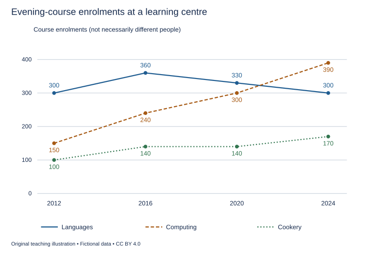

# U31 第21周：长篇阅读、写作与口语

本页为已独立核验的原创文字课程。先完成学生题目，再展开对应参考。非真题、非标准化模考，不换算雅思分数。听力尚未补齐，本页不代表全科课程已完成。

每周选A或G类Task 1一题，加Task 2及三次口语。参考范文不是学生已完成作业，仍须提交初稿、录音和重写，独立真人评分另行安排。

阅读每周180分钟（60分钟首次限时、120分钟证据精读与延迟复测），写作180分钟、口语120分钟。词汇60分钟、听力180分钟另列；新增完整听力未验收，不能勾整周完成。

W22/W24原创阶段检查按实际证据复盘；正式T22/T24陌生整卷、所选真实考试界面操作及真人评分另记，缺少目标或真实证据时不能据此判断报考/延长，本页原创技能卷不能代替正式模拟。后续周数与达标规则见 [U04](u04-exam-preparation.md)。

## 阅读：首答不查词

### R-W21-01 · The Shadow Larger than the Puppet

W21｜正文 853 词｜13 题｜篇章：科学模型：投影中的比例与参照（6段）

本课必做60分钟：首答20、证据复盘20、词汇长句10、48小时后复测10。每周三课180分钟，合卷首答替代单课首答，不重复计算。开放短文选做另加15分钟。

本项目原创虚构教学情境，人物、地点、历史事件和案例数据均非真实研究或史料。科学解释只讨论文内说明的模型与条件。非雅思真题或标准化模考；正确数不换算雅思等级。许可：CC BY 4.0 — RayXBuilds and contributors。

能力点：识别论证关系、区分作者与引述者、条件与因果、精确定位。初读不查词，完成后打开独立答案页。

#### Passage

**A** At the fictional Vela workshop, a small puppet casts a surprisingly large shadow on a screen. A student concludes that the puppet must have grown because its outline now occupies more space. Another says the lamp has made the puppet brighter and therefore larger. The teacher separates the object from its projected outline. In the simplified arrangement used here, a small light source, a flat puppet and a screen stand along the same general line. The shadow depends on their relative positions. Its size is not a direct measurement of the puppet unless those positions are also specified. The exercise is deliberately restricted to this model and makes no claim about every lamp, transparent material or irregular surface. Its purpose is to show how a visible result can change while the object that appears to produce it remains physically unchanged.

**B** The first comparison keeps the lamp and screen fixed while moving the puppet towards the lamp. In this model, the shadow becomes larger. Moving the puppet towards the screen produces a smaller outline, closer to the puppet's own size. The teacher draws two lines from the light source through the top and bottom of the puppet and extends them to the screen. These boundary lines show why a short object can exclude light from a wider area farther away. The drawing is an account of the arrangement, rather than evidence that the puppet itself stretches. Students place a reference ruler beside the puppet before and after each move, confirming that the object remains the same length while the area of the screen from which it excludes light changes.

**C** A second comparison moves the screen while holding the puppet and lamp still. The class measures the outline at each screen position instead of assuming that every change must originate with the moving object in the first comparison. This reversal matters because the same visible increase can arise from changes in different parts of an arrangement. An observer who sees only the final shadow may lack enough information to reconstruct what moved. The students therefore keep a position chart that records the locations of all three components, not merely the outline's dimensions. An explanation becomes stronger when it identifies both what changed and what remained fixed. Otherwise, two observations may be treated as examples of the same cause simply because the resulting shadows look similarly large to someone entering the room after the adjustments have been completed.

**D** The students next replace the small source with a wider luminous panel. The edge of the shadow becomes less sharply defined in the classroom example. Different parts of the panel illuminate around different edges of the puppet, so the transition from dark to light occupies a visible band. The original line drawing no longer describes the whole arrangement adequately. This does not show that the first model was worthless; it shows that a condition on which its simple boundary depended has changed. For measurement, the teacher introduces an edge rule that specifies which point within the transition band will count as the outline. Without a shared rule, two careful students could report different widths because they had chosen different boundaries, rather than because either had failed to observe the screen attentively.

**E** Movement creates an additional challenge for a performance. A puppet that approaches the source while moving sideways can appear to travel and grow at the same time. The performers mark a guide path on the floor to preserve the intended distance from the lamp during a scene requiring constant shadow size. A rehearsal card records which scenes deliberately include changes of scale. These aids distinguish an intended transformation from an accidental one without declaring that every variable shadow is a mistake. The purpose of the performance determines which changes should be prevented. A scene about an approaching giant may benefit from enlargement, whereas a scene representing two equally sized neighbours may become confusing if one performer unintentionally moves closer to the source during an ordinary exchange.

**F** The final demonstration places the unchanged puppet beside several drawings of its shadow. Viewers are asked which drawing gives the true size. The teacher explains that the question needs a reference: the puppet has a physical length, while each shadow has a length on a particular screen under particular conditions. The different measurements need not compete as though only one event actually occurred. A visitor interested in building a second puppet needs the object measurement, whereas a performer arranging a scene needs the projected outline under the planned lighting. The usefulness of a measurement depends on which of these tasks it is meant to support. What would be misleading is to substitute one for another without naming what was measured. The lesson therefore concerns more than optical surprise. It shows why a representation must be interpreted through the arrangement that produced it. Recording a clear number is useful, but the number becomes informative only when its object, boundary and conditions are clear enough for another person to understand or repeat the comparison. A larger image can reveal a changed relationship even when it reveals no growth in the thing being represented.

#### Questions

**Complete the sentences. Choose NO MORE THAN 3 WORDS FROM THE PASSAGE for each answer. Do not change word forms.**

1. The unchanged physical length is checked using a ______ beside the puppet.

2. Locations of the source, puppet and screen are entered on a ______.

3. The agreed boundary inside a blurred band is specified by an ______.

4. Performers follow a floor marking called a ______ to maintain the planned distance.

5. Intentional changes of scale are recorded on a ______.

**Choose ONE answer, A, B, C or D.**

6. The initial mistake is to treat

   A. a lamp as a light source
   B. a projected size as a direct change in the object
   C. the puppet as flat
   D. a screen as a surface

7. What is the purpose of the boundary lines?

   A. To prove material stretching
   B. To record performer names
   C. To explain the geometry of light exclusion
   D. To eliminate the screen

8. Why record all three component positions?

   A. Similar results can arise from different changes
   B. All large shadows share a cause
   C. Only the lamp can move
   D. Puppet size is never relevant

9. The wider light panel demonstrates

   A. that all prior measurements were dishonest
   B. that the puppet must become transparent
   C. a changed condition requiring a richer account
   D. that every shadow has no boundary

**Do the following statements agree with the writer's views? Write YES, NO or NOT GIVEN. YES = the writer agrees; NO = the writer expresses the opposite view; NOT GIVEN = the writer's view is not stated. Do not use outside knowledge.**

10. Every change in shadow size is a performance error.

11. Careful observers can disagree about width because they use different edge definitions.

12. The writer recommends hiring separate staff to maintain the workshop’s lighting equipment.

13. A number needs a clear object and conditions to support a repeatable comparison.

#### 本周重点

限时首答并留出漏答、拼写与词数核对；真实所选考试界面另记未完成。

#### 复盘

必做：给每道错题标记“定位/作者立场/范围/语法/词数”，抄最短证据；用一行箭头概括本文论证或过程。48小时后重做错题与两道正确题，检查是否仍能指出证据。

选做（15分钟，80–100词）：Explain how one unchanged object can support several valid measurements.

R-W21-01 答案、证据与精读（首答后展开）

### R-W21-01 · 独立答案与证据

来源与许可同学生页。先完成再核对。可接受答案由 accepted_answers 明确列出；只忽略大小写和首尾空格，不自行删词。开放复盘不计入客观正确数。

1. **reference ruler / ruler**｜段落 B｜证据：“a reference ruler beside the puppet”

   ruler为合法中心词。

2. **position chart / chart**｜段落 C｜证据：“a position chart that records the locations”

   chart可接受，三者位置明确。

3. **edge rule**｜段落 D｜证据：“an edge rule that specifies”

   rule单独不能接an。

4. **guide path / path**｜段落 E｜证据：“a guide path on the floor”

   path可接受。

5. **rehearsal card / card**｜段落 E｜证据：“A rehearsal card records which scenes”

   card可接受。

6. **B**｜段落 A｜证据：“not a direct measurement of the puppet”

   未限定投影条件即推物体增长。

7. **C**｜段落 B｜证据：“exclude light from a wider area”

   线说明空间关系。

8. **A**｜段落 C｜证据：“changes in different parts”

   同结果不确定同原因。

9. **C**｜段落 D｜证据：“a condition on which its simple boundary depended has changed”

   模型适用条件变化。

10. **NO**｜段落 E｜证据：“which scenes deliberately include changes of scale”

   部分为设计效果。

11. **YES**｜段落 D｜证据：“they had chosen different boundaries”

   明确允许。

12. **NOT GIVEN**｜段落 A｜证据：“small light source”

   全文未提人员雇用政策。

13. **YES**｜段落 F｜证据：“its object, boundary and conditions are clear”

   结论明确。

#### 词汇与长句

- **projected**：通过光影在另一表面呈现的
- **luminous**：发光的
- **boundary**：测量对象所采用的边界
- **transformation**：形态或呈现方式的变化

> An observer who sees only the final shadow may lack enough information to reconstruct what moved.

who限定观察者的信息范围；may不意味着每次都无法判断。

> Without a shared rule, two careful students could report different widths because they had chosen different boundaries, rather than because either had failed to observe the screen attentively.

because提出差异原因，rather than排除草率归因于观察疏忽。

#### 开放任务参考

F分别说明物体与不同条件下投影；B/C记录关系，不把尺寸值直接等同物体增长。

标准：观点有文内依据，保留条件和范围，推断明确标注；不存在唯一措辞。

### R-W21-02 · The Pattern Book of a Tile Workshop

W21｜正文 896 词｜13 题｜篇章：虚构历史：设计样本与实际制作（8段）

本课必做60分钟：首答20、证据复盘20、词汇长句10、48小时后复测10。每周三课180分钟，合卷首答替代单课首答，不重复计算。开放短文选做另加15分钟。

本项目原创虚构教学情境，人物、地点、历史事件和案例数据均非真实研究或史料。科学解释只讨论文内说明的模型与条件。非雅思真题或标准化模考；正确数不换算雅思等级。许可：CC BY 4.0 — RayXBuilds and contributors。

能力点：识别论证关系、区分作者与引述者、条件与因果、精确定位。初读不查词，完成后打开独立答案页。

#### Passage

**A** The fictional tile workshop of Orda leaves a book filled with coloured patterns. A museum initially describes every page as a record of a floor that the workshop installed. The assumption seems reasonable because the drawings are carefully numbered and some carry customers' names. Yet several designs have no corresponding orders, while one customer's letter rejects the pattern shown beside that name. The book contains proposals as well as completed work. Its precision concerns how designs were represented, not necessarily whether they were built. To understand the workshop's activity, a researcher must identify what each page was intended to do before turning an attractive sequence of drawings into a history of actual interiors.

**B** Early pages show a central motif surrounded by a repeating border. The motif is drawn large enough for a customer to inspect its colours, while the border is compressed to fit the page. A viewer who assumes that the whole drawing uses one scale will misjudge the floor's proportions. The researcher finds small measurements beside the repeated border units and uses those figures to reconstruct the arrangement. The image and its annotations perform different jobs. One communicates the appearance of a pattern, while the other specifies dimensions needed for production. Neither should be discarded, but they cannot simply be treated as duplicate descriptions carrying exactly the same information in two forms.

**C** The workshop later adds detachable colour samples. Customers can place these beside several drawings before choosing a combination. A sample attached to a page today may therefore have been used with another proposal earlier. The present arrangement is evidence of the book's surviving condition, not automatic proof of every original pairing. A letter mentions returning a blue sample after rejecting a design, while a later order uses the same named blue in a different room. The researcher does not infer that the physical sample travelled to both buildings. Its role was to support a decision in the workshop. Confusing a choice aid with an installed component would assign the object a journey that the documents do not establish.

**D** One commission changes after the room is measured. The proposed border would leave a narrow strip of cut tiles beside the doorway, so the maker shifts the central motif and adjusts the border's width. The customer approves the revision in a margin note. This is a practical response to the room rather than evidence that the first drawing was incompetently made. At the proposal stage, the maker lacked the final dimensions. The revision makes that change in knowledge visible. It also explains why a surviving floor can resemble a book design without reproducing it exactly. Differences may result from documented adaptation, not necessarily from a later owner's replacement or a mistaken identification by the researcher.

**E** The numbered pages create a further temptation: treating the sequence of numbers as the sequence of production. The workshop sometimes reserved numbers for proposals that were never accepted and returned to earlier designs when new customers asked for variations. A later number could therefore be installed before an earlier one. The researcher compares the book with delivery notes, which give dates when finished tiles left the workshop. Even those dates do not by themselves prove when a whole floor was completed. Shipment and installation are connected events with different timing. A responsible account names the event supported by each date instead of making a single convenient chronology from records created for different practical purposes.

**F** The reconstructed catalogue uses a proposal index to list page numbers, intended customers and whether acceptance is documented. A dimension table transcribes the measurements attached to each design. A revision sheet places the first and altered layouts beside the approving note. A dispatch register collects shipment dates and the number of cases sent. Each record makes one kind of evidence easier to inspect. The categories do not remove uncertainty where a source is missing. They prevent uncertainty about one event from being disguised by a precise number that belongs to another. A blank acceptance field is therefore left blank unless evidence supports a decision, even when the design appears detailed enough to tempt the researcher into imagining a satisfied customer.

**G** For the museum, the researcher prepares a status label distinguishing a proposed design, an approved revision and a confirmed surviving installation. Visitors can appreciate the book's visual richness without assuming that every page has the same relationship to a real floor. The display includes the rejected proposal beside the customer's letter, making refusal part of the workshop's history rather than hiding it as an embarrassing interruption. A business produces options as well as objects. Studying rejected or revised options can reveal how customers and makers negotiated practical requirements that a display of finished masterpieces alone would leave invisible.

**H** The pattern book thus becomes more informative when it ceases to be treated as a simple album of completed rooms. It records a process in which images, measurements, samples and agreements moved towards possible production. Some proposals reached that stage and others did not. The researcher's task is not to make the surviving material tell a uniform success story, but to preserve distinctions that explain how work developed. A drawing's elegance may justify exhibiting it; elegance cannot establish that the design was accepted, manufactured and installed. Those are separate claims, and the book becomes a stronger historical source when the evidence for each remains open to examination.

#### Questions

**Do the following statements agree with the writer's views? Write YES, NO or NOT GIVEN. YES = the writer agrees; NO = the writer expresses the opposite view; NOT GIVEN = the writer's view is not stated. Do not use outside knowledge.**

1. A detailed proposal necessarily proves customer acceptance.

2. A documented adaptation can explain differences between a drawing and a surviving floor.

3. The writer recommends selling copies of the rejected design to museum visitors.

4. Rejected options can contribute to understanding the workshop’s activity.

**Which paragraph contains the following information? Write a letter, A–H. You may use any letter more than once.**

5. a detachable sample whose current attachment need not preserve its original association

6. different scales being used for a central design and its surrounding border

7. a design altered to avoid a narrow cut strip beside an entrance

8. reserved numbers preventing page order from establishing production order

**Complete the summary. Choose NO MORE THAN 3 WORDS FROM THE PASSAGE for each answer. Do not change word forms.**

Customers and acceptance evidence are listed in the (9) ______. Measurements are transcribed in a (10) ______. Original and altered layouts are compared on a (11) ______. Shipment dates and case totals enter a (12) ______. Museum visitors identify the evidential category of a design from a (13) ______.

#### 本周重点

限时首答并留出漏答、拼写与词数核对；真实所选考试界面另记未完成。

#### 复盘

必做：给每道错题标记“定位/作者立场/范围/语法/词数”，抄最短证据；用一行箭头概括本文论证或过程。48小时后重做错题与两道正确题，检查是否仍能指出证据。

选做（15分钟，80–100词）：Explain why a precise drawing is not necessarily evidence of a completed floor.

R-W21-02 答案、证据与精读（首答后展开）

### R-W21-02 · 独立答案与证据

来源与许可同学生页。先完成再核对。可接受答案由 accepted_answers 明确列出；只忽略大小写和首尾空格，不自行删词。开放复盘不计入客观正确数。

1. **NO**｜段落 F｜证据：“A blank acceptance field is therefore left blank”

   明确详细程度不能补接受证据。

2. **YES**｜段落 D｜证据：“Differences may result from documented adaptation”

   保留may。

3. **NOT GIVEN**｜段落 G｜证据：“display includes the rejected proposal”

   展示不说明销售意见。

4. **YES**｜段落 G｜证据：“Studying rejected or revised options can reveal”

   非只成功品有价值。

5. **C**｜段落 C｜证据：“may therefore have been used with another proposal earlier”

   C可移动色样。

6. **B**｜段落 B｜证据：“the border is compressed to fit the page”

   B混合尺度。

7. **D**｜段落 D｜证据：“beside the doorway”

   D具体适配条件。

8. **E**｜段落 E｜证据：“reserved numbers for proposals that were never accepted”

   E编号与生产脱钩。

9. **proposal index / index**｜段落 F｜证据：“a proposal index to list page numbers”

   the后index或完整短语均合法。

10. **dimension table / table**｜段落 F｜证据：“A dimension table transcribes”

   table可接受。

11. **revision sheet / sheet**｜段落 F｜证据：“A revision sheet places the first and altered layouts”

   sheet可接受。

12. **dispatch register / register**｜段落 F｜证据：“A dispatch register collects shipment dates”

   register可接受。

13. **status label / label**｜段落 G｜证据：“a status label distinguishing”

   label可接受。

#### 词汇与长句

- **motif**：图案的核心装饰单元
- **detachable**：可以取下或换位置的
- **commission**：委托制作的项目
- **dispatch**：发货，区别实际安装

> A sample attached to a page today may therefore have been used with another proposal earlier.

attached修饰sample；may have been保留历史可能性。

> Shipment and installation are connected events with different timing.

connected不等于同一事件；日期需跟对应动作绑定。

#### 开放任务参考

A拒绝与无订单；F详细程度不补证；区分提案、批准、发货和安装。

标准：观点有文内依据，保留条件和范围，推断明确标注；不存在唯一措辞。

### R-W21-03 · Does a Trail Need a Destination?

W21｜正文 856 词｜14 题｜篇章：议论：步道目标、选择与服务对象（7段）

本课必做60分钟：首答20、证据复盘20、词汇长句10、48小时后复测10。每周三课180分钟，合卷首答替代单课首答，不重复计算。开放短文选做另加15分钟。

本项目原创虚构教学情境，人物、地点、历史事件和案例数据均非真实研究或史料。科学解释只讨论文内说明的模型与条件。非雅思真题或标准化模考；正确数不换算雅思等级。许可：CC BY 4.0 — RayXBuilds and contributors。

能力点：识别论证关系、区分作者与引述者、条件与因果、精确定位。初读不查词，完成后打开独立答案页。

#### Passage

**A** The fictional landscape trust of Eren plans a walking trail through low hills. Its first proposal ends at a lookout, and the publicity describes reaching that point as the reward for completing the route. A second proposal forms a loop with several places to stop but no single culminating view. Some trustees call the loop aimless. Their criticism assumes that a recreational walk becomes meaningful only when it delivers a distinctive final destination. That assumption deserves examination. A destination can organise effort and create anticipation, but a route can also support observation, conversation or a repeated practice of walking near home. The question is not whether endpoints are good or bad. It is which experience a particular trail promises and whether its design makes that experience available to the people it claims to serve.

**B** A conspicuous endpoint has real advantages. New visitors can understand where they are going, estimate progress and tell others what they intend to reach. A sign naming the lookout can reduce uncertainty at a junction. These benefits should not be dismissed merely because they sound simple. However, the final view may depend on weather, and some walkers may need to turn back before reaching it. If publicity presents everything before the lookout as an obstacle to be overcome, those visitors may feel that their walk has failed despite having enjoyed much of it. The destination's value does not require treating the rest of the route as empty distance. A design can make progress legible while giving intermediate experiences a purpose of their own.

**C** The loop proposal includes a sheltered seat, a stretch where seasonal changes are easy to notice and a short branch returning to the entrance. These features support different lengths of visit. Someone with limited time can take the branch without being represented as an unsuccessful climber. The trust nevertheless avoids describing the loop as suitable for everyone. A circular line on a map says nothing by itself about gradients, surface conditions or the distance between resting places. An apparently modest route may still exclude people whose needs were not considered. Accessibility requires attention to the actual conditions of use, rather than a flattering contrast between a supposedly inclusive loop and a supposedly demanding destination trail.

**D** Maintenance complicates the choice. A lookout concentrates wear at one popular point, while several stopping places distribute activity across a wider area. Distribution may reduce pressure at a single location but create more places needing care. The trust therefore compares likely maintenance tasks rather than assuming that dispersal automatically removes the burden. It also considers how signs will direct people when one section closes. A trail is not only the line drawn before opening day. It is a continuing arrangement whose usefulness depends on repairs, clear alternatives and the ability to explain temporary changes without sending visitors into a route they cannot complete under the current conditions.

**E** To understand demand, staff ask walkers to describe the purpose of their visit before choosing a route. They then ask what made the visit feel complete. Some mention reaching a view; others mention spending a short interval outdoors or noticing a change since their previous walk. The responses are not votes proving that one form should replace all others. They reveal different criteria that a single completion count would hide. Recording only arrivals at the lookout would define success in the destination trail's own terms before the comparison began. A fair evaluation needs measures connected to the purposes under consideration, including the purposes for which reaching that point was never necessary.

**F** The final plan combines a clearly signed lookout branch with a shorter loop and marks the distances and conditions of both. The entrance information explains that either can form a complete visit. This is not a claim that every compromise produces a better design. Extra junctions can confuse people unless the relationship between the routes is made clear. The trust tests the signs with visitors who have not seen the planning drawings and checks whether they can identify a suitable return route. Familiarity with the designer's map is not taken as evidence that first-time walkers will understand the choices presented on the ground. The combined layout must justify its added complexity through actual opportunities it creates. A choice that exists only on paper is not yet an opportunity a visitor can reliably use.

**G** The debate consequently shifts from deciding whether every trail needs a destination to deciding how a trail defines a worthwhile experience. A final view can remain important without monopolising that definition. Equally, an open-ended walk is not automatically thoughtful or accessible just because it lacks a summit photograph. What matters is whether promises, physical conditions and evaluation criteria fit together. Walkers should be able to understand what they are choosing and to recognise a completed visit without being judged against a purpose they never adopted. A landscape can offer more than one kind of arrival, including the decision to return after an attentive short walk. The trust's responsibility is to make those possibilities clear and practical, rather than allowing a memorable publicity image to decide in advance what every visitor ought to value.

#### Questions

**Choose ONE answer, A, B, C or D.**

1. The writer’s central concern is

   A. whether all viewpoints should close
   B. whether publicity should omit route information
   C. whether loops always lack purpose
   D. whether design serves the experience it promises

2. An endpoint can help unfamiliar visitors by

   A. eliminating intermediate experiences
   B. removing every physical barrier
   C. guaranteeing good weather
   D. making direction and progress understandable

3. Why is a circular map line insufficient evidence of accessibility?

   A. Maps cannot show any facts
   B. Resting places are irrelevant
   C. All circles are steep
   D. It does not by itself describe conditions of use

4. Counting only lookout arrivals would

   A. fairly represent every purpose
   B. define success using one proposal’s own criterion
   C. measure maintenance cost
   D. prove loops are preferred

**Do the following statements agree with the writer's views? Write YES, NO or NOT GIVEN. YES = the writer agrees; NO = the writer expresses the opposite view; NOT GIVEN = the writer's view is not stated. Do not use outside knowledge.**

5. A destination’s advantages justify treating all earlier sections as purposeless.

6. Distributing activity necessarily removes maintenance burdens.

7. The writer recommends charging a lower fee to walkers who return early.

8. The combined layout must be tested for difficulties introduced by extra choices.

9. A short visit may be complete according to the visitor’s own purpose.

**Which paragraph contains the following information? Write a letter, A–G. You may use any letter more than once.**

10. testing new signs with people unfamiliar with the planning drawings

11. a final view whose availability can depend on the weather

12. a comparison of concentrated wear and care needed at multiple stopping places

13. a sheltered seat and an early-return branch supporting different visit lengths

14. questions about visit purpose asked before route choice

#### 本周重点

限时首答并留出漏答、拼写与词数核对；真实所选考试界面另记未完成。

#### 复盘

必做：给每道错题标记“定位/作者立场/范围/语法/词数”，抄最短证据；用一行箭头概括本文论证或过程。48小时后重做错题与两道正确题，检查是否仍能指出证据。

选做（15分钟，80–100词）：Explain how a completion measure can favour one trail design before evaluation begins.

R-W21-03 答案、证据与精读（首答后展开）

### R-W21-03 · 独立答案与证据

来源与许可同学生页。先完成再核对。可接受答案由 accepted_answers 明确列出；只忽略大小写和首尾空格，不自行删词。开放复盘不计入客观正确数。

1. **D**｜段落 A｜证据：“which experience a particular trail promises”

   目的和设计匹配。

2. **D**｜段落 B｜证据：“estimate progress”

   明确承认终点优势。

3. **D**｜段落 C｜证据：“says nothing by itself about gradients”

   图形不能代替实际条件。

4. **B**｜段落 E｜证据：“define success in the destination trail's own terms”

   比较标准偏向单用途。

5. **NO**｜段落 B｜证据：“does not require treating the rest of the route as empty distance”

   明确相反。

6. **NO**｜段落 D｜证据：“create more places needing care”

   分散可转移而不消除。

7. **NOT GIVEN**｜段落 C｜证据：“different lengths of visit”

   未讨论收费。

8. **YES**｜段落 F｜证据：“Extra junctions can confuse people”

   组合有新复杂性。

9. **YES**｜段落 G｜证据：“an attentive short walk”

   作者承认多种完成。

10. **F**｜段落 F｜证据：“visitors who have not seen the planning drawings”

   F具体测试对象。

11. **B**｜段落 B｜证据：“the final view may depend on weather”

   B天气限制独有，避免与F最终标志测试重叠。

12. **D**｜段落 D｜证据：“distribute activity across a wider area”

   D维护对比。

13. **C**｜段落 C｜证据：“a sheltered seat”

   C设施组合。

14. **E**｜段落 E｜证据：“before choosing a route”

   E调查时序。

#### 词汇与长句

- **culminating**：被安排为体验高潮或终点的
- **gradient**：坡度
- **dispersal**：将活动分散到多处
- **criterion**：评价所依据的标准

> Distribution may reduce pressure at a single location but create more places needing care.

may和but同时保留收益与代价。

> Walkers should be able to understand what they are choosing and to recognise a completed visit without being judged against a purpose they never adopted.

两个不定式并列；without限制外加评价目标。

#### 开放任务参考

E只数到达观景台将终点目的当唯一标准；需先看不同访问目的。

标准：观点有文内依据，保留条件和范围，推断明确标注；不存在唯一措辞。

## 写作与口语：Task 1双分支择一

### WS-W21-T1A 学生页：晚间课程报名趋势

周次 W21｜题型 T1A｜能力点：趋势、限时与漏项检查

Task 1 的 A/G 分支二选一，另一分支不计入本周作业。

#### 使用与记录

原创教学练习，非真题、非标准化模拟，难度未校准。先完成本页再打开参考页。人物、机构、经历与数据均为教学虚构。范例的身份、地点、动作和细节不是强制要求。口语优先用真实经历或真实观察，并说明来源；没有相关经历时，可将假设回答明确标为技能练习，不伪装成亲历。不要背诵示例。自评和 AI 反馈不能代替独立真人评分，未获得真人评阅时标记“分数未确认”。

保存：任务ID、实际日期、用时、初稿或原始录音、证据化反馈、重写/重答、三条修改理由。没有学生提交物，不得填写“已批改”或“已完成训练”。

#### 完整题干

The graph shows enrolments in three types of evening course at a learning centre in selected years between 2012 and 2024. Summarise the information by selecting and reporting the main features, and make comparisons where relevant.

Write at least 150 words. Spend about 20 minutes on this task.

教学虚构。2012/2016/2020/2024：Languages300/360/330/300，Computing150/240/300/390，Cookery100/140/140/170。单位报名次数，可一人多课；未给价格、人数或开课频率。

#### 任务预算（含首次审题，不额外加时）

初稿20分钟（审题规划3、写作15、检查2）；诊断15；反馈阅读与证据核查10；完整重写25；对照归档5。合计75分钟。

#### 初稿后自评清单

- [ ] 达到最低字数；全文连贯成段，没有用项目符号代替作文。
- [ ] 概述给主要特征；数据、阶段或方位都与题图逐项相符，不推断未提供的原因。
- [ ] 每段可写出一个功能标签；例子或数据与该段要点相连。
- [ ] 核查两处词汇搭配和两处句法；如有疑点先试改再核实，无问题则记录通过证据。
- [ ] 如有影响理解的问题，记录原句；否则记通过或待核查，不填写自猜分数。

#### 反馈与重写

打开 独立参考页（本节下方展开参考），按逐段检查和通用协议核验。重写任务：完整重写至少150词；如存在漏项/拼写疑点才修正，保留原词与依据；如无则记录核查通过。按所选纸笔或键入方式限时，但不能据此声称实际考场界面练习完成。

#### 本周重点操作（已含原预算）

在原归档时段取3分钟登记所选考试形式及本次练习工具。写作按所选纸笔/键入方式完成，漏项和拼写检查已在初稿20分钟内的2分钟或40分钟内的5分钟，不另加时。核对报名单位、主要趋势、持平与比较；只核查实际写出的词语拼写。 如有问题才登记修正；无则记通过或待核查。普通编辑器、录音或本课页面不等于实际考试界面。真实界面熟悉练习单列来源、日期和完成状态；目前无记录，标“未完成/未确认”。

记录表见[阶段证据表](u35-feedback.md)，只在上述原时段填写相关行。

W21 T1A 示例、反馈与重练（首答后展开）

### WS-W21-T1A 独立参考页

只在初稿完成后阅读；不是唯一答案，也没有官方分数。以下是对原创示例的教学讲评，不是对学生尚未提交作文的已完成批改。

#### 思路拆解

首答20分钟内完成概述和主比较；读清报名次数非独立人数；查首尾、峰值与持平，最后核拼写和单位。

#### 原创示例

The graph compares enrolments in language, computing and cookery courses at a learning centre in four selected years from 2012 to 2024. The figures represent course enrolments rather than necessarily different individuals.

Overall, language courses attracted the most enrolments in the first three years shown, but computing became the largest category in 2024. Computing enrolments increased throughout, whereas language enrolments rose initially and then declined. Cookery remained the smallest category despite an increase over the period.

In 2012, languages recorded 300 enrolments, compared with 150 for computing and 100 for cookery. By 2016, the language figure had reached its peak of 360, while computing rose to 240 and cookery to 140. Languages therefore retained a substantial lead at that point.

In 2020, language enrolments fell to 330 and computing increased to 300, reducing the gap to just thirty. Cookery remained unchanged at 140. In the final year, computing reached 390 enrolments, ninety more than languages, which returned to 300. Cookery rose to 170. Consequently, the three categories together accounted for 860 enrolments in 2024, compared with 550 in 2012.

示例正文词数：179（本项目正则计数；书信不含称呼、结束语与署名；连字符词作一词）。

#### 逐段反馈与迁移

以下只分析上方原创示例。题干要点及图表事实必须遵守；书信、议论文的自拟身份、日期、经历和例子不是新增强制要求。按自己的合理设定核验，不为对齐范例编造经历。

- P1 enrolments不等于独立学生，同人可能报多课。

- P2 computing末年领先，cookery一直最小；languages不是持续上涨。

- P3 2016语言峰360，另两类240/140；不补收费或宣传原因。

- P4 2020差30、2024差90；厨艺2016/2020持平140；合计550→860，算术可回查。

#### 常见失误

把报名当不同人数；漏持平；只检查单词不查概述或单位。

#### 可执行反馈步骤

1. 先把自己的段落标为引入、概述/论点、支持、收束；分段可不同于示例，按功能核查，不照抄段数。
2. 对照上方逐段检查，逐项标“已有证据/缺失/不适用”。每条意见必须附自己的原句或缺失位置。
3. 按 [反馈协议](u35-feedback.md) 的四维表记录；有争议的 AI 意见回题干、数据或语法依据核验。
4. 只选至多两项有证据的优先点执行整篇重写；如未发现问题，可改变组织或表达练迁移，但不把它标成纠错；保留原稿，禁止把示例替换为自己的作业。

#### 重写任务

完整重写至少150词；如存在漏项/拼写疑点才修正，保留原词与依据；如无则记录核查通过。按所选纸笔或键入方式限时，但不能据此声称实际考场界面练习完成。

完成后重新勾选 学生页（见本节上方学生题） 清单；将一处改前/改后及理由交给独立评阅者核查。真人评阅状态目前为“待安排”，不是已完成。

### WS-W21-T1G 学生页：要求核对课程报名信息

周次 W21｜题型 T1G｜能力点：书信目的、要点与语气

Task 1 的 A/G 分支二选一，另一分支不计入本周作业。

#### 使用与记录

原创教学练习，非真题、非标准化模拟，难度未校准。先完成本页再打开参考页。人物、机构、经历与数据均为教学虚构。范例的身份、地点、动作和细节不是强制要求。口语优先用真实经历或真实观察，并说明来源；没有相关经历时，可将假设回答明确标为技能练习，不伪装成亲历。不要背诵示例。自评和 AI 反馈不能代替独立真人评分，未获得真人评阅时标记“分数未确认”。

保存：任务ID、实际日期、用时、初稿或原始录音、证据化反馈、重写/重答、三条修改理由。没有学生提交物，不得填写“已批改”或“已完成训练”。

#### 完整题干

You booked a short course, but the confirmation contains incorrect information. Write to the course administrator. In your letter:
- give the details of the booking you intended to make
- describe the incorrect information in the confirmation
- ask for the corrections and confirmation you need.
Begin your letter: Dear Sir or Madam,

Write at least 150 words. You do not need to write any addresses. Spend about 20 minutes on this task.

#### 任务预算（含首次审题，不额外加时）

初稿20分钟（审题规划3、写作15、检查2）；诊断15；反馈阅读与证据核查10；完整重写25；对照归档5。合计75分钟。

#### 初稿后自评清单

- [ ] 达到最低字数；全文连贯成段，没有用项目符号代替作文。
- [ ] 三个要点均展开；称呼、目的、语气和结束语适合收信人。
- [ ] 每段可写出一个功能标签；例子或数据与该段要点相连。
- [ ] 核查两处词汇搭配和两处句法；如有疑点先试改再核实，无问题则记录通过证据。
- [ ] 如有影响理解的问题，记录原句；否则记通过或待核查，不填写自猜分数。

#### 反馈与重写

打开 独立参考页（本节下方展开参考），按逐段检查和通用协议核验。重写任务：整篇重写至少150词；核对三个题干要点、名字、日期和请求语气。如无错误记通过，不制造错字；实际所选输入方式单独登记。

#### 本周重点操作（已含原预算）

在原归档时段取3分钟登记所选考试形式及本次练习工具。写作按所选纸笔/键入方式完成，漏项和拼写检查已在初稿20分钟内的2分钟或40分钟内的5分钟，不另加时。核对自己设定的原报名信息、确认中的差异和更正请求；名字与日期前后一致。 如有问题才登记修正；无则记通过或待核查。普通编辑器、录音或本课页面不等于实际考试界面。真实界面熟悉练习单列来源、日期和完成状态；目前无记录，标“未完成/未确认”。

记录表见[阶段证据表](u35-feedback.md)，只在上述原时段填写相关行。

W21 T1G 示例、反馈与重练（首答后展开）

### WS-W21-T1G 独立参考页

只在初稿完成后阅读；不是唯一答案，也没有官方分数。以下是对原创示例的教学讲评，不是对学生尚未提交作文的已完成批改。

#### 思路拆解

正式核对；原拟报名与收到信息分开。示例选择姓名和组别两项差异，学生可合理自拟其他错误信息；备选未获同意不假定。

#### 原创示例

Dear Sir or Madam,

I am writing about my booking for the introductory gardening course, reference GD417. I intended to join the Saturday morning group beginning on 8 September. When I completed the booking form, I selected that group because I work during the week and can only attend at weekends.

The confirmation I received yesterday lists the Thursday evening group instead. It also spells my surname as Chan, although I entered Chen on the form. The email address and telephone number shown in the confirmation are correct. I would like to have the group and name checked before any course materials or attendance records are prepared.

Could you please transfer the booking to the Saturday group, if a place is still available, and correct the spelling of my name? I would appreciate a revised confirmation showing the starting date, session time and location. If the Saturday group is already full, please let me know what alternatives are available before changing my booking to another group. I have attached the original booking summary so that you can compare the details.

Yours faithfully,
Alex Chen

示例正文词数：176（本项目正则计数；书信不含称呼、结束语与署名；连字符词作一词）。

#### 逐段反馈与迁移

以下只分析上方原创示例。题干要点及图表事实必须遵守；书信、议论文的自拟身份、日期、经历和例子不是新增强制要求。按自己的合理设定核验，不为对齐范例编造经历。

- P1 编号/原选周六及原因完整，属于虚构书信情境非真实订单。

- P2 周四组及Chan/Chen两误差明确；正确联系方式不误改。

- P3 请求改正与新确认要点齐全；满员则先告知选项，不声称已转成功。

#### 常见失误

漏自己设定的错误信息或更正请求；若采用本示例的姓名/组别设定，需前后一致，但题目不强制学生使用这两项具体错误。

#### 可执行反馈步骤

1. 先把自己的段落标为引入、概述/论点、支持、收束；分段可不同于示例，按功能核查，不照抄段数。
2. 对照上方逐段检查，逐项标“已有证据/缺失/不适用”。每条意见必须附自己的原句或缺失位置。
3. 按 [反馈协议](u35-feedback.md) 的四维表记录；有争议的 AI 意见回题干、数据或语法依据核验。
4. 只选至多两项有证据的优先点执行整篇重写；如未发现问题，可改变组织或表达练迁移，但不把它标成纠错；保留原稿，禁止把示例替换为自己的作业。

#### 重写任务

整篇重写至少150词；核对三个题干要点、名字、日期和请求语气。如无错误记通过，不制造错字；实际所选输入方式单独登记。

完成后重新勾选 学生页（见本节上方学生题） 清单；将一处改前/改后及理由交给独立评阅者核查。真人评阅状态目前为“待安排”，不是已完成。

### WS-W21-T2 学生页：四天工作周

周次 W21｜题型 T2｜能力点：观点展开与任务回应

A/G 共用本题。

#### 使用与记录

原创教学练习，非真题、非标准化模拟，难度未校准。先完成本页再打开参考页。人物、机构、经历与数据均为教学虚构。范例的身份、地点、动作和细节不是强制要求。口语优先用真实经历或真实观察，并说明来源；没有相关经历时，可将假设回答明确标为技能练习，不伪装成亲历。不要背诵示例。自评和 AI 反馈不能代替独立真人评分，未获得真人评阅时标记“分数未确认”。

保存：任务ID、实际日期、用时、初稿或原始录音、证据化反馈、重写/重答、三条修改理由。没有学生提交物，不得填写“已批改”或“已完成训练”。

#### 完整题干

Some employers are considering a four-day working week with no reduction in weekly pay. Do the advantages of this arrangement outweigh the disadvantages? Give reasons and include relevant examples.

Write at least 250 words. Spend about 40 minutes on this task.

#### 任务预算（含首次审题，不额外加时）

初稿40分钟（审题规划5、写作30、检查5）；诊断15；反馈阅读与证据核查10；完整重写35；对照归档5。合计105分钟。

#### 初稿后自评清单

- [ ] 达到最低字数；全文连贯成段，没有用项目符号代替作文。
- [ ] 直接回答题目的所有问句，有始终一致的立场。
- [ ] 每段可写出一个功能标签；例子或数据与该段要点相连。
- [ ] 核查两处词汇搭配和两处句法；如有疑点先试改再核实，无问题则记录通过证据。
- [ ] 如有影响理解的问题，记录原句；否则记通过或待核查，不填写自猜分数。

#### 反馈与重写

打开 独立参考页（本节下方展开参考），按逐段检查和通用协议核验。重写任务：完整重写至少250词；限时核主张、例子与限制。如发现长句或拼写问题才修；结束时标真实完成位置，不靠额外时间伪报按时完成。

#### 本周重点操作（已含原预算）

在原归档时段取3分钟登记所选考试形式及本次练习工具。写作按所选纸笔/键入方式完成，漏项和拼写检查已在初稿20分钟内的2分钟或40分钟内的5分钟，不另加时。核对利弊权衡、立场与限制，检查实际文本的漏项和拼写，不预设有错误。 如有问题才登记修正；无则记通过或待核查。普通编辑器、录音或本课页面不等于实际考试界面。真实界面熟悉练习单列来源、日期和完成状态；目前无记录，标“未完成/未确认”。

记录表见[阶段证据表](u35-feedback.md)，只在上述原时段填写相关行。

W21 T2 示例、反馈与重练（首答后展开）

### WS-W21-T2 独立参考页

只在初稿完成后阅读；不是唯一答案，也没有官方分数。以下是对原创示例的教学讲评，不是对学生尚未提交作文的已完成批改。

#### 思路拆解

权衡限定适用工作场景，不把四天等于总工时自动减少；按休息、覆盖与强度比较，试点需证据。

#### 原创示例

A four-day working week without lower weekly pay could give employees more time outside work, but it also raises questions about workload and service coverage. I believe its advantages can outweigh its disadvantages in suitable workplaces, provided that employers redesign the work rather than simply compress five days of tasks into four exhausting days.

The main potential benefit is additional time for rest and personal responsibilities. An employee might use the extra day for appointments, family activities or learning without repeatedly interrupting the working week. This could make the job more attractive and help staff remain with an organisation. However, the benefit depends on whether the free day is genuinely protected. If unfinished tasks routinely spill into it, the apparent reduction in working days achieves much less.

The disadvantages are particularly clear where a service must remain available throughout the week. A customer support team, for example, cannot assume that customers will stop needing help on the fifth day. Covering the same opening hours may require staggered schedules or additional staff. Some employees could also face more intense working days, making the arrangement less comfortable than its name suggests. These costs should be included in any comparison rather than treated as minor implementation details.

In my view, a limited trial offers a better approach than either rejecting the idea or introducing it everywhere at once. A workplace could reduce unnecessary meetings, distribute coverage across different teams and monitor both employee workload and service quality. If the trial shows that tasks are being rushed or that staff work unofficially on the extra day off, the arrangement should be adjusted rather than declared successful merely because the schedule has changed.

Overall, the extra personal time can be a substantial advantage, but it is not created by a calendar change alone. The case is strongest where work can be reorganised without transferring unreasonable pressure to employees or customers.

示例正文词数：315（本项目正则计数；书信不含称呼、结束语与署名；连字符词作一词）。

#### 逐段反馈与迁移

以下只分析上方原创示例。题干要点及图表事实必须遵守；书信、议论文的自拟身份、日期、经历和例子不是新增强制要求。按自己的合理设定核验，不为对齐范例编造经历。

- P1 条件式利大，no reduction pay已回应，不讨论自愿减薪兼职。

- P2 休息/责任便利有机制，真正休息日是条件。

- P3 服务覆盖与强度成本具体，不假设所有岗位相同。

- P4 试点看实际负担质量，不凭新日历宣布成功。

- P5 和首段一致，没有保证生产率上涨。

#### 常见失误

把四天必然等于轻松；忘服务需求；用虚构研究证明固定百分比效果。

#### 可执行反馈步骤

1. 先把自己的段落标为引入、概述/论点、支持、收束；分段可不同于示例，按功能核查，不照抄段数。
2. 对照上方逐段检查，逐项标“已有证据/缺失/不适用”。每条意见必须附自己的原句或缺失位置。
3. 按 [反馈协议](u35-feedback.md) 的四维表记录；有争议的 AI 意见回题干、数据或语法依据核验。
4. 只选至多两项有证据的优先点执行整篇重写；如未发现问题，可改变组织或表达练迁移，但不把它标成纠错；保留原稿，禁止把示例替换为自己的作业。

#### 重写任务

完整重写至少250词；限时核主张、例子与限制。如发现长句或拼写问题才修；结束时标真实完成位置，不靠额外时间伪报按时完成。

完成后重新勾选 学生页（见本节上方学生题） 清单；将一处改前/改后及理由交给独立评阅者核查。真人评阅状态目前为“待安排”，不是已完成。

### WS-W21-S1 学生页

周次W21｜Part 1专项｜能力点：在规定时间内直接回应；检查题卡覆盖，选择并回应追问｜30分钟

#### 使用与记录

原创教学练习，非真题、非标准化模拟，难度未校准。先完成本页再打开参考页。人物、机构、经历与数据均为教学虚构。范例的身份、地点、动作和细节不是强制要求。口语优先用真实经历或真实观察，并说明来源；没有相关经历时，可将假设回答明确标为技能练习，不伪装成亲历。不要背诵示例。自评和 AI 反馈不能代替独立真人评分，未获得真人评阅时标记“分数未确认”。

保存：任务ID、实际日期、用时、初稿或原始录音、证据化反馈、重写/重答、三条修改理由。没有学生提交物，不得填写“已批改”或“已完成训练”。

#### 操作与预算

设备与审题3分钟；首答录音6；回听及局部转写7；示例和诊断5；不看稿重答6；归档3。共30分钟。

#### Part 1专项题

1. Do you prefer making plans on paper or on a screen?
2. When do you usually check your plans?
3. How do you remember small tasks?
4. Has the way you organise your time changed?

追问：

- What happens when a plan changes unexpectedly?
- Would the same method suit everyone?

首答6分钟内依次答4个主问，每题约40～60秒；两条追问只选1条答约30～45秒，其余时间用于转题。备用追问留给重答，不要求全部说完。

#### 录音回听清单

- [ ] 保留首答原音，记录实际时长、是否中断、是否看稿；只报真实完成状态；短于目标时长如实记，不用沉默或无关内容凑时。
- [ ] 流利与连贯：标出两处时间戳，区分构思停顿与重复搜词，检查是否偏离问句。
- [ ] 词汇：如有模糊词或无效重复，引用一处并先解释原意再试改；无则记录清楚的表达，不为难词改变意思。
- [ ] 语法：核对经历与习惯的时态；局部转写核查；如存在妨碍理解的问题才更正，无则记通过。
- [ ] 发音：不看转写听30秒，如有听不清的词尾、重音或断句则标时间戳，无则记录清楚证据；没有音频不能判断发音。
- [ ] 展开：主要回答有具体情境或理由；追问后第一句回应追问的新角度。

#### 重答要求

如有笼统判断，选择至多两个答案补具体情境；如没有，选择两题换角度重答并保留切题证据；重答一条追问，检查是否真正回应其新角度。

首答回听后才打开独立参考页（本节下方展开参考）。按[反馈协议](u35-feedback.md)填至少三个时间戳，不以文字转写替代音频评阅。

#### 本周重点操作（已含原预算）

在原归档时段取3分钟记本次现场同伴/远程同伴/独练方式、实际首答时长与所选追问；按本页限时，不强行回答整套备用题。依据自己的原始音频标实际时长、题目覆盖和一个清楚或待核查的时间戳；范例身份、事件和细节均不必照搬。 如有问题才登记修正；无则记通过或待核查。普通编辑器、录音或本课页面不等于实际考试界面。真实界面熟悉练习单列来源、日期和完成状态；目前无记录，标“未完成/未确认”。

记录表见[阶段证据表](u35-feedback.md)，只在上述原时段填写相关行。

W21 S1 示例、反馈与重练（首答后展开）

### WS-W21-S1 独立参考页

原创教学示例，非真题或评分结果。未收到学生音频；以下是示例分析与待执行反馈，不能登记为已完成学生批改。

#### 展开示例

##### 直接回应→原因→具体情境的展开示例

I normally use a paper notebook for personal plans because I can see the whole week at once. For appointments that may change, though, I use my phone. It can remind me before I leave, so I do not have to keep checking the notebook while I am travelling.

纯口答示例词数：49；只计MODEL标记内实际英文口答，不含标题、标签、说明。词数不能证明录音时长或流利度。

#### 展开与反馈

本周能力：在规定时间内直接回应；检查题卡覆盖，选择并回应追问。

1. 示例先表态，再说明偏好理由，最后提供条件或场景。检查自己是否用一个词回答后就结束。
2. 找到一个具体细节：物品、动作、对话或地点。用真实经历或注明来源的真实观察替换；假设回答须标为技能练习。保持切题，不强制复制范例细节，不照搬身份与经历。
3. 追问要重新回应，不能继续背长答。首句先回答追问，再用一条理由支持。
4. 如存在听不清或语法影响理解处，标原音时间戳；否则标一处清楚的原音证据；先尝试最小修正。不要把自然停顿一概当成错误，或用加快语速掩盖逻辑断裂。

#### 常见失误

空泛形容词替代具体过程；给了经历却没解释为什么重要；Part 3只有个人故事没有一般解释；AI只看转写就判断发音。逐项回原音核对，不能凭范例推断自己已达到某个分数。

#### 可执行重答与反馈

如有笼统判断，选择至多两个答案补具体情境；如没有，选择两题换角度重答并保留切题证据；重答一条追问，检查是否真正回应其新角度。

填写[反馈协议](u35-feedback.md)四维表，附三个时间戳和原话证据。如存在，选至多一个内容问题与一个语言问题先修；否则记录清楚的证据并做迁移重答；重答后并排听两段，记录改善与仍未解决之处。自评与AI不能替代独立真人评分；独立评阅目前待安排，分数未确认。

### WS-W21-S2 学生页

周次W21｜Part 2专项｜能力点：在规定时间内直接回应；检查题卡覆盖，选择并回应追问｜30分钟

#### 使用与记录

原创教学练习，非真题、非标准化模拟，难度未校准。先完成本页再打开参考页。人物、机构、经历与数据均为教学虚构。范例的身份、地点、动作和细节不是强制要求。口语优先用真实经历或真实观察，并说明来源；没有相关经历时，可将假设回答明确标为技能练习，不伪装成亲历。不要背诵示例。自评和 AI 反馈不能代替独立真人评分，未获得真人评阅时标记“分数未确认”。

保存：任务ID、实际日期、用时、初稿或原始录音、证据化反馈、重写/重答、三条修改理由。没有学生提交物，不得填写“已批改”或“已完成训练”。

#### 操作与预算

准备、首答录音及追问5分钟；回听及局部转写8；示例与诊断5；关键词重组3；重答及追问5；归档4。共30分钟。

#### Part 2专项任务卡

Describe a time you checked something carefully before using it.

Say:
- what you checked
- why you checked it
- how you checked it
- and explain whether the check was useful.

准备1分钟，说1～2分钟。只记5个关键词，不预写句子。

收尾追问：

- Would you do the same check again?
- Who else might find that check useful?

每轮5分钟包含准备1分钟、连续说1～2分钟、两条收尾追问选1条答20～30秒及转题缓冲；另一条可用于重答。不把备用题全部加进本轮。

#### 录音回听清单

- [ ] 保留首答原音，记录实际时长、是否中断、是否看稿；只报真实完成状态；短于目标时长如实记，不用沉默或无关内容凑时。
- [ ] 流利与连贯：标出两处时间戳，区分构思停顿与重复搜词，检查是否偏离问句。
- [ ] 词汇：如有模糊词或无效重复，引用一处并先解释原意再试改；无则记录清楚的表达，不为难词改变意思。
- [ ] 语法：核对经历与习惯的时态；局部转写核查；如存在妨碍理解的问题才更正，无则记通过。
- [ ] 发音：不看转写听30秒，如有听不清的词尾、重音或断句则标时间戳，无则记录清楚证据；没有音频不能判断发音。
- [ ] 展开：主要回答有具体情境或理由；追问后第一句回应追问的新角度。

#### 重答要求

用五个关键词重答完整任务卡1～2分钟，再从两条追问中选1条答20～30秒；如缺具体细节则补、如有无关背景则删；若已清楚，换表达但保持事实。比较首答与重答，不背示例。

首答回听后才打开独立参考页（本节下方展开参考）。按[反馈协议](u35-feedback.md)填至少三个时间戳，不以文字转写替代音频评阅。

#### 本周重点操作（已含原预算）

在原归档时段取3分钟记本次现场同伴/远程同伴/独练方式、实际首答时长与所选追问；按本页限时，不强行回答整套备用题。依据自己的原始音频标实际时长、题目覆盖和一个清楚或待核查的时间戳；范例身份、事件和细节均不必照搬。 如有问题才登记修正；无则记通过或待核查。普通编辑器、录音或本课页面不等于实际考试界面。真实界面熟悉练习单列来源、日期和完成状态；目前无记录，标“未完成/未确认”。

记录表见[阶段证据表](u35-feedback.md)，只在上述原时段填写相关行。

W21 S2 示例、反馈与重练（首答后展开）

### WS-W21-S2 独立参考页

原创教学示例，非真题或评分结果。未收到学生音频；以下是示例分析与待执行反馈，不能登记为已完成学生批改。

#### 展开示例

##### 原创长答示例（时长须以个人实际录音测量）

I would like to talk about checking the route for a walk I was planning with a friend. We wanted to visit a lake outside our town, and I had found a route description online.

Before we left, I noticed that the description had been written several years earlier. I was not sure whether the small footbridge mentioned in it was still open, so I compared it with a more recent notice from the park. That notice said the bridge was closed for repairs. I then marked a different path on a paper map and saved a copy on my phone.

The check took only a few minutes, but it changed where we started the walk. We also allowed more time because the alternative route was longer. When we reached the park, there was a barrier beside the old bridge, exactly as the notice had explained.

I found the check useful because it turned a possible interruption into an ordinary part of our plan. It did not remove every uncertainty, such as the weather, but it dealt with one specific question before it caused a problem.

纯口答示例词数：186；只计MODEL标记内实际英文口答，不含标题、标签、说明。词数不能证明录音时长或流利度。

#### 展开与反馈

本周能力：在规定时间内直接回应；检查题卡覆盖，选择并回应追问。

1. 长答示例按背景、行动/观察、变化与意义组织。每段都推进内容；检查自己是否只有背景而没有具体事件。
2. 找到一个具体细节：物品、动作、对话或地点。用真实经历或注明来源的真实观察替换；假设回答须标为技能练习。保持切题，不强制复制范例细节，不照搬身份与经历。
3. 追问要重新回应，不能继续背长答。首句先回答追问，再用一条理由支持。
4. 如存在听不清或语法影响理解处，标原音时间戳；否则标一处清楚的原音证据；先尝试最小修正。不要把自然停顿一概当成错误，或用加快语速掩盖逻辑断裂。

#### 常见失误

空泛形容词替代具体过程；给了经历却没解释为什么重要；Part 3只有个人故事没有一般解释；AI只看转写就判断发音。逐项回原音核对，不能凭范例推断自己已达到某个分数。

#### 可执行重答与反馈

用五个关键词重答完整任务卡1～2分钟，再从两条追问中选1条答20～30秒；如缺具体细节则补、如有无关背景则删；若已清楚，换表达但保持事实。比较首答与重答，不背示例。

填写[反馈协议](u35-feedback.md)四维表，附三个时间戳和原话证据。如存在，选至多一个内容问题与一个语言问题先修；否则记录清楚的证据并做迁移重答；重答后并排听两段，记录改善与仍未解决之处。自评与AI不能替代独立真人评分；独立评阅目前待安排，分数未确认。

### WS-W21-S3 学生页

周次W21｜三部分全流程｜能力点：在规定时间内直接回应；检查题卡覆盖，选择并回应追问｜60分钟

#### 使用与记录

原创教学练习，非真题、非标准化模拟，难度未校准。先完成本页再打开参考页。人物、机构、经历与数据均为教学虚构。范例的身份、地点、动作和细节不是强制要求。口语优先用真实经历或真实观察，并说明来源；没有相关经历时，可将假设回答明确标为技能练习，不伪装成亲历。不要背诵示例。自评和 AI 反馈不能代替独立真人评分，未获得真人评阅时标记“分数未确认”。

保存：任务ID、实际日期、用时、初稿或原始录音、证据化反馈、重写/重答、三条修改理由。没有学生提交物，不得填写“已批改”或“已完成训练”。

#### 操作与预算

D5：设备与流程准备2分钟，连续首答11～14分钟，余14～17分钟完整回听标记，共30分钟。D6：局部转写诊断10，阅读示例与调整5，重答与新追问10，对照归档5，共30分钟。合计60分钟。

#### 连续三部分全流程（首答不可看参考）

找同伴读题，或独练逐题揭示。完整首答11～14分钟，中途不暂停纠错。模拟同伴不是认证考官；自行读题的练习记录不能冒充真实面试。

##### Part 1：4～5分钟

1. What kind of place do you study or work in?
2. Do you like a quiet environment?
3. What do you keep on your desk?
4. How do you choose a place to sit?
5. Do you often change your surroundings?
6. What helps you concentrate?

可按回答追加 Why? / Can you give an example? 到时转下部分，不强行说完全部备用问题。

##### Part 2：3～4分钟（含准备）

Describe a useful instruction you followed.

Say:
- what it was for
- where you found it
- what you did
- and explain what made it useful.

准备1分钟，连续说1～2分钟。收尾追问：

- Was any part difficult to follow?
- Would you recommend that instruction to someone else?

##### Part 3：4～5分钟

1. What makes an instruction clear?
2. Why do people sometimes ignore instructions?
3. Should public instructions include pictures?
4. How can organisations check whether their instructions work?

根据回答追加追问：

- Could too much detail create difficulties?
- When might written instructions be insufficient?

Part 2收尾追问两条选1条，答20～30秒，含在3～4分钟内。Part 3从4个主问中选3个，每个约60～75秒，再从2条追问中选1条答30～45秒；连同读题控制在4～5分钟，到时结束。题库数量不是必答数量。

#### 录音回听清单

- [ ] 保留首答原音，记录实际时长、是否中断、是否看稿；只报真实完成状态；短于目标时长如实记，不用沉默或无关内容凑时。
- [ ] 流利与连贯：标出两处时间戳，区分构思停顿与重复搜词，检查是否偏离问句。
- [ ] 词汇：如有模糊词或无效重复，引用一处并先解释原意再试改；无则记录清楚的表达，不为难词改变意思。
- [ ] 语法：核对经历与习惯的时态；局部转写核查；如存在妨碍理解的问题才更正，无则记通过。
- [ ] 发音：不看转写听30秒，如有听不清的词尾、重音或断句则标时间戳，无则记录清楚证据；没有音频不能判断发音。
- [ ] 展开：主要回答有具体情境或理由；追问后第一句回应追问的新角度。

#### 重答要求

在10分钟重答时段：选择一个有核查需要的Part 1主问答约1分钟；Part 2准备1分钟、答1～2分钟，再选一条收尾追问答20～30秒；Part 3只选一个主问答约1分钟，再选一条未用追问答30～45秒。余时用于换题和回听；无薄弱项则选已通过题换角度练迁移，保持真实细节，不复述范例。局部重答不另计全流程。

首答回听后才打开独立参考页（本节下方展开参考）。按[反馈协议](u35-feedback.md)填至少三个时间戳，不以文字转写替代音频评阅。

#### 本周重点操作（已含原预算）

在原归档时段取3分钟记本次现场同伴/远程同伴/独练方式、实际首答时长与所选追问；按本页限时，不强行回答整套备用题。依据自己的原始音频标实际时长、题目覆盖和一个清楚或待核查的时间戳；范例身份、事件和细节均不必照搬。 如有问题才登记修正；无则记通过或待核查。普通编辑器、录音或本课页面不等于实际考试界面。真实界面熟悉练习单列来源、日期和完成状态；目前无记录，标“未完成/未确认”。

记录表见[阶段证据表](u35-feedback.md)，只在上述原时段填写相关行。

W21 S3 示例、反馈与重练（首答后展开）

### WS-W21-S3 独立参考页

原创教学示例，非真题或评分结果。未收到学生音频；以下是示例分析与待执行反馈，不能登记为已完成学生批改。

#### 展开示例

##### Part 2原创展开示例（个人语速不同，不能以词数推录音时长）

One useful instruction I followed explained how to assemble a small reading lamp. I bought it for a desk at home, and the parts came with a single sheet of diagrams.

At first I thought I could work out the assembly by looking at the finished picture. However, two of the screws looked almost identical, so I decided to follow the numbered steps. The sheet showed each screw beside its measurement. I put the parts into separate groups and checked the first diagram before attaching the base.

The most helpful detail was a close view of the joint between the arm and the shade. It showed which side a small washer belonged on. Without that picture, I might have placed it on the opposite side and had to take the joint apart again. Once the lamp was assembled, I checked that the base was stable before using it.

I liked the instruction because each picture answered a question at the moment I needed it. There was very little text, but the order and the labels were clear. For this particular task, that was more useful than a long general explanation.

##### Part 3观点→理由→条件展开示例

Clear instructions should tell people what to do next and make important conditions easy to find. A numbered sequence helps with a practical task, while a diagram can explain a position more quickly than a paragraph. However, extra detail is not always helpful. If every possible exception appears before the first step, readers may lose track of the main action. I would test the instructions with someone unfamiliar with the task and watch where they hesitate.

纯口答示例词数：266；只计MODEL标记内实际英文口答，不含标题、标签、说明。词数不能证明录音时长或流利度。

#### 展开与反馈

本周能力：在规定时间内直接回应；检查题卡覆盖，选择并回应追问。

1. 长答示例按背景、行动/观察、变化与意义组织。每段都推进内容；检查自己是否只有背景而没有具体事件。
2. 找到一个具体细节：物品、动作、对话或地点。用真实经历或注明来源的真实观察替换；假设回答须标为技能练习。保持切题，不强制复制范例细节，不照搬身份与经历。
3. Part 3示例不把个人选择强加给所有人；先讲机制，再说明条件或例外。检查自己的追问答案是否直接回应新问题。
4. 如存在听不清或语法影响理解处，标原音时间戳；否则标一处清楚的原音证据；先尝试最小修正。不要把自然停顿一概当成错误，或用加快语速掩盖逻辑断裂。

#### 常见失误

空泛形容词替代具体过程；给了经历却没解释为什么重要；Part 3只有个人故事没有一般解释；AI只看转写就判断发音。逐项回原音核对，不能凭范例推断自己已达到某个分数。

#### 可执行重答与反馈

在10分钟重答时段：选择一个有核查需要的Part 1主问答约1分钟；Part 2准备1分钟、答1～2分钟，再选一条收尾追问答20～30秒；Part 3只选一个主问答约1分钟，再选一条未用追问答30～45秒。余时用于换题和回听；无薄弱项则选已通过题换角度练迁移，保持真实细节，不复述范例。局部重答不另计全流程。

填写[反馈协议](u35-feedback.md)四维表，附三个时间戳和原话证据。如存在，选至多一个内容问题与一个语言问题先修；否则记录清楚的证据并做迁移重答；重答后并排听两段，记录改善与仍未解决之处。自评与AI不能替代独立真人评分；独立评阅目前待安排，分数未确认。

## 许可

原创文字：RayXBuilds and contributors，CC BY 4.0。此页由已验收分课汇编，调整了标题和导航；题干、正文和答案内容保留。公开第三方音频未包含。
