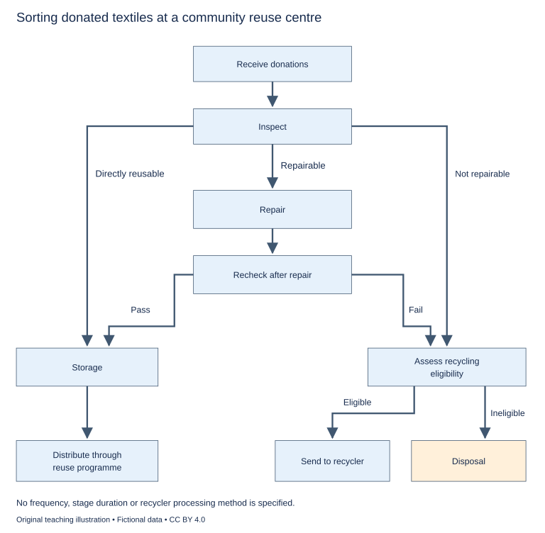

# U32 第22周：长篇阅读、写作与口语

本页为已独立核验的原创文字课程。先完成学生题目，再展开对应参考。非真题、非标准化模考，不换算雅思分数。听力尚未补齐，本页不代表全科课程已完成。

每周选A或G类Task 1一题，加Task 2及三次口语。参考范文不是学生已完成作业，仍须提交初稿、录音和重写，独立真人评分另行安排。

阅读每周180分钟（60分钟首次限时、120分钟证据精读与延迟复测），写作180分钟、口语120分钟。词汇60分钟、听力180分钟另列；新增完整听力未验收，不能勾整周完成。

W22/W24原创阶段检查按实际证据复盘；正式T22/T24陌生整卷、所选真实考试界面操作及真人评分另记，缺少目标或真实证据时不能据此判断报考/延长，本页原创技能卷不能代替正式模拟。后续周数与达标规则见 [U04](u04-exam-preparation.md)。

## 阅读：首答不查词

### R-W22-01 · The Bubbles inside the Dough

W22｜正文 852 词｜13 题｜篇章：简化科学过程：产生气体与保持结构（6段）

本课必做60分钟：首答20、证据复盘20、词汇长句10、48小时后复测10。每周三课180分钟，合卷首答替代单课首答，不重复计算。开放短文选做另加15分钟。

本项目原创虚构教学情境，人物、地点、历史事件和案例数据均非真实研究或史料。科学解释只讨论文内说明的模型与条件。非雅思真题或标准化模考；正确数不换算雅思等级。许可：CC BY 4.0 — RayXBuilds and contributors。

能力点：识别论证关系、区分作者与引述者、条件与因果、精确定位。初读不查词，完成后打开独立答案页。

#### Passage

**A** In the fictional kitchen laboratory of Mera, students compare two pieces of dough that receive the same gas-producing mixture. One expands visibly, while the other releases many bubbles at its surface without retaining much additional volume. The first explanation offered is that the larger piece must have produced more gas. The teacher asks whether production and retention have been confused. In the simplified model used for this lesson, gas must both enter spaces within the dough and remain there long enough to change its volume. A material that produces gas but lets it escape can behave differently from one that holds it. The account is restricted to the stated model and does not provide a recipe or explain every kind of bread. Its purpose is to distinguish a source of change from the structure that allows the change to become visible in a particular form.

**B** The class begins with a soft transparent model containing small air pockets. When more air enters a pocket, its boundary moves and the surrounding material is displaced. The expansion depends on the material yielding without immediately opening a route to the outside. A boundary that is too rigid may resist enlargement; one that separates easily may release the contents. The students therefore reject a simple opposition between strong material and weak material. Different properties matter at different stages. The model needs enough flexibility to change shape and enough continuity to preserve enclosed spaces. Saying only that the material must be stronger would hide the balance the demonstration is intended to make understandable. A useful account names the behaviour required rather than treating a favourable adjective as an explanation of the mechanism.

**C** The teacher then punctures one model pocket. Air escapes through the opening, and the local shape changes even though the air source continues working. This observation supports a distinction between ongoing supply and retained volume. It does not show that every reduction in real dough volume has the same cause. The students keep an escape map marking visible routes through which air leaves the model. A separate input chart records how much air is supplied during each observation interval. Comparing them prevents the class from interpreting every small final volume as evidence of a weak source. The material surrounding the pocket can change the outcome even when the amount supplied is held constant, so an explanation must consider what happens after the input as well as the input itself.

**D** A comparison over time produces another surprise. One model expands rapidly at first and then loses volume, while another changes more slowly and retains its shape longer. Ranking them at a single early moment would favour the first; ranking them later could favour the second. The teacher asks the class to state whether its question concerns initial expansion or continued retention. Neither observation time is inherently dishonest, but a report becomes misleading when it presents a result for one stage as an answer about another. The students draw a volume curve showing measurements taken at successive times. This reveals development that one photograph would conceal and allows the class to discuss speed and stability as separate features of the response rather than using larger as a complete description of performance.

**E** The model is finally connected back to the classroom dough, with its limitations stated. A texture card records observations of stretching and tearing made during a specified comparison. A timing log records when each sample is mixed, observed and removed from the demonstration. These records cannot reveal every microscopic process, and the class does not pretend that naming an observable property establishes its full cause. They do help preserve which sample was compared under which conditions. The students also note that a surface bubble can indicate escape rather than successful retention. Counting visible surface events alone would therefore answer a different question from measuring volume held within the sample. The most conspicuous sign of activity is not necessarily the sign most relevant to the outcome the investigator wants to explain. Before counting it, the class writes down the question that the count is meant to answer and checks whether an increase would represent retention or loss.

**F** The lesson ends with a deliberately limited conclusion: the observed expansion depends on both supply and the behaviour of the surrounding material over time. The class can use that relationship to ask better questions about unfamiliar systems without claiming that every such system is dough. A container filling with water, for example, invites a comparable distinction between inflow and leakage, but the analogy must not import the model's other properties without checking them. Transfer is useful when it preserves a relevant relationship and identifies where the comparison stops. The students now describe what was supplied, what was retained, how the boundary behaved and when the observation was made. Their explanation contains more parts than the original claim that more bubbles mean more growth, yet those parts make it easier to see which evidence would support or challenge the conclusion. A visible increase has become a process to investigate rather than a result whose cause can be read directly from its size.

#### Questions

**Choose ONE answer, A, B, C or D.**

1. The first explanation confuses

   A. a surface with a photograph
   B. gas supply with the amount retained
   C. volume with length units
   D. a model with an oven

2. The model boundary needs

   A. maximum rigidity in every condition
   B. no relationship to the contents
   C. an immediate permanent opening
   D. flexibility together with continued enclosure

3. The puncture example shows that

   A. the source always stops
   B. surface bubbles prove storage
   C. retained volume can change despite continued supply
   D. all dough losses have one cause

4. Why compare measurements at successive times?

   A. To eliminate the question of timing
   B. To hide early differences
   C. To distinguish initial expansion from lasting retention
   D. To make larger mean everything

**Complete the sentences. Choose NO MORE THAN 3 WORDS FROM THE PASSAGE for each answer. Do not change word forms.**

5. Visible exit routes are marked on an ______.

6. Air supplied in each interval is entered on an ______.

7. Successive volume measurements form a ______.

8. Stretching and tearing observations are recorded on a ______.

9. Mixing, observation and removal times are recorded in a ______.

**Do the following statements agree with the writer's views? Write YES, NO or NOT GIVEN. YES = the writer agrees; NO = the writer expresses the opposite view; NOT GIVEN = the writer's view is not stated. Do not use outside knowledge.**

10. Stronger is by itself a sufficient explanation of the required material behaviour.

11. Different observation times can support different legitimate questions.

12. The writer recommends replacing the school’s existing ovens.

13. The most visible activity need not measure the outcome of interest.

#### 本周重点

原创技能检查与正式T22分开；无正式施测证据，不换算等级。

#### 复盘

必做：给每道错题标记“定位/作者立场/范围/语法/词数”，抄最短证据；用一行箭头概括本文论证或过程。48小时后重做错题与两道正确题，检查是否仍能指出证据。

选做（15分钟，80–100词）：Explain the difference between supply and retention using evidence from the model.

R-W22-01 答案、证据与精读（首答后展开）

### R-W22-01 · 独立答案与证据

来源与许可同学生页。先完成再核对。可接受答案由 accepted_answers 明确列出；只忽略大小写和首尾空格，不自行删词。开放复盘不计入客观正确数。

1. **B**｜段落 A｜证据：“production and retention have been confused”

   供应与保留不同。

2. **D**｜段落 B｜证据：“enough flexibility to change shape and enough continuity”

   双重条件。

3. **C**｜段落 C｜证据：“even though the air source continues working”

   原因定位有边界。

4. **C**｜段落 D｜证据：“speed and stability as separate features”

   动态变化。

5. **escape map**｜段落 C｜证据：“an escape map marking visible routes”

   map不能单独接an。

6. **input chart**｜段落 C｜证据：“input chart records how much air”

   chart不能单独接an。

7. **volume curve / curve**｜段落 D｜证据：“a volume curve showing measurements”

   curve可接受。

8. **texture card / card**｜段落 E｜证据：“A texture card records observations”

   card可接受。

9. **timing log / log**｜段落 E｜证据：“A timing log records when each sample”

   log可接受。

10. **NO**｜段落 B｜证据：“would hide the balance”

   简单形容词不够。

11. **YES**｜段落 D｜证据：“Neither observation time is inherently dishonest”

   但需标阶段。

12. **NOT GIVEN**｜段落 A｜证据：“does not provide a recipe”

   未讨论烤箱采购。

13. **YES**｜段落 E｜证据：“not necessarily the sign most relevant”

   表面气泡可能是逃逸。

#### 词汇与长句

- **retention**：使输入物留在系统中的能力或过程
- **continuity**：边界保持连续、不出现泄漏开口
- **puncture**：在边界上刺出孔口
- **inflow**：进入系统的流入量或流入过程

> The material surrounding the pocket can change the outcome even when the amount supplied is held constant, so an explanation must consider what happens after the input as well as the input itself.

even when保留相同供应量条件；so引出解释要求。

> Transfer is useful when it preserves a relevant relationship and identifies where the comparison stops.

when限定迁移；不是把模型全部特征套到新系统。

#### 开放任务参考

C持续供气仍可逃逸，D时间改变保留；类比须标适用关系。

标准：观点有文内依据，保留条件和范围，推断明确标注；不存在唯一措辞。

### R-W22-02 · The Postal Card That Changed Its Job

W22｜正文 941 词｜13 题｜篇章：虚构历史：物件用途变化与收藏选择（8段）

本课必做60分钟：首答20、证据复盘20、词汇长句10、48小时后复测10。每周三课180分钟，合卷首答替代单课首答，不重复计算。开放短文选做另加15分钟。

本项目原创虚构教学情境，人物、地点、历史事件和案例数据均非真实研究或史料。科学解释只讨论文内说明的模型与条件。非雅思真题或标准化模考；正确数不换算雅思等级。许可：CC BY 4.0 — RayXBuilds and contributors。

能力点：识别论证关系、区分作者与引述者、条件与因果、精确定位。初读不查词，完成后打开独立答案页。

#### Passage

**A** A box of illustrated postal cards survives from the fictional town of Darel. Many cards show the same fountain, but they carry different messages, stamps and handwritten additions. An early display groups them as pictures of local architecture. A later researcher asks what is lost when the image alone determines the category. One card announced an arrival, another advertised a shop, and a third was kept as a souvenir without ever being posted. Their shared design did not give them a single practical history. The researcher studies how one printed form could become several kinds of object through use. This approach does not deny the importance of the image; it places the image within the sequence of actions that made each surviving card distinctive.

**B** The first group was sold at a station kiosk. Travellers wrote brief messages on the reverse and sent them to people elsewhere. Several mention the convenience of buying a picture and writing material together. The fountain served as a recognisable sign of place without requiring the sender to describe the town at length. Yet the date printed beneath the illustration names the year of the fountain's rebuilding, not the date the message was written. A reader who overlooks that distinction can move a journey into the wrong decade. The researcher uses the handwritten date and postal mark where available, recording disagreement rather than quietly selecting whichever number seems to fit a preferred account of the traveller's movements.

**C** A shopkeeper bought a batch of the same cards and overprinted the lower border with the name of a new business. The architecture remained visible, but the card now invited recipients to connect the town with a commercial address. Some examples were mailed; others were handed out locally. A card without a postal mark is therefore not necessarily an unused failure. It may have completed its intended job without entering the postal system. The researcher looks for evidence of distribution instead of treating postage as the only action that can make a card historically meaningful. The printed form provided a convenient carrier for several communications, and one institution's record of movement cannot be assumed to capture them all.

**D** A collector later mounted cards in an album by arranging similar views together. To keep the page tidy, the collector trimmed the lower border of several examples, removing shop names and parts of messages. The album preserved the images while altering the evidence of use. The researcher compares loose cards with mounted ones to identify what the selection concealed. This does not make the album worthless. Its arrangement provides evidence of what the collector valued, even as its modifications reduce what can be learned about earlier senders. A source can be informative about one activity while being incomplete evidence for another. The mistake would be to treat the collector's visual order as though it reproduced the original sequence in which the cards circulated.

**E** The card with no message presents a different uncertainty. It might have been bought as a souvenir, saved for a future letter or left unsold. Its blank reverse does not identify which possibility occurred. A note in the box describes one card as a gift, but the note does not specify which example it accompanied. The researcher keeps those limits visible. The aim is not to fill every absence with the most appealing personal story. Nor is it to exclude every object lacking a complete biography. An unposted card can still show printing choices or collecting practices, provided the account does not pretend that those observations establish an undocumented intention on the part of a particular owner.

**F** The catalogue separates these questions through several aids. An image index groups the printed views without assigning them a single use. A message transcript preserves legible handwriting, including gaps where letters cannot be read. A circulation table records postal marks and documented hand distribution. A trimming diagram shows which edges were removed in the album examples. These records permit comparisons without making one feature stand for the whole object. A researcher interested in the fountain can use the image index, while someone studying communication can follow messages and routes. The same collection can answer different questions because the catalogue preserves connections between its categories rather than forcing every card into an exclusive identity decided by the first person to describe it.

**G** For the revised display, a use label distinguishes confirmed functions from possible ones. Visitors see a mailed card, a locally distributed advertisement and an example whose personal use remains unknown. The blank card is not labelled unused merely because it lacks a message. The display also includes the collector's album as an object with its own history of selection. This makes preservation itself part of the account: what survives has passed through decisions that may have changed its form and the questions it can now answer. The cards did not simply wait untouched for a researcher to assign meaning to them many years later.

**H** The box consequently tells a story about communication, commerce and collecting as well as architecture. A printed picture can remain visually stable while the job of the object carrying it changes. Traces on the reverse, missing borders and later arrangements can be as important as the prominent fountain on the front. The researcher gains a richer account by asking what each person did with the card and which evidence supports that claim. Similar appearance is a useful starting point for comparison, but it is not a substitute for reconstructing use. The collection becomes more intelligible when the same design is allowed to participate in different histories without requiring every surviving example to have an equally complete explanation.

#### Questions

**Which paragraph contains the following information? Write a letter, A–H. You may use any letter more than once.**

1. a gift note that cannot be securely linked to one particular card

2. a collector preserving views while physically removing evidence of earlier use

3. a commercial addition to a border and distribution that did not always involve postage

4. a date beneath an illustration referring to rebuilding rather than a traveller’s message

**Do the following statements agree with the writer's views? Write YES, NO or NOT GIVEN. YES = the writer agrees; NO = the writer expresses the opposite view; NOT GIVEN = the writer's view is not stated. Do not use outside knowledge.**

5. The absence of a postal mark necessarily means a card failed to serve a purpose.

6. The album can provide evidence about the collector despite losing earlier information.

7. The writer recommends selling blank cards separately from written ones.

8. Every surviving card needs a complete personal biography before it can be useful.

**Complete the summary. Choose NO MORE THAN 3 WORDS FROM THE PASSAGE for each answer. Do not change word forms.**

Printed views are grouped in the (9) ______. Readable handwriting is preserved in a (10) ______. Postal marks and hand distribution enter a (11) ______. Removed edges are shown in a (12) ______. Confirmed and possible functions are distinguished for visitors by a (13) ______.

#### 本周重点

原创技能检查与正式T22分开；无正式施测证据，不换算等级。

#### 复盘

必做：给每道错题标记“定位/作者立场/范围/语法/词数”，抄最短证据；用一行箭头概括本文论证或过程。48小时后重做错题与两道正确题，检查是否仍能指出证据。

选做（15分钟，80–100词）：Explain why an unposted card should not automatically be labelled unused.

R-W22-02 答案、证据与精读（首答后展开）

### R-W22-02 · 独立答案与证据

来源与许可同学生页。先完成再核对。可接受答案由 accepted_answers 明确列出；只忽略大小写和首尾空格，不自行删词。开放复盘不计入客观正确数。

1. **E**｜段落 E｜证据：“does not specify which example”

   E归属不明。

2. **D**｜段落 D｜证据：“trimmed the lower border”

   D裁边。

3. **C**｜段落 C｜证据：“overprinted the lower border”

   C商业改用与手递组合。

4. **B**｜段落 B｜证据：“the year of the fountain's rebuilding”

   B两日期事件。

5. **NO**｜段落 C｜证据：“not necessarily an unused failure”

   手递可完成用途。

6. **YES**｜段落 D｜证据：“evidence of what the collector valued”

   不同研究问题。

7. **NOT GIVEN**｜段落 E｜证据：“Its blank reverse”

   未提出销售分类政策。

8. **NO**｜段落 E｜证据：“exclude every object lacking a complete biography”

   明确拒绝排除。

9. **image index / index**｜段落 F｜证据：“An image index groups the printed views”

   the可接index，避免an误限制。

10. **message transcript / transcript**｜段落 F｜证据：“A message transcript preserves legible handwriting”

   transcript可接受。

11. **circulation table / table**｜段落 F｜证据：“A circulation table records postal marks”

   table可接受。

12. **trimming diagram / diagram**｜段落 F｜证据：“A trimming diagram shows which edges”

   diagram可接受。

13. **use label / label**｜段落 G｜证据：“a use label distinguishes”

   use读音以辅音起，a合法，label也可。

#### 词汇与长句

- **reverse**：卡片背面
- **overprint**：在既有印刷品上加印
- **circulation**：物件或信息的传播与转手
- **legible**：字迹可辨认的

> A source can be informative about one activity while being incomplete evidence for another.

while保留并存评价，非一刀切可靠或不可靠。

> A printed picture can remain visually stable while the job of the object carrying it changes.

carrying修饰object；视觉稳定不保证用途不变。

#### 开放任务参考

C手递与E未明用途区分；无邮戳只否定已知邮寄证据，不否定所有用途。

标准：观点有文内依据，保留条件和范围，推断明确标注；不存在唯一措辞。

### R-W22-03 · Restoring the Missing Piece of a Bowl

W22｜正文 851 词｜14 题｜篇章：议论：修复、可见性与证据边界（7段）

本课必做60分钟：首答20、证据复盘20、词汇长句10、48小时后复测10。每周三课180分钟，合卷首答替代单课首答，不重复计算。开放短文选做另加15分钟。

本项目原创虚构教学情境，人物、地点、历史事件和案例数据均非真实研究或史料。科学解释只讨论文内说明的模型与条件。非雅思真题或标准化模考；正确数不换算雅思等级。许可：CC BY 4.0 — RayXBuilds and contributors。

能力点：识别论证关系、区分作者与引述者、条件与因果、精确定位。初读不查词，完成后打开独立答案页。

#### Passage

**A** At the fictional Lorn collection, a ceramic bowl has lost a section of its rim. A restorer can fill the gap with a material close in colour to the surviving surface, leave the gap open, or add a clearly distinguishable support. Each option changes how visitors encounter the object. A seamless fill may help them imagine the original form, while a visible difference may make the history of damage and treatment easier to recognise. The choice is sometimes described as a contest between beauty and honesty. That opposition is too simple. An attractive presentation need not conceal its intervention, and a visible repair does not automatically explain itself. The collection must decide what the treatment is intended to support and what visitors should be able to infer from the result.

**B** The surviving curve provides evidence about part of the missing shape. It does not necessarily establish every painted mark that once crossed the gap. The restorer therefore separates reconstruction of form from reconstruction of decoration. A plain addition could continue the rim without inventing a detailed pattern. Conversely, copying a motif from elsewhere on the bowl would introduce a hypothesis about repetition. That hypothesis might be reasonable, but it should remain distinguishable from surviving material. The issue is not whether inference can ever enter restoration. It is whether the strength and scope of the inference are represented accurately enough for viewers and later researchers to understand what has been added and why.

**C** Leaving the gap open also involves a choice. It can keep the loss immediately visible, but the remaining edge may require support for safe display. A viewer may misread the gap as part of the original design if no explanation is offered. The absence of new decorative material does not remove the need for interpretation. Nor does it guarantee that the object is presented exactly as it was found, since cleaning, mounting and lighting can already have changed its appearance. The restorer therefore describes the actual treatment rather than calling one option untouched. That description allows people to consider what was done without assuming that every visible incompleteness is a direct and complete record of the object's earlier condition.

**D** Colour matching introduces a further complication. A fill that is unobtrusive from a normal viewing distance may be distinguishable at close range. This can support both an overall reading of the form and a closer examination of the intervention. Yet the difference must remain discoverable under the display conditions actually offered to visitors. A distinction visible only to staff holding the bowl beneath a special lamp cannot be assumed to communicate itself through a glass case. The collection tests the display from the public viewing position and checks the wording of the accompanying note. Claims about transparency should refer to an available means of recognising the repair, not merely to information that exists somewhere in a technical file.

**E** The decision also has a future dimension. A treatment may eventually need revision as materials age or new evidence appears. The restorer records the added material, its location and the reasons for choosing it. The aim is not to promise that every action can be perfectly undone. It is to reduce unnecessary obstacles for whoever must examine or alter the work later. Detailed documentation can help future staff distinguish an old intervention from original material. However, documentation cannot make an unnecessarily damaging procedure harmless. Keeping a record and choosing an appropriate action are related responsibilities, not alternatives in which sufficient paperwork excuses any physical change made to the bowl.

**F** For the final display, the collection uses a plain fill that continues the rim and remains identifiable on close inspection. A nearby drawing marks the surviving ceramic and the added section. The label explains that the lost decoration is unknown, so the plain area is not evidence that the original bowl lacked a pattern there. Visitors are invited to view both the whole outline and the boundary of the repair. The choice answers this collection's stated purposes under its present display conditions. It does not establish a rule that every damaged bowl should receive the same treatment, because different evidence, materials and uses could justify different decisions. A procedure becomes defensible through its reasons, not through being repeated unchanged across objects that merely look similar. Those reasons should remain available when a future curator asks whether the present choice still serves the collection.

**G** Restoration therefore concerns the relationship between an object, an intervention and the claims made about both. The finished appearance is important, but it is not the only evidence by which the work should be judged. A responsible account connects the available evidence with the chosen addition, makes uncertainty visible where it affects interpretation and preserves a usable record for later examination. It also recognises that visitors need more than a slogan about authenticity. They need a practical way to tell what survives, what has been reconstructed and what remains unknown. The repaired bowl can then support an encounter with form and history together, without requiring the gap to disappear from the explanation simply because it no longer interrupts the outline.

#### Questions

**Which paragraph contains the following information? Write a letter, A–G. You may use any letter more than once.**

1. records intended to help future workers separate old treatment from original material

2. a staff-only special lamp revealing a distinction unavailable through the normal case

3. a surviving curve supporting shape reconstruction without confirming every lost painted mark

4. an open gap possibly being mistaken for an original design feature

5. a plain fill accompanied by a drawing marking the added and surviving areas

**Do the following statements agree with the writer's views? Write YES, NO or NOT GIVEN. YES = the writer agrees; NO = the writer expresses the opposite view; NOT GIVEN = the writer's view is not stated. Do not use outside knowledge.**

6. Leaving a gap open eliminates the need for interpretation.

7. A proposed decorative reconstruction may be reasonable while still requiring identification as inference.

8. The writer recommends giving the bowl a monetary value before selecting a repair.

9. The chosen plain fill proves the missing original surface had no pattern.

10. Similar-looking objects may warrant different treatments.

**Choose ONE answer, A, B, C or D.**

11. The writer rejects the opening opposition because

   A. beauty and honest explanation can coexist
   B. all fills are invisible
   C. every repair is equally suitable
   D. visible gaps never need support

12. Why separate form from decoration?

   A. Every repeated motif is certain
   B. Evidence for the curve need not establish lost markings
   C. No inference is permitted
   D. Paint never matters

13. What limits the claim that a repair is visibly distinguishable?

   A. Whether visitors can discover the distinction under actual conditions
   B. The number of staff
   C. Whether any photograph exists
   D. The bowl’s price

14. Documentation does not

   A. help future examination
   B. excuse an unnecessarily damaging action
   C. record reasons
   D. identify added material

#### 本周重点

原创技能检查与正式T22分开；无正式施测证据，不换算等级。

#### 复盘

必做：给每道错题标记“定位/作者立场/范围/语法/词数”，抄最短证据；用一行箭头概括本文论证或过程。48小时后重做错题与两道正确题，检查是否仍能指出证据。

选做（15分钟，80–100词）：Explain why a plain repair still needs an interpretation note.

R-W22-03 答案、证据与精读（首答后展开）

### R-W22-03 · 独立答案与证据

来源与许可同学生页。先完成再核对。可接受答案由 accepted_answers 明确列出；只忽略大小写和首尾空格，不自行删词。开放复盘不计入客观正确数。

1. **E**｜段落 E｜证据：“distinguish an old intervention”

   E未来使用。

2. **D**｜段落 D｜证据：“beneath a special lamp”

   D具体条件。

3. **B**｜段落 B｜证据：“surviving curve”

   B形与纹证据不同。

4. **C**｜段落 C｜证据：“misread the gap as part of the original design”

   C反直觉误读。

5. **F**｜段落 F｜证据：“A nearby drawing marks”

   F最终方案组合。

6. **NO**｜段落 C｜证据：“does not remove the need for interpretation”

   直接否定。

7. **YES**｜段落 B｜证据：“That hypothesis might be reasonable”

   合理不等于已存事实。

8. **NOT GIVEN**｜段落 A｜证据：“what the treatment is intended to support”

   未讨论估价前置要求。

9. **NO**｜段落 F｜证据：“not evidence that the original bowl lacked a pattern”

   明确反向。

10. **YES**｜段落 F｜证据：“different evidence, materials and uses could justify different decisions”

   条件依赖。

11. **A**｜段落 A｜证据：“An attractive presentation need not conceal its intervention”

   反对简单二分。

12. **B**｜段落 B｜证据：“does not necessarily establish every painted mark”

   证据范围不同。

13. **A**｜段落 D｜证据：“display conditions actually offered”

   实际可访问性。

14. **B**｜段落 E｜证据：“cannot make an unnecessarily damaging procedure harmless”

   记录不能替代行动适当性。

#### 词汇与长句

- **intervention**：对原物实施的处理或添加
- **unobtrusive**：不明显干扰整体观看的
- **authenticity**：与来源和原物关系有关的真实性
- **reconstruction**：依据证据与推断重建缺失部分

> A fill that is unobtrusive from a normal viewing distance may be distinguishable at close range.

两个距离条件允许整体效果与局部可辨并存。

> Keeping a record and choosing an appropriate action are related responsibilities, not alternatives in which sufficient paperwork excuses any physical change made to the bowl.

并列主语区分两责任；not alternatives否定互相替代。

#### 开放任务参考

F空白修补不证明原纹样为空；B分别证据支持形状和装饰。

标准：观点有文内依据，保留条件和范围，推断明确标注；不存在唯一措辞。

## 写作与口语：Task 1双分支择一

### WS-W22-T1A 学生页：二手织物分流流程

周次 W22｜题型 T1A｜能力点：流程条件与阶段记录

Task 1 的 A/G 分支二选一，另一分支不计入本周作业。

#### 使用与记录

原创教学练习，非真题、非标准化模拟，难度未校准。先完成本页再打开参考页。人物、机构、经历与数据均为教学虚构。范例的身份、地点、动作和细节不是强制要求。口语优先用真实经历或真实观察，并说明来源；没有相关经历时，可将假设回答明确标为技能练习，不伪装成亲历。不要背诵示例。自评和 AI 反馈不能代替独立真人评分，未获得真人评阅时标记“分数未确认”。

保存：任务ID、实际日期、用时、初稿或原始录音、证据化反馈、重写/重答、三条修改理由。没有学生提交物，不得填写“已批改”或“已完成训练”。

#### 完整题干

The diagram shows how donated textiles are sorted at a community reuse centre. Summarise the information by selecting and reporting the main features, and make comparisons where relevant.

Write at least 150 words. Spend about 20 minutes on this task.

教学虚构简化工作流：接收→检查。可直接再用→储存；可修→维修→复核，通过→储存，不通过→回收资格评估；不可修→回收资格评估。储存→再用项目分发。符合回收要求→送回收商；不符合→处置。未给频次、时长、清洗步骤、销售或回收商处理工艺。

#### 任务预算（含首次审题，不额外加时）

初稿20分钟（审题规划3、写作15、检查2）；诊断15；反馈阅读与证据核查10；完整重写25；对照归档5。合计75分钟。

#### 初稿后自评清单

- [ ] 达到最低字数；全文连贯成段，没有用项目符号代替作文。
- [ ] 概述给主要特征；数据、阶段或方位都与题图逐项相符，不推断未提供的原因。
- [ ] 每段可写出一个功能标签；例子或数据与该段要点相连。
- [ ] 核查两处词汇搭配和两处句法；如有疑点先试改再核实，无问题则记录通过证据。
- [ ] 如有影响理解的问题，记录原句；否则记通过或待核查，不填写自猜分数。

#### 反馈与重写

打开 独立参考页（本节下方展开参考），按逐段检查和通用协议核验。重写任务：完整重写至少150词；如出现图外步骤、频次或时长则删去，清楚者保留。归档真实用时和覆盖，原创检查不能填正式T22完成。

#### 本周重点操作（已含原预算）

在原归档时段取3分钟填EVIDENCE的W22对应行，只记录本题原创材料的真实初稿/首答表现。核对三个终点、修复复核与回收资格；图未提供频次或时长，不能补写。 正式T22另记合法卷源、是否见过、方式、真实条件、总分与听读写说单项，以及目标总分和单项要求；目前未提供的一律待填。自评、AI与本题参考示例不能填正式分数。正式任务如替换本题时段，本题改备用，不叠加后仍报原预算。

记录表见[阶段证据表](u35-feedback.md)，只在上述原时段填写相关行。

W22 T1A 示例、反馈与重练（首答后展开）

### WS-W22-T1A 独立参考页

只在初稿完成后阅读；不是唯一答案，也没有官方分数。以下是对原创示例的教学讲评，不是对学生尚未提交作文的已完成批改。

#### 思路拆解

三终点与修复后复核；不把失败直接处置，先查回收资格；题面无频次/时间不能补daily。

#### 原创示例

The diagram illustrates how a community reuse centre sorts donated textiles. It begins with accepting donations and checking them, and ends with distribution for reuse, transfer for recycling or disposal.

Overall, the process separates items according to their condition and the work needed to make them usable. Some donations can be reused directly after sorting, while others are repaired first. Items unsuitable for reuse are checked for recycling eligibility rather than being automatically discarded.

Initially, donations are received and examined. Items that are already suitable for reuse move directly to a storage area. Those with repairable faults are sent for repair and then checked again. If the repair succeeds, these items join the usable donations in storage. The stored items are subsequently distributed through the centre’s reuse programme.

Donations that are unsuitable for repair, together with items that fail the check after repair, follow a separate route. Staff assess whether they meet the recycling requirements. Eligible textiles are sent to a recycler, whereas ineligible items are disposed of. The diagram does not show how the recycler processes the materials, nor does it give the time required for any stage.

示例正文词数：189（本项目正则计数；书信不含称呼、结束语与署名；连字符词作一词）。

#### 逐段反馈与迁移

以下只分析上方原创示例。题干要点及图表事实必须遵守；书信、议论文的自拟身份、日期、经历和例子不是新增强制要求。按自己的合理设定核验，不为对齐范例编造经历。

- P1 reuse/recycling/disposal三种结果，不增加销售或出口目的地。

- P2 repair条件与recycling资格区分，概述有逻辑。

- P3 直接可用入储存，修后通过才合流；无清洗步骤不能自加。

- P4 不可修及修失败进入回收资格检查；eligibility不是全部可回收，不给工序时长。

#### 常见失误

给范文自加daily/weekly；把修复失败直接丢弃；把送回收商当再生过程已知。

#### 可执行反馈步骤

1. 先把自己的段落标为引入、概述/论点、支持、收束；分段可不同于示例，按功能核查，不照抄段数。
2. 对照上方逐段检查，逐项标“已有证据/缺失/不适用”。每条意见必须附自己的原句或缺失位置。
3. 按 [反馈协议](u35-feedback.md) 的四维表记录；有争议的 AI 意见回题干、数据或语法依据核验。
4. 只选至多两项有证据的优先点执行整篇重写；如未发现问题，可改变组织或表达练迁移，但不把它标成纠错；保留原稿，禁止把示例替换为自己的作业。

#### 重写任务

完整重写至少150词；如出现图外步骤、频次或时长则删去，清楚者保留。归档真实用时和覆盖，原创检查不能填正式T22完成。

完成后重新勾选 学生页（见本节上方学生题） 清单；将一处改前/改后及理由交给独立评阅者核查。真人评阅状态目前为“待安排”，不是已完成。

### WS-W22-T1G 学生页：联系慈善中心捐赠安排

周次 W22｜题型 T1G｜能力点：书信目的、要点与语气

Task 1 的 A/G 分支二选一，另一分支不计入本周作业。

#### 使用与记录

原创教学练习，非真题、非标准化模拟，难度未校准。先完成本页再打开参考页。人物、机构、经历与数据均为教学虚构。范例的身份、地点、动作和细节不是强制要求。口语优先用真实经历或真实观察，并说明来源；没有相关经历时，可将假设回答明确标为技能练习，不伪装成亲历。不要背诵示例。自评和 AI 反馈不能代替独立真人评分，未获得真人评阅时标记“分数未确认”。

保存：任务ID、实际日期、用时、初稿或原始录音、证据化反馈、重写/重答、三条修改理由。没有学生提交物，不得填写“已批改”或“已完成训练”。

#### 完整题干

You would like to donate some household items to a community organisation. Write to the donations coordinator. In your letter:
- describe the items you would like to donate
- explain why you are offering them
- ask about the requirements and arrangements for donating them.
Begin your letter: Dear Sir or Madam,

Write at least 150 words. You do not need to write any addresses. Spend about 20 minutes on this task.

#### 任务预算（含首次审题，不额外加时）

初稿20分钟（审题规划3、写作15、检查2）；诊断15；反馈阅读与证据核查10；完整重写25；对照归档5。合计75分钟。

#### 初稿后自评清单

- [ ] 达到最低字数；全文连贯成段，没有用项目符号代替作文。
- [ ] 三个要点均展开；称呼、目的、语气和结束语适合收信人。
- [ ] 每段可写出一个功能标签；例子或数据与该段要点相连。
- [ ] 核查两处词汇搭配和两处句法；如有疑点先试改再核实，无问题则记录通过证据。
- [ ] 如有影响理解的问题，记录原句；否则记通过或待核查，不填写自猜分数。

#### 反馈与重写

打开 独立参考页（本节下方展开参考），按逐段检查和通用协议核验。重写任务：整篇重写至少150词；按题干核资格与安排问句，问题存在才改；保留真实初稿/重写区分，不把本课当正式T22评分。

#### 本周重点操作（已含原预算）

在原归档时段取3分钟填EVIDENCE的W22对应行，只记录本题原创材料的真实初稿/首答表现。核对物品、捐赠原因与安排询问，合理自拟信息不等于真实用户经历。 正式T22另记合法卷源、是否见过、方式、真实条件、总分与听读写说单项，以及目标总分和单项要求；目前未提供的一律待填。自评、AI与本题参考示例不能填正式分数。正式任务如替换本题时段，本题改备用，不叠加后仍报原预算。

记录表见[阶段证据表](u35-feedback.md)，只在上述原时段填写相关行。

W22 T1G 示例、反馈与重练（首答后展开）

### WS-W22-T1G 独立参考页

只在初稿完成后阅读；不是唯一答案，也没有官方分数。以下是对原创示例的教学讲评，不是对学生尚未提交作文的已完成批改。

#### 思路拆解

正式询问不是强制机构接收；物品情况、原因、资格/收送两类安排具体，未承诺安全认证。

#### 原创示例

Dear Sir or Madam,

I am writing to ask whether your organisation could accept some household items. I have a small wooden table, four matching chairs and two desk lamps that I no longer need. The furniture is in good condition apart from a few marks on the tabletop, and both lamps were working when I last used them.

I am moving to a furnished flat next month, so there will be no space for these items in my new home. I would prefer them to be used by someone else rather than simply left in storage. A neighbour mentioned your organisation’s work, which is why I am contacting you before making other arrangements.

Could you please explain which of these items you are able to accept and whether you need photographs or further information about their condition? I would also like to know whether you offer collection or whether donations must be delivered to your centre. If delivery is required, please tell me which days and times are suitable. I can make arrangements during the next two weekends, but I would like to confirm the requirements before moving anything.

Yours faithfully,
Alex Chen

示例正文词数：186（本项目正则计数；书信不含称呼、结束语与署名；连字符词作一词）。

#### 逐段反馈与迁移

以下只分析上方原创示例。题干要点及图表事实必须遵守；书信、议论文的自拟身份、日期、经历和例子不是新增强制要求。按自己的合理设定核验，不为对齐范例编造经历。

- P1 物品数量和状态限定为最后使用时，不声称已专业检验。

- P2 搬家空间理由直接；不是自夸慈善历史。

- P3 接受范围与需证据、收送时间都有请求，先确认再搬。

#### 常见失误

假定机构必接收或免费上门；漏物品状态；将最后使用时工作正常当安全保证。

#### 可执行反馈步骤

1. 先把自己的段落标为引入、概述/论点、支持、收束；分段可不同于示例，按功能核查，不照抄段数。
2. 对照上方逐段检查，逐项标“已有证据/缺失/不适用”。每条意见必须附自己的原句或缺失位置。
3. 按 [反馈协议](u35-feedback.md) 的四维表记录；有争议的 AI 意见回题干、数据或语法依据核验。
4. 只选至多两项有证据的优先点执行整篇重写；如未发现问题，可改变组织或表达练迁移，但不把它标成纠错；保留原稿，禁止把示例替换为自己的作业。

#### 重写任务

整篇重写至少150词；按题干核资格与安排问句，问题存在才改；保留真实初稿/重写区分，不把本课当正式T22评分。

完成后重新勾选 学生页（见本节上方学生题） 清单；将一处改前/改后及理由交给独立评阅者核查。真人评阅状态目前为“待安排”，不是已完成。

### WS-W22-T2 学生页：父母还是学校教生活技能

周次 W22｜题型 T2｜能力点：观点展开与任务回应

A/G 共用本题。

#### 使用与记录

原创教学练习，非真题、非标准化模拟，难度未校准。先完成本页再打开参考页。人物、机构、经历与数据均为教学虚构。范例的身份、地点、动作和细节不是强制要求。口语优先用真实经历或真实观察，并说明来源；没有相关经历时，可将假设回答明确标为技能练习，不伪装成亲历。不要背诵示例。自评和 AI 反馈不能代替独立真人评分，未获得真人评阅时标记“分数未确认”。

保存：任务ID、实际日期、用时、初稿或原始录音、证据化反馈、重写/重答、三条修改理由。没有学生提交物，不得填写“已批改”或“已完成训练”。

#### 完整题干

Some people think parents should teach children practical everyday skills, while others believe schools should take responsibility for this. Discuss both views and give your own opinion. Give reasons and include relevant examples.

Write at least 250 words. Spend about 40 minutes on this task.

#### 任务预算（含首次审题，不额外加时）

初稿40分钟（审题规划5、写作30、检查5）；诊断15；反馈阅读与证据核查10；完整重写35；对照归档5。合计105分钟。

#### 初稿后自评清单

- [ ] 达到最低字数；全文连贯成段，没有用项目符号代替作文。
- [ ] 直接回答题目的所有问句，有始终一致的立场。
- [ ] 每段可写出一个功能标签；例子或数据与该段要点相连。
- [ ] 核查两处词汇搭配和两处句法；如有疑点先试改再核实，无问题则记录通过证据。
- [ ] 如有影响理解的问题，记录原句；否则记通过或待核查，不填写自猜分数。

#### 反馈与重写

打开 独立参考页（本节下方展开参考），按逐段检查和通用协议核验。重写任务：完整重写至少250词；如有单边或不回应的段落则调整，无问题记录通过证据；本题只记原创表现，正式目标与单项结果另列。

#### 本周重点操作（已含原预算）

在原归档时段取3分钟填EVIDENCE的W22对应行，只记录本题原创材料的真实初稿/首答表现。核对父母与学校双方观点及自己的意见，记录原稿证据，不能凭示例给分。 正式T22另记合法卷源、是否见过、方式、真实条件、总分与听读写说单项，以及目标总分和单项要求；目前未提供的一律待填。自评、AI与本题参考示例不能填正式分数。正式任务如替换本题时段，本题改备用，不叠加后仍报原预算。

记录表见[阶段证据表](u35-feedback.md)，只在上述原时段填写相关行。

W22 T2 示例、反馈与重练（首答后展开）

### WS-W22-T2 独立参考页

只在初稿完成后阅读；不是唯一答案，也没有官方分数。以下是对原创示例的教学讲评，不是对学生尚未提交作文的已完成批改。

#### 思路拆解

双方讨论并给共享责任；承认家庭差异与学校时数，实际学习目标而非责任互推。

#### 原创示例

Practical skills such as organising belongings, preparing simple food and managing small tasks are useful in everyday life. Parents and schools can both help children acquire them. I believe the responsibility should be shared, with families providing regular opportunities to practise and schools ensuring that basic learning is not left entirely to differences between homes.

Parents are well placed to connect a skill with a real purpose. A child can help prepare a shopping list, for example, and then see how that list guides an actual trip. Practice can happen repeatedly in familiar surroundings, and an adult can adjust the task to the child’s current ability. However, this approach depends on time, confidence and suitable opportunities at home. It would be unrealistic to assume that every family can provide the same range of experiences.

Schools can offer a more consistent starting point. A lesson on organising a small group project could teach planning and cooperation to children who have had little chance to practise those skills elsewhere. Teachers can also explain a task in stages and observe how different pupils respond. Nevertheless, school time is limited, and a lesson cannot reproduce every situation children will meet outside the classroom. Adding practical activities without considering the existing timetable could reduce the time available for other important learning.

A shared approach would address these limitations better than assigning the whole responsibility to either side. Schools could introduce a small set of useful routines, while families could be given simple suggestions for practising them when circumstances allow. The aim should not be to judge parents whose resources differ, but to give children more than one route to learning. Progress should be assessed through what children can do, rather than through whether every household completes identical activities.

In conclusion, families offer meaningful everyday practice, while schools can provide wider and more consistent access. Cooperation between them is more likely to meet different children’s needs than a rule that makes only one side responsible.

示例正文词数：329（本项目正则计数；书信不含称呼、结束语与署名；连字符词作一词）。

#### 逐段反馈与迁移

以下只分析上方原创示例。题干要点及图表事实必须遵守；书信、议论文的自拟身份、日期、经历和例子不是新增强制要求。按自己的合理设定核验，不为对齐范例编造经历。

- P1 具体技能例与立场清楚，不声称所有家长或教师有同样能力。

- P2 购物单联系真实任务并讲重复机会，家庭条件限制保留。

- P3 学校提供共同起点，同时时间成本具体。

- P4 介绍/家庭可选练习合作，不能将未做家庭作业作为道德指责。

- P5 回扣两方优势，没有偷换成是否上大学。

#### 常见失误

只赞父母关爱而无技能机制；忽略一方；宣称学校能完全替代家庭实践。

#### 可执行反馈步骤

1. 先把自己的段落标为引入、概述/论点、支持、收束；分段可不同于示例，按功能核查，不照抄段数。
2. 对照上方逐段检查，逐项标“已有证据/缺失/不适用”。每条意见必须附自己的原句或缺失位置。
3. 按 [反馈协议](u35-feedback.md) 的四维表记录；有争议的 AI 意见回题干、数据或语法依据核验。
4. 只选至多两项有证据的优先点执行整篇重写；如未发现问题，可改变组织或表达练迁移，但不把它标成纠错；保留原稿，禁止把示例替换为自己的作业。

#### 重写任务

完整重写至少250词；如有单边或不回应的段落则调整，无问题记录通过证据；本题只记原创表现，正式目标与单项结果另列。

完成后重新勾选 学生页（见本节上方学生题） 清单；将一处改前/改后及理由交给独立评阅者核查。真人评阅状态目前为“待安排”，不是已完成。

### WS-W22-S1 学生页

周次W22｜Part 1专项｜能力点：原创阶段检查与成绩记录分开；解释判断依据和局限｜30分钟

#### 使用与记录

原创教学练习，非真题、非标准化模拟，难度未校准。先完成本页再打开参考页。人物、机构、经历与数据均为教学虚构。范例的身份、地点、动作和细节不是强制要求。口语优先用真实经历或真实观察，并说明来源；没有相关经历时，可将假设回答明确标为技能练习，不伪装成亲历。不要背诵示例。自评和 AI 反馈不能代替独立真人评分，未获得真人评阅时标记“分数未确认”。

保存：任务ID、实际日期、用时、初稿或原始录音、证据化反馈、重写/重答、三条修改理由。没有学生提交物，不得填写“已批改”或“已完成训练”。

#### 操作与预算

设备与审题3分钟；首答录音6；回听及局部转写7；示例和诊断5；不看稿重答6；归档3。共30分钟。

#### Part 1专项题

1. Do you enjoy learning practical skills?
2. How do you choose something new to learn?
3. Do you prefer demonstrations or written explanations?
4. How do you notice that you are improving?

追问：

- Does quick progress always mean good learning?
- What might make you change your learning method?

首答6分钟内依次答4个主问，每题约40～60秒；两条追问只选1条答约30～45秒，其余时间用于转题。备用追问留给重答，不要求全部说完。

#### 录音回听清单

- [ ] 保留首答原音，记录实际时长、是否中断、是否看稿；只报真实完成状态；短于目标时长如实记，不用沉默或无关内容凑时。
- [ ] 流利与连贯：标出两处时间戳，区分构思停顿与重复搜词，检查是否偏离问句。
- [ ] 词汇：如有模糊词或无效重复，引用一处并先解释原意再试改；无则记录清楚的表达，不为难词改变意思。
- [ ] 语法：核对经历与习惯的时态；局部转写核查；如存在妨碍理解的问题才更正，无则记通过。
- [ ] 发音：不看转写听30秒，如有听不清的词尾、重音或断句则标时间戳，无则记录清楚证据；没有音频不能判断发音。
- [ ] 展开：主要回答有具体情境或理由；追问后第一句回应追问的新角度。

#### 重答要求

如有笼统判断，选择至多两个答案补具体情境；如没有，选择两题换角度重答并保留切题证据；重答一条追问，检查是否真正回应其新角度。

首答回听后才打开独立参考页（本节下方展开参考）。按[反馈协议](u35-feedback.md)填至少三个时间戳，不以文字转写替代音频评阅。

#### 本周重点操作（已含原预算）

在原归档时段取3分钟填EVIDENCE的W22对应行，只记录本题原创材料的真实初稿/首答表现。依据自己的原始音频标实际时长、题目覆盖和一个清楚或待核查的时间戳；范例身份、事件和细节均不必照搬。 正式T22另记合法卷源、是否见过、方式、真实条件、总分与听读写说单项，以及目标总分和单项要求；目前未提供的一律待填。自评、AI与本题参考示例不能填正式分数。正式任务如替换本题时段，本题改备用，不叠加后仍报原预算。

记录表见[阶段证据表](u35-feedback.md)，只在上述原时段填写相关行。

W22 S1 示例、反馈与重练（首答后展开）

### WS-W22-S1 独立参考页

原创教学示例，非真题或评分结果。未收到学生音频；以下是示例分析与待执行反馈，不能登记为已完成学生批改。

#### 展开示例

##### 直接回应→原因→具体情境的展开示例

I usually notice improvement when I can do a task without looking at every instruction. For example, with a new recipe, I may remember the order after trying it a few times. That does not mean the result is perfect, but it shows that one part of the process has become easier.

纯口答示例词数：52；只计MODEL标记内实际英文口答，不含标题、标签、说明。词数不能证明录音时长或流利度。

#### 展开与反馈

本周能力：原创阶段检查与成绩记录分开；解释判断依据和局限。

1. 示例先表态，再说明偏好理由，最后提供条件或场景。检查自己是否用一个词回答后就结束。
2. 找到一个具体细节：物品、动作、对话或地点。用真实经历或注明来源的真实观察替换；假设回答须标为技能练习。保持切题，不强制复制范例细节，不照搬身份与经历。
3. 追问要重新回应，不能继续背长答。首句先回答追问，再用一条理由支持。
4. 如存在听不清或语法影响理解处，标原音时间戳；否则标一处清楚的原音证据；先尝试最小修正。不要把自然停顿一概当成错误，或用加快语速掩盖逻辑断裂。

#### 常见失误

空泛形容词替代具体过程；给了经历却没解释为什么重要；Part 3只有个人故事没有一般解释；AI只看转写就判断发音。逐项回原音核对，不能凭范例推断自己已达到某个分数。

#### 可执行重答与反馈

如有笼统判断，选择至多两个答案补具体情境；如没有，选择两题换角度重答并保留切题证据；重答一条追问，检查是否真正回应其新角度。

填写[反馈协议](u35-feedback.md)四维表，附三个时间戳和原话证据。如存在，选至多一个内容问题与一个语言问题先修；否则记录清楚的证据并做迁移重答；重答后并排听两段，记录改善与仍未解决之处。自评与AI不能替代独立真人评分；独立评阅目前待安排，分数未确认。

### WS-W22-S2 学生页

周次W22｜Part 2专项｜能力点：原创阶段检查与成绩记录分开；解释判断依据和局限｜30分钟

#### 使用与记录

原创教学练习，非真题、非标准化模拟，难度未校准。先完成本页再打开参考页。人物、机构、经历与数据均为教学虚构。范例的身份、地点、动作和细节不是强制要求。口语优先用真实经历或真实观察，并说明来源；没有相关经历时，可将假设回答明确标为技能练习，不伪装成亲历。不要背诵示例。自评和 AI 反馈不能代替独立真人评分，未获得真人评阅时标记“分数未确认”。

保存：任务ID、实际日期、用时、初稿或原始录音、证据化反馈、重写/重答、三条修改理由。没有学生提交物，不得填写“已批改”或“已完成训练”。

#### 操作与预算

准备、首答录音及追问5分钟；回听及局部转写8；示例与诊断5；关键词重组3；重答及追问5；归档4。共30分钟。

#### Part 2专项任务卡

Describe something you learned by observing another person.

Say:
- what you learned
- whom you observed
- what you noticed
- and explain how the observation helped you.

准备1分钟，说1～2分钟。只记5个关键词，不预写句子。

收尾追问：

- Would a written explanation have helped as well?
- Would you like to develop that skill further?

每轮5分钟包含准备1分钟、连续说1～2分钟、两条收尾追问选1条答20～30秒及转题缓冲；另一条可用于重答。不把备用题全部加进本轮。

#### 录音回听清单

- [ ] 保留首答原音，记录实际时长、是否中断、是否看稿；只报真实完成状态；短于目标时长如实记，不用沉默或无关内容凑时。
- [ ] 流利与连贯：标出两处时间戳，区分构思停顿与重复搜词，检查是否偏离问句。
- [ ] 词汇：如有模糊词或无效重复，引用一处并先解释原意再试改；无则记录清楚的表达，不为难词改变意思。
- [ ] 语法：核对经历与习惯的时态；局部转写核查；如存在妨碍理解的问题才更正，无则记通过。
- [ ] 发音：不看转写听30秒，如有听不清的词尾、重音或断句则标时间戳，无则记录清楚证据；没有音频不能判断发音。
- [ ] 展开：主要回答有具体情境或理由；追问后第一句回应追问的新角度。

#### 重答要求

用五个关键词重答完整任务卡1～2分钟，再从两条追问中选1条答20～30秒；如缺具体细节则补、如有无关背景则删；若已清楚，换表达但保持事实。比较首答与重答，不背示例。

首答回听后才打开独立参考页（本节下方展开参考）。按[反馈协议](u35-feedback.md)填至少三个时间戳，不以文字转写替代音频评阅。

#### 本周重点操作（已含原预算）

在原归档时段取3分钟填EVIDENCE的W22对应行，只记录本题原创材料的真实初稿/首答表现。依据自己的原始音频标实际时长、题目覆盖和一个清楚或待核查的时间戳；范例身份、事件和细节均不必照搬。 正式T22另记合法卷源、是否见过、方式、真实条件、总分与听读写说单项，以及目标总分和单项要求；目前未提供的一律待填。自评、AI与本题参考示例不能填正式分数。正式任务如替换本题时段，本题改备用，不叠加后仍报原预算。

记录表见[阶段证据表](u35-feedback.md)，只在上述原时段填写相关行。

W22 S2 示例、反馈与重练（首答后展开）

### WS-W22-S2 独立参考页

原创教学示例，非真题或评分结果。未收到学生音频；以下是示例分析与待执行反馈，不能登记为已完成学生批改。

#### 展开示例

##### 原创长答示例（时长须以个人实际录音测量）

I learned a simple way of wrapping a fragile object by watching a friend pack a small ceramic bowl. We were preparing some household items for a move, and I was unsure how much paper to use.

My friend placed the bowl in the middle of a sheet and folded the corners over it one at a time. What caught my attention was that she supported the inside of the bowl with loosely folded paper before wrapping the outside. She also left a soft layer underneath it in the box instead of putting it directly on the bottom.

I then wrapped a similar bowl while she watched. I initially pulled the paper too tightly, and she suggested leaving a little space so it would act as a cushion. Seeing her movements made that advice much clearer than the words alone would have done.

The observation helped me understand the purpose of each step. I was not simply copying a shape: I was trying to stop the bowl from moving and protect it from pressure. I would still ask for specialist advice before packing anything unusually valuable, but the method was useful for our ordinary dishes.

纯口答示例词数：195；只计MODEL标记内实际英文口答，不含标题、标签、说明。词数不能证明录音时长或流利度。

#### 展开与反馈

本周能力：原创阶段检查与成绩记录分开；解释判断依据和局限。

1. 长答示例按背景、行动/观察、变化与意义组织。每段都推进内容；检查自己是否只有背景而没有具体事件。
2. 找到一个具体细节：物品、动作、对话或地点。用真实经历或注明来源的真实观察替换；假设回答须标为技能练习。保持切题，不强制复制范例细节，不照搬身份与经历。
3. 追问要重新回应，不能继续背长答。首句先回答追问，再用一条理由支持。
4. 如存在听不清或语法影响理解处，标原音时间戳；否则标一处清楚的原音证据；先尝试最小修正。不要把自然停顿一概当成错误，或用加快语速掩盖逻辑断裂。

#### 常见失误

空泛形容词替代具体过程；给了经历却没解释为什么重要；Part 3只有个人故事没有一般解释；AI只看转写就判断发音。逐项回原音核对，不能凭范例推断自己已达到某个分数。

#### 可执行重答与反馈

用五个关键词重答完整任务卡1～2分钟，再从两条追问中选1条答20～30秒；如缺具体细节则补、如有无关背景则删；若已清楚，换表达但保持事实。比较首答与重答，不背示例。

填写[反馈协议](u35-feedback.md)四维表，附三个时间戳和原话证据。如存在，选至多一个内容问题与一个语言问题先修；否则记录清楚的证据并做迁移重答；重答后并排听两段，记录改善与仍未解决之处。自评与AI不能替代独立真人评分；独立评阅目前待安排，分数未确认。

### WS-W22-S3 学生页

周次W22｜三部分全流程｜能力点：原创阶段检查与成绩记录分开；解释判断依据和局限｜60分钟

#### 使用与记录

原创教学练习，非真题、非标准化模拟，难度未校准。先完成本页再打开参考页。人物、机构、经历与数据均为教学虚构。范例的身份、地点、动作和细节不是强制要求。口语优先用真实经历或真实观察，并说明来源；没有相关经历时，可将假设回答明确标为技能练习，不伪装成亲历。不要背诵示例。自评和 AI 反馈不能代替独立真人评分，未获得真人评阅时标记“分数未确认”。

保存：任务ID、实际日期、用时、初稿或原始录音、证据化反馈、重写/重答、三条修改理由。没有学生提交物，不得填写“已批改”或“已完成训练”。

#### 操作与预算

D5：设备与流程准备2分钟，连续首答11～14分钟，余14～17分钟完整回听标记，共30分钟。D6：局部转写诊断10，阅读示例与调整5，重答与新追问10，对照归档5，共30分钟。合计60分钟。

#### 连续三部分全流程（首答不可看参考）

找同伴读题，或独练逐题揭示。完整首答11～14分钟，中途不暂停纠错。模拟同伴不是认证考官；自行读题的练习记录不能冒充真实面试。

##### Part 1：4～5分钟

1. Do you like taking photographs?
2. What do you usually photograph?
3. Do you keep old photographs?
4. How do you organise pictures?
5. Do you prefer printed pictures or digital ones?
6. Do you ever show pictures to friends?

可按回答追加 Why? / Can you give an example? 到时转下部分，不强行说完全部备用问题。

##### Part 2：3～4分钟（含准备）

Describe a photograph that helped you remember a place.

Say:
- what place it showed
- when you saw the photograph
- what details you noticed
- and explain why it helped you remember.

准备1分钟，连续说1～2分钟。收尾追问：

- Would you like to return to that place?
- Would someone else understand its importance?

##### Part 3：4～5分钟

1. Why do people keep records of their experiences?
2. Are photographs always reliable records?
3. How can museums explain the limits of historical evidence?
4. Does keeping more information necessarily improve understanding?

根据回答追加追问：

- What other evidence could support a photograph?
- Could selecting only attractive pictures change a story?

Part 2收尾追问两条选1条，答20～30秒，含在3～4分钟内。Part 3从4个主问中选3个，每个约60～75秒，再从2条追问中选1条答30～45秒；连同读题控制在4～5分钟，到时结束。题库数量不是必答数量。

#### 录音回听清单

- [ ] 保留首答原音，记录实际时长、是否中断、是否看稿；只报真实完成状态；短于目标时长如实记，不用沉默或无关内容凑时。
- [ ] 流利与连贯：标出两处时间戳，区分构思停顿与重复搜词，检查是否偏离问句。
- [ ] 词汇：如有模糊词或无效重复，引用一处并先解释原意再试改；无则记录清楚的表达，不为难词改变意思。
- [ ] 语法：核对经历与习惯的时态；局部转写核查；如存在妨碍理解的问题才更正，无则记通过。
- [ ] 发音：不看转写听30秒，如有听不清的词尾、重音或断句则标时间戳，无则记录清楚证据；没有音频不能判断发音。
- [ ] 展开：主要回答有具体情境或理由；追问后第一句回应追问的新角度。

#### 重答要求

在10分钟重答时段：选择一个有核查需要的Part 1主问答约1分钟；Part 2准备1分钟、答1～2分钟，再选一条收尾追问答20～30秒；Part 3只选一个主问答约1分钟，再选一条未用追问答30～45秒。余时用于换题和回听；无薄弱项则选已通过题换角度练迁移，保持真实细节，不复述范例。局部重答不另计全流程。

首答回听后才打开独立参考页（本节下方展开参考）。按[反馈协议](u35-feedback.md)填至少三个时间戳，不以文字转写替代音频评阅。

#### 本周重点操作（已含原预算）

在原归档时段取3分钟填EVIDENCE的W22对应行，只记录本题原创材料的真实初稿/首答表现。依据自己的原始音频标实际时长、题目覆盖和一个清楚或待核查的时间戳；范例身份、事件和细节均不必照搬。 正式T22另记合法卷源、是否见过、方式、真实条件、总分与听读写说单项，以及目标总分和单项要求；目前未提供的一律待填。自评、AI与本题参考示例不能填正式分数。正式任务如替换本题时段，本题改备用，不叠加后仍报原预算。

记录表见[阶段证据表](u35-feedback.md)，只在上述原时段填写相关行。

W22 S3 示例、反馈与重练（首答后展开）

### WS-W22-S3 独立参考页

原创教学示例，非真题或评分结果。未收到学生音频；以下是示例分析与待执行反馈，不能登记为已完成学生批改。

#### 展开示例

##### Part 2原创展开示例（个人语速不同，不能以词数推录音时长）

A photograph that helped me remember a place showed a small courtyard beside a guesthouse. I had stayed there during a short trip with my cousin, but I had almost forgotten the arrangement of the buildings until I found the picture while sorting some files.

The photograph was not especially impressive. It showed a wooden table, two blue chairs and a narrow doorway at the back. Yet the chairs reminded me that we had eaten breakfast outside because the kitchen was being cleaned. I also noticed a pot of herbs beside the doorway, which brought back the smell of the meal our host prepared that morning.

The picture helped me place several memories in the same setting. Before seeing it, I remembered a conversation with my cousin but could not clearly picture where we had been sitting. The angle of the table made that connection easier.

Of course, a photograph cannot preserve everything about a visit. It did not tell me the exact date or the words we used. Still, those small visible details gave me a useful starting point for recalling the atmosphere of the place.

##### Part 3观点→理由→条件展开示例

A photograph can provide useful evidence of what was visible at one moment, but it cannot explain everything outside the frame. A crowded street, for instance, might reflect an unusual event rather than normal conditions. To understand it, we may need a date, a description of the occasion and other records. I think the important distinction is between what we can actually see and the explanation we add to it.

纯口答示例词数：257；只计MODEL标记内实际英文口答，不含标题、标签、说明。词数不能证明录音时长或流利度。

#### 展开与反馈

本周能力：原创阶段检查与成绩记录分开；解释判断依据和局限。

1. 长答示例按背景、行动/观察、变化与意义组织。每段都推进内容；检查自己是否只有背景而没有具体事件。
2. 找到一个具体细节：物品、动作、对话或地点。用真实经历或注明来源的真实观察替换；假设回答须标为技能练习。保持切题，不强制复制范例细节，不照搬身份与经历。
3. Part 3示例不把个人选择强加给所有人；先讲机制，再说明条件或例外。检查自己的追问答案是否直接回应新问题。
4. 如存在听不清或语法影响理解处，标原音时间戳；否则标一处清楚的原音证据；先尝试最小修正。不要把自然停顿一概当成错误，或用加快语速掩盖逻辑断裂。

#### 常见失误

空泛形容词替代具体过程；给了经历却没解释为什么重要；Part 3只有个人故事没有一般解释；AI只看转写就判断发音。逐项回原音核对，不能凭范例推断自己已达到某个分数。

#### 可执行重答与反馈

在10分钟重答时段：选择一个有核查需要的Part 1主问答约1分钟；Part 2准备1分钟、答1～2分钟，再选一条收尾追问答20～30秒；Part 3只选一个主问答约1分钟，再选一条未用追问答30～45秒。余时用于换题和回听；无薄弱项则选已通过题换角度练迁移，保持真实细节，不复述范例。局部重答不另计全流程。

填写[反馈协议](u35-feedback.md)四维表，附三个时间戳和原话证据。如存在，选至多一个内容问题与一个语言问题先修；否则记录清楚的证据并做迁移重答；重答后并排听两段，记录改善与仍未解决之处。自评与AI不能替代独立真人评分；独立评阅目前待安排，分数未确认。

## 许可

原创文字：RayXBuilds and contributors，CC BY 4.0。此页由已验收分课汇编，调整了标题和导航；题干、正文和答案内容保留。公开第三方音频未包含。
