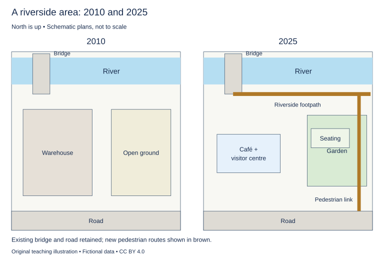

# U33 第23周：长篇阅读、写作与口语

本页为已独立核验的原创文字课程。先完成学生题目，再展开对应参考。非真题、非标准化模考，不换算雅思分数。听力尚未补齐，本页不代表全科课程已完成。

每周选A或G类Task 1一题，加Task 2及三次口语。参考范文不是学生已完成作业，仍须提交初稿、录音和重写，独立真人评分另行安排。

阅读每周180分钟（60分钟首次限时、120分钟证据精读与延迟复测），写作180分钟、口语120分钟。词汇60分钟、听力180分钟另列；新增完整听力未验收，不能勾整周完成。

W22/W24原创阶段检查按实际证据复盘；正式T22/T24陌生整卷、所选真实考试界面操作及真人评分另记，缺少目标或真实证据时不能据此判断报考/延长，本页原创技能卷不能代替正式模拟。后续周数与达标规则见 [U04](u04-exam-preparation.md)。

## 阅读：首答不查词

### R-W23-01 · Two Wheels on a Curved Track

W23｜正文 899 词｜13 题｜篇章：科学模型：共同运动与不同路径（7段）

本课必做60分钟：首答20、证据复盘20、词汇长句10、48小时后复测10。每周三课180分钟，合卷首答替代单课首答，不重复计算。开放短文选做另加15分钟。

本项目原创虚构教学情境，人物、地点、历史事件和案例数据均非真实研究或史料。科学解释只讨论文内说明的模型与条件。非雅思真题或标准化模考；正确数不换算雅思等级。许可：CC BY 4.0 — RayXBuilds and contributors。

能力点：识别论证关系、区分作者与引述者、条件与因果、精确定位。初读不查词，完成后打开独立答案页。

#### Passage

**A** In the fictional engineering classroom of Pel, students build a small trolley with two equal wheels attached firmly to one axle. On a straight track, the arrangement appears unremarkable: the wheels turn together and travel side by side. A curved track produces a puzzle. The outer wheel must follow a longer path than the inner wheel, yet the rigid connection makes both wheels complete the same number of turns. The demonstration is designed around a simplified condition in which the wheels have equal effective diameters. It is not a guide to designing a real vehicle. Its purpose is to expose a conflict between two requirements that can coexist on a straight route but become incompatible when the paths diverge in length. The trolley helps the class see why a mechanism must be understood in relation to the journey it is expected to perform.

**B** The students first mark a starting point on each wheel and roll the trolley along the straight section. A rotation counter records complete turns, while a distance tape measures the route along each side. Under the demonstration's no-slip condition, equal turns of equal wheels correspond to equal travelled distances. The result follows from the specified arrangement, not from a universal rule that objects moving together must cover identical paths. The teacher asks the class to preserve that distinction before introducing the bend. A relationship that holds under one geometry may need reconsideration when the geometry changes, even if the trolley's components remain exactly as they were at the start. Describing the parts alone would not reveal which condition the straight-track comparison had quietly supplied.

**C** On the bend, the students trace the two paths on a large route sheet. The outer trace is longer. They do not try to explain the difference by claiming that one wheel has become physically larger. Instead, they recognise that a shared journey around the bend contains two distinct distances. If both equal wheels remain locked to the same turning rate, they cannot both satisfy the model's no-slip condition along those unequal paths. Some adjustment must occur. In the demonstration, a visible sideways movement and rubbing mark show that the simple rolling assumption has failed. This result identifies a limit of the rigid arrangement under the stated conditions; it does not establish that every curved journey in every real machine must produce the same visible behaviour.

**D** The class then uses a model in which the wheels can turn independently. The outer wheel completes more turns while both travel around the same bend. The trolley's overall movement remains coordinated even though the two local rotation counts differ. This is the relationship the exercise is intended to reveal. Coordination need not mean that every component repeats an identical motion. Sometimes a mechanism must permit a difference between its parts in order to preserve the joint action that matters. The teacher also notes that independent turning alone does not describe every feature needed by a real vehicle. The model isolates one conflict and one way of allowing the required difference, leaving other engineering questions outside the exercise rather than pretending they have disappeared.

**E** A comparison becomes confusing if the class changes both wheel size and the connection at the same time. Different sizes could alter how far each turn carries a wheel, adding another possible explanation for the result. The students therefore retain the equal wheels while changing the connection, then label the limits of that comparison. An axle record identifies whether each trial uses a rigid or independent arrangement. A slip note records the visible evidence that the no-slip assumption was or was not supported during the run. These records prevent a result from being attributed solely to the named mechanism without checking the conditions under which the mechanism was observed. The aim is to make causal reasoning inspectable, not to multiply labels until the demonstration sounds more technical.

**F** For an unfamiliar observer, the most difficult step is often accepting that the two wheels can belong to one trolley without travelling the same distance. The teacher uses two students walking around concentric arcs to illustrate the geometry. The comparison helps with path length, but it does not reproduce the trolley's rolling contact or mechanical connection. The class states that limit before transferring any further conclusion from people to wheels. An analogy works by preserving a selected relationship. It becomes misleading when a convenient resemblance is allowed to carry claims about properties the example does not share. Here the walking demonstration explains the paths, while the trolley models provide evidence about how different connections respond to those paths.

**G** The final explanation therefore combines geometry, assumptions and mechanism. It identifies the longer outer route, the equal wheel sizes, the turning constraint imposed by a rigid axle and the conditions under which slipping would become relevant. The class can now explain why a design that appeared satisfactory on a straight track required reconsideration on a bend. It has not discovered that rigid connections are always poor or that independent parts are always better. It has learned to ask which differences a coordinated system must allow and which it must prevent. That question can travel beyond this particular model, provided the new setting supplies its own evidence about paths, constraints and intended outcomes. A single moving object may contain several necessary local movements, and understanding their relationship is more useful than assuming that together must always mean identical.

#### Questions

**Do the following statements agree with the writer's views? Write YES, NO or NOT GIVEN. YES = the writer agrees; NO = the writer expresses the opposite view; NOT GIVEN = the writer's view is not stated. Do not use outside knowledge.**

1. Changing wheel size while changing the connection can complicate causal interpretation.

2. A rigid connection is always inferior regardless of the intended task.

3. The writer recommends using metal rather than wood for the classroom axle.

4. The model solves every engineering question about real vehicles.

**Complete the sentences. Choose NO MORE THAN 3 WORDS FROM THE PASSAGE for each answer. Do not change word forms.**

5. Complete wheel turns are recorded by a ______.

6. The travelled routes are measured using a ______.

7. The inner and outer traces are drawn on a large ______.

8. The connection used in each trial is identified in an ______.

9. Visible evidence concerning the no-slip assumption is entered in a ______.

**Choose ONE answer, A, B, C or D.**

10. The bend creates a conflict because

   A. the trolley becomes two objects
   B. equal locked wheels are assigned unequal path lengths
   C. straight paths cannot be measured
   D. the wheels necessarily change size

11. The straight-track relationship depends on

   A. a universal definition of coordination
   B. specified wheel sizes and a no-slip condition
   C. all objects sharing every distance
   D. the observer’s preference

12. The independently turning model illustrates that

   A. coordination forbids difference
   B. outer paths become shorter
   C. different local motions can support coordinated travel
   D. all vehicle questions are solved

13. The walking analogy is useful primarily for

   A. axle manufacture
   B. measuring tyre materials
   C. the difference between path lengths
   D. wheel contact mechanics

#### 本周重点

依据真实错题补缺；目前无学习者记录，维持待诊断，不虚构弱项。

#### 复盘

必做：给每道错题标记“定位/作者立场/范围/语法/词数”，抄最短证据；用一行箭头概括本文论证或过程。48小时后重做错题与两道正确题，检查是否仍能指出证据。

选做（15分钟，80–100词）：Describe one assumption you initially imported and how the passage tests it.

R-W23-01 答案、证据与精读（首答后展开）

### R-W23-01 · 独立答案与证据

来源与许可同学生页。先完成再核对。可接受答案由 accepted_answers 明确列出；只忽略大小写和首尾空格，不自行删词。开放复盘不计入客观正确数。

1. **YES**｜段落 E｜证据：“adding another possible explanation”

   混合变量。

2. **NO**｜段落 G｜证据：“has not discovered that rigid connections are always poor”

   明确拒绝全称。

3. **NOT GIVEN**｜段落 E｜证据：“rigid or independent arrangement”

   未提材料选择。

4. **NO**｜段落 D｜证据：“does not describe every feature needed by a real vehicle”

   范围限制明确。

5. **rotation counter / counter**｜段落 B｜证据：“A rotation counter records complete turns”

   counter可接受。

6. **distance tape / tape**｜段落 B｜证据：“a distance tape measures”

   tape可接受。

7. **route sheet / sheet**｜段落 C｜证据：“a large route sheet”

   large已在题干中。

8. **axle record**｜段落 E｜证据：“An axle record identifies”

   record不能单独接an。

9. **slip note / note**｜段落 E｜证据：“A slip note records the visible evidence”

   note可接受。

10. **B**｜段落 A｜证据：“outer wheel must follow a longer path”

   几何与同步转数冲突。

11. **B**｜段落 B｜证据：“Under the demonstration's no-slip condition”

   限定条件。

12. **C**｜段落 D｜证据：“even though the two local rotation counts differ”

   协调不等于局部完全同动。

13. **C**｜段落 F｜证据：“helps with path length”

   只迁移共享关系。

#### 词汇与长句

- **axle**：连接或支承轮子的轴
- **constraint**：限制可发生动作的条件
- **concentric**：具有同一圆心的
- **coordinated**：共同完成整体动作的

> Sometimes a mechanism must permit a difference between its parts in order to preserve the joint action that matters.

in order to给目的；局部差异支持共同动作。

> The comparison helps with path length, but it does not reproduce the trolley's rolling contact or mechanical connection.

but明确类比覆盖范围与未覆盖性质。

#### 开放任务参考

只据实际作答写；可反思共同移动=同距离，B/C以条件与路径修正；无答卷不预设错因。

标准：观点有文内依据，保留条件和范围，推断明确标注；不存在唯一措辞。

### R-W23-02 · The Orchard without a Planting Plan

W23｜正文 956 词｜13 题｜篇章：虚构历史：标签、空间与多次改植（8段）

本课必做60分钟：首答20、证据复盘20、词汇长句10、48小时后复测10。每周三课180分钟，合卷首答替代单课首答，不重复计算。开放短文选做另加15分钟。

本项目原创虚构教学情境，人物、地点、历史事件和案例数据均非真实研究或史料。科学解释只讨论文内说明的模型与条件。非雅思真题或标准化模考；正确数不换算雅思等级。许可：CC BY 4.0 — RayXBuilds and contributors。

能力点：识别论证关系、区分作者与引述者、条件与因果、精确定位。初读不查词，完成后打开独立答案页。

#### Passage

**A** When researchers enter the fictional estate orchard of Sere, they find rows of old trees but no complete planting plan. A surviving notebook lists varieties, and several metal labels remain attached to branches. It is tempting to assign each name to the nearest tree and draw a confident map of the original orchard. The evidence is less cooperative. Labels have been moved, some trees have been replaced, and the notebook includes purchases that may never have been planted. The task is not simply to recover a lost picture from scattered pieces. It is to distinguish stages in a changing landscape, using records whose dates and purposes do not all coincide. The orchard's present order may preserve parts of earlier arrangements while combining them with decisions made much later.

**B** A gardener's invoice records the purchase of twelve young trees for the northern row. The notebook repeats the variety names but does not say whether every purchased tree survived the journey or was planted there. A later letter mentions moving two trees to a sheltered corner after damage during a storm. These sources support a history of planned and altered placement rather than a single fixed layout. The researcher resists treating the invoice as a photograph of the finished orchard. Purchase, planting, survival and later movement are separate events. Evidence for one may make another plausible, but it does not establish the whole sequence without additional support. A neat plan can be less accurate than a map that leaves some locations unresolved.

**C** The metal labels introduce another complication. One label hangs from a branch of a tree that an estate diary describes as receiving a new variety on part of its existing structure. In the fictional case, the diary explicitly distinguishes the older trunk from the added branch. The label names the latter. Assigning its name to every part of the tree would therefore erase a distinction preserved by the source. The researcher records which branch carries the label and compares that observation with the dated entry. This is a question about the identity claimed by a particular label, not a general instruction in orchard management. A name attached to a living object can refer to one component or intervention rather than to the complete history of everything supporting it.

**D** The spacing between trees also changes. An early sketch shows wide gaps used for access with a cart. Later notes describe small trees inserted between the older ones. A present-day row can consequently look irregular even if both stages followed deliberate plans. The researcher does not explain every uneven distance as carelessness. Nor does she assume that a regular pattern must belong to the earliest period. She tests proposed sequences against dated observations. The orchard is a layered arrangement, and a pattern visible now may be the combined result of several orderly decisions. Looking for one original geometry can hide the very changes that account for the spacing the researcher is trying to understand.

**E** A family account describes the orchard as producing fruit for market, while a visitor's letter praises a shaded place for afternoon walks. These descriptions need not compete as mutually exclusive functions. The sources address different activities and possibly different seasons. However, neither proves that both functions were equally important throughout the orchard's history. The researcher keeps the time and viewpoint of each account attached to the claim it supports. She avoids replacing a simple commercial story with an equally simple leisure story merely because the visitor's prose is more vivid. Multiple uses can coexist, but coexistence itself must be established at the relevant time rather than assumed from the survival of contrasting descriptions in one archive box.

**F** The reconstruction uses a purchase table listing varieties, quantities and invoice dates. A movement register records only relocations supported by dated notes. A branch diagram links labels to the particular parts of trees they identify. A spacing map distinguishes observed positions from proposed earlier positions. These records preserve both connections and differences among the sources. A blank entry is not silently filled from a neighbouring tree's name. When a position remains uncertain, the map marks it as uncertain rather than borrowing confidence from the precision of a label elsewhere. The researcher can explain which part of the reconstruction would change if a new diary or plan appeared, making the account open to correction instead of protecting it through an appearance of completeness.

**G** For visitors, a chronology panel presents the documented purchase, relocation and insertion episodes in sequence. It does not claim to show every event in the orchard's life. A short walk then directs attention to the different kinds of evidence still visible: surviving labels, altered spacing and positions associated with later notes. The display makes clear that the present trees are part of a continuing landscape, not untouched witnesses arranged exactly as their first owner left them. That distinction allows visitors to value the orchard's age without demanding a false picture of absolute continuity. Change is part of what has survived, even when it must be reconstructed through traces rather than read directly from one object.

**H** The missing plan thus becomes an opportunity to ask a more precise historical question. Instead of seeking one complete diagram and treating everything else as noise, the researcher asks which arrangement existed at which stage and how confidently it can be described. The resulting account contains gaps, but its claims can be inspected. It respects the difference between a purchased tree, a recorded planting, a moved object and a named branch. An orchard can retain a recognisable identity while its components and uses change. Explaining that continuity requires attention to transformations, not the assumption that an old place must have remained materially identical in order for its history to matter.

#### Questions

**Which paragraph contains the following information? Write a letter, A–H. You may use any letter more than once.**

1. a label naming an added branch rather than the whole tree’s history

2. purchased trees later being moved after storm damage

3. new trees inserted into spaces originally used by carts

4. commercial and recreational descriptions that may concern different times or seasons

**Do the following statements agree with the writer's views? Write YES, NO or NOT GIVEN. YES = the writer agrees; NO = the writer expresses the opposite view; NOT GIVEN = the writer's view is not stated. Do not use outside knowledge.**

5. An invoice alone establishes that every purchased tree was planted in its intended place.

6. Irregular present spacing can result from several deliberate arrangements.

7. The writer recommends closing the orchard to visitors throughout every winter.

8. An old place must remain materially identical for its history to matter.

**Complete the summary. Choose NO MORE THAN 3 WORDS FROM THE PASSAGE for each answer. Do not change word forms.**

Varieties, quantities and invoice dates enter a (9) ______. Documented relocations appear in a (10) ______. Labels and the tree parts they name are linked in a (11) ______. Current and proposed earlier positions are separated on a (12) ______. Dated episodes are presented to visitors on a (13) ______.

#### 本周重点

依据真实错题补缺；目前无学习者记录，维持待诊断，不虚构弱项。

#### 复盘

必做：给每道错题标记“定位/作者立场/范围/语法/词数”，抄最短证据；用一行箭头概括本文论证或过程。48小时后重做错题与两道正确题，检查是否仍能指出证据。

选做（15分钟，80–100词）：Identify the exact event supported by one source and a stronger event it does not establish.

R-W23-02 答案、证据与精读（首答后展开）

### R-W23-02 · 独立答案与证据

来源与许可同学生页。先完成再核对。可接受答案由 accepted_answers 明确列出；只忽略大小写和首尾空格，不自行删词。开放复盘不计入客观正确数。

1. **C**｜段落 C｜证据：“The label names the latter”

   C部分身份。

2. **B**｜段落 B｜证据：“moving two trees to a sheltered corner”

   B具体原因和迁移。

3. **D**｜段落 D｜证据：“wide gaps used for access with a cart”

   D两阶段间距。

4. **E**｜段落 E｜证据：“different activities and possibly different seasons”

   E用途与时段。

5. **NO**｜段落 B｜证据：“does not say whether every purchased tree survived”

   采购不能证完整顺序。

6. **YES**｜段落 D｜证据：“combined result of several orderly decisions”

   多阶段叠加。

7. **NOT GIVEN**｜段落 G｜证据：“For visitors, a chronology panel”

   全文未提出冬季开放政策；历史研究边界不说明访问日程。

8. **NO**｜段落 H｜证据：“not the assumption that an old place must have remained materially identical”

   直接否定。

9. **purchase table / table**｜段落 F｜证据：“a purchase table listing varieties”

   table可接受。

10. **movement register / register**｜段落 F｜证据：“A movement register records only relocations”

   register可接受。

11. **branch diagram / diagram**｜段落 F｜证据：“A branch diagram links labels”

   diagram可接受。

12. **spacing map / map**｜段落 F｜证据：“A spacing map distinguishes observed positions”

   map可接受。

13. **chronology panel / panel**｜段落 G｜证据：“a chronology panel presents”

   panel可接受。

#### 词汇与长句

- **relocation**：移动到另一地点
- **invoice**：记录购买数量与日期的账单
- **insertion**：在原有空隙中加入新对象
- **continuity**：在变化中仍可追踪的延续关系

> A present-day row can consequently look irregular even if both stages followed deliberate plans.

even if揭示外观不规则与多阶段各自有序可以并存。

> A name attached to a living object can refer to one component or intervention rather than to the complete history of everything supporting it.

attached修饰name；rather than限定标签指涉范围。

#### 开放任务参考

B采购不证全部成活/种植；C支标签不证整树身份；记录实际混淆后再选补缺。

标准：观点有文内依据，保留条件和范围，推断明确标注；不存在唯一措辞。

### R-W23-03 · Can a Game Be Fair without Being Equal?

W23｜正文 856 词｜14 题｜篇章：议论：非对称角色、机会与程序（7段）

本课必做60分钟：首答20、证据复盘20、词汇长句10、48小时后复测10。每周三课180分钟，合卷首答替代单课首答，不重复计算。开放短文选做另加15分钟。

本项目原创虚构教学情境，人物、地点、历史事件和案例数据均非真实研究或史料。科学解释只讨论文内说明的模型与条件。非雅思真题或标准化模考；正确数不换算雅思等级。许可：CC BY 4.0 — RayXBuilds and contributors。

能力点：识别论证关系、区分作者与引述者、条件与因果、精确定位。初读不查词，完成后打开独立答案页。

#### Passage

**A** The fictional game studio of Ansa designs a board game in which one player controls a caravan and another controls the weather it encounters. Their pieces, available actions and immediate goals differ. Some testers call the game unfair before playing because the roles are unequal. Others assume that unequal roles must make it interesting and therefore acceptable. Both reactions skip a necessary question: what kind of fairness is the game intended to provide? Identical equipment is one possible arrangement, but fairness can also concern meaningful choices, understandable rules or comparable opportunities over repeated play. These criteria are related without being interchangeable. The designers need to state which promise they are making before they can decide whether the differences between the roles support that promise or undermine it.

**B** In the first version, the caravan player chooses between routes, while the weather player draws a card and must apply it immediately. The roles may have similar chances of winning in recorded trials, yet the weather player has fewer decisions to make. A balance in outcomes would not remove that difference in participation. The studio therefore asks testers whether each role offers decisions that affect the course of play. It does not assume that every player wants the same number of choices or the same degree of complexity. It does recognise that an advertised contest of strategic decisions should give both participants a relevant opportunity to exercise strategy. Counting victories alone would miss a failure to deliver that particular experience.

**C** The second version allows the weather player to keep two cards and choose when to use one. This creates more decisions, but it also changes the information available to the caravan player. Hidden possibilities can make planning uncertain. That uncertainty need not be unfair if the rules explain its nature and both players can respond meaningfully. However, uncertainty about the rules is different from uncertainty generated by the rules. If the caravan player discovers halfway through that a card can cancel a route, a clear explanation given afterwards may arrive too late to make earlier choices informed. The studio tests the written instructions separately from the balance of the game, because a well-balanced system can still be poorly communicated to the people expected to use it. The two tests answer different questions.

**D** Experience complicates the outcome records. Skilled caravan players may initially face weather players trying the revised role for the first time. If their victories are attributed entirely to the role, the comparison confuses design with familiarity. The studio records previous experience and alternates roles during testing. This does not guarantee identical learning rates or remove every individual difference. It makes one relevant source of variation visible. A claim about role advantage should not quietly depend on one role being occupied by the more practised players throughout the trial. The test needs to preserve the distinction between what a role allows and what a particular participant has learned to do with it.

**E** Alternating roles also raises a question about the unit of evaluation. A single session may favour one role while a paired session gives each player a turn in both positions. That arrangement could support fairness across the pair without making every individual game symmetrical. Whether it is appropriate depends on the promise offered to buyers. If the box describes a complete short game, players should not have to infer that fairness requires an unannounced second session. If paired play is central to the design, the instructions should state that clearly. A longer evaluation period can be legitimate, but it must not be introduced only after an unfavourable result as a way to protect a claim the original description did not make.

**F** The final revision gives both players choices, explains the hidden-card mechanism before play and offers a clearly labelled paired mode. Test reports list results separately by mode and experience level. The studio also preserves comments from players who enjoyed the unequal roles while disliking a particular rule. Enjoyment does not prove that every part is fair, just as frustration after losing does not by itself prove that a rule is defective. Those reactions are evidence about experience that needs interpretation alongside the design and the conditions of play. The revised game is not declared fair for every possible audience. The studio can instead explain which criteria it used, what it changed and which questions its testing has not resolved.

**G** A game can therefore be fair in a defensible sense without giving every participant identical actions, provided the relevant promises and conditions are clear. That conclusion does not excuse arbitrary disadvantage by calling it variety. It requires the designer to connect unequal roles with an explicit account of meaningful participation and evaluation. Players should know what differences they are accepting and how the contest is meant to work. The most useful question is not whether all pieces look equivalent, but whether the system gives participants the opportunities it claims to offer under the conditions in which it is actually played. Fairness becomes something that can be examined through rules, experience and evidence, rather than a favourable label applied whenever the winning numbers happen to look reassuring.

#### Questions

**Choose ONE answer, A, B, C or D.**

1. The writer asks designers first to

   A. assume unequal roles are always good
   B. define the fairness promise being evaluated
   C. make every piece identical
   D. ignore outcomes

2. Similar win rates could conceal

   A. equal learning histories
   B. unequal opportunities to make strategic choices
   C. absence of any rules
   D. identical decision opportunities

3. What distinction is central to the hidden-card discussion?

   A. Beginners versus experienced staff
   B. Uncertainty within clear rules versus uncertainty about the rules
   C. Cards versus pieces only
   D. Winning versus scoring

4. Why record experience and alternate roles?

   A. To guarantee identical winning totals
   B. To remove all variation
   C. To avoid attributing practice differences entirely to a role
   D. To ensure no one learns

**Which paragraph contains the following information? Write a letter, A–G. You may use any letter more than once.**

5. a short-game description that could conceal the need for a second session

6. experienced players in one role facing first-time players in the other

7. one player selecting routes while the other initially has to apply a drawn card immediately

8. a new ability to retain two cards and choose when to use one

9. test results separated by play mode and previous experience

**Do the following statements agree with the writer's views? Write YES, NO or NOT GIVEN. YES = the writer agrees; NO = the writer expresses the opposite view; NOT GIVEN = the writer's view is not stated. Do not use outside knowledge.**

10. Identical equipment is the only possible basis for fairness.

11. A paired-session evaluation can be legitimate when it is part of the stated design.

12. The writer recommends banning competitive tournaments using the game.

13. Enjoyment establishes that every rule is fair.

14. Differences between roles need to be connected to an explicit account of participation.

#### 本周重点

依据真实错题补缺；目前无学习者记录，维持待诊断，不虚构弱项。

#### 复盘

必做：给每道错题标记“定位/作者立场/范围/语法/词数”，抄最短证据；用一行箭头概括本文论证或过程。48小时后重做错题与两道正确题，检查是否仍能指出证据。

选做（15分钟，80–100词）：Use one mistaken inference from your own answers to choose a specific repair action.

R-W23-03 答案、证据与精读（首答后展开）

### R-W23-03 · 独立答案与证据

来源与许可同学生页。先完成再核对。可接受答案由 accepted_answers 明确列出；只忽略大小写和首尾空格，不自行删词。开放复盘不计入客观正确数。

1. **B**｜段落 A｜证据：“state which promise they are making”

   先定义评价对象。

2. **B**｜段落 B｜证据：“fewer decisions to make”

   结果平衡不能证参与相同。

3. **B**｜段落 C｜证据：“uncertainty about the rules is different”

   机制不确定与规则不清。

4. **C**｜段落 D｜证据：“confuses design with familiarity”

   控制/显化经验来源。

5. **E**｜段落 E｜证据：“an unannounced second session”

   E评价单位。

6. **D**｜段落 D｜证据：“trying the revised role for the first time”

   D比较混淆。

7. **B**｜段落 B｜证据：“must apply it immediately”

   B首版角色配置。

8. **C**｜段落 C｜证据：“keep two cards”

   C具体修订。

9. **F**｜段落 F｜证据：“separately by mode and experience level”

   F最终报告结构。

10. **NO**｜段落 A｜证据：“one possible arrangement”

   明确多标准。

11. **YES**｜段落 E｜证据：“If paired play is central”

   条件保留。

12. **NOT GIVEN**｜段落 F｜证据：“not declared fair for every possible audience”

   未提禁赛政策。

13. **NO**｜段落 F｜证据：“Enjoyment does not prove that every part is fair”

   直接否定。

14. **YES**｜段落 G｜证据：“explicit account of meaningful participation”

   条件论证。

#### 词汇与长句

- **asymmetrical**：不同角色或部分并非镜像相同的
- **strategic**：与作出影响后续结果的选择有关的
- **familiarity**：对规则或角色已有的熟悉程度
- **arbitrary**：缺少与明确目的相关理由的

> However, uncertainty about the rules is different from uncertainty generated by the rules.

about与generated by区别规则不明和机制内未知。

> A longer evaluation period can be legitimate, but it must not be introduced only after an unfavourable result as a way to protect a claim the original description did not make.

but限制事后改标准；并非否定长周期评估。

#### 开放任务参考

有答卷再记录；可涉及把相同胜率当参与平等或把不确定当规则不清，不能预填为个人错误。

标准：观点有文内依据，保留条件和范围，推断明确标注；不存在唯一措辞。

## 写作与口语：Task 1双分支择一

### WS-W23-T1A 学生页：河岸步行区改造

周次 W23｜题型 T1A｜能力点：地图变化与反馈核验

Task 1 的 A/G 分支二选一，另一分支不计入本周作业。

#### 使用与记录

原创教学练习，非真题、非标准化模拟，难度未校准。先完成本页再打开参考页。人物、机构、经历与数据均为教学虚构。范例的身份、地点、动作和细节不是强制要求。口语优先用真实经历或真实观察，并说明来源；没有相关经历时，可将假设回答明确标为技能练习，不伪装成亲历。不要背诵示例。自评和 AI 反馈不能代替独立真人评分，未获得真人评阅时标记“分数未确认”。

保存：任务ID、实际日期、用时、初稿或原始录音、证据化反馈、重写/重答、三条修改理由。没有学生提交物，不得填写“已批改”或“已完成训练”。

#### 完整题干

The maps show a riverside area in 2010 and after changes in 2025. Summarise the information by selecting and reporting the main features, and make comparisons where relevant.

Write at least 150 words. Spend about 20 minutes on this task.

教学虚构示意图，北向上不按比例。河沿北边、路沿南边，两年不变；西侧桥跨河位置不变。2010西部Warehouse、东部Open ground。2025西部以更小Café + visitor centre替换仓库，东部Garden + seating；新增河南岸东西Footpath，并新增东部南北Pedestrian link连接道路、花园与沿河步道。没有车流或实际坡度数据。

#### 任务预算（含首次审题，不额外加时）

初稿20分钟（审题规划3、写作15、检查2）；诊断15；反馈阅读与证据核查10；完整重写25；对照归档5。合计75分钟。

#### 初稿后自评清单

- [ ] 达到最低字数；全文连贯成段，没有用项目符号代替作文。
- [ ] 概述给主要特征；数据、阶段或方位都与题图逐项相符，不推断未提供的原因。
- [ ] 每段可写出一个功能标签；例子或数据与该段要点相连。
- [ ] 核查两处词汇搭配和两处句法；如有疑点先试改再核实，无问题则记录通过证据。
- [ ] 如有影响理解的问题，记录原句；否则记通过或待核查，不填写自猜分数。

#### 反馈与重写

打开 独立参考页（本节下方展开参考），按逐段检查和通用协议核验。重写任务：完整重写至少150词；如反馈与图不符则标争议并求核实，不盲改；向第二轮真人评阅交原稿、图与改动依据，未有真人意见就记待安排。

#### 本周重点操作（已含原预算）

在原反馈/诊断时段整理已有证据，在原归档时段取3分钟填写第二轮真人交接状态。把争议句定位到地图的桥、路、替换设施或新增步道；无法从图推出的内容标待核查。 有第一轮真实意见时附日期、评阅者和落实证据；没有则如实写“第一轮待安排，第二轮尚不具备比较依据”。交接原题、限时初稿/原音、重写/重答和一个具体核查问题，未收到真人回复记待评，不能把AI意见或示例讲评记作第二轮真人反馈。超出课内预算的会谈另记实际时间，不假装已经完成。

记录表见[阶段证据表](u35-feedback.md)，只在上述原时段填写相关行。

W23 T1A 示例、反馈与重练（首答后展开）

### WS-W23-T1A 独立参考页

只在初稿完成后阅读；不是唯一答案，也没有官方分数。以下是对原创示例的教学讲评，不是对学生尚未提交作文的已完成批改。

#### 思路拆解

反馈核验需要图上证据；西仓库替换、东空地花园、新沿河路/南北链接与保留桥路；不推车流。

#### 原创示例

The maps compare a riverside area in 2010 and 2025. The river runs along the northern edge of both maps, while a road forms the southern boundary.

Overall, the area became more accessible for pedestrians and gained recreational facilities. A warehouse was replaced by a café and visitor centre, and the open ground in the east became a garden. The existing bridge and the road remained in place.

In 2010, the warehouse occupied the western part of the site, between the road and the river. By 2025, it had been replaced by a smaller café and visitor centre within the same general area. A footpath was added along the southern bank of the river, connecting the bridge on the western side with the eastern end of the site.

The eastern open ground was converted into a garden with a seating area. A new north-south pedestrian link connected this garden and the riverside footpath to the road. The bridge still crossed the river at the same position in the west, and no change was shown to the road’s alignment. Thus, the main alterations occurred within the area between these existing transport features.

示例正文词数：191（本项目正则计数；书信不含称呼、结束语与署名；连字符词作一词）。

#### 逐段反馈与迁移

以下只分析上方原创示例。题干要点及图表事实必须遵守；书信、议论文的自拟身份、日期、经历和例子不是新增强制要求。按自己的合理设定核验，不为对齐范例编造经历。

- P1 北河、南路是基准；图未提供全城交通。

- P2 accessible指新增步道联系，不假造无障碍认证。

- P3 咖啡访客中心在原西部区域且更小，沿河南岸连接西桥与东端。

- P4 花园和南北链接可指出；桥位与路走向不变，不能说新建桥。

#### 常见失误

混淆南岸与北岸；把新步道写成车道；无图据接受AI关于拆桥建议。

#### 可执行反馈步骤

1. 先把自己的段落标为引入、概述/论点、支持、收束；分段可不同于示例，按功能核查，不照抄段数。
2. 对照上方逐段检查，逐项标“已有证据/缺失/不适用”。每条意见必须附自己的原句或缺失位置。
3. 按 [反馈协议](u35-feedback.md) 的四维表记录；有争议的 AI 意见回题干、数据或语法依据核验。
4. 只选至多两项有证据的优先点执行整篇重写；如未发现问题，可改变组织或表达练迁移，但不把它标成纠错；保留原稿，禁止把示例替换为自己的作业。

#### 重写任务

完整重写至少150词；如反馈与图不符则标争议并求核实，不盲改；向第二轮真人评阅交原稿、图与改动依据，未有真人意见就记待安排。

完成后重新勾选 学生页（见本节上方学生题） 清单；将一处改前/改后及理由交给独立评阅者核查。真人评阅状态目前为“待安排”，不是已完成。

### WS-W23-T1G 学生页：请求导师对修改稿反馈

周次 W23｜题型 T1G｜能力点：书信目的、要点与语气

Task 1 的 A/G 分支二选一，另一分支不计入本周作业。

#### 使用与记录

原创教学练习，非真题、非标准化模拟，难度未校准。先完成本页再打开参考页。人物、机构、经历与数据均为教学虚构。范例的身份、地点、动作和细节不是强制要求。口语优先用真实经历或真实观察，并说明来源；没有相关经历时，可将假设回答明确标为技能练习，不伪装成亲历。不要背诵示例。自评和 AI 反馈不能代替独立真人评分，未获得真人评阅时标记“分数未确认”。

保存：任务ID、实际日期、用时、初稿或原始录音、证据化反馈、重写/重答、三条修改理由。没有学生提交物，不得填写“已批改”或“已完成训练”。

#### 完整题干

You have revised a report after receiving advice from your course tutor. Write to your tutor, Ms Carter. In your letter:
- explain which report you revised
- describe the changes you made
- ask for feedback on one aspect that you are still unsure about.
Begin your letter: Dear Ms Carter,

Write at least 150 words. You do not need to write any addresses. Spend about 20 minutes on this task.

#### 任务预算（含首次审题，不额外加时）

初稿20分钟（审题规划3、写作15、检查2）；诊断15；反馈阅读与证据核查10；完整重写25；对照归档5。合计75分钟。

#### 初稿后自评清单

- [ ] 达到最低字数；全文连贯成段，没有用项目符号代替作文。
- [ ] 三个要点均展开；称呼、目的、语气和结束语适合收信人。
- [ ] 每段可写出一个功能标签；例子或数据与该段要点相连。
- [ ] 核查两处词汇搭配和两处句法；如有疑点先试改再核实，无问题则记录通过证据。
- [ ] 如有影响理解的问题，记录原句；否则记通过或待核查，不填写自猜分数。

#### 反馈与重写

打开 独立参考页（本节下方展开参考），按逐段检查和通用协议核验。重写任务：完整重写至少150词；按虚构角色合理自拟修改细节，不强制使用示例改法。真实第二轮反馈状态在证据表另记，没收意见不得填写已收。

#### 本周重点操作（已含原预算）

在原反馈/诊断时段整理已有证据，在原归档时段取3分钟填写第二轮真人交接状态。对照本题所写的修改与希望老师核查的事项；虚构信件中的老师意见不是你已取得的真人反馈。 有第一轮真实意见时附日期、评阅者和落实证据；没有则如实写“第一轮待安排，第二轮尚不具备比较依据”。交接原题、限时初稿/原音、重写/重答和一个具体核查问题，未收到真人回复记待评，不能把AI意见或示例讲评记作第二轮真人反馈。超出课内预算的会谈另记实际时间，不假装已经完成。

记录表见[阶段证据表](u35-feedback.md)，只在上述原时段填写相关行。

W23 T1G 示例、反馈与重练（首答后展开）

### WS-W23-T1G 独立参考页

只在初稿完成后阅读；不是唯一答案，也没有官方分数。以下是对原创示例的教学讲评，不是对学生尚未提交作文的已完成批改。

#### 思路拆解

书信角色情境自带已收建议，非真实学生已经获批改；说明稿件/修订/一项待评焦点，半正式。

#### 原创示例

Dear Ms Carter,

I am writing about the short project report on the use of shared study spaces that I submitted last month. Thank you for suggesting that I make the purpose of each section clearer. I have now prepared a revised version and would appreciate your comments when you have time to look at it.

The introduction now states the question I investigated before describing the locations I visited. I have also moved the details about individual observations into a separate section, so that they no longer interrupt the comparison between the two spaces. In the conclusion, I have removed a general claim about all students and limited the discussion to the observations included in the report.

I am still unsure whether the comparison section explains the differences clearly enough. Could you comment on whether the examples support the main points, or whether I need to organise them differently? I have attached both versions and highlighted the changed passages to make the revision easier to follow. If a short meeting would be more convenient than written comments, I am available after class on Tuesday or Thursday.

Best wishes,
Alex Chen

示例正文词数：184（本项目正则计数；书信不含称呼、结束语与署名；连字符词作一词）。

#### 逐段反馈与迁移

以下只分析上方原创示例。题干要点及图表事实必须遵守；书信、议论文的自拟身份、日期、经历和例子不是新增强制要求。按自己的合理设定核验，不为对齐范例编造经历。

- P1 定位报告与主题、请求时间礼貌；仅虚构信件角色经历。

- P2 三项调整为原创例文自拟，学生可用其他合理修订，不强制照搬。

- P3 聚焦comparison examples支持与组织，附版本便利评阅，时间可执行。

#### 常见失误

将示例修订冒充自己真实课程已完成；问题泛成is it good；漏修改内容。

#### 可执行反馈步骤

1. 先把自己的段落标为引入、概述/论点、支持、收束；分段可不同于示例，按功能核查，不照抄段数。
2. 对照上方逐段检查，逐项标“已有证据/缺失/不适用”。每条意见必须附自己的原句或缺失位置。
3. 按 [反馈协议](u35-feedback.md) 的四维表记录；有争议的 AI 意见回题干、数据或语法依据核验。
4. 只选至多两项有证据的优先点执行整篇重写；如未发现问题，可改变组织或表达练迁移，但不把它标成纠错；保留原稿，禁止把示例替换为自己的作业。

#### 重写任务

完整重写至少150词；按虚构角色合理自拟修改细节，不强制使用示例改法。真实第二轮反馈状态在证据表另记，没收意见不得填写已收。

完成后重新勾选 学生页（见本节上方学生题） 清单；将一处改前/改后及理由交给独立评阅者核查。真人评阅状态目前为“待安排”，不是已完成。

### WS-W23-T2 学生页：信息过载

周次 W23｜题型 T2｜能力点：观点展开与任务回应

A/G 共用本题。

#### 使用与记录

原创教学练习，非真题、非标准化模拟，难度未校准。先完成本页再打开参考页。人物、机构、经历与数据均为教学虚构。范例的身份、地点、动作和细节不是强制要求。口语优先用真实经历或真实观察，并说明来源；没有相关经历时，可将假设回答明确标为技能练习，不伪装成亲历。不要背诵示例。自评和 AI 反馈不能代替独立真人评分，未获得真人评阅时标记“分数未确认”。

保存：任务ID、实际日期、用时、初稿或原始录音、证据化反馈、重写/重答、三条修改理由。没有学生提交物，不得填写“已批改”或“已完成训练”。

#### 完整题干

Many people receive more information than they can use in their daily lives. What problems can this cause, and what could individuals and organisations do to address these problems? Give reasons and include relevant examples.

Write at least 250 words. Spend about 40 minutes on this task.

#### 任务预算（含首次审题，不额外加时）

初稿40分钟（审题规划5、写作30、检查5）；诊断15；反馈阅读与证据核查10；完整重写35；对照归档5。合计105分钟。

#### 初稿后自评清单

- [ ] 达到最低字数；全文连贯成段，没有用项目符号代替作文。
- [ ] 直接回答题目的所有问句，有始终一致的立场。
- [ ] 每段可写出一个功能标签；例子或数据与该段要点相连。
- [ ] 核查两处词汇搭配和两处句法；如有疑点先试改再核实，无问题则记录通过证据。
- [ ] 如有影响理解的问题，记录原句；否则记通过或待核查，不填写自猜分数。

#### 反馈与重写

打开 独立参考页（本节下方展开参考），按逐段检查和通用协议核验。重写任务：完整重写至少250词；依据真实反馈优先修有证据问题，无真人意见先作自评并标待评；保留初稿和不同版本，第二轮意见不能被AI反馈替代。

#### 本周重点操作（已含原预算）

在原反馈/诊断时段整理已有证据，在原归档时段取3分钟填写第二轮真人交接状态。核对信息过载的问题、个人及组织措施；向评阅者只问一个有原文依据的疑点。 有第一轮真实意见时附日期、评阅者和落实证据；没有则如实写“第一轮待安排，第二轮尚不具备比较依据”。交接原题、限时初稿/原音、重写/重答和一个具体核查问题，未收到真人回复记待评，不能把AI意见或示例讲评记作第二轮真人反馈。超出课内预算的会谈另记实际时间，不假装已经完成。

记录表见[阶段证据表](u35-feedback.md)，只在上述原时段填写相关行。

W23 T2 示例、反馈与重练（首答后展开）

### WS-W23-T2 独立参考页

只在初稿完成后阅读；不是唯一答案，也没有官方分数。以下是对原创示例的教学讲评，不是对学生尚未提交作文的已完成批改。

#### 思路拆解

问题+两主体措施，不误写仅原因；干扰/漏重要内容分别展开；限时控制不提出无依据万能断网。

#### 原创示例

Receiving a large amount of information can make it harder to identify what requires attention. The main problems are distraction and the possibility of missing important details among less useful messages. Individuals and organisations can reduce these difficulties by making priorities and communication purposes clearer.

One problem is the interruption of sustained work. A person may repeatedly stop a task to check messages that seem urgent but have little relevance to it. Even when each interruption is brief, returning to the original task can require effort. Another problem is uncertainty about what matters. If routine updates and genuinely important changes arrive in the same form, recipients may either spend too much time checking everything or overlook a message that requires action.

Individuals can respond by setting aside appropriate times to review non-urgent information and by reducing subscriptions or alerts they no longer use. This is not a recommendation to ignore all incoming messages. Some responsibilities require a prompt response, so the approach should reflect the person’s role. A useful first step is to distinguish information needed for an immediate decision from material that can be read later or not at all.

Organisations also have a responsibility to communicate selectively. A message should make clear who needs it, what action is required and when that action matters. Routine information could be gathered into a regular summary rather than sent as many separate interruptions. However, an urgent update should not be hidden in that summary simply for consistency. Clear channels and agreed expectations are more helpful than asking every employee to cope individually with an unlimited stream.

In conclusion, excess information can consume attention and obscure important messages. Personal filtering and more purposeful organisational communication would address both problems, provided that urgent and non-urgent needs are distinguished rather than treated identically.

示例正文词数：299（本项目正则计数；书信不含称呼、结束语与署名；连字符词作一词）。

#### 逐段反馈与迁移

以下只分析上方原创示例。题干要点及图表事实必须遵守；书信、议论文的自拟身份、日期、经历和例子不是新增强制要求。按自己的合理设定核验，不为对齐范例编造经历。

- P1 两问题对应attention与important details。

- P2 中断与优先级混淆分开，未编次数/时间损耗研究。

- P3 个人按角色过滤，urgent例外防止不合理一刀切。

- P4 组织收件人/行动/时间与汇总，紧急不藏汇总。

- P5 回应题目，不偷换成技术全面有害。

#### 常见失误

写互联网历史替代问题；只提个人不提组织；把所有消息都推迟。

#### 可执行反馈步骤

1. 先把自己的段落标为引入、概述/论点、支持、收束；分段可不同于示例，按功能核查，不照抄段数。
2. 对照上方逐段检查，逐项标“已有证据/缺失/不适用”。每条意见必须附自己的原句或缺失位置。
3. 按 [反馈协议](u35-feedback.md) 的四维表记录；有争议的 AI 意见回题干、数据或语法依据核验。
4. 只选至多两项有证据的优先点执行整篇重写；如未发现问题，可改变组织或表达练迁移，但不把它标成纠错；保留原稿，禁止把示例替换为自己的作业。

#### 重写任务

完整重写至少250词；依据真实反馈优先修有证据问题，无真人意见先作自评并标待评；保留初稿和不同版本，第二轮意见不能被AI反馈替代。

完成后重新勾选 学生页（见本节上方学生题） 清单；将一处改前/改后及理由交给独立评阅者核查。真人评阅状态目前为“待安排”，不是已完成。

### WS-W23-S1 学生页

周次W23｜Part 1专项｜能力点：根据真实录音查缺补漏；提出一个可核查的真人反馈问题｜30分钟

#### 使用与记录

原创教学练习，非真题、非标准化模拟，难度未校准。先完成本页再打开参考页。人物、机构、经历与数据均为教学虚构。范例的身份、地点、动作和细节不是强制要求。口语优先用真实经历或真实观察，并说明来源；没有相关经历时，可将假设回答明确标为技能练习，不伪装成亲历。不要背诵示例。自评和 AI 反馈不能代替独立真人评分，未获得真人评阅时标记“分数未确认”。

保存：任务ID、实际日期、用时、初稿或原始录音、证据化反馈、重写/重答、三条修改理由。没有学生提交物，不得填写“已批改”或“已完成训练”。

#### 操作与预算

设备与审题3分钟；首答录音6；回听及局部转写7；示例和诊断5；不看稿重答6；归档3。共30分钟。

#### Part 1专项题

1. Do you like discussing ideas with other people?
2. Whom do you ask when you need an explanation?
3. Do you prefer advice in person or in writing?
4. How do you decide whether advice is useful?

追问：

- What if two people give different advice?
- Can advice be useful even if you do not follow it?

首答6分钟内依次答4个主问，每题约40～60秒；两条追问只选1条答约30～45秒，其余时间用于转题。备用追问留给重答，不要求全部说完。

#### 录音回听清单

- [ ] 保留首答原音，记录实际时长、是否中断、是否看稿；只报真实完成状态；短于目标时长如实记，不用沉默或无关内容凑时。
- [ ] 流利与连贯：标出两处时间戳，区分构思停顿与重复搜词，检查是否偏离问句。
- [ ] 词汇：如有模糊词或无效重复，引用一处并先解释原意再试改；无则记录清楚的表达，不为难词改变意思。
- [ ] 语法：核对经历与习惯的时态；局部转写核查；如存在妨碍理解的问题才更正，无则记通过。
- [ ] 发音：不看转写听30秒，如有听不清的词尾、重音或断句则标时间戳，无则记录清楚证据；没有音频不能判断发音。
- [ ] 展开：主要回答有具体情境或理由；追问后第一句回应追问的新角度。

#### 重答要求

如有笼统判断，选择至多两个答案补具体情境；如没有，选择两题换角度重答并保留切题证据；重答一条追问，检查是否真正回应其新角度。

首答回听后才打开独立参考页（本节下方展开参考）。按[反馈协议](u35-feedback.md)填至少三个时间戳，不以文字转写替代音频评阅。

#### 本周重点操作（已含原预算）

在原反馈/诊断时段整理已有证据，在原归档时段取3分钟填写第二轮真人交接状态。依据自己的原始音频标实际时长、题目覆盖和一个清楚或待核查的时间戳；范例身份、事件和细节均不必照搬。 有第一轮真实意见时附日期、评阅者和落实证据；没有则如实写“第一轮待安排，第二轮尚不具备比较依据”。交接原题、限时初稿/原音、重写/重答和一个具体核查问题，未收到真人回复记待评，不能把AI意见或示例讲评记作第二轮真人反馈。超出课内预算的会谈另记实际时间，不假装已经完成。

记录表见[阶段证据表](u35-feedback.md)，只在上述原时段填写相关行。

W23 S1 示例、反馈与重练（首答后展开）

### WS-W23-S1 独立参考页

原创教学示例，非真题或评分结果。未收到学生音频；以下是示例分析与待执行反馈，不能登记为已完成学生批改。

#### 展开示例

##### 直接回应→原因→具体情境的展开示例

I find advice useful when the person explains the reason behind it. If someone simply tells me to choose a different method, I may not understand what will improve. A small example helps me compare the suggestion with what I already do, and then I can decide whether to try it.

纯口答示例词数：51；只计MODEL标记内实际英文口答，不含标题、标签、说明。词数不能证明录音时长或流利度。

#### 展开与反馈

本周能力：根据真实录音查缺补漏；提出一个可核查的真人反馈问题。

1. 示例先表态，再说明偏好理由，最后提供条件或场景。检查自己是否用一个词回答后就结束。
2. 找到一个具体细节：物品、动作、对话或地点。用真实经历或注明来源的真实观察替换；假设回答须标为技能练习。保持切题，不强制复制范例细节，不照搬身份与经历。
3. 追问要重新回应，不能继续背长答。首句先回答追问，再用一条理由支持。
4. 如存在听不清或语法影响理解处，标原音时间戳；否则标一处清楚的原音证据；先尝试最小修正。不要把自然停顿一概当成错误，或用加快语速掩盖逻辑断裂。

#### 常见失误

空泛形容词替代具体过程；给了经历却没解释为什么重要；Part 3只有个人故事没有一般解释；AI只看转写就判断发音。逐项回原音核对，不能凭范例推断自己已达到某个分数。

#### 可执行重答与反馈

如有笼统判断，选择至多两个答案补具体情境；如没有，选择两题换角度重答并保留切题证据；重答一条追问，检查是否真正回应其新角度。

填写[反馈协议](u35-feedback.md)四维表，附三个时间戳和原话证据。如存在，选至多一个内容问题与一个语言问题先修；否则记录清楚的证据并做迁移重答；重答后并排听两段，记录改善与仍未解决之处。自评与AI不能替代独立真人评分；独立评阅目前待安排，分数未确认。

### WS-W23-S2 学生页

周次W23｜Part 2专项｜能力点：根据真实录音查缺补漏；提出一个可核查的真人反馈问题｜30分钟

#### 使用与记录

原创教学练习，非真题、非标准化模拟，难度未校准。先完成本页再打开参考页。人物、机构、经历与数据均为教学虚构。范例的身份、地点、动作和细节不是强制要求。口语优先用真实经历或真实观察，并说明来源；没有相关经历时，可将假设回答明确标为技能练习，不伪装成亲历。不要背诵示例。自评和 AI 反馈不能代替独立真人评分，未获得真人评阅时标记“分数未确认”。

保存：任务ID、实际日期、用时、初稿或原始录音、证据化反馈、重写/重答、三条修改理由。没有学生提交物，不得填写“已批改”或“已完成训练”。

#### 操作与预算

准备、首答录音及追问5分钟；回听及局部转写8；示例与诊断5；关键词重组3；重答及追问5；归档4。共30分钟。

#### Part 2专项任务卡

Describe a conversation that helped you understand a task.

Say:
- what the task was
- whom you spoke to
- what you discussed
- and explain what became clearer.

准备1分钟，说1～2分钟。只记5个关键词，不预写句子。

收尾追问：

- Did you need any further information?
- Could the explanation have been given another way?

每轮5分钟包含准备1分钟、连续说1～2分钟、两条收尾追问选1条答20～30秒及转题缓冲；另一条可用于重答。不把备用题全部加进本轮。

#### 录音回听清单

- [ ] 保留首答原音，记录实际时长、是否中断、是否看稿；只报真实完成状态；短于目标时长如实记，不用沉默或无关内容凑时。
- [ ] 流利与连贯：标出两处时间戳，区分构思停顿与重复搜词，检查是否偏离问句。
- [ ] 词汇：如有模糊词或无效重复，引用一处并先解释原意再试改；无则记录清楚的表达，不为难词改变意思。
- [ ] 语法：核对经历与习惯的时态；局部转写核查；如存在妨碍理解的问题才更正，无则记通过。
- [ ] 发音：不看转写听30秒，如有听不清的词尾、重音或断句则标时间戳，无则记录清楚证据；没有音频不能判断发音。
- [ ] 展开：主要回答有具体情境或理由；追问后第一句回应追问的新角度。

#### 重答要求

用五个关键词重答完整任务卡1～2分钟，再从两条追问中选1条答20～30秒；如缺具体细节则补、如有无关背景则删；若已清楚，换表达但保持事实。比较首答与重答，不背示例。

首答回听后才打开独立参考页（本节下方展开参考）。按[反馈协议](u35-feedback.md)填至少三个时间戳，不以文字转写替代音频评阅。

#### 本周重点操作（已含原预算）

在原反馈/诊断时段整理已有证据，在原归档时段取3分钟填写第二轮真人交接状态。依据自己的原始音频标实际时长、题目覆盖和一个清楚或待核查的时间戳；范例身份、事件和细节均不必照搬。 有第一轮真实意见时附日期、评阅者和落实证据；没有则如实写“第一轮待安排，第二轮尚不具备比较依据”。交接原题、限时初稿/原音、重写/重答和一个具体核查问题，未收到真人回复记待评，不能把AI意见或示例讲评记作第二轮真人反馈。超出课内预算的会谈另记实际时间，不假装已经完成。

记录表见[阶段证据表](u35-feedback.md)，只在上述原时段填写相关行。

W23 S2 示例、反馈与重练（首答后展开）

### WS-W23-S2 独立参考页

原创教学示例，非真题或评分结果。未收到学生音频；以下是示例分析与待执行反馈，不能登记为已完成学生批改。

#### 展开示例

##### 原创长答示例（时长须以个人实际录音测量）

A conversation that helped me understand a task took place before a small community book sale. I had volunteered to arrange the books, but the message I received only said that they should be sorted into sections.

I spoke to the organiser because I was unsure whether those sections meant subjects, prices or the age of the readers. She explained that visitors would first choose between books for adults and books for children. Within those two areas, we could use broad subject labels. The price would be shown on a sticker on each book, so separate price tables were unnecessary.

I repeated the plan in my own words and asked where picture books with very little text should go. She pointed to the children's area and suggested keeping them near the front, where families could see them easily. We then drew a quick layout on a sheet of paper.

After that conversation, I could begin without guessing the purpose of the sections. The most useful part was not receiving more instructions in general; it was resolving the particular uncertainty that had stopped me from starting. I still checked unusual items with the organiser as we worked.

纯口答示例词数：196；只计MODEL标记内实际英文口答，不含标题、标签、说明。词数不能证明录音时长或流利度。

#### 展开与反馈

本周能力：根据真实录音查缺补漏；提出一个可核查的真人反馈问题。

1. 长答示例按背景、行动/观察、变化与意义组织。每段都推进内容；检查自己是否只有背景而没有具体事件。
2. 找到一个具体细节：物品、动作、对话或地点。用真实经历或注明来源的真实观察替换；假设回答须标为技能练习。保持切题，不强制复制范例细节，不照搬身份与经历。
3. 追问要重新回应，不能继续背长答。首句先回答追问，再用一条理由支持。
4. 如存在听不清或语法影响理解处，标原音时间戳；否则标一处清楚的原音证据；先尝试最小修正。不要把自然停顿一概当成错误，或用加快语速掩盖逻辑断裂。

#### 常见失误

空泛形容词替代具体过程；给了经历却没解释为什么重要；Part 3只有个人故事没有一般解释；AI只看转写就判断发音。逐项回原音核对，不能凭范例推断自己已达到某个分数。

#### 可执行重答与反馈

用五个关键词重答完整任务卡1～2分钟，再从两条追问中选1条答20～30秒；如缺具体细节则补、如有无关背景则删；若已清楚，换表达但保持事实。比较首答与重答，不背示例。

填写[反馈协议](u35-feedback.md)四维表，附三个时间戳和原话证据。如存在，选至多一个内容问题与一个语言问题先修；否则记录清楚的证据并做迁移重答；重答后并排听两段，记录改善与仍未解决之处。自评与AI不能替代独立真人评分；独立评阅目前待安排，分数未确认。

### WS-W23-S3 学生页

周次W23｜三部分全流程｜能力点：根据真实录音查缺补漏；提出一个可核查的真人反馈问题｜60分钟

#### 使用与记录

原创教学练习，非真题、非标准化模拟，难度未校准。先完成本页再打开参考页。人物、机构、经历与数据均为教学虚构。范例的身份、地点、动作和细节不是强制要求。口语优先用真实经历或真实观察，并说明来源；没有相关经历时，可将假设回答明确标为技能练习，不伪装成亲历。不要背诵示例。自评和 AI 反馈不能代替独立真人评分，未获得真人评阅时标记“分数未确认”。

保存：任务ID、实际日期、用时、初稿或原始录音、证据化反馈、重写/重答、三条修改理由。没有学生提交物，不得填写“已批改”或“已完成训练”。

#### 操作与预算

D5：设备与流程准备2分钟，连续首答11～14分钟，余14～17分钟完整回听标记，共30分钟。D6：局部转写诊断10，阅读示例与调整5，重答与新追问10，对照归档5，共30分钟。合计60分钟。

#### 连续三部分全流程（首答不可看参考）

找同伴读题，或独练逐题揭示。完整首答11～14分钟，中途不暂停纠错。模拟同伴不是认证考官；自行读题的练习记录不能冒充真实面试。

##### Part 1：4～5分钟

1. Do you enjoy visiting libraries?
2. What makes a shared space comfortable?
3. Do you prefer working alone or with others?
4. What kinds of signs do you find useful?
5. How do you react when a place changes?
6. Would you like to help improve a local facility?

可按回答追加 Why? / Can you give an example? 到时转下部分，不强行说完全部备用问题。

##### Part 2：3～4分钟（含准备）

Describe a change you noticed in a public place.

Say:
- what the place was
- what changed
- how you noticed it
- and explain your opinion of the change.

准备1分钟，连续说1～2分钟。收尾追问：

- Did everyone seem to use the change in the same way?
- What would you want to know before judging its success?

##### Part 3：4～5分钟

1. How should public organisations collect feedback?
2. Why might different users judge the same change differently?
3. Should every suggestion be acted on?
4. How can an organisation explain a decision to users?

根据回答追加追问：

- What if the people most affected rarely respond?
- How can organisations tell whether a change helped?

Part 2收尾追问两条选1条，答20～30秒，含在3～4分钟内。Part 3从4个主问中选3个，每个约60～75秒，再从2条追问中选1条答30～45秒；连同读题控制在4～5分钟，到时结束。题库数量不是必答数量。

#### 录音回听清单

- [ ] 保留首答原音，记录实际时长、是否中断、是否看稿；只报真实完成状态；短于目标时长如实记，不用沉默或无关内容凑时。
- [ ] 流利与连贯：标出两处时间戳，区分构思停顿与重复搜词，检查是否偏离问句。
- [ ] 词汇：如有模糊词或无效重复，引用一处并先解释原意再试改；无则记录清楚的表达，不为难词改变意思。
- [ ] 语法：核对经历与习惯的时态；局部转写核查；如存在妨碍理解的问题才更正，无则记通过。
- [ ] 发音：不看转写听30秒，如有听不清的词尾、重音或断句则标时间戳，无则记录清楚证据；没有音频不能判断发音。
- [ ] 展开：主要回答有具体情境或理由；追问后第一句回应追问的新角度。

#### 重答要求

在10分钟重答时段：选择一个有核查需要的Part 1主问答约1分钟；Part 2准备1分钟、答1～2分钟，再选一条收尾追问答20～30秒；Part 3只选一个主问答约1分钟，再选一条未用追问答30～45秒。余时用于换题和回听；无薄弱项则选已通过题换角度练迁移，保持真实细节，不复述范例。局部重答不另计全流程。

首答回听后才打开独立参考页（本节下方展开参考）。按[反馈协议](u35-feedback.md)填至少三个时间戳，不以文字转写替代音频评阅。

#### 本周重点操作（已含原预算）

在原反馈/诊断时段整理已有证据，在原归档时段取3分钟填写第二轮真人交接状态。依据自己的原始音频标实际时长、题目覆盖和一个清楚或待核查的时间戳；范例身份、事件和细节均不必照搬。 有第一轮真实意见时附日期、评阅者和落实证据；没有则如实写“第一轮待安排，第二轮尚不具备比较依据”。交接原题、限时初稿/原音、重写/重答和一个具体核查问题，未收到真人回复记待评，不能把AI意见或示例讲评记作第二轮真人反馈。超出课内预算的会谈另记实际时间，不假装已经完成。

记录表见[阶段证据表](u35-feedback.md)，只在上述原时段填写相关行。

W23 S3 示例、反馈与重练（首答后展开）

### WS-W23-S3 独立参考页

原创教学示例，非真题或评分结果。未收到学生音频；以下是示例分析与待执行反馈，不能登记为已完成学生批改。

#### 展开示例

##### Part 2原创展开示例（个人语速不同，不能以词数推录音时长）

I noticed a change in the entrance area of a library near my home. Previously, a large noticeboard stood just inside the door. On a later visit, I saw that the board had moved to a side wall and a low table with a simple floor plan had taken its place.

The difference caught my attention because I had once stopped in the doorway to read a notice and blocked someone carrying books. With the new arrangement, I could move to the side before reading. The floor plan also showed the stairs and the enquiry desk with large symbols, which I found easy to recognise.

My first impression was positive. I spent less time deciding where to go, and the entrance seemed easier to move through during my visit. However, I only saw it on one quiet afternoon, so I cannot say that it solved every problem for every visitor.

I would be interested to hear from library staff and people who use mobility aids before making a stronger judgement. For me, the change was a helpful reminder that a small adjustment to the position of information can affect how a place feels.

##### Part 3观点→理由→条件展开示例

Public organisations should collect feedback in more than one way because a single survey may miss people who have limited time or difficulty using it. Short conversations and accessible written forms can reveal different experiences. However, collecting opinions is only a first step. The organisation should connect a suggestion to a specific problem, consider who is affected and explain what evidence supports its decision. Popularity alone does not show that a change will work.

纯口答示例词数：267；只计MODEL标记内实际英文口答，不含标题、标签、说明。词数不能证明录音时长或流利度。

#### 展开与反馈

本周能力：根据真实录音查缺补漏；提出一个可核查的真人反馈问题。

1. 长答示例按背景、行动/观察、变化与意义组织。每段都推进内容；检查自己是否只有背景而没有具体事件。
2. 找到一个具体细节：物品、动作、对话或地点。用真实经历或注明来源的真实观察替换；假设回答须标为技能练习。保持切题，不强制复制范例细节，不照搬身份与经历。
3. Part 3示例不把个人选择强加给所有人；先讲机制，再说明条件或例外。检查自己的追问答案是否直接回应新问题。
4. 如存在听不清或语法影响理解处，标原音时间戳；否则标一处清楚的原音证据；先尝试最小修正。不要把自然停顿一概当成错误，或用加快语速掩盖逻辑断裂。

#### 常见失误

空泛形容词替代具体过程；给了经历却没解释为什么重要；Part 3只有个人故事没有一般解释；AI只看转写就判断发音。逐项回原音核对，不能凭范例推断自己已达到某个分数。

#### 可执行重答与反馈

在10分钟重答时段：选择一个有核查需要的Part 1主问答约1分钟；Part 2准备1分钟、答1～2分钟，再选一条收尾追问答20～30秒；Part 3只选一个主问答约1分钟，再选一条未用追问答30～45秒。余时用于换题和回听；无薄弱项则选已通过题换角度练迁移，保持真实细节，不复述范例。局部重答不另计全流程。

填写[反馈协议](u35-feedback.md)四维表，附三个时间戳和原话证据。如存在，选至多一个内容问题与一个语言问题先修；否则记录清楚的证据并做迁移重答；重答后并排听两段，记录改善与仍未解决之处。自评与AI不能替代独立真人评分；独立评阅目前待安排，分数未确认。

## 许可

原创文字：RayXBuilds and contributors，CC BY 4.0。此页由已验收分课汇编，调整了标题和导航；题干、正文和答案内容保留。公开第三方音频未包含。
