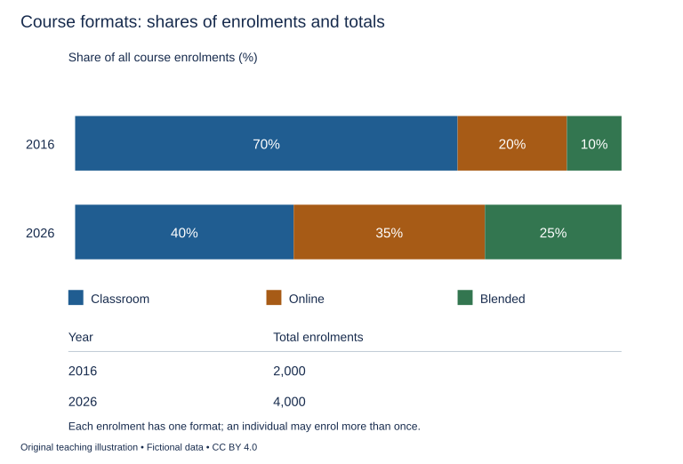

# U34 第24周：长篇阅读、写作与口语

本页为已独立核验的原创文字课程。先完成学生题目，再展开对应参考。非真题、非标准化模考，不换算雅思分数。听力尚未补齐，本页不代表全科课程已完成。

每周选A或G类Task 1一题，加Task 2及三次口语。参考范文不是学生已完成作业，仍须提交初稿、录音和重写，独立真人评分另行安排。

阅读每周180分钟（60分钟首次限时、120分钟证据精读与延迟复测），写作180分钟、口语120分钟。词汇60分钟、听力180分钟另列；新增完整听力未验收，不能勾整周完成。

W22/W24原创阶段检查按实际证据复盘；正式T22/T24陌生整卷、所选真实考试界面操作及真人评分另记，缺少目标或真实证据时不能据此判断报考/延长，本页原创技能卷不能代替正式模拟。后续周数与达标规则见 [U04](u04-exam-preparation.md)。

## 阅读：首答不查词

### R-W24-01 · A Loop That Holds by Contact

W24｜正文 896 词｜13 题｜篇章：科学模型：接触、受力与比较条件（7段）

本课必做60分钟：首答20、证据复盘20、词汇长句10、48小时后复测10。每周三课180分钟，合卷首答替代单课首答，不重复计算。开放短文选做另加15分钟。

本项目原创虚构教学情境，人物、地点、历史事件和案例数据均非真实研究或史料。科学解释只讨论文内说明的模型与条件。非雅思真题或标准化模考；正确数不换算雅思等级。许可：CC BY 4.0 — RayXBuilds and contributors。

能力点：识别论证关系、区分作者与引述者、条件与因果、精确定位。初读不查词，完成后打开独立答案页。

#### Passage

**A** In the fictional mechanics studio of Rova, students examine a flexible strip wrapped around a smooth cylinder. One end is pulled while the other is held with a smaller opposing force. Under the conditions chosen for the demonstration, contact with the cylinder helps resist movement of the strip. The teacher emphasises that the cylinder is not producing energy or fastening the strip with an invisible hook. The exercise concerns how contact over a curved surface can influence the forces needed to maintain a particular state. It is a simplified model, not instructions for lifting, climbing or securing real loads. Its value lies in separating the appearance of a stationary object from the relationships that allow it to remain stationary, and in showing why a successful demonstration under one arrangement does not establish a general guarantee for another.

**B** The first comparison uses the same strip and cylinder but changes how much of the curved surface the strip touches. The class distinguishes contact along a short arc from contact extending farther around the cylinder. It records the arrangement before comparing the opposing pulls. The teacher does not let students describe the result simply as more material means more holding. The relevant change is where and how the strip meets the cylinder, not merely how much strip exists on the bench. A longer loose tail would add material without reproducing the changed contact arrangement. This comparison shows why a plausible everyday description can miss the relationship actually varied in an experiment. The words used to explain a result should identify the part of the system that the evidence concerns.

**C** A second comparison changes the surface covering while preserving the same path around the cylinder. In the model, the force relationship changes. The students can therefore see that the amount of wrap alone is insufficient to describe the outcome. They need information about the contacting surfaces as well. A contact diagram marks the arc along which the strip touches the cylinder, while a surface card identifies the covering used in each run. These records keep two variables distinct. If both are changed at once, an observed difference cannot simply be assigned to either one without further reasoning. The teacher presents this as a limit on what the particular comparison establishes, rather than as a claim that complicated situations can never be investigated through carefully designed observations.

**D** The class then distinguishes a strip that remains still from one that is already moving. Starting motion and maintaining motion are treated as separate questions in the lesson. A result obtained in the first condition is not automatically entered as an answer for the second. The students use a motion log to record whether the strip is stationary, begins to move or continues moving during an observation. The categories prevent a broad word such as holding from concealing a change in the event being described. An observer entering halfway through a run needs to know its earlier state before interpreting the forces displayed at that moment. A single reading can be precise while remaining incomplete evidence about the sequence that produced it.

**E** The opposing pulls are recorded on a force chart, with the direction of each pull marked beside its value. The students initially add the two values and call the total the explanation. The teacher asks them to describe which end each reading belongs to and what direction it acts in. A list of magnitudes alone leaves out relationships needed to understand the arrangement. The class does not need a claim that every numerical summary is useless. It needs a summary suited to the question. Combining measurements can be helpful only when the combined quantity preserves the distinction the explanation depends on, rather than erasing the different roles of the observations simply because both happen to use the same unit.

**F** Repeated runs also reveal changes in the strip. A wear sheet records visible marks and alterations after each sequence, allowing later results to be linked with the condition of the material. The students do not assume that using the same physical strip guarantees identical conditions forever. An object can retain its identity while properties relevant to the demonstration change through use. The teacher therefore records the order of runs and checks whether an apparent effect of arrangement could instead be associated with the material's changing condition. This does not prove that wear explains every difference. It identifies a possibility that a comparison should preserve long enough to examine rather than discard simply because the equipment has not been replaced.

**G** The final account describes contact, surface, motion state, force direction and material condition together. None of those terms is a substitute for the relationships among them. The students can explain why one observed stationary state does not justify a promise that any similar-looking strip will hold any load. They can also explain why that limitation does not make the model uninformative. A useful demonstration reveals a relationship under specified conditions and suggests what must be checked before extending it. Its success is not measured by how confidently the conclusion can be detached from those conditions. By the end, an apparently simple loop has become a way to practise disciplined comparison: identify the state, preserve the relevant differences and avoid making a claim broader than the evidence that gives it meaning. The classroom result remains useful precisely because its boundaries remain part of the explanation.

#### Questions

**Complete the sentences. Choose NO MORE THAN 3 WORDS FROM THE PASSAGE for each answer. Do not change word forms.**

1. The arc of contact is marked on a ______.

2. The covering used in each run is identified on a ______.

3. Stationary, starting and continuing movement are recorded in a ______.

4. Values and directions of opposing pulls appear on a ______.

5. Visible material changes after each sequence are entered on a ______.

**Do the following statements agree with the writer's views? Write YES, NO or NOT GIVEN. YES = the writer agrees; NO = the writer expresses the opposite view; NOT GIVEN = the writer's view is not stated. Do not use outside knowledge.**

6. A stationary-state result automatically answers the question about continued motion.

7. The same physical strip necessarily maintains identical relevant conditions through repeated use.

8. The writer recommends replacing all classroom equipment at the end of each term.

9. A model can remain useful while its conclusions are limited to stated conditions.

**Choose ONE answer, A, B, C or D.**

10. The demonstration is primarily intended to investigate

   A. instructions for securing any load
   B. energy produced by a stationary cylinder
   C. contact and force relationships under stated conditions
   D. an invisible hook in the cylinder

11. Why does adding a loose tail not reproduce the first change?

   A. It does not change the same contact relationship
   B. The cylinder must disappear
   C. Length can never be observed
   D. All strips are equal in length

12. The surface comparison shows that

   A. surface and contact are identical variables
   B. wrap alone predicts every result
   C. contact extent alone is insufficient
   D. the model explains no relationship

13. Why preserve force directions with their values?

   A. Magnitudes alone omit the roles of the pulls
   B. Only the total matters
   C. Directions replace values
   D. Numbers cannot support explanations

#### 本周重点

原创学习记录、正式T22/T24陌生卷与目标分数分栏；证据不足不作报考或达标结论。

#### 复盘

必做：给每道错题标记“定位/作者立场/范围/语法/词数”，抄最短证据；用一行箭头概括本文论证或过程。48小时后重做错题与两道正确题，检查是否仍能指出证据。

选做（15分钟，80–100词）：Explain what this limited model supports and one broader claim it does not support.

R-W24-01 答案、证据与精读（首答后展开）

### R-W24-01 · 独立答案与证据

来源与许可同学生页。先完成再核对。可接受答案由 accepted_answers 明确列出；只忽略大小写和首尾空格，不自行删词。开放复盘不计入客观正确数。

1. **contact diagram / diagram**｜段落 C｜证据：“A contact diagram marks the arc”

   diagram可接受。

2. **surface card / card**｜段落 C｜证据：“a surface card identifies the covering”

   card可接受。

3. **motion log / log**｜段落 D｜证据：“a motion log to record”

   log可接受。

4. **force chart / chart**｜段落 E｜证据：“a force chart”

   chart可接受。

5. **wear sheet / sheet**｜段落 F｜证据：“A wear sheet records visible marks”

   sheet可接受。

6. **NO**｜段落 D｜证据：“not automatically entered as an answer for the second”

   明确状态区别。

7. **NO**｜段落 F｜证据：“guarantees identical conditions forever”

   原文do not assume，后句明确可变。

8. **NOT GIVEN**｜段落 F｜证据：“equipment has not been replaced”

   未述全面更换周期。

9. **YES**｜段落 G｜证据：“that limitation does not make the model uninformative”

   有限而有用。

10. **C**｜段落 A｜证据：“contact over a curved surface”

   限定模型。

11. **A**｜段落 B｜证据：“without reproducing the changed contact arrangement”

   材料量与接触安排不同。

12. **C**｜段落 C｜证据：“amount of wrap alone is insufficient”

   多条件，未全盘否定。

13. **A**｜段落 E｜证据：“leaves out relationships”

   大小不包方向与端点。

#### 词汇与长句

- **magnitude**：不含方向信息的量值大小
- **opposing**：方向相对的
- **stationary**：在所述观察中保持静止的
- **wear**：因使用出现的磨损或状态变化

> A single reading can be precise while remaining incomplete evidence about the sequence that produced it.

while允许数值精确与过程信息不足并存。

> An object can retain its identity while properties relevant to the demonstration change through use.

while对比物体身份与相关性质，不可用同一件器材代替同条件。

#### 开放任务参考

G只证限定接触关系，不证任意负载；不将本批作答表现外推为正式成绩。

标准：观点有文内依据，保留条件和范围，推断明确标注；不存在唯一措辞。

### R-W24-02 · The Dictionary That Was Never Finished

W24｜正文 911 词｜13 题｜篇章：虚构文献史：收集、分类与版本边界（8段）

本课必做60分钟：首答20、证据复盘20、词汇长句10、48小时后复测10。每周三课180分钟，合卷首答替代单课首答，不重复计算。开放短文选做另加15分钟。

本项目原创虚构教学情境，人物、地点、历史事件和案例数据均非真实研究或史料。科学解释只讨论文内说明的模型与条件。非雅思真题或标准化模考；正确数不换算雅思等级。许可：CC BY 4.0 — RayXBuilds and contributors。

能力点：识别论证关系、区分作者与引述者、条件与因果、精确定位。初读不查词，完成后打开独立答案页。

#### Passage

**A** In the fictional region of Vale, a teacher begins collecting local words in a set of notebooks. She plans a dictionary but dies before arranging the whole collection alphabetically. Decades later, an editor prepares a printed volume from the surviving pages. Readers sometimes describe that volume as the teacher's completed dictionary. The phrase conceals decisions made after her work ended. The notebooks include definitions, examples, questions and reminders to consult other speakers. Not every entry represents a settled judgement, and the printed order does not reproduce the order in which the material was gathered. To understand what the volume preserves, a researcher must distinguish collecting words from deciding how a dictionary should present them.

**B** The teacher's first notebook follows journeys between villages. A word appears beside the name of the person who used it and a short account of the occasion. Similar words recur on later pages, sometimes with different meanings. Repetition was useful during collection because it preserved separate encounters rather than forcing early agreement. The editor later groups repeated forms under one heading. This makes the printed book easier to search, but it can also hide the circumstances that made the examples differ. The researcher therefore follows the references back to the notebooks before deciding whether two descriptions are contradictions, variations in use or observations of different activities that happened to share a word.

**C** One entry illustrates the problem. The teacher records a term used for a covered basket in one village and for the act of carrying supplies in another. A margin question asks whether the uses are connected. The editor prints both meanings but omits the question. The resulting entry can make the connection appear established even though the teacher had left it open. The issue is not that grouping the meanings must be wrong. It is that a proposal about their relationship has become harder for a reader to distinguish from a conclusion supported by further investigation. Removing a small mark of uncertainty can alter the status of an explanation without changing either of the individual examples quoted beneath it.

**D** Spelling introduces another editorial choice. The teacher sometimes writes the same sound differently on different visits, and the notebooks contain no complete statement of a preferred spelling system. The editor selects one form for each printed heading and lists alternatives in smaller type. That arrangement helps readers find entries, but the chosen heading should not automatically be described as the form the teacher regarded as correct. It belongs partly to the editor's organisation of the material. A practical publishing convention can be defensible without being projected backwards as an earlier author's judgement. The researcher records who made the selection and which surviving sources, if any, support a claim about the teacher's own preference.

**E** Absence is equally difficult to interpret. A common word missing from the notebooks may have seemed too ordinary to record, may have been intended for later work or may simply not have arisen during the documented visits. The absence does not prove that local speakers never used it. Nor can the researcher confidently choose among those possible explanations without evidence. The incomplete project should remain incomplete in the historical account. Calling it a dictionary does not give it the coverage of a finished reference work. Its gaps can help reveal the collecting process, but only if they are not converted into categorical statements about the entire language of a community the teacher encountered through limited occasions and particular speakers.

**F** The revised research catalogue uses a collection register to connect words with recorded speakers, places and occasions. A variant table places different written forms side by side. A query list preserves unresolved questions from margins and loose pages. An editorial record identifies choices made when the printed volume was prepared. These aids separate evidence about usage from evidence about publication. They also let readers follow a printed entry back to several notebook passages instead of assuming that one tidy heading must have originated as one equally tidy source. Where the chain cannot be established, the catalogue marks the missing connection rather than supplying an invented reference to make every entry look complete.

**G** For an exhibition, a version panel shows a notebook page, an editor's working draft and the corresponding printed entry. Visitors can see that editing added useful organisation while changing how hesitation and repetition appeared. The display does not rank handwritten disorder as automatically more truthful than print. A notebook can contain mistakes, and a printed arrangement can make comparisons possible that were difficult in the original pages. The point is to understand what each form makes visible and what it suppresses. The teacher's unfinished work and the editor's finished volume are related achievements with different authorship and different limits, not rival objects of which only one is allowed to have value.

**H** The dictionary's history consequently extends beyond the collection of definitions. It includes encounters with speakers, decisions about grouping and spelling, and later expectations about what a reference book ought to provide. The researcher can respect the printed volume without treating its finality as proof that every question in its sources was resolved. A clear account identifies the stages, preserves uncertainty where it affects a claim and states whose decision is being described. The unfinished notebooks remain informative precisely because they record work in progress. Their value does not depend on pretending that the teacher completed a project which later readers, helped by a different person's labour, came to experience as complete.

#### Questions

**Which paragraph contains the following information? Write a letter, A–H. You may use any letter more than once.**

1. a question connecting a basket term with an action term disappearing from print

2. several possible reasons why an ordinary word might be absent

3. material first ordered by journeys later being grouped under repeated word forms

4. headword spellings selected despite no complete earlier spelling policy

**Do the following statements agree with the writer's views? Write YES, NO or NOT GIVEN. YES = the writer agrees; NO = the writer expresses the opposite view; NOT GIVEN = the writer's view is not stated. Do not use outside knowledge.**

5. Grouping two meanings necessarily establishes that the teacher resolved their relationship.

6. A published heading can be useful without representing the earlier writer’s preferred spelling.

7. The writer recommends allowing only researchers to view the original notebooks.

8. A missing word proves it was never used by the local community.

**Complete the summary. Choose NO MORE THAN 3 WORDS FROM THE PASSAGE for each answer. Do not change word forms.**

Words are linked with speakers and occasions in a (9) ______. Written alternatives appear in a (10) ______. Unresolved questions are preserved in a (11) ______. Publishing decisions are identified in the (12) ______. Visitors compare notebook, draft and printed entry on a (13) ______.

#### 本周重点

原创学习记录、正式T22/T24陌生卷与目标分数分栏；证据不足不作报考或达标结论。

#### 复盘

必做：给每道错题标记“定位/作者立场/范围/语法/词数”，抄最短证据；用一行箭头概括本文论证或过程。48小时后重做错题与两道正确题，检查是否仍能指出证据。

选做（15分钟，80–100词）：Explain why a finished publication does not imply that every source question was settled.

R-W24-02 答案、证据与精读（首答后展开）

### R-W24-02 · 独立答案与证据

来源与许可同学生页。先完成再核对。可接受答案由 accepted_answers 明确列出；只忽略大小写和首尾空格，不自行删词。开放复盘不计入客观正确数。

1. **C**｜段落 C｜证据：“omits the question”

   C具体不确定丢失。

2. **E**｜段落 E｜证据：“may have seemed too ordinary to record”

   E多种缺失解释。

3. **B**｜段落 B｜证据：“follows journeys between villages”

   B采集顺序到检索顺序。

4. **D**｜段落 D｜证据：“no complete statement of a preferred spelling system”

   D编辑选择。

5. **NO**｜段落 C｜证据：“teacher had left it open”

   分组不证原作者已定。

6. **YES**｜段落 D｜证据：“defensible without being projected backwards”

   可用与归属分开。

7. **NOT GIVEN**｜段落 G｜证据：“For an exhibition, a version panel”

   展示页面不说明谁可以接触原本；全文未提出限制访问原件的政策。

8. **NO**｜段落 E｜证据：“does not prove that local speakers never used it”

   明确反向。

9. **collection register / register**｜段落 F｜证据：“a collection register to connect words”

   register可接受。

10. **variant table / table**｜段落 F｜证据：“A variant table places different written forms”

   table可接受。

11. **query list / list**｜段落 F｜证据：“A query list preserves unresolved questions”

   list可接受。

12. **editorial record / record**｜段落 F｜证据：“An editorial record identifies choices”

   题干用the，允许record。

13. **version panel / panel**｜段落 G｜证据：“a version panel shows a notebook page”

   panel可接受。

#### 词汇与长句

- **headword**：词典条目的检索词头
- **variant**：同一形式或用法的变体
- **categorical**：未保留例外或不确定性的断然判断
- **authorship**：文字或决定由谁作出的归属

> A practical publishing convention can be defensible without being projected backwards as an earlier author's judgement.

without限定归属，合理编辑惯例不代表原作者意见。

> The researcher can respect the printed volume without treating its finality as proof that every question in its sources was resolved.

without区分出版完成与证据问题全部解决。

#### 开放任务参考

C删未定问题；D后人选拼法；把资料状态和编辑完成分开。

标准：观点有文内依据，保留条件和范围，推断明确标注；不存在唯一措辞。

### R-W24-03 · Why a Useful Estimate Has a Range

W24｜正文 851 词｜14 题｜篇章：议论：估计、精确性与决策条件（7段）

本课必做60分钟：首答20、证据复盘20、词汇长句10、48小时后复测10。每周三课180分钟，合卷首答替代单课首答，不重复计算。开放短文选做另加15分钟。

本项目原创虚构教学情境，人物、地点、历史事件和案例数据均非真实研究或史料。科学解释只讨论文内说明的模型与条件。非雅思真题或标准化模考；正确数不换算雅思等级。许可：CC BY 4.0 — RayXBuilds and contributors。

能力点：识别论证关系、区分作者与引述者、条件与因果、精确定位。初读不查词，完成后打开独立答案页。

#### Passage

**A** The fictional town of Mira plans seating for an outdoor lecture. Two reports estimate attendance. One predicts exactly four hundred and twelve people; the other gives a range and explains the assumptions behind its limits. Some organisers prefer the exact number because it looks more confident. Yet the appearance of precision does not establish the quality of the information that produced it. An estimate is useful when it supports a decision with an honest account of uncertainty, not merely when it supplies a convenient single figure. The choice of seats may require a central expectation, a reserve or a practical plan for conditions changing over time. Before comparing the reports, the organisers need to identify which decision they are making and what kind of error would matter to that decision.

**B** Both estimates begin with registrations, but registration does not guarantee attendance. Some people may cancel, and others may arrive without registering if the event allows it. The reports use different assumptions about those movements. The second report makes the assumptions explicit and shows how the result changes when they change. Its range is therefore not simply a confession that the author knows nothing. It records several outcomes compatible with stated conditions. The exact report may still contain useful work, but its single figure gives the organisers less help in seeing which part of the conclusion depends on which assumption. A number can be calculated carefully from premises that remain uncertain, and careful arithmetic does not remove that uncertainty from the result.

**C** The meaning of a range also needs explanation. The second report does not claim that every number inside its limits is equally likely, or that outcomes outside them are impossible. It describes the limits as the results of selected scenarios, including changes in cancellation and unregistered arrival. A reader who treats them as guaranteed boundaries would give the report a claim it did not make. The organisers ask for the scenario descriptions alongside the numbers. This makes the uncertainty usable by connecting it with events that could occur. A wide interval without any account of its basis may be no more helpful than an exact number whose assumptions are hidden. Transparency concerns the relationship between evidence and conclusion, not a preference for one numerical format in every situation.

**D** Different decisions can use the same estimate differently. Ordering chairs that can be returned carries a different consequence from constructing permanent seating. The cost of an empty chair may differ from the cost of turning someone away. The organisers therefore discuss the consequences of overestimating and underestimating instead of assuming that the middle of the range must always be the best action. The estimate describes possibilities under assumptions; the decision also involves priorities, costs and available alternatives. Confusing those two tasks can make a practical choice look as though it was dictated by arithmetic alone. The report can inform the discussion without silently deciding which consequence the town ought to regard as more important.

**E** Information changes as the date approaches. A revised weather forecast and a new transport arrangement may affect the scenarios. The second report states when its assumptions should be reviewed and which new observations would justify revision. Updating is not automatically an admission that the earlier work was careless. An estimate can be appropriate to the information available at one time and need adjustment when that information changes. However, a revision should explain what changed rather than merely replacing the old number and concealing the difference. The organisers keep successive versions so they can distinguish a response to new evidence from an unexplained alteration made after someone disliked the previous conclusion.

**F** The final seating plan uses a modest initial arrangement with a documented option to add temporary chairs. The organisers record the expected attendance, the scenarios considered and the reasons for selecting that response. They do not claim that a flexible plan makes the attendance estimate unnecessary or that spare chairs eliminate every possible inconvenience. Flexibility changes which errors can be managed and at what cost. After the lecture, the actual count is compared with the reports, but one observed outcome is not treated as proof that every estimate with a similar range will always be reliable. The review examines both the prediction and the reasoning, including whether the assumptions were stated clearly enough to be challenged before the event rather than only explained afterwards.

**G** A useful estimate consequently combines a quantity with a description of its evidential limits and a clear relationship to the decision at hand. Precision can be valuable when the information supports it; a range can be valuable when its meaning is explained. Neither format earns trust by appearance alone. The responsible reader asks what was counted, what was assumed, which possibilities were considered and what would justify changing the conclusion. The responsible decision-maker then keeps those answers separate from the priorities that determine an action. This separation does not prevent decisions under uncertainty. It makes them easier to examine and revise, because confidence is attached to reasons that others can inspect rather than to a number whose extra digits merely make doubt less visible.

#### Questions

**Do the following statements agree with the writer's views? Write YES, NO or NOT GIVEN. YES = the writer agrees; NO = the writer expresses the opposite view; NOT GIVEN = the writer's view is not stated. Do not use outside knowledge.**

1. Every numerical range is more useful than every exact figure.

2. Updating a prediction necessarily proves the earlier work was careless.

3. The writer recommends paying forecasters according to their number of revisions.

4. A single event outcome proves that every similarly expressed estimate will always be reliable.

5. Explained uncertainty can support decisions rather than prevent them.

**Choose ONE answer, A, B, C or D.**

6. The writer challenges the preference for the exact forecast because

   A. exact numbers are always false
   B. decisions never need quantities
   C. ranges require no explanation
   D. precision in appearance does not establish evidential quality

7. Why can careful arithmetic still yield an uncertain prediction?

   A. Its premises can remain uncertain
   B. Every scenario must occur
   C. Registration is meaningless
   D. Numbers cannot be added

8. The limits of the second report represent

   A. guaranteed impossible-to-exceed boundaries
   B. proof that the author has no information
   C. equally likely attendance totals
   D. results of selected scenarios

9. What distinguishes a decision from an estimate?

   A. Decisions also involve consequences and priorities
   B. Decisions exclude evidence
   C. Costs always determine a midpoint
   D. Estimates choose every social priority

**Which paragraph contains the following information? Write a letter, A–G. You may use any letter more than once.**

10. a comparison of returnable chairs and permanent seating

11. an initial seating arrangement with an option to add temporary chairs

12. scenario limits explicitly not guaranteeing impossibility outside the interval

13. two reports starting from registrations but using different attendance assumptions

14. weather and transport changes triggering review of assumptions

#### 本周重点

原创学习记录、正式T22/T24陌生卷与目标分数分栏；证据不足不作报考或达标结论。

#### 复盘

必做：给每道错题标记“定位/作者立场/范围/语法/词数”，抄最短证据；用一行箭头概括本文论证或过程。48小时后重做错题与两道正确题，检查是否仍能指出证据。

选做（15分钟，80–100词）：Separate a result recorded in this course from a broader conclusion that would require new evidence.

R-W24-03 答案、证据与精读（首答后展开）

### R-W24-03 · 独立答案与证据

来源与许可同学生页。先完成再核对。可接受答案由 accepted_answers 明确列出；只忽略大小写和首尾空格，不自行删词。开放复盘不计入客观正确数。

1. **NO**｜段落 C｜证据：“may be no more helpful than an exact number”

   不按形式绝对排名。

2. **NO**｜段落 E｜证据：“not automatically an admission”

   信息变化可合理修订。

3. **NOT GIVEN**｜段落 E｜证据：“which new observations would justify revision”

   未提薪酬制度。

4. **NO**｜段落 F｜证据：“not treated as proof”

   直接否定推广。

5. **YES**｜段落 G｜证据：“does not prevent decisions under uncertainty”

   作者结论。

6. **D**｜段落 A｜证据：“appearance of precision”

   格式不保证质量。

7. **A**｜段落 B｜证据：“premises that remain uncertain”

   计算无误不消除前提不确定。

8. **D**｜段落 C｜证据：“results of selected scenarios”

   解释range含义。

9. **A**｜段落 D｜证据：“priorities, costs and available alternatives”

   量与价值选择分开。

10. **D**｜段落 D｜证据：“chairs that can be returned”

   D决策代价。

11. **F**｜段落 F｜证据：“add temporary chairs”

   F最终方案。

12. **C**｜段落 C｜证据：“outcomes outside them are impossible”

   C范围语义。

13. **B**｜段落 B｜证据：“The reports use different assumptions”

   B明确两个报告共同起点与假设差异，区别C单份报告的情景范围。

14. **E**｜段落 E｜证据：“A revised weather forecast and a new transport arrangement”

   E具体更新条件。

#### 词汇与长句

- **premise**：计算或推理所依赖的前提
- **scenario**：在一组明确条件下考察的情景
- **revision**：依据明确变化进行的修订
- **precision**：数值呈现或测量的精细程度

> A number can be calculated carefully from premises that remain uncertain, and careful arithmetic does not remove that uncertainty from the result.

that限定premises；and连接计算正确与前提不确定。

> The estimate describes possibilities under assumptions; the decision also involves priorities, costs and available alternatives.

分号并列两层，不能把决策偏好伪装为算术必然。

#### 开放任务参考

课程正确数仅描述本批；正式T22/T24、目标与条件未齐时，不据原创或熟题复测判断报考/达标。

标准：观点有文内依据，保留条件和范围，推断明确标注；不存在唯一措辞。

## 写作与口语：Task 1双分支择一

### WS-W24-T1A 学生页：学习中心模式构成与总参与量

周次 W24｜题型 T1A｜能力点：比例、总量与证据边界

Task 1 的 A/G 分支二选一，另一分支不计入本周作业。

#### 使用与记录

原创教学练习，非真题、非标准化模拟，难度未校准。先完成本页再打开参考页。人物、机构、经历与数据均为教学虚构。范例的身份、地点、动作和细节不是强制要求。口语优先用真实经历或真实观察，并说明来源；没有相关经历时，可将假设回答明确标为技能练习，不伪装成亲历。不要背诵示例。自评和 AI 反馈不能代替独立真人评分，未获得真人评阅时标记“分数未确认”。

保存：任务ID、实际日期、用时、初稿或原始录音、证据化反馈、重写/重答、三条修改理由。没有学生提交物，不得填写“已批改”或“已完成训练”。

#### 完整题干

The charts show the proportions of course enrolments in classroom, online and blended formats at a training provider in 2016 and 2026. The table gives total enrolments in each year. Summarise the information by selecting and reporting the main features, and make comparisons where relevant.

Write at least 150 words. Spend about 20 minutes on this task.

教学虚构。2016总报名2000：Classroom70%、Online20%、Blended10%；2026总4000：40%、35%、25%。每份报名只归一种模式，各年合100%；同一人可多报，独立人数未知。Blended指同一课程结合线上与面授。

#### 任务预算（含首次审题，不额外加时）

初稿20分钟（审题规划3、写作15、检查2）；诊断15；反馈阅读与证据核查10；完整重写25；对照归档5。合计75分钟。

#### 初稿后自评清单

- [ ] 达到最低字数；全文连贯成段，没有用项目符号代替作文。
- [ ] 概述给主要特征；数据、阶段或方位都与题图逐项相符，不推断未提供的原因。
- [ ] 每段可写出一个功能标签；例子或数据与该段要点相连。
- [ ] 核查两处词汇搭配和两处句法；如有疑点先试改再核实，无问题则记录通过证据。
- [ ] 如有影响理解的问题，记录原句；否则记通过或待核查，不填写自猜分数。

#### 反馈与重写

打开 独立参考页（本节下方展开参考），按逐段检查和通用协议核验。重写任务：完整重写至少150词；有证据问题才改，核对数量/比例/分母。保存真实作答记录供W24证据表，不以本题完成或示例推断报考准备度。

#### 本周重点操作（已含原预算）

在原归档时段取3分钟更新W24证据表，本题只贡献原创写说过程证据。核对份额、分母与换算；课堂份额下降并不等于报名数量下降。 核验真实T22、T24、目标总分/单项、两轮真人反馈和实际考试形式练习的来源及状态；缺关键证据写“未定”，不是自动失败，也不是自动建议报考。只有可信证据显示差距时才讨论针对性延长与复核节点，不能保分。本课完成不代表正式T24已完成或报考决定已作出。

记录表见[阶段证据表](u35-feedback.md)，只在上述原时段填写相关行。

W24 T1A 示例、反馈与重练（首答后展开）

### WS-W24-T1A 独立参考页

只在初稿完成后阅读；不是唯一答案，也没有官方分数。以下是对原创示例的教学讲评，不是对学生尚未提交作文的已完成批改。

#### 思路拆解

比例与绝对量同时看；末年仍classroom40最大；参加人数未知，首尾核算用于证据不是成绩。

#### 原创示例

The charts compare the shares of enrolments in classroom, online and blended courses at a training provider in 2016 and 2026. The table gives the overall number of enrolments, allowing the quantities for individual formats to be calculated.

Overall, classroom courses lost share but remained the largest category in 2026. Both online and blended learning gained share, and total enrolments doubled. As a result, the number of classroom enrolments increased despite the decline in their proportion.

In 2016, classroom teaching accounted for 70% of the provider’s 2,000 enrolments, equivalent to 1,400. Online courses represented 20%, or 400 enrolments, while blended courses had the smallest share at 10%, corresponding to 200 enrolments.

By 2026, the total had risen to 4,000. Classroom courses made up 40%, giving 1,600 enrolments, while online courses accounted for 35%, or 1,400. The remaining 25%, equivalent to 1,000 enrolments, were in blended courses. The gap between classroom and online shares therefore narrowed from fifty to five percentage points. Blended enrolments increased fivefold in number, whereas their share rose by fifteen percentage points. The data describe enrolments rather than separate individual learners.

示例正文词数：190（本项目正则计数；书信不含称呼、结束语与署名；连字符词作一词）。

#### 逐段反馈与迁移

以下只分析上方原创示例。题干要点及图表事实必须遵守；书信、议论文的自拟身份、日期、经历和例子不是新增强制要求。按自己的合理设定核验，不为对齐范例编造经历。

- P1 2000/4000允许算各类数量，不能把enrolments当不同人。

- P2 classroom比例70→40降，但件数1400→1600升。

- P3 2016各1400/400/200，合2000。

- P4 2026各1600/1400/1000合4000；gap50→5，blended数量5倍但份额+15点。

#### 常见失误

比例降就说人数降；算5倍占比而非数量；将登记次数充正式学习效果。

#### 可执行反馈步骤

1. 先把自己的段落标为引入、概述/论点、支持、收束；分段可不同于示例，按功能核查，不照抄段数。
2. 对照上方逐段检查，逐项标“已有证据/缺失/不适用”。每条意见必须附自己的原句或缺失位置。
3. 按 [反馈协议](u35-feedback.md) 的四维表记录；有争议的 AI 意见回题干、数据或语法依据核验。
4. 只选至多两项有证据的优先点执行整篇重写；如未发现问题，可改变组织或表达练迁移，但不把它标成纠错；保留原稿，禁止把示例替换为自己的作业。

#### 重写任务

完整重写至少150词；有证据问题才改，核对数量/比例/分母。保存真实作答记录供W24证据表，不以本题完成或示例推断报考准备度。

完成后重新勾选 学生页（见本节上方学生题） 清单；将一处改前/改后及理由交给独立评阅者核查。真人评阅状态目前为“待安排”，不是已完成。

### WS-W24-T1G 学生页：询问考试准备工作坊安排

周次 W24｜题型 T1G｜能力点：书信目的、要点与语气

Task 1 的 A/G 分支二选一，另一分支不计入本周作业。

#### 使用与记录

原创教学练习，非真题、非标准化模拟，难度未校准。先完成本页再打开参考页。人物、机构、经历与数据均为教学虚构。范例的身份、地点、动作和细节不是强制要求。口语优先用真实经历或真实观察，并说明来源；没有相关经历时，可将假设回答明确标为技能练习，不伪装成亲历。不要背诵示例。自评和 AI 反馈不能代替独立真人评分，未获得真人评阅时标记“分数未确认”。

保存：任务ID、实际日期、用时、初稿或原始录音、证据化反馈、重写/重答、三条修改理由。没有学生提交物，不得填写“已批改”或“已完成训练”。

#### 完整题干

You are interested in a short preparation workshop advertised by a training centre. Write to the centre manager. In your letter:
- explain what you hope to practise
- ask about the activities and feedback provided
- ask for the practical information you need before deciding whether to attend.
Begin your letter: Dear Sir or Madam,

Write at least 150 words. You do not need to write any addresses. Spend about 20 minutes on this task.

#### 任务预算（含首次审题，不额外加时）

初稿20分钟（审题规划3、写作15、检查2）；诊断15；反馈阅读与证据核查10；完整重写25；对照归档5。合计75分钟。

#### 初稿后自评清单

- [ ] 达到最低字数；全文连贯成段，没有用项目符号代替作文。
- [ ] 三个要点均展开；称呼、目的、语气和结束语适合收信人。
- [ ] 每段可写出一个功能标签；例子或数据与该段要点相连。
- [ ] 核查两处词汇搭配和两处句法；如有疑点先试改再核实，无问题则记录通过证据。
- [ ] 如有影响理解的问题，记录原句；否则记通过或待核查，不填写自猜分数。

#### 反馈与重写

打开 独立参考页（本节下方展开参考），按逐段检查和通用协议核验。重写任务：整篇重写至少150词；学生可合理自拟希望练习的内容，不必采用示例的具体弱项。真实报名/报考判断另据证据表，不把这封虚构信当已发送或已报名。

#### 本周重点操作（已含原预算）

在原归档时段取3分钟更新W24证据表，本题只贡献原创写说过程证据。核对目标、活动反馈与实际安排三要点；虚构询问信不能算已报名。 核验真实T22、T24、目标总分/单项、两轮真人反馈和实际考试形式练习的来源及状态；缺关键证据写“未定”，不是自动失败，也不是自动建议报考。只有可信证据显示差距时才讨论针对性延长与复核节点，不能保分。本课完成不代表正式T24已完成或报考决定已作出。

记录表见[阶段证据表](u35-feedback.md)，只在上述原时段填写相关行。

W24 T1G 示例、反馈与重练（首答后展开）

### WS-W24-T1G 独立参考页

只在初稿完成后阅读；不是唯一答案，也没有官方分数。以下是对原创示例的教学讲评，不是对学生尚未提交作文的已完成批改。

#### 思路拆解

正式询问信，目标练习可自拟；问反馈谁提供/是否个人实际作业，费用设备日程未给就问不编。

#### 原创示例

Dear Sir or Madam,

I saw your advertisement for a short preparation workshop and would like some further information before deciding whether to attend. I am particularly interested in practising timed writing and receiving specific comments on how clearly I respond to a task. I would also like an opportunity to practise answering spoken questions without reading from prepared notes.

Could you explain how the workshop sessions are organised? For example, will participants complete individual tasks during the session, or will most of the time be used for demonstrations? I would also like to know who provides the feedback and whether it refers to each participant’s own writing and speaking. A general explanation of useful techniques would be welcome, but individual comments are important to my decision.

Please send the dates, session length, group size and total fee, including any charge for reviewing work afterwards. I would also appreciate information about the equipment participants need to bring and whether a sample schedule is available. Once I understand the activities and practical arrangements, I will be able to judge whether the workshop fits my needs and availability.

Yours faithfully,
Alex Chen

示例正文词数：182（本项目正则计数；书信不含称呼、结束语与署名；连字符词作一词）。

#### 逐段反馈与迁移

以下只分析上方原创示例。题干要点及图表事实必须遵守；书信、议论文的自拟身份、日期、经历和例子不是新增强制要求。按自己的合理设定核验，不为对齐范例编造经历。

- P1 希望练习的内容明确，但不是用户已报名或已诊断的事实。

- P2 individual tasks/demo、反馈者/个别反馈为问题，不能假装机构官方认证。

- P3 日期时长人数总费设备和样表支持决策，不提前承诺参加。

#### 常见失误

虚构已获分数或教师资历；把广告当保分承诺；只问价格忘训练与反馈。

#### 可执行反馈步骤

1. 先把自己的段落标为引入、概述/论点、支持、收束；分段可不同于示例，按功能核查，不照抄段数。
2. 对照上方逐段检查，逐项标“已有证据/缺失/不适用”。每条意见必须附自己的原句或缺失位置。
3. 按 [反馈协议](u35-feedback.md) 的四维表记录；有争议的 AI 意见回题干、数据或语法依据核验。
4. 只选至多两项有证据的优先点执行整篇重写；如未发现问题，可改变组织或表达练迁移，但不把它标成纠错；保留原稿，禁止把示例替换为自己的作业。

#### 重写任务

整篇重写至少150词；学生可合理自拟希望练习的内容，不必采用示例的具体弱项。真实报名/报考判断另据证据表，不把这封虚构信当已发送或已报名。

完成后重新勾选 学生页（见本节上方学生题） 清单；将一处改前/改后及理由交给独立评阅者核查。真人评阅状态目前为“待安排”，不是已完成。

### WS-W24-T2 学生页：迁居城市工作利弊

周次 W24｜题型 T2｜能力点：观点展开与任务回应

A/G 共用本题。

#### 使用与记录

原创教学练习，非真题、非标准化模拟，难度未校准。先完成本页再打开参考页。人物、机构、经历与数据均为教学虚构。范例的身份、地点、动作和细节不是强制要求。口语优先用真实经历或真实观察，并说明来源；没有相关经历时，可将假设回答明确标为技能练习，不伪装成亲历。不要背诵示例。自评和 AI 反馈不能代替独立真人评分，未获得真人评阅时标记“分数未确认”。

保存：任务ID、实际日期、用时、初稿或原始录音、证据化反馈、重写/重答、三条修改理由。没有学生提交物，不得填写“已批改”或“已完成训练”。

#### 完整题干

Many adults move from smaller towns to large cities in search of work. Do the advantages of this development outweigh the disadvantages? Give reasons and include relevant examples.

Write at least 250 words. Spend about 40 minutes on this task.

#### 任务预算（含首次审题，不额外加时）

初稿40分钟（审题规划5、写作30、检查5）；诊断15；反馈阅读与证据核查10；完整重写35；对照归档5。合计105分钟。

#### 初稿后自评清单

- [ ] 达到最低字数；全文连贯成段，没有用项目符号代替作文。
- [ ] 直接回答题目的所有问句，有始终一致的立场。
- [ ] 每段可写出一个功能标签；例子或数据与该段要点相连。
- [ ] 核查两处词汇搭配和两处句法；如有疑点先试改再核实，无问题则记录通过证据。
- [ ] 如有影响理解的问题，记录原句；否则记通过或待核查，不填写自猜分数。

#### 反馈与重写

打开 独立参考页（本节下方展开参考），按逐段检查和通用协议核验。重写任务：完整重写至少250词；根据本次及真实历史稿核是否有重复问题，无证据保持未知。保存真实限时稿供独立评阅，报考/延长不能由范文字数或本包完结决定。

#### 本周重点操作（已含原预算）

在原归档时段取3分钟更新W24证据表，本题只贡献原创写说过程证据。核对迁居工作的利弊权衡与条件；不能从议论文立场推导你个人应报名考试。 核验真实T22、T24、目标总分/单项、两轮真人反馈和实际考试形式练习的来源及状态；缺关键证据写“未定”，不是自动失败，也不是自动建议报考。只有可信证据显示差距时才讨论针对性延长与复核节点，不能保分。本课完成不代表正式T24已完成或报考决定已作出。

记录表见[阶段证据表](u35-feedback.md)，只在上述原时段填写相关行。

W24 T2 示例、反馈与重练（首答后展开）

### WS-W24-T2 独立参考页

只在初稿完成后阅读；不是唯一答案，也没有官方分数。以下是对原创示例的教学讲评，不是对学生尚未提交作文的已完成批改。

#### 思路拆解

利弊条件式权衡，用具体机会与整体生活而非只比薪水；不是为真实用户职业/财务选择下结论。

#### 原创示例

Moving to a large city can widen an adult’s employment options, but it can also bring higher living costs and a loss of familiar support. I believe the advantages can outweigh the disadvantages when the move is connected to realistic opportunities, although relocation should not be regarded as beneficial for everyone.

The main advantage is access to a wider range of employers and specialised roles. A person whose skills are needed by only a few organisations may have more opportunities where those organisations are concentrated. Changing jobs may also become easier without another major move. These benefits are particularly relevant when a smaller town offers little work in the person’s field. However, a larger number of vacancies does not guarantee that an individual will obtain a suitable position.

The disadvantages concern both money and daily life. Housing and travel can absorb much of the benefit from a higher salary, so comparing pay alone gives an incomplete picture. A person may also lose the practical help and social connections available near family or long-standing friends. Building a new support network takes time. For someone with responsibilities that depend on nearby relatives, this loss may be more significant than access to additional employers.

On balance, the case for moving is stronger when a person can compare a concrete opportunity with the actual costs and arrangements involved. Information about accommodation, commuting and the stability of the work is therefore important. There are also alternatives: some roles can be performed remotely, and some people may find suitable work in a regional centre rather than the largest city. These options do not eliminate the value of relocation, but they show why the decision should be based on circumstances rather than a simple assumption that bigger places are always better.

In conclusion, large cities can offer valuable employment advantages, especially for specialised work. Whether those gains exceed the disadvantages depends on the opportunity available and the effect of the move on the person’s overall living conditions.

示例正文词数：330（本项目正则计数；书信不含称呼、结束语与署名；连字符词作一词）。

#### 逐段反馈与迁移

以下只分析上方原创示例。题干要点及图表事实必须遵守；书信、议论文的自拟身份、日期、经历和例子不是新增强制要求。按自己的合理设定核验，不为对齐范例编造经历。

- P1 opportunities与cost/support两方明确，条件不空泛。

- P2 专门岗位与雇主集中机制，机会不等于保证offer。

- P3 住房交通与支持网络多维成本，不能只算收入。

- P4 actual opportunity/cost与remote/regional替代作范围限制，不否认所有城市收益。

- P5 判断与开头一致，不自动建议任何人搬家。

#### 常见失误

把所有大城市写成高薪低风险；忽略support；只有利弊列表没有判断依据。

#### 可执行反馈步骤

1. 先把自己的段落标为引入、概述/论点、支持、收束；分段可不同于示例，按功能核查，不照抄段数。
2. 对照上方逐段检查，逐项标“已有证据/缺失/不适用”。每条意见必须附自己的原句或缺失位置。
3. 按 [反馈协议](u35-feedback.md) 的四维表记录；有争议的 AI 意见回题干、数据或语法依据核验。
4. 只选至多两项有证据的优先点执行整篇重写；如未发现问题，可改变组织或表达练迁移，但不把它标成纠错；保留原稿，禁止把示例替换为自己的作业。

#### 重写任务

完整重写至少250词；根据本次及真实历史稿核是否有重复问题，无证据保持未知。保存真实限时稿供独立评阅，报考/延长不能由范文字数或本包完结决定。

完成后重新勾选 学生页（见本节上方学生题） 清单；将一处改前/改后及理由交给独立评阅者核查。真人评阅状态目前为“待安排”，不是已完成。

### WS-W24-S1 学生页

周次W24｜Part 1专项｜能力点：依据已知证据解释选择；承认信息缺口，避免无条件结论｜30分钟

#### 使用与记录

原创教学练习，非真题、非标准化模拟，难度未校准。先完成本页再打开参考页。人物、机构、经历与数据均为教学虚构。范例的身份、地点、动作和细节不是强制要求。口语优先用真实经历或真实观察，并说明来源；没有相关经历时，可将假设回答明确标为技能练习，不伪装成亲历。不要背诵示例。自评和 AI 反馈不能代替独立真人评分，未获得真人评阅时标记“分数未确认”。

保存：任务ID、实际日期、用时、初稿或原始录音、证据化反馈、重写/重答、三条修改理由。没有学生提交物，不得填写“已批改”或“已完成训练”。

#### 操作与预算

设备与审题3分钟；首答录音6；回听及局部转写7；示例和诊断5；不看稿重答6；归档3。共30分钟。

#### Part 1专项题

1. How do you choose between different activities?
2. Do you make important decisions quickly?
3. What information do you look for before joining a course?
4. Do you ever change a decision after learning more?

追问：

- When is it reasonable to delay a decision?
- Does having more choice always help?

首答6分钟内依次答4个主问，每题约40～60秒；两条追问只选1条答约30～45秒，其余时间用于转题。备用追问留给重答，不要求全部说完。

#### 录音回听清单

- [ ] 保留首答原音，记录实际时长、是否中断、是否看稿；只报真实完成状态；短于目标时长如实记，不用沉默或无关内容凑时。
- [ ] 流利与连贯：标出两处时间戳，区分构思停顿与重复搜词，检查是否偏离问句。
- [ ] 词汇：如有模糊词或无效重复，引用一处并先解释原意再试改；无则记录清楚的表达，不为难词改变意思。
- [ ] 语法：核对经历与习惯的时态；局部转写核查；如存在妨碍理解的问题才更正，无则记通过。
- [ ] 发音：不看转写听30秒，如有听不清的词尾、重音或断句则标时间戳，无则记录清楚证据；没有音频不能判断发音。
- [ ] 展开：主要回答有具体情境或理由；追问后第一句回应追问的新角度。

#### 重答要求

如有笼统判断，选择至多两个答案补具体情境；如没有，选择两题换角度重答并保留切题证据；重答一条追问，检查是否真正回应其新角度。

首答回听后才打开独立参考页（本节下方展开参考）。按[反馈协议](u35-feedback.md)填至少三个时间戳，不以文字转写替代音频评阅。

#### 本周重点操作（已含原预算）

在原归档时段取3分钟更新W24证据表，本题只贡献原创写说过程证据。依据自己的原始音频标实际时长、题目覆盖和一个清楚或待核查的时间戳；范例身份、事件和细节均不必照搬。 核验真实T22、T24、目标总分/单项、两轮真人反馈和实际考试形式练习的来源及状态；缺关键证据写“未定”，不是自动失败，也不是自动建议报考。只有可信证据显示差距时才讨论针对性延长与复核节点，不能保分。本课完成不代表正式T24已完成或报考决定已作出。

记录表见[阶段证据表](u35-feedback.md)，只在上述原时段填写相关行。

W24 S1 示例、反馈与重练（首答后展开）

### WS-W24-S1 独立参考页

原创教学示例，非真题或评分结果。未收到学生音频；以下是示例分析与待执行反馈，不能登记为已完成学生批改。

#### 展开示例

##### 直接回应→原因→具体情境的展开示例

Before joining a course, I would look at what participants actually do and how much time it requires. A title can sound attractive without telling me whether it suits my needs. If the information is incomplete, I would ask for a sample schedule instead of assuming that every session follows the same format.

纯口答示例词数：53；只计MODEL标记内实际英文口答，不含标题、标签、说明。词数不能证明录音时长或流利度。

#### 展开与反馈

本周能力：依据已知证据解释选择；承认信息缺口，避免无条件结论。

1. 示例先表态，再说明偏好理由，最后提供条件或场景。检查自己是否用一个词回答后就结束。
2. 找到一个具体细节：物品、动作、对话或地点。用真实经历或注明来源的真实观察替换；假设回答须标为技能练习。保持切题，不强制复制范例细节，不照搬身份与经历。
3. 追问要重新回应，不能继续背长答。首句先回答追问，再用一条理由支持。
4. 如存在听不清或语法影响理解处，标原音时间戳；否则标一处清楚的原音证据；先尝试最小修正。不要把自然停顿一概当成错误，或用加快语速掩盖逻辑断裂。

#### 常见失误

空泛形容词替代具体过程；给了经历却没解释为什么重要；Part 3只有个人故事没有一般解释；AI只看转写就判断发音。逐项回原音核对，不能凭范例推断自己已达到某个分数。

#### 可执行重答与反馈

如有笼统判断，选择至多两个答案补具体情境；如没有，选择两题换角度重答并保留切题证据；重答一条追问，检查是否真正回应其新角度。

填写[反馈协议](u35-feedback.md)四维表，附三个时间戳和原话证据。如存在，选至多一个内容问题与一个语言问题先修；否则记录清楚的证据并做迁移重答；重答后并排听两段，记录改善与仍未解决之处。自评与AI不能替代独立真人评分；独立评阅目前待安排，分数未确认。

### WS-W24-S2 学生页

周次W24｜Part 2专项｜能力点：依据已知证据解释选择；承认信息缺口，避免无条件结论｜30分钟

#### 使用与记录

原创教学练习，非真题、非标准化模拟，难度未校准。先完成本页再打开参考页。人物、机构、经历与数据均为教学虚构。范例的身份、地点、动作和细节不是强制要求。口语优先用真实经历或真实观察，并说明来源；没有相关经历时，可将假设回答明确标为技能练习，不伪装成亲历。不要背诵示例。自评和 AI 反馈不能代替独立真人评分，未获得真人评阅时标记“分数未确认”。

保存：任务ID、实际日期、用时、初稿或原始录音、证据化反馈、重写/重答、三条修改理由。没有学生提交物，不得填写“已批改”或“已完成训练”。

#### 操作与预算

准备、首答录音及追问5分钟；回听及局部转写8；示例与诊断5；关键词重组3；重答及追问5；归档4。共30分钟。

#### Part 2专项任务卡

Describe a time you waited for more information before making a choice.

Say:
- what choice you faced
- what information was missing
- how you obtained it
- and explain whether waiting helped.

准备1分钟，说1～2分钟。只记5个关键词，不预写句子。

收尾追问：

- Could waiting have had a disadvantage?
- Would you use the same approach again?

每轮5分钟包含准备1分钟、连续说1～2分钟、两条收尾追问选1条答20～30秒及转题缓冲；另一条可用于重答。不把备用题全部加进本轮。

#### 录音回听清单

- [ ] 保留首答原音，记录实际时长、是否中断、是否看稿；只报真实完成状态；短于目标时长如实记，不用沉默或无关内容凑时。
- [ ] 流利与连贯：标出两处时间戳，区分构思停顿与重复搜词，检查是否偏离问句。
- [ ] 词汇：如有模糊词或无效重复，引用一处并先解释原意再试改；无则记录清楚的表达，不为难词改变意思。
- [ ] 语法：核对经历与习惯的时态；局部转写核查；如存在妨碍理解的问题才更正，无则记通过。
- [ ] 发音：不看转写听30秒，如有听不清的词尾、重音或断句则标时间戳，无则记录清楚证据；没有音频不能判断发音。
- [ ] 展开：主要回答有具体情境或理由；追问后第一句回应追问的新角度。

#### 重答要求

用五个关键词重答完整任务卡1～2分钟，再从两条追问中选1条答20～30秒；如缺具体细节则补、如有无关背景则删；若已清楚，换表达但保持事实。比较首答与重答，不背示例。

首答回听后才打开独立参考页（本节下方展开参考）。按[反馈协议](u35-feedback.md)填至少三个时间戳，不以文字转写替代音频评阅。

#### 本周重点操作（已含原预算）

在原归档时段取3分钟更新W24证据表，本题只贡献原创写说过程证据。依据自己的原始音频标实际时长、题目覆盖和一个清楚或待核查的时间戳；范例身份、事件和细节均不必照搬。 核验真实T22、T24、目标总分/单项、两轮真人反馈和实际考试形式练习的来源及状态；缺关键证据写“未定”，不是自动失败，也不是自动建议报考。只有可信证据显示差距时才讨论针对性延长与复核节点，不能保分。本课完成不代表正式T24已完成或报考决定已作出。

记录表见[阶段证据表](u35-feedback.md)，只在上述原时段填写相关行。

W24 S2 示例、反馈与重练（首答后展开）

### WS-W24-S2 独立参考页

原创教学示例，非真题或评分结果。未收到学生音频；以下是示例分析与待执行反馈，不能登记为已完成学生批改。

#### 展开示例

##### 原创长答示例（时长须以个人实际录音测量）

I once waited for more information before choosing a weekend art workshop. There were two options at a local centre, and both descriptions said that beginners were welcome. One focused on drawing objects, while the other involved working with clay.

I was interested in the clay workshop, but I could not tell whether the listed fee included materials or whether participants needed to return on another day to collect their work. Since I was only free that weekend, the second point mattered quite a lot. I sent the centre a short enquiry and kept the drawing workshop as an alternative.

The reply explained that the clay pieces would need to be fired later and collected the following week. A friend could have collected mine, but arranging that would have added another complication. I eventually chose the drawing session, where I could take my work home on the same day.

Waiting helped because the missing information was directly connected to my schedule. It did not prove that drawing was a better activity in general. It simply allowed me to choose the option that fitted my circumstances at that time.

纯口答示例词数：188；只计MODEL标记内实际英文口答，不含标题、标签、说明。词数不能证明录音时长或流利度。

#### 展开与反馈

本周能力：依据已知证据解释选择；承认信息缺口，避免无条件结论。

1. 长答示例按背景、行动/观察、变化与意义组织。每段都推进内容；检查自己是否只有背景而没有具体事件。
2. 找到一个具体细节：物品、动作、对话或地点。用真实经历或注明来源的真实观察替换；假设回答须标为技能练习。保持切题，不强制复制范例细节，不照搬身份与经历。
3. 追问要重新回应，不能继续背长答。首句先回答追问，再用一条理由支持。
4. 如存在听不清或语法影响理解处，标原音时间戳；否则标一处清楚的原音证据；先尝试最小修正。不要把自然停顿一概当成错误，或用加快语速掩盖逻辑断裂。

#### 常见失误

空泛形容词替代具体过程；给了经历却没解释为什么重要；Part 3只有个人故事没有一般解释；AI只看转写就判断发音。逐项回原音核对，不能凭范例推断自己已达到某个分数。

#### 可执行重答与反馈

用五个关键词重答完整任务卡1～2分钟，再从两条追问中选1条答20～30秒；如缺具体细节则补、如有无关背景则删；若已清楚，换表达但保持事实。比较首答与重答，不背示例。

填写[反馈协议](u35-feedback.md)四维表，附三个时间戳和原话证据。如存在，选至多一个内容问题与一个语言问题先修；否则记录清楚的证据并做迁移重答；重答后并排听两段，记录改善与仍未解决之处。自评与AI不能替代独立真人评分；独立评阅目前待安排，分数未确认。

### WS-W24-S3 学生页

周次W24｜三部分全流程｜能力点：依据已知证据解释选择；承认信息缺口，避免无条件结论｜60分钟

#### 使用与记录

原创教学练习，非真题、非标准化模拟，难度未校准。先完成本页再打开参考页。人物、机构、经历与数据均为教学虚构。范例的身份、地点、动作和细节不是强制要求。口语优先用真实经历或真实观察，并说明来源；没有相关经历时，可将假设回答明确标为技能练习，不伪装成亲历。不要背诵示例。自评和 AI 反馈不能代替独立真人评分，未获得真人评阅时标记“分数未确认”。

保存：任务ID、实际日期、用时、初稿或原始录音、证据化反馈、重写/重答、三条修改理由。没有学生提交物，不得填写“已批改”或“已完成训练”。

#### 操作与预算

D5：设备与流程准备2分钟，连续首答11～14分钟，余14～17分钟完整回听标记，共30分钟。D6：局部转写诊断10，阅读示例与调整5，重答与新追问10，对照归档5，共30分钟。合计60分钟。

#### 连续三部分全流程（首答不可看参考）

找同伴读题，或独练逐题揭示。完整首答11～14分钟，中途不暂停纠错。模拟同伴不是认证考官；自行读题的练习记录不能冒充真实面试。

##### Part 1：4～5分钟

1. Do you enjoy setting personal goals?
2. Do you prefer short projects or longer ones?
3. How do you keep track of a project?
4. Do you celebrate finishing something?
5. What do you do when a plan takes longer than expected?
6. Who do you talk to about future plans?

可按回答追加 Why? / Can you give an example? 到时转下部分，不强行说完全部备用问题。

##### Part 2：3～4分钟（含准备）

Describe a project whose next step you had to decide.

Say:
- what the project was
- what had already been done
- what options you considered
- and explain how you decided what to do next.

准备1分钟，连续说1～2分钟。收尾追问：

- Could the decision change later?
- What information would have made the choice easier?

##### Part 3：4～5分钟

1. What evidence should people consider before starting a major project?
2. Why do people sometimes continue with an unsuitable plan?
3. When is extending a deadline reasonable?
4. How can people compare progress with their original goals?

根据回答追加追问：

- Can an uncertain result still be useful?
- What if different measures of progress disagree?

Part 2收尾追问两条选1条，答20～30秒，含在3～4分钟内。Part 3从4个主问中选3个，每个约60～75秒，再从2条追问中选1条答30～45秒；连同读题控制在4～5分钟，到时结束。题库数量不是必答数量。

#### 录音回听清单

- [ ] 保留首答原音，记录实际时长、是否中断、是否看稿；只报真实完成状态；短于目标时长如实记，不用沉默或无关内容凑时。
- [ ] 流利与连贯：标出两处时间戳，区分构思停顿与重复搜词，检查是否偏离问句。
- [ ] 词汇：如有模糊词或无效重复，引用一处并先解释原意再试改；无则记录清楚的表达，不为难词改变意思。
- [ ] 语法：核对经历与习惯的时态；局部转写核查；如存在妨碍理解的问题才更正，无则记通过。
- [ ] 发音：不看转写听30秒，如有听不清的词尾、重音或断句则标时间戳，无则记录清楚证据；没有音频不能判断发音。
- [ ] 展开：主要回答有具体情境或理由；追问后第一句回应追问的新角度。

#### 重答要求

在10分钟重答时段：选择一个有核查需要的Part 1主问答约1分钟；Part 2准备1分钟、答1～2分钟，再选一条收尾追问答20～30秒；Part 3只选一个主问答约1分钟，再选一条未用追问答30～45秒。余时用于换题和回听；无薄弱项则选已通过题换角度练迁移，保持真实细节，不复述范例。局部重答不另计全流程。

首答回听后才打开独立参考页（本节下方展开参考）。按[反馈协议](u35-feedback.md)填至少三个时间戳，不以文字转写替代音频评阅。

#### 本周重点操作（已含原预算）

在原归档时段取3分钟更新W24证据表，本题只贡献原创写说过程证据。依据自己的原始音频标实际时长、题目覆盖和一个清楚或待核查的时间戳；范例身份、事件和细节均不必照搬。 核验真实T22、T24、目标总分/单项、两轮真人反馈和实际考试形式练习的来源及状态；缺关键证据写“未定”，不是自动失败，也不是自动建议报考。只有可信证据显示差距时才讨论针对性延长与复核节点，不能保分。本课完成不代表正式T24已完成或报考决定已作出。

记录表见[阶段证据表](u35-feedback.md)，只在上述原时段填写相关行。

W24 S3 示例、反馈与重练（首答后展开）

### WS-W24-S3 独立参考页

原创教学示例，非真题或评分结果。未收到学生音频；以下是示例分析与待执行反馈，不能登记为已完成学生批改。

#### 展开示例

##### Part 2原创展开示例（个人语速不同，不能以词数推录音时长）

A project whose next step I had to decide was a small collection of family recipes. I had typed several handwritten recipes into a document so that relatives could read them more easily. Once the first version was ready, I considered printing a booklet or asking everyone to check it before doing anything else.

The document looked complete, but two recipes used expressions such as a small cup without explaining the size. I also did not know whether I had copied one cooking temperature correctly. Printing immediately would have been satisfying, yet it might have made those uncertain details harder to correct later.

I decided to send the draft to the relatives who had provided the recipes and ask specific questions about those points. I marked the uncertain measurements clearly, so nobody would mistake them for confirmed instructions. While waiting, I worked on the contents page, which did not depend on their answers.

That choice let the project continue without pretending that every part was finished. If the replies confirmed the details, printing could become the next step. If they raised further questions, I would revise the draft first. The decision depended on the information available, rather than simply on how long I had already spent.

##### Part 3观点→理由→条件展开示例

An uncertain result can still be useful if it shows exactly what remains unknown. For example, a trial might reveal that a method is practical without showing whether it works reliably over time. That supports a further check, rather than an immediate claim of success or failure. When measures disagree, I would examine whether they assess the same goal and whether the conditions were comparable before making a decision.

纯口答示例词数：275；只计MODEL标记内实际英文口答，不含标题、标签、说明。词数不能证明录音时长或流利度。

#### 展开与反馈

本周能力：依据已知证据解释选择；承认信息缺口，避免无条件结论。

1. 长答示例按背景、行动/观察、变化与意义组织。每段都推进内容；检查自己是否只有背景而没有具体事件。
2. 找到一个具体细节：物品、动作、对话或地点。用真实经历或注明来源的真实观察替换；假设回答须标为技能练习。保持切题，不强制复制范例细节，不照搬身份与经历。
3. Part 3示例不把个人选择强加给所有人；先讲机制，再说明条件或例外。检查自己的追问答案是否直接回应新问题。
4. 如存在听不清或语法影响理解处，标原音时间戳；否则标一处清楚的原音证据；先尝试最小修正。不要把自然停顿一概当成错误，或用加快语速掩盖逻辑断裂。

#### 常见失误

空泛形容词替代具体过程；给了经历却没解释为什么重要；Part 3只有个人故事没有一般解释；AI只看转写就判断发音。逐项回原音核对，不能凭范例推断自己已达到某个分数。

#### 可执行重答与反馈

在10分钟重答时段：选择一个有核查需要的Part 1主问答约1分钟；Part 2准备1分钟、答1～2分钟，再选一条收尾追问答20～30秒；Part 3只选一个主问答约1分钟，再选一条未用追问答30～45秒。余时用于换题和回听；无薄弱项则选已通过题换角度练迁移，保持真实细节，不复述范例。局部重答不另计全流程。

填写[反馈协议](u35-feedback.md)四维表，附三个时间戳和原话证据。如存在，选至多一个内容问题与一个语言问题先修；否则记录清楚的证据并做迁移重答；重答后并排听两段，记录改善与仍未解决之处。自评与AI不能替代独立真人评分；独立评阅目前待安排，分数未确认。

## 许可

原创文字：RayXBuilds and contributors，CC BY 4.0。此页由已验收分课汇编，调整了标题和导航；题干、正文和答案内容保留。公开第三方音频未包含。
