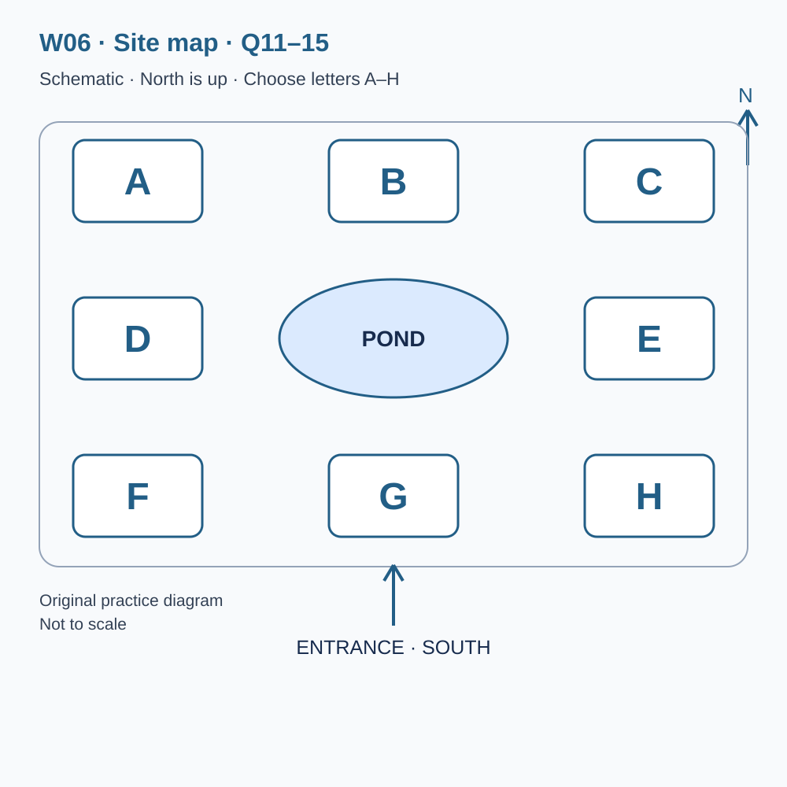
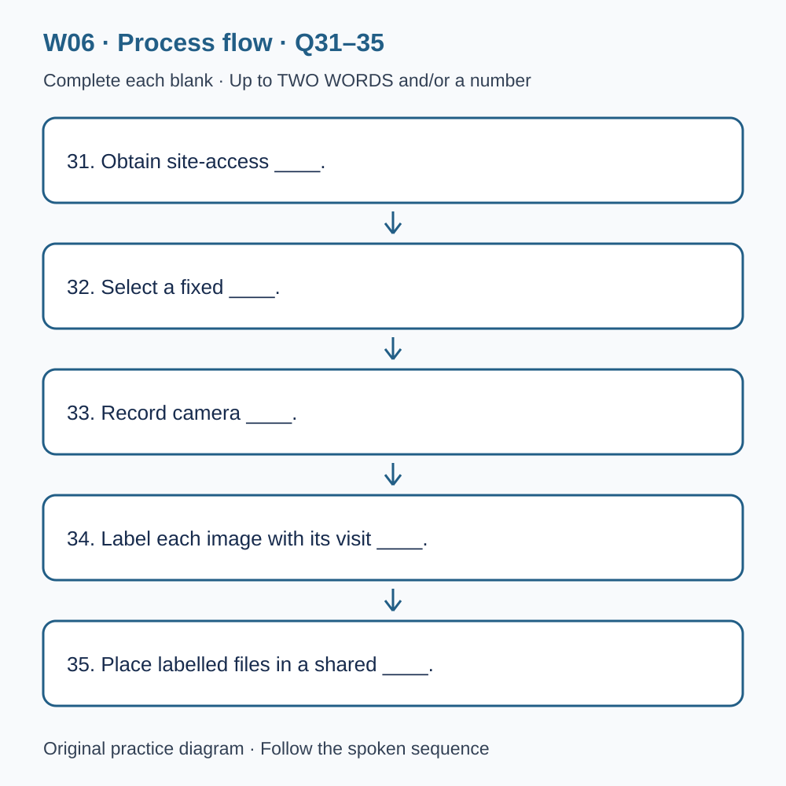

# U41 第6周听力题面与复盘（音频待补）

本页提供已核验的原创题目、参考答案和脚本。配套完整音频尚未验收，当前只能预览题面；不能进行有效的首次听力测试，也不能把读稿作答计作听力成绩或已完成一套听力。

请先保留首次作答机会：批准音频就绪前，不要展开下方答案和脚本。若已读稿，请标记为熟悉材料，之后的练习不能充当陌生题诊断。页面阅读标记只代表看过文字，不代表完成听力。

本材料非雅思真题、非标准化模考，不换算正式分数。计划分钟数不是实测音频时长；学习记录、正式测评和真人反馈须另行完成。

## 学生题面

### L-W06 — Field visits and careful observation
> 原创 IELTS-style 技能练习，非真题、非标准化模考，不可换算正式分数。当前只有文字和题目，音频未生成，不能计作已完成听力套题。

共四部分、40 个计分空，每空 1 分。正式首次作答须等待批准音频，先不要打开 script.md 或 answers.md。朗读前先看题；只听一遍后提交首次答案及信心等级，再做精听。当前只能预览题面，不能把读稿作答记作听力成绩。

#### Part 1 — Arranging a wetland group visit

Q1–6: Complete the notes. Write **NO MORE THAN TWO WORDS AND/OR A NUMBER** for each answer, using words from the recording. Numeric notation may replace spoken numbers. Do not repeat a printed unit. Q7–10: Choose **ONE letter, A, B or C**.

**Q1.** The group's main interest: ____

**Q2.** Chosen day of May: ____

**Q3.** Number of confirmed visitors: ____

**Q4.** Guide meeting time (a.m.): ____

**Q5.** Total guided-visit price: £____

**Q6.** Recommended footwear: ____

**Q7.** For the member using a walking aid, what should the organiser do?

- A. Assume every part of the standard route is suitable.
- B. Cancel the whole visit immediately.
- C. Discuss requirements and request an adapted route.

Answer: ____

**Q8.** Where can the group eat its own packed lunch?

- A. In a shared covered picnic area.
- B. At privately reserved picnic tables guaranteed to be empty.
- C. Only in the cafe after booking its menu.

Answer: ____

**Q9.** How are photographic observation points selected?

- A. Visitors may move barriers if they need a closer view.
- B. The guide selects permitted points for the conditions.
- C. Every booking includes access to nesting areas.

Answer: ____

**Q10.** What should the group do if heavy rain is forecast?

- A. Assume automatic cancellation.
- B. Let individual members make separate assumptions.
- C. Wait for a direct message about the plan.

Answer: ____

#### Part 2 — Wetland learning centre orientation

Q11–15: Label the map. Write **ONE letter, A–H**, for each destination. Three letters are unused. Q16–20: Choose **ONE letter, A, B or C**.

**Q11.** Information desk

Answer: ____

**Q12.** Equipment loan point

Answer: ____

**Q13.** Sheltered observation area

Answer: ____

**Q14.** Indoor classroom

Answer: ____

**Q15.** Covered picnic area

Answer: ____

**Q16.** If a guided route changes, visitors should

- A. leave to follow the original route alone.
- B. follow the guide's explained adaptation.
- C. assume the whole visit has lost its value.

Answer: ____

**Q17.** When comparing display photographs, what should visitors consider?

- A. The dates and conditions under which images were made.
- B. Only the most dramatic difference.
- C. Every visual difference as definite long-term change.

Answer: ____

**Q18.** What makes an uncertain identification useful?

- A. Presenting an app suggestion as independent recognition.
- B. Reporting a confident name without details.
- C. Describing observed features and how a suggested name was obtained.

Answer: ____

**Q19.** Volunteer monitoring differs from an ordinary visit because it

- A. includes everybody on the tour automatically.
- B. requires a consistent method and training.
- C. values the largest number of observations regardless of quality.

Answer: ____

**Q20.** What feedback is most useful?

- A. A specific location or instruction that caused difficulty.
- B. A demand to make everything better without an example.
- C. A complaint sent after departure as an urgent same-day request.

Answer: ____

#### Part 3 — Designing a student survey

Q21–26: Match each proposal to the students' **final** positions at the end of that exchange. The tutor is not included. Write **A, B, C or D**. Letters may be reused.

- **A** Leah only
- **B** Aron only
- **C** Both students
- **D** Neither student

Q27–28 and Q29–30: Choose **TWO different letters, A–E**, for each pair. Write one letter in each numbered slot; either order is accepted. Each distinct correct choice earns one point, maximum two. Repeating a letter cannot earn two points. Submit no more than two letters.

**Q21.** At the END of this exchange, who supports: Surveying only at the exit?

Answer: ____

**Q22.** At the END of this exchange, who supports: Piloting the questions before the main survey?

Answer: ____

**Q23.** At the END of this exchange, who supports: Collecting visitor names on the survey forms?

Answer: ____

**Q24.** At the END of this exchange, who supports: Including an optional open-response question?

Answer: ____

**Q25.** At the END of this exchange, who supports: Recording weather with simple consistent descriptions?

Answer: ____

**Q26.** At the END of this exchange, who supports: Counting people who decline to answer?

Answer: ____

**Q27–28.** Which TWO fixed-choice questions do the students retain?

- A. How visitors heard about the centre before visiting
- B. How many species visitors think live at the site
- C. What each visitor's camera cost
- D. Which information visitors used to find a route after arrival
- E. Each visitor's exact home address

Answers: Q27 ____ · Q28 ____

**Q29–30.** Which TWO changes would make comparisons between main survey sessions difficult?

- A. Recording the date
- B. Changing the question wording midway
- C. Using pencils instead of pens for legible records
- D. Changing which passing visitors are approached
- E. Not collecting income figures

Answers: Q29 ____ · Q30 ____

#### Part 4 — Planning repeat photography

Q31–35: Complete the flow chart below. Q36–40: Complete the notes. Write **NO MORE THAN TWO WORDS AND/OR A NUMBER** for each answer, using words from the recording. Numeric notation may replace spoken numbers. Words or units already printed do not belong in the blank. The numbered text below repeats the SVG prompts for readability.

**Q31.** Obtain site-access ____.

**Q32.** Select a fixed ____.

**Q33.** Record camera ____.

**Q34.** Label each image with its visit ____.

**Q35.** Place labelled files in a shared ____.

**Q36.** Changing sun position can change the ____ visible in images.

**Q37.** Distinguish ____ variation from a longer-term trend.

**Q38.** Measure ____ between different observers.

**Q39.** Disturbed ground may have several possible ____.

**Q40.** The final review should describe ____, not only display clear images.

#### 本周训练安排（音频批准后执行）

- Preview questions without the script：8 分钟。
- Future continuous first listen, including planned part pauses：32 分钟。
- Submit first answers and confidence, without a second play：8 分钟。
- Check answers and classify errors：20 分钟。
- Four Q-located intensive segments, 15 minutes each：60 分钟。
- Diagram and opinion retelling：15 分钟。
- Next-day retry of missed items：15 分钟。

合计 **158 分钟**；最多另用 22 分钟缓冲，总计不超过 180 分钟。暂停、回放与查词均计入精听预算，不能另行无限追加。当前实际已完成听力分钟数为 0。精听区段和步骤见 intensive.md；答案和脚本另页。

参考答案与证据（完成首次听力后再展开）

### L-W06 — Answers and evidence
> 独立答案页。先提交首次答案，再看本页。当前缺音频，文本验题不能充当实听验收。

每个单空 1 分；双选各 2 分、答案顺序不限、按不同正确选项计分。接受形式仅做大小写和空白规范化；不做模糊词形推断。

#### Q1 — photography

Accepted answers: photography

Use the final confirmed detail in this exchange; the printed unit or date context is already supplied.

Evidence locator: Q01 (script.md; timestamps unavailable).

> Visitor: I'm organising a visit for a small community group. Coordinator: We can offer a guided visit or a self-guided trail with an information pack. How would you describe your group's main interest? Visitor: Photography. We're not a birdwatching club, although birds may appear in the pictures. Some members use ordinary phones, and nobody is expecting specialist instruction in expensive equipment. Coordinator: Then I'll record photography as the focus and arrange a guide who can discuss observation points without assuming that everybody has the same camera or level of experience.

#### Q2 — 16

Accepted answers: 16 / 16th / sixteenth / the sixteenth

Use the final confirmed detail in this exchange; the printed unit or date context is already supplied.

Evidence locator: Q02 (script.md; timestamps unavailable).

> Coordinator: Which date are you considering? Visitor: We originally discussed the fourteenth of May, but two members would be unable to come. We'd like the sixteenth of May instead. Coordinator: The sixteenth is available. I'll reserve that provisionally while we complete the booking. Visitor: Thank you. I'll make sure the group receives the corrected date, because the earlier one is still written in our meeting notes. Coordinator: Please do. We can change a provisional reservation if needed, but once transport is arranged, correcting several separate messages becomes much more difficult.

#### Q3 — 14

Accepted answers: 14 / fourteen

Use the final confirmed detail in this exchange; the printed unit or date context is already supplied.

Evidence locator: Q03 (script.md; timestamps unavailable).

> Coordinator: How many visitors should the guide expect? We need a realistic number because some observation areas have limited space. Visitor: There are eighteen people in the wider group, but only fourteen have confirmed for this visit. Could you book for fourteen rather than the whole membership? Coordinator: Certainly. If more people decide to join, contact us before adding them to the transport list. Visitor: I'll explain that a place in our group doesn't automatically mean a place on this particular trip. Coordinator: That helps. It is easier to consider an additional visitor in advance than to discover at the entrance that the group is larger than the guide was told.

#### Q4 — 10.20

Accepted answers: 10.20 / 10:20 / ten twenty

Use the final confirmed detail in this exchange; the printed unit or date context is already supplied.

Evidence locator: Q04 (script.md; timestamps unavailable).

> Visitor: What time does the guided part begin? Our transport company wants a clear arrival target, but I don't want them to confuse the meeting time with the end of the visit. Coordinator: The guide will meet you at ten twenty in the morning. Please allow time before that to use the facilities and put bags away. Visitor: I'll tell the driver that ten twenty is the meeting time, not the moment we should first reach the car park. Coordinator: Exactly. If you arrive unusually early, reception can direct you to a waiting area. The guide may be finishing another task and cannot necessarily begin before the reserved time.

#### Q5 — 90

Accepted answers: 90 / ninety

Use the final confirmed detail in this exchange; the printed unit or date context is already supplied.

Evidence locator: Q05 (script.md; timestamps unavailable).

> Visitor: Is there a single price for the group, or do members buy individual admission tickets? Coordinator: The guided group visit costs ninety pounds altogether. That includes entry and the guide's time, but not food or transport. Visitor: A single total is helpful. I had seen a lower figure on a page about self-guided visits, so I wanted to check that I wasn't mixing the two offers. Coordinator: They are different arrangements. Your confirmation will identify the guided visit and show the total clearly, so you can divide it among your members in whatever way your group has agreed.

#### Q6 — boots

Accepted answers: boots

Use the final confirmed detail in this exchange; the printed unit or date context is already supplied.

Evidence locator: Q06 (script.md; timestamps unavailable).

> Visitor: What equipment should we bring apart from cameras? A few people have asked whether ordinary trainers are suitable, and I don't want to give them the wrong impression about the paths. Coordinator: Please tell everyone to wear boots. The main paths are maintained, but some sections can still be muddy, especially after rain. Visitor: I'll emphasise boots in the message and remind people that this is an outdoor visit rather than a classroom session. Coordinator: Good. You should also check the weather before travelling. The guide may adapt the route to conditions, but suitable clothing remains each visitor's responsibility, even when the forecast appears promising at the start of the day.

#### Q7 — C

Accepted answers: C

The centre can discuss an accessible section and limits rather than promise all paths or cancel automatically.

Evidence locator: Q07 (script.md; timestamps unavailable).

> Visitor: A member uses a walking aid. Would that mean we should cancel the guided route and remain inside the centre? Coordinator: Not necessarily. The route includes an accessible section, and the guide can discuss the group's needs before confirming which parts to use. The useful step is to tell us about the practical requirements now. Visitor: So we should request an adapted route rather than assume that the standard plan is suitable or that no visit is possible. Coordinator: Yes. We'll explain the available options and any limits. The aim is to make an informed arrangement, not to promise that every path can accommodate every situation.

#### Q8 — A

Accepted answers: A

The picnic area accepts visitors' food but is shared.

Evidence locator: Q08 (script.md; timestamps unavailable).

> Visitor: Several members would like to eat together afterwards. Do we need to book a table in the cafe, or is there somewhere we can use our own packed lunches? Coordinator: There is a covered picnic area, and a group can bring its own food there without making a cafe booking. Please take your rubbish away or use the labelled bins correctly. Visitor: That would suit us better. We can accommodate different food preferences without asking the cafe to prepare a special menu. Coordinator: The area is shared, so we can't guarantee that every table will be empty. It is intended as a practical eating space rather than a private room reserved for your group.

#### Q9 — B

Accepted answers: B

The guide controls appropriate points; restricted areas remain restricted.

Evidence locator: Q09 (script.md; timestamps unavailable).

> Visitor: Will we be able to go close to the nesting area for photographs? Some members hope to take detailed pictures, although we don't want to disturb anything. Coordinator: The guide decides which observation points are appropriate on the day. Visitors must stay on the permitted paths and use the observation screens as directed. A booking doesn't provide access to restricted areas. Visitor: I'll make that clear before people choose their equipment. They shouldn't expect the guide to move barriers or approach nests to improve a photograph. Coordinator: Exactly. A successful visit can involve noticing behaviour from a distance. Getting closer is not automatically the most useful way to understand what is happening.

#### Q10 — C

Accepted answers: C

The outdoor section may be adapted; only some conditions require cancellation.

Evidence locator: Q10 (script.md; timestamps unavailable).

> Visitor: If heavy rain is forecast, should we assume the visit has been cancelled? Our group sometimes changes walking plans informally, and people might make different assumptions. Coordinator: Please wait for a direct message from us. The guide may shorten the outdoor section and use indoor activities, while only some conditions require cancellation. Visitor: Then I'll keep the booking active unless you contact me, and I'll pass on the same message to everybody. Coordinator: That's the best arrangement. We don't want half the group travelling while the others stay at home because they interpreted a forecast differently. The confirmation explains how we contact the organiser and what to do if your own group decides to withdraw.

#### Q11 — G

Accepted answers: G

Use the explicitly stated position relative to the pond, not an earlier layout or adjacent area.

Evidence locator: Q11 (script.md; timestamps unavailable).

> Welcome to the wetland learning centre. The map places north at the top and shows the entrance on the southern edge. The circular pond in the middle is a fixed landmark, not one of the lettered destinations. The information desk is in the area directly south of the pond, on the entrance axis. It is not in either southern corner. Visitors should report there before joining a group, because staff may have information about temporary path changes. Even if you have downloaded a map, today's advice takes priority over an older route description. We keep the desk near the entrance so that people receive that information before choosing where to go.

#### Q12 — D

Accepted answers: D

Use the explicitly stated position relative to the pond, not an earlier layout or adjacent area.

Evidence locator: Q12 (script.md; timestamps unavailable).

> The equipment loan point is directly west of the pond, level with its centre on the map. It is not the area in the southwest corner. You can borrow simple items there, but availability varies and we cannot reserve every item for each visitor. Staff will explain how to use and return anything you borrow. Please inspect it together before leaving the desk, so that an existing mark or missing part can be recorded. The arrangement is intended to make observation accessible without encouraging everyone to buy equipment for a single visit. However, a borrowed item still needs care, and someone in your group should remain responsible for it until it is returned.

#### Q13 — A

Accepted answers: A

Use the explicitly stated position relative to the pond, not an earlier layout or adjacent area.

Evidence locator: Q13 (script.md; timestamps unavailable).

> The sheltered observation area is in the northwest corner of the site. It lies north of the equipment loan point and west of the area at the northern centre. The shelter reduces exposure to the weather, but it is not a completely enclosed room. Visitors should still bring appropriate clothing and keep the walkway clear. We ask groups to enter quietly and allow others space to look through the openings. A crowded shelter can make observation less useful even when everyone is trying to be considerate. If your group is large, the guide may divide it into smaller groups and rotate them rather than bring everyone inside at the same time.

#### Q14 — B

Accepted answers: B

Use the explicitly stated position relative to the pond, not an earlier layout or adjacent area.

Evidence locator: Q14 (script.md; timestamps unavailable).

> The indoor classroom is directly north of the pond. On your map it occupies the northern central position, between the two northern corners. An older leaflet placed teaching activities in the northeast area, but that arrangement has changed. The classroom can be used for introductory discussion, examination of display materials or an alternative activity when conditions limit outdoor work. Please leave muddy footwear where the guide indicates before entering. The room is used by different groups during the day, so we need to prepare it for the next session promptly. Personal bags should be kept away from the teaching table unless they contain materials you have been asked to bring.

#### Q15 — H

Accepted answers: H

Use the explicitly stated position relative to the pond, not an earlier layout or adjacent area.

Evidence locator: Q15 (script.md; timestamps unavailable).

> The covered picnic area is in the southeast corner, east of the information desk and south of the area directly east of the pond. It is shared by visitors, including people who are not taking part in a guided session. Please avoid occupying extra tables with bags when others are looking for somewhere to sit. The picnic area is not an observation hide, so ordinary conversation is welcome there. Nevertheless, amplified music would affect nearby activities and should not be used. Before leaving, check beneath the table as well as on top of it. Small pieces of packaging are easy to miss and can be carried away by the wind.

#### Q16 — B

Accepted answers: B

A current adaptation can itself offer learning; the map cannot show every short-term condition.

Evidence locator: Q16 (script.md; timestamps unavailable).

> During a guided visit, the route may change because of conditions on the site. A change does not necessarily mean that the whole visit has become less valuable. For example, a temporarily closed path may lead the guide to use a different observation point and discuss why access is managed. We will explain the reason for a change rather than simply directing the group elsewhere without context. Please do not leave the group to follow the original route independently. A map shows the general arrangement, but it cannot show every short-term condition. If you have a particular interest, tell the guide, who can explain what is realistically available that day.

#### Q17 — A

Accepted answers: A

Season, weather and viewpoint can explain contrasts.

Evidence locator: Q17 (script.md; timestamps unavailable).

> Our displays include photographs taken at different times of year. When comparing them, notice the date as well as the subject. A difference between two images may reflect the season, the weather, the viewpoint or a genuine change in the site. It is easy to choose the most dramatic pair and tell a simple story, but that can conceal important differences in how the pictures were made. The labels therefore describe the conditions where they are known. We encourage visitors to ask what additional information would help them interpret a comparison. Observation is not just noticing that two pictures look different; it also involves considering why that difference might exist.

#### Q18 — C

Accepted answers: C

The report should separate observation, identification and uncertainty.

Evidence locator: Q18 (script.md; timestamps unavailable).

> Visitors often ask whether they should report every unfamiliar bird or plant they notice. Staff welcome observations, but a useful report should distinguish a confident identification from a guess. If you are uncertain, describe the features you actually saw and where you were standing. A clear photograph may help, provided it was taken without leaving the permitted route or disturbing the subject. Please don't copy a name from an identification application and present it as something you independently recognised. The suggested name may be useful, but staff need to know how you reached it. Honest uncertainty makes a report easier to assess than confidence unsupported by a description.

#### Q19 — B

Accepted answers: B

Monitoring has its own method, training and participation process.

Evidence locator: Q19 (script.md; timestamps unavailable).

> The centre also runs volunteer monitoring sessions. These are separate from ordinary guided visits because they require a consistent method and a commitment to recording information carefully. Enthusiasm is welcome, but collecting more observations is not always better if they cannot be compared reliably. Volunteers receive training and practise with examples before their records are included in the main project. They are also encouraged to report difficulties with the method. A field that is frequently misunderstood may need revision rather than another reminder to fill it in. If you are interested, ask for the monitoring information sheet; joining today's tour does not automatically enrol you as a monitoring volunteer.

#### Q20 — A

Accepted answers: A

Specific examples help the centre identify what needs changing.

Evidence locator: Q20 (script.md; timestamps unavailable).

> At the end of your visit, please tell staff if an instruction was difficult to understand or a sign was hard to find. Specific examples are particularly helpful. A comment identifying a confusing junction gives us more to investigate than a general statement that the site needs better signs. We cannot promise to make every suggested change, since one solution may create a difficulty for another group of visitors. However, the comments help us see the site from perspectives that regular staff may overlook. The most useful feedback describes what happened, where it happened and what information you were trying to find at that moment.

#### Q21 — B

Accepted answers: B

Final stance: Aron only. Ignore an initial proposal if later withdrawn; the tutor is not an answer option.

Evidence locator: Q21 (script.md; timestamps unavailable).

> Tutor: Let's begin with Aron's proposal to survey visitors only after they finish the route. Aron: I support that. They will have experienced the whole visit and can comment on more than the entrance area. Leah: I don't support interviewing only at the exit. People who leave early may use another gate, and we could miss their experience entirely. Tutor: Could you add an earlier observation point? Aron: That might improve a larger study, but I still support an exit-only survey for this small project because it is manageable. Leah: My objection remains. Tutor: Record the difference between a manageable method and a method that captures every kind of visit; those are not the same claim.

#### Q22 — C

Accepted answers: C

Final stance: Both students. Ignore an initial proposal if later withdrawn; the tutor is not an answer option.

Evidence locator: Q22 (script.md; timestamps unavailable).

> Leah: I propose testing the questions with a few people before the main survey. A word that seems ordinary to us may be interpreted differently by someone unfamiliar with the site. Aron: I initially thought a pilot would waste one of our limited afternoons. But if we keep it short and use the results to revise the form, I support it. Tutor: What changed your view? Aron: I realised that collecting many responses to an unclear question would waste more time later. Leah: Exactly. The pilot is not a smaller version of the final result; it is a way of checking the method. Tutor: Good. Note the purpose clearly so you don't quietly combine pilot responses with the main data.

#### Q23 — D

Accepted answers: D

Final stance: Neither student. Ignore an initial proposal if later withdrawn; the tutor is not an answer option.

Evidence locator: Q23 (script.md; timestamps unavailable).

> Aron: I suggested asking visitors to write their names, mainly because it would make the forms feel more personal. Leah: I don't support that. We aren't following individuals over time, so their names don't help answer our question. Tutor: Is there any necessary use for those names that isn't already served by an anonymous response number? Aron: No, not really. I withdraw the suggestion. We can make the introduction welcoming without collecting identifying details. Leah: Then I agree with leaving names out. Tutor: Your final position is that neither of you supports collecting names. Keep that distinction clear when you summarise this discussion, since the first suggestion alone would give the wrong impression.

#### Q24 — A

Accepted answers: A

Final stance: Leah only. Ignore an initial proposal if later withdrawn; the tutor is not an answer option.

Evidence locator: Q24 (script.md; timestamps unavailable).

> Leah: I support including a question that lets visitors describe something they noticed, using their own words. It could reveal interests we haven't anticipated. Aron: I don't support that addition for this version. We need a short form, and free responses will take longer to analyse than the fixed choices. Tutor: Could a single optional line address both concerns? Aron: It would reduce the burden on visitors, but I would still rather leave it out because of the analysis time. Leah: I still think one open response is worth the effort. Tutor: Then the disagreement remains. Explain whether you are disagreeing about the value of the information or the resources needed to process it.

#### Q25 — C

Accepted answers: C

Final stance: Both students. Ignore an initial proposal if later withdrawn; the tutor is not an answer option.

Evidence locator: Q25 (script.md; timestamps unavailable).

> Aron: We should record the weather during each survey session. Otherwise we might compare a warm afternoon with a wet morning without noticing how different the circumstances were. Leah: I support that, provided we use a simple, consistent description rather than trying to make precise measurements we aren't equipped to collect. Tutor: How will you handle a change halfway through a session? Aron: We can note when it happened and keep the time with the responses. Leah: That would preserve the context without pretending the conditions stayed the same. Tutor: You both support recording weather in that limited way. Make the procedure clear enough that another student could follow it without asking you what each category means.

#### Q26 — B

Accepted answers: B

Final stance: Aron only. Ignore an initial proposal if later withdrawn; the tutor is not an answer option.

Evidence locator: Q26 (script.md; timestamps unavailable).

> Aron: I also support counting how many people decline to answer. It would help us describe participation rather than reporting only the number of completed forms. Leah: I don't support adding that task. I'm concerned it will distract us from introducing the survey properly to the next visitor. Tutor: Could the count be recorded with a quick mark? Leah: Perhaps, but I still prefer to focus on the conversations in this small project. Aron: I continue to support the count, because without it we won't know whether our respondents were a small or large share of those approached. Tutor: That is a real methodological disagreement. Don't erase it by writing a vague statement that participation will be considered.

#### Q27–28 — A, D

Accept unordered set: A, D. One point per distinct correct choice, maximum 2.

The chosen questions concern information before and during the visit; knowledge, camera price and address do not serve that aim.

Evidence locator: Q27, Q28 (script.md; timestamps unavailable).

> Tutor: You have room for two fixed-choice questions. Which ones will you retain? Leah: One should ask how visitors found out about the centre. That connects directly to our question about which information channels bring people here. Aron: Agreed. We should include an option for a source we haven't listed, rather than forcing every answer into our preferred categories. Tutor: That selects one question. What about asking visitors to estimate the total number of species at the site? Leah: No. That would test their knowledge and invite guesses; it would not tell us how they heard about the centre. Aron: We should also avoid collecting their exact home address for this project.

> Aron: The second fixed-choice question should ask which source of information they used to decide where to go once they arrived. That could be a map, a staff explanation, signs or something else. Leah: I support that. We must distinguish hearing about the centre before a visit from finding a route during the visit. Tutor: Good. You have selected two questions about different stages of the information process. You have not chosen a question about the price of the visitor's camera or a test of species knowledge. Aron: Keeping those distinctions clear should help us avoid treating all uses of information as though they were the same behaviour.

#### Q29–30 — B, D

Accept unordered set: B, D. One point per distinct correct choice, maximum 2.

Changed wording changes the meaning of responses; changed recruitment changes the invited sample.

Evidence locator: Q29, Q30 (script.md; timestamps unavailable).

> Tutor: Which two problems would make a comparison between survey sessions difficult? Aron: One would be changing the wording halfway through the main survey. Responses collected with the earlier wording might not mean the same thing as responses collected later. Leah: I agree. We should revise during the pilot and then keep the main questions stable. Tutor: Correct. Using pencils instead of pens would not by itself prevent comparison, provided the records remain legible. Nor would recording the date create a problem; that is useful context. Focus on changes that alter what the responses represent rather than listing every practical difference you can imagine between two afternoons on the site.

> Leah: The second problem would be approaching only visitors who seem enthusiastic during one session but approaching everyone who passes during another. The groups invited to respond would have been selected differently. Aron: Yes. Even if the questions were identical, the recruitment method would have changed. Tutor: Those are the two problems to highlight. Your form does not ask for financial information, so missing income figures are not a defect in this design. Leah: We'll write a short recruitment rule before starting. Tutor: Good. A rule cannot eliminate every difference between sessions, but it makes your choices visible and helps prevent an attractive set of responses from being mistaken for a consistent sample.

#### Q31 — permission

Accepted answers: permission

Complete the named stage in the stated process order; retain any word already printed around the blank.

Evidence locator: Q31 (script.md; timestamps unavailable).

> Today we will consider repeat photography as a way of recording change in a public landscape. Our example is a hypothetical small project, not evidence that a particular site has improved or declined. Before choosing camera positions, the team obtains permission from whoever manages access to the site. Permission matters even when the activity appears harmless, because the team may plan repeated visits or use locations outside ordinary visitor routes. It also creates an opportunity to discuss how photographs will be stored and shared. Agreement about access should not be assumed to cover every later use of an image, particularly if people or private information could appear in it.

#### Q32 — reference point

Accepted answers: reference point / point / camera position

Complete the named stage in the stated process order; retain any word already printed around the blank.

Evidence locator: Q32 (script.md; timestamps unavailable).

> The next stage is to select a fixed reference point that can be found again. A convenient place on the first visit may become difficult to identify after vegetation grows or temporary objects are moved. The team should therefore describe the reference point clearly and record enough information for another person to locate it. Depending entirely on one photographer's memory makes the method fragile. A photograph of the camera position can complement a written description, but it should not replace details that explain where the photographer stood. The goal is repeatability: a later image should reflect the intended view rather than an approximation chosen because the original position was forgotten.

#### Q33 — height

Accepted answers: height

Complete the named stage in the stated process order; retain any word already printed around the blank.

Evidence locator: Q33 (script.md; timestamps unavailable).

> At the third stage, the team records the camera's height. A small change in height can alter which objects overlap and how much of the ground is visible. The record should also describe the direction of view and other relevant settings, but height is the specific field highlighted in this stage of our example. Consistency does not require pretending that every device is identical. It requires describing the choices that could affect comparison and making those choices as reproducible as practical. If a later visit requires a different arrangement, the change should be recorded rather than hidden in the hope that nobody notices the images no longer align.

#### Q34 — date

Accepted answers: date

Complete the named stage in the stated process order; retain any word already printed around the blank.

Evidence locator: Q34 (script.md; timestamps unavailable).

> Each image then receives a label containing the visit date. The date connects the photograph to field notes and helps prevent a later reader from confusing the order of visits. File creation information can be useful, but it may change when a file is copied or processed, and it should not be the only record on which the project depends. A consistent naming rule makes the collection easier to manage. The rule should be explained to everyone who contributes images, rather than developed separately by each photographer. A small effort at this stage can prevent considerable uncertainty when the team tries to compare images collected by different people over several months.

#### Q35 — archive

Accepted answers: archive

Complete the named stage in the stated process order; retain any word already printed around the blank.

Evidence locator: Q35 (script.md; timestamps unavailable).

> The final stage in the basic workflow is to place the labelled files in a shared archive. An archive should contain the original files as well as any versions prepared for display, with a clear distinction between them. If only edited images survive, later researchers may be unable to determine whether a difference came from the site or from processing choices. Access arrangements also matter. A folder that only one student can open is not a reliable shared record for a project that will continue after that student leaves. The team should decide who maintains the archive and how errors or missing information can be corrected without silently rewriting its history.

#### Q36 — shadows

Accepted answers: shadows

The corresponding evidence block supplies this distinction or qualification; the question retains the surrounding grammar.

Evidence locator: Q36 (script.md; timestamps unavailable).

> When interpreting the photographs, the team pays attention to shadows. A dark region in one image and a bright region in another may reflect the position of the sun rather than a change in the surface being photographed. This does not mean the images are useless. It means that the comparison should be made with awareness of conditions. Choosing similar times of day can reduce some differences, but weather and season may still affect illumination. The field notes should preserve that context. A persuasive visual comparison can be misleading when its presentation encourages viewers to treat every visible contrast as evidence of a change in the landscape itself.

#### Q37 — seasonal

Accepted answers: seasonal

The corresponding evidence block supplies this distinction or qualification; the question retains the surrounding grammar.

Evidence locator: Q37 (script.md; timestamps unavailable).

> The team must also distinguish seasonal variation from a longer-term trend. Vegetation may look dramatically different at two visits simply because they occurred at different points in the growing cycle. If the question concerns change over several years, comparisons between similar seasons may be more informative than a sequence of images chosen only because they look striking. The appropriate comparison depends on the research question. There is no single arrangement that answers every question equally well. The report should explain why particular images were compared and what other explanations remain possible, rather than allowing a visually appealing sequence to stand in for an argument about the evidence.

#### Q38 — agreement

Accepted answers: agreement / the agreement

The corresponding evidence block supplies this distinction or qualification; the question retains the surrounding grammar.

Evidence locator: Q38 (script.md; timestamps unavailable).

> Different observers may classify the same image differently. One person may count an area as bare ground while another sees sparse vegetation and assigns it to a different category. The team can examine this by measuring agreement between observers on a small set of images. Disagreement may reveal ambiguous definitions, poor image quality or a genuinely mixed area that does not fit a simple category. The useful response is to investigate those possibilities. Forcing agreement without understanding the reason for a difference can make the final data look consistent while concealing a weakness in the classification system that will reappear when new images are added.

#### Q39 — causes

Accepted answers: causes

The corresponding evidence block supplies this distinction or qualification; the question retains the surrounding grammar.

Evidence locator: Q39 (script.md; timestamps unavailable).

> An image can provide evidence about what was visible from a particular viewpoint, but it cannot reveal every process that produced the scene. A patch of disturbed ground might have several possible causes. The photograph alone does not establish which one occurred. Additional records, observations or conversations may help, depending on the question and the permissions available. Researchers should keep the boundary between description and explanation visible in their report. Saying that a feature appeared between two visits is a different claim from saying why it appeared. The second claim usually needs more support, even when one explanation seems obvious to someone familiar with the site.

#### Q40 — uncertainty

Accepted answers: uncertainty / the uncertainty / limitations / these limitations

The corresponding evidence block supplies this distinction or qualification; the question retains the surrounding grammar.

Evidence locator: Q40 (script.md; timestamps unavailable).

> The project should end with a review of uncertainty as well as a display of the clearest images. Some views may be partly obstructed, some dates may be missing and some comparisons may be inconclusive. These limitations should be described in a way that helps a later team improve the method. A record of difficulty can be valuable if it explains what happened and how it affected interpretation. Simply discarding every awkward image can produce an attractive presentation while making the remaining collection look more complete than it really is. The aim is a trustworthy account of the work, not a sequence in which every photograph appears to tell an uncomplicated story.

完整脚本（提前阅读会失去陌生题首答机会）

### L-W06 — Field visits and careful observation: transcript
> 原创虚构练习，非真题；音频缺失。仅供完成首次作答后的核对或文字审阅。Q 标记与角色名不属于朗读正文。

#### Part 1 — Arranging a wetland group visit

##### Q1 evidence block

**Visitor:** I'm organising a visit for a small community group.

**Coordinator:** We can offer a guided visit or a self-guided trail with an information pack. How would you describe your group's main interest?

**Visitor:** Photography. We're not a birdwatching club, although birds may appear in the pictures. Some members use ordinary phones, and nobody is expecting specialist instruction in expensive equipment.

**Coordinator:** Then I'll record photography as the focus and arrange a guide who can discuss observation points without assuming that everybody has the same camera or level of experience.

##### Q2 evidence block

**Coordinator:** Which date are you considering?

**Visitor:** We originally discussed the fourteenth of May, but two members would be unable to come. We'd like the sixteenth of May instead.

**Coordinator:** The sixteenth is available. I'll reserve that provisionally while we complete the booking.

**Visitor:** Thank you. I'll make sure the group receives the corrected date, because the earlier one is still written in our meeting notes.

**Coordinator:** Please do. We can change a provisional reservation if needed, but once transport is arranged, correcting several separate messages becomes much more difficult.

##### Q3 evidence block

**Coordinator:** How many visitors should the guide expect? We need a realistic number because some observation areas have limited space.

**Visitor:** There are eighteen people in the wider group, but only fourteen have confirmed for this visit. Could you book for fourteen rather than the whole membership?

**Coordinator:** Certainly. If more people decide to join, contact us before adding them to the transport list.

**Visitor:** I'll explain that a place in our group doesn't automatically mean a place on this particular trip.

**Coordinator:** That helps. It is easier to consider an additional visitor in advance than to discover at the entrance that the group is larger than the guide was told.

##### Q4 evidence block

**Visitor:** What time does the guided part begin? Our transport company wants a clear arrival target, but I don't want them to confuse the meeting time with the end of the visit.

**Coordinator:** The guide will meet you at ten twenty in the morning. Please allow time before that to use the facilities and put bags away.

**Visitor:** I'll tell the driver that ten twenty is the meeting time, not the moment we should first reach the car park.

**Coordinator:** Exactly. If you arrive unusually early, reception can direct you to a waiting area. The guide may be finishing another task and cannot necessarily begin before the reserved time.

##### Q5 evidence block

**Visitor:** Is there a single price for the group, or do members buy individual admission tickets?

**Coordinator:** The guided group visit costs ninety pounds altogether. That includes entry and the guide's time, but not food or transport.

**Visitor:** A single total is helpful. I had seen a lower figure on a page about self-guided visits, so I wanted to check that I wasn't mixing the two offers.

**Coordinator:** They are different arrangements. Your confirmation will identify the guided visit and show the total clearly, so you can divide it among your members in whatever way your group has agreed.

##### Q6 evidence block

**Visitor:** What equipment should we bring apart from cameras? A few people have asked whether ordinary trainers are suitable, and I don't want to give them the wrong impression about the paths.

**Coordinator:** Please tell everyone to wear boots. The main paths are maintained, but some sections can still be muddy, especially after rain.

**Visitor:** I'll emphasise boots in the message and remind people that this is an outdoor visit rather than a classroom session.

**Coordinator:** Good. You should also check the weather before travelling. The guide may adapt the route to conditions, but suitable clothing remains each visitor's responsibility, even when the forecast appears promising at the start of the day.

##### Q7 evidence block

**Visitor:** A member uses a walking aid. Would that mean we should cancel the guided route and remain inside the centre?

**Coordinator:** Not necessarily. The route includes an accessible section, and the guide can discuss the group's needs before confirming which parts to use. The useful step is to tell us about the practical requirements now.

**Visitor:** So we should request an adapted route rather than assume that the standard plan is suitable or that no visit is possible.

**Coordinator:** Yes. We'll explain the available options and any limits. The aim is to make an informed arrangement, not to promise that every path can accommodate every situation.

##### Q8 evidence block

**Visitor:** Several members would like to eat together afterwards. Do we need to book a table in the cafe, or is there somewhere we can use our own packed lunches?

**Coordinator:** There is a covered picnic area, and a group can bring its own food there without making a cafe booking. Please take your rubbish away or use the labelled bins correctly.

**Visitor:** That would suit us better. We can accommodate different food preferences without asking the cafe to prepare a special menu.

**Coordinator:** The area is shared, so we can't guarantee that every table will be empty. It is intended as a practical eating space rather than a private room reserved for your group.

##### Q9 evidence block

**Visitor:** Will we be able to go close to the nesting area for photographs? Some members hope to take detailed pictures, although we don't want to disturb anything.

**Coordinator:** The guide decides which observation points are appropriate on the day. Visitors must stay on the permitted paths and use the observation screens as directed. A booking doesn't provide access to restricted areas.

**Visitor:** I'll make that clear before people choose their equipment. They shouldn't expect the guide to move barriers or approach nests to improve a photograph.

**Coordinator:** Exactly. A successful visit can involve noticing behaviour from a distance. Getting closer is not automatically the most useful way to understand what is happening.

##### Q10 evidence block

**Visitor:** If heavy rain is forecast, should we assume the visit has been cancelled? Our group sometimes changes walking plans informally, and people might make different assumptions.

**Coordinator:** Please wait for a direct message from us. The guide may shorten the outdoor section and use indoor activities, while only some conditions require cancellation.

**Visitor:** Then I'll keep the booking active unless you contact me, and I'll pass on the same message to everybody.

**Coordinator:** That's the best arrangement. We don't want half the group travelling while the others stay at home because they interpreted a forecast differently. The confirmation explains how we contact the organiser and what to do if your own group decides to withdraw.

#### Part 2 — Wetland learning centre orientation

##### Q11 evidence block

**Centre guide:** Welcome to the wetland learning centre. The map places north at the top and shows the entrance on the southern edge. The circular pond in the middle is a fixed landmark, not one of the lettered destinations. The information desk is in the area directly south of the pond, on the entrance axis. It is not in either southern corner. Visitors should report there before joining a group, because staff may have information about temporary path changes. Even if you have downloaded a map, today's advice takes priority over an older route description. We keep the desk near the entrance so that people receive that information before choosing where to go.

##### Q12 evidence block

**Centre guide:** The equipment loan point is directly west of the pond, level with its centre on the map. It is not the area in the southwest corner. You can borrow simple items there, but availability varies and we cannot reserve every item for each visitor. Staff will explain how to use and return anything you borrow. Please inspect it together before leaving the desk, so that an existing mark or missing part can be recorded. The arrangement is intended to make observation accessible without encouraging everyone to buy equipment for a single visit. However, a borrowed item still needs care, and someone in your group should remain responsible for it until it is returned.

##### Q13 evidence block

**Centre guide:** The sheltered observation area is in the northwest corner of the site. It lies north of the equipment loan point and west of the area at the northern centre. The shelter reduces exposure to the weather, but it is not a completely enclosed room. Visitors should still bring appropriate clothing and keep the walkway clear. We ask groups to enter quietly and allow others space to look through the openings. A crowded shelter can make observation less useful even when everyone is trying to be considerate. If your group is large, the guide may divide it into smaller groups and rotate them rather than bring everyone inside at the same time.

##### Q14 evidence block

**Centre guide:** The indoor classroom is directly north of the pond. On your map it occupies the northern central position, between the two northern corners. An older leaflet placed teaching activities in the northeast area, but that arrangement has changed. The classroom can be used for introductory discussion, examination of display materials or an alternative activity when conditions limit outdoor work. Please leave muddy footwear where the guide indicates before entering. The room is used by different groups during the day, so we need to prepare it for the next session promptly. Personal bags should be kept away from the teaching table unless they contain materials you have been asked to bring.

##### Q15 evidence block

**Centre guide:** The covered picnic area is in the southeast corner, east of the information desk and south of the area directly east of the pond. It is shared by visitors, including people who are not taking part in a guided session. Please avoid occupying extra tables with bags when others are looking for somewhere to sit. The picnic area is not an observation hide, so ordinary conversation is welcome there. Nevertheless, amplified music would affect nearby activities and should not be used. Before leaving, check beneath the table as well as on top of it. Small pieces of packaging are easy to miss and can be carried away by the wind.

##### Q16 evidence block

**Centre guide:** During a guided visit, the route may change because of conditions on the site. A change does not necessarily mean that the whole visit has become less valuable. For example, a temporarily closed path may lead the guide to use a different observation point and discuss why access is managed. We will explain the reason for a change rather than simply directing the group elsewhere without context. Please do not leave the group to follow the original route independently. A map shows the general arrangement, but it cannot show every short-term condition. If you have a particular interest, tell the guide, who can explain what is realistically available that day.

##### Q17 evidence block

**Centre guide:** Our displays include photographs taken at different times of year. When comparing them, notice the date as well as the subject. A difference between two images may reflect the season, the weather, the viewpoint or a genuine change in the site. It is easy to choose the most dramatic pair and tell a simple story, but that can conceal important differences in how the pictures were made. The labels therefore describe the conditions where they are known. We encourage visitors to ask what additional information would help them interpret a comparison. Observation is not just noticing that two pictures look different; it also involves considering why that difference might exist.

##### Q18 evidence block

**Centre guide:** Visitors often ask whether they should report every unfamiliar bird or plant they notice. Staff welcome observations, but a useful report should distinguish a confident identification from a guess. If you are uncertain, describe the features you actually saw and where you were standing. A clear photograph may help, provided it was taken without leaving the permitted route or disturbing the subject. Please don't copy a name from an identification application and present it as something you independently recognised. The suggested name may be useful, but staff need to know how you reached it. Honest uncertainty makes a report easier to assess than confidence unsupported by a description.

##### Q19 evidence block

**Centre guide:** The centre also runs volunteer monitoring sessions. These are separate from ordinary guided visits because they require a consistent method and a commitment to recording information carefully. Enthusiasm is welcome, but collecting more observations is not always better if they cannot be compared reliably. Volunteers receive training and practise with examples before their records are included in the main project. They are also encouraged to report difficulties with the method. A field that is frequently misunderstood may need revision rather than another reminder to fill it in. If you are interested, ask for the monitoring information sheet; joining today's tour does not automatically enrol you as a monitoring volunteer.

##### Q20 evidence block

**Centre guide:** At the end of your visit, please tell staff if an instruction was difficult to understand or a sign was hard to find. Specific examples are particularly helpful. A comment identifying a confusing junction gives us more to investigate than a general statement that the site needs better signs. We cannot promise to make every suggested change, since one solution may create a difficulty for another group of visitors. However, the comments help us see the site from perspectives that regular staff may overlook. The most useful feedback describes what happened, where it happened and what information you were trying to find at that moment.

#### Part 3 — Designing a student survey

##### Q21 evidence block

**Tutor:** Let's begin with Aron's proposal to survey visitors only after they finish the route.

**Aron:** I support that. They will have experienced the whole visit and can comment on more than the entrance area.

**Leah:** I don't support interviewing only at the exit. People who leave early may use another gate, and we could miss their experience entirely.

**Tutor:** Could you add an earlier observation point?

**Aron:** That might improve a larger study, but I still support an exit-only survey for this small project because it is manageable.

**Leah:** My objection remains.

**Tutor:** Record the difference between a manageable method and a method that captures every kind of visit; those are not the same claim.

##### Q22 evidence block

**Leah:** I propose testing the questions with a few people before the main survey. A word that seems ordinary to us may be interpreted differently by someone unfamiliar with the site.

**Aron:** I initially thought a pilot would waste one of our limited afternoons. But if we keep it short and use the results to revise the form, I support it.

**Tutor:** What changed your view?

**Aron:** I realised that collecting many responses to an unclear question would waste more time later.

**Leah:** Exactly. The pilot is not a smaller version of the final result; it is a way of checking the method.

**Tutor:** Good. Note the purpose clearly so you don't quietly combine pilot responses with the main data.

##### Q23 evidence block

**Aron:** I suggested asking visitors to write their names, mainly because it would make the forms feel more personal.

**Leah:** I don't support that. We aren't following individuals over time, so their names don't help answer our question.

**Tutor:** Is there any necessary use for those names that isn't already served by an anonymous response number?

**Aron:** No, not really. I withdraw the suggestion. We can make the introduction welcoming without collecting identifying details.

**Leah:** Then I agree with leaving names out.

**Tutor:** Your final position is that neither of you supports collecting names. Keep that distinction clear when you summarise this discussion, since the first suggestion alone would give the wrong impression.

##### Q24 evidence block

**Leah:** I support including a question that lets visitors describe something they noticed, using their own words. It could reveal interests we haven't anticipated.

**Aron:** I don't support that addition for this version. We need a short form, and free responses will take longer to analyse than the fixed choices.

**Tutor:** Could a single optional line address both concerns?

**Aron:** It would reduce the burden on visitors, but I would still rather leave it out because of the analysis time.

**Leah:** I still think one open response is worth the effort.

**Tutor:** Then the disagreement remains. Explain whether you are disagreeing about the value of the information or the resources needed to process it.

##### Q25 evidence block

**Aron:** We should record the weather during each survey session. Otherwise we might compare a warm afternoon with a wet morning without noticing how different the circumstances were.

**Leah:** I support that, provided we use a simple, consistent description rather than trying to make precise measurements we aren't equipped to collect.

**Tutor:** How will you handle a change halfway through a session?

**Aron:** We can note when it happened and keep the time with the responses.

**Leah:** That would preserve the context without pretending the conditions stayed the same.

**Tutor:** You both support recording weather in that limited way. Make the procedure clear enough that another student could follow it without asking you what each category means.

##### Q26 evidence block

**Aron:** I also support counting how many people decline to answer. It would help us describe participation rather than reporting only the number of completed forms.

**Leah:** I don't support adding that task. I'm concerned it will distract us from introducing the survey properly to the next visitor.

**Tutor:** Could the count be recorded with a quick mark?

**Leah:** Perhaps, but I still prefer to focus on the conversations in this small project.

**Aron:** I continue to support the count, because without it we won't know whether our respondents were a small or large share of those approached.

**Tutor:** That is a real methodological disagreement. Don't erase it by writing a vague statement that participation will be considered.

##### Q27 evidence block

**Tutor:** You have room for two fixed-choice questions. Which ones will you retain?

**Leah:** One should ask how visitors found out about the centre. That connects directly to our question about which information channels bring people here.

**Aron:** Agreed. We should include an option for a source we haven't listed, rather than forcing every answer into our preferred categories.

**Tutor:** That selects one question. What about asking visitors to estimate the total number of species at the site?

**Leah:** No. That would test their knowledge and invite guesses; it would not tell us how they heard about the centre.

**Aron:** We should also avoid collecting their exact home address for this project.

##### Q28 evidence block

**Aron:** The second fixed-choice question should ask which source of information they used to decide where to go once they arrived. That could be a map, a staff explanation, signs or something else.

**Leah:** I support that. We must distinguish hearing about the centre before a visit from finding a route during the visit.

**Tutor:** Good. You have selected two questions about different stages of the information process. You have not chosen a question about the price of the visitor's camera or a test of species knowledge.

**Aron:** Keeping those distinctions clear should help us avoid treating all uses of information as though they were the same behaviour.

##### Q29 evidence block

**Tutor:** Which two problems would make a comparison between survey sessions difficult?

**Aron:** One would be changing the wording halfway through the main survey. Responses collected with the earlier wording might not mean the same thing as responses collected later.

**Leah:** I agree. We should revise during the pilot and then keep the main questions stable.

**Tutor:** Correct. Using pencils instead of pens would not by itself prevent comparison, provided the records remain legible. Nor would recording the date create a problem; that is useful context. Focus on changes that alter what the responses represent rather than listing every practical difference you can imagine between two afternoons on the site.

##### Q30 evidence block

**Leah:** The second problem would be approaching only visitors who seem enthusiastic during one session but approaching everyone who passes during another. The groups invited to respond would have been selected differently.

**Aron:** Yes. Even if the questions were identical, the recruitment method would have changed.

**Tutor:** Those are the two problems to highlight. Your form does not ask for financial information, so missing income figures are not a defect in this design.

**Leah:** We'll write a short recruitment rule before starting.

**Tutor:** Good. A rule cannot eliminate every difference between sessions, but it makes your choices visible and helps prevent an attractive set of responses from being mistaken for a consistent sample.

#### Part 4 — Planning repeat photography

##### Q31 evidence block

**Lecturer:** Today we will consider repeat photography as a way of recording change in a public landscape. Our example is a hypothetical small project, not evidence that a particular site has improved or declined. Before choosing camera positions, the team obtains permission from whoever manages access to the site. Permission matters even when the activity appears harmless, because the team may plan repeated visits or use locations outside ordinary visitor routes. It also creates an opportunity to discuss how photographs will be stored and shared. Agreement about access should not be assumed to cover every later use of an image, particularly if people or private information could appear in it.

##### Q32 evidence block

**Lecturer:** The next stage is to select a fixed reference point that can be found again. A convenient place on the first visit may become difficult to identify after vegetation grows or temporary objects are moved. The team should therefore describe the reference point clearly and record enough information for another person to locate it. Depending entirely on one photographer's memory makes the method fragile. A photograph of the camera position can complement a written description, but it should not replace details that explain where the photographer stood. The goal is repeatability: a later image should reflect the intended view rather than an approximation chosen because the original position was forgotten.

##### Q33 evidence block

**Lecturer:** At the third stage, the team records the camera's height. A small change in height can alter which objects overlap and how much of the ground is visible. The record should also describe the direction of view and other relevant settings, but height is the specific field highlighted in this stage of our example. Consistency does not require pretending that every device is identical. It requires describing the choices that could affect comparison and making those choices as reproducible as practical. If a later visit requires a different arrangement, the change should be recorded rather than hidden in the hope that nobody notices the images no longer align.

##### Q34 evidence block

**Lecturer:** Each image then receives a label containing the visit date. The date connects the photograph to field notes and helps prevent a later reader from confusing the order of visits. File creation information can be useful, but it may change when a file is copied or processed, and it should not be the only record on which the project depends. A consistent naming rule makes the collection easier to manage. The rule should be explained to everyone who contributes images, rather than developed separately by each photographer. A small effort at this stage can prevent considerable uncertainty when the team tries to compare images collected by different people over several months.

##### Q35 evidence block

**Lecturer:** The final stage in the basic workflow is to place the labelled files in a shared archive. An archive should contain the original files as well as any versions prepared for display, with a clear distinction between them. If only edited images survive, later researchers may be unable to determine whether a difference came from the site or from processing choices. Access arrangements also matter. A folder that only one student can open is not a reliable shared record for a project that will continue after that student leaves. The team should decide who maintains the archive and how errors or missing information can be corrected without silently rewriting its history.

##### Q36 evidence block

**Lecturer:** When interpreting the photographs, the team pays attention to shadows. A dark region in one image and a bright region in another may reflect the position of the sun rather than a change in the surface being photographed. This does not mean the images are useless. It means that the comparison should be made with awareness of conditions. Choosing similar times of day can reduce some differences, but weather and season may still affect illumination. The field notes should preserve that context. A persuasive visual comparison can be misleading when its presentation encourages viewers to treat every visible contrast as evidence of a change in the landscape itself.

##### Q37 evidence block

**Lecturer:** The team must also distinguish seasonal variation from a longer-term trend. Vegetation may look dramatically different at two visits simply because they occurred at different points in the growing cycle. If the question concerns change over several years, comparisons between similar seasons may be more informative than a sequence of images chosen only because they look striking. The appropriate comparison depends on the research question. There is no single arrangement that answers every question equally well. The report should explain why particular images were compared and what other explanations remain possible, rather than allowing a visually appealing sequence to stand in for an argument about the evidence.

##### Q38 evidence block

**Lecturer:** Different observers may classify the same image differently. One person may count an area as bare ground while another sees sparse vegetation and assigns it to a different category. The team can examine this by measuring agreement between observers on a small set of images. Disagreement may reveal ambiguous definitions, poor image quality or a genuinely mixed area that does not fit a simple category. The useful response is to investigate those possibilities. Forcing agreement without understanding the reason for a difference can make the final data look consistent while concealing a weakness in the classification system that will reappear when new images are added.

##### Q39 evidence block

**Lecturer:** An image can provide evidence about what was visible from a particular viewpoint, but it cannot reveal every process that produced the scene. A patch of disturbed ground might have several possible causes. The photograph alone does not establish which one occurred. Additional records, observations or conversations may help, depending on the question and the permissions available. Researchers should keep the boundary between description and explanation visible in their report. Saying that a feature appeared between two visits is a different claim from saying why it appeared. The second claim usually needs more support, even when one explanation seems obvious to someone familiar with the site.

##### Q40 evidence block

**Lecturer:** The project should end with a review of uncertainty as well as a display of the clearest images. Some views may be partly obstructed, some dates may be missing and some comparisons may be inconclusive. These limitations should be described in a way that helps a later team improve the method. A record of difficulty can be valuable if it explains what happened and how it affected interpretation. Simply discarding every awkward image can produce an attractive presentation while making the remaining collection look more complete than it really is. The aim is a trustworthy account of the work, not a sequence in which every photograph appears to tell an uncomplicated story.

精听与复盘步骤（须有已验收配套音频）

### L-W06 — Q-based intensive listening
> 音频尚未生成；以下是未来执行安排，不是已完成记录。不要用文本阅读替代首次听力。无实际时间戳。

周预算：预览 8 + 首听 32 + 交首次答案 8 + 查错 20 + 精听 60 + 复述 15 + 次日重做 15 = **158 分钟**。含暂停/回放；加用缓冲最多 22 分钟，总计≤180。

四段各 15 分钟：先定位并不看稿听 2 分钟；分句回放、写关键词 4 分钟；对照稿找误听与改口 3 分钟；遮稿跟读和复述 3 分钟；重答并记录错误原因 3 分钟。不得把同一段回放另算在周预算之外。

#### Q2–3 — 15 minutes

定位 script.md 的 Q2 evidence block 起至 Q3 evidence block 结束（约 191 词）；音频起止为 null。

目标：Separate the abandoned date, final date, total membership and confirmed attendance.

留痕：首次答案 → 听到的原词 → 干扰来源 → 修正答案 → 一句英文复述。

#### Q12–13 — 15 minutes

定位 script.md 的 Q12 evidence block 起至 Q13 evidence block 结束（约 224 词）；音频起止为 null。

目标：Connect west and north-west locations without swapping them.

留痕：首次答案 → 听到的原词 → 干扰来源 → 修正答案 → 一句英文复述。

#### Q23–24 — 15 minutes

定位 script.md 的 Q23 evidence block 起至 Q24 evidence block 结束（约 215 词）；音频起止为 null。

目标：Identify withdrawal of names and continuing disagreement over an open response.

留痕：首次答案 → 听到的原词 → 干扰来源 → 修正答案 → 一句英文复述。

#### Q37–38 — 15 minutes

定位 script.md 的 Q37 evidence block 起至 Q38 evidence block 结束（约 212 词）；音频起止为 null。

目标：Explain seasonal variation and observer agreement using the speaker's qualifications.

留痕：首次答案 → 听到的原词 → 干扰来源 → 修正答案 → 一句英文复述。

#### 15 分钟复述与 15 分钟次日重做

复述：5 分钟遮住答案口述地图五个位置；5 分钟按人说明三人讨论的最终观点；5 分钟复述流程及一个限制。次日：8 分钟仅重做错题对应 Q 段；4 分钟核对；3 分钟更新错误记录。若仍超时，留下未完成项，不把额外时间隐去。

## 许可说明

原创文字和图示：RayXBuilds and contributors，CC BY 4.0。本页不包含配套音频；现有基础VOA媒体不能代替本套题的录音。
