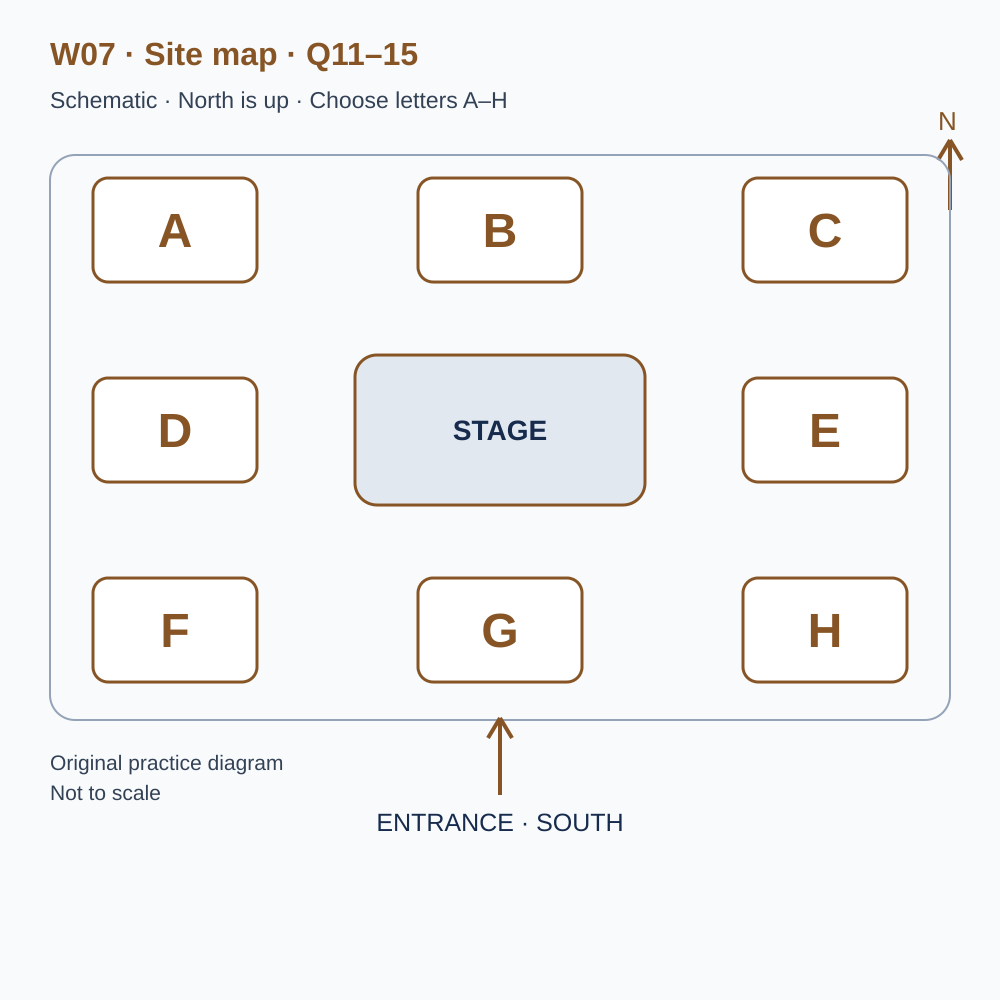
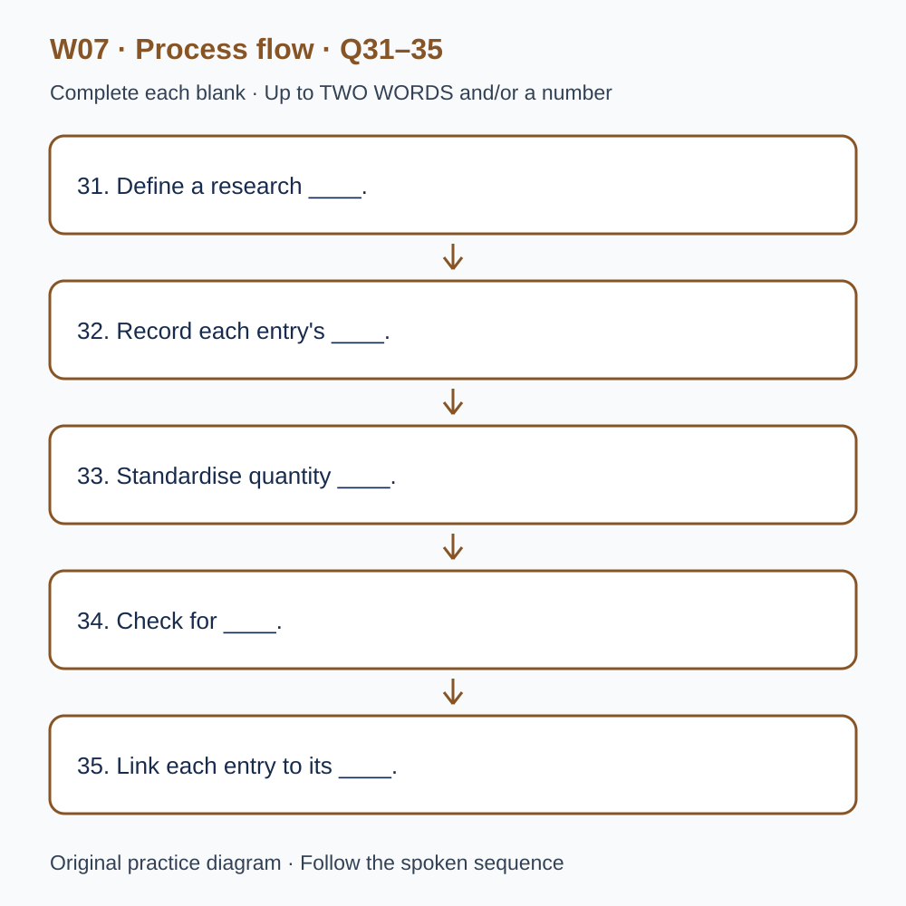

# U42 第7周听力题面与复盘（音频待补）

本页提供已核验的原创题目、参考答案和脚本。配套完整音频尚未验收，当前只能预览题面；不能进行有效的首次听力测试，也不能把读稿作答计作听力成绩或已完成一套听力。

请先保留首次作答机会：批准音频就绪前，不要展开下方答案和脚本。若已读稿，请标记为熟悉材料，之后的练习不能充当陌生题诊断。页面阅读标记只代表看过文字，不代表完成听力。

本材料非雅思真题、非标准化模考，不换算正式分数。计划分钟数不是实测音频时长；学习记录、正式测评和真人反馈须另行完成。

## 学生题面

### L-W07 — Food, stories and community records
> 原创 IELTS-style 技能练习，非真题、非标准化模考，不可换算正式分数。当前只有文字和题目，音频未生成，不能计作已完成听力套题。

共四部分、40 个计分空，每空 1 分。正式首次作答须等待批准音频，先不要打开 script.md 或 answers.md。朗读前先看题；只听一遍后提交首次答案及信心等级，再做精听。当前只能预览题面，不能把读稿作答记作听力成绩。

#### Part 1 — Booking a festival stall

Q1–6: Complete the notes. Write **NO MORE THAN TWO WORDS AND/OR A NUMBER** for each answer, using words from the recording. Numeric notation may replace spoken numbers. Do not repeat a printed unit. Q7–10: Choose **ONE letter, A, B or C**.

**Q1.** Main product to be sold: ____

**Q2.** Chosen day of June: ____

**Q3.** Number of stallholder passes: ____

**Q4.** Allocated unloading time (a.m.): ____

**Q5.** Total stall fee for this community group: £____

**Q6.** Items to attach the display board: ____

**Q7.** Why does the organiser suggest an illustrated information sheet?

- A. It guarantees programme priority.
- B. It lets visitors continue reading after a brief conversation.
- C. It replaces required stall information.

Answer: ____

**Q8.** What must the friend wishing to sell pottery do first?

- A. Submit a separate application.
- B. Use a corner of the existing stall informally.
- C. Arrive on the morning and claim neighbouring space.

Answer: ____

**Q9.** If all the products sell early, the group should

- A. drive away immediately.
- B. invent an extra performance.
- C. keep its information display open until the agreed close.

Answer: ____

**Q10.** Which plan should volunteers use?

- A. The rough early website sketch.
- B. The numbered plan in the booking confirmation, replaced if revised.
- C. Any old version provided they telephone each week.

Answer: ____

#### Part 2 — Festival grounds orientation

Q11–15: Label the map. Write **ONE letter, A–H**, for each destination. Three letters are unused. Q16–20: Choose **ONE letter, A, B or C**.

**Q11.** Tasting tent

Answer: ____

**Q12.** Drinking-water point

Answer: ____

**Q13.** Information and first-aid tent

Answer: ____

**Q14.** Story corner

Answer: ____

**Q15.** Recycling point

Answer: ____

**Q16.** Why are pauses built into the performance programme?

- A. To allow movement and equipment checks.
- B. Because all performers are expected to be late.
- C. To require stallholders to make sales announcements.

Answer: ____

**Q17.** For an identifiable story recorded for the archive, collectors should

- A. assume attendance implies consent.
- B. ask a second volunteer to approach anyone who declines.
- C. explain the use and record the contributor's decision.

Answer: ____

**Q18.** What is the purpose of activity-trail stamps?

- A. To pay for goods at every stall.
- B. To encourage exploration without requiring purchases.
- C. To guarantee a free purchase after completion.

Answer: ____

**Q19.** How should a story-session change be handled first?

- A. Post only on the group's personal social account.
- B. Move to any apparently unused space.
- C. Report it to the programme desk for coordinated updates.

Answer: ____

**Q20.** What belongs in a shift handover?

- A. Unresolved requests and relevant confirmed changes.
- B. Every pleasant conversation in detail.
- C. A blank whenever nothing needs follow-up.

Answer: ____

#### Part 3 — Editing a festival documentary

Q21–26: Match each proposal to the students' **final** positions at the end of that exchange. The tutor is not included. Write **A, B, C or D**. Letters may be reused.

- **A** Mira only
- **B** Ethan only
- **C** Both students
- **D** Neither student

Q27–28 and Q29–30: Choose **TWO different letters, A–E**, for each pair. Write one letter in each numbered slot; either order is accepted. Each distinct correct choice earns one point, maximum two. Repeating a letter cannot earn two points. Submit no more than two letters.

**Q21.** At the END of this exchange, who supports: Opening with a visual montage?

Answer: ____

**Q22.** At the END of this exchange, who supports: Recording conversations secretly?

Answer: ____

**Q23.** At the END of this exchange, who supports: Testing a short pilot clip with classmates unfamiliar with the festival?

Answer: ____

**Q24.** At the END of this exchange, who supports: Keeping the quiet interview in the final short film?

Answer: ____

**Q25.** At the END of this exchange, who supports: Maintaining a source and permission log?

Answer: ____

**Q26.** At the END of this exchange, who supports: Using a split-screen comparison?

Answer: ____

**Q27–28.** Which TWO clips are selected for the middle section?

- A. A celebrity's promotional greeting
- B. A first-time stallholder describing a changed expectation
- C. Anonymous cheering without clear context
- D. A child's close recording without the required agreement
- E. A recycling volunteer explaining sorting

Answers: Q27 ____ · Q28 ____

**Q29–30.** Which TWO caption changes are confirmed?

- A. Use a more decorative typeface
- B. Shorten every display time
- C. Increase the font size
- D. Remove all speaker labels
- E. Use consistent speaker labels

Answers: Q29 ____ · Q30 ____

#### Part 4 — Reading historical market records

Q31–35: Complete the flow chart below. Q36–40: Complete the notes. Write **NO MORE THAN TWO WORDS AND/OR A NUMBER** for each answer, using words from the recording. Numeric notation may replace spoken numbers. Words or units already printed do not belong in the blank. The numbered text below repeats the SVG prompts for readability.

**Q31.** Define a research ____.

**Q32.** Record each entry's ____.

**Q33.** Standardise quantity ____.

**Q34.** Check for ____.

**Q35.** Link each entry to its ____.

**Q36.** A recorded ____ explicitly means none; a blank may mean missing information.

**Q37.** The team's main comparison uses ____, rather than money values.

**Q38.** The issue of which sellers appear in the records is called ____.

**Q39.** For ambiguous digits, calculate a ____ of possible totals.

**Q40.** The final report includes an account of ____.

#### 本周训练安排（音频批准后执行）

- Preview questions without the script：8 分钟。
- Future continuous first listen, including planned part pauses：32 分钟。
- Submit first answers and confidence, without a second play：8 分钟。
- Check answers and classify errors：20 分钟。
- Four Q-located intensive segments, 15 minutes each：60 分钟。
- Diagram and opinion retelling：15 分钟。
- Next-day retry of missed items：15 分钟。

合计 **158 分钟**；最多另用 22 分钟缓冲，总计不超过 180 分钟。暂停、回放与查词均计入精听预算，不能另行无限追加。当前实际已完成听力分钟数为 0。精听区段和步骤见 intensive.md；答案和脚本另页。

参考答案与证据（完成首次听力后再展开）

### L-W07 — Answers and evidence
> 独立答案页。先提交首次答案，再看本页。当前缺音频，文本验题不能充当实听验收。

每个单空 1 分；双选各 2 分、答案顺序不限、按不同正确选项计分。接受形式仅做大小写和空白规范化；不做模糊词形推断。

#### Q1 — bread

Accepted answers: bread

Use the final confirmed detail in this exchange; the printed unit or date context is already supplied.

Evidence locator: Q01 (script.md; timestamps unavailable).

> Organiser: Welcome to the neighbourhood food festival office. Are you enquiring about a stall for your organisation? Stallholder: Yes, our community kitchen has made bread for local events before, and we want to try a public stall. We discussed selling cakes as well, but we cannot organise two production teams this time. Organiser: So I should enter bread as your main product? Stallholder: Please do. We can describe how we make it while people look around, although we won't run a cooking demonstration. Our kitchen is across town, and transporting the equipment would be much harder than bringing the finished products.

#### Q2 — 19

Accepted answers: 19 / 19th / nineteenth / the nineteenth

Use the final confirmed detail in this exchange; the printed unit or date context is already supplied.

Evidence locator: Q02 (script.md; timestamps unavailable).

> Organiser: Which date were you hoping for? Our programme covers two weekends, and the stall arrangements are separate for each one. Stallholder: I originally wrote down June the twelfth, because that appeared in an early message. Then our volunteers checked their availability. The nineteenth of June is the date that everyone can manage. Organiser: Yes, the twelfth was a provisional date for a smaller event. The nineteenth is available, and I'll put you on that list. Stallholder: Thank you. I'd rather join once with a full team than attempt both weekends and leave one person trying to manage everything alone.

#### Q3 — 4

Accepted answers: 4 / four

Use the final confirmed detail in this exchange; the printed unit or date context is already supplied.

Evidence locator: Q03 (script.md; timestamps unavailable).

> Organiser: How many people will need stallholder passes? Visitors can enter freely, but the setup area is restricted before the festival opens. Stallholder: We have six volunteers involved in the kitchen, though not all of them will attend. Two will finish the baking and stay behind, so we'll need four passes. Organiser: Four it is. Will the same people be present all day? Stallholder: Yes. They'll take turns having breaks without bringing extra helpers into the stall. Organiser: That makes things straightforward. Please let me know in advance if a named person changes, so we can update the entrance list.

#### Q4 — 8.30

Accepted answers: 8.30 / 8:30 / 08.30 / 08:30 / eight thirty

Use the final confirmed detail in this exchange; the printed unit or date context is already supplied.

Evidence locator: Q04 (script.md; timestamps unavailable).

> Stallholder: What time should we arrive with our boxes? Organiser: Vehicle unloading starts at eight, but your allocated slot is eight thirty. Each row has its own slot to prevent the narrow entrance becoming blocked. Stallholder: Could we arrive at eight and wait? Organiser: There isn't a waiting area for vehicles at the gate. Please plan around eight thirty, then move the vehicle to the public car park when you've unloaded. The public opening is much later, so you'll still have plenty of time to arrange the stall. Stallholder: Good. I'll put the unloading time on our transport sheet, not the opening time.

#### Q5 — 40

Accepted answers: 40 / forty

Use the final confirmed detail in this exchange; the printed unit or date context is already supplied.

Evidence locator: Q05 (script.md; timestamps unavailable).

> Stallholder: Is there a charge for the stall? Someone told me community groups could apply for a reduced rate. Organiser: They can, and your group meets the conditions. The standard amount is sixty pounds, but your fee will be forty pounds. That covers the stall space and the basic table. Stallholder: Is that per volunteer? Organiser: No, it's the total for your stall for the day. Stallholder: That's helpful. We have a small budget for printing our information sheet, so I'll record forty pounds as the stall cost and keep the printing expense separate when we discuss the budget with the group.

#### Q6 — clips

Accepted answers: clips

Use the final confirmed detail in this exchange; the printed unit or date context is already supplied.

Evidence locator: Q06 (script.md; timestamps unavailable).

> Organiser: The last practical question concerns your sign. We provide a table, but groups bring their own display materials. Stallholder: We can make a board with our kitchen's name. How do we attach it? Organiser: Please bring clips. String tends to hang loose in the shared walkway, and tape can damage the table surface when people remove it. Stallholder: Clips, then. I'll ask our volunteer to pack them with the board rather than in the food boxes. Organiser: Excellent. Keeping the display equipment together will make unloading easier, particularly if a different volunteer has to do that job on the morning.

#### Q7 — B

Accepted answers: B

The take-away sheet extends a short conversation; it confers no priority.

Evidence locator: Q07 (script.md; timestamps unavailable).

> Stallholder: We'd like visitors to hear the story behind the kitchen. Should we schedule a long talk at the stall? Organiser: For your location, brief conversations will work better. The walkway needs to stay open, and people may only have a minute before they move on. A short illustrated sheet gives them something to take away if they're interested. Stallholder: So the main reason for that sheet is to let people continue reading afterwards? Organiser: Exactly. It isn't a substitute for the required stall information, and printing more pages doesn't give a group priority in the programme. Keep the story clear and manageable.

#### Q8 — A

Accepted answers: A

Responsibility and proposed goods must be recorded for each organisation.

Evidence locator: Q08 (script.md; timestamps unavailable).

> Stallholder: A friend offered to share our space and sell pottery. It would make the table look attractive, but it's a different organisation. Organiser: Please ask them to apply separately. We need to know who is responsible for each stall and what each group intends to bring. You cannot add another seller informally on the morning. Stallholder: Even if they only use one corner? Organiser: Yes. We can consider placing the two groups near each other, although that depends on available space. A separate application is the first step. Stallholder: I'll explain that we shouldn't promise them part of our table before they've spoken to you.

#### Q9 — C

Accepted answers: C

Selling may stop but the information display remains; vehicle entry is restricted.

Evidence locator: Q09 (script.md; timestamps unavailable).

> Stallholder: If we sell everything before the end, can we pack up immediately? Organiser: You can stop selling, of course, but please keep your information display open until the agreed closing time. Vehicles cannot enter the stall rows while visitors are still moving around them. Stallholder: So we could talk about the kitchen after the products are gone? Organiser: That's ideal. Bring a sign saying you've sold out, and visitors can still find out what your organisation does. You won't need to invent extra activities. Stallholder: Fine. We'll plan a quieter final hour instead of assuming we can drive away as soon as the last item sells.

#### Q10 — B

Accepted answers: B

Confirmed numbered plans, and direct revisions, govern the stall location.

Evidence locator: Q10 (script.md; timestamps unavailable).

> Stallholder: How will you confirm the final stall position? Organiser: I'll send a numbered site plan with your booking confirmation. Please check the number against the name on the plan; the rough sketch on our website is only an early overview. Stallholder: Should I call every week to see whether it's changed? Organiser: No need. If your position changes after confirmation, we'll contact you directly and send a revised plan. Stallholder: Then I'll distribute the confirmed version to our volunteers and replace it if you send an update. Organiser: Exactly. That prevents different members of the same team arriving with different versions and searching in opposite directions.

#### Q11 — B

Accepted answers: B

Use the explicitly stated position relative to the stage, not an earlier layout or adjacent area.

Evidence locator: Q11 (script.md; timestamps unavailable).

> Before you leave the briefing, look at the map of the festival grounds. North is at the top, and the public entrance is on the southern edge. The stage is the central landmark. The eight lettered areas are separate activity spaces around it. First, the tasting tent is directly north of the stage. It is not the area to the north-east, even though the two can look close together on a small screen. Visitors entering from the south can use the stage as a reference point. Please describe this location by direction rather than by the colour of the tent, because covers may be changed.

#### Q12 — F

Accepted answers: F

Use the explicitly stated position relative to the stage, not an earlier layout or adjacent area.

Evidence locator: Q12 (script.md; timestamps unavailable).

> The drinking-water point is in the south-west area. On the map that means below and to the left of the central stage. An earlier layout placed it immediately south of the stage, near the entrance, but that created a crowd where people were arriving. We moved it sideways to give visitors room to stop. The water point remains easy to reach without crossing the performance space. If someone asks for it, make sure you don't simply direct them back towards the entrance. The southern lettered area has another use today, and a visitor following that vague instruction would miss the water station.

#### Q13 — C

Accepted answers: C

Use the explicitly stated position relative to the stage, not an earlier layout or adjacent area.

Evidence locator: Q13 (script.md; timestamps unavailable).

> The information and first-aid tent is in the north-east corner of the activity ring. Its shared front desk handles general requests and directs visitors to the appropriate member of staff. Some volunteers remember an arrangement in which the information point stood west of the stage. That was last year's plan, so please use today's map. The north-east position is above and to the right of the stage when you hold the page upright. We use a single shared front desk so visitors do not have to decide which team they need before asking for assistance. Staff inside will help them find the right person.

#### Q14 — D

Accepted answers: D

Use the explicitly stated position relative to the stage, not an earlier layout or adjacent area.

Evidence locator: Q14 (script.md; timestamps unavailable).

> The story corner is directly west of the stage, level with its centre. It is a small seated area where contributors can describe their community projects. Please distinguish it from the north-west area, which is reserved for another purpose. We tested the story corner beside the main entrance, but short talks were difficult to hear over the arriving crowd. Moving it to the west gives it a clearer boundary. It still isn't a private interview room, so documentary teams should arrange separate conversations if they need quiet recordings. For an ordinary visitor looking for the programme of stories, however, this western area is the correct destination.

#### Q15 — H

Accepted answers: H

Use the explicitly stated position relative to the stage, not an earlier layout or adjacent area.

Evidence locator: Q15 (script.md; timestamps unavailable).

> Finally, the recycling point is south-east of the stage. That is the lower-right area of the map, and it is separate from the drinking-water point on the opposite side. Volunteers will help visitors read the labels on the containers. We haven't placed recycling directly beside the stage because the space there must remain open during performances. Do not send people to the south-west area simply because you remember that another service is located there. Water is south-west; recycling is south-east. Those two locations are the most commonly confused, so use both the direction and the central stage when explaining the route to a visitor.

#### Q16 — A

Accepted answers: A

Pauses support circulation and preparation, not compulsory selling.

Evidence locator: Q16 (script.md; timestamps unavailable).

> The programme has several short performances, with a pause between each one. Those pauses are deliberate. They give visitors time to move between activities and allow the next group to check its equipment without rushing. We haven't introduced them because performers are expected to arrive late. Nor are they extra sales periods that stallholders must fill with announcements. During a pause, volunteers should keep the main paths clear and answer ordinary questions. If a performance starts a few minutes later than printed, consult the stage coordinator before making an announcement. A guessed explanation can spread quickly and leave different parts of the site giving contradictory information.

#### Q17 — C

Accepted answers: C

Contributors choose with an understanding of intended use.

Evidence locator: Q17 (script.md; timestamps unavailable).

> Anyone collecting photographs or recorded stories for the festival archive must follow the contributor arrangements. Being at a public event does not mean someone has agreed to a close interview for our archive. Explain the intended use, ask the person, and record their decision using the project form. A general crowd photograph and an identifiable personal story are different tasks in our workflow. If somebody declines, thank them and move on. Do not ask a neighbouring volunteer to approach the same person again. Our aim is to collect contributions people understand and choose to make, not to obtain a particular number of recordings by the end of the afternoon.

#### Q18 — B

Accepted answers: B

Stamps are part of an activity trail, not money or a purchase prize.

Evidence locator: Q18 (script.md; timestamps unavailable).

> The festival tokens used in the activity trail are not money. Children collect a stamp at participating activities and can show the completed card at the exit desk. Stallholders should not accept the stamps as payment or promise that a completed card wins a purchase. We designed the trail to encourage visitors to explore different community groups, including activities that do not sell anything. A family can take part without buying food or products. If a card is lost, the exit team can explain the available options. Individual volunteers should avoid inventing replacement rules, because inconsistent promises create problems for families who have followed the printed instructions.

#### Q19 — C

Accepted answers: C

The desk checks and communicates changes across the site.

Evidence locator: Q19 (script.md; timestamps unavailable).

> A change to a scheduled story session should be reported to the programme desk first. The desk updates the main noticeboard and tells the volunteers near the affected area. Posting a message on one group's personal social account is not enough, because many visitors will not see it. Equally, crossing out a time on one small sign leaves other copies unchanged. The programme desk provides one coordinated route for revisions. You can help by giving the session name, original time and proposed change clearly. Please wait for confirmation before directing a group to a new location; that space may already be booked for somebody else's activity.

#### Q20 — A

Accepted answers: A

The next volunteer needs actionable information and an explicit indication when no issue remains.

Evidence locator: Q20 (script.md; timestamps unavailable).

> At the end of your shift, leave a short handover for the next volunteer. Include unresolved requests and any confirmed programme changes relevant to your position. A long description of every pleasant conversation is unnecessary, although you are welcome to share those stories later. The useful question is what the next person needs to know to do the job. If there is nothing unresolved, say so explicitly instead of leaving the form blank. A blank can mean either no issue or a forgotten handover. Keep personal information out of the public-facing copy and use the staff process for any details that need restricted access.

#### Q21 — A

Accepted answers: A

Final stance: Mira only. Ignore an initial proposal if later withdrawn; the tutor is not an answer option.

Evidence locator: Q21 (script.md; timestamps unavailable).

> Tutor: Let's settle the opening of your student documentary. Mira: I want a short visual montage of people setting up stalls. It establishes the place before we hear explanations. Ethan: The pictures are attractive, but I'd start with one contributor speaking. Otherwise viewers might not know what question the film is exploring. Mira: We can add the question as a title, and I still favour the montage. Tutor: Would a shorter version bring you together? Ethan: No, my preference remains a spoken opening. Mira: Then we should record that we disagree. I support the visual montage, even if the final editing decision goes another way.

#### Q22 — D

Accepted answers: D

Final stance: Neither student. Ignore an initial proposal if later withdrawn; the tutor is not an answer option.

Evidence locator: Q22 (script.md; timestamps unavailable).

> Tutor: What about recording informal conversations without approaching people first? Ethan: I initially thought hidden recording might make the dialogue sound more natural. Mira: It would also leave contributors unaware of how their words could be used. I don't support it. Ethan: Having looked at our project requirements, I've changed my mind. We should explain the recording and ask people to participate. Tutor: So hidden recording is no longer a proposal either of you supports? Ethan: Correct. I withdraw it rather than simply postponing it. Mira: And I remain against it. We can capture relaxed conversation with willing contributors instead of concealing what we're doing.

#### Q23 — C

Accepted answers: C

Final stance: Both students. Ignore an initial proposal if later withdrawn; the tutor is not an answer option.

Evidence locator: Q23 (script.md; timestamps unavailable).

> Tutor: How will you check whether viewers follow the structure? Mira: We could show a short pilot clip to classmates who haven't visited the festival. Ethan: I worried that would waste time before the full edit, but a pilot could reveal a missing explanation early. I support testing one now. Mira: I'd ask viewers to describe the sequence in their own words, rather than just say whether they like it. Tutor: That seems manageable. Ethan: Yes, as long as the pilot is short, I agree with the proposal. We needn't wait until the soundtrack and every transition are polished before finding out whether the basic story makes sense.

#### Q24 — B

Accepted answers: B

Final stance: Ethan only. Ignore an initial proposal if later withdrawn; the tutor is not an answer option.

Evidence locator: Q24 (script.md; timestamps unavailable).

> Tutor: One interview has long pauses. Will you keep it? Ethan: I want to retain that quiet interview. The contributor describes a difficult first year, and the pauses give the answer room to develop. Mira: I understand the value, but in this short film I'd replace it with a more concise account. Ethan: We can trim repetition without losing the measured pace. I still support keeping the interview. Tutor: Mira, has that suggestion changed your position? Mira: No. I would use another speaker and preserve this recording in the project archive. It deserves to be heard, but I don't favour including it in our final short film.

#### Q25 — C

Accepted answers: C

Final stance: Both students. Ignore an initial proposal if later withdrawn; the tutor is not an answer option.

Evidence locator: Q25 (script.md; timestamps unavailable).

> Tutor: You have contributions from several groups. How will you track their agreed uses? Mira: A source and permission log would connect every clip to the contributor's decision. Ethan: I support that. I originally imagined filenames would be enough, but they cannot tell us whether someone agreed to a classroom screening only. Mira: We should check the log before exporting each version. Tutor: And if the intended audience changes? Ethan: We review the agreement rather than assuming permission extends automatically. Mira: Exactly. So we both want the log, with a clear entry for each source, even if some entries need further discussion before we can use the material.

#### Q26 — A

Accepted answers: A

Final stance: Mira only. Ignore an initial proposal if later withdrawn; the tutor is not an answer option.

Evidence locator: Q26 (script.md; timestamps unavailable).

> Tutor: Your draft compares the same stall at opening and closing. Mira: I'd show the images in a split-screen comparison. Viewers could see the changed arrangement at once. Ethan: I prefer showing one image and then the other, with a short explanation. Two moving pictures compete for attention. Mira: We could use still frames, but I still favour the split-screen. Tutor: Would still frames resolve your objection, Ethan? Ethan: They would help, but I remain against that format for this sequence. I want viewers to focus on each image separately. Mira: Then my support stays, and his doesn't. We'll test both versions before making the editing decision.

#### Q27–28 — B, E

Accept unordered set: B, E. One point per distinct correct choice, maximum 2.

The selected clips develop the theme with usable agreed contributions; the greeting, cheering and unapproved child contribution are not selected.

Evidence locator: Q27, Q28 (script.md; timestamps unavailable).

> Tutor: You have space for two more clips in the middle section. Which one is already agreed? Ethan: The interview with the first-time stallholder who changed her view of the event. At the start she expected only sales, but afterwards she talks about meeting possible volunteers. Mira: Yes, that change gives the film a clear development. We both selected it. Tutor: What about the local celebrity's promotional greeting? Mira: It attracts attention, but it doesn't advance our question. Ethan: And the anonymous cheering shot has no clear context. We haven't selected either of those. The first agreed addition is the stallholder describing how her expectation changed.

> Tutor: And your second agreed addition? Mira: The recycling volunteer explaining the sorting process. We have clear images of the labelled containers to accompany that explanation. Ethan: Agreed. It shows work that visitors may overlook, and the volunteer approved the intended screening. Tutor: There is also the close recording of a child discussing the activity trail. Ethan: We don't have the necessary project agreement for that contribution, so it is not one of our selected clips. Mira: We won't try to fill the gap with an unclear crowd sound either. Our two additions are the changed expectation from the stallholder and the volunteer's explanation of sorting.

#### Q29–30 — C, E

Accept unordered set: C, E. One point per distinct correct choice, maximum 2.

Larger letters address reading difficulty; consistent labels preserve useful contributor context.

Evidence locator: Q29, Q30 (script.md; timestamps unavailable).

> Tutor: Let's finish with captions. The test viewers struggled with the preview. Ethan: Several said the letters were too small on the classroom display. I suggest increasing the font size across all captions. Mira: I agree. Enlarging just the first caption would leave the same problem elsewhere. Tutor: Did anyone request a more decorative typeface? Mira: One classmate liked that idea aesthetically, but it wouldn't address the reading problem, and we haven't adopted it. Ethan: Nor are we planning to animate each line. The first confirmed change is a larger font, with enough space around it to keep the words separate from the image details.

> Tutor: What is the other confirmed caption change? Mira: Consistent speaker labels. In the current edit, one person is introduced by name, another by role, and a third has no label. Ethan: We should use the same pattern for every contributor, subject to the name each person has agreed to show. Tutor: Would removing every label simplify matters? Ethan: It would remove useful context, so we rejected that. Mira: We also rejected shortening the display time simply to make the film feel faster. The two changes we've approved are increasing the font size and using consistent speaker labels. We'll check them in a new preview before declaring the captions finished.

#### Q31 — question

Accepted answers: question

Complete the named stage in the stated process order; retain any word already printed around the blank.

Evidence locator: Q31 (script.md; timestamps unavailable).

> This lecture uses an invented archive project to explore historical market records. The team wants to compare the quantities of selected goods sold at a small market over several years. Its first task is to define a question. Without that step, researchers can spend weeks copying figures that do not help their investigation. A broad interest in local life needs to become a question specific enough to guide selection. Here, the team asks how recorded quantities changed, rather than trying to describe every aspect of the market. That choice will shape which records it copies, how it groups entries and what its eventual conclusions can reasonably cover.

#### Q32 — date

Accepted answers: date

Complete the named stage in the stated process order; retain any word already printed around the blank.

Evidence locator: Q32 (script.md; timestamps unavailable).

> Next, the team records the date attached to each entry. The position of a page in a bound volume is useful, but it is not a reliable substitute for a date. Pages may have been inserted later or grouped by seller rather than by time. If the date cannot be read, the team marks that uncertainty instead of borrowing the date from a neighbouring entry. Clear dates allow observations to be ordered and compared across the chosen period. The original written form is preserved beside the working version, so another reader can check how the researchers interpreted an unusual abbreviation or an incomplete entry.

#### Q33 — units

Accepted answers: units

Complete the named stage in the stated process order; retain any word already printed around the blank.

Evidence locator: Q33 (script.md; timestamps unavailable).

> The third stage is to standardise the units used for quantities. One page might count individual containers while another records a measure of weight. The team cannot simply add the figures because both happen to be numbers. It first establishes what each unit means in the relevant records and whether a justified conversion is available. When no reliable conversion can be made, the values remain separate. Standardising units is therefore not a licence to invent missing information. It is a documented process that makes comparable observations comparable while keeping genuine differences visible. The conversion rule, when used, is stored with the working data rather than only in a researcher's memory.

#### Q34 — duplicates

Accepted answers: duplicates / the duplicates / duplicate entries

Complete the named stage in the stated process order; retain any word already printed around the blank.

Evidence locator: Q34 (script.md; timestamps unavailable).

> The fourth stage checks for duplicates. An entry may appear in a daily sheet and then again in a weekly summary. Counting both as separate sales would inflate the total. Researchers compare dates, descriptions and other recorded features before deciding that two entries refer to the same event. Similar quantities alone are not enough, because different sales can have equal amounts. A duplicate flag preserves the relationship between the records without destroying the original transcription. The working total includes the event once, while a reviewer can still trace both written appearances. This is a careful checking stage, not an instruction to delete every line that resembles an earlier one.

#### Q35 — source

Accepted answers: source / original material

Complete the named stage in the stated process order; retain any word already printed around the blank.

Evidence locator: Q35 (script.md; timestamps unavailable).

> The fifth stage links each working entry to its source. A page reference and archive identifier let another researcher find the original material. Even a beautifully organised table loses much of its value if nobody can discover where a figure came from. The source link also helps when a later reader proposes a different interpretation of handwriting. Researchers can return to the evidence instead of arguing only from copied numbers. In this project the link is stored for every entry, including entries excluded from the final comparison. Exclusion is a research decision that needs an explanation; it should not erase the route back to the material on which that decision was based.

#### Q36 — zero

Accepted answers: zero / 0

The corresponding evidence block supplies this distinction or qualification; the question retains the surrounding grammar.

Evidence locator: Q36 (script.md; timestamps unavailable).

> During analysis, the team must distinguish a blank from a zero. A zero explicitly records that none of the relevant goods were counted. A blank may mean that the information was omitted, the page was damaged, or the category was not used on that occasion. Replacing every blank with zero would turn missing information into a confident statement about activity. The team therefore uses a separate missing-value label and describes the rule in its notes. This does not solve the historical uncertainty, but it prevents a spreadsheet operation from hiding it. Readers should be able to see both the calculated results and the limits of the observations behind them.

#### Q37 — quantities

Accepted answers: quantities

The corresponding evidence block supplies this distinction or qualification; the question retains the surrounding grammar.

Evidence locator: Q37 (script.md; timestamps unavailable).

> Prices and quantities must also remain distinct. A rise in the money recorded for a product does not by itself show that a greater quantity was sold. The price per unit may have changed, or the way payments were recorded may differ. For the question this team has chosen, quantities are the main comparison. Money values can provide context when the records support it, but they cannot silently replace the required measurements. A graph with a clear title and unit label helps prevent that substitution. Researchers should ask what each axis actually represents before treating the shape of a line as evidence for a broader story about the market.

#### Q38 — coverage

Accepted answers: coverage

The corresponding evidence block supplies this distinction or qualification; the question retains the surrounding grammar.

Evidence locator: Q38 (script.md; timestamps unavailable).

> Another issue is coverage. Suppose the surviving records describe only some sellers. Their combined totals would not automatically represent the whole market. The team examines who appears in the documents and whether that group changes across the years. A new seller entering the records can make a total rise even if existing sellers have not changed their activity. Coverage is therefore part of the interpretation, rather than a minor detail reserved for a final footnote. The researchers might restrict a comparison to a consistent subset, while clearly explaining what that subset excludes. Such a choice narrows the claim, but makes the relationship between the evidence and the claim easier to assess.

#### Q39 — range

Accepted answers: range

The corresponding evidence block supplies this distinction or qualification; the question retains the surrounding grammar.

Evidence locator: Q39 (script.md; timestamps unavailable).

> Some handwritten numbers allow more than one plausible reading. Rather than quietly choosing the value that produces the smoothest graph, the team can calculate a range of possible totals using the defensible alternatives. That range shows how much the uncertain entry could affect the result. It is not a claim that every number between the endpoints was actually observed. The original ambiguity remains documented alongside the calculation. If the broad pattern changes when a single unclear digit is read differently, the final explanation should say so. A precise-looking total is not useful when its apparent precision conceals a choice that readers would reasonably want to examine.

#### Q40 — uncertainty

Accepted answers: uncertainty / the uncertainty

The corresponding evidence block supplies this distinction or qualification; the question retains the surrounding grammar.

Evidence locator: Q40 (script.md; timestamps unavailable).

> The final report combines the result with an account of uncertainty. It explains which entries were included, how units were treated, where records were missing and which readings remained doubtful. This is not an optional apology after the interesting part of the project. It helps readers decide what the comparison can support and what further evidence would be valuable. The team may still identify a convincing pattern within its defined collection. It simply avoids extending that pattern to every seller or every year without support. A successful report lets another person follow the reasoning from source entries to conclusion, including the points where the available material limits the conclusion.

完整脚本（提前阅读会失去陌生题首答机会）

### L-W07 — Food, stories and community records: transcript
> 原创虚构练习，非真题；音频缺失。仅供完成首次作答后的核对或文字审阅。Q 标记与角色名不属于朗读正文。

#### Part 1 — Booking a festival stall

##### Q1 evidence block

**Organiser:** Welcome to the neighbourhood food festival office. Are you enquiring about a stall for your organisation?

**Stallholder:** Yes, our community kitchen has made bread for local events before, and we want to try a public stall. We discussed selling cakes as well, but we cannot organise two production teams this time.

**Organiser:** So I should enter bread as your main product?

**Stallholder:** Please do. We can describe how we make it while people look around, although we won't run a cooking demonstration. Our kitchen is across town, and transporting the equipment would be much harder than bringing the finished products.

##### Q2 evidence block

**Organiser:** Which date were you hoping for? Our programme covers two weekends, and the stall arrangements are separate for each one.

**Stallholder:** I originally wrote down June the twelfth, because that appeared in an early message. Then our volunteers checked their availability. The nineteenth of June is the date that everyone can manage.

**Organiser:** Yes, the twelfth was a provisional date for a smaller event. The nineteenth is available, and I'll put you on that list.

**Stallholder:** Thank you. I'd rather join once with a full team than attempt both weekends and leave one person trying to manage everything alone.

##### Q3 evidence block

**Organiser:** How many people will need stallholder passes? Visitors can enter freely, but the setup area is restricted before the festival opens.

**Stallholder:** We have six volunteers involved in the kitchen, though not all of them will attend. Two will finish the baking and stay behind, so we'll need four passes.

**Organiser:** Four it is. Will the same people be present all day?

**Stallholder:** Yes. They'll take turns having breaks without bringing extra helpers into the stall.

**Organiser:** That makes things straightforward. Please let me know in advance if a named person changes, so we can update the entrance list.

##### Q4 evidence block

**Stallholder:** What time should we arrive with our boxes?

**Organiser:** Vehicle unloading starts at eight, but your allocated slot is eight thirty. Each row has its own slot to prevent the narrow entrance becoming blocked.

**Stallholder:** Could we arrive at eight and wait?

**Organiser:** There isn't a waiting area for vehicles at the gate. Please plan around eight thirty, then move the vehicle to the public car park when you've unloaded. The public opening is much later, so you'll still have plenty of time to arrange the stall.

**Stallholder:** Good. I'll put the unloading time on our transport sheet, not the opening time.

##### Q5 evidence block

**Stallholder:** Is there a charge for the stall? Someone told me community groups could apply for a reduced rate.

**Organiser:** They can, and your group meets the conditions. The standard amount is sixty pounds, but your fee will be forty pounds. That covers the stall space and the basic table.

**Stallholder:** Is that per volunteer?

**Organiser:** No, it's the total for your stall for the day.

**Stallholder:** That's helpful. We have a small budget for printing our information sheet, so I'll record forty pounds as the stall cost and keep the printing expense separate when we discuss the budget with the group.

##### Q6 evidence block

**Organiser:** The last practical question concerns your sign. We provide a table, but groups bring their own display materials.

**Stallholder:** We can make a board with our kitchen's name. How do we attach it?

**Organiser:** Please bring clips. String tends to hang loose in the shared walkway, and tape can damage the table surface when people remove it.

**Stallholder:** Clips, then. I'll ask our volunteer to pack them with the board rather than in the food boxes.

**Organiser:** Excellent. Keeping the display equipment together will make unloading easier, particularly if a different volunteer has to do that job on the morning.

##### Q7 evidence block

**Stallholder:** We'd like visitors to hear the story behind the kitchen. Should we schedule a long talk at the stall?

**Organiser:** For your location, brief conversations will work better. The walkway needs to stay open, and people may only have a minute before they move on. A short illustrated sheet gives them something to take away if they're interested.

**Stallholder:** So the main reason for that sheet is to let people continue reading afterwards?

**Organiser:** Exactly. It isn't a substitute for the required stall information, and printing more pages doesn't give a group priority in the programme. Keep the story clear and manageable.

##### Q8 evidence block

**Stallholder:** A friend offered to share our space and sell pottery. It would make the table look attractive, but it's a different organisation.

**Organiser:** Please ask them to apply separately. We need to know who is responsible for each stall and what each group intends to bring. You cannot add another seller informally on the morning.

**Stallholder:** Even if they only use one corner?

**Organiser:** Yes. We can consider placing the two groups near each other, although that depends on available space. A separate application is the first step.

**Stallholder:** I'll explain that we shouldn't promise them part of our table before they've spoken to you.

##### Q9 evidence block

**Stallholder:** If we sell everything before the end, can we pack up immediately?

**Organiser:** You can stop selling, of course, but please keep your information display open until the agreed closing time. Vehicles cannot enter the stall rows while visitors are still moving around them.

**Stallholder:** So we could talk about the kitchen after the products are gone?

**Organiser:** That's ideal. Bring a sign saying you've sold out, and visitors can still find out what your organisation does. You won't need to invent extra activities.

**Stallholder:** Fine. We'll plan a quieter final hour instead of assuming we can drive away as soon as the last item sells.

##### Q10 evidence block

**Stallholder:** How will you confirm the final stall position?

**Organiser:** I'll send a numbered site plan with your booking confirmation. Please check the number against the name on the plan; the rough sketch on our website is only an early overview.

**Stallholder:** Should I call every week to see whether it's changed?

**Organiser:** No need. If your position changes after confirmation, we'll contact you directly and send a revised plan.

**Stallholder:** Then I'll distribute the confirmed version to our volunteers and replace it if you send an update.

**Organiser:** Exactly. That prevents different members of the same team arriving with different versions and searching in opposite directions.

#### Part 2 — Festival grounds orientation

##### Q11 evidence block

**Festival coordinator:** Before you leave the briefing, look at the map of the festival grounds. North is at the top, and the public entrance is on the southern edge. The stage is the central landmark. The eight lettered areas are separate activity spaces around it. First, the tasting tent is directly north of the stage. It is not the area to the north-east, even though the two can look close together on a small screen. Visitors entering from the south can use the stage as a reference point. Please describe this location by direction rather than by the colour of the tent, because covers may be changed.

##### Q12 evidence block

**Festival coordinator:** The drinking-water point is in the south-west area. On the map that means below and to the left of the central stage. An earlier layout placed it immediately south of the stage, near the entrance, but that created a crowd where people were arriving. We moved it sideways to give visitors room to stop. The water point remains easy to reach without crossing the performance space. If someone asks for it, make sure you don't simply direct them back towards the entrance. The southern lettered area has another use today, and a visitor following that vague instruction would miss the water station.

##### Q13 evidence block

**Festival coordinator:** The information and first-aid tent is in the north-east corner of the activity ring. Its shared front desk handles general requests and directs visitors to the appropriate member of staff. Some volunteers remember an arrangement in which the information point stood west of the stage. That was last year's plan, so please use today's map. The north-east position is above and to the right of the stage when you hold the page upright. We use a single shared front desk so visitors do not have to decide which team they need before asking for assistance. Staff inside will help them find the right person.

##### Q14 evidence block

**Festival coordinator:** The story corner is directly west of the stage, level with its centre. It is a small seated area where contributors can describe their community projects. Please distinguish it from the north-west area, which is reserved for another purpose. We tested the story corner beside the main entrance, but short talks were difficult to hear over the arriving crowd. Moving it to the west gives it a clearer boundary. It still isn't a private interview room, so documentary teams should arrange separate conversations if they need quiet recordings. For an ordinary visitor looking for the programme of stories, however, this western area is the correct destination.

##### Q15 evidence block

**Festival coordinator:** Finally, the recycling point is south-east of the stage. That is the lower-right area of the map, and it is separate from the drinking-water point on the opposite side. Volunteers will help visitors read the labels on the containers. We haven't placed recycling directly beside the stage because the space there must remain open during performances. Do not send people to the south-west area simply because you remember that another service is located there. Water is south-west; recycling is south-east. Those two locations are the most commonly confused, so use both the direction and the central stage when explaining the route to a visitor.

##### Q16 evidence block

**Festival coordinator:** The programme has several short performances, with a pause between each one. Those pauses are deliberate. They give visitors time to move between activities and allow the next group to check its equipment without rushing. We haven't introduced them because performers are expected to arrive late. Nor are they extra sales periods that stallholders must fill with announcements. During a pause, volunteers should keep the main paths clear and answer ordinary questions. If a performance starts a few minutes later than printed, consult the stage coordinator before making an announcement. A guessed explanation can spread quickly and leave different parts of the site giving contradictory information.

##### Q17 evidence block

**Festival coordinator:** Anyone collecting photographs or recorded stories for the festival archive must follow the contributor arrangements. Being at a public event does not mean someone has agreed to a close interview for our archive. Explain the intended use, ask the person, and record their decision using the project form. A general crowd photograph and an identifiable personal story are different tasks in our workflow. If somebody declines, thank them and move on. Do not ask a neighbouring volunteer to approach the same person again. Our aim is to collect contributions people understand and choose to make, not to obtain a particular number of recordings by the end of the afternoon.

##### Q18 evidence block

**Festival coordinator:** The festival tokens used in the activity trail are not money. Children collect a stamp at participating activities and can show the completed card at the exit desk. Stallholders should not accept the stamps as payment or promise that a completed card wins a purchase. We designed the trail to encourage visitors to explore different community groups, including activities that do not sell anything. A family can take part without buying food or products. If a card is lost, the exit team can explain the available options. Individual volunteers should avoid inventing replacement rules, because inconsistent promises create problems for families who have followed the printed instructions.

##### Q19 evidence block

**Festival coordinator:** A change to a scheduled story session should be reported to the programme desk first. The desk updates the main noticeboard and tells the volunteers near the affected area. Posting a message on one group's personal social account is not enough, because many visitors will not see it. Equally, crossing out a time on one small sign leaves other copies unchanged. The programme desk provides one coordinated route for revisions. You can help by giving the session name, original time and proposed change clearly. Please wait for confirmation before directing a group to a new location; that space may already be booked for somebody else's activity.

##### Q20 evidence block

**Festival coordinator:** At the end of your shift, leave a short handover for the next volunteer. Include unresolved requests and any confirmed programme changes relevant to your position. A long description of every pleasant conversation is unnecessary, although you are welcome to share those stories later. The useful question is what the next person needs to know to do the job. If there is nothing unresolved, say so explicitly instead of leaving the form blank. A blank can mean either no issue or a forgotten handover. Keep personal information out of the public-facing copy and use the staff process for any details that need restricted access.

#### Part 3 — Editing a festival documentary

##### Q21 evidence block

**Tutor:** Let's settle the opening of your student documentary.

**Mira:** I want a short visual montage of people setting up stalls. It establishes the place before we hear explanations.

**Ethan:** The pictures are attractive, but I'd start with one contributor speaking. Otherwise viewers might not know what question the film is exploring.

**Mira:** We can add the question as a title, and I still favour the montage.

**Tutor:** Would a shorter version bring you together?

**Ethan:** No, my preference remains a spoken opening.

**Mira:** Then we should record that we disagree. I support the visual montage, even if the final editing decision goes another way.

##### Q22 evidence block

**Tutor:** What about recording informal conversations without approaching people first?

**Ethan:** I initially thought hidden recording might make the dialogue sound more natural.

**Mira:** It would also leave contributors unaware of how their words could be used. I don't support it.

**Ethan:** Having looked at our project requirements, I've changed my mind. We should explain the recording and ask people to participate.

**Tutor:** So hidden recording is no longer a proposal either of you supports?

**Ethan:** Correct. I withdraw it rather than simply postponing it.

**Mira:** And I remain against it. We can capture relaxed conversation with willing contributors instead of concealing what we're doing.

##### Q23 evidence block

**Tutor:** How will you check whether viewers follow the structure?

**Mira:** We could show a short pilot clip to classmates who haven't visited the festival.

**Ethan:** I worried that would waste time before the full edit, but a pilot could reveal a missing explanation early. I support testing one now.

**Mira:** I'd ask viewers to describe the sequence in their own words, rather than just say whether they like it.

**Tutor:** That seems manageable.

**Ethan:** Yes, as long as the pilot is short, I agree with the proposal. We needn't wait until the soundtrack and every transition are polished before finding out whether the basic story makes sense.

##### Q24 evidence block

**Tutor:** One interview has long pauses. Will you keep it?

**Ethan:** I want to retain that quiet interview. The contributor describes a difficult first year, and the pauses give the answer room to develop.

**Mira:** I understand the value, but in this short film I'd replace it with a more concise account.

**Ethan:** We can trim repetition without losing the measured pace. I still support keeping the interview.

**Tutor:** Mira, has that suggestion changed your position?

**Mira:** No. I would use another speaker and preserve this recording in the project archive. It deserves to be heard, but I don't favour including it in our final short film.

##### Q25 evidence block

**Tutor:** You have contributions from several groups. How will you track their agreed uses?

**Mira:** A source and permission log would connect every clip to the contributor's decision.

**Ethan:** I support that. I originally imagined filenames would be enough, but they cannot tell us whether someone agreed to a classroom screening only.

**Mira:** We should check the log before exporting each version.

**Tutor:** And if the intended audience changes?

**Ethan:** We review the agreement rather than assuming permission extends automatically.

**Mira:** Exactly. So we both want the log, with a clear entry for each source, even if some entries need further discussion before we can use the material.

##### Q26 evidence block

**Tutor:** Your draft compares the same stall at opening and closing.

**Mira:** I'd show the images in a split-screen comparison. Viewers could see the changed arrangement at once.

**Ethan:** I prefer showing one image and then the other, with a short explanation. Two moving pictures compete for attention.

**Mira:** We could use still frames, but I still favour the split-screen.

**Tutor:** Would still frames resolve your objection, Ethan?

**Ethan:** They would help, but I remain against that format for this sequence. I want viewers to focus on each image separately.

**Mira:** Then my support stays, and his doesn't. We'll test both versions before making the editing decision.

##### Q27 evidence block

**Tutor:** You have space for two more clips in the middle section. Which one is already agreed?

**Ethan:** The interview with the first-time stallholder who changed her view of the event. At the start she expected only sales, but afterwards she talks about meeting possible volunteers.

**Mira:** Yes, that change gives the film a clear development. We both selected it.

**Tutor:** What about the local celebrity's promotional greeting?

**Mira:** It attracts attention, but it doesn't advance our question.

**Ethan:** And the anonymous cheering shot has no clear context. We haven't selected either of those. The first agreed addition is the stallholder describing how her expectation changed.

##### Q28 evidence block

**Tutor:** And your second agreed addition?

**Mira:** The recycling volunteer explaining the sorting process. We have clear images of the labelled containers to accompany that explanation.

**Ethan:** Agreed. It shows work that visitors may overlook, and the volunteer approved the intended screening.

**Tutor:** There is also the close recording of a child discussing the activity trail.

**Ethan:** We don't have the necessary project agreement for that contribution, so it is not one of our selected clips.

**Mira:** We won't try to fill the gap with an unclear crowd sound either. Our two additions are the changed expectation from the stallholder and the volunteer's explanation of sorting.

##### Q29 evidence block

**Tutor:** Let's finish with captions. The test viewers struggled with the preview.

**Ethan:** Several said the letters were too small on the classroom display. I suggest increasing the font size across all captions.

**Mira:** I agree. Enlarging just the first caption would leave the same problem elsewhere.

**Tutor:** Did anyone request a more decorative typeface?

**Mira:** One classmate liked that idea aesthetically, but it wouldn't address the reading problem, and we haven't adopted it.

**Ethan:** Nor are we planning to animate each line. The first confirmed change is a larger font, with enough space around it to keep the words separate from the image details.

##### Q30 evidence block

**Tutor:** What is the other confirmed caption change?

**Mira:** Consistent speaker labels. In the current edit, one person is introduced by name, another by role, and a third has no label.

**Ethan:** We should use the same pattern for every contributor, subject to the name each person has agreed to show.

**Tutor:** Would removing every label simplify matters?

**Ethan:** It would remove useful context, so we rejected that.

**Mira:** We also rejected shortening the display time simply to make the film feel faster. The two changes we've approved are increasing the font size and using consistent speaker labels. We'll check them in a new preview before declaring the captions finished.

#### Part 4 — Reading historical market records

##### Q31 evidence block

**Lecturer:** This lecture uses an invented archive project to explore historical market records. The team wants to compare the quantities of selected goods sold at a small market over several years. Its first task is to define a question. Without that step, researchers can spend weeks copying figures that do not help their investigation. A broad interest in local life needs to become a question specific enough to guide selection. Here, the team asks how recorded quantities changed, rather than trying to describe every aspect of the market. That choice will shape which records it copies, how it groups entries and what its eventual conclusions can reasonably cover.

##### Q32 evidence block

**Lecturer:** Next, the team records the date attached to each entry. The position of a page in a bound volume is useful, but it is not a reliable substitute for a date. Pages may have been inserted later or grouped by seller rather than by time. If the date cannot be read, the team marks that uncertainty instead of borrowing the date from a neighbouring entry. Clear dates allow observations to be ordered and compared across the chosen period. The original written form is preserved beside the working version, so another reader can check how the researchers interpreted an unusual abbreviation or an incomplete entry.

##### Q33 evidence block

**Lecturer:** The third stage is to standardise the units used for quantities. One page might count individual containers while another records a measure of weight. The team cannot simply add the figures because both happen to be numbers. It first establishes what each unit means in the relevant records and whether a justified conversion is available. When no reliable conversion can be made, the values remain separate. Standardising units is therefore not a licence to invent missing information. It is a documented process that makes comparable observations comparable while keeping genuine differences visible. The conversion rule, when used, is stored with the working data rather than only in a researcher's memory.

##### Q34 evidence block

**Lecturer:** The fourth stage checks for duplicates. An entry may appear in a daily sheet and then again in a weekly summary. Counting both as separate sales would inflate the total. Researchers compare dates, descriptions and other recorded features before deciding that two entries refer to the same event. Similar quantities alone are not enough, because different sales can have equal amounts. A duplicate flag preserves the relationship between the records without destroying the original transcription. The working total includes the event once, while a reviewer can still trace both written appearances. This is a careful checking stage, not an instruction to delete every line that resembles an earlier one.

##### Q35 evidence block

**Lecturer:** The fifth stage links each working entry to its source. A page reference and archive identifier let another researcher find the original material. Even a beautifully organised table loses much of its value if nobody can discover where a figure came from. The source link also helps when a later reader proposes a different interpretation of handwriting. Researchers can return to the evidence instead of arguing only from copied numbers. In this project the link is stored for every entry, including entries excluded from the final comparison. Exclusion is a research decision that needs an explanation; it should not erase the route back to the material on which that decision was based.

##### Q36 evidence block

**Lecturer:** During analysis, the team must distinguish a blank from a zero. A zero explicitly records that none of the relevant goods were counted. A blank may mean that the information was omitted, the page was damaged, or the category was not used on that occasion. Replacing every blank with zero would turn missing information into a confident statement about activity. The team therefore uses a separate missing-value label and describes the rule in its notes. This does not solve the historical uncertainty, but it prevents a spreadsheet operation from hiding it. Readers should be able to see both the calculated results and the limits of the observations behind them.

##### Q37 evidence block

**Lecturer:** Prices and quantities must also remain distinct. A rise in the money recorded for a product does not by itself show that a greater quantity was sold. The price per unit may have changed, or the way payments were recorded may differ. For the question this team has chosen, quantities are the main comparison. Money values can provide context when the records support it, but they cannot silently replace the required measurements. A graph with a clear title and unit label helps prevent that substitution. Researchers should ask what each axis actually represents before treating the shape of a line as evidence for a broader story about the market.

##### Q38 evidence block

**Lecturer:** Another issue is coverage. Suppose the surviving records describe only some sellers. Their combined totals would not automatically represent the whole market. The team examines who appears in the documents and whether that group changes across the years. A new seller entering the records can make a total rise even if existing sellers have not changed their activity. Coverage is therefore part of the interpretation, rather than a minor detail reserved for a final footnote. The researchers might restrict a comparison to a consistent subset, while clearly explaining what that subset excludes. Such a choice narrows the claim, but makes the relationship between the evidence and the claim easier to assess.

##### Q39 evidence block

**Lecturer:** Some handwritten numbers allow more than one plausible reading. Rather than quietly choosing the value that produces the smoothest graph, the team can calculate a range of possible totals using the defensible alternatives. That range shows how much the uncertain entry could affect the result. It is not a claim that every number between the endpoints was actually observed. The original ambiguity remains documented alongside the calculation. If the broad pattern changes when a single unclear digit is read differently, the final explanation should say so. A precise-looking total is not useful when its apparent precision conceals a choice that readers would reasonably want to examine.

##### Q40 evidence block

**Lecturer:** The final report combines the result with an account of uncertainty. It explains which entries were included, how units were treated, where records were missing and which readings remained doubtful. This is not an optional apology after the interesting part of the project. It helps readers decide what the comparison can support and what further evidence would be valuable. The team may still identify a convincing pattern within its defined collection. It simply avoids extending that pattern to every seller or every year without support. A successful report lets another person follow the reasoning from source entries to conclusion, including the points where the available material limits the conclusion.

精听与复盘步骤（须有已验收配套音频）

### L-W07 — Q-based intensive listening
> 音频尚未生成；以下是未来执行安排，不是已完成记录。不要用文本阅读替代首次听力。无实际时间戳。

周预算：预览 8 + 首听 32 + 交首次答案 8 + 查错 20 + 精听 60 + 复述 15 + 次日重做 15 = **158 分钟**。含暂停/回放；加用缓冲最多 22 分钟，总计≤180。

四段各 15 分钟：先定位并不看稿听 2 分钟；分句回放、写关键词 4 分钟；对照稿找误听与改口 3 分钟；遮稿跟读和复述 3 分钟；重答并记录错误原因 3 分钟。不得把同一段回放另算在周预算之外。

#### Q2–3 — 15 minutes

定位 script.md 的 Q2 evidence block 起至 Q3 evidence block 结束（约 191 词）；音频起止为 null。

目标：Track date correction and subtract non-attending volunteers only after listening.

留痕：首次答案 → 听到的原词 → 干扰来源 → 修正答案 → 一句英文复述。

#### Q12–13 — 15 minutes

定位 script.md 的 Q12 evidence block 起至 Q13 evidence block 结束（约 206 词）；音频起止为 null。

目标：Place south-west water and north-east information separately.

留痕：首次答案 → 听到的原词 → 干扰来源 → 修正答案 → 一句英文复述。

#### Q23–24 — 15 minutes

定位 script.md 的 Q23 evidence block 起至 Q24 evidence block 结束（约 203 词）；音频起止为 null。

目标：Contrast an agreed pilot with a persistent disagreement over the quiet interview.

留痕：首次答案 → 听到的原词 → 干扰来源 → 修正答案 → 一句英文复述。

#### Q37–38 — 15 minutes

定位 script.md 的 Q37 evidence block 起至 Q38 evidence block 结束（约 220 词）；音频起止为 null。

目标：Explain quantities versus prices, then identify how seller coverage limits a total.

留痕：首次答案 → 听到的原词 → 干扰来源 → 修正答案 → 一句英文复述。

#### 15 分钟复述与 15 分钟次日重做

复述：5 分钟遮住答案口述地图五个位置；5 分钟按人说明三人讨论的最终观点；5 分钟复述流程及一个限制。次日：8 分钟仅重做错题对应 Q 段；4 分钟核对；3 分钟更新错误记录。若仍超时，留下未完成项，不把额外时间隐去。

## 许可说明

原创文字和图示：RayXBuilds and contributors，CC BY 4.0。本页不包含配套音频；现有基础VOA媒体不能代替本套题的录音。
