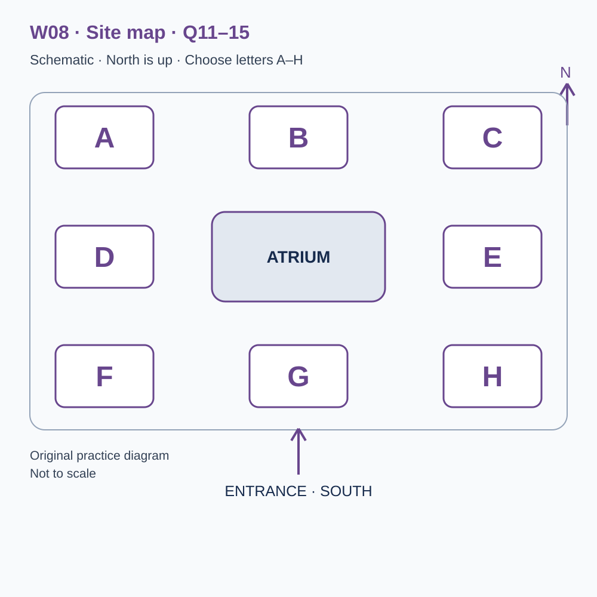
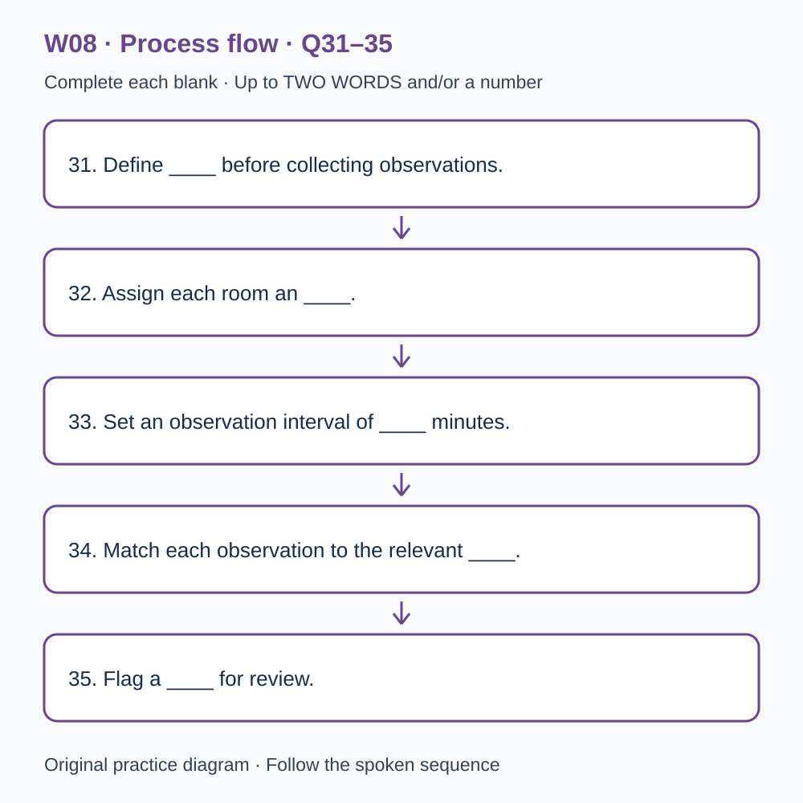

# U43 第8周听力题面与复盘（音频待补）

本页提供已核验的原创题目、参考答案和脚本。配套完整音频尚未验收，当前只能预览题面；不能进行有效的首次听力测试，也不能把读稿作答计作听力成绩或已完成一套听力。

请先保留首次作答机会：批准音频就绪前，不要展开下方答案和脚本。若已读稿，请标记为熟悉材料，之后的练习不能充当陌生题诊断。页面阅读标记只代表看过文字，不代表完成听力。

本材料非雅思真题、非标准化模考，不换算正式分数。计划分钟数不是实测音频时长；学习记录、正式测评和真人反馈须另行完成。

## 学生题面

### L-W08 — Shared work and useful information
> 原创 IELTS-style 技能练习，非真题、非标准化模考，不可换算正式分数。当前只有文字和题目，音频未生成，不能计作已完成听力套题。

共四部分、40 个计分空，每空 1 分。正式首次作答须等待批准音频，先不要打开 script.md 或 answers.md。朗读前先看题；只听一遍后提交首次答案及信心等级，再做精听。当前只能预览题面，不能把读稿作答记作听力成绩。

#### Part 1 — Reserving a shared workspace

Q1–6: Complete the notes. Write **NO MORE THAN TWO WORDS AND/OR A NUMBER** for each answer, using words from the recording. Numeric notation may replace spoken numbers. Do not repeat a printed unit. Q7–10: Choose **ONE letter, A, B or C**.

**Q1.** Type of space initially requested: ____

**Q2.** Chosen regular weekday: ____

**Q3.** First booking — day of September: ____

**Q4.** Daytime desk price: £____

**Q5.** Personal equipment needed for listening to recordings: ____

**Q6.** Number of digits in the locker code: ____

**Q7.** Where should a short individual phone call take place?

- A. At the shared desk whenever it is brief.
- B. In the designated call room when available.
- C. Only in a fully booked group meeting room.

Answer: ____

**Q8.** To change a booking for one week, the applicant should

- A. check availability and request the change through the booking page.
- B. leave a note on the desk.
- C. ask another user to take the reservation informally.

Answer: ____

**Q9.** What is the rule for equipment at the end of a day booking?

- A. A note reserves the desk for the next week.
- B. Day lockers automatically include overnight storage.
- C. Clear the desk and arrange any longer storage separately.

Answer: ____

**Q10.** What does the receptionist suggest before a long commitment?

- A. Choose a package during the call to secure the day price.
- B. Try the arranged day and review how it worked.
- C. Avoid using the workspace until all future needs are known.

Answer: ____

#### Part 2 — Workspace building orientation

Q11–15: Label the map. Write **ONE letter, A–H**, for each destination. Three letters are unused. Q16–20: Choose **ONE letter, A, B or C**.

**Q11.** Reception

Answer: ____

**Q12.** Quiet work room

Answer: ____

**Q13.** Call room

Answer: ____

**Q14.** Project meeting room

Answer: ____

**Q15.** Kitchenette

Answer: ____

**Q16.** What should users do when an atrium conversation becomes a meeting?

- A. Promise clients unrestricted use of any empty chairs.
- B. Stop all communication with colleagues.
- C. Check the availability of a suitable room.

Answer: ____

**Q17.** How should a workshop notice reach the community board?

- A. Through the workspace submission form.
- B. By covering an existing notice.
- C. By claiming workspace endorsement automatically.

Answer: ____

**Q18.** If a reserved room is occupied, users should

- A. enter any other room that appears empty.
- B. show reception the booking confirmation.
- C. argue that their meeting is more important.

Answer: ____

**Q19.** What kind of trial-visit feedback helps most?

- A. Only complaints submitted with a compulsory name.
- B. General demands without examples.
- C. Specific observations about where an instruction was hard to find.

Answer: ____

**Q20.** Why is checkout useful?

- A. It confirms availability for the next use and helps locate forgotten items.
- B. It measures how productive other users were.
- C. It allows borrowed equipment to be left on any desk.

Answer: ____

#### Part 3 — Testing a visitor information page

Q21–26: Match each proposal to the students' **final** positions at the end of that exchange. The tutor is not included. Write **A, B, C or D**. Letters may be reused.

- **A** Sam only
- **B** Priya only
- **C** Both students
- **D** Neither student

Q27–28 and Q29–30: Choose **TWO different letters, A–E**, for each pair. Write one letter in each numbered slot; either order is accepted. Each distinct correct choice earns one point, maximum two. Repeating a letter cannot earn two points. Submit no more than two letters.

**Q21.** At the END of this exchange, who supports: Recruiting first-time visitors for the page study?

Answer: ____

**Q22.** At the END of this exchange, who supports: Requiring participants to think aloud during tasks?

Answer: ____

**Q23.** At the END of this exchange, who supports: Putting participant names on response sheets?

Answer: ____

**Q24.** At the END of this exchange, who supports: Alternating the order of the two tasks between participants?

Answer: ____

**Q25.** At the END of this exchange, who supports: Recording wrong turns using a consistent definition?

Answer: ____

**Q26.** At the END of this exchange, who supports: Setting a strict task time limit in the pilot?

Answer: ____

**Q27–28.** Which TWO information-finding tasks are selected?

- A. Finding how to change a desk reservation
- B. Recognising the organisation's logo
- C. Finding the building's opening year
- D. Finding where to report a missing item
- E. Guessing an unlisted private telephone number

Answers: Q27 ____ · Q28 ____

**Q29–30.** Which TWO revisions are confirmed after the trial?

- A. Adding decorative photographs
- B. Replacing vague headings with action-based headings
- C. Replacing all text with icons
- D. Reducing text size
- E. Placing contact details beside the relevant reporting instruction

Answers: Q29 ____ · Q30 ____

#### Part 4 — Investigating room bookings

Q31–35: Complete the flow chart below. Q36–40: Complete the notes. Write **NO MORE THAN TWO WORDS AND/OR A NUMBER** for each answer, using words from the recording. Numeric notation may replace spoken numbers. Words or units already printed do not belong in the blank. The numbered text below repeats the SVG prompts for readability.

**Q31.** Define ____ before collecting observations.

**Q32.** Assign each room an ____.

**Q33.** Set an observation interval of ____ minutes.

**Q34.** Match each observation to the relevant ____.

**Q35.** Flag a ____ for review.

**Q36.** Check whether ____ are missing from the booking export.

**Q37.** Summarise use separately in the morning and ____.

**Q38.** State the ____ used to calculate each percentage.

**Q39.** Occupancy does not directly measure user ____.

**Q40.** Before treating one week as a stable pattern, ____ the study.

#### 本周训练安排（音频批准后执行）

- Preview questions without the script：8 分钟。
- Future continuous first listen, including planned part pauses：32 分钟。
- Submit first answers and confidence, without a second play：8 分钟。
- Check answers and classify errors：20 分钟。
- Four Q-located intensive segments, 15 minutes each：60 分钟。
- Diagram and opinion retelling：15 分钟。
- Next-day retry of missed items：15 分钟。

合计 **158 分钟**；最多另用 22 分钟缓冲，总计不超过 180 分钟。暂停、回放与查词均计入精听预算，不能另行无限追加。当前实际已完成听力分钟数为 0。精听区段和步骤见 intensive.md；答案和脚本另页。

参考答案与证据（完成首次听力后再展开）

### L-W08 — Answers and evidence
> 独立答案页。先提交首次答案，再看本页。当前缺音频，文本验题不能充当实听验收。

每个单空 1 分；双选各 2 分、答案顺序不限、按不同正确选项计分。接受形式仅做大小写和空白规范化；不做模糊词形推断。

#### Q1 — desk

Accepted answers: desk / a desk / the desk / shared desk

Use the final confirmed detail in this exchange; the printed unit or date context is already supplied.

Evidence locator: Q01 (script.md; timestamps unavailable).

> Receptionist: Hello, Riverside Workspace. How can I help? Applicant: I'm looking for somewhere to work one day a week. My home is usually quiet, but occasionally I need a separate place to concentrate. Receptionist: Are you looking for a permanent private office? Applicant: No, that's more than I need. I'd like to reserve a desk in the shared area. I don't expect to receive clients there. Receptionist: A desk booking should suit that pattern. We also have meeting rooms, but those are booked separately. Applicant: Good. Please start with a desk, and I can ask about the other facilities if my work changes later.

#### Q2 — Wednesday

Accepted answers: Wednesday

Use the final confirmed detail in this exchange; the printed unit or date context is already supplied.

Evidence locator: Q02 (script.md; timestamps unavailable).

> Receptionist: Do you have a preferred weekday? Applicant: I was considering Tuesday because I used to have a regular appointment on Wednesday. That appointment has finished, though, and Wednesday now fits my schedule better. Receptionist: We have space on either day at present. Shall I put Wednesday on the application? Applicant: Yes. Tuesday would leave me rushing from another commitment, whereas Wednesday gives me a full working day. Receptionist: I'll record Wednesday as your regular day. If you need an occasional different day, you can check availability without changing the whole arrangement. Applicant: That's useful, but I'd like to start with a predictable routine.

#### Q3 — 12

Accepted answers: 12 / 12th / twelfth / the twelfth

Use the final confirmed detail in this exchange; the printed unit or date context is already supplied.

Evidence locator: Q03 (script.md; timestamps unavailable).

> Receptionist: What date do you want your first booking to be? Applicant: The notice I saw mentioned September the fifth, but I assume that was an example. I'd like to begin on the twelfth of September. Receptionist: The twelfth is available. We will send an introductory message before that date with the entrance instructions. Applicant: Thank you. I won't be in town the week before, so beginning on the fifth wouldn't work for me. Receptionist: Then the twelfth is the date to put in your calendar. Your welcome message will repeat it, along with the day and the type of space you have reserved.

#### Q4 — 24

Accepted answers: 24 / twenty-four / twenty four

Use the final confirmed detail in this exchange; the printed unit or date context is already supplied.

Evidence locator: Q04 (script.md; timestamps unavailable).

> Applicant: How much is a single day? I saw two different prices on a leaflet. Receptionist: The eighteen-pound figure is for an evening session. Your daytime desk booking is twenty-four pounds. Applicant: Does that mean twenty-four pounds for each hour? Receptionist: No, for the day. Extra meeting-room bookings have their own charges, but they aren't part of the desk price. Applicant: I'll use the daytime option and record twenty-four pounds in my budget. Receptionist: Fine. We'll show the booking type and total clearly in the confirmation, so you can check them before paying. Contact us if that document doesn't match what we've arranged today.

#### Q5 — headphones

Accepted answers: headphones / the headphones

Use the final confirmed detail in this exchange; the printed unit or date context is already supplied.

Evidence locator: Q05 (script.md; timestamps unavailable).

> Applicant: What should I bring on the first visit? I can carry my laptop and charger, but I'd rather not pack unnecessary equipment. Receptionist: If you intend to listen to recordings or join an online session, please bring headphones. Sound should not play through speakers in the shared work area. Applicant: I have headphones, so that's easy. Is a separate monitor compulsory? Receptionist: No. Some people prefer one, but you can work with your laptop alone. Applicant: I'll bring the headphones and keep the rest simple. If I find that I need a different arrangement after trying the space, I can ask about available options.

#### Q6 — 4

Accepted answers: 4 / four

Use the final confirmed detail in this exchange; the printed unit or date context is already supplied.

Evidence locator: Q06 (script.md; timestamps unavailable).

> Receptionist: We can provide a locker for the day if you want somewhere to leave a coat or bag while you work. Applicant: That would help. Is there a separate key? Receptionist: The locker uses a four-digit code that you choose when you arrive. Please don't include it in your public desk label or share it in the general chat. Applicant: So I need to choose four digits, and the desk booking number isn't the locker code? Receptionist: Correct. They're separate. The booking number identifies your reservation; the four-digit code opens your locker. We'll explain the process in person, so you don't need to invent one during this call.

#### Q7 — B

Accepted answers: B

The call room supports short individual calls without disturbing quiet work.

Evidence locator: Q07 (script.md; timestamps unavailable).

> Applicant: I sometimes need to make a short phone call. Can I do that at the shared desk? Receptionist: Please use the designated call room when it's available. Even a brief conversation can disturb nearby people who are concentrating. Applicant: Do I have to reserve a full meeting room for every call? Receptionist: No, the call room is intended for short individual calls. Longer meetings with several participants need a different booking. Applicant: Then I'll check the call room before answering. Receptionist: That's the best approach. The shared desk is for quiet work, and the call room lets us accommodate ordinary calls without turning the whole area into a conversation space.

#### Q8 — A

Accepted answers: A

The booking system and its confirmation establish the change.

Evidence locator: Q08 (script.md; timestamps unavailable).

> Applicant: What happens if I need to change my regular day for one week? Receptionist: Use the booking page to check availability and request the change. A note left on your desk won't reach the team reliably, and another user can't transfer your reservation by simply taking your place. Applicant: Will the page immediately guarantee any day I select? Receptionist: It shows the available options and sends a confirmation when the change is completed. Keep that confirmation. Applicant: So the important step is using the booking system, rather than assuming a message to another user has changed the record. Receptionist: Exactly. That helps us keep the desk allocation accurate.

#### Q9 — C

Accepted answers: C

Day use does not include overnight workstation storage.

Evidence locator: Q09 (script.md; timestamps unavailable).

> Applicant: May I leave my equipment on the desk overnight? Receptionist: Day bookings don't include overnight storage at the workstation. Please clear the desk when you leave. A different person may have it the next morning. Applicant: What about putting a note on the screen saying I'll return next week? Receptionist: That wouldn't reserve it. If you need storage beyond the day, ask us about the separate arrangements before leaving anything. Applicant: Understood. I'll plan to carry my equipment home. Receptionist: You can still use the day locker during your visit; just remember that its temporary use doesn't extend the booking into the following day.

#### Q10 — B

Accepted answers: B

A day booking is a complete option that permits an informed later decision.

Evidence locator: Q10 (script.md; timestamps unavailable).

> Applicant: Is there a way to tell whether the space will suit me before making a long commitment? Receptionist: Start with the day booking we've arranged and review how it worked afterwards. We don't require you to choose a long package during this call. Applicant: I was worried I would have to decide immediately to keep the price. Receptionist: The day option is a complete option in its own right. You can assess the working environment and ask questions before considering anything longer. Applicant: That makes sense. I'll try the first day, note what I need, and then decide whether a regular arrangement is useful for my work.

#### Q11 — G

Accepted answers: G

Use the explicitly stated position relative to the atrium, not an earlier layout or adjacent area.

Evidence locator: Q11 (script.md; timestamps unavailable).

> Welcome to the workspace orientation. Our building diagram is schematic, with north at the top. The entrance is on the southern edge, and the open atrium is the central reference point. Eight lettered areas surround it. First, reception is directly south of the atrium, between that central space and the entrance. Don't confuse it with the south-east room, which has a separate function. Everyone attending an introductory visit should check in at reception before going to a desk. This lets us confirm the booking and answer practical questions without interrupting somebody else's working session. Use the letter on the map to mark that location in your notes.

#### Q12 — A

Accepted answers: A

Use the explicitly stated position relative to the atrium, not an earlier layout or adjacent area.

Evidence locator: Q12 (script.md; timestamps unavailable).

> The quiet work room is in the north-west area. That puts it above and to the left of the atrium on the diagram. Some older information called the room directly north the quiet area, but the arrangement changed when we created additional meeting space. Today you need the north-west room. Calls and group conversations should take place elsewhere, even if only a few desks in that room are occupied. A quiet room works because users can expect the same conditions throughout the day. The location matters particularly for visitors who have selected the space because they need an uninterrupted period of individual work.

#### Q13 — E

Accepted answers: E

Use the explicitly stated position relative to the atrium, not an earlier layout or adjacent area.

Evidence locator: Q13 (script.md; timestamps unavailable).

> The call room is directly east of the atrium, level with its centre. It is not the room in the north-east corner. We located it close to the shared work area so people can move out for a short call without crossing the whole building. Please check whether it is occupied before entering, and follow the displayed arrangements for use. The room is designed for individual calls rather than a gathering of several colleagues. If somebody asks you where it is, direct them to the eastern area beside the atrium, not vaguely to the right-hand side, which contains more than one room.

#### Q14 — B

Accepted answers: B

Use the explicitly stated position relative to the atrium, not an earlier layout or adjacent area.

Evidence locator: Q14 (script.md; timestamps unavailable).

> The project meeting room is directly north of the atrium. This is the room mentioned in the older leaflet as a quiet work area, so the revised function is worth remembering. Teams can book it for scheduled discussions and collaborative sessions. It is separate from the call room to the east. The tables can be arranged in several ways, but the booking team needs to know about special arrangements beforehand. For the map exercise, mark the northern room as the project meeting room. The room to its east is not an extension of it, even though the two appear close together in the simplified diagram.

#### Q15 — F

Accepted answers: F

Use the explicitly stated position relative to the atrium, not an earlier layout or adjacent area.

Evidence locator: Q15 (script.md; timestamps unavailable).

> The kitchenette is in the south-west area, below and to the left of the atrium. You can prepare a drink there and use the labelled shared shelves during your booking. The south-east room is not another kitchen, and reception directly south of the atrium does not have facilities for preparing food. We ask users to leave the kitchenette ready for the next person and take away their own containers when they finish. If something needs attention, tell reception rather than leaving an unclear note for an unknown future user. On your diagram, the south-west letter identifies the kitchenette and completes the five locations in today's exercise.

#### Q16 — C

Accepted answers: C

Longer meetings need suitable space so the atrium remains usable.

Evidence locator: Q16 (script.md; timestamps unavailable).

> The atrium has informal seating, but it isn't a substitute for a reserved meeting room. A brief exchange is fine; a scheduled team session can make the area difficult for people passing through. The purpose of this distinction is to keep shared circulation space usable while giving longer discussions a suitable setting. It isn't a rule that colleagues must avoid talking to one another. If a conversation grows into a meeting, check room availability. Reception can explain the options. You should not promise clients that they can attend an unrestricted meeting in the atrium simply because you saw empty chairs there during a quiet moment.

#### Q17 — A

Accepted answers: A

The team checks current details and space; display does not imply endorsement.

Evidence locator: Q17 (script.md; timestamps unavailable).

> The community noticeboard displays information about workshops and shared projects. Before adding a notice, submit it through the workspace form so the team can check the date, contact details and available space. A notice attached directly over somebody else's sheet may hide information that is still current. We remove expired items as part of the regular update. This process helps the board remain useful rather than becoming a permanent collection of unrelated advertisements. Submitting a notice does not guarantee that the workspace endorses the activity. The display is an information service, and the notice should make clear who is organising the event and how to contact them.

#### Q18 — B

Accepted answers: B

Reception compares the current records and arranges a solution.

Evidence locator: Q18 (script.md; timestamps unavailable).

> If you discover that a booked room is occupied, speak to reception and show your confirmation. Avoid resolving the problem by entering another apparently empty room, because it may be reserved for somebody arriving shortly. Reception can compare the bookings and arrange a solution using the current record. A printed name on an old door sign may be out of date, which is another reason to check the system. You don't need to argue with the other group about whose meeting is more important. The useful information is the room, the booked time and your confirmation, not a judgement about the value of another user's work.

#### Q19 — C

Accepted answers: C

Specific feedback makes problems identifiable; names are optional and urgent booking issues go to reception.

Evidence locator: Q19 (script.md; timestamps unavailable).

> We collect feedback about the workspace at the end of a trial visit. Specific observations are especially helpful. For example, tell us which instruction was difficult to find and where you looked for it. A general statement that everything should be clearer gives us much less to investigate. Feedback is not limited to complaints; an explanation of what worked well can help us preserve a useful feature during changes. You may leave your name if you want a reply, but the ordinary feedback form does not require it. Urgent booking problems should still go directly to reception rather than waiting in the routine feedback collection.

#### Q20 — A

Accepted answers: A

Checkout and proper equipment return support the next user.

Evidence locator: Q20 (script.md; timestamps unavailable).

> Before leaving, check that you have cleared your desk, collected your belongings and followed the checkout instructions. Checkout tells the team that the space is available for its next use and helps identify forgotten items promptly. It isn't an invitation to evaluate other users or report how much work they completed. If you have borrowed equipment, return it through the stated process rather than placing it on an empty desk. A quick check prevents the next user from searching for something recorded as available but left elsewhere. Reception can help with an uncertainty; simply leaving the building without asking may make a small issue harder to resolve later.

#### Q21 — C

Accepted answers: C

Final stance: Both students. Ignore an initial proposal if later withdrawn; the tutor is not an answer option.

Evidence locator: Q21 (script.md; timestamps unavailable).

> Tutor: Let's plan your study of the visitor information page. Sam: I suggest testing it with people who haven't used the building before. Familiar users already know where things are. Priya: I agree. They may skip unclear instructions because they can fill the gaps from experience. Tutor: Do you both support recruiting first-time visitors for this study? Sam: Yes, while explaining that our findings will concern that group. Priya: Yes. We can study experienced users later with a different question. Tutor: Good. That defines the group without pretending one sample tells you everything about every user. Sam: We'll put the first-time visitor requirement in our recruitment description.

#### Q22 — A

Accepted answers: A

Final stance: Sam only. Ignore an initial proposal if later withdrawn; the tutor is not an answer option.

Evidence locator: Q22 (script.md; timestamps unavailable).

> Tutor: Should participants be required to think aloud while finding information? Sam: I favour that. Hearing what they are looking for could reveal why a heading confuses them. Priya: I would rather let them work silently and ask questions afterwards. Speaking might change the way they search. Sam: We can remind them gently and avoid giving clues. I still support asking them to think aloud. Tutor: Priya, does that adjustment change your view? Priya: No. For this first study I continue to prefer silent task completion followed by questions. Tutor: Then your current positions differ. We'll compare the practical consequences before deciding which procedure the study will use.

#### Q23 — D

Accepted answers: D

Final stance: Neither student. Ignore an initial proposal if later withdrawn; the tutor is not an answer option.

Evidence locator: Q23 (script.md; timestamps unavailable).

> Tutor: Your draft mentions names on every response sheet. Priya: I included that because I thought it would help match the sheets, but participant codes can do the matching. Sam: I don't support collecting names for this exercise. We don't need them to answer the research question. Priya: I agree now, and I withdraw the name requirement. Tutor: To be clear, neither of you supports putting participant names on the response sheets at the end of this discussion? Sam: Correct. Priya: Correct. We'll keep the study code separate from any recruitment contact arrangements, and the analysis sheet will use the code. That gives us the link we need without the unnecessary field.

#### Q24 — B

Accepted answers: B

Final stance: Priya only. Ignore an initial proposal if later withdrawn; the tutor is not an answer option.

Evidence locator: Q24 (script.md; timestamps unavailable).

> Tutor: What about varying the order of the two tasks between participants? Priya: I support alternating the order. Otherwise the first task might teach everyone something that makes the second easier. Sam: I understand that concern, but I would keep the same order for everyone in this small pilot. It makes the procedure easier to run consistently. Tutor: Could a prepared schedule handle the alternation? Priya: Yes, and that is what I propose. Sam: Even with a schedule, I still prefer one fixed order for the pilot. Tutor: So Priya supports alternating, and Sam does not at present. We'll record both the reason and the unresolved choice.

#### Q25 — C

Accepted answers: C

Final stance: Both students. Ignore an initial proposal if later withdrawn; the tutor is not an answer option.

Evidence locator: Q25 (script.md; timestamps unavailable).

> Tutor: Will you record wrong turns, or only whether each task is eventually completed? Sam: We should record wrong turns as well. Someone might reach the answer after several confusing steps. Priya: I agree. A completion tick alone would hide that difficulty. Tutor: How will you avoid guessing what counts as a wrong turn? Priya: Define it before testing, using observable actions such as opening an unrelated section and then returning. Sam: Yes, we both support recording those actions under a consistent definition. Tutor: Good. Keep interpretation separate from the observation. A participant may explore deliberately, so you should not automatically label every extra click as proof of confusion without further evidence.

#### Q26 — B

Accepted answers: B

Final stance: Priya only. Ignore an initial proposal if later withdrawn; the tutor is not an answer option.

Evidence locator: Q26 (script.md; timestamps unavailable).

> Tutor: Should you set a strict time limit for each task? Priya: I favour a limit, so sessions remain manageable and every participant has the same maximum time. Sam: I would let people finish and record the elapsed time in this pilot. A cut-off could stop us seeing how they recover from a wrong turn. Priya: We could choose a generous limit, but I still support having one. Tutor: Sam? Sam: I remain against a strict limit at this stage. We can arrange sessions with enough space between them. Tutor: Then Priya supports the proposal and Sam doesn't. That distinction concerns the pilot procedure, not whether recording time is useful.

#### Q27–28 — A, D

Accept unordered set: A, D. One point per distinct correct choice, maximum 2.

Both selected tasks address practical visitor needs; logo, history and unlisted private details are outside the task selection.

Evidence locator: Q27, Q28 (script.md; timestamps unavailable).

> Tutor: You have agreed to test two information-finding tasks. What is the first? Sam: Finding how to change an existing desk reservation. The answer is on the page, but people must choose the relevant heading. Priya: Yes, that's one of our selected tasks. We rejected asking participants to state the year the building opened because it doesn't reflect an ordinary booking need. Tutor: And the question about recognising the organisation's logo? Priya: Also rejected. It would test a different kind of recognition. Sam: We want actions a visitor might reasonably need to take. Finding the reservation-change instructions is the first agreed task, regardless of our remaining decisions about the testing procedure.

> Tutor: And the second task? Priya: Finding where to report a missing item. That instruction appears in the visitor information section, and it has a clear practical purpose. Sam: Agreed. We aren't asking participants to guess an unlisted staff member's private telephone number. That was never information the page was meant to provide. Tutor: So the two selected tasks are changing a reservation and reporting a missing item? Priya: Exactly. The logo question and the building-history question aren't included. Sam: We'll write realistic short scenarios for the two selected tasks without using the exact heading words, since copying those words into the prompt would make the search artificially easy.

#### Q29–30 — B, E

Accept unordered set: B, E. One point per distinct correct choice, maximum 2.

The revisions address an unclear heading and separated contact information; the other changes are rejected.

Evidence locator: Q29, Q30 (script.md; timestamps unavailable).

> Tutor: The trial has now revealed problems. Which revisions are confirmed? Priya: First, replace vague headings with action-based headings. People didn't understand that 'Your arrangements' contained the booking-change instructions. Sam: We agree to use a heading that tells visitors the action they can take. Tutor: Are you also adding more decorative photographs? Sam: No. That suggestion doesn't address the difficulty we observed. Priya: Nor are we replacing all the text with icons. Some icons would need explanation and could introduce another problem. The confirmed heading change follows directly from the trial: participants searched for an action, but our wording concealed where the relevant instructions began.

> Tutor: What is the other confirmed revision? Sam: Move the missing-item contact details beside the instruction to report an item. Participants found the instruction but had to search elsewhere for the contact route. Priya: Agreed. Keeping related information together should reduce that extra search. Tutor: Did you decide to reduce the text size to fit everything on one screen? Priya: No, that could make the page harder to read, and we rejected it. Sam: Our two agreed revisions are clearer action-based headings and placing contact details beside the relevant instruction. We'll test the revised page with new participants before claiming those changes have solved the observed problems.

#### Q31 — occupancy

Accepted answers: occupancy / room occupancy

Complete the named stage in the stated process order; retain any word already printed around the blank.

Evidence locator: Q31 (script.md; timestamps unavailable).

> Consider a fictional workspace manager investigating whether meeting-room bookings reflect actual use. The first stage is to define occupancy for the study. Does a room count as occupied when someone leaves a bag there, or only when a person is present? Different definitions produce different results, so the team must choose and document one before collecting observations. In this exercise, occupancy means at least one person present during the scheduled observation. That definition does not capture every aspect of usefulness, but it gives observers a consistent rule. Starting with the rule prevents the team from adjusting its meaning afterwards to make the figures support a preferred conclusion.

#### Q32 — identifier

Accepted answers: identifier

Complete the named stage in the stated process order; retain any word already printed around the blank.

Evidence locator: Q32 (script.md; timestamps unavailable).

> The next stage is to assign an identifier to each room. Descriptions such as the bright room or the room near the stairs may be understandable to one observer but ambiguous to another. A stable identifier connects observations with the appropriate booking record even if a room's display name changes. The team makes a reference list and checks it against the building plan. The identifier is not a score of quality or a ranking of popularity; it is simply a way to refer to the same space consistently. Any later change to the list is documented so that old and new records can still be related correctly.

#### Q33 — 15

Accepted answers: 15 / fifteen

Complete the named stage in the stated process order; retain any word already printed around the blank.

Evidence locator: Q33 (script.md; timestamps unavailable).

> The third stage sets the observation interval. In this fictional pilot, observers check the rooms at regular intervals of fifteen minutes during the study period. They do not claim that each brief check describes every moment between checks. The interval determines what the method is likely to notice and what it may miss. A meeting that begins and ends between observations could be absent from the observation record. The team therefore states the interval clearly when reporting results. Choosing a regular schedule also reduces the chance that observers visit only when they expect rooms to be busy, which would make the sample difficult to interpret.

#### Q34 — booking

Accepted answers: booking / booking record

Complete the named stage in the stated process order; retain any word already printed around the blank.

Evidence locator: Q34 (script.md; timestamps unavailable).

> The fourth stage matches each observation to the relevant booking. Matching uses the room identifier and the observation time, not merely a similar meeting title. A booking may span several checks, and an observation can fall outside any reserved period. Both situations should be represented explicitly in the working table. If a record cannot be matched because a time is missing, the team marks the issue instead of forcing a link. The aim is a traceable comparison between two kinds of evidence: what the booking system says was reserved and what the observer recorded at a particular moment. Neither record should silently overwrite the other.

#### Q35 — discrepancy

Accepted answers: discrepancy / difference

Complete the named stage in the stated process order; retain any word already printed around the blank.

Evidence locator: Q35 (script.md; timestamps unavailable).

> The fifth stage flags a discrepancy for review. A discrepancy occurs when the records do not agree under the study's defined comparison rule. For example, a room might be booked but appear empty at a scheduled check. The flag asks for examination; it does not by itself prove that a user behaved improperly. The booking could have changed, the observation time could be wrong, or the room could have been used between checks. Keeping the flag distinct from an explanation prevents the team from turning an unresolved difference into an accusation. A review note can later record what additional evidence, if any, clarifies the case.

#### Q36 — cancellations

Accepted answers: cancellations

The corresponding evidence block supplies this distinction or qualification; the question retains the surrounding grammar.

Evidence locator: Q36 (script.md; timestamps unavailable).

> Cancellations are a useful category to examine. If a booking was cancelled but the cancellation did not appear in the exported file, the table may make an available room look reserved. The team therefore records when the booking data were extracted and which version was used. A later export may contain a correction that the earlier version lacked. This is a data-history problem before it is a question about room demand. Researchers should not count every apparent empty reservation as the same kind of event. Checking cancellations can explain some differences, while leaving other cases unresolved. The analysis should preserve those distinctions rather than combining them for a simpler headline.

#### Q37 — afternoon

Accepted answers: afternoon / the afternoon

The corresponding evidence block supplies this distinction or qualification; the question retains the surrounding grammar.

Evidence locator: Q37 (script.md; timestamps unavailable).

> The comparison also needs attention to the time of day. A room that is busy in the morning and quiet in the afternoon could have a moderate overall average that describes neither period particularly well. Grouping observations by time can reveal that pattern, provided the grouping is chosen and reported clearly. The team should not repeatedly try many groupings and show only the one that looks most dramatic. Here, morning and afternoon were defined before the pilot began. Their separate summaries help the manager consider scheduling questions without assuming that one daily average gives a complete account of when people actually need a room.

#### Q38 — denominator

Accepted answers: denominator / underlying count

The corresponding evidence block supplies this distinction or qualification; the question retains the surrounding grammar.

Evidence locator: Q38 (script.md; timestamps unavailable).

> A percentage must have a clear denominator. If the team reports that a certain percentage of observations showed occupancy, readers need to know how many valid observations were included. Missed checks should not quietly count as empty rooms, and cancelled study periods should not remain in the total as if observations had occurred. The denominator therefore consists of the valid checks under the stated rule. The report gives both the percentage and the underlying count. This makes it easier to recognise a result based on very little evidence and to compare periods whose observation totals differ. A percentage alone can conceal those differences behind a familiar-looking number.

#### Q39 — satisfaction

Accepted answers: satisfaction

The corresponding evidence block supplies this distinction or qualification; the question retains the surrounding grammar.

Evidence locator: Q39 (script.md; timestamps unavailable).

> The manager should also understand the distinction between occupancy and satisfaction. Seeing somebody in a room does not tell an observer whether the person found the space comfortable or suitable. A room could be heavily used because alternatives were unavailable, even if users disliked it. Satisfaction would require separate evidence, such as appropriately designed questions about the experience. The occupancy study can inform decisions about use, but it should not be renamed a satisfaction survey after the data are collected. Keeping the terms distinct helps the team explain what its method measures and prevents a useful narrow study from being stretched into claims it cannot support.

#### Q40 — repeat

Accepted answers: repeat

The corresponding evidence block supplies this distinction or qualification; the question retains the surrounding grammar.

Evidence locator: Q40 (script.md; timestamps unavailable).

> Finally, the team should repeat the study before treating a single week as a stable pattern. The pilot week may contain unusual events, staff absences or deadlines that affect bookings. Repetition under a comparable procedure can show whether the same broad pattern appears again. It cannot guarantee that future demand will remain unchanged, but it provides more context than one short observation period. The final recommendation therefore includes another planned round of checks and a review of the method's practical burden. The manager receives a provisional interpretation with clear next steps, rather than a permanent allocation rule presented as certain on the basis of one limited sample.

完整脚本（提前阅读会失去陌生题首答机会）

### L-W08 — Shared work and useful information: transcript
> 原创虚构练习，非真题；音频缺失。仅供完成首次作答后的核对或文字审阅。Q 标记与角色名不属于朗读正文。

#### Part 1 — Reserving a shared workspace

##### Q1 evidence block

**Receptionist:** Hello, Riverside Workspace. How can I help?

**Applicant:** I'm looking for somewhere to work one day a week. My home is usually quiet, but occasionally I need a separate place to concentrate.

**Receptionist:** Are you looking for a permanent private office?

**Applicant:** No, that's more than I need. I'd like to reserve a desk in the shared area. I don't expect to receive clients there.

**Receptionist:** A desk booking should suit that pattern. We also have meeting rooms, but those are booked separately.

**Applicant:** Good. Please start with a desk, and I can ask about the other facilities if my work changes later.

##### Q2 evidence block

**Receptionist:** Do you have a preferred weekday?

**Applicant:** I was considering Tuesday because I used to have a regular appointment on Wednesday. That appointment has finished, though, and Wednesday now fits my schedule better.

**Receptionist:** We have space on either day at present. Shall I put Wednesday on the application?

**Applicant:** Yes. Tuesday would leave me rushing from another commitment, whereas Wednesday gives me a full working day.

**Receptionist:** I'll record Wednesday as your regular day. If you need an occasional different day, you can check availability without changing the whole arrangement.

**Applicant:** That's useful, but I'd like to start with a predictable routine.

##### Q3 evidence block

**Receptionist:** What date do you want your first booking to be?

**Applicant:** The notice I saw mentioned September the fifth, but I assume that was an example. I'd like to begin on the twelfth of September.

**Receptionist:** The twelfth is available. We will send an introductory message before that date with the entrance instructions.

**Applicant:** Thank you. I won't be in town the week before, so beginning on the fifth wouldn't work for me.

**Receptionist:** Then the twelfth is the date to put in your calendar. Your welcome message will repeat it, along with the day and the type of space you have reserved.

##### Q4 evidence block

**Applicant:** How much is a single day? I saw two different prices on a leaflet.

**Receptionist:** The eighteen-pound figure is for an evening session. Your daytime desk booking is twenty-four pounds.

**Applicant:** Does that mean twenty-four pounds for each hour?

**Receptionist:** No, for the day. Extra meeting-room bookings have their own charges, but they aren't part of the desk price.

**Applicant:** I'll use the daytime option and record twenty-four pounds in my budget.

**Receptionist:** Fine. We'll show the booking type and total clearly in the confirmation, so you can check them before paying. Contact us if that document doesn't match what we've arranged today.

##### Q5 evidence block

**Applicant:** What should I bring on the first visit? I can carry my laptop and charger, but I'd rather not pack unnecessary equipment.

**Receptionist:** If you intend to listen to recordings or join an online session, please bring headphones. Sound should not play through speakers in the shared work area.

**Applicant:** I have headphones, so that's easy. Is a separate monitor compulsory?

**Receptionist:** No. Some people prefer one, but you can work with your laptop alone.

**Applicant:** I'll bring the headphones and keep the rest simple. If I find that I need a different arrangement after trying the space, I can ask about available options.

##### Q6 evidence block

**Receptionist:** We can provide a locker for the day if you want somewhere to leave a coat or bag while you work.

**Applicant:** That would help. Is there a separate key?

**Receptionist:** The locker uses a four-digit code that you choose when you arrive. Please don't include it in your public desk label or share it in the general chat.

**Applicant:** So I need to choose four digits, and the desk booking number isn't the locker code?

**Receptionist:** Correct. They're separate. The booking number identifies your reservation; the four-digit code opens your locker. We'll explain the process in person, so you don't need to invent one during this call.

##### Q7 evidence block

**Applicant:** I sometimes need to make a short phone call. Can I do that at the shared desk?

**Receptionist:** Please use the designated call room when it's available. Even a brief conversation can disturb nearby people who are concentrating.

**Applicant:** Do I have to reserve a full meeting room for every call?

**Receptionist:** No, the call room is intended for short individual calls. Longer meetings with several participants need a different booking.

**Applicant:** Then I'll check the call room before answering.

**Receptionist:** That's the best approach. The shared desk is for quiet work, and the call room lets us accommodate ordinary calls without turning the whole area into a conversation space.

##### Q8 evidence block

**Applicant:** What happens if I need to change my regular day for one week?

**Receptionist:** Use the booking page to check availability and request the change. A note left on your desk won't reach the team reliably, and another user can't transfer your reservation by simply taking your place.

**Applicant:** Will the page immediately guarantee any day I select?

**Receptionist:** It shows the available options and sends a confirmation when the change is completed. Keep that confirmation.

**Applicant:** So the important step is using the booking system, rather than assuming a message to another user has changed the record.

**Receptionist:** Exactly. That helps us keep the desk allocation accurate.

##### Q9 evidence block

**Applicant:** May I leave my equipment on the desk overnight?

**Receptionist:** Day bookings don't include overnight storage at the workstation. Please clear the desk when you leave. A different person may have it the next morning.

**Applicant:** What about putting a note on the screen saying I'll return next week?

**Receptionist:** That wouldn't reserve it. If you need storage beyond the day, ask us about the separate arrangements before leaving anything.

**Applicant:** Understood. I'll plan to carry my equipment home.

**Receptionist:** You can still use the day locker during your visit; just remember that its temporary use doesn't extend the booking into the following day.

##### Q10 evidence block

**Applicant:** Is there a way to tell whether the space will suit me before making a long commitment?

**Receptionist:** Start with the day booking we've arranged and review how it worked afterwards. We don't require you to choose a long package during this call.

**Applicant:** I was worried I would have to decide immediately to keep the price.

**Receptionist:** The day option is a complete option in its own right. You can assess the working environment and ask questions before considering anything longer.

**Applicant:** That makes sense. I'll try the first day, note what I need, and then decide whether a regular arrangement is useful for my work.

#### Part 2 — Workspace building orientation

##### Q11 evidence block

**Workspace host:** Welcome to the workspace orientation. Our building diagram is schematic, with north at the top. The entrance is on the southern edge, and the open atrium is the central reference point. Eight lettered areas surround it. First, reception is directly south of the atrium, between that central space and the entrance. Don't confuse it with the south-east room, which has a separate function. Everyone attending an introductory visit should check in at reception before going to a desk. This lets us confirm the booking and answer practical questions without interrupting somebody else's working session. Use the letter on the map to mark that location in your notes.

##### Q12 evidence block

**Workspace host:** The quiet work room is in the north-west area. That puts it above and to the left of the atrium on the diagram. Some older information called the room directly north the quiet area, but the arrangement changed when we created additional meeting space. Today you need the north-west room. Calls and group conversations should take place elsewhere, even if only a few desks in that room are occupied. A quiet room works because users can expect the same conditions throughout the day. The location matters particularly for visitors who have selected the space because they need an uninterrupted period of individual work.

##### Q13 evidence block

**Workspace host:** The call room is directly east of the atrium, level with its centre. It is not the room in the north-east corner. We located it close to the shared work area so people can move out for a short call without crossing the whole building. Please check whether it is occupied before entering, and follow the displayed arrangements for use. The room is designed for individual calls rather than a gathering of several colleagues. If somebody asks you where it is, direct them to the eastern area beside the atrium, not vaguely to the right-hand side, which contains more than one room.

##### Q14 evidence block

**Workspace host:** The project meeting room is directly north of the atrium. This is the room mentioned in the older leaflet as a quiet work area, so the revised function is worth remembering. Teams can book it for scheduled discussions and collaborative sessions. It is separate from the call room to the east. The tables can be arranged in several ways, but the booking team needs to know about special arrangements beforehand. For the map exercise, mark the northern room as the project meeting room. The room to its east is not an extension of it, even though the two appear close together in the simplified diagram.

##### Q15 evidence block

**Workspace host:** The kitchenette is in the south-west area, below and to the left of the atrium. You can prepare a drink there and use the labelled shared shelves during your booking. The south-east room is not another kitchen, and reception directly south of the atrium does not have facilities for preparing food. We ask users to leave the kitchenette ready for the next person and take away their own containers when they finish. If something needs attention, tell reception rather than leaving an unclear note for an unknown future user. On your diagram, the south-west letter identifies the kitchenette and completes the five locations in today's exercise.

##### Q16 evidence block

**Workspace host:** The atrium has informal seating, but it isn't a substitute for a reserved meeting room. A brief exchange is fine; a scheduled team session can make the area difficult for people passing through. The purpose of this distinction is to keep shared circulation space usable while giving longer discussions a suitable setting. It isn't a rule that colleagues must avoid talking to one another. If a conversation grows into a meeting, check room availability. Reception can explain the options. You should not promise clients that they can attend an unrestricted meeting in the atrium simply because you saw empty chairs there during a quiet moment.

##### Q17 evidence block

**Workspace host:** The community noticeboard displays information about workshops and shared projects. Before adding a notice, submit it through the workspace form so the team can check the date, contact details and available space. A notice attached directly over somebody else's sheet may hide information that is still current. We remove expired items as part of the regular update. This process helps the board remain useful rather than becoming a permanent collection of unrelated advertisements. Submitting a notice does not guarantee that the workspace endorses the activity. The display is an information service, and the notice should make clear who is organising the event and how to contact them.

##### Q18 evidence block

**Workspace host:** If you discover that a booked room is occupied, speak to reception and show your confirmation. Avoid resolving the problem by entering another apparently empty room, because it may be reserved for somebody arriving shortly. Reception can compare the bookings and arrange a solution using the current record. A printed name on an old door sign may be out of date, which is another reason to check the system. You don't need to argue with the other group about whose meeting is more important. The useful information is the room, the booked time and your confirmation, not a judgement about the value of another user's work.

##### Q19 evidence block

**Workspace host:** We collect feedback about the workspace at the end of a trial visit. Specific observations are especially helpful. For example, tell us which instruction was difficult to find and where you looked for it. A general statement that everything should be clearer gives us much less to investigate. Feedback is not limited to complaints; an explanation of what worked well can help us preserve a useful feature during changes. You may leave your name if you want a reply, but the ordinary feedback form does not require it. Urgent booking problems should still go directly to reception rather than waiting in the routine feedback collection.

##### Q20 evidence block

**Workspace host:** Before leaving, check that you have cleared your desk, collected your belongings and followed the checkout instructions. Checkout tells the team that the space is available for its next use and helps identify forgotten items promptly. It isn't an invitation to evaluate other users or report how much work they completed. If you have borrowed equipment, return it through the stated process rather than placing it on an empty desk. A quick check prevents the next user from searching for something recorded as available but left elsewhere. Reception can help with an uncertainty; simply leaving the building without asking may make a small issue harder to resolve later.

#### Part 3 — Testing a visitor information page

##### Q21 evidence block

**Tutor:** Let's plan your study of the visitor information page.

**Sam:** I suggest testing it with people who haven't used the building before. Familiar users already know where things are.

**Priya:** I agree. They may skip unclear instructions because they can fill the gaps from experience.

**Tutor:** Do you both support recruiting first-time visitors for this study?

**Sam:** Yes, while explaining that our findings will concern that group.

**Priya:** Yes. We can study experienced users later with a different question.

**Tutor:** Good. That defines the group without pretending one sample tells you everything about every user.

**Sam:** We'll put the first-time visitor requirement in our recruitment description.

##### Q22 evidence block

**Tutor:** Should participants be required to think aloud while finding information?

**Sam:** I favour that. Hearing what they are looking for could reveal why a heading confuses them.

**Priya:** I would rather let them work silently and ask questions afterwards. Speaking might change the way they search.

**Sam:** We can remind them gently and avoid giving clues. I still support asking them to think aloud.

**Tutor:** Priya, does that adjustment change your view?

**Priya:** No. For this first study I continue to prefer silent task completion followed by questions.

**Tutor:** Then your current positions differ. We'll compare the practical consequences before deciding which procedure the study will use.

##### Q23 evidence block

**Tutor:** Your draft mentions names on every response sheet.

**Priya:** I included that because I thought it would help match the sheets, but participant codes can do the matching.

**Sam:** I don't support collecting names for this exercise. We don't need them to answer the research question.

**Priya:** I agree now, and I withdraw the name requirement.

**Tutor:** To be clear, neither of you supports putting participant names on the response sheets at the end of this discussion?

**Sam:** Correct.

**Priya:** Correct. We'll keep the study code separate from any recruitment contact arrangements, and the analysis sheet will use the code. That gives us the link we need without the unnecessary field.

##### Q24 evidence block

**Tutor:** What about varying the order of the two tasks between participants?

**Priya:** I support alternating the order. Otherwise the first task might teach everyone something that makes the second easier.

**Sam:** I understand that concern, but I would keep the same order for everyone in this small pilot. It makes the procedure easier to run consistently.

**Tutor:** Could a prepared schedule handle the alternation?

**Priya:** Yes, and that is what I propose.

**Sam:** Even with a schedule, I still prefer one fixed order for the pilot.

**Tutor:** So Priya supports alternating, and Sam does not at present. We'll record both the reason and the unresolved choice.

##### Q25 evidence block

**Tutor:** Will you record wrong turns, or only whether each task is eventually completed?

**Sam:** We should record wrong turns as well. Someone might reach the answer after several confusing steps.

**Priya:** I agree. A completion tick alone would hide that difficulty.

**Tutor:** How will you avoid guessing what counts as a wrong turn?

**Priya:** Define it before testing, using observable actions such as opening an unrelated section and then returning.

**Sam:** Yes, we both support recording those actions under a consistent definition.

**Tutor:** Good. Keep interpretation separate from the observation. A participant may explore deliberately, so you should not automatically label every extra click as proof of confusion without further evidence.

##### Q26 evidence block

**Tutor:** Should you set a strict time limit for each task?

**Priya:** I favour a limit, so sessions remain manageable and every participant has the same maximum time.

**Sam:** I would let people finish and record the elapsed time in this pilot. A cut-off could stop us seeing how they recover from a wrong turn.

**Priya:** We could choose a generous limit, but I still support having one.

**Tutor:** Sam?

**Sam:** I remain against a strict limit at this stage. We can arrange sessions with enough space between them.

**Tutor:** Then Priya supports the proposal and Sam doesn't. That distinction concerns the pilot procedure, not whether recording time is useful.

##### Q27 evidence block

**Tutor:** You have agreed to test two information-finding tasks. What is the first?

**Sam:** Finding how to change an existing desk reservation. The answer is on the page, but people must choose the relevant heading.

**Priya:** Yes, that's one of our selected tasks. We rejected asking participants to state the year the building opened because it doesn't reflect an ordinary booking need.

**Tutor:** And the question about recognising the organisation's logo?

**Priya:** Also rejected. It would test a different kind of recognition.

**Sam:** We want actions a visitor might reasonably need to take. Finding the reservation-change instructions is the first agreed task, regardless of our remaining decisions about the testing procedure.

##### Q28 evidence block

**Tutor:** And the second task?

**Priya:** Finding where to report a missing item. That instruction appears in the visitor information section, and it has a clear practical purpose.

**Sam:** Agreed. We aren't asking participants to guess an unlisted staff member's private telephone number. That was never information the page was meant to provide.

**Tutor:** So the two selected tasks are changing a reservation and reporting a missing item?

**Priya:** Exactly. The logo question and the building-history question aren't included.

**Sam:** We'll write realistic short scenarios for the two selected tasks without using the exact heading words, since copying those words into the prompt would make the search artificially easy.

##### Q29 evidence block

**Tutor:** The trial has now revealed problems. Which revisions are confirmed?

**Priya:** First, replace vague headings with action-based headings. People didn't understand that 'Your arrangements' contained the booking-change instructions.

**Sam:** We agree to use a heading that tells visitors the action they can take.

**Tutor:** Are you also adding more decorative photographs?

**Sam:** No. That suggestion doesn't address the difficulty we observed.

**Priya:** Nor are we replacing all the text with icons. Some icons would need explanation and could introduce another problem. The confirmed heading change follows directly from the trial: participants searched for an action, but our wording concealed where the relevant instructions began.

##### Q30 evidence block

**Tutor:** What is the other confirmed revision?

**Sam:** Move the missing-item contact details beside the instruction to report an item. Participants found the instruction but had to search elsewhere for the contact route.

**Priya:** Agreed. Keeping related information together should reduce that extra search.

**Tutor:** Did you decide to reduce the text size to fit everything on one screen?

**Priya:** No, that could make the page harder to read, and we rejected it.

**Sam:** Our two agreed revisions are clearer action-based headings and placing contact details beside the relevant instruction. We'll test the revised page with new participants before claiming those changes have solved the observed problems.

#### Part 4 — Investigating room bookings

##### Q31 evidence block

**Lecturer:** Consider a fictional workspace manager investigating whether meeting-room bookings reflect actual use. The first stage is to define occupancy for the study. Does a room count as occupied when someone leaves a bag there, or only when a person is present? Different definitions produce different results, so the team must choose and document one before collecting observations. In this exercise, occupancy means at least one person present during the scheduled observation. That definition does not capture every aspect of usefulness, but it gives observers a consistent rule. Starting with the rule prevents the team from adjusting its meaning afterwards to make the figures support a preferred conclusion.

##### Q32 evidence block

**Lecturer:** The next stage is to assign an identifier to each room. Descriptions such as the bright room or the room near the stairs may be understandable to one observer but ambiguous to another. A stable identifier connects observations with the appropriate booking record even if a room's display name changes. The team makes a reference list and checks it against the building plan. The identifier is not a score of quality or a ranking of popularity; it is simply a way to refer to the same space consistently. Any later change to the list is documented so that old and new records can still be related correctly.

##### Q33 evidence block

**Lecturer:** The third stage sets the observation interval. In this fictional pilot, observers check the rooms at regular intervals of fifteen minutes during the study period. They do not claim that each brief check describes every moment between checks. The interval determines what the method is likely to notice and what it may miss. A meeting that begins and ends between observations could be absent from the observation record. The team therefore states the interval clearly when reporting results. Choosing a regular schedule also reduces the chance that observers visit only when they expect rooms to be busy, which would make the sample difficult to interpret.

##### Q34 evidence block

**Lecturer:** The fourth stage matches each observation to the relevant booking. Matching uses the room identifier and the observation time, not merely a similar meeting title. A booking may span several checks, and an observation can fall outside any reserved period. Both situations should be represented explicitly in the working table. If a record cannot be matched because a time is missing, the team marks the issue instead of forcing a link. The aim is a traceable comparison between two kinds of evidence: what the booking system says was reserved and what the observer recorded at a particular moment. Neither record should silently overwrite the other.

##### Q35 evidence block

**Lecturer:** The fifth stage flags a discrepancy for review. A discrepancy occurs when the records do not agree under the study's defined comparison rule. For example, a room might be booked but appear empty at a scheduled check. The flag asks for examination; it does not by itself prove that a user behaved improperly. The booking could have changed, the observation time could be wrong, or the room could have been used between checks. Keeping the flag distinct from an explanation prevents the team from turning an unresolved difference into an accusation. A review note can later record what additional evidence, if any, clarifies the case.

##### Q36 evidence block

**Lecturer:** Cancellations are a useful category to examine. If a booking was cancelled but the cancellation did not appear in the exported file, the table may make an available room look reserved. The team therefore records when the booking data were extracted and which version was used. A later export may contain a correction that the earlier version lacked. This is a data-history problem before it is a question about room demand. Researchers should not count every apparent empty reservation as the same kind of event. Checking cancellations can explain some differences, while leaving other cases unresolved. The analysis should preserve those distinctions rather than combining them for a simpler headline.

##### Q37 evidence block

**Lecturer:** The comparison also needs attention to the time of day. A room that is busy in the morning and quiet in the afternoon could have a moderate overall average that describes neither period particularly well. Grouping observations by time can reveal that pattern, provided the grouping is chosen and reported clearly. The team should not repeatedly try many groupings and show only the one that looks most dramatic. Here, morning and afternoon were defined before the pilot began. Their separate summaries help the manager consider scheduling questions without assuming that one daily average gives a complete account of when people actually need a room.

##### Q38 evidence block

**Lecturer:** A percentage must have a clear denominator. If the team reports that a certain percentage of observations showed occupancy, readers need to know how many valid observations were included. Missed checks should not quietly count as empty rooms, and cancelled study periods should not remain in the total as if observations had occurred. The denominator therefore consists of the valid checks under the stated rule. The report gives both the percentage and the underlying count. This makes it easier to recognise a result based on very little evidence and to compare periods whose observation totals differ. A percentage alone can conceal those differences behind a familiar-looking number.

##### Q39 evidence block

**Lecturer:** The manager should also understand the distinction between occupancy and satisfaction. Seeing somebody in a room does not tell an observer whether the person found the space comfortable or suitable. A room could be heavily used because alternatives were unavailable, even if users disliked it. Satisfaction would require separate evidence, such as appropriately designed questions about the experience. The occupancy study can inform decisions about use, but it should not be renamed a satisfaction survey after the data are collected. Keeping the terms distinct helps the team explain what its method measures and prevents a useful narrow study from being stretched into claims it cannot support.

##### Q40 evidence block

**Lecturer:** Finally, the team should repeat the study before treating a single week as a stable pattern. The pilot week may contain unusual events, staff absences or deadlines that affect bookings. Repetition under a comparable procedure can show whether the same broad pattern appears again. It cannot guarantee that future demand will remain unchanged, but it provides more context than one short observation period. The final recommendation therefore includes another planned round of checks and a review of the method's practical burden. The manager receives a provisional interpretation with clear next steps, rather than a permanent allocation rule presented as certain on the basis of one limited sample.

精听与复盘步骤（须有已验收配套音频）

### L-W08 — Q-based intensive listening
> 音频尚未生成；以下是未来执行安排，不是已完成记录。不要用文本阅读替代首次听力。无实际时间戳。

周预算：预览 8 + 首听 32 + 交首次答案 8 + 查错 20 + 精听 60 + 复述 15 + 次日重做 15 = **158 分钟**。含暂停/回放；加用缓冲最多 22 分钟，总计≤180。

四段各 15 分钟：先定位并不看稿听 2 分钟；分句回放、写关键词 4 分钟；对照稿找误听与改口 3 分钟；遮稿跟读和复述 3 分钟；重答并记录错误原因 3 分钟。不得把同一段回放另算在周预算之外。

#### Q2–3 — 15 minutes

定位 script.md 的 Q2 evidence block 起至 Q3 evidence block 结束（约 197 词）；音频起止为 null。

目标：Distinguish a previous weekly commitment and an example date from the actual booking.

留痕：首次答案 → 听到的原词 → 干扰来源 → 修正答案 → 一句英文复述。

#### Q12–13 — 15 minutes

定位 script.md 的 Q12 evidence block 起至 Q13 evidence block 结束（约 205 词）；音频起止为 null。

目标：Identify the revised north-west quiet room and the eastern call room.

留痕：首次答案 → 听到的原词 → 干扰来源 → 修正答案 → 一句英文复述。

#### Q23–24 — 15 minutes

定位 script.md 的 Q23 evidence block 起至 Q24 evidence block 结束（约 205 词）；音频起止为 null。

目标：Track the name proposal being withdrawn and the unresolved task-order disagreement.

留痕：首次答案 → 听到的原词 → 干扰来源 → 修正答案 → 一句英文复述。

#### Q37–38 — 15 minutes

定位 script.md 的 Q37 evidence block 起至 Q38 evidence block 结束（约 211 词）；音频起止为 null。

目标：Identify time grouping and the denominator, retaining the warning about missed checks.

留痕：首次答案 → 听到的原词 → 干扰来源 → 修正答案 → 一句英文复述。

#### 15 分钟复述与 15 分钟次日重做

复述：5 分钟遮住答案口述地图五个位置；5 分钟按人说明三人讨论的最终观点；5 分钟复述流程及一个限制。次日：8 分钟仅重做错题对应 Q 段；4 分钟核对；3 分钟更新错误记录。若仍超时，留下未完成项，不把额外时间隐去。

## 许可说明

原创文字和图示：RayXBuilds and contributors，CC BY 4.0。本页不包含配套音频；现有基础VOA媒体不能代替本套题的录音。
