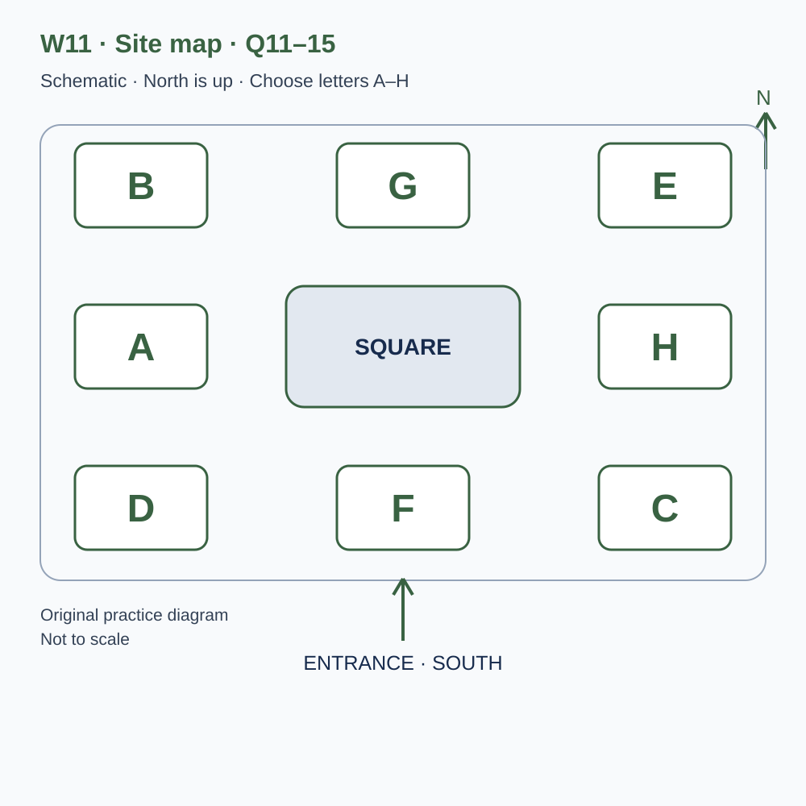
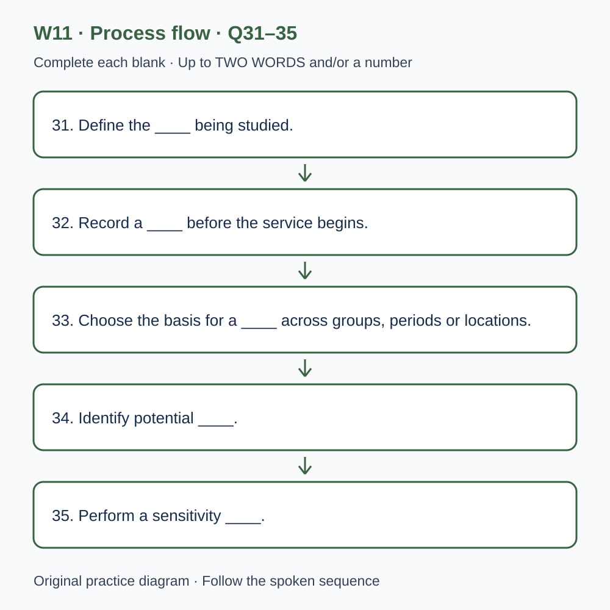

# U46 第11周听力题面与复盘（音频待补）

本页提供已核验的原创题目、参考答案和脚本。配套完整音频尚未验收，当前只能预览题面；不能进行有效的首次听力测试，也不能把读稿作答计作听力成绩或已完成一套听力。

请先保留首次作答机会：批准音频就绪前，不要展开下方答案和脚本。若已读稿，请标记为熟悉材料，之后的练习不能充当陌生题诊断。页面阅读标记只代表看过文字，不代表完成听力。

本材料非雅思真题、非标准化模考，不换算正式分数。计划分钟数不是实测音频时长；学习记录、正式测评和真人反馈须另行完成。

## 学生题面

### L-W11 — Routes, choices and cautious explanations
> 原创 IELTS-style 技能练习，非真题、非标准化模考，不可换算正式分数。当前只有文字和题目，音频未生成，不能计作已完成听力套题。

共四部分、40 个计分空，每空 1 分。正式首次作答须等待批准音频，先不要打开 script.md 或 answers.md。朗读前先看题；只听一遍后提交首次答案及信心等级，再做精听。当前只能预览题面，不能把读稿作答记作听力成绩。

#### Part 1 — Registering for an observation visit

Q1–6: Complete the notes. Write **NO MORE THAN TWO WORDS AND/OR A NUMBER** for each answer, using words from the recording. Numeric notation may replace spoken numbers. Do not repeat a printed unit. Q7–10: Choose **ONE letter, A, B or C**.

**Q1.** Project interest: ____

**Q2.** Confirmed day of April: ____

**Q3.** Meeting time (a.m.): ____

**Q4.** Confirmed group places: ____

**Q5.** Orientation before the walk: ____ minutes

**Q6.** Writing support to bring, if available: ____

**Q7.** How should passers-by's names be handled?

- A. Record every name offered in conversation
- B. Put all conversations into the data
- C. Keep names outside the observation sheet

Answer: ____

**Q8.** If the observation point is unavailable, volunteers should

- A. wait for the leader to confirm and document an alternative
- B. choose any convenient nearby corner
- C. begin independently before the briefing

Answer: ____

**Q9.** In heavy rain, the group should

- A. assume cancellation from any general forecast
- B. follow the direct update to the named organiser
- C. let each member invent a different plan

Answer: ____

**Q10.** What is required before main-project records can be collected?

- A. Only attendance at the introduction
- B. The fastest possible handwriting
- C. A supervised practice check as well as the introduction

Answer: ____

#### Part 2 — Route-study meeting site

Q11–15: Label the map. Write **ONE letter, A–H**, for each destination. Three letters are unused. Q16–20: Choose **ONE letter, A, B or C**.

**Q11.** Briefing shelter

Answer: ____

**Q12.** Equipment desk

Answer: ____

**Q13.** Practice observation point

Answer: ____

**Q14.** Rest shelter

Answer: ____

**Q15.** Checkout desk

Answer: ____

**Q16.** How should a return to the junction be recorded?

- A. As proof that someone was lost
- B. As an observed action, with intention kept separate
- C. As evidence of a forgotten errand in every case

Answer: ____

**Q17.** When observers disagree, they should

- A. compare the case and inspect the definition or view
- B. choose whoever sounds most confident
- C. hide the uncertainty once a category has been selected

Answer: ____

**Q18.** What should volunteers tell interested passers-by?

- A. That a new crossing is guaranteed
- B. That every observer can set the project's scope
- C. The agreed purpose and limits from the briefing

Answer: ____

**Q19.** Why record temporary conditions in the notes field?

- A. To prove the reason for every route choice
- B. To provide relevant context while keeping causal claims qualified
- C. To collect unrelated personal details

Answer: ____

**Q20.** What belongs in the final review?

- A. Clear and difficult definitions, plus planned versus completed work
- B. Only dramatic problems
- C. An assumption that enjoyment means the full plan was completed

Answer: ____

#### Part 3 — Designing a wayfinding pilot

Q21–26: Match each proposal to the students' **final** positions at the end of that exchange. The tutor is not included. Write **A, B, C or D**. Letters may be reused.

- **A** Luca only
- **B** Nina only
- **C** Both students
- **D** Neither student

Q27–28 and Q29–30: Choose **TWO different letters, A–E**, for each pair. Write one letter in each numbered slot; either order is accepted. Each distinct correct choice earns one point, maximum two. Repeating a letter cannot earn two points. Submit no more than two letters.

**Q21.** At the END of this exchange, who supports: Following participants along the whole route?

Answer: ____

**Q22.** At the END of this exchange, who supports: Writing definitions with examples before the main observations?

Answer: ____

**Q23.** At the END of this exchange, who supports: Adding an exploratory weekend observation session?

Answer: ____

**Q24.** At the END of this exchange, who supports: Putting participant names on the analysis sheet?

Answer: ____

**Q25.** At the END of this exchange, who supports: Keeping a factual log of temporary route closures?

Answer: ____

**Q26.** At the END of this exchange, who supports: Adding a short post-walk interview to this pilot?

Answer: ____

**Q27–28.** Which TWO measures are definitely included in the junction task?

- A. Time from entering the decision area to choosing a path
- B. Fastest possible walking speed
- C. Home address
- D. Price of the participant's shoes
- E. Returns to the marked junction

Answers: Q27 ____ · Q28 ____

**Q29–30.** Which TWO differences complicate comparing the trial sessions?

- A. The observers synchronised clocks
- B. Traffic conditions differed
- C. There were two clearly assigned observers
- D. The groups differed in prior route familiarity
- E. One session was cancelled

Answers: Q29 ____ · Q30 ____

#### Part 4 — Interpreting changes in travel choices

Q31–35: Complete the flow chart below. Q36–40: Complete the notes. Write **NO MORE THAN TWO WORDS AND/OR A NUMBER** for each answer, using words from the recording. Numeric notation may replace spoken numbers. Words or units already printed do not belong in the blank. The numbered text below repeats the SVG prompts for readability.

**Q31.** Define the ____ being studied.

**Q32.** Record a ____ before the service begins.

**Q33.** Choose the basis for a ____ across groups, periods or locations.

**Q34.** Identify potential ____.

**Q35.** Perform a sensitivity ____.

**Q36.** An observed relationship is an ____.

**Q37.** ____ could mean that plans to walk more lead people to seek information.

**Q38.** Record the ____ in which observations were collected.

**Q39.** Describe ____ when reporting estimated differences.

**Q40.** Revise the ____ for the next round of work.

#### 本周训练安排（音频批准后执行）

- Preview questions without the script：8 分钟。
- Future continuous first listen, including planned part pauses：32 分钟。
- Submit first answers and confidence, without a second play：8 分钟。
- Check answers and classify errors：20 分钟。
- Four Q-located intensive segments, 15 minutes each：60 分钟。
- Diagram and opinion retelling：15 分钟。
- Next-day retry of missed items：15 分钟。

合计 **158 分钟**；最多另用 22 分钟缓冲，总计不超过 180 分钟。暂停、回放与查词均计入精听预算，不能另行无限追加。当前实际已完成听力分钟数为 0。精听区段和步骤见 intensive.md；答案和脚本另页。

参考答案与证据（完成首次听力后再展开）

### L-W11 — Answers and evidence
> 独立答案页。先提交首次答案，再看本页。当前缺音频，文本验题不能充当实听验收。

每个单空 1 分；双选各 2 分、答案顺序不限、按不同正确选项计分。接受形式仅做大小写和空白规范化；不做模糊词形推断。

#### Q1 — walking

Accepted answers: walking / walking project

Use the final confirmed detail in this exchange; the printed unit or date context is already supplied.

Evidence locator: Q01 (script.md; timestamps unavailable).

> Organiser: Neighbourhood route project, hello. Volunteer: I'd like to join an introductory observation visit. I saw descriptions of a cycling project and a walking project, and I'm not sure whether they share a booking list. Organiser: They have separate introductions because the questions and observation methods differ. Which interests you? Volunteer: Walking. I want to understand how people choose a route through the neighbourhood, rather than how quickly they can complete it. Organiser: I'll record walking as your project interest. The introduction will explain what we observe and what we leave out. Volunteer: Good. I'm interested in careful observation, but I don't want to assume that simply watching people tells us why they made every choice.

#### Q2 — 23

Accepted answers: 23 / 23rd / twenty-third / the twenty-third / twenty third / the 23rd

Use the final confirmed detail in this exchange; the printed unit or date context is already supplied.

Evidence locator: Q02 (script.md; timestamps unavailable).

> Organiser: The next introduction is on the twenty-third of April. Volunteer: I had the twenty-first in my notes. Has the date changed? Organiser: Yes, the earlier date was provisional. The twenty-third is now confirmed with the site team. Volunteer: Then I'll replace the old date and make sure my colleague does too. Organiser: Please use the current confirmation when arranging your journey. We have corrected the booking page, but some people may still have the original email. Volunteer: I'll send my colleague the revised message rather than a brief note saying the date has changed. That should reduce the chance of somebody keeping one date in a calendar and another in a message.

#### Q3 — 7.50

Accepted answers: 7.50 / 7:50 / 07.50 / 07:50 / seven fifty

Use the final confirmed detail in this exchange; the printed unit or date context is already supplied.

Evidence locator: Q03 (script.md; timestamps unavailable).

> Volunteer: What time do we meet? Organiser: Seven fifty in the morning. We want to explain the task before the later morning activity makes the meeting area busy. Volunteer: Seven fifty, not eight fifteen? Organiser: Correct. Eight fifteen was the time suggested for an older version of the visit, when the introduction was shorter. Volunteer: I'll use seven fifty as the meeting time. Is arriving a little early helpful? Organiser: Yes, but there is no observation task for you to begin independently before the briefing. Wait at the meeting point so the whole group receives the same explanation before anybody starts writing records.

#### Q4 — 12

Accepted answers: 12 / twelve

Use the final confirmed detail in this exchange; the printed unit or date context is already supplied.

Evidence locator: Q04 (script.md; timestamps unavailable).

> Organiser: How many people are included in your booking? Volunteer: Our group has fifteen members, but only twelve have confirmed that they can attend. Please book twelve places. Organiser: That's within the group limit for this introduction. If others decide to join, ask us before adding them. Volunteer: I will. Membership of our local group doesn't automatically create an observation place. Organiser: Exactly. We need to plan the briefing space and the practice activity around the confirmed attendance. Volunteer: I'll keep a list of the twelve names for our own transport arrangements, but I won't tell the other members that they can simply arrive and expect the site team to accommodate them.

#### Q5 — 50

Accepted answers: 50 / fifty

Use the final confirmed detail in this exchange; the printed unit or date context is already supplied.

Evidence locator: Q05 (script.md; timestamps unavailable).

> Volunteer: How long should we allow for the orientation before the practice walk? Organiser: The orientation lasts fifty minutes. It includes the method explanation and a short exercise in distinguishing an observation from an inference. Volunteer: So fifty minutes is just the orientation, not the full visit? Organiser: That's right. The practice walk and review follow it, and the confirmation gives the overall finishing arrangement. Volunteer: I'll make that distinction when sharing the plan. One person needs to organise another appointment afterwards, and a single duration without a label could lead them to assume the entire activity ends when the initial explanation is actually only just finishing.

#### Q6 — clipboard

Accepted answers: clipboard / a clipboard / the clipboard

Use the final confirmed detail in this exchange; the printed unit or date context is already supplied.

Evidence locator: Q06 (script.md; timestamps unavailable).

> Volunteer: Do we need to bring any equipment? Organiser: Please bring a clipboard if you have one. We supply the paper observation sheets, but a firm surface makes it easier to write while standing at the designated point. Volunteer: I have a clipboard from another project. I'll bring the clipboard and ask the others whether they have one. Organiser: Good. You don't need to buy a specialist device for the introduction. If somebody doesn't have a clipboard, tell us in advance and we can explain the available alternatives. Volunteer: I'll avoid sending a long equipment list that makes the visit sound more complicated than it is.

#### Q7 — C

Accepted answers: C

The task records defined movements; conversations do not automatically become observations.

Evidence locator: Q07 (script.md; timestamps unavailable).

> Volunteer: Will we record the names of people using the route? Organiser: No. The introductory task concerns observable movements at a junction. Personal names are not part of the record. Volunteer: What if a passer-by starts talking to us and gives their name? Organiser: You can respond politely without adding it to the observation sheet. The briefing explains how to answer questions about the project. Volunteer: That's clear. I had wondered whether every conversation became part of the data. Organiser: It doesn't. Keeping the task defined helps us avoid collecting details merely because they happen to be available, and it makes the records easier to compare across observers.

#### Q8 — A

Accepted answers: A

A different view may change what the counts represent.

Evidence locator: Q08 (script.md; timestamps unavailable).

> Volunteer: If the planned observation point is unavailable, should we choose another nearby corner ourselves? Organiser: Please wait for the leader to confirm the alternative. A different position can change what you can see, and that affects the meaning of the counts. Volunteer: So a convenient view isn't necessarily equivalent to the original position. Organiser: Exactly. The leader will explain any change and how it should be recorded. Volunteer: I'll tell the group not to begin independently at whichever place looks quiet. Organiser: Thank you. We want everyone to understand the observation boundary before collecting information, not to discover later that several apparently comparable records describe quite different sections of the route.

#### Q9 — B

Accepted answers: B

Adaptation and postponement are different possibilities; the group needs one confirmed plan.

Evidence locator: Q09 (script.md; timestamps unavailable).

> Volunteer: What happens if heavy rain changes the plan? Organiser: We'll contact the named booking organiser directly. Some conditions may lead us to adapt the practical exercise, while others may require postponement. Please don't treat a general forecast as an automatic cancellation message. Volunteer: Then I'll pass on the direct update to our group and make sure everyone receives the same version. Organiser: Yes. The confirmation also explains what to do if your own group decides it cannot attend. Volunteer: That will help. Otherwise people might independently make different decisions and assume the whole group knows, leaving some travelling while others stay at home.

#### Q10 — C

Accepted answers: C

The project checks consistent use of definitions, not simply attendance or speed.

Evidence locator: Q10 (script.md; timestamps unavailable).

> Volunteer: Does completing the introduction qualify us to collect data for the main project? Organiser: It is the first step, but main-project observers also complete a supervised practice check. We need to know that they apply the definitions consistently and can explain uncertain cases. Volunteer: So attendance alone isn't the approval to begin official project records. Organiser: Correct. The practice check is intended to identify questions and training needs, not to reward whoever writes fastest. Volunteer: That's reassuring. I'd rather have a chance to discuss a difficult example than discover later that a large set of records can't be used because I misunderstood one of the categories.

#### Q11 — G

Accepted answers: G

Use the explicitly stated position relative to the square, not an earlier layout or adjacent area.

Evidence locator: Q11 (script.md; timestamps unavailable).

> Welcome to the route-study meeting site. The diagram places north at the top and the entrance on the southern edge. The central square is the fixed landmark, with eight lettered areas around it. The briefing shelter is directly north of the square. It is not in either northern corner. Please gather there for the introduction before collecting equipment. We begin with a shared explanation because small differences in the task can produce records that look similar but mean different things. If you arrive after the group has started, speak to the leader rather than copying a neighbour's sheet and assuming you have understood the method from its layout alone.

#### Q12 — D

Accepted answers: D

Use the explicitly stated position relative to the square, not an earlier layout or adjacent area.

Evidence locator: Q12 (script.md; timestamps unavailable).

> The equipment desk is in the south-west area, below and to the left of the square. An older plan placed it directly south, on the entrance axis, but that position obstructed arriving groups. The south-west location gives people room to collect their materials without blocking the main arrival area. Check your pack with the helper before leaving the desk. It should contain the version of the observation sheet named in today's briefing. A sheet left over from an earlier practice may use different categories. Keeping the version visible is a simple way to prevent a later analyst from combining records that were produced under different instructions.

#### Q13 — H

Accepted answers: H

Use the explicitly stated position relative to the square, not an earlier layout or adjacent area.

Evidence locator: Q13 (script.md; timestamps unavailable).

> The practice observation point is directly east of the square, level with its centre. It is not the area in the south-east corner. This position provides the view used in our prepared exercise, so please don't shift to another lettered area simply because it seems closer to a particular path. The task has been designed around what is visible from the eastern position. During the practice, describe anything you cannot see clearly instead of filling the gap with a likely story. A limited but accurate record is more useful than a complete-looking sheet built partly from assumptions that nobody can later distinguish from observations.

#### Q14 — E

Accepted answers: E

Use the explicitly stated position relative to the square, not an earlier layout or adjacent area.

Evidence locator: Q14 (script.md; timestamps unavailable).

> The rest shelter is in the north-east corner, directly north of the observation point. It lies east of the briefing shelter, which is in the northern central area. Those two shelters share the same northern row on the diagram. The rest shelter is available between activities, but it is not another observation point. If you need to leave the task briefly, follow the leader's arrangement and mark any gap in your record. Do not ask a friend to continue under your name without documenting the change. Different observers may apply a definition differently, and a transparent record helps the team understand where such a difference might have entered.

#### Q15 — A

Accepted answers: A

Use the explicitly stated position relative to the square, not an earlier layout or adjacent area.

Evidence locator: Q15 (script.md; timestamps unavailable).

> At the end of the practical activity, return your completed sheet to the checkout desk directly west of the square. It is level with the central landmark, not in the north-west corner. The helper will check that the sheet has the correct session code and that any missing periods are identified. This isn't a judgement about whether your counts are high or low. A low count can be a valid observation, while an unexplained blank leaves the team uncertain about whether anything was recorded. Please hand in unused sheets separately so they cannot be mistaken for completed records showing no activity. The western desk completes the five locations needed for today's visit.

#### Q16 — B

Accepted answers: B

The same visible movement can have several reasons; the observation does not reveal intention.

Evidence locator: Q16 (script.md; timestamps unavailable).

> The observation categories describe actions rather than personal intentions. You may see somebody return to a junction, but you cannot automatically know that they were lost. They may have met a friend, remembered an errand or changed their mind for another reason. Record the return under the agreed definition and keep any interpretation separate. This distinction is central to the exercise. If the team later wants to investigate reasons, it needs another suitable method rather than a more confident guess from the same visible action. Our records should make clear what an observer could actually see from the designated position at the time of the check.

#### Q17 — A

Accepted answers: A

Ambiguity or obstruction can explain disagreement and reveal a method problem.

Evidence locator: Q17 (script.md; timestamps unavailable).

> When two observers disagree, compare the details of the case before deciding that one person was careless. The definition may be ambiguous, the view may have been obstructed or the event may fall between categories. A useful practice discussion identifies which of these problems occurred and whether the instructions need revision. Simply telling everybody to agree can hide a weakness that will return during the main project. Please bring uncertain examples to the review even if you eventually chose a category. The uncertainty itself can reveal something important about how the method works under ordinary conditions, where events do not always resemble the clean examples in an introductory sheet.

#### Q18 — C

Accepted answers: C

The short explanation describes the project without unauthorised promises.

Evidence locator: Q18 (script.md; timestamps unavailable).

> If a passer-by asks what you are doing, use the short explanation provided at the briefing. It states the project's purpose and the limited information recorded. Don't promise that the study will immediately produce a new crossing or a changed street layout. Those decisions are outside this introductory exercise. You can explain how people can find public project information and direct more detailed questions to the coordinator. An honest account of the scope is more helpful than an enthusiastic promise nobody has authorised. It also prevents different observers from giving contradictory descriptions that leave residents unsure whether they are encountering one project or several unrelated activities.

#### Q19 — B

Accepted answers: B

Conditions may affect interpretation, but a note alone does not prove each person's reason.

Evidence locator: Q19 (script.md; timestamps unavailable).

> During the practice, record temporary conditions that affect the view or route, using the notes field. A delivery vehicle, a temporary closure or an organised group can change what happens during a short period. Such a note doesn't establish that the condition caused every observed change, but it gives the later review relevant context. Avoid using the notes field for unrelated personal details about passers-by. The useful question is what another analyst needs to know to interpret the observation period. If a condition prevents the task from being carried out as defined, tell the leader rather than treating the resulting gap as an ordinary zero count.

#### Q20 — A

Accepted answers: A

The review records practical differences and identifies useful changes and features to retain.

Evidence locator: Q20 (script.md; timestamps unavailable).

> The final review asks you to identify one definition that worked clearly and one case that remained difficult. We also compare the planned activity with the activity actually completed. If the observation period was shortened, that fact belongs in the record; it shouldn't disappear because the group still enjoyed the exercise. The review is a chance to improve the next stage, not a competition to find the most dramatic problem. A small wording change can be valuable when it prevents repeated confusion. Equally, a feature that worked consistently may be worth retaining rather than replacing simply to make the next version look more ambitious.

#### Q21 — A

Accepted answers: A

Final stance: Luca only. Ignore an initial proposal if later withdrawn; the tutor is not an answer option.

Evidence locator: Q21 (script.md; timestamps unavailable).

> Tutor: Luca, your draft proposes following participants along the whole route. Luca: Yes. It would show where a wrong turn eventually leads, not just what happens at the first junction. Nina: I prefer observing from fixed positions. Following people may affect how they behave, and we would struggle to record events consistently while moving. Tutor: Could greater distance address that concern? Nina: It might reduce one problem, but I still don't support following for this pilot. Luca: I still favour it, with the procedure explained to participants. Tutor: Then the proposal remains a disagreement. You need to distinguish the information you would gain from the practical and methodological costs of obtaining it.

#### Q22 — C

Accepted answers: C

Final stance: Both students. Ignore an initial proposal if later withdrawn; the tutor is not an answer option.

Evidence locator: Q22 (script.md; timestamps unavailable).

> Tutor: What about written definitions for the actions you record? Nina: I thought we could settle them informally because there are only two observers. Luca: I think we need them written down. We disagreed about a return to the junction even during our short rehearsal. Nina: That's true. I support a written definition now, with examples of uncertain cases. Tutor: How will you use it? Luca: Each of us will classify the same practice sequence before comparing our decisions. Nina: And if the wording fails, we'll revise it before the main observations. Tutor: Good. The document should guide actual decisions, not just make the project file look complete after the work is over.

#### Q23 — B

Accepted answers: B

Final stance: Nina only. Ignore an initial proposal if later withdrawn; the tutor is not an answer option.

Evidence locator: Q23 (script.md; timestamps unavailable).

> Tutor: Nina suggests adding a weekend observation session. Nina: I support that because the people and purposes of journeys may differ from a weekday morning. Luca: I would keep this pilot to weekdays. We have limited time, and adding one weekend session might create a comparison too small to interpret well. Tutor: Could it be exploratory rather than a formal comparison? Nina: That's what I intend. I'd label it clearly as an exploratory session. Luca: I understand, but I still prefer to use the available time to repeat the weekday procedure. Tutor: Then Nina supports the added weekend session, while Luca continues to favour a narrower pilot with more consistent repetition.

#### Q24 — D

Accepted answers: D

Final stance: Neither student. Ignore an initial proposal if later withdrawn; the tutor is not an answer option.

Evidence locator: Q24 (script.md; timestamps unavailable).

> Tutor: Your response sheet includes a name field. Luca: I originally wanted to connect the short interview with the observed route, but a participant code can do that. Nina: I don't support recording names on the analysis sheet. They don't help answer our question. Luca: Agreed. I'll remove the name field and use the code. Tutor: Is that a change in your position? Luca: Yes. I'm withdrawing the suggestion to put names on the response sheet. Nina: We should keep the coding procedure clear so we don't create a different matching problem. Tutor: Exactly. Removing an unnecessary field and maintaining a reliable link between the relevant records are compatible decisions.

#### Q25 — C

Accepted answers: C

Final stance: Both students. Ignore an initial proposal if later withdrawn; the tutor is not an answer option.

Evidence locator: Q25 (script.md; timestamps unavailable).

> Tutor: Should the record include temporary route closures? Nina: Yes. A closure could change the available choices during an observation period. Luca: I support recording it, including when it started and ended if we know. Tutor: Would you use that note as proof of the reason for every person's route? Luca: No. It provides context, but it doesn't reveal each person's intention. Nina: We can report the visible condition and keep the explanation qualified. Tutor: That distinction is useful. Luca: Then we both support a closure log, with clear limits on what we infer from it. Nina: It should be a short factual note, not a story assembled from guesses about individual travellers.

#### Q26 — B

Accepted answers: B

Final stance: Nina only. Ignore an initial proposal if later withdrawn; the tutor is not an answer option.

Evidence locator: Q26 (script.md; timestamps unavailable).

> Tutor: Finally, do you want a short interview after the walk? Nina: I do. We could ask which instruction the participant found hardest to interpret. Luca: I would leave interviews out of this first pilot and focus on getting the observation method reliable. Nina: A single focused question could help explain an action we otherwise misunderstand. Tutor: Luca, would limiting it to one question change your position? Luca: Not yet. Even a short interview requires a clear procedure and time that I want to spend on the observation review. Nina: I still support including it. Tutor: So the disagreement concerns this pilot's priorities, not whether participant explanations could ever be informative.

#### Q27–28 — A, E

Accept unordered set: A, E. One point per distinct correct choice, maximum 2.

Decision time and qualifying returns are selected; neither is automatically a measure of confusion.

Evidence locator: Q27, Q28 (script.md; timestamps unavailable).

> Tutor: Which two measures are definitely included in the junction task? Luca: First, the time between reaching the marked decision area and choosing an outgoing path. Nina: Agreed, provided we define the start and end points so both observers time the same action. Tutor: Are you measuring the participant's fastest possible walking speed? Nina: No. We aren't asking people to race along the route. Luca: Nor are we collecting their home addresses. Neither would serve this particular task. Tutor: Then the first measure concerns decision time at the junction. It should not be described later as the duration of the entire journey, because that would imply a much broader observation than you actually made.

> Tutor: And the second measure? Nina: Count returns to the marked junction after an outgoing path has been chosen. Luca: Yes. We'll use the written definition and record each qualifying return. Tutor: Does a return automatically mean the participant misunderstood a sign? Luca: No. We need to keep that interpretation separate. Nina: We rejected asking the price of the participant's shoes as an additional measure. It wouldn't clarify this observation. Tutor: So the agreed pair is decision time and returns to the junction. Those measures describe different aspects of the task. Neither turns the whole procedure into a direct measure of confusion without further evidence about what the participant was trying to do.

#### Q29–30 — B, D

Accept unordered set: B, D. One point per distinct correct choice, maximum 2.

Traffic and prior familiarity offer competing explanations; clock coordination and clear roles are useful, and the sessions occurred.

Evidence locator: Q29, Q30 (script.md; timestamps unavailable).

> Tutor: What two differences between your trial sessions could complicate a comparison? Nina: Traffic conditions differed substantially. One session coincided with a busy delivery period, while the other was quieter. Luca: That could affect the view and the choices available around the junction, so we need to state it. Tutor: Is using two observers automatically a weakness? Luca: No, not if their roles and method are clear. Nina: And synchronising the clocks is helpful, rather than a limitation. Tutor: Good. Focus on differences that offer competing explanations for the results. Listing every piece of equipment or every practical arrangement doesn't show the reader why a comparison might be difficult to interpret.

> Tutor: What is the second difference? Luca: The groups had unequal familiarity with the route. Several people in the first session had used it before, while most in the second session were new to the area. Nina: Agreed. We can't attribute a difference in decision time only to the revised instructions when previous experience also differs. Tutor: What would you do next? Nina: Record familiarity consistently and plan recruitment with that issue in mind. Luca: We shouldn't pretend that the two existing groups were comparable simply because they contained the same number of people. Tutor: Exactly. The two limitations are the traffic conditions and route familiarity. The observations were completed, so a cancelled session is not a third limitation.

#### Q31 — exposure

Accepted answers: exposure / access

Complete the named stage in the stated process order; retain any word already printed around the blank.

Evidence locator: Q31 (script.md; timestamps unavailable).

> This lecture considers a fictional study of changing travel choices in a neighbourhood. The first stage defines the exposure the researchers want to examine. Here, exposure means whether a person had access to a new route-information service during the study period. It is not the same as whether the person used the service, remembered its content or changed a journey afterwards. Those are separate questions. Defining exposure clearly prevents the team from moving between different meanings when presenting its results. The definition should also specify the period involved, since access introduced after a journey cannot explain a decision already made before the information became available.

#### Q32 — baseline

Accepted answers: baseline / starting pattern / reference / pattern

Complete the named stage in the stated process order; retain any word already printed around the blank.

Evidence locator: Q32 (script.md; timestamps unavailable).

> The second stage records a baseline before the service begins. The baseline describes the relevant starting pattern of journeys under the team's stated method. It gives researchers a reference for describing later change, but it is not a complete explanation of why that starting pattern existed. The team should note missing records and avoid filling them with a typical journey chosen from another person. It also needs to use a comparable recording period later. Comparing one ordinary weekday with an entire holiday week would introduce differences that have little to do with the service. The baseline is useful because its meaning is explicit, not because an early measurement is automatically a fair reference.

#### Q33 — comparison

Accepted answers: comparison

Complete the named stage in the stated process order; retain any word already printed around the blank.

Evidence locator: Q33 (script.md; timestamps unavailable).

> The third stage chooses a comparison. The team might compare periods, groups or locations, depending on the question and what is feasible. Each arrangement brings limitations that should be stated rather than hidden behind a familiar label. If people choose whether to use the information service, users and non-users may differ before the service affects anything. A comparison of their later journeys may therefore combine several influences. The researchers should explain how they selected the comparison and which differences they can examine. Calling one group a comparison group does not, by itself, make it equivalent to the group receiving the service or turn every observed difference into a causal effect.

#### Q34 — confounders

Accepted answers: confounders / factors / other factors / competing influences / influences

Complete the named stage in the stated process order; retain any word already printed around the blank.

Evidence locator: Q34 (script.md; timestamps unavailable).

> The fourth stage identifies potential confounders. Confounders are other factors that could affect both the exposure being studied and the outcome of interest, making their relationship difficult to interpret. In this example, a person's work schedule could influence access to the information service and the journeys they can make. The team considers such factors before selecting which details to record. It cannot measure every aspect of a person's life, and collecting more fields without a reason may add burden without improving the explanation. The useful task is to identify plausible competing influences, describe the information available about them and acknowledge important influences the study cannot adequately examine.

#### Q35 — check

Accepted answers: check / analysis

Complete the named stage in the stated process order; retain any word already printed around the blank.

Evidence locator: Q35 (script.md; timestamps unavailable).

> The fifth stage performs a sensitivity check. A sensitivity check asks whether the main interpretation changes under other reasonable choices in the analysis. For example, researchers might examine what happens when uncertain journey records are handled in another defensible way. They should not try many choices and report only the version that makes the service look effective. The point is to understand how dependent the result is on decisions that remain open to question. If a modest change to an assumption reverses the conclusion, that is information readers need. The check helps describe the strength and limits of the reasoning rather than producing a guarantee that every hidden influence has been removed.

#### Q36 — association

Accepted answers: association

The corresponding evidence block supplies this distinction or qualification; the question retains the surrounding grammar.

Evidence locator: Q36 (script.md; timestamps unavailable).

> An association is an observed relationship, and it should not automatically be described as an effect. Suppose people who consulted the service also reported more walking journeys. That pattern may be consistent with an influence from the service, but it can also reflect other differences between those people and the rest of the sample. The team should state the observation clearly and then explain what additional evidence would be needed for the stronger claim. Avoiding a premature causal conclusion does not make the association uninteresting. It can guide a better question or a later study, provided readers are not encouraged to mistake a promising pattern for a settled explanation.

#### Q37 — reverse causation

Accepted answers: reverse causation

The corresponding evidence block supplies this distinction or qualification; the question retains the surrounding grammar.

Evidence locator: Q37 (script.md; timestamps unavailable).

> The direction of a relationship can also be uncertain. Reverse causation is one possibility: people already planning to walk more might be especially likely to seek route information. In that case, an intention influencing service use could help produce a pattern that initially looks like service use influencing the intention. Both processes might operate, and a simple final survey may not distinguish them. The team therefore considers the timing of decisions and observations. Asking when an intention formed may provide context, although memories of timing have their own limits. The important step is to examine the direction of explanation rather than assume it from the order in which variables appear in a table.

#### Q38 — season

Accepted answers: season / period / short period

The corresponding evidence block supplies this distinction or qualification; the question retains the surrounding grammar.

Evidence locator: Q38 (script.md; timestamps unavailable).

> Season is another source of context for a travel comparison. A journey pattern recorded in one season may differ from a pattern recorded in another for reasons unrelated to the information service. The team should state when observations were collected and consider how the comparison period relates to the question. This doesn't mean that every seasonal difference can be removed by adding one label to a dataset. It means the timing belongs in the interpretation. If the study covers only one short period, the report should not quietly extend its conclusion to all conditions throughout the year. A limited observation can still be useful when its temporal boundary remains visible.

#### Q39 — uncertainty

Accepted answers: uncertainty / the uncertainty

The corresponding evidence block supplies this distinction or qualification; the question retains the surrounding grammar.

Evidence locator: Q39 (script.md; timestamps unavailable).

> Results should include a description of uncertainty. An estimated difference based on a small or incomplete collection of records may be less stable than a single precise number suggests. The report can use an appropriate interval or a clear account of alternative interpretations, depending on the method and the evidence available. It should also explain what the uncertainty statement represents. A range caused by alternative readings of missing data is not necessarily the same thing as an interval derived from a statistical model. The purpose is to help readers judge the result, not to attach a technical-looking decoration that encourages confidence without explaining the limits of the calculation.

#### Q40 — protocol

Accepted answers: protocol / procedure / written procedure / method / plan

The corresponding evidence block supplies this distinction or qualification; the question retains the surrounding grammar.

Evidence locator: Q40 (script.md; timestamps unavailable).

> At the final stage review, the team revises the protocol for its next round of work. The protocol is the written procedure covering recruitment, observation and analysis decisions. Revisions should respond to identified problems, such as an unclear exposure definition or a comparison period that introduced avoidable differences. The team records both the change and the reason, while preserving enough information to understand the earlier study. It should not rewrite the old plan as though the improved method had been used from the beginning. A transparent revision creates a useful connection between stages: what was learned, what will change and which uncertainty the next study is designed to investigate.

完整脚本（提前阅读会失去陌生题首答机会）

### L-W11 — Routes, choices and cautious explanations: transcript
> 原创虚构练习，非真题；音频缺失。仅供完成首次作答后的核对或文字审阅。Q 标记与角色名不属于朗读正文。

#### Part 1 — Registering for an observation visit

##### Q1 evidence block

**Organiser:** Neighbourhood route project, hello.

**Volunteer:** I'd like to join an introductory observation visit. I saw descriptions of a cycling project and a walking project, and I'm not sure whether they share a booking list.

**Organiser:** They have separate introductions because the questions and observation methods differ. Which interests you?

**Volunteer:** Walking. I want to understand how people choose a route through the neighbourhood, rather than how quickly they can complete it.

**Organiser:** I'll record walking as your project interest. The introduction will explain what we observe and what we leave out.

**Volunteer:** Good. I'm interested in careful observation, but I don't want to assume that simply watching people tells us why they made every choice.

##### Q2 evidence block

**Organiser:** The next introduction is on the twenty-third of April.

**Volunteer:** I had the twenty-first in my notes. Has the date changed?

**Organiser:** Yes, the earlier date was provisional. The twenty-third is now confirmed with the site team.

**Volunteer:** Then I'll replace the old date and make sure my colleague does too.

**Organiser:** Please use the current confirmation when arranging your journey. We have corrected the booking page, but some people may still have the original email.

**Volunteer:** I'll send my colleague the revised message rather than a brief note saying the date has changed. That should reduce the chance of somebody keeping one date in a calendar and another in a message.

##### Q3 evidence block

**Volunteer:** What time do we meet?

**Organiser:** Seven fifty in the morning. We want to explain the task before the later morning activity makes the meeting area busy.

**Volunteer:** Seven fifty, not eight fifteen?

**Organiser:** Correct. Eight fifteen was the time suggested for an older version of the visit, when the introduction was shorter.

**Volunteer:** I'll use seven fifty as the meeting time. Is arriving a little early helpful?

**Organiser:** Yes, but there is no observation task for you to begin independently before the briefing. Wait at the meeting point so the whole group receives the same explanation before anybody starts writing records.

##### Q4 evidence block

**Organiser:** How many people are included in your booking?

**Volunteer:** Our group has fifteen members, but only twelve have confirmed that they can attend. Please book twelve places.

**Organiser:** That's within the group limit for this introduction. If others decide to join, ask us before adding them.

**Volunteer:** I will. Membership of our local group doesn't automatically create an observation place.

**Organiser:** Exactly. We need to plan the briefing space and the practice activity around the confirmed attendance.

**Volunteer:** I'll keep a list of the twelve names for our own transport arrangements, but I won't tell the other members that they can simply arrive and expect the site team to accommodate them.

##### Q5 evidence block

**Volunteer:** How long should we allow for the orientation before the practice walk?

**Organiser:** The orientation lasts fifty minutes. It includes the method explanation and a short exercise in distinguishing an observation from an inference.

**Volunteer:** So fifty minutes is just the orientation, not the full visit?

**Organiser:** That's right. The practice walk and review follow it, and the confirmation gives the overall finishing arrangement.

**Volunteer:** I'll make that distinction when sharing the plan. One person needs to organise another appointment afterwards, and a single duration without a label could lead them to assume the entire activity ends when the initial explanation is actually only just finishing.

##### Q6 evidence block

**Volunteer:** Do we need to bring any equipment?

**Organiser:** Please bring a clipboard if you have one. We supply the paper observation sheets, but a firm surface makes it easier to write while standing at the designated point.

**Volunteer:** I have a clipboard from another project. I'll bring the clipboard and ask the others whether they have one.

**Organiser:** Good. You don't need to buy a specialist device for the introduction. If somebody doesn't have a clipboard, tell us in advance and we can explain the available alternatives.

**Volunteer:** I'll avoid sending a long equipment list that makes the visit sound more complicated than it is.

##### Q7 evidence block

**Volunteer:** Will we record the names of people using the route?

**Organiser:** No. The introductory task concerns observable movements at a junction. Personal names are not part of the record.

**Volunteer:** What if a passer-by starts talking to us and gives their name?

**Organiser:** You can respond politely without adding it to the observation sheet. The briefing explains how to answer questions about the project.

**Volunteer:** That's clear. I had wondered whether every conversation became part of the data.

**Organiser:** It doesn't. Keeping the task defined helps us avoid collecting details merely because they happen to be available, and it makes the records easier to compare across observers.

##### Q8 evidence block

**Volunteer:** If the planned observation point is unavailable, should we choose another nearby corner ourselves?

**Organiser:** Please wait for the leader to confirm the alternative. A different position can change what you can see, and that affects the meaning of the counts.

**Volunteer:** So a convenient view isn't necessarily equivalent to the original position.

**Organiser:** Exactly. The leader will explain any change and how it should be recorded.

**Volunteer:** I'll tell the group not to begin independently at whichever place looks quiet.

**Organiser:** Thank you. We want everyone to understand the observation boundary before collecting information, not to discover later that several apparently comparable records describe quite different sections of the route.

##### Q9 evidence block

**Volunteer:** What happens if heavy rain changes the plan?

**Organiser:** We'll contact the named booking organiser directly. Some conditions may lead us to adapt the practical exercise, while others may require postponement. Please don't treat a general forecast as an automatic cancellation message.

**Volunteer:** Then I'll pass on the direct update to our group and make sure everyone receives the same version.

**Organiser:** Yes. The confirmation also explains what to do if your own group decides it cannot attend.

**Volunteer:** That will help. Otherwise people might independently make different decisions and assume the whole group knows, leaving some travelling while others stay at home.

##### Q10 evidence block

**Volunteer:** Does completing the introduction qualify us to collect data for the main project?

**Organiser:** It is the first step, but main-project observers also complete a supervised practice check. We need to know that they apply the definitions consistently and can explain uncertain cases.

**Volunteer:** So attendance alone isn't the approval to begin official project records.

**Organiser:** Correct. The practice check is intended to identify questions and training needs, not to reward whoever writes fastest.

**Volunteer:** That's reassuring. I'd rather have a chance to discuss a difficult example than discover later that a large set of records can't be used because I misunderstood one of the categories.

#### Part 2 — Route-study meeting site

##### Q11 evidence block

**Route-study leader:** Welcome to the route-study meeting site. The diagram places north at the top and the entrance on the southern edge. The central square is the fixed landmark, with eight lettered areas around it. The briefing shelter is directly north of the square. It is not in either northern corner. Please gather there for the introduction before collecting equipment. We begin with a shared explanation because small differences in the task can produce records that look similar but mean different things. If you arrive after the group has started, speak to the leader rather than copying a neighbour's sheet and assuming you have understood the method from its layout alone.

##### Q12 evidence block

**Route-study leader:** The equipment desk is in the south-west area, below and to the left of the square. An older plan placed it directly south, on the entrance axis, but that position obstructed arriving groups. The south-west location gives people room to collect their materials without blocking the main arrival area. Check your pack with the helper before leaving the desk. It should contain the version of the observation sheet named in today's briefing. A sheet left over from an earlier practice may use different categories. Keeping the version visible is a simple way to prevent a later analyst from combining records that were produced under different instructions.

##### Q13 evidence block

**Route-study leader:** The practice observation point is directly east of the square, level with its centre. It is not the area in the south-east corner. This position provides the view used in our prepared exercise, so please don't shift to another lettered area simply because it seems closer to a particular path. The task has been designed around what is visible from the eastern position. During the practice, describe anything you cannot see clearly instead of filling the gap with a likely story. A limited but accurate record is more useful than a complete-looking sheet built partly from assumptions that nobody can later distinguish from observations.

##### Q14 evidence block

**Route-study leader:** The rest shelter is in the north-east corner, directly north of the observation point. It lies east of the briefing shelter, which is in the northern central area. Those two shelters share the same northern row on the diagram. The rest shelter is available between activities, but it is not another observation point. If you need to leave the task briefly, follow the leader's arrangement and mark any gap in your record. Do not ask a friend to continue under your name without documenting the change. Different observers may apply a definition differently, and a transparent record helps the team understand where such a difference might have entered.

##### Q15 evidence block

**Route-study leader:** At the end of the practical activity, return your completed sheet to the checkout desk directly west of the square. It is level with the central landmark, not in the north-west corner. The helper will check that the sheet has the correct session code and that any missing periods are identified. This isn't a judgement about whether your counts are high or low. A low count can be a valid observation, while an unexplained blank leaves the team uncertain about whether anything was recorded. Please hand in unused sheets separately so they cannot be mistaken for completed records showing no activity. The western desk completes the five locations needed for today's visit.

##### Q16 evidence block

**Route-study leader:** The observation categories describe actions rather than personal intentions. You may see somebody return to a junction, but you cannot automatically know that they were lost. They may have met a friend, remembered an errand or changed their mind for another reason. Record the return under the agreed definition and keep any interpretation separate. This distinction is central to the exercise. If the team later wants to investigate reasons, it needs another suitable method rather than a more confident guess from the same visible action. Our records should make clear what an observer could actually see from the designated position at the time of the check.

##### Q17 evidence block

**Route-study leader:** When two observers disagree, compare the details of the case before deciding that one person was careless. The definition may be ambiguous, the view may have been obstructed or the event may fall between categories. A useful practice discussion identifies which of these problems occurred and whether the instructions need revision. Simply telling everybody to agree can hide a weakness that will return during the main project. Please bring uncertain examples to the review even if you eventually chose a category. The uncertainty itself can reveal something important about how the method works under ordinary conditions, where events do not always resemble the clean examples in an introductory sheet.

##### Q18 evidence block

**Route-study leader:** If a passer-by asks what you are doing, use the short explanation provided at the briefing. It states the project's purpose and the limited information recorded. Don't promise that the study will immediately produce a new crossing or a changed street layout. Those decisions are outside this introductory exercise. You can explain how people can find public project information and direct more detailed questions to the coordinator. An honest account of the scope is more helpful than an enthusiastic promise nobody has authorised. It also prevents different observers from giving contradictory descriptions that leave residents unsure whether they are encountering one project or several unrelated activities.

##### Q19 evidence block

**Route-study leader:** During the practice, record temporary conditions that affect the view or route, using the notes field. A delivery vehicle, a temporary closure or an organised group can change what happens during a short period. Such a note doesn't establish that the condition caused every observed change, but it gives the later review relevant context. Avoid using the notes field for unrelated personal details about passers-by. The useful question is what another analyst needs to know to interpret the observation period. If a condition prevents the task from being carried out as defined, tell the leader rather than treating the resulting gap as an ordinary zero count.

##### Q20 evidence block

**Route-study leader:** The final review asks you to identify one definition that worked clearly and one case that remained difficult. We also compare the planned activity with the activity actually completed. If the observation period was shortened, that fact belongs in the record; it shouldn't disappear because the group still enjoyed the exercise. The review is a chance to improve the next stage, not a competition to find the most dramatic problem. A small wording change can be valuable when it prevents repeated confusion. Equally, a feature that worked consistently may be worth retaining rather than replacing simply to make the next version look more ambitious.

#### Part 3 — Designing a wayfinding pilot

##### Q21 evidence block

**Tutor:** Luca, your draft proposes following participants along the whole route.

**Luca:** Yes. It would show where a wrong turn eventually leads, not just what happens at the first junction.

**Nina:** I prefer observing from fixed positions. Following people may affect how they behave, and we would struggle to record events consistently while moving.

**Tutor:** Could greater distance address that concern?

**Nina:** It might reduce one problem, but I still don't support following for this pilot.

**Luca:** I still favour it, with the procedure explained to participants.

**Tutor:** Then the proposal remains a disagreement. You need to distinguish the information you would gain from the practical and methodological costs of obtaining it.

##### Q22 evidence block

**Tutor:** What about written definitions for the actions you record?

**Nina:** I thought we could settle them informally because there are only two observers.

**Luca:** I think we need them written down. We disagreed about a return to the junction even during our short rehearsal.

**Nina:** That's true. I support a written definition now, with examples of uncertain cases.

**Tutor:** How will you use it?

**Luca:** Each of us will classify the same practice sequence before comparing our decisions.

**Nina:** And if the wording fails, we'll revise it before the main observations.

**Tutor:** Good. The document should guide actual decisions, not just make the project file look complete after the work is over.

##### Q23 evidence block

**Tutor:** Nina suggests adding a weekend observation session.

**Nina:** I support that because the people and purposes of journeys may differ from a weekday morning.

**Luca:** I would keep this pilot to weekdays. We have limited time, and adding one weekend session might create a comparison too small to interpret well.

**Tutor:** Could it be exploratory rather than a formal comparison?

**Nina:** That's what I intend. I'd label it clearly as an exploratory session.

**Luca:** I understand, but I still prefer to use the available time to repeat the weekday procedure.

**Tutor:** Then Nina supports the added weekend session, while Luca continues to favour a narrower pilot with more consistent repetition.

##### Q24 evidence block

**Tutor:** Your response sheet includes a name field.

**Luca:** I originally wanted to connect the short interview with the observed route, but a participant code can do that.

**Nina:** I don't support recording names on the analysis sheet. They don't help answer our question.

**Luca:** Agreed. I'll remove the name field and use the code.

**Tutor:** Is that a change in your position?

**Luca:** Yes. I'm withdrawing the suggestion to put names on the response sheet.

**Nina:** We should keep the coding procedure clear so we don't create a different matching problem.

**Tutor:** Exactly. Removing an unnecessary field and maintaining a reliable link between the relevant records are compatible decisions.

##### Q25 evidence block

**Tutor:** Should the record include temporary route closures?

**Nina:** Yes. A closure could change the available choices during an observation period.

**Luca:** I support recording it, including when it started and ended if we know.

**Tutor:** Would you use that note as proof of the reason for every person's route?

**Luca:** No. It provides context, but it doesn't reveal each person's intention.

**Nina:** We can report the visible condition and keep the explanation qualified.

**Tutor:** That distinction is useful.

**Luca:** Then we both support a closure log, with clear limits on what we infer from it.

**Nina:** It should be a short factual note, not a story assembled from guesses about individual travellers.

##### Q26 evidence block

**Tutor:** Finally, do you want a short interview after the walk?

**Nina:** I do. We could ask which instruction the participant found hardest to interpret.

**Luca:** I would leave interviews out of this first pilot and focus on getting the observation method reliable.

**Nina:** A single focused question could help explain an action we otherwise misunderstand.

**Tutor:** Luca, would limiting it to one question change your position?

**Luca:** Not yet. Even a short interview requires a clear procedure and time that I want to spend on the observation review.

**Nina:** I still support including it.

**Tutor:** So the disagreement concerns this pilot's priorities, not whether participant explanations could ever be informative.

##### Q27 evidence block

**Tutor:** Which two measures are definitely included in the junction task?

**Luca:** First, the time between reaching the marked decision area and choosing an outgoing path.

**Nina:** Agreed, provided we define the start and end points so both observers time the same action.

**Tutor:** Are you measuring the participant's fastest possible walking speed?

**Nina:** No. We aren't asking people to race along the route.

**Luca:** Nor are we collecting their home addresses. Neither would serve this particular task.

**Tutor:** Then the first measure concerns decision time at the junction. It should not be described later as the duration of the entire journey, because that would imply a much broader observation than you actually made.

##### Q28 evidence block

**Tutor:** And the second measure?

**Nina:** Count returns to the marked junction after an outgoing path has been chosen.

**Luca:** Yes. We'll use the written definition and record each qualifying return.

**Tutor:** Does a return automatically mean the participant misunderstood a sign?

**Luca:** No. We need to keep that interpretation separate.

**Nina:** We rejected asking the price of the participant's shoes as an additional measure. It wouldn't clarify this observation.

**Tutor:** So the agreed pair is decision time and returns to the junction. Those measures describe different aspects of the task. Neither turns the whole procedure into a direct measure of confusion without further evidence about what the participant was trying to do.

##### Q29 evidence block

**Tutor:** What two differences between your trial sessions could complicate a comparison?

**Nina:** Traffic conditions differed substantially. One session coincided with a busy delivery period, while the other was quieter.

**Luca:** That could affect the view and the choices available around the junction, so we need to state it.

**Tutor:** Is using two observers automatically a weakness?

**Luca:** No, not if their roles and method are clear.

**Nina:** And synchronising the clocks is helpful, rather than a limitation.

**Tutor:** Good. Focus on differences that offer competing explanations for the results. Listing every piece of equipment or every practical arrangement doesn't show the reader why a comparison might be difficult to interpret.

##### Q30 evidence block

**Tutor:** What is the second difference?

**Luca:** The groups had unequal familiarity with the route. Several people in the first session had used it before, while most in the second session were new to the area.

**Nina:** Agreed. We can't attribute a difference in decision time only to the revised instructions when previous experience also differs.

**Tutor:** What would you do next?

**Nina:** Record familiarity consistently and plan recruitment with that issue in mind.

**Luca:** We shouldn't pretend that the two existing groups were comparable simply because they contained the same number of people.

**Tutor:** Exactly. The two limitations are the traffic conditions and route familiarity. The observations were completed, so a cancelled session is not a third limitation.

#### Part 4 — Interpreting changes in travel choices

##### Q31 evidence block

**Lecturer:** This lecture considers a fictional study of changing travel choices in a neighbourhood. The first stage defines the exposure the researchers want to examine. Here, exposure means whether a person had access to a new route-information service during the study period. It is not the same as whether the person used the service, remembered its content or changed a journey afterwards. Those are separate questions. Defining exposure clearly prevents the team from moving between different meanings when presenting its results. The definition should also specify the period involved, since access introduced after a journey cannot explain a decision already made before the information became available.

##### Q32 evidence block

**Lecturer:** The second stage records a baseline before the service begins. The baseline describes the relevant starting pattern of journeys under the team's stated method. It gives researchers a reference for describing later change, but it is not a complete explanation of why that starting pattern existed. The team should note missing records and avoid filling them with a typical journey chosen from another person. It also needs to use a comparable recording period later. Comparing one ordinary weekday with an entire holiday week would introduce differences that have little to do with the service. The baseline is useful because its meaning is explicit, not because an early measurement is automatically a fair reference.

##### Q33 evidence block

**Lecturer:** The third stage chooses a comparison. The team might compare periods, groups or locations, depending on the question and what is feasible. Each arrangement brings limitations that should be stated rather than hidden behind a familiar label. If people choose whether to use the information service, users and non-users may differ before the service affects anything. A comparison of their later journeys may therefore combine several influences. The researchers should explain how they selected the comparison and which differences they can examine. Calling one group a comparison group does not, by itself, make it equivalent to the group receiving the service or turn every observed difference into a causal effect.

##### Q34 evidence block

**Lecturer:** The fourth stage identifies potential confounders. Confounders are other factors that could affect both the exposure being studied and the outcome of interest, making their relationship difficult to interpret. In this example, a person's work schedule could influence access to the information service and the journeys they can make. The team considers such factors before selecting which details to record. It cannot measure every aspect of a person's life, and collecting more fields without a reason may add burden without improving the explanation. The useful task is to identify plausible competing influences, describe the information available about them and acknowledge important influences the study cannot adequately examine.

##### Q35 evidence block

**Lecturer:** The fifth stage performs a sensitivity check. A sensitivity check asks whether the main interpretation changes under other reasonable choices in the analysis. For example, researchers might examine what happens when uncertain journey records are handled in another defensible way. They should not try many choices and report only the version that makes the service look effective. The point is to understand how dependent the result is on decisions that remain open to question. If a modest change to an assumption reverses the conclusion, that is information readers need. The check helps describe the strength and limits of the reasoning rather than producing a guarantee that every hidden influence has been removed.

##### Q36 evidence block

**Lecturer:** An association is an observed relationship, and it should not automatically be described as an effect. Suppose people who consulted the service also reported more walking journeys. That pattern may be consistent with an influence from the service, but it can also reflect other differences between those people and the rest of the sample. The team should state the observation clearly and then explain what additional evidence would be needed for the stronger claim. Avoiding a premature causal conclusion does not make the association uninteresting. It can guide a better question or a later study, provided readers are not encouraged to mistake a promising pattern for a settled explanation.

##### Q37 evidence block

**Lecturer:** The direction of a relationship can also be uncertain. Reverse causation is one possibility: people already planning to walk more might be especially likely to seek route information. In that case, an intention influencing service use could help produce a pattern that initially looks like service use influencing the intention. Both processes might operate, and a simple final survey may not distinguish them. The team therefore considers the timing of decisions and observations. Asking when an intention formed may provide context, although memories of timing have their own limits. The important step is to examine the direction of explanation rather than assume it from the order in which variables appear in a table.

##### Q38 evidence block

**Lecturer:** Season is another source of context for a travel comparison. A journey pattern recorded in one season may differ from a pattern recorded in another for reasons unrelated to the information service. The team should state when observations were collected and consider how the comparison period relates to the question. This doesn't mean that every seasonal difference can be removed by adding one label to a dataset. It means the timing belongs in the interpretation. If the study covers only one short period, the report should not quietly extend its conclusion to all conditions throughout the year. A limited observation can still be useful when its temporal boundary remains visible.

##### Q39 evidence block

**Lecturer:** Results should include a description of uncertainty. An estimated difference based on a small or incomplete collection of records may be less stable than a single precise number suggests. The report can use an appropriate interval or a clear account of alternative interpretations, depending on the method and the evidence available. It should also explain what the uncertainty statement represents. A range caused by alternative readings of missing data is not necessarily the same thing as an interval derived from a statistical model. The purpose is to help readers judge the result, not to attach a technical-looking decoration that encourages confidence without explaining the limits of the calculation.

##### Q40 evidence block

**Lecturer:** At the final stage review, the team revises the protocol for its next round of work. The protocol is the written procedure covering recruitment, observation and analysis decisions. Revisions should respond to identified problems, such as an unclear exposure definition or a comparison period that introduced avoidable differences. The team records both the change and the reason, while preserving enough information to understand the earlier study. It should not rewrite the old plan as though the improved method had been used from the beginning. A transparent revision creates a useful connection between stages: what was learned, what will change and which uncertainty the next study is designed to investigate.

精听与复盘步骤（须有已验收配套音频）

### L-W11 — Q-based intensive listening
> 音频尚未生成；以下是未来执行安排，不是已完成记录。不要用文本阅读替代首次听力。无实际时间戳。

周预算：预览 8 + 首听 32 + 交首次答案 8 + 查错 20 + 精听 60 + 复述 15 + 次日重做 15 = **158 分钟**。含暂停/回放；加用缓冲最多 22 分钟，总计≤180。

四段各 15 分钟：先定位并不看稿听 2 分钟；分句回放、写关键词 4 分钟；对照稿找误听与改口 3 分钟；遮稿跟读和复述 3 分钟；重答并记录错误原因 3 分钟。不得把同一段回放另算在周预算之外。

#### Q2–3 — 15 minutes

定位 script.md 的 Q2 evidence block 起至 Q3 evidence block 结束（约 204 词）；音频起止为 null。

目标：Follow corrected date and meeting time; separate arriving early from starting the task.

留痕：首次答案 → 听到的原词 → 干扰来源 → 修正答案 → 一句英文复述。

#### Q12–14 — 15 minutes

定位 script.md 的 Q12 evidence block 起至 Q14 evidence block 结束（约 318 词）；音频起止为 null。

目标：Place the moved equipment desk, eastern observation point and northern row of shelters.

留痕：首次答案 → 听到的原词 → 干扰来源 → 修正答案 → 一句英文复述。

#### Q23–24 — 15 minutes

定位 script.md 的 Q23 evidence block 起至 Q24 evidence block 结束（约 206 词）；音频起止为 null。

目标：Contrast the weekend disagreement with the name requirement being withdrawn.

留痕：首次答案 → 听到的原词 → 干扰来源 → 修正答案 → 一句英文复述。

#### Q37–40 — 15 minutes

定位 script.md 的 Q37 evidence block 起至 Q40 evidence block 结束（约 440 词）；音频起止为 null。

目标：Explain reverse causation, seasonal context and uncertainty, then propose a reasoned protocol revision.

留痕：首次答案 → 听到的原词 → 干扰来源 → 修正答案 → 一句英文复述。

#### 15 分钟复述与 15 分钟次日重做

复述：5 分钟遮住答案口述地图五个位置；5 分钟按人说明三人讨论的最终观点；5 分钟复述流程及一个限制。次日：8 分钟仅重做错题对应 Q 段；4 分钟核对；3 分钟更新错误记录。若仍超时，留下未完成项，不把额外时间隐去。

## 许可说明

原创文字和图示：RayXBuilds and contributors，CC BY 4.0。本页不包含配套音频；现有基础VOA媒体不能代替本套题的录音。
