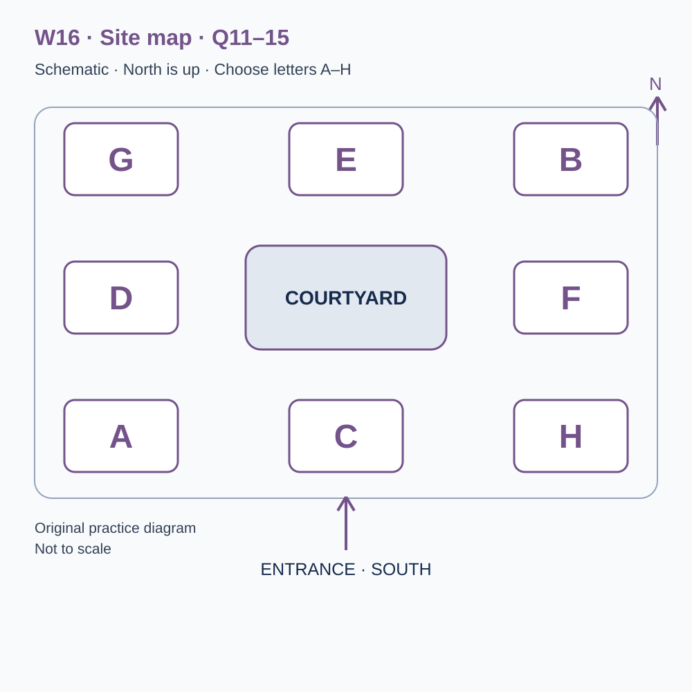
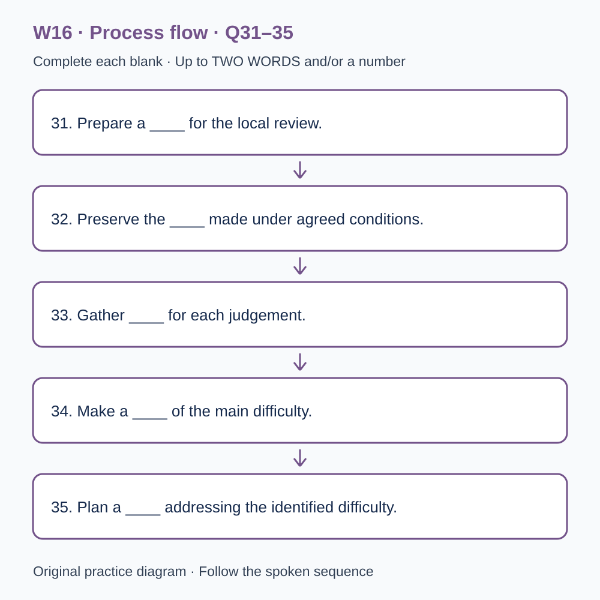

# U51 第16周听力题面与复盘（音频待补）

本页提供已核验的原创题目、参考答案和脚本。配套完整音频尚未验收，当前只能预览题面；不能进行有效的首次听力测试，也不能把读稿作答计作听力成绩或已完成一套听力。

请先保留首次作答机会：批准音频就绪前，不要展开下方答案和脚本。若已读稿，请标记为熟悉材料，之后的练习不能充当陌生题诊断。页面阅读标记只代表看过文字，不代表完成听力。

本材料非雅思真题、非标准化模考，不换算正式分数。计划分钟数不是实测音频时长；学习记录、正式测评和真人反馈须另行完成。

## 学生题面

### L-W16 — An original checkpoint and the next learning decision
> W16 是原创阶段检查，不能替代正式 T16，也不能据本练习换算官方分数。

> 原创 IELTS-style 技能练习，非真题、非标准化模考，不可换算正式分数。当前只有文字和题目，音频未生成，不能计作已完成听力套题。

共四部分、40 个计分空，每空 1 分。正式首次作答须等待批准音频，先不要打开 script.md 或 answers.md。朗读前先看题；只听一遍后提交首次答案及信心等级，再做精听。当前只能预览题面，不能把读稿作答记作听力成绩。

#### Part 1 — Booking a progress workshop

Q1–6: Complete the notes. Write **NO MORE THAN TWO WORDS AND/OR A NUMBER** for each answer, using words from the recording. Numeric notation may replace spoken numbers. Do not repeat a printed unit. Q7–10: Choose **ONE letter, A, B or C**.

**Q1.** Workshop selected: ____

**Q2.** Confirmed day of November: ____

**Q3.** Workshop start (p.m.): ____

**Q4.** Number of confirmed places: ____

**Q5.** Total booking cost: £____

**Q6.** Practice record to bring: ____

**Q7.** What is the workshop activity?

- A. An original learning review, not a formal examination
- B. A guaranteed official score assessment
- C. A replacement for any separately required formal checkpoint

Answer: ____

**Q8.** Before comparing practice scores, learners should

- A. treat every increase as proven learning
- B. check tasks, timing and help received
- C. discard all lower totals without examining the work

Answer: ____

**Q9.** What should happen with a format requirement?

- A. Guess on the partner's behalf
- B. Assume only standard print exists
- C. Discuss the practical need before the workshop

Answer: ____

**Q10.** How should a booking change be reported?

- A. Through the confirmation reference and its designated contact route
- B. Through public comments alone
- C. By retaining only a screenshot of the start time

Answer: ____

#### Part 2 — Learning review centre orientation

Q11–15: Label the map. Write **ONE letter, A–H**, for each destination. Three letters are unused. Q16–20: Choose **ONE letter, A, B or C**.

**Q11.** Check-in

Answer: ____

**Q12.** Individual practice room

Answer: ____

**Q13.** Discussion room

Answer: ____

**Q14.** Review room

Answer: ____

**Q15.** Printed-resource collection point

Answer: ____

**Q16.** How should the original checkpoint result be used?

- A. As an official band conversion
- B. As evidence for specific next learning decisions
- C. As a substitute for all formal assessment requirements

Answer: ____

**Q17.** What should learners identify before starting?

- A. Every possible optional addition
- B. Only the maximum amount they can write
- C. Required outputs and what the stated limit includes

Answer: ____

**Q18.** Why preserve the first response separately?

- A. It shows the difficulty before correction or feedback
- B. It proves revisions were unaided
- C. It makes help received irrelevant

Answer: ____

**Q19.** How should confidence ratings be interpreted?

- A. As substitutes for supporting evidence
- B. Alongside answers and the reasons behind the rating
- C. As a rule that high confidence deserves praise regardless of accuracy

Answer: ____

**Q20.** What makes the closing plan useful?

- A. Trying to change every weakness at once
- B. Promising a score before the next attempt
- C. Naming a manageable priority and a later way to check it

Answer: ____

#### Part 3 — Interpreting two practice attempts

Q21–26: Match each proposal to the students' **final** positions at the end of that exchange. The tutor is not included. Write **A, B, C or D**. Letters may be reused.

- **A** Mina only
- **B** Caleb only
- **C** Both students
- **D** Neither student

Q27–28 and Q29–30: Choose **TWO different letters, A–E**, for each pair. Write one letter in each numbered slot; either order is accepted. Each distinct correct choice earns one point, maximum two. Repeating a letter cannot earn two points. Submit no more than two letters.

**Q21.** At the END of this exchange, who supports: Reviewing missed required outputs before other details?

Answer: ____

**Q22.** At the END of this exchange, who supports: Timing the first planning stage separately next time?

Answer: ____

**Q23.** At the END of this exchange, who supports: Converting the local total into an official band?

Answer: ____

**Q24.** At the END of this exchange, who supports: Adding a short follow-up on uncertain interpretations in the next session?

Answer: ____

**Q25.** At the END of this exchange, who supports: Checking task and support conditions before comparing attempts?

Answer: ____

**Q26.** At the END of this exchange, who supports: Adding confidence ratings with reasons beside first answers?

Answer: ____

**Q27–28.** Which TWO indicators are agreed for the review?

- A. Total word count as the main measure
- B. Required-output coverage
- C. A neatness ranking
- D. Evidence traceability for main claims
- E. An official score forecast

Answers: Q27 ____ · Q28 ____

**Q29–30.** Which TWO limitations affect the comparison of attempts?

- A. The second task was more familiar
- B. Both original responses were saved
- C. A session was cancelled
- D. Participants received unequal assistance
- E. Pages were missing

Answers: Q29 ____ · Q30 ____

#### Part 4 — From a checkpoint to a revised learning plan

Q31–35: Complete the flow chart below. Q36–40: Complete the notes. Write **NO MORE THAN TWO WORDS AND/OR A NUMBER** for each answer, using words from the recording. Numeric notation may replace spoken numbers. Words or units already printed do not belong in the blank. The numbered text below repeats the SVG prompts for readability.

**Q31.** Prepare a ____ for the local review.

**Q32.** Preserve the ____ made under agreed conditions.

**Q33.** Gather ____ for each judgement.

**Q34.** Make a ____ of the main difficulty.

**Q35.** Plan a ____ addressing the identified difficulty.

**Q36.** Check ____ after a delay.

**Q37.** Using learning in a different task or setting is ____.

**Q38.** The relationship between confidence and accuracy is ____.

**Q39.** Select a small number of ____ for the next period.

**Q40.** Arrange a ____ to review the next attempt.

#### 本周训练安排（音频批准后执行）

- Preview questions without the script：8 分钟。
- Future continuous first listen, including planned part pauses：32 分钟。
- Submit first answers and confidence, without a second play：8 分钟。
- Check answers and classify errors：20 分钟。
- Four Q-located intensive segments, 15 minutes each：60 分钟。
- Diagram and opinion retelling：15 分钟。
- Next-day retry of missed items：15 分钟。

合计 **158 分钟**；最多另用 22 分钟缓冲，总计不超过 180 分钟。暂停、回放与查词均计入精听预算，不能另行无限追加。当前实际已完成听力分钟数为 0。精听区段和步骤见 intensive.md；答案和脚本另页。

参考答案与证据（完成首次听力后再展开）

### L-W16 — Answers and evidence
> 独立答案页。先提交首次答案，再看本页。当前缺音频，文本验题不能充当实听验收。

每个单空 1 分；双选各 2 分、答案顺序不限、按不同正确选项计分。接受形式仅做大小写和空白规范化；不做模糊词形推断。

#### Q1 — progress review

Accepted answers: progress review / review

Use the final confirmed detail in this exchange; the printed unit or date context is already supplied.

Evidence locator: Q01 (script.md; timestamps unavailable).

> Adviser: Learning review centre, hello. Learner: I'd like to attend one of your workshops with a study partner. We don't need somebody to predict an official test score. We want to review what our recent practice shows and decide what to work on next. Adviser: Then progress review is the workshop topic to select. Learner: Yes, progress review describes our purpose. We have records from several original classroom tasks, but we're unsure which differences reflect learning and which reflect different conditions. Adviser: The session examines that distinction. It uses local examples and doesn't turn classroom marks into an official result or replace any formal assessment you may need to arrange separately.

#### Q2 — 21

Accepted answers: 21 / 21st / twenty-first / the twenty-first / twenty first / the 21st

Use the final confirmed detail in this exchange; the printed unit or date context is already supplied.

Evidence locator: Q02 (script.md; timestamps unavailable).

> Adviser: The workshop is on the twenty-first of November. Learner: I saw the fourteenth in an early programme. Has it moved? Adviser: Yes. The twenty-first is the confirmed date after the room arrangement was settled. Learner: That's possible for both of us. I'll replace the older calendar entry and send my partner the current information. Adviser: We will repeat the date in your confirmation. Learner: Good. I want to avoid keeping two versions and then guessing which one was final when we organise transport. Adviser: The confirmation is the booking record to use. If another practical change occurs, the update will clearly identify that same booking rather than appear as an unrelated event notice.

#### Q3 — 1.35

Accepted answers: 1.35 / 1:35 / 01.35 / 01:35 / 13.35 / 13:35 / one thirty-five

Use the final confirmed detail in this exchange; the printed unit or date context is already supplied.

Evidence locator: Q03 (script.md; timestamps unavailable).

> Learner: What time does it start? Adviser: One thirty-five in the afternoon. The building is open from one, but your workshop begins at one thirty-five. Learner: I'll record one thirty-five as the session time and arrive shortly before it to check in. Adviser: Thank you. The introduction explains how to use the practice records and what conclusions the exercise cannot support. Learner: We shouldn't miss that and then assume the workshop is a formal test. Adviser: Exactly. The activity is a guided review of learning evidence. It has a schedule and clear tasks, but those features alone don't make it a standardised assessment or provide an official score interpretation.

#### Q4 — 2

Accepted answers: 2 / two

Use the final confirmed detail in this exchange; the printed unit or date context is already supplied.

Evidence locator: Q04 (script.md; timestamps unavailable).

> Adviser: How many places should I reserve? Learner: Two. Three of us discussed attending, but the third person has another commitment. Adviser: Two places are available. Learner: We'll collect that person's questions, but we won't reserve a seat that we don't expect them to use. Adviser: If your attendance changes, contact us before transferring a place. The group activity depends on knowing who is coming and how many work areas to prepare. Learner: I'll keep the booking with the two confirmed names and update it through the proper route if necessary. Adviser: That helps us maintain a clear record rather than reconstruct changes from several informal messages on the morning.

#### Q5 — 28

Accepted answers: 28 / 28.00 / twenty-eight / twenty eight

Use the final confirmed detail in this exchange; the printed unit or date context is already supplied.

Evidence locator: Q05 (script.md; timestamps unavailable).

> Learner: What is the total cost for the two places? Adviser: The introductory booking total is twenty-eight pounds. Learner: Twenty-eight altogether, not for each person? Adviser: Correct. It includes the workshop materials. A separate consultation about a longer programme would have different arrangements, but you haven't booked that here. Learner: I'll share the total and the scope with my partner so we both understand what the payment covers. Adviser: Check the confirmation before completing payment. If the amount or number of places differs from this conversation, ask us to correct it. A clear explanation now is better than discovering later that each person assumed a different service was included.

#### Q6 — error log

Accepted answers: error log / log / the log

Use the final confirmed detail in this exchange; the printed unit or date context is already supplied.

Evidence locator: Q06 (script.md; timestamps unavailable).

> Learner: What should we bring from our practice? Adviser: Bring your error log, with the original task references if you have them. The log should distinguish what you first answered, what the feedback said and what you changed afterwards. Learner: I have an error log, although some entries just say careless mistake. Adviser: Bring it as it is. We can discuss how to make those entries more informative. You don't need to rewrite the log to make your preparation look better. Learner: That's useful. A record of the difficulty we actually had will probably help more than a polished summary that hides the steps between the first attempt and the correction.

#### Q7 — A

Accepted answers: A

Its local tasks guide learning and do not provide an official interpretation.

Evidence locator: Q07 (script.md; timestamps unavailable).

> Learner: Will we take a formal examination during the workshop? Adviser: No. There is an original practice activity to help you examine your review method, but it isn't an official examination or a substitute for a separately required checkpoint. Learner: So its results help us plan learning rather than establish a recognised score. Adviser: Exactly. The tasks and local criteria are explained for that purpose. Learner: I'll make sure my partner understands the distinction before we arrive. Adviser: Good. A structured activity can be useful without claiming the standardisation, security or score interpretation of a formal assessment. We want the conclusions to match the evidence the activity is actually designed to produce.

#### Q8 — B

Accepted answers: B

Task familiarity and support affect interpretation; the totals alone are insufficient.

Evidence locator: Q08 (script.md; timestamps unavailable).

> Learner: Can we compare our two practice scores directly? Adviser: You can discuss them, but first examine the tasks, timing and help received. A higher total from an easier or more familiar activity may not show the same thing as improvement under comparable conditions. Learner: We should bring those details rather than just the final numbers. Adviser: Yes. The workshop looks at the information behind a difference. It doesn't assume every rise proves learning or every fall proves decline. Learner: That could change how we read our logs. We've sometimes written a judgement beside a number without recording whether we repeated a task we already knew or received extra explanation before finishing it.

#### Q9 — C

Accepted answers: C

A specific advance request supports a clear arrangement with stated limits.

Evidence locator: Q09 (script.md; timestamps unavailable).

> Learner: One of us may need a different format for the review sheet. Should we wait until the workshop? Adviser: Please describe the practical requirement when replying to the confirmation. We can check the available formats and discuss any limits before the day. Learner: I'll ask my partner which format works rather than guess on their behalf. Adviser: Thank you. That gives us a useful request to respond to. Learner: We don't want to arrive assuming that an ordinary printed sheet is the only option, or assume an alternative is guaranteed without discussing it. Adviser: Exactly. The aim is a clear arrangement that the participant and the teaching team both understand in advance.

#### Q10 — A

Accepted answers: A

The complete confirmation contains both attendance instructions and the route for changes.

Evidence locator: Q10 (script.md; timestamps unavailable).

> Learner: If we need to change the booking, what should we do? Adviser: Reply to the confirmation with the booking reference. For an urgent change close to the session, use the telephone number printed there. Learner: A message in the public workshop comments wouldn't update the attendance list? Adviser: Correct. It may not reach the person managing places. Learner: I'll keep the full confirmation, not just a screenshot of the time. Adviser: Good. It contains the current instructions and the route for changing them. That helps prevent two people acting on different versions and each assuming the other has already told the centre about a revised plan.

#### Q11 — C

Accepted answers: C

Use the explicitly stated position relative to the courtyard, not an earlier layout or adjacent area.

Evidence locator: Q11 (script.md; timestamps unavailable).

> Welcome to the learning review centre. North is at the top of the diagram, the entrance is on the southern edge and the courtyard is the central landmark. Eight lettered spaces surround it. Check-in is directly south of the courtyard, on the entrance axis. It isn't in either southern corner. Please report there before joining an activity. Staff can confirm the room and explain any practical update. The centre hosts several kinds of learning session, so an old plan from another event may not identify today's arrangement. Use the current diagram and ask if a sign appears inconsistent with the instructions in your confirmation.

#### Q12 — G

Accepted answers: G

Use the explicitly stated position relative to the courtyard, not an earlier layout or adjacent area.

Evidence locator: Q12 (script.md; timestamps unavailable).

> The individual practice room is in the north-west corner. It is west of the northern central room and diagonally north-west of the courtyard. An earlier plan put the practice activity directly north, but that room now has another function. The practice room is used under a stated timetable, so please wait until the leader explains when to begin. This original activity is a way to examine a learning process, not an official test. Keep the conditions visible in your record, including any agreed support. A local score is only interpretable in relation to the task and procedure that produced it, not by the room's formal appearance or the presence of a timer.

#### Q13 — F

Accepted answers: F

Use the explicitly stated position relative to the courtyard, not an earlier layout or adjacent area.

Evidence locator: Q13 (script.md; timestamps unavailable).

> The discussion room is directly east of the courtyard, level with its centre. It is not the south-east room. Groups use that space to compare interpretations of their practice records after the individual activity. The purpose is to explain what the evidence supports and where members disagree, not to rank people by a single total. A participant with a lower score may have encountered unfamiliar material or received less help, so the number alone doesn't settle the comparison. Please bring the task conditions and relevant examples to the discussion. Those details give the group something specific to examine instead of relying only on a broad judgement such as better or worse.

#### Q14 — B

Accepted answers: B

Use the explicitly stated position relative to the courtyard, not an earlier layout or adjacent area.

Evidence locator: Q14 (script.md; timestamps unavailable).

> The review room is in the north-east corner, directly north of the discussion room. It is also east of the northern central room, since both positions are on the same northern row of the diagram. This is where participants turn their observations into a short plan for the next stage. The plan should identify a priority and the evidence behind it, rather than list every possible weakness. Staff may ask you to explain why a proposed action addresses the difficulty you observed. That question is intended to clarify the reasoning, not to demand certainty about a future result. A useful plan can include a carefully defined uncertainty to investigate.

#### Q15 — A

Accepted answers: A

Use the explicitly stated position relative to the courtyard, not an earlier layout or adjacent area.

Evidence locator: Q15 (script.md; timestamps unavailable).

> The collection point for printed resources is in the south-west area, west of check-in and below the room directly west of the courtyard. Please take the resource that matches the task version named by your leader. Several activities use similar layouts, but their required outputs may differ. A familiar-looking sheet isn't necessarily the correct one. If you find a missing page, report it rather than copy a neighbour's answers and treat that as an independent attempt. The collection point is a practical service, not a second assessment desk. The helper can supply the right material but won't decide which interpretation your response should defend.

#### Q16 — B

Accepted answers: B

The activity is original practice with a limited learning purpose, not official score evidence.

Evidence locator: Q16 (script.md; timestamps unavailable).

> Today's checkpoint is original practice. It cannot replace an official or separately scheduled formal assessment, and its local score should not be converted into an official band or grade. The useful evidence concerns particular actions: whether a requirement was noticed, whether a claim had support and whether time was reserved for checking. Those observations can guide a next learning decision without predicting every future performance. We ask participants to keep that scope visible when discussing the result afterwards. Calling an exercise a checkpoint explains its place in a learning sequence; it doesn't by itself establish that the task has the properties needed for a formal score interpretation.

#### Q17 — C

Accepted answers: C

Effort should address the specified task; unrequested work can displace a required qualification.

Evidence locator: Q17 (script.md; timestamps unavailable).

> Before the activity begins, identify what the task requires and what the stated limit includes. If a response asks for a comparison and a recommendation, completing only the comparison is an incomplete response even if it is detailed. At the same time, adding an unrequested section can consume time needed for a required qualification. The task isn't a contest to write the largest amount. It asks you to allocate effort to the work specified. If an instruction is unclear, follow the clarification process rather than silently invent a requirement. Your later review should be able to distinguish misunderstanding the task from understanding it but running out of time.

#### Q18 — A

Accepted answers: A

First and revised responses answer different questions; support must remain visible.

Evidence locator: Q18 (script.md; timestamps unavailable).

> During the review, preserve your first response separately from the corrected version. Otherwise you may remember the improved answer as though it were what you produced independently at the start. The first response provides evidence about the difficulty; the correction provides evidence about what you changed after feedback or further thought. Both are useful, but they answer different questions. If you used an explanation from another person, record that support rather than presenting the revision as unaided work. The aim is an honest learning record, not a display that makes every attempt look successful by removing the parts that would help you understand why improvement was needed.

#### Q19 — B

Accepted answers: B

Ratings become useful when linked to evidence, errors and changes of interpretation.

Evidence locator: Q19 (script.md; timestamps unavailable).

> A confidence rating can be discussed alongside an answer, but confidence isn't a substitute for evidence. A person may feel certain about an incorrect interpretation or uncertain about a well-supported one. The review can examine the relationship between the rating and the response rather than praising confidence by itself. Explain which clue or reasoning step produced your judgement. If you changed your mind, identify what new information mattered. This makes a confidence record useful for learning: it can reveal a recurring unsupported assumption or a tendency to overlook evidence you actually understood. A bare high-or-low label without that connection may tell the group little about what to change next.

#### Q20 — C

Accepted answers: C

A deliberate next action can be examined; one local result is not a permanent description of ability.

Evidence locator: Q20 (script.md; timestamps unavailable).

> The closing plan should name one manageable priority and a way to check it later. You may need more than one improvement over time, but attempting every possible change in the next session can make it difficult to learn which action helped. Record what you will retain as well as what you will revise. The next checkpoint should connect to the plan without simply repeating a familiar answer from memory. A useful sequence includes an attempt, evidence, interpretation and a deliberate next action. It remains open to revision when new evidence arrives, rather than treating one local practice result as a permanent description of a learner's ability.

#### Q21 — C

Accepted answers: C

Final stance: Both students. Ignore an initial proposal if later withdrawn; the tutor is not an answer option.

Evidence locator: Q21 (script.md; timestamps unavailable).

> Tutor: You completed two original practice attempts last week. Today we're reviewing them before planning the next checkpoint. Mina: I suggest beginning with any required output that was missed. A neat answer can still fail to do everything the task asked. Caleb: I agree. I initially wanted to start with spelling, but an omitted recommendation affects the whole response. Tutor: So you both support reviewing missed requirements first? Caleb: Yes, while keeping the other issues for later. Mina: We can mark the instruction and the corresponding place in the response. Tutor: That gives you a concrete comparison rather than a general impression that one answer seems more complete than another.

#### Q22 — B

Accepted answers: B

Final stance: Caleb only. Ignore an initial proposal if later withdrawn; the tutor is not an answer option.

Evidence locator: Q22 (script.md; timestamps unavailable).

> Tutor: Caleb proposes timing the first planning stage separately in the next attempt. Caleb: I support that. We know the overall duration, but we don't know whether the planning stage expanded or whether writing took longer. Mina: I'd keep the same timing record for one more attempt before adding another measurement. A new stage marker might alter how people plan. Tutor: Could that alteration itself be useful to observe? Mina: Possibly, but I still prefer to establish the existing pattern first. Caleb: I continue to support the separate timing. Tutor: Then the proposal isn't shared. Your disagreement is about what the next attempt should investigate, not whether planning time can matter.

#### Q23 — D

Accepted answers: D

Final stance: Neither student. Ignore an initial proposal if later withdrawn; the tutor is not an answer option.

Evidence locator: Q23 (script.md; timestamps unavailable).

> Tutor: An early note suggests converting the local total into an official band. Caleb: I wrote that because a familiar scale seemed easier to explain. Mina: I don't support it. These tasks don't provide a valid official score conversion. Caleb: You're right. I'll remove the conversion and keep the result on the local scale with its purpose stated. Tutor: Are you withdrawing the proposed official interpretation? Caleb: Yes. A structured original task isn't enough to justify that claim. Mina: We can still identify specific strengths and difficulties. Tutor: Exactly. A narrower, justified conclusion is more useful than a familiar number whose meaning the assessment design cannot support.

#### Q24 — A

Accepted answers: A

Final stance: Mina only. Ignore an initial proposal if later withdrawn; the tutor is not an answer option.

Evidence locator: Q24 (script.md; timestamps unavailable).

> Tutor: Mina proposes a short follow-up on uncertain interpretations from the review. Mina: I support asking participants to explain one passage they were unsure about. It could distinguish a misunderstood word from a problem with the underlying reasoning. Caleb: I'd leave that out of the next session and use the time for another independent attempt. Mina: We could keep it brief, but I still think the explanation is worth collecting. Tutor: Caleb, does limiting it to one passage change your position? Caleb: Not for this stage. I want to see whether the difficulty recurs without additional help. Tutor: Then Mina supports the follow-up and Caleb remains against including it in this next session.

#### Q25 — C

Accepted answers: C

Final stance: Both students. Ignore an initial proposal if later withdrawn; the tutor is not an answer option.

Evidence locator: Q25 (script.md; timestamps unavailable).

> Tutor: Should you compare attempts only after checking the conditions? Caleb: Yes. We need to know whether the tasks were similarly familiar and what help was available. Mina: I agree. Equal time limits don't make every other condition equivalent. Tutor: What would you do if the conditions differed? Mina: Describe the difference and narrow the claim, rather than force the totals into a simple improvement story. Caleb: We might still learn something from the examples, but we couldn't attribute every change to the learning plan. Tutor: Then this is a shared check. It should happen before interpreting the score difference, not appear as a small qualification after a confident conclusion has already been announced.

#### Q26 — A

Accepted answers: A

Final stance: Mina only. Ignore an initial proposal if later withdrawn; the tutor is not an answer option.

Evidence locator: Q26 (script.md; timestamps unavailable).

> Tutor: Do you both want a confidence rating beside each first answer? Mina: I support it, with a brief note about the evidence behind the rating. It could show where I'm certain for a weak reason. Caleb: I'd record the errors and their causes first without adding ratings. People may use the scale differently, and I don't want to create another difficult comparison. Tutor: Would an agreed scale resolve that? Caleb: It would help, but I still prefer to leave ratings out of the next attempt. Mina: I continue to favour them. Tutor: Then Mina supports the proposal and Caleb doesn't. Keep that distinction separate from your shared agreement to preserve the first response.

#### Q27–28 — B, D

Accept unordered set: B, D. One point per distinct correct choice, maximum 2.

Coverage and traceable evidence address the observed task difficulties without claiming a formal score.

Evidence locator: Q27, Q28 (script.md; timestamps unavailable).

> Tutor: Which two indicators have you agreed for the stage review? Caleb: First, coverage of the required outputs. We can check whether each requested component is present rather than assume a long answer is complete. Mina: Agreed. The checklist should use the actual instruction for that task. Tutor: Are you using total word count as the main indicator instead? Mina: No. More words don't necessarily mean better task fulfilment. Caleb: We also rejected a neatness ranking. Tutor: Then required-output coverage is the first agreed indicator. It doesn't judge every aspect of quality, but it addresses a concrete problem that appeared in the practice and can be examined directly in the response.

> Tutor: What is the second agreed indicator? Mina: Whether the evidence behind each main claim can be traced. A response may state an attractive conclusion without showing which information supports it. Caleb: Yes. We'll connect the claim to a relevant source detail or reasoning step. Tutor: Are you predicting an official result from that indicator? Caleb: No. We rejected a formal score forecast for this original activity. Mina: The pair is required-output coverage and evidence traceability. Tutor: Good. Those indicators give the review a defined focus. They don't turn it into a complete assessment of every skill, so keep the scope visible when explaining the result to somebody who wasn't part of the exercise.

#### Q29–30 — A, D

Accept unordered set: A, D. One point per distinct correct choice, maximum 2.

Familiarity and extra help limit attribution to the learning plan; the other options were not defects affecting these attempts.

Evidence locator: Q29, Q30 (script.md; timestamps unavailable).

> Tutor: Which two limitations affect the comparison between last week's attempts? Mina: The second task was more familiar. Several participants had worked with a similar example before, whereas the first task introduced a new setting. Caleb: Agreed. That familiarity could contribute to a higher total. Tutor: Does saving both first responses count as a limitation? Caleb: No, it helps us compare the actual work. Mina: And both sessions took place, so cancellation isn't part of the explanation. Tutor: Then prior familiarity is the first limitation. Explain its relevance to the result rather than listing every difference between the task sheets as though each must have had an equal effect.

> Tutor: What is the second limitation? Caleb: Participants received different amounts of help. Some had an additional explanation before completing the second response. Mina: Yes. We can't treat that result as entirely independent work or attribute every improvement to the plan we proposed. Tutor: What will change next time? Mina: Record the assistance consistently and distinguish unaided work from work completed after help. Caleb: We should preserve the earlier records with their limitations rather than edit the help out of the history. Tutor: Exactly. The two limitations are task familiarity and unequal assistance. The printed pages were complete, so missing material isn't another problem that affected these particular attempts.

#### Q31 — rubric

Accepted answers: rubric / scoring guide / guide / useful rubric

Complete the named stage in the stated process order; retain any word already printed around the blank.

Evidence locator: Q31 (script.md; timestamps unavailable).

> This lecture describes an original learning checkpoint, not a formal standardised examination. The first stage prepares a rubric. A rubric is a scoring guide that explains which features the local review will examine and how judgements will be made. In this example, the guide focuses on responding to the task and supporting claims with relevant evidence. It does not provide an official score conversion. The team should make the criteria clear before reviewing the responses, so the standard doesn't shift to fit an attractive answer after it has been seen. A useful rubric supports consistent discussion while keeping its limited purpose visible to both participants and reviewers.

#### Q32 — first attempt

Accepted answers: first attempt / attempt / initial response / response / first response / initial attempt

Complete the named stage in the stated process order; retain any word already printed around the blank.

Evidence locator: Q32 (script.md; timestamps unavailable).

> The second stage preserves the first attempt made under the agreed conditions. The initial response is kept separately from revisions, with the task version, time limit and any support recorded. This gives the review an identifiable object rather than a memory of what the learner probably meant to write. A corrected response may demonstrate useful learning, but it cannot replace the initial response when the question concerns independent performance before feedback. The team should also note a significant interruption rather than pretend the attempt followed the plan exactly. Keeping the record clear is a practical requirement for interpreting later change, not an invitation to treat one attempt as a complete description of ability.

#### Q33 — evidence

Accepted answers: evidence

Complete the named stage in the stated process order; retain any word already printed around the blank.

Evidence locator: Q33 (script.md; timestamps unavailable).

> The third stage gathers evidence for each judgement. Evidence includes features of the response that relate to the stated criteria, such as a missing required output or a claim connected to an appropriate source detail. The reviewer should identify the relevant passage rather than rely only on a general impression. A label such as unclear may be a starting observation, but it needs an explanation of what the reader cannot follow and why that matters to the task. The purpose is to make the judgement inspectable. Another reviewer should be able to see the basis for the comment and discuss it, rather than accept an unexplained verdict because it sounds confident.

#### Q34 — diagnosis

Accepted answers: diagnosis / reasoned explanation

Complete the named stage in the stated process order; retain any word already printed around the blank.

Evidence locator: Q34 (script.md; timestamps unavailable).

> The fourth stage makes a diagnosis of the main difficulty. A diagnosis is a reasoned explanation that connects the observed problem with a plausible learning need. An omitted section could reflect a missed instruction, poor time allocation or uncertainty about the content. The response alone may not distinguish those possibilities, so the reviewer should keep the explanation qualified and use additional information where appropriate. Calling every omission carelessness doesn't identify a useful action. The aim is to formulate a difficulty precisely enough that a later revision can address it, while acknowledging when the evidence supports more than one interpretation. Diagnosis therefore follows evidence rather than replacing the need to examine it.

#### Q35 — revision

Accepted answers: revision / change / deliberate change / focused adjustment / selected action

Complete the named stage in the stated process order; retain any word already printed around the blank.

Evidence locator: Q35 (script.md; timestamps unavailable).

> The fifth stage plans a revision that addresses the identified difficulty. A revision is a deliberate change, not simply a second attempt made with the hope that more effort will produce a better result. The learner might add a check for required outputs, practise a particular reasoning step or alter the allocation of time. The selected action should connect to the diagnosis and remain manageable within the next session. If several changes are introduced at once, it may be difficult to understand which one helped. The plan can therefore begin with a focused adjustment while keeping other needs recorded for later work. The next attempt will provide new evidence, not a guaranteed confirmation that the plan was correct.

#### Q36 — retention

Accepted answers: retention / what remains

The corresponding evidence block supplies this distinction or qualification; the question retains the surrounding grammar.

Evidence locator: Q36 (script.md; timestamps unavailable).

> Retention concerns what remains available after a delay. A learner who can repeat an explanation immediately after hearing it may not use the same idea independently a week later. A later check can explore retention, provided its purpose and conditions are clear. The reviewer should not treat any difference as proof that all earlier learning disappeared; the later task may introduce another demand or context. It helps to identify which specific knowledge or procedure the check is intended to examine. That makes the comparison more informative than a broad judgement that the learner either remembers everything or has forgotten the whole lesson based on one response.

#### Q37 — transfer

Accepted answers: transfer

The corresponding evidence block supplies this distinction or qualification; the question retains the surrounding grammar.

Evidence locator: Q37 (script.md; timestamps unavailable).

> Transfer concerns using learning in a different task or setting. A person may recognise the required comparison in a familiar example but miss it when the wording changes. The next stage can examine whether the underlying principle carries across, without simply asking for the same answer again. The team should describe the relevant similarities and differences between tasks. A task that changes every feature at once may make a difficulty hard to interpret, while an almost identical task may mainly reward memory of the earlier response. A useful transfer check is designed around the principle being investigated and keeps the claim narrower than a promise of success in every future situation.

#### Q38 — calibration

Accepted answers: calibration

The corresponding evidence block supplies this distinction or qualification; the question retains the surrounding grammar.

Evidence locator: Q38 (script.md; timestamps unavailable).

> Calibration concerns the relationship between confidence and accuracy. In this example, a learner records confidence before receiving feedback and later compares that rating with the support for the answer. High confidence in a weak interpretation may reveal an assumption worth examining; low confidence in a sound interpretation may reveal overlooked evidence. The review should investigate the pattern rather than simply encourage everyone to sound more certain. Different people may use a rating scale differently, so an agreed description helps. Calibration is a local learning question here, not a diagnosis of personality. Its value depends on linking a rating with an answer and the reasons behind it.

#### Q39 — priorities

Accepted answers: priorities / targets / improvement targets / clear priorities

The corresponding evidence block supplies this distinction or qualification; the question retains the surrounding grammar.

Evidence locator: Q39 (script.md; timestamps unavailable).

> The stage review selects a small number of priorities for the next period. These improvement targets should reflect both the importance of a difficulty and the evidence that the proposed action can address it. The most frequent error is not automatically the best first target if it has little effect on the required task. Equally, a striking rare mistake may distract from a repeated omission that prevents completion. The learner and reviewer explain the choice and record what will be deferred. This keeps the plan manageable without pretending that deferred issues have disappeared. Clear priorities make the next session a deliberate test of an improvement idea rather than another attempt to fix everything simultaneously.

#### Q40 — checkpoint

Accepted answers: checkpoint / review / useful review

The corresponding evidence block supplies this distinction or qualification; the question retains the surrounding grammar.

Evidence locator: Q40 (script.md; timestamps unavailable).

> Finally, the team arranges a checkpoint to review the next attempt. The checkpoint identifies when the evidence will be examined, which criteria remain relevant and what would justify changing the plan. It should not promise a particular score before the learner has done the work. A useful review can lead to retaining the current approach, revising the diagnosis or testing a different action. The record should preserve that decision and its reasons. In this way, an original checkpoint becomes one stage in a continuing learning process. It supports a justified next step while leaving formal assessment requirements separate and avoiding claims that a local exercise can establish every conclusion a learner might want to draw.

完整脚本（提前阅读会失去陌生题首答机会）

### L-W16 — An original checkpoint and the next learning decision: transcript
> 原创虚构练习，非真题；音频缺失。仅供完成首次作答后的核对或文字审阅。Q 标记与角色名不属于朗读正文。

#### Part 1 — Booking a progress workshop

##### Q1 evidence block

**Adviser:** Learning review centre, hello.

**Learner:** I'd like to attend one of your workshops with a study partner. We don't need somebody to predict an official test score. We want to review what our recent practice shows and decide what to work on next.

**Adviser:** Then progress review is the workshop topic to select.

**Learner:** Yes, progress review describes our purpose. We have records from several original classroom tasks, but we're unsure which differences reflect learning and which reflect different conditions.

**Adviser:** The session examines that distinction. It uses local examples and doesn't turn classroom marks into an official result or replace any formal assessment you may need to arrange separately.

##### Q2 evidence block

**Adviser:** The workshop is on the twenty-first of November.

**Learner:** I saw the fourteenth in an early programme. Has it moved?

**Adviser:** Yes. The twenty-first is the confirmed date after the room arrangement was settled.

**Learner:** That's possible for both of us. I'll replace the older calendar entry and send my partner the current information.

**Adviser:** We will repeat the date in your confirmation.

**Learner:** Good. I want to avoid keeping two versions and then guessing which one was final when we organise transport.

**Adviser:** The confirmation is the booking record to use. If another practical change occurs, the update will clearly identify that same booking rather than appear as an unrelated event notice.

##### Q3 evidence block

**Learner:** What time does it start?

**Adviser:** One thirty-five in the afternoon. The building is open from one, but your workshop begins at one thirty-five.

**Learner:** I'll record one thirty-five as the session time and arrive shortly before it to check in.

**Adviser:** Thank you. The introduction explains how to use the practice records and what conclusions the exercise cannot support.

**Learner:** We shouldn't miss that and then assume the workshop is a formal test.

**Adviser:** Exactly. The activity is a guided review of learning evidence. It has a schedule and clear tasks, but those features alone don't make it a standardised assessment or provide an official score interpretation.

##### Q4 evidence block

**Adviser:** How many places should I reserve?

**Learner:** Two. Three of us discussed attending, but the third person has another commitment.

**Adviser:** Two places are available.

**Learner:** We'll collect that person's questions, but we won't reserve a seat that we don't expect them to use.

**Adviser:** If your attendance changes, contact us before transferring a place. The group activity depends on knowing who is coming and how many work areas to prepare.

**Learner:** I'll keep the booking with the two confirmed names and update it through the proper route if necessary.

**Adviser:** That helps us maintain a clear record rather than reconstruct changes from several informal messages on the morning.

##### Q5 evidence block

**Learner:** What is the total cost for the two places?

**Adviser:** The introductory booking total is twenty-eight pounds.

**Learner:** Twenty-eight altogether, not for each person?

**Adviser:** Correct. It includes the workshop materials. A separate consultation about a longer programme would have different arrangements, but you haven't booked that here.

**Learner:** I'll share the total and the scope with my partner so we both understand what the payment covers.

**Adviser:** Check the confirmation before completing payment. If the amount or number of places differs from this conversation, ask us to correct it. A clear explanation now is better than discovering later that each person assumed a different service was included.

##### Q6 evidence block

**Learner:** What should we bring from our practice?

**Adviser:** Bring your error log, with the original task references if you have them. The log should distinguish what you first answered, what the feedback said and what you changed afterwards.

**Learner:** I have an error log, although some entries just say careless mistake.

**Adviser:** Bring it as it is. We can discuss how to make those entries more informative. You don't need to rewrite the log to make your preparation look better.

**Learner:** That's useful. A record of the difficulty we actually had will probably help more than a polished summary that hides the steps between the first attempt and the correction.

##### Q7 evidence block

**Learner:** Will we take a formal examination during the workshop?

**Adviser:** No. There is an original practice activity to help you examine your review method, but it isn't an official examination or a substitute for a separately required checkpoint.

**Learner:** So its results help us plan learning rather than establish a recognised score.

**Adviser:** Exactly. The tasks and local criteria are explained for that purpose.

**Learner:** I'll make sure my partner understands the distinction before we arrive.

**Adviser:** Good. A structured activity can be useful without claiming the standardisation, security or score interpretation of a formal assessment. We want the conclusions to match the evidence the activity is actually designed to produce.

##### Q8 evidence block

**Learner:** Can we compare our two practice scores directly?

**Adviser:** You can discuss them, but first examine the tasks, timing and help received. A higher total from an easier or more familiar activity may not show the same thing as improvement under comparable conditions.

**Learner:** We should bring those details rather than just the final numbers.

**Adviser:** Yes. The workshop looks at the information behind a difference. It doesn't assume every rise proves learning or every fall proves decline.

**Learner:** That could change how we read our logs. We've sometimes written a judgement beside a number without recording whether we repeated a task we already knew or received extra explanation before finishing it.

##### Q9 evidence block

**Learner:** One of us may need a different format for the review sheet. Should we wait until the workshop?

**Adviser:** Please describe the practical requirement when replying to the confirmation. We can check the available formats and discuss any limits before the day.

**Learner:** I'll ask my partner which format works rather than guess on their behalf.

**Adviser:** Thank you. That gives us a useful request to respond to.

**Learner:** We don't want to arrive assuming that an ordinary printed sheet is the only option, or assume an alternative is guaranteed without discussing it.

**Adviser:** Exactly. The aim is a clear arrangement that the participant and the teaching team both understand in advance.

##### Q10 evidence block

**Learner:** If we need to change the booking, what should we do?

**Adviser:** Reply to the confirmation with the booking reference. For an urgent change close to the session, use the telephone number printed there.

**Learner:** A message in the public workshop comments wouldn't update the attendance list?

**Adviser:** Correct. It may not reach the person managing places.

**Learner:** I'll keep the full confirmation, not just a screenshot of the time.

**Adviser:** Good. It contains the current instructions and the route for changing them. That helps prevent two people acting on different versions and each assuming the other has already told the centre about a revised plan.

#### Part 2 — Learning review centre orientation

##### Q11 evidence block

**Review host:** Welcome to the learning review centre. North is at the top of the diagram, the entrance is on the southern edge and the courtyard is the central landmark. Eight lettered spaces surround it. Check-in is directly south of the courtyard, on the entrance axis. It isn't in either southern corner. Please report there before joining an activity. Staff can confirm the room and explain any practical update. The centre hosts several kinds of learning session, so an old plan from another event may not identify today's arrangement. Use the current diagram and ask if a sign appears inconsistent with the instructions in your confirmation.

##### Q12 evidence block

**Review host:** The individual practice room is in the north-west corner. It is west of the northern central room and diagonally north-west of the courtyard. An earlier plan put the practice activity directly north, but that room now has another function. The practice room is used under a stated timetable, so please wait until the leader explains when to begin. This original activity is a way to examine a learning process, not an official test. Keep the conditions visible in your record, including any agreed support. A local score is only interpretable in relation to the task and procedure that produced it, not by the room's formal appearance or the presence of a timer.

##### Q13 evidence block

**Review host:** The discussion room is directly east of the courtyard, level with its centre. It is not the south-east room. Groups use that space to compare interpretations of their practice records after the individual activity. The purpose is to explain what the evidence supports and where members disagree, not to rank people by a single total. A participant with a lower score may have encountered unfamiliar material or received less help, so the number alone doesn't settle the comparison. Please bring the task conditions and relevant examples to the discussion. Those details give the group something specific to examine instead of relying only on a broad judgement such as better or worse.

##### Q14 evidence block

**Review host:** The review room is in the north-east corner, directly north of the discussion room. It is also east of the northern central room, since both positions are on the same northern row of the diagram. This is where participants turn their observations into a short plan for the next stage. The plan should identify a priority and the evidence behind it, rather than list every possible weakness. Staff may ask you to explain why a proposed action addresses the difficulty you observed. That question is intended to clarify the reasoning, not to demand certainty about a future result. A useful plan can include a carefully defined uncertainty to investigate.

##### Q15 evidence block

**Review host:** The collection point for printed resources is in the south-west area, west of check-in and below the room directly west of the courtyard. Please take the resource that matches the task version named by your leader. Several activities use similar layouts, but their required outputs may differ. A familiar-looking sheet isn't necessarily the correct one. If you find a missing page, report it rather than copy a neighbour's answers and treat that as an independent attempt. The collection point is a practical service, not a second assessment desk. The helper can supply the right material but won't decide which interpretation your response should defend.

##### Q16 evidence block

**Review host:** Today's checkpoint is original practice. It cannot replace an official or separately scheduled formal assessment, and its local score should not be converted into an official band or grade. The useful evidence concerns particular actions: whether a requirement was noticed, whether a claim had support and whether time was reserved for checking. Those observations can guide a next learning decision without predicting every future performance. We ask participants to keep that scope visible when discussing the result afterwards. Calling an exercise a checkpoint explains its place in a learning sequence; it doesn't by itself establish that the task has the properties needed for a formal score interpretation.

##### Q17 evidence block

**Review host:** Before the activity begins, identify what the task requires and what the stated limit includes. If a response asks for a comparison and a recommendation, completing only the comparison is an incomplete response even if it is detailed. At the same time, adding an unrequested section can consume time needed for a required qualification. The task isn't a contest to write the largest amount. It asks you to allocate effort to the work specified. If an instruction is unclear, follow the clarification process rather than silently invent a requirement. Your later review should be able to distinguish misunderstanding the task from understanding it but running out of time.

##### Q18 evidence block

**Review host:** During the review, preserve your first response separately from the corrected version. Otherwise you may remember the improved answer as though it were what you produced independently at the start. The first response provides evidence about the difficulty; the correction provides evidence about what you changed after feedback or further thought. Both are useful, but they answer different questions. If you used an explanation from another person, record that support rather than presenting the revision as unaided work. The aim is an honest learning record, not a display that makes every attempt look successful by removing the parts that would help you understand why improvement was needed.

##### Q19 evidence block

**Review host:** A confidence rating can be discussed alongside an answer, but confidence isn't a substitute for evidence. A person may feel certain about an incorrect interpretation or uncertain about a well-supported one. The review can examine the relationship between the rating and the response rather than praising confidence by itself. Explain which clue or reasoning step produced your judgement. If you changed your mind, identify what new information mattered. This makes a confidence record useful for learning: it can reveal a recurring unsupported assumption or a tendency to overlook evidence you actually understood. A bare high-or-low label without that connection may tell the group little about what to change next.

##### Q20 evidence block

**Review host:** The closing plan should name one manageable priority and a way to check it later. You may need more than one improvement over time, but attempting every possible change in the next session can make it difficult to learn which action helped. Record what you will retain as well as what you will revise. The next checkpoint should connect to the plan without simply repeating a familiar answer from memory. A useful sequence includes an attempt, evidence, interpretation and a deliberate next action. It remains open to revision when new evidence arrives, rather than treating one local practice result as a permanent description of a learner's ability.

#### Part 3 — Interpreting two practice attempts

##### Q21 evidence block

**Tutor:** You completed two original practice attempts last week. Today we're reviewing them before planning the next checkpoint.

**Mina:** I suggest beginning with any required output that was missed. A neat answer can still fail to do everything the task asked.

**Caleb:** I agree. I initially wanted to start with spelling, but an omitted recommendation affects the whole response.

**Tutor:** So you both support reviewing missed requirements first?

**Caleb:** Yes, while keeping the other issues for later.

**Mina:** We can mark the instruction and the corresponding place in the response.

**Tutor:** That gives you a concrete comparison rather than a general impression that one answer seems more complete than another.

##### Q22 evidence block

**Tutor:** Caleb proposes timing the first planning stage separately in the next attempt.

**Caleb:** I support that. We know the overall duration, but we don't know whether the planning stage expanded or whether writing took longer.

**Mina:** I'd keep the same timing record for one more attempt before adding another measurement. A new stage marker might alter how people plan.

**Tutor:** Could that alteration itself be useful to observe?

**Mina:** Possibly, but I still prefer to establish the existing pattern first.

**Caleb:** I continue to support the separate timing.

**Tutor:** Then the proposal isn't shared. Your disagreement is about what the next attempt should investigate, not whether planning time can matter.

##### Q23 evidence block

**Tutor:** An early note suggests converting the local total into an official band.

**Caleb:** I wrote that because a familiar scale seemed easier to explain.

**Mina:** I don't support it. These tasks don't provide a valid official score conversion.

**Caleb:** You're right. I'll remove the conversion and keep the result on the local scale with its purpose stated.

**Tutor:** Are you withdrawing the proposed official interpretation?

**Caleb:** Yes. A structured original task isn't enough to justify that claim.

**Mina:** We can still identify specific strengths and difficulties.

**Tutor:** Exactly. A narrower, justified conclusion is more useful than a familiar number whose meaning the assessment design cannot support.

##### Q24 evidence block

**Tutor:** Mina proposes a short follow-up on uncertain interpretations from the review.

**Mina:** I support asking participants to explain one passage they were unsure about. It could distinguish a misunderstood word from a problem with the underlying reasoning.

**Caleb:** I'd leave that out of the next session and use the time for another independent attempt.

**Mina:** We could keep it brief, but I still think the explanation is worth collecting.

**Tutor:** Caleb, does limiting it to one passage change your position?

**Caleb:** Not for this stage. I want to see whether the difficulty recurs without additional help.

**Tutor:** Then Mina supports the follow-up and Caleb remains against including it in this next session.

##### Q25 evidence block

**Tutor:** Should you compare attempts only after checking the conditions?

**Caleb:** Yes. We need to know whether the tasks were similarly familiar and what help was available.

**Mina:** I agree. Equal time limits don't make every other condition equivalent.

**Tutor:** What would you do if the conditions differed?

**Mina:** Describe the difference and narrow the claim, rather than force the totals into a simple improvement story.

**Caleb:** We might still learn something from the examples, but we couldn't attribute every change to the learning plan.

**Tutor:** Then this is a shared check. It should happen before interpreting the score difference, not appear as a small qualification after a confident conclusion has already been announced.

##### Q26 evidence block

**Tutor:** Do you both want a confidence rating beside each first answer?

**Mina:** I support it, with a brief note about the evidence behind the rating. It could show where I'm certain for a weak reason.

**Caleb:** I'd record the errors and their causes first without adding ratings. People may use the scale differently, and I don't want to create another difficult comparison.

**Tutor:** Would an agreed scale resolve that?

**Caleb:** It would help, but I still prefer to leave ratings out of the next attempt.

**Mina:** I continue to favour them.

**Tutor:** Then Mina supports the proposal and Caleb doesn't. Keep that distinction separate from your shared agreement to preserve the first response.

##### Q27 evidence block

**Tutor:** Which two indicators have you agreed for the stage review?

**Caleb:** First, coverage of the required outputs. We can check whether each requested component is present rather than assume a long answer is complete.

**Mina:** Agreed. The checklist should use the actual instruction for that task.

**Tutor:** Are you using total word count as the main indicator instead?

**Mina:** No. More words don't necessarily mean better task fulfilment.

**Caleb:** We also rejected a neatness ranking.

**Tutor:** Then required-output coverage is the first agreed indicator. It doesn't judge every aspect of quality, but it addresses a concrete problem that appeared in the practice and can be examined directly in the response.

##### Q28 evidence block

**Tutor:** What is the second agreed indicator?

**Mina:** Whether the evidence behind each main claim can be traced. A response may state an attractive conclusion without showing which information supports it.

**Caleb:** Yes. We'll connect the claim to a relevant source detail or reasoning step.

**Tutor:** Are you predicting an official result from that indicator?

**Caleb:** No. We rejected a formal score forecast for this original activity.

**Mina:** The pair is required-output coverage and evidence traceability.

**Tutor:** Good. Those indicators give the review a defined focus. They don't turn it into a complete assessment of every skill, so keep the scope visible when explaining the result to somebody who wasn't part of the exercise.

##### Q29 evidence block

**Tutor:** Which two limitations affect the comparison between last week's attempts?

**Mina:** The second task was more familiar. Several participants had worked with a similar example before, whereas the first task introduced a new setting.

**Caleb:** Agreed. That familiarity could contribute to a higher total.

**Tutor:** Does saving both first responses count as a limitation?

**Caleb:** No, it helps us compare the actual work.

**Mina:** And both sessions took place, so cancellation isn't part of the explanation.

**Tutor:** Then prior familiarity is the first limitation. Explain its relevance to the result rather than listing every difference between the task sheets as though each must have had an equal effect.

##### Q30 evidence block

**Tutor:** What is the second limitation?

**Caleb:** Participants received different amounts of help. Some had an additional explanation before completing the second response.

**Mina:** Yes. We can't treat that result as entirely independent work or attribute every improvement to the plan we proposed.

**Tutor:** What will change next time?

**Mina:** Record the assistance consistently and distinguish unaided work from work completed after help.

**Caleb:** We should preserve the earlier records with their limitations rather than edit the help out of the history.

**Tutor:** Exactly. The two limitations are task familiarity and unequal assistance. The printed pages were complete, so missing material isn't another problem that affected these particular attempts.

#### Part 4 — From a checkpoint to a revised learning plan

##### Q31 evidence block

**Lecturer:** This lecture describes an original learning checkpoint, not a formal standardised examination. The first stage prepares a rubric. A rubric is a scoring guide that explains which features the local review will examine and how judgements will be made. In this example, the guide focuses on responding to the task and supporting claims with relevant evidence. It does not provide an official score conversion. The team should make the criteria clear before reviewing the responses, so the standard doesn't shift to fit an attractive answer after it has been seen. A useful rubric supports consistent discussion while keeping its limited purpose visible to both participants and reviewers.

##### Q32 evidence block

**Lecturer:** The second stage preserves the first attempt made under the agreed conditions. The initial response is kept separately from revisions, with the task version, time limit and any support recorded. This gives the review an identifiable object rather than a memory of what the learner probably meant to write. A corrected response may demonstrate useful learning, but it cannot replace the initial response when the question concerns independent performance before feedback. The team should also note a significant interruption rather than pretend the attempt followed the plan exactly. Keeping the record clear is a practical requirement for interpreting later change, not an invitation to treat one attempt as a complete description of ability.

##### Q33 evidence block

**Lecturer:** The third stage gathers evidence for each judgement. Evidence includes features of the response that relate to the stated criteria, such as a missing required output or a claim connected to an appropriate source detail. The reviewer should identify the relevant passage rather than rely only on a general impression. A label such as unclear may be a starting observation, but it needs an explanation of what the reader cannot follow and why that matters to the task. The purpose is to make the judgement inspectable. Another reviewer should be able to see the basis for the comment and discuss it, rather than accept an unexplained verdict because it sounds confident.

##### Q34 evidence block

**Lecturer:** The fourth stage makes a diagnosis of the main difficulty. A diagnosis is a reasoned explanation that connects the observed problem with a plausible learning need. An omitted section could reflect a missed instruction, poor time allocation or uncertainty about the content. The response alone may not distinguish those possibilities, so the reviewer should keep the explanation qualified and use additional information where appropriate. Calling every omission carelessness doesn't identify a useful action. The aim is to formulate a difficulty precisely enough that a later revision can address it, while acknowledging when the evidence supports more than one interpretation. Diagnosis therefore follows evidence rather than replacing the need to examine it.

##### Q35 evidence block

**Lecturer:** The fifth stage plans a revision that addresses the identified difficulty. A revision is a deliberate change, not simply a second attempt made with the hope that more effort will produce a better result. The learner might add a check for required outputs, practise a particular reasoning step or alter the allocation of time. The selected action should connect to the diagnosis and remain manageable within the next session. If several changes are introduced at once, it may be difficult to understand which one helped. The plan can therefore begin with a focused adjustment while keeping other needs recorded for later work. The next attempt will provide new evidence, not a guaranteed confirmation that the plan was correct.

##### Q36 evidence block

**Lecturer:** Retention concerns what remains available after a delay. A learner who can repeat an explanation immediately after hearing it may not use the same idea independently a week later. A later check can explore retention, provided its purpose and conditions are clear. The reviewer should not treat any difference as proof that all earlier learning disappeared; the later task may introduce another demand or context. It helps to identify which specific knowledge or procedure the check is intended to examine. That makes the comparison more informative than a broad judgement that the learner either remembers everything or has forgotten the whole lesson based on one response.

##### Q37 evidence block

**Lecturer:** Transfer concerns using learning in a different task or setting. A person may recognise the required comparison in a familiar example but miss it when the wording changes. The next stage can examine whether the underlying principle carries across, without simply asking for the same answer again. The team should describe the relevant similarities and differences between tasks. A task that changes every feature at once may make a difficulty hard to interpret, while an almost identical task may mainly reward memory of the earlier response. A useful transfer check is designed around the principle being investigated and keeps the claim narrower than a promise of success in every future situation.

##### Q38 evidence block

**Lecturer:** Calibration concerns the relationship between confidence and accuracy. In this example, a learner records confidence before receiving feedback and later compares that rating with the support for the answer. High confidence in a weak interpretation may reveal an assumption worth examining; low confidence in a sound interpretation may reveal overlooked evidence. The review should investigate the pattern rather than simply encourage everyone to sound more certain. Different people may use a rating scale differently, so an agreed description helps. Calibration is a local learning question here, not a diagnosis of personality. Its value depends on linking a rating with an answer and the reasons behind it.

##### Q39 evidence block

**Lecturer:** The stage review selects a small number of priorities for the next period. These improvement targets should reflect both the importance of a difficulty and the evidence that the proposed action can address it. The most frequent error is not automatically the best first target if it has little effect on the required task. Equally, a striking rare mistake may distract from a repeated omission that prevents completion. The learner and reviewer explain the choice and record what will be deferred. This keeps the plan manageable without pretending that deferred issues have disappeared. Clear priorities make the next session a deliberate test of an improvement idea rather than another attempt to fix everything simultaneously.

##### Q40 evidence block

**Lecturer:** Finally, the team arranges a checkpoint to review the next attempt. The checkpoint identifies when the evidence will be examined, which criteria remain relevant and what would justify changing the plan. It should not promise a particular score before the learner has done the work. A useful review can lead to retaining the current approach, revising the diagnosis or testing a different action. The record should preserve that decision and its reasons. In this way, an original checkpoint becomes one stage in a continuing learning process. It supports a justified next step while leaving formal assessment requirements separate and avoiding claims that a local exercise can establish every conclusion a learner might want to draw.

精听与复盘步骤（须有已验收配套音频）

### L-W16 — Q-based intensive listening
> 音频尚未生成；以下是未来执行安排，不是已完成记录。不要用文本阅读替代首次听力。无实际时间戳。

周预算：预览 8 + 首听 32 + 交首次答案 8 + 查错 20 + 精听 60 + 复述 15 + 次日重做 15 = **158 分钟**。含暂停/回放；加用缓冲最多 22 分钟，总计≤180。

四段各 15 分钟：先定位并不看稿听 2 分钟；分句回放、写关键词 4 分钟；对照稿找误听与改口 3 分钟；遮稿跟读和复述 3 分钟；重答并记录错误原因 3 分钟。不得把同一段回放另算在周预算之外。

#### Q2–3 — 15 minutes

定位 script.md 的 Q2 evidence block 起至 Q3 evidence block 结束（约 210 词）；音频起止为 null。

目标：Track the confirmed date and start, retaining the distinction between a local workshop and formal assessment.

留痕：首次答案 → 听到的原词 → 干扰来源 → 修正答案 → 一句英文复述。

#### Q12–14 — 15 minutes

定位 script.md 的 Q12 evidence block 起至 Q14 evidence block 结束（约 332 词）；音频起止为 null。

目标：Reject the old practice-room location and verify north-east versus east relative to the northern room.

留痕：首次答案 → 听到的原词 → 干扰来源 → 修正答案 → 一句英文复述。

#### Q23–24 — 15 minutes

定位 script.md 的 Q23 evidence block 起至 Q24 evidence block 结束（约 205 词）；音频起止为 null。

目标：Separate withdrawal of official-score conversion from the continuing follow-up disagreement.

留痕：首次答案 → 听到的原词 → 干扰来源 → 修正答案 → 一句英文复述。

#### Q38–40 — 15 minutes

定位 script.md 的 Q38 evidence block 起至 Q40 evidence block 结束（约 335 词）；音频起止为 null。

目标：Explain calibration, select a manageable priority and define a later checkpoint without promising a score.

留痕：首次答案 → 听到的原词 → 干扰来源 → 修正答案 → 一句英文复述。

#### 15 分钟复述与 15 分钟次日重做

复述：5 分钟遮住答案口述地图五个位置；5 分钟按人说明三人讨论的最终观点；5 分钟复述流程及一个限制。次日：8 分钟仅重做错题对应 Q 段；4 分钟核对；3 分钟更新错误记录。若仍超时，留下未完成项，不把额外时间隐去。

## 许可说明

原创文字和图示：RayXBuilds and contributors，CC BY 4.0。本页不包含配套音频；现有基础VOA媒体不能代替本套题的录音。
