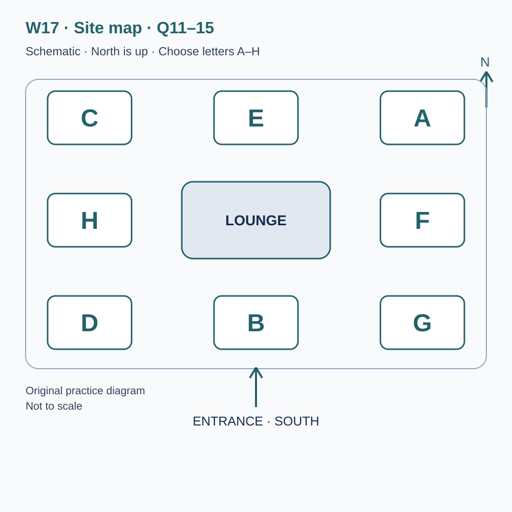
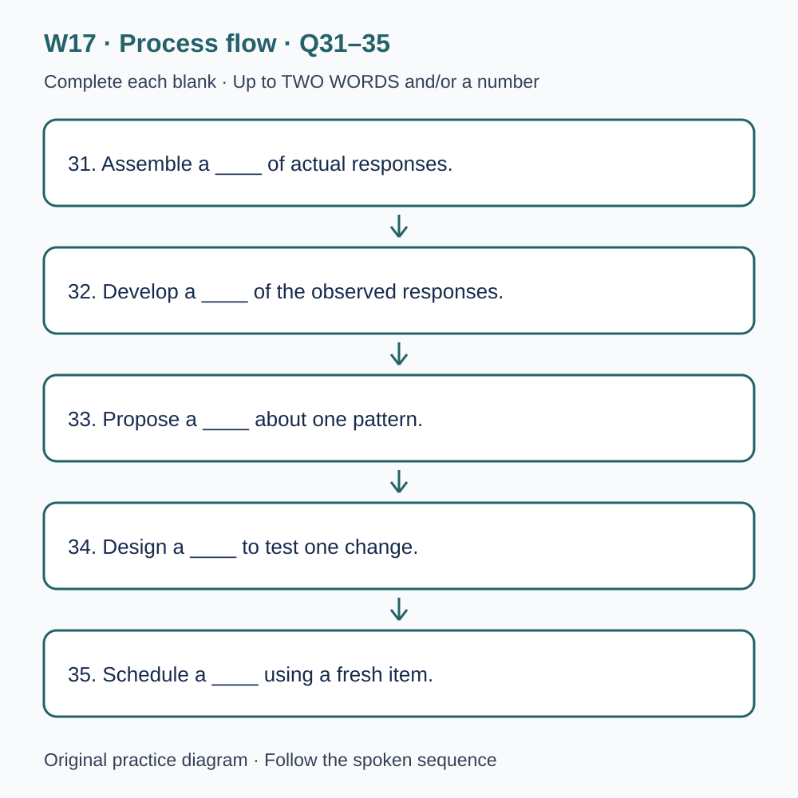

# U52 第17周听力题面与复盘（音频待补）

本页提供已核验的原创题目、参考答案和脚本。配套完整音频尚未验收，当前只能预览题面；不能进行有效的首次听力测试，也不能把读稿作答计作听力成绩或已完成一套听力。

请先保留首次作答机会：批准音频就绪前，不要展开下方答案和脚本。若已读稿，请标记为熟悉材料，之后的练习不能充当陌生题诊断。页面阅读标记只代表看过文字，不代表完成听力。

本材料非雅思真题、非标准化模考，不换算正式分数。计划分钟数不是实测音频时长；学习记录、正式测评和真人反馈须另行完成。

## 学生题面

### L-W17 — From recorded errors to a testable practice decision

> 原创 IELTS-style 技能练习，非真题、非标准化模考，不可换算正式分数。当前只有文字和题目，音频未生成，不能计作已完成听力套题。

共四部分、40 个计分空，每空 1 分。正式首次作答须等待批准音频，先不要打开 script.md 或 answers.md。朗读前先看题；只听一遍后提交首次答案及信心等级，再做精听。当前只能预览题面，不能把读稿作答记作听力成绩。

#### Part 1 — Booking an evidence review

Q1–6: Complete the notes. Write **NO MORE THAN TWO WORDS AND/OR A NUMBER** for each answer, using words from the recording. Numeric notation may replace spoken numbers. Do not repeat a printed unit. Q7–10: Choose **ONE letter, A, B or C**.

**Q1.** Workshop selected: ____

**Q2.** Confirmed day of May: ____

**Q3.** Teaching start (a.m.): ____

**Q4.** Number of places: ____

**Q5.** Total group charge: £____

**Q6.** Essential document, if the first response survives: ____

**Q7.** What can the leader conclude about a participant?

- A. A general weakness from attendance alone
- B. A complete error profile from a total
- C. Only observations supported by the available records

Answer: ____

**Q8.** What should happen to unanswered spaces?

- A. Fill them before the review
- B. Preserve them in the first response
- C. Copy the corrected version over them

Answer: ____

**Q9.** How should the reading-application requirement be handled?

- A. Describe the format need in advance
- B. Assume a worksheet photograph is equivalent
- C. Hide the arrangement from the practice record

Answer: ____

**Q10.** How should a routine attendance change be reported?

- A. By public comment alone
- B. Through an absent group member
- C. By replying to the confirmation with its reference

Answer: ____

#### Part 2 — Finding the review facilities

Q11–15: Label the map. Write **ONE letter, A–H**, for each destination. Three letters are unused. Q16–20: Choose **ONE letter, A, B or C**.

**Q11.** Check-in desk

Answer: ____

**Q12.** Records room

Answer: ____

**Q13.** Comparison room

Answer: ____

**Q14.** Consultation room

Answer: ____

**Q15.** Worksheet collection point

Answer: ____

**Q16.** What should the opening review begin with?

- A. A permanent label for the learner
- B. The first response compared with the stated requirement
- C. A guessed cause for every error

Answer: ____

**Q17.** If the earlier response is missing, participants should

- A. reconstruct it from the total
- B. use a fictional example as personal evidence
- C. record the gap and plan appropriate collection

Answer: ____

**Q18.** Before comparing scores, the group should

- A. check and consistently apply the stated scoring rule
- B. award two points for a repeated correct letter
- C. silently change ambiguous rules for one participant

Answer: ____

**Q19.** How should shared responses be identified?

- A. By displaying every personal detail
- B. By changing the code on each page
- C. By a consistent code linking the relevant records

Answer: ____

**Q20.** What makes the closing plan appropriate?

- A. Giving every participant the same weakness
- B. Choosing an action or evidence collection justified by the record
- C. Treating one error as a permanent inability

Answer: ____

#### Part 3 — Choosing the next practice trial

Q21–26: Match each proposal to the students' **final** positions at the end of that exchange. The tutor is not included. Write **A, B, C or D**. Letters may be reused.

- **A** Iris only
- **B** Owen only
- **C** Both students
- **D** Neither student

Q27–28 and Q29–30: Choose **TWO different letters, A–E**, for each pair. Write one letter in each numbered slot; either order is accepted. Each distinct correct choice earns one point, maximum two. Repeating a letter cannot earn two points. Submit no more than two letters.

**Q21.** At the END of this exchange, who supports: Selecting one observed error pattern as the next focus?

Answer: ____

**Q22.** At the END of this exchange, who supports: Preserving the first response before annotation?

Answer: ____

**Q23.** At the END of this exchange, who supports: Recording time spent reading the instruction in the next trial?

Answer: ____

**Q24.** At the END of this exchange, who supports: Classifying every blank as carelessness?

Answer: ____

**Q25.** At the END of this exchange, who supports: Using a fresh task for the very next check?

Answer: ____

**Q26.** At the END of this exchange, who supports: Keeping more than one plausible explanation in the record?

Answer: ____

**Q27–28.** Which TWO preparation steps are agreed?

- A. Compare responses with requirements and evidence
- B. Rank participants by their totals
- C. Rewrite the first answers immediately
- D. Preserve relevant attempt conditions
- E. Forecast official scores

Answers: Q27 ____ · Q28 ____

**Q29–30.** Which TWO limitations affected the completed review?

- A. All response pages were missing
- B. Only a narrow range of tasks was represented
- C. The room was unavailable
- D. The sessions were cancelled
- E. Participants had unequal replay opportunities

Answers: Q29 ____ · Q30 ____

#### Part 4 — Evaluating a proposed improvement

Q31–35: Complete the flow chart below. Q36–40: Complete the notes. Write **NO MORE THAN TWO WORDS AND/OR A NUMBER** for each answer, using words from the recording. Numeric notation may replace spoken numbers. Words or units already printed do not belong in the blank. The numbered text below repeats the SVG prompts for readability.

**Q31.** Assemble a ____ of actual responses.

**Q32.** Develop a ____ of the observed responses.

**Q33.** Propose a ____ about one pattern.

**Q34.** Design a ____ to test one change.

**Q35.** Schedule a ____ using a fresh item.

**Q36.** Preserve the ____ of each response.

**Q37.** State the ____ when calculating an error rate.

**Q38.** A rating taken before feedback records the learner's ____.

**Q39.** Availability of learning after a delay concerns ____.

**Q40.** Using learning when the task changes concerns ____.

#### 本周训练安排（音频批准后执行）

- Preview questions without the script：8 分钟。
- Future continuous first listen, including planned part pauses：32 分钟。
- Submit first answers and confidence, without a second play：8 分钟。
- Check answers and classify errors：20 分钟。
- Four Q-located intensive segments, 15 minutes each：60 分钟。
- Diagram and opinion retelling：15 分钟。
- Next-day retry of missed items：15 分钟。

合计 **158 分钟**；最多另用 22 分钟缓冲，总计不超过 180 分钟。暂停、回放与查词均计入精听预算，不能另行无限追加。当前实际已完成听力分钟数为 0。精听区段和步骤见 intensive.md；答案和脚本另页。

#### 补弱选择以真实错题为依据

当前没有本套音频或个人首答，不能指定你的弱项。已有可核验首答时，记录题号、原答、原文证据和当时条件，再选择一个反复出现且有证据的模式。没有首答或条件不明时记未知；仅学习审阅方法，待批准音频后采集新首答，不虚构错题。补弱时间使用既有60分钟精听预算，不额外叠加。

参考答案与证据（完成首次听力后再展开）

### L-W17 — Answers and evidence
> 独立答案页。先提交首次答案，再看本页。当前缺音频，文本验题不能充当实听验收。

每个单空 1 分；双选各 2 分、答案顺序不限、按不同正确选项计分。接受形式仅做大小写和空白规范化；不做模糊词形推断。

#### Q1 — error review

Accepted answers: error review

Use the final confirmed detail in this exchange; the printed unit or date context is already supplied.

Evidence locator: Q01 (script.md; timestamps unavailable).

> Adviser: Learning support desk, how may I help? Caller: Our group would like advice on reviewing mistakes from language practice. I saw a pronunciation class, but we don't yet know whether pronunciation explains our results. Adviser: Then book error review. That session starts from actual responses rather than assigning everyone the same weakness. Caller: Error review sounds appropriate. We have several answer sheets, although some are corrected copies. Adviser: Bring what you have and identify which version each sheet represents. Missing evidence is something we can record; it isn't a reason to invent the answer someone probably gave before receiving help or to diagnose a problem from a vague recollection.

#### Q2 — 19

Accepted answers: 19 / 19th / nineteenth / the nineteenth / the 19th

Use the final confirmed detail in this exchange; the printed unit or date context is already supplied.

Evidence locator: Q02 (script.md; timestamps unavailable).

> Caller: Is the session still on the twelfth of May? Adviser: That was the date on the provisional programme. The confirmed date is the nineteenth of May. Caller: The nineteenth works for four of us. I'll remove the earlier date from our shared calendar. Adviser: Please use the confirmation we send today when arranging transport. Caller: I will forward the complete message, rather than a cropped image that leaves out the workshop name. Adviser: That's useful because two different sessions are being advertised that month. A date belonging to another activity can look convincing when it has been separated from the heading that explains what it actually refers to.

#### Q3 — 9.50

Accepted answers: 9.50 / 9:50 / 09.50 / 09:50 / nine fifty

Use the final confirmed detail in this exchange; the printed unit or date context is already supplied.

Evidence locator: Q03 (script.md; timestamps unavailable).

> Caller: What time does teaching begin? Adviser: Nine fifty in the morning. The building opens at nine thirty, but the review session begins at nine fifty. Caller: So nine thirty is an opening time, not the start of our class. Adviser: Exactly. Arrive a few minutes before the session to find the desk and settle in. Caller: I'll keep that suggested arrival separate from the teaching time in our note. Adviser: The opening explanation matters. It establishes the difference between an observed wrong answer and a proposed explanation for it, so arriving after that discussion can make the later exercise rather difficult to interpret.

#### Q4 — 4

Accepted answers: 4 / four

Use the final confirmed detail in this exchange; the printed unit or date context is already supplied.

Evidence locator: Q04 (script.md; timestamps unavailable).

> Adviser: How many places should I reserve? Caller: Six people belong to our study group, but two cannot attend. Please book four places. Adviser: Four places are available. Will everyone bring a separate response? Caller: Yes, although we'll also collect questions from the absent members. We aren't booking seats for them. Adviser: That's fine. If somebody else comes in place of a confirmed participant, update the booking through the contact route in your confirmation. Caller: I'll keep the attendance list current. We don't want the leader to prepare a paired exercise for one number and then discover a different group when the session is about to begin.

#### Q5 — 52

Accepted answers: 52 / 52.00 / fifty-two / fifty two

Use the final confirmed detail in this exchange; the printed unit or date context is already supplied.

Evidence locator: Q05 (script.md; timestamps unavailable).

> Caller: What is the total charge? Adviser: The group booking for those four places is fifty-two pounds altogether. Caller: Fifty-two pounds for the whole group, rather than for each person? Adviser: Correct. That includes the printed comparison materials. An individual appointment after the workshop would be a separate booking, and you haven't requested one. Caller: I'll tell the person handling payment both the total and what it covers. Adviser: Please compare those details with the confirmation before paying. If it shows a different number of places, let us correct the record instead of assuming that an unexplained extra charge must refer to an additional service.

#### Q6 — answer sheet

Accepted answers: answer sheet / sheet / the sheet / a sheet

Use the final confirmed detail in this exchange; the printed unit or date context is already supplied.

Evidence locator: Q06 (script.md; timestamps unavailable).

> Caller: Which document is essential? Adviser: Bring an answer sheet showing a genuine first response, if one survives. A personal error log is useful but optional. Caller: I'll bring the answer sheet I submitted before looking at the key. Adviser: Good. Keep the sheet separate from a corrected copy. If you have only a later version, label it honestly rather than rewrite it to look like an original. Caller: One member has no saved first response. Adviser: That person's earlier error pattern must remain unknown. They can learn the review procedure and collect a new response later; we cannot recover reliable evidence simply by asking them to guess their previous answers.

#### Q7 — C

Accepted answers: C

The leader distinguishes an observation from its possible cause; a settled explanation is not guaranteed.

Evidence locator: Q07 (script.md; timestamps unavailable).

> Caller: Will the leader tell each of us our main weakness? Adviser: Only if the records support a sufficiently narrow observation. A few wrong answers do not automatically establish a general weakness in vocabulary, attention or memory. Caller: So we shouldn't expect a personal diagnosis from attendance alone. Adviser: Exactly. The leader can help you distinguish what happened from possible reasons and identify what further evidence would be useful. Caller: That sounds more helpful than receiving the same label as everyone else. Adviser: You may leave with a question to investigate rather than a settled explanation. That is still a practical outcome if the next activity can address the uncertainty.

#### Q8 — B

Accepted answers: B

The original blanks remain; later recollections and corrections are separate.

Evidence locator: Q08 (script.md; timestamps unavailable).

> Caller: Should we fill in unanswered spaces before bringing the sheet? Adviser: No. Preserve the first response, including blanks. A blank may reflect a missed instruction, a decision to move on, or a difficulty hearing the information. Filling it later would hide what the original record actually shows. Caller: We can add a separate note explaining what we remember. Adviser: Yes, but mark it as a later account, not part of the first response. Caller: And a corrected answer goes on another copy. Adviser: Right. The distinction makes it possible to discuss learning after feedback without accidentally treating that learning as evidence of what you knew before the feedback arrived.

#### Q9 — A

Accepted answers: A

The centre checks a specific request and relevant conditions stay visible.

Evidence locator: Q09 (script.md; timestamps unavailable).

> Caller: One participant uses a reading application for printed instructions. Should we mention that now? Adviser: Yes, describe the practical format requirement before the session. We can check which files are available and explain any limitations. Caller: I won't assume a photograph of the worksheet will be equivalent. Adviser: Thank you. Different formats can affect how a task is accessed, and the review needs a clear record of the arrangement actually used. Caller: Should that appear in the practice record? Adviser: If it changes a relevant condition, yes. Recording support doesn't diminish the work; it helps the reviewer understand what conclusions a comparison can reasonably support.

#### Q10 — C

Accepted answers: C

Public comments do not update the attendance record.

Evidence locator: Q10 (script.md; timestamps unavailable).

> Caller: If our attendance changes, can I leave a message under the public workshop notice? Adviser: Please use the booking reference and reply to the confirmation instead. Public comments are not checked as an attendance list. For an urgent change, use the contact number in that same message. Caller: I'll keep the full confirmation until the visit is over. Adviser: Good. It contains the room instructions as well as the reference. Caller: I'll also remind everyone that the workshop reviews genuine records rather than promising a score. Adviser: That's the right expectation. We can help organise a careful enquiry, but the evidence still has to come from work that actually happened.

#### Q11 — B

Accepted answers: B

Use the explicitly stated position relative to the lounge, not an earlier layout or adjacent area.

Evidence locator: Q11 (script.md; timestamps unavailable).

> Welcome to the review centre. North is at the top of the map, and the entrance is on the southern edge. The lounge in the centre is our fixed reference point. The check-in desk is directly south of the lounge, on the entrance axis. It is not in either southern corner. Please report there before taking materials into another room. Staff will confirm which activity you booked and whether any practical arrangement has changed. A letter on the diagram identifies a position, not the first letter of a room name, so use the spoken directions rather than guessing from the labels when you complete the map.

#### Q12 — C

Accepted answers: C

Use the explicitly stated position relative to the lounge, not an earlier layout or adjacent area.

Evidence locator: Q12 (script.md; timestamps unavailable).

> The records room is in the north-west corner. It lies west of the northern central room and diagonally north-west of the lounge. An old leaflet put this activity directly north, but that position now serves another group. In the records room, you can arrange original and corrected responses in a sequence that preserves their relationship. Don't remove a page merely because it contains an embarrassing mistake. The point is to understand the work that was submitted, not construct an improved history after the event. Any identifying details that aren't needed for the exercise should be covered before material is shared with another participant.

#### Q13 — F

Accepted answers: F

Use the explicitly stated position relative to the lounge, not an earlier layout or adjacent area.

Evidence locator: Q13 (script.md; timestamps unavailable).

> The comparison room is directly east of the lounge, level with its centre. It is not the south-east room. Tables there hold paired examples showing a first response and a later revision. Before deciding that one is better, check what changed between the two attempts, including the information available to the writer. A revision made with the key open answers a different question from an unaided first response. Both can be useful, provided the comparison doesn't hide that difference. Please keep each pair together and return it in its labelled folder rather than sorting pages by which answer appears most polished at first glance.

#### Q14 — A

Accepted answers: A

Use the explicitly stated position relative to the lounge, not an earlier layout or adjacent area.

Evidence locator: Q14 (script.md; timestamps unavailable).

> The consultation room occupies the north-east corner. It is directly north of the comparison room and directly east of the northern central room. Those northern rooms share a row, so the consultation room is east of its neighbour, not north-east of that neighbour. Small groups use it to discuss one proposed explanation for an observed error. The leader may ask what evidence would count against your explanation. That question is intended to make the proposal testable, not to suggest that every interpretation must be wrong. Keep a distinction between a possibility worth checking and a conclusion already justified by the records on the table.

#### Q15 — D

Accepted answers: D

Use the explicitly stated position relative to the lounge, not an earlier layout or adjacent area.

Evidence locator: Q15 (script.md; timestamps unavailable).

> The worksheet collection point is in the south-west corner. It is west of check-in and below the room directly west of the lounge. Collect the version named by your leader, because several sheets use similar tables for different purposes. One asks for an observation; another asks for a possible cause. Copying a phrase into the wrong column can make a tentative explanation look like an established fact. If you are unsure which sheet belongs to your group, ask the helper. The collection point supplies materials, but the helper won't choose a personal weakness for you or fill a missing response with an imagined example.

#### Q16 — B

Accepted answers: B

An observable response is examined before interpreting its cause.

Evidence locator: Q16 (script.md; timestamps unavailable).

> During the opening activity, keep the first response visible before consulting feedback. Record exactly what was written or left blank, then compare it with the stated answer requirements. An explanation such as I was careless may feel familiar, but it doesn't describe the response precisely enough to guide a next step. You might instead note that the answer repeated a unit already printed in the question. That is an observable feature. Whether it arose from haste, a misunderstood instruction or another cause remains a separate question. Beginning with the response gives everyone a common object to discuss before interpretations start to diverge.

#### Q17 — C

Accepted answers: C

Fictional examples can demonstrate a method but cannot establish a personal error pattern.

Evidence locator: Q17 (script.md; timestamps unavailable).

> If an earlier response is missing, record the gap. Don't reconstruct a complete error profile from the final score or from what another group member usually finds difficult. A total can identify neither the exact answers nor the conditions under which they were produced. You can still practise the review method using a clearly labelled fictional example, but that example is not evidence about your own performance. When approved listening material becomes available, collect a new first response under stated conditions. Until then, the missing personal evidence remains unknown. A cautious blank in a record is more informative than a confident diagnosis built from invented details.

#### Q18 — A

Accepted answers: A

Scoring rules and ambiguities must be visible; duplicates do not earn another point.

Evidence locator: Q18 (script.md; timestamps unavailable).

> Before comparing totals, check the scoring rule. Some tasks give one point for each distinct correct option, so writing the same correct letter twice does not produce two points. Other questions require a word or phrase that fits the grammar already printed around the blank. The comparison exercise asks you to apply the stated rule consistently, not to reward an answer because its intention seems clear. If the rule itself is ambiguous, flag it for review rather than silently changing it for one participant. Keeping the scoring decision visible helps distinguish an assessment problem from a problem in the response being assessed.

#### Q19 — C

Accepted answers: C

A consistent code connects pages without unnecessary identifying details.

Evidence locator: Q19 (script.md; timestamps unavailable).

> When sharing a response, use a participant code and remove identifying information that the exercise doesn't need. The code should allow you to reconnect the pages belonging to the same attempt without exposing a name to everyone in the room. Keep the code consistent between the answer sheet and the separate conditions note. Changing it halfway through the exercise would create uncertainty about which record belongs with which response. The task concerns learning decisions, not comparisons of named individuals. A carefully limited record can preserve the evidence needed for discussion while avoiding details that contribute nothing to the question the group is investigating.

#### Q20 — B

Accepted answers: B

The next step depends on actual evidence and may be collection rather than remediation.

Evidence locator: Q20 (script.md; timestamps unavailable).

> At the end, choose one manageable action connected to the evidence you have. A useful plan identifies the observed problem, a proposed explanation and a way to check whether the action helps. If the explanation remains uncertain, say so. Don't write a permanent label such as bad listener merely because one response was incomplete. You may decide that another first response is needed before selecting a practice focus. That is a valid next step when evidence is missing. The review should make the next decision clearer, rather than force every participant to leave with a weakness that the available records cannot actually establish.

#### Q21 — A

Accepted answers: A

Final stance: Iris only. Ignore an initial proposal if later withdrawn; the tutor is not an answer option.

Evidence locator: Q21 (script.md; timestamps unavailable).

> Tutor: You examined the saved responses last week. What should the next practice trial focus on? Iris: One recurring error pattern at a time. I'd select the duplicated units we actually found on three sheets. Owen: I would compare two patterns first, because an omitted condition may have a larger effect on the task. Tutor: Does that mean you reject the evidence about units? Owen: No. I disagree about the next priority, not whether those responses exist. Iris: I still support choosing one pattern now and keeping the other for later. Tutor: Then Iris supports that proposal, while Owen wants a comparison before the group narrows its focus.

#### Q22 — C

Accepted answers: C

Final stance: Both students. Ignore an initial proposal if later withdrawn; the tutor is not an answer option.

Evidence locator: Q22 (script.md; timestamps unavailable).

> Tutor: Should you preserve the first response before annotating it? Owen: Yes. I initially thought one corrected copy would be enough, but it hides the sequence of decisions. Iris: I agree. We can keep the original and add comments on a separate version. Tutor: What if somebody notices an obvious spelling error immediately after submission? Iris: Record the correction later without altering the saved first response. Owen: That lets us examine both the original difficulty and what the participant can repair without further help. Tutor: Good. You both support preserving the initial version, and that agreement doesn't prevent revision; it makes the revision's relationship to the first attempt visible.

#### Q23 — B

Accepted answers: B

Final stance: Owen only. Ignore an initial proposal if later withdrawn; the tutor is not an answer option.

Evidence locator: Q23 (script.md; timestamps unavailable).

> Tutor: Owen proposes recording the time spent on the instruction before answering. Owen: I support that for the next trial. We know some people missed the word only, but not whether they read the line quickly or misunderstood it after careful reading. Iris: I'd keep the procedure simpler and ask for a brief explanation after the attempt. Another timing signal could change how participants behave. Tutor: Would a silent observer solve that concern? Iris: It might reduce interruption, but I still prefer the explanation for this stage. Owen: I continue to favour the timing record. Tutor: Then the specific timing proposal remains Owen's, not a shared procedure.

#### Q24 — D

Accepted answers: D

Final stance: Neither student. Ignore an initial proposal if later withdrawn; the tutor is not an answer option.

Evidence locator: Q24 (script.md; timestamps unavailable).

> Tutor: Your early notes classify every blank answer as carelessness. Iris: I wrote that heading before examining the sheets closely. I don't think we can defend it now. Owen: Neither do I. One participant reported losing the question position, and another didn't understand the required category. Iris: I'll remove the heading rather than pretend those are the same cause. Tutor: Are you replacing it with another universal label? Iris: No. We'll record the blank and keep the explanation open unless there is supporting evidence. Owen: Agreed. Tutor: Then neither of you supports the original classification, even though it appeared in the first version of your review table.

#### Q25 — A

Accepted answers: A

Final stance: Iris only. Ignore an initial proposal if later withdrawn; the tutor is not an answer option.

Evidence locator: Q25 (script.md; timestamps unavailable).

> Tutor: Should the next check use a new task? Iris: Yes. If participants remember the corrected answer, repeating the old task may show memory of feedback rather than use of the intended procedure. Owen: I would repeat the old task once to check whether they can explain the correction before introducing unfamiliar material. Tutor: Could those activities serve different purposes? Owen: Certainly, but for the very next check I prefer the familiar task. Iris: I still want a fresh example with the same instruction demand. Tutor: Then your priorities differ. Don't report agreement merely because both of you recognise that familiar and unfamiliar tasks can provide useful but different kinds of evidence.

#### Q26 — C

Accepted answers: C

Final stance: Both students. Ignore an initial proposal if later withdrawn; the tutor is not an answer option.

Evidence locator: Q26 (script.md; timestamps unavailable).

> Tutor: What should happen when two explanations remain plausible? Owen: Keep both in the record and identify what might distinguish them. Iris: I agree. I originally wanted one cause in every row, but that would make the table more definite than our evidence. Tutor: Would you leave the next action unspecified? Iris: Not necessarily. We can choose a small trial aimed at one distinction and state its limits. Owen: And avoid treating a successful answer as proof that the other explanation was impossible. Tutor: Good. Both of you support retaining uncertainty where it belongs, while still making a practical decision about what information the next attempt should collect.

#### Q27–28 — A, D

Accept unordered set: A, D. One point per distinct correct choice, maximum 2.

The agreed steps concern the actual response and its conditions, not rankings or forecasts.

Evidence locator: Q27, Q28 (script.md; timestamps unavailable).

> Tutor: Let's settle the preparation steps you actually agree on. Iris: First, compare each response with the question wording and its evidence block. That should reveal whether the problem is in the answer or in our interpretation of the requirement. Owen: I agree. We shouldn't begin by ranking people or guessing their ability from a total. Tutor: Are you proposing to rewrite the original answers at this stage? Iris: No. The first response stays intact. We record the comparison alongside it. Owen: And a low total doesn't give us permission to assume every answer has the same cause. Tutor: Then comparison with the requirement is one agreed preparation step.

> Tutor: What is the other preparation step? Owen: Preserve a note of the conditions, including any replay or help received. Iris: Agreed. A second attempt with repeated listening cannot be treated as though it had exactly the same conditions as the first. Tutor: Do you need a forecast of an official score? Iris: No. That would exceed what this small trial can support. Owen: We also don't need a decorative chart before the records are clear. Tutor: So the two agreed steps are comparing the response with the requirement and evidence, and preserving the relevant conditions. Keep those distinct from attractive additions that the group hasn't selected.

#### Q29–30 — B, E

Accept unordered set: B, E. One point per distinct correct choice, maximum 2.

The limitation is narrow task coverage plus unequal replay, not lost sheets or cancelled sessions.

Evidence locator: Q29, Q30 (script.md; timestamps unavailable).

> Tutor: What limits the conclusion from last week's review? Iris: The saved responses came from only a narrow range of tasks. We saw several short completion items but almost no extended discussion questions. Owen: Yes. That limits any claim that the same pattern appears across every listening demand. Tutor: Were the papers lost or incomplete? Iris: No, the sheets in that small sample were complete. The limitation is coverage, not missing pages. Owen: We should describe which tasks were represented instead of using the broad phrase all listening. Tutor: That description will help a later reviewer decide whether another sample answers the same question or extends it to a different demand.

> Tutor: Was there a second limitation? Owen: Participants had unequal opportunities to replay the material before the responses we reviewed were saved. Iris: Exactly. Some sheets represented a first attempt, while others followed another play, and those versions were labelled. Tutor: Then you cannot attribute the difference in totals solely to the practice advice. Iris: Correct. We can still examine the responses, but the comparison is qualified. Owen: The room was available and the sessions happened; neither was the problem. Tutor: Record the narrow task range and unequal replay as the two limitations, rather than adding plausible obstacles that did not occur in this particular review.

#### Q31 — sample

Accepted answers: sample / response sample

Complete the named stage in the stated process order; retain any word already printed around the blank.

Evidence locator: Q31 (script.md; timestamps unavailable).

> Consider a fictional team evaluating a proposed improvement in language practice. The first stage assembles a sample of actual responses. The sample must contain work that was genuinely produced, with enough context to identify the task and the conditions. It should not consist of answers reconstructed after the key has been read. A response sample can be small, but its scope needs to be stated. If no suitable work survives, this stage records a gap and plans collection instead of inventing evidence. The team can demonstrate the method with fictional material, provided that material remains clearly separate from claims about the learner's own performance.

#### Q32 — classification

Accepted answers: classification / working classification

Complete the named stage in the stated process order; retain any word already printed around the blank.

Evidence locator: Q32 (script.md; timestamps unavailable).

> The second stage develops a classification of the observed responses. Classification groups features that can be identified from the work, such as a duplicated unit, an omitted condition or a selected distractor. The team should explain the categories rather than assume that a label means the same thing to every reviewer. This working classification is not yet a diagnosis. Two responses in the same category may have different causes, and one response may present more than one relevant feature. A small disagreement between reviewers can reveal a definition that needs clarification. The objective is a usable description of what happened, not a table that appears perfectly orderly because difficult cases were removed.

#### Q33 — hypothesis

Accepted answers: hypothesis / working hypothesis

Complete the named stage in the stated process order; retain any word already printed around the blank.

Evidence locator: Q33 (script.md; timestamps unavailable).

> The third stage proposes a hypothesis about one pattern. A hypothesis is an explanation to investigate, not a cause established by giving it a confident name. For example, repeated unit duplication might reflect uncertainty about whether the printed symbol belongs inside the answer. It could also reflect a habit of copying a complete phrase without checking the blank. The team states what observations would help distinguish these accounts. A working hypothesis should lead to a specific question for the next attempt. If every possible outcome would be described as supporting it, the proposal is too flexible to guide a meaningful check of the explanation.

#### Q34 — trial

Accepted answers: trial / targeted trial

Complete the named stage in the stated process order; retain any word already printed around the blank.

Evidence locator: Q34 (script.md; timestamps unavailable).

> The fourth stage designs a targeted trial. The trial changes one manageable feature of the procedure, such as asking participants to mark printed units before beginning. It keeps other relevant conditions visible so that a later comparison has a clear basis. A successful response after the prompt may show that the prompt was useful in that setting; it does not establish that all earlier errors had the same cause. The team also records whether the change creates another difficulty, perhaps by consuming attention needed elsewhere. A targeted trial is valuable when it tests a defined proposition, not merely when it gives participants more practice and produces a higher total.

#### Q35 — retest

Accepted answers: retest / later check / check

Complete the named stage in the stated process order; retain any word already printed around the blank.

Evidence locator: Q35 (script.md; timestamps unavailable).

> The fifth stage schedules a retest using a fresh item with the same relevant demand. This later check asks whether the intended procedure can be used without simply recalling the old answer. The retest should have a stated purpose and a record of support received. A task that is much easier than the first would complicate interpretation even if the timing were identical. The team need not pretend that two tasks are perfectly equivalent, but it should explain the important differences. The result can support a limited decision about the next practice step while leaving wider claims about general ability unresolved until further evidence is available.

#### Q36 — provenance

Accepted answers: provenance / source history / history

The corresponding evidence block supplies this distinction or qualification; the question retains the surrounding grammar.

Evidence locator: Q36 (script.md; timestamps unavailable).

> Provenance matters throughout the review. Here, provenance means the source history of a response: which task produced it, when it was saved, and whether it preceded or followed feedback. A number copied into a spreadsheet can lose that history even when the number itself is accurate. The team therefore preserves links between the summary and the underlying work. Without them, a later reviewer may be unable to tell whether an apparent improvement compares two first attempts or a first attempt with a corrected version. Keeping provenance visible makes the evidence inspectable and allows mistakes in the record to be corrected without rewriting the learner's history.

#### Q37 — denominator

Accepted answers: denominator

The corresponding evidence block supplies this distinction or qualification; the question retains the surrounding grammar.

Evidence locator: Q37 (script.md; timestamps unavailable).

> A rate of errors also requires a denominator. The denominator identifies how many relevant opportunities there were, rather than merely how many errors were counted. Two duplicated units among two applicable questions mean something different from two among twenty. The task set may change the number of opportunities even when the total number of questions remains constant. The team should therefore state which items could display the pattern being counted. A percentage with an unclear denominator can look precise while answering an unstable question. The useful comparison connects the count to the actual task demands instead of treating every question as an identical opportunity for every kind of error.

#### Q38 — confidence

Accepted answers: confidence / initial confidence

The corresponding evidence block supplies this distinction or qualification; the question retains the surrounding grammar.

Evidence locator: Q38 (script.md; timestamps unavailable).

> Confidence can provide another kind of information if it is recorded before feedback. A participant may select the correct answer with low confidence or defend an incorrect answer for a reason that reveals a misunderstanding. These cases can guide a discussion, but confidence is not itself a mark of correctness. The team should preserve the initial confidence rating and ask for its basis rather than replace it with the certainty that follows seeing the key. Different people may interpret a scale differently, so a shared description helps. The value lies in comparing a judgement with the evidence available at the time, not in encouraging everyone to sound equally sure.

#### Q39 — retention

Accepted answers: retention

The corresponding evidence block supplies this distinction or qualification; the question retains the surrounding grammar.

Evidence locator: Q39 (script.md; timestamps unavailable).

> Retention concerns whether something learned remains available after a delay. An immediate corrected response may reflect information still present from feedback, while a later attempt asks a different question. The review should identify what knowledge or procedure the delayed check is intended to examine. If the later task introduces a new difficulty, a lower score cannot automatically mean that the earlier learning disappeared. The team records those conditions and keeps its conclusion narrow. Retention is therefore not a single label attached to a person. It is a question about a specified piece of learning, a stated interval and the circumstances under which that learning is used again.

#### Q40 — transfer

Accepted answers: transfer

The corresponding evidence block supplies this distinction or qualification; the question retains the surrounding grammar.

Evidence locator: Q40 (script.md; timestamps unavailable).

> Transfer concerns using the learning when the task changes. A participant who checks printed units on one familiar sheet may overlook the same requirement in a new layout. The team can investigate whether the underlying procedure carries across, rather than repeatedly presenting the old item until its answer is remembered. It should describe which feature stays relevant and which features change. An unsuccessful transfer attempt can prompt another question about the procedure or the new demand, without proving that the earlier work was useless. The review ends by selecting the next evidence to collect, not by turning a small fictional exercise into a permanent judgement of the learner's ability.

完整脚本（提前阅读会失去陌生题首答机会）

### L-W17 — From recorded errors to a testable practice decision: transcript
> 原创虚构练习，非真题；音频缺失。仅供完成首次作答后的核对或文字审阅。Q 标记与角色名不属于朗读正文。

#### Part 1 — Booking an evidence review

##### Q1 evidence block

**Adviser:** Learning support desk, how may I help?

**Caller:** Our group would like advice on reviewing mistakes from language practice. I saw a pronunciation class, but we don't yet know whether pronunciation explains our results.

**Adviser:** Then book error review. That session starts from actual responses rather than assigning everyone the same weakness.

**Caller:** Error review sounds appropriate. We have several answer sheets, although some are corrected copies.

**Adviser:** Bring what you have and identify which version each sheet represents. Missing evidence is something we can record; it isn't a reason to invent the answer someone probably gave before receiving help or to diagnose a problem from a vague recollection.

##### Q2 evidence block

**Caller:** Is the session still on the twelfth of May?

**Adviser:** That was the date on the provisional programme. The confirmed date is the nineteenth of May.

**Caller:** The nineteenth works for four of us. I'll remove the earlier date from our shared calendar.

**Adviser:** Please use the confirmation we send today when arranging transport.

**Caller:** I will forward the complete message, rather than a cropped image that leaves out the workshop name.

**Adviser:** That's useful because two different sessions are being advertised that month. A date belonging to another activity can look convincing when it has been separated from the heading that explains what it actually refers to.

##### Q3 evidence block

**Caller:** What time does teaching begin?

**Adviser:** Nine fifty in the morning. The building opens at nine thirty, but the review session begins at nine fifty.

**Caller:** So nine thirty is an opening time, not the start of our class.

**Adviser:** Exactly. Arrive a few minutes before the session to find the desk and settle in.

**Caller:** I'll keep that suggested arrival separate from the teaching time in our note.

**Adviser:** The opening explanation matters. It establishes the difference between an observed wrong answer and a proposed explanation for it, so arriving after that discussion can make the later exercise rather difficult to interpret.

##### Q4 evidence block

**Adviser:** How many places should I reserve?

**Caller:** Six people belong to our study group, but two cannot attend. Please book four places.

**Adviser:** Four places are available. Will everyone bring a separate response?

**Caller:** Yes, although we'll also collect questions from the absent members. We aren't booking seats for them.

**Adviser:** That's fine. If somebody else comes in place of a confirmed participant, update the booking through the contact route in your confirmation.

**Caller:** I'll keep the attendance list current. We don't want the leader to prepare a paired exercise for one number and then discover a different group when the session is about to begin.

##### Q5 evidence block

**Caller:** What is the total charge?

**Adviser:** The group booking for those four places is fifty-two pounds altogether.

**Caller:** Fifty-two pounds for the whole group, rather than for each person?

**Adviser:** Correct. That includes the printed comparison materials. An individual appointment after the workshop would be a separate booking, and you haven't requested one.

**Caller:** I'll tell the person handling payment both the total and what it covers.

**Adviser:** Please compare those details with the confirmation before paying. If it shows a different number of places, let us correct the record instead of assuming that an unexplained extra charge must refer to an additional service.

##### Q6 evidence block

**Caller:** Which document is essential?

**Adviser:** Bring an answer sheet showing a genuine first response, if one survives. A personal error log is useful but optional.

**Caller:** I'll bring the answer sheet I submitted before looking at the key.

**Adviser:** Good. Keep the sheet separate from a corrected copy. If you have only a later version, label it honestly rather than rewrite it to look like an original.

**Caller:** One member has no saved first response.

**Adviser:** That person's earlier error pattern must remain unknown. They can learn the review procedure and collect a new response later; we cannot recover reliable evidence simply by asking them to guess their previous answers.

##### Q7 evidence block

**Caller:** Will the leader tell each of us our main weakness?

**Adviser:** Only if the records support a sufficiently narrow observation. A few wrong answers do not automatically establish a general weakness in vocabulary, attention or memory.

**Caller:** So we shouldn't expect a personal diagnosis from attendance alone.

**Adviser:** Exactly. The leader can help you distinguish what happened from possible reasons and identify what further evidence would be useful.

**Caller:** That sounds more helpful than receiving the same label as everyone else.

**Adviser:** You may leave with a question to investigate rather than a settled explanation. That is still a practical outcome if the next activity can address the uncertainty.

##### Q8 evidence block

**Caller:** Should we fill in unanswered spaces before bringing the sheet?

**Adviser:** No. Preserve the first response, including blanks. A blank may reflect a missed instruction, a decision to move on, or a difficulty hearing the information. Filling it later would hide what the original record actually shows.

**Caller:** We can add a separate note explaining what we remember.

**Adviser:** Yes, but mark it as a later account, not part of the first response.

**Caller:** And a corrected answer goes on another copy.

**Adviser:** Right. The distinction makes it possible to discuss learning after feedback without accidentally treating that learning as evidence of what you knew before the feedback arrived.

##### Q9 evidence block

**Caller:** One participant uses a reading application for printed instructions. Should we mention that now?

**Adviser:** Yes, describe the practical format requirement before the session. We can check which files are available and explain any limitations.

**Caller:** I won't assume a photograph of the worksheet will be equivalent.

**Adviser:** Thank you. Different formats can affect how a task is accessed, and the review needs a clear record of the arrangement actually used.

**Caller:** Should that appear in the practice record?

**Adviser:** If it changes a relevant condition, yes. Recording support doesn't diminish the work; it helps the reviewer understand what conclusions a comparison can reasonably support.

##### Q10 evidence block

**Caller:** If our attendance changes, can I leave a message under the public workshop notice?

**Adviser:** Please use the booking reference and reply to the confirmation instead. Public comments are not checked as an attendance list. For an urgent change, use the contact number in that same message.

**Caller:** I'll keep the full confirmation until the visit is over.

**Adviser:** Good. It contains the room instructions as well as the reference.

**Caller:** I'll also remind everyone that the workshop reviews genuine records rather than promising a score.

**Adviser:** That's the right expectation. We can help organise a careful enquiry, but the evidence still has to come from work that actually happened.

#### Part 2 — Finding the review facilities

##### Q11 evidence block

**Centre host:** Welcome to the review centre. North is at the top of the map, and the entrance is on the southern edge. The lounge in the centre is our fixed reference point. The check-in desk is directly south of the lounge, on the entrance axis. It is not in either southern corner. Please report there before taking materials into another room. Staff will confirm which activity you booked and whether any practical arrangement has changed. A letter on the diagram identifies a position, not the first letter of a room name, so use the spoken directions rather than guessing from the labels when you complete the map.

##### Q12 evidence block

**Centre host:** The records room is in the north-west corner. It lies west of the northern central room and diagonally north-west of the lounge. An old leaflet put this activity directly north, but that position now serves another group. In the records room, you can arrange original and corrected responses in a sequence that preserves their relationship. Don't remove a page merely because it contains an embarrassing mistake. The point is to understand the work that was submitted, not construct an improved history after the event. Any identifying details that aren't needed for the exercise should be covered before material is shared with another participant.

##### Q13 evidence block

**Centre host:** The comparison room is directly east of the lounge, level with its centre. It is not the south-east room. Tables there hold paired examples showing a first response and a later revision. Before deciding that one is better, check what changed between the two attempts, including the information available to the writer. A revision made with the key open answers a different question from an unaided first response. Both can be useful, provided the comparison doesn't hide that difference. Please keep each pair together and return it in its labelled folder rather than sorting pages by which answer appears most polished at first glance.

##### Q14 evidence block

**Centre host:** The consultation room occupies the north-east corner. It is directly north of the comparison room and directly east of the northern central room. Those northern rooms share a row, so the consultation room is east of its neighbour, not north-east of that neighbour. Small groups use it to discuss one proposed explanation for an observed error. The leader may ask what evidence would count against your explanation. That question is intended to make the proposal testable, not to suggest that every interpretation must be wrong. Keep a distinction between a possibility worth checking and a conclusion already justified by the records on the table.

##### Q15 evidence block

**Centre host:** The worksheet collection point is in the south-west corner. It is west of check-in and below the room directly west of the lounge. Collect the version named by your leader, because several sheets use similar tables for different purposes. One asks for an observation; another asks for a possible cause. Copying a phrase into the wrong column can make a tentative explanation look like an established fact. If you are unsure which sheet belongs to your group, ask the helper. The collection point supplies materials, but the helper won't choose a personal weakness for you or fill a missing response with an imagined example.

##### Q16 evidence block

**Centre host:** During the opening activity, keep the first response visible before consulting feedback. Record exactly what was written or left blank, then compare it with the stated answer requirements. An explanation such as I was careless may feel familiar, but it doesn't describe the response precisely enough to guide a next step. You might instead note that the answer repeated a unit already printed in the question. That is an observable feature. Whether it arose from haste, a misunderstood instruction or another cause remains a separate question. Beginning with the response gives everyone a common object to discuss before interpretations start to diverge.

##### Q17 evidence block

**Centre host:** If an earlier response is missing, record the gap. Don't reconstruct a complete error profile from the final score or from what another group member usually finds difficult. A total can identify neither the exact answers nor the conditions under which they were produced. You can still practise the review method using a clearly labelled fictional example, but that example is not evidence about your own performance. When approved listening material becomes available, collect a new first response under stated conditions. Until then, the missing personal evidence remains unknown. A cautious blank in a record is more informative than a confident diagnosis built from invented details.

##### Q18 evidence block

**Centre host:** Before comparing totals, check the scoring rule. Some tasks give one point for each distinct correct option, so writing the same correct letter twice does not produce two points. Other questions require a word or phrase that fits the grammar already printed around the blank. The comparison exercise asks you to apply the stated rule consistently, not to reward an answer because its intention seems clear. If the rule itself is ambiguous, flag it for review rather than silently changing it for one participant. Keeping the scoring decision visible helps distinguish an assessment problem from a problem in the response being assessed.

##### Q19 evidence block

**Centre host:** When sharing a response, use a participant code and remove identifying information that the exercise doesn't need. The code should allow you to reconnect the pages belonging to the same attempt without exposing a name to everyone in the room. Keep the code consistent between the answer sheet and the separate conditions note. Changing it halfway through the exercise would create uncertainty about which record belongs with which response. The task concerns learning decisions, not comparisons of named individuals. A carefully limited record can preserve the evidence needed for discussion while avoiding details that contribute nothing to the question the group is investigating.

##### Q20 evidence block

**Centre host:** At the end, choose one manageable action connected to the evidence you have. A useful plan identifies the observed problem, a proposed explanation and a way to check whether the action helps. If the explanation remains uncertain, say so. Don't write a permanent label such as bad listener merely because one response was incomplete. You may decide that another first response is needed before selecting a practice focus. That is a valid next step when evidence is missing. The review should make the next decision clearer, rather than force every participant to leave with a weakness that the available records cannot actually establish.

#### Part 3 — Choosing the next practice trial

##### Q21 evidence block

**Tutor:** You examined the saved responses last week. What should the next practice trial focus on?

**Iris:** One recurring error pattern at a time. I'd select the duplicated units we actually found on three sheets.

**Owen:** I would compare two patterns first, because an omitted condition may have a larger effect on the task.

**Tutor:** Does that mean you reject the evidence about units?

**Owen:** No. I disagree about the next priority, not whether those responses exist.

**Iris:** I still support choosing one pattern now and keeping the other for later.

**Tutor:** Then Iris supports that proposal, while Owen wants a comparison before the group narrows its focus.

##### Q22 evidence block

**Tutor:** Should you preserve the first response before annotating it?

**Owen:** Yes. I initially thought one corrected copy would be enough, but it hides the sequence of decisions.

**Iris:** I agree. We can keep the original and add comments on a separate version.

**Tutor:** What if somebody notices an obvious spelling error immediately after submission?

**Iris:** Record the correction later without altering the saved first response.

**Owen:** That lets us examine both the original difficulty and what the participant can repair without further help.

**Tutor:** Good. You both support preserving the initial version, and that agreement doesn't prevent revision; it makes the revision's relationship to the first attempt visible.

##### Q23 evidence block

**Tutor:** Owen proposes recording the time spent on the instruction before answering.

**Owen:** I support that for the next trial. We know some people missed the word only, but not whether they read the line quickly or misunderstood it after careful reading.

**Iris:** I'd keep the procedure simpler and ask for a brief explanation after the attempt. Another timing signal could change how participants behave.

**Tutor:** Would a silent observer solve that concern?

**Iris:** It might reduce interruption, but I still prefer the explanation for this stage.

**Owen:** I continue to favour the timing record.

**Tutor:** Then the specific timing proposal remains Owen's, not a shared procedure.

##### Q24 evidence block

**Tutor:** Your early notes classify every blank answer as carelessness.

**Iris:** I wrote that heading before examining the sheets closely. I don't think we can defend it now.

**Owen:** Neither do I. One participant reported losing the question position, and another didn't understand the required category.

**Iris:** I'll remove the heading rather than pretend those are the same cause.

**Tutor:** Are you replacing it with another universal label?

**Iris:** No. We'll record the blank and keep the explanation open unless there is supporting evidence.

**Owen:** Agreed.

**Tutor:** Then neither of you supports the original classification, even though it appeared in the first version of your review table.

##### Q25 evidence block

**Tutor:** Should the next check use a new task?

**Iris:** Yes. If participants remember the corrected answer, repeating the old task may show memory of feedback rather than use of the intended procedure.

**Owen:** I would repeat the old task once to check whether they can explain the correction before introducing unfamiliar material.

**Tutor:** Could those activities serve different purposes?

**Owen:** Certainly, but for the very next check I prefer the familiar task.

**Iris:** I still want a fresh example with the same instruction demand.

**Tutor:** Then your priorities differ. Don't report agreement merely because both of you recognise that familiar and unfamiliar tasks can provide useful but different kinds of evidence.

##### Q26 evidence block

**Tutor:** What should happen when two explanations remain plausible?

**Owen:** Keep both in the record and identify what might distinguish them.

**Iris:** I agree. I originally wanted one cause in every row, but that would make the table more definite than our evidence.

**Tutor:** Would you leave the next action unspecified?

**Iris:** Not necessarily. We can choose a small trial aimed at one distinction and state its limits.

**Owen:** And avoid treating a successful answer as proof that the other explanation was impossible.

**Tutor:** Good. Both of you support retaining uncertainty where it belongs, while still making a practical decision about what information the next attempt should collect.

##### Q27 evidence block

**Tutor:** Let's settle the preparation steps you actually agree on.

**Iris:** First, compare each response with the question wording and its evidence block. That should reveal whether the problem is in the answer or in our interpretation of the requirement.

**Owen:** I agree. We shouldn't begin by ranking people or guessing their ability from a total.

**Tutor:** Are you proposing to rewrite the original answers at this stage?

**Iris:** No. The first response stays intact. We record the comparison alongside it.

**Owen:** And a low total doesn't give us permission to assume every answer has the same cause.

**Tutor:** Then comparison with the requirement is one agreed preparation step.

##### Q28 evidence block

**Tutor:** What is the other preparation step?

**Owen:** Preserve a note of the conditions, including any replay or help received.

**Iris:** Agreed. A second attempt with repeated listening cannot be treated as though it had exactly the same conditions as the first.

**Tutor:** Do you need a forecast of an official score?

**Iris:** No. That would exceed what this small trial can support.

**Owen:** We also don't need a decorative chart before the records are clear.

**Tutor:** So the two agreed steps are comparing the response with the requirement and evidence, and preserving the relevant conditions. Keep those distinct from attractive additions that the group hasn't selected.

##### Q29 evidence block

**Tutor:** What limits the conclusion from last week's review?

**Iris:** The saved responses came from only a narrow range of tasks. We saw several short completion items but almost no extended discussion questions.

**Owen:** Yes. That limits any claim that the same pattern appears across every listening demand.

**Tutor:** Were the papers lost or incomplete?

**Iris:** No, the sheets in that small sample were complete. The limitation is coverage, not missing pages.

**Owen:** We should describe which tasks were represented instead of using the broad phrase all listening.

**Tutor:** That description will help a later reviewer decide whether another sample answers the same question or extends it to a different demand.

##### Q30 evidence block

**Tutor:** Was there a second limitation?

**Owen:** Participants had unequal opportunities to replay the material before the responses we reviewed were saved.

**Iris:** Exactly. Some sheets represented a first attempt, while others followed another play, and those versions were labelled.

**Tutor:** Then you cannot attribute the difference in totals solely to the practice advice.

**Iris:** Correct. We can still examine the responses, but the comparison is qualified.

**Owen:** The room was available and the sessions happened; neither was the problem.

**Tutor:** Record the narrow task range and unequal replay as the two limitations, rather than adding plausible obstacles that did not occur in this particular review.

#### Part 4 — Evaluating a proposed improvement

##### Q31 evidence block

**Lecturer:** Consider a fictional team evaluating a proposed improvement in language practice. The first stage assembles a sample of actual responses. The sample must contain work that was genuinely produced, with enough context to identify the task and the conditions. It should not consist of answers reconstructed after the key has been read. A response sample can be small, but its scope needs to be stated. If no suitable work survives, this stage records a gap and plans collection instead of inventing evidence. The team can demonstrate the method with fictional material, provided that material remains clearly separate from claims about the learner's own performance.

##### Q32 evidence block

**Lecturer:** The second stage develops a classification of the observed responses. Classification groups features that can be identified from the work, such as a duplicated unit, an omitted condition or a selected distractor. The team should explain the categories rather than assume that a label means the same thing to every reviewer. This working classification is not yet a diagnosis. Two responses in the same category may have different causes, and one response may present more than one relevant feature. A small disagreement between reviewers can reveal a definition that needs clarification. The objective is a usable description of what happened, not a table that appears perfectly orderly because difficult cases were removed.

##### Q33 evidence block

**Lecturer:** The third stage proposes a hypothesis about one pattern. A hypothesis is an explanation to investigate, not a cause established by giving it a confident name. For example, repeated unit duplication might reflect uncertainty about whether the printed symbol belongs inside the answer. It could also reflect a habit of copying a complete phrase without checking the blank. The team states what observations would help distinguish these accounts. A working hypothesis should lead to a specific question for the next attempt. If every possible outcome would be described as supporting it, the proposal is too flexible to guide a meaningful check of the explanation.

##### Q34 evidence block

**Lecturer:** The fourth stage designs a targeted trial. The trial changes one manageable feature of the procedure, such as asking participants to mark printed units before beginning. It keeps other relevant conditions visible so that a later comparison has a clear basis. A successful response after the prompt may show that the prompt was useful in that setting; it does not establish that all earlier errors had the same cause. The team also records whether the change creates another difficulty, perhaps by consuming attention needed elsewhere. A targeted trial is valuable when it tests a defined proposition, not merely when it gives participants more practice and produces a higher total.

##### Q35 evidence block

**Lecturer:** The fifth stage schedules a retest using a fresh item with the same relevant demand. This later check asks whether the intended procedure can be used without simply recalling the old answer. The retest should have a stated purpose and a record of support received. A task that is much easier than the first would complicate interpretation even if the timing were identical. The team need not pretend that two tasks are perfectly equivalent, but it should explain the important differences. The result can support a limited decision about the next practice step while leaving wider claims about general ability unresolved until further evidence is available.

##### Q36 evidence block

**Lecturer:** Provenance matters throughout the review. Here, provenance means the source history of a response: which task produced it, when it was saved, and whether it preceded or followed feedback. A number copied into a spreadsheet can lose that history even when the number itself is accurate. The team therefore preserves links between the summary and the underlying work. Without them, a later reviewer may be unable to tell whether an apparent improvement compares two first attempts or a first attempt with a corrected version. Keeping provenance visible makes the evidence inspectable and allows mistakes in the record to be corrected without rewriting the learner's history.

##### Q37 evidence block

**Lecturer:** A rate of errors also requires a denominator. The denominator identifies how many relevant opportunities there were, rather than merely how many errors were counted. Two duplicated units among two applicable questions mean something different from two among twenty. The task set may change the number of opportunities even when the total number of questions remains constant. The team should therefore state which items could display the pattern being counted. A percentage with an unclear denominator can look precise while answering an unstable question. The useful comparison connects the count to the actual task demands instead of treating every question as an identical opportunity for every kind of error.

##### Q38 evidence block

**Lecturer:** Confidence can provide another kind of information if it is recorded before feedback. A participant may select the correct answer with low confidence or defend an incorrect answer for a reason that reveals a misunderstanding. These cases can guide a discussion, but confidence is not itself a mark of correctness. The team should preserve the initial confidence rating and ask for its basis rather than replace it with the certainty that follows seeing the key. Different people may interpret a scale differently, so a shared description helps. The value lies in comparing a judgement with the evidence available at the time, not in encouraging everyone to sound equally sure.

##### Q39 evidence block

**Lecturer:** Retention concerns whether something learned remains available after a delay. An immediate corrected response may reflect information still present from feedback, while a later attempt asks a different question. The review should identify what knowledge or procedure the delayed check is intended to examine. If the later task introduces a new difficulty, a lower score cannot automatically mean that the earlier learning disappeared. The team records those conditions and keeps its conclusion narrow. Retention is therefore not a single label attached to a person. It is a question about a specified piece of learning, a stated interval and the circumstances under which that learning is used again.

##### Q40 evidence block

**Lecturer:** Transfer concerns using the learning when the task changes. A participant who checks printed units on one familiar sheet may overlook the same requirement in a new layout. The team can investigate whether the underlying procedure carries across, rather than repeatedly presenting the old item until its answer is remembered. It should describe which feature stays relevant and which features change. An unsuccessful transfer attempt can prompt another question about the procedure or the new demand, without proving that the earlier work was useless. The review ends by selecting the next evidence to collect, not by turning a small fictional exercise into a permanent judgement of the learner's ability.

精听与复盘步骤（须有已验收配套音频）

### L-W17 — Q-based intensive listening
> 音频尚未生成；以下是未来执行安排，不是已完成记录。不要用文本阅读替代首次听力。无实际时间戳。

周预算：预览 8 + 首听 32 + 交首次答案 8 + 查错 20 + 精听 60 + 复述 15 + 次日重做 15 = **158 分钟**。含暂停/回放；加用缓冲最多 22 分钟，总计≤180。

四段各 15 分钟：先定位并不看稿听 2 分钟；分句回放、写关键词 4 分钟；对照稿找误听与改口 3 分钟；遮稿跟读和复述 3 分钟；重答并记录错误原因 3 分钟。不得把同一段回放另算在周预算之外。

#### Q2–3 — 15 minutes

定位 script.md 的 Q2 evidence block 起至 Q3 evidence block 结束（约 201 词）；音频起止为 null。

目标：Separate revised date, building opening and teaching start.

留痕：首次答案 → 听到的原词 → 干扰来源 → 修正答案 → 一句英文复述。

#### Q12–14 — 15 minutes

定位 script.md 的 Q12 evidence block 起至 Q14 evidence block 结束（约 311 词）；音频起止为 null。

目标：Resolve a moved room and two different map reference points.

留痕：首次答案 → 听到的原词 → 干扰来源 → 修正答案 → 一句英文复述。

#### Q23–24 — 15 minutes

定位 script.md 的 Q23 evidence block 起至 Q24 evidence block 结束（约 199 词）；音频起止为 null。

目标：Distinguish continuing disagreement from withdrawal of a causal label.

留痕：首次答案 → 听到的原词 → 干扰来源 → 修正答案 → 一句英文复述。

#### Q31–35 — 15 minutes

定位 script.md 的 Q31 evidence block 起至 Q35 evidence block 结束（约 535 词）；音频起止为 null。

目标：Separate actual response, classification, hypothesis, trial and retest; do not diagnose without evidence.

留痕：首次答案 → 听到的原词 → 干扰来源 → 修正答案 → 一句英文复述。

#### 15 分钟复述与 15 分钟次日重做

复述：5 分钟遮住答案口述地图五个位置；5 分钟按人说明三人讨论的最终观点；5 分钟复述流程及一个限制。次日：8 分钟仅重做错题对应 Q 段；4 分钟核对；3 分钟更新错误记录。若仍超时，留下未完成项，不把额外时间隐去。

#### 条件式补弱分配

四段是待执行的默认技能训练，不代表个人已被诊断。若已有真实首答和条件记录，在原60分钟预算内将最多两段替换为同类真实错题Q段，保留原答、证据、原因假设与复验结果。无法核验时不替换、不编造弱项；音频未批准前仅保留计划，实际听力完成0。

## 许可说明

原创文字和图示：RayXBuilds and contributors，CC BY 4.0。本页不包含配套音频；现有基础VOA媒体不能代替本套题的录音。
