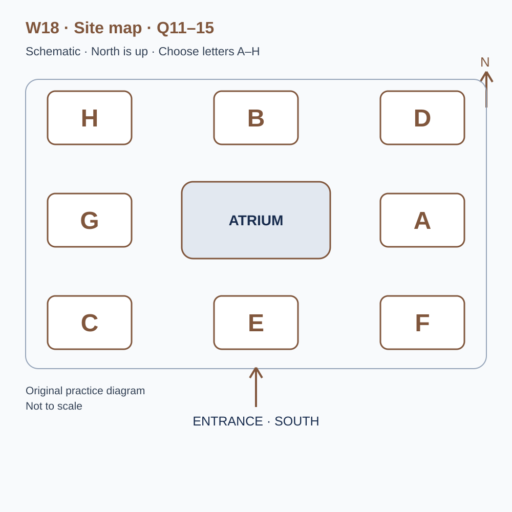
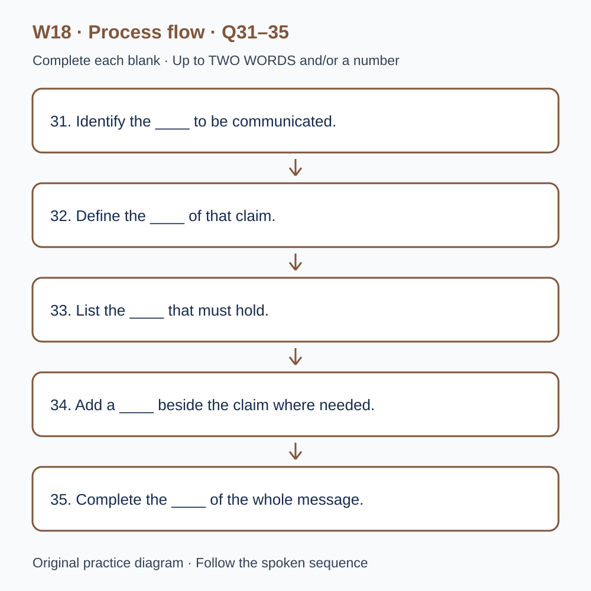

# U53 第18周听力题面与复盘（音频待补）

本页提供已核验的原创题目、参考答案和脚本。配套完整音频尚未验收，当前只能预览题面；不能进行有效的首次听力测试，也不能把读稿作答计作听力成绩或已完成一套听力。

请先保留首次作答机会：批准音频就绪前，不要展开下方答案和脚本。若已读稿，请标记为熟悉材料，之后的练习不能充当陌生题诊断。页面阅读标记只代表看过文字，不代表完成听力。

本材料非雅思真题、非标准化模考，不换算正式分数。计划分钟数不是实测音频时长；学习记录、正式测评和真人反馈须另行完成。

## 学生题面

### L-W18 — Conditions, exceptions and the meaning of a claim

> 原创 IELTS-style 技能练习，非真题、非标准化模考，不可换算正式分数。当前只有文字和题目，音频未生成，不能计作已完成听力套题。

共四部分、40 个计分空，每空 1 分。正式首次作答须等待批准音频，先不要打开 script.md 或 answers.md。朗读前先看题；只听一遍后提交首次答案及信心等级，再做精听。当前只能预览题面，不能把读稿作答记作听力成绩。

#### Part 1 — Booking a notice-writing workshop

Q1–6: Complete the notes. Write **NO MORE THAN TWO WORDS AND/OR A NUMBER** for each answer, using words from the recording. Numeric notation may replace spoken numbers. Do not repeat a printed unit. Q7–10: Choose **ONE letter, A, B or C**.

**Q1.** Workshop selected: ____

**Q2.** Confirmed day of July: ____

**Q3.** Teaching start (p.m.): ____

**Q4.** Number of places: ____

**Q5.** Total association fee: £____

**Q6.** Required current document: ____

**Q7.** What should the association expect?

- A. A guaranteed complete publication
- B. Practice in making and explaining revisions
- C. Legal wording for every real arrangement

Answer: ____

**Q8.** Which image use is appropriate?

- A. Any image received by email
- B. Workshop permission assumed to cover later publication
- C. Use within checked permissions, or a placeholder

Answer: ____

**Q9.** What should happen with a digital-format requirement?

- A. Describe it in advance for availability checks
- B. Assume larger print is equivalent
- C. Wait until the activity starts

Answer: ____

**Q10.** Which practical information should the group follow?

- A. Convenient details combined from old messages
- B. The current confirmation and updates quoting its reference
- C. Only the earliest programme

Answer: ____

#### Part 2 — Orientation at the communication centre

Q11–15: Label the map. Write **ONE letter, A–H**, for each destination. Three letters are unused. Q16–20: Choose **ONE letter, A, B or C**.

**Q11.** Reception

Answer: ____

**Q12.** Interpretation room

Answer: ____

**Q13.** Example display

Answer: ____

**Q14.** Testing booth

Answer: ____

**Q15.** Resource desk

Answer: ____

**Q16.** What should guide the opening review?

- A. The amount of background available
- B. The decision the intended reader needs to make
- C. A universal rule for the shortest possible notice

Answer: ____

**Q17.** Why keep a condition near its claim?

- A. All sentences must be long
- B. Footnotes are always inaccurate
- C. Distance may change the apparent scope of the promise

Answer: ____

**Q18.** What should the team do with an uncertain practical detail?

- A. State its status and the route for an update
- B. Invent a precise figure
- C. Let layout imply that it is confirmed

Answer: ____

**Q19.** During reader testing, the team should

- A. supply its preferred explanation first
- B. record an action and ask a neutral follow-up
- C. treat every wrong selection as the same cause

Answer: ____

**Q20.** What should the closing review check?

- A. Only visual neatness
- B. Whether every background fact was included
- C. Requirements, qualifications and remaining uncertainty

Answer: ____

#### Part 3 — Revising a visitor message

Q21–26: Match each proposal to the students' **final** positions at the end of that exchange. The tutor is not included. Write **A, B, C or D**. Letters may be reused.

- **A** Mae only
- **B** Jon only
- **C** Both students
- **D** Neither student

Q27–28 and Q29–30: Choose **TWO different letters, A–E**, for each pair. Write one letter in each numbered slot; either order is accepted. Each distinct correct choice earns one point, maximum two. Repeating a letter cannot earn two points. Submit no more than two letters.

**Q21.** At the END of this exchange, who supports: Retaining the eligibility condition beside the headline?

Answer: ____

**Q22.** At the END of this exchange, who supports: Putting the confirmed closing time in the opening panel?

Answer: ____

**Q23.** At the END of this exchange, who supports: Keeping the claim that the activity suits everyone?

Answer: ____

**Q24.** At the END of this exchange, who supports: Recruiting unfamiliar readers for the next test?

Answer: ____

**Q25.** At the END of this exchange, who supports: Preserving exact notice versions with test records?

Answer: ____

**Q26.** At the END of this exchange, who supports: Recording a short verbal explanation from each reader?

Answer: ____

**Q27–28.** Which TWO revision actions are agreed?

- A. Keep all historical background
- B. Give every panel equal length
- C. Retain conditions affecting the headline claim
- D. Insert a temporary invented number
- E. Separate confirmed facts from assumptions

Answers: Q27 ____ · Q28 ____

**Q29–30.** Which TWO factors limit the comparison of reader sessions?

- A. Both sessions were cancelled
- B. Reader groups differed in relevant experience
- C. Every printed page was incomplete
- D. The question asked after reading changed
- E. The room was unavailable

Answers: Q29 ____ · Q30 ____

#### Part 4 — Keeping qualifications connected to claims

Q31–35: Complete the flow chart below. Q36–40: Complete the notes. Write **NO MORE THAN TWO WORDS AND/OR A NUMBER** for each answer, using words from the recording. Numeric notation may replace spoken numbers. Words or units already printed do not belong in the blank. The numbered text below repeats the SVG prompts for readability.

**Q31.** Identify the ____ to be communicated.

**Q32.** Define the ____ of that claim.

**Q33.** List the ____ that must hold.

**Q34.** Add a ____ beside the claim where needed.

**Q35.** Complete the ____ of the whole message.

**Q36.** More than one plausible reading indicates ____.

**Q37.** Consider the ____ readers draw from the layout.

**Q38.** A ____ can acknowledge a competing consideration.

**Q39.** Attention to a feature is affected by its ____.

**Q40.** Connecting claims with sources and revisions requires ____.

#### 本周训练安排（音频批准后执行）

- Preview questions without the script：8 分钟。
- Future continuous first listen, including planned part pauses：32 分钟。
- Submit first answers and confidence, without a second play：8 分钟。
- Check answers and classify errors：20 分钟。
- Four Q-located intensive segments, 15 minutes each：60 分钟。
- Diagram and opinion retelling：15 分钟。
- Next-day retry of missed items：15 分钟。

合计 **158 分钟**；最多另用 22 分钟缓冲，总计不超过 180 分钟。暂停、回放与查词均计入精听预算，不能另行无限追加。当前实际已完成听力分钟数为 0。精听区段和步骤见 intensive.md；答案和脚本另页。

参考答案与证据（完成首次听力后再展开）

### L-W18 — Answers and evidence
> 独立答案页。先提交首次答案，再看本页。当前缺音频，文本验题不能充当实听验收。

每个单空 1 分；双选各 2 分、答案顺序不限、按不同正确选项计分。接受形式仅做大小写和空白规范化；不做模糊词形推断。

#### Q1 — public notices

Accepted answers: public notices

Use the final confirmed detail in this exchange; the printed unit or date context is already supplied.

Evidence locator: Q01 (script.md; timestamps unavailable).

> Coordinator: Communication centre, good afternoon. Applicant: Our association wants help writing information for visitors. I noticed a course on meeting minutes, but our difficulty is with announcements that people read without someone nearby to explain them. Coordinator: Public notices would be the relevant workshop. Applicant: Yes, please book public notices. We need to describe who can attend an event and under what conditions, without making the page impossible to follow. Coordinator: The workshop examines that balance through fictional examples. It doesn't supply legal wording for a particular organisation, but it can help you see when a short message loses a condition that changes what the reader understands.

#### Q2 — 23

Accepted answers: 23 / 23rd / twenty-third / the twenty-third / twenty third / the 23rd

Use the final confirmed detail in this exchange; the printed unit or date context is already supplied.

Evidence locator: Q02 (script.md; timestamps unavailable).

> Applicant: Is the workshop on the sixteenth of July? Coordinator: That was the first proposed date. It is now confirmed for the twenty-third of July. Applicant: The twenty-third suits us. I'll replace the earlier entry rather than leave both dates in our calendar. Coordinator: We will send a confirmation identifying the subject and date together. Applicant: One member saw an announcement for another course in the same series, so that detail will help. Coordinator: Similar headings can be misleading when practical information is copied between events. Please use the booking confirmation for this workshop rather than combining whichever details happen to be most convenient from several different notices.

#### Q3 — 2.45

Accepted answers: 2.45 / 2:45 / 02.45 / 02:45 / 14.45 / 14:45 / two forty-five

Use the final confirmed detail in this exchange; the printed unit or date context is already supplied.

Evidence locator: Q03 (script.md; timestamps unavailable).

> Applicant: When does the teaching start? Coordinator: Two forty-five in the afternoon. The reception desk opens at two fifteen, but your workshop begins at two forty-five. Applicant: So the earlier time is for the desk, not the first activity. Coordinator: Correct. Arrive shortly before the workshop to check in. Applicant: I'll put the start time clearly in our travel note. Coordinator: That will help. The opening activity asks participants to compare a headline with a condition printed elsewhere on the page. If somebody misses that introduction, the later discussion about what a reader could reasonably infer may seem like an argument about style rather than meaning.

#### Q4 — 3

Accepted answers: 3 / three

Use the final confirmed detail in this exchange; the printed unit or date context is already supplied.

Evidence locator: Q04 (script.md; timestamps unavailable).

> Coordinator: How many places are required? Applicant: Five members helped prepare our current notice, but only three can attend. Please reserve three places. Coordinator: Three are available. Can those people bring the other members' questions? Applicant: Yes. We'll gather them in advance, but the two absent members won't be counted as workshop participants. Coordinator: If that changes, update the booking rather than making an informal substitution. Applicant: I'll keep a current attendance list with the confirmation. Coordinator: Good. The room activity uses small groups, and a clear number helps the leader prepare without having to change the arrangement while people are arriving and the teaching time has already begun.

#### Q5 — 42

Accepted answers: 42 / 42.00 / forty-two / forty two

Use the final confirmed detail in this exchange; the printed unit or date context is already supplied.

Evidence locator: Q05 (script.md; timestamps unavailable).

> Applicant: What will the three places cost altogether? Coordinator: The association booking is forty-two pounds in total. Applicant: Forty-two for all three places, not forty-two each? Coordinator: Exactly. The printed examples are included. Bringing your own notice for discussion does not purchase a separate editing service. Applicant: I'll explain that distinction to the committee. Coordinator: Please check the number of places and the total on the confirmation before paying. If anything differs from this conversation, ask us to correct the record. Applicant: That is easier than trying to work out afterwards whether an extra amount meant extra participants, extra materials or a service nobody had actually requested.

#### Q6 — draft

Accepted answers: draft / the draft / a draft

Use the final confirmed detail in this exchange; the printed unit or date context is already supplied.

Evidence locator: Q06 (script.md; timestamps unavailable).

> Applicant: What should we bring? Coordinator: A draft of the notice you want to discuss. It needn't look finished; we need to see the information and conditions you are trying to communicate. Applicant: I'll bring the draft with the unresolved wording still marked. Coordinator: That is more useful than removing the awkward paragraph just to make the page appear polished. Applicant: Do we need the poster from last year's event? Coordinator: You may bring it for context, but the required document is the draft for the current task. Keep earlier versions separate, especially if their entry conditions differ, so a convenient old sentence doesn't silently replace the rule now being communicated.

#### Q7 — B

Accepted answers: B

The workshop teaches revision and discusses examples; a commissioned rewrite is separate.

Evidence locator: Q07 (script.md; timestamps unavailable).

> Applicant: Will the leader rewrite our notice during the session? Coordinator: No. You will practise making and explaining revisions, with feedback on selected examples. A complete commissioned rewrite would be a different service. Applicant: So we should expect a method and a clearer view of our choices, rather than a guaranteed finished publication. Coordinator: That's right. The workshop can identify a missing qualification, but the organisation still has to confirm its actual arrangements. Applicant: We'll distinguish facts we know from details awaiting a decision. Coordinator: Good. A reader-friendly sentence is only useful if it represents the information the organisation is prepared to stand behind.

#### Q8 — C

Accepted answers: C

Permission is purpose-specific; the image can be replaced if unnecessary.

Evidence locator: Q08 (script.md; timestamps unavailable).

> Applicant: Our notice includes a photograph from a previous activity. Can we use it in the workshop example? Coordinator: Bring only material you may share for that purpose, and make any restrictions clear. Permission for a workshop discussion should not be assumed to cover a later public poster. Applicant: I'll check the conditions instead of relying on the fact that someone emailed us the image. Coordinator: Yes. You can also use a simple placeholder if the image isn't necessary to examine the wording. Applicant: That would let us focus on the information rather than delay the whole exercise while we search for a more attractive picture.

#### Q9 — A

Accepted answers: A

Practical needs and file compatibility must be checked.

Evidence locator: Q09 (script.md; timestamps unavailable).

> Applicant: One member needs an accessible digital version of the examples. Should I request that in advance? Coordinator: Please describe the practical format requirement now, so we can check what is available and confirm any limits. Applicant: I won't assume that a larger printout addresses the same need. Coordinator: Thank you. Different arrangements support different ways of accessing the task. Applicant: Should the person bring their usual device? Coordinator: If they normally use it, mention that too, but we shouldn't promise compatibility without checking the relevant files. A clear description before the session gives us a better chance of agreeing a workable arrangement than a general request after the first activity has started.

#### Q10 — B

Accepted answers: B

The latest complete booking information prevents version mixing.

Evidence locator: Q10 (script.md; timestamps unavailable).

> Applicant: Which message should we follow if the room changes? Coordinator: Use the current confirmation and any update that quotes its booking reference. Don't combine the entrance from an old programme with the time from a newer message. Applicant: I'll keep the latest complete version in the group folder. Coordinator: For a routine change to your booking, reply to that confirmation. For an urgent issue, use the contact number it contains. Applicant: Understood. Coordinator: Keeping the conditions with the main information is also part of the workshop's subject. A correct detail can still mislead when the reader cannot tell which event, version or circumstance it belongs to.

#### Q11 — G

Accepted answers: G

Use the explicitly stated position relative to the atrium, not an earlier layout or adjacent area.

Evidence locator: Q11 (script.md; timestamps unavailable).

> Welcome to the communication centre. North is at the top of the plan, and the entrance is on the southern edge. The atrium in the middle is the fixed landmark. Reception is directly west of the atrium, level with its centre. It is not the space immediately south of the atrium, which you pass when entering. Please check in at reception before joining the group. Staff can identify the current room arrangement and any practical update. The letters mark positions rather than room initials, so listen for the relation to the atrium or another named location instead of treating a familiar letter as a clue to the answer.

#### Q12 — D

Accepted answers: D

Use the explicitly stated position relative to the atrium, not an earlier layout or adjacent area.

Evidence locator: Q12 (script.md; timestamps unavailable).

> The interpretation room is in the north-east corner. It lies east of the northern central room and north of the space directly east of the atrium. An earlier programme located the activity in the north-west corner, but today's workshop begins in the north-east room. The first exercise compares a statement with several possible readings. You will be asked which interpretation is supported by the wording, not which one you personally prefer. A statement can be accurate under one condition and misleading when repeated without that condition. Keep the example sheet available during discussion so that the group can point to the actual phrase rather than argue from memory.

#### Q13 — B

Accepted answers: B

Use the explicitly stated position relative to the atrium, not an earlier layout or adjacent area.

Evidence locator: Q13 (script.md; timestamps unavailable).

> The example display is directly north of the atrium, in the northern central position. It is west of the interpretation room on the same row. The display contains several versions of a visitor notice, each prepared for a different audience and purpose. Read the short brief beside a page before deciding that its layout is better than another. A concise version may rely on background knowledge that a new visitor does not possess. The point is to connect a design choice with the task it serves, rather than search for one arrangement that should supposedly work for every message regardless of its content or readers.

#### Q14 — F

Accepted answers: F

Use the explicitly stated position relative to the atrium, not an earlier layout or adjacent area.

Evidence locator: Q14 (script.md; timestamps unavailable).

> The testing booth is in the south-east corner. It is south of the space directly east of the atrium and east of the southern central room. A volunteer reader will use that booth for a short navigation task. Observe which condition the reader finds, then ask a neutral question about how they interpreted it. Don't explain the intended meaning halfway through the task and later describe the result as independent understanding. Help can be useful, but its timing must remain visible in the record. Otherwise the team may credit a revised notice for an interpretation that was actually supplied by the observer during the test.

#### Q15 — C

Accepted answers: C

Use the explicitly stated position relative to the atrium, not an earlier layout or adjacent area.

Evidence locator: Q15 (script.md; timestamps unavailable).

> The resource desk is in the south-west corner. It lies south of reception and west of the southern central room. Collect the worksheet version named by the leader rather than taking a loose sheet from another group's table. Some worksheets ask for an observation and others for an interpretation; the headings look similar when viewed quickly. If a resource is missing, report it so the group can use a consistent version. The desk completes the five locations for today's visit. Reception is on the western side, while resources are below it, so don't confuse the two merely because both involve speaking to a member of staff.

#### Q16 — B

Accepted answers: B

Purpose determines relevant information and arrangement.

Evidence locator: Q16 (script.md; timestamps unavailable).

> Begin each exercise by identifying the decision the notice is intended to support. A page that enables a booking has different information priorities from a page explaining the history of an activity. Interesting background can displace a practical condition if the group treats every supplied fact as equally important. Ask what the reader needs to do and which information makes that action possible. This doesn't mean all notices should be reduced to the same short formula. It means the amount and arrangement of information should be justified by the reader's task, rather than by the amount of material the writer happens to have collected beforehand.

#### Q17 — C

Accepted answers: C

Retaining words somewhere does not necessarily preserve their practical connection.

Evidence locator: Q17 (script.md; timestamps unavailable).

> A condition should stay close enough to the claim it limits for the reader to connect them. If a headline says admission is free but a later note restricts that offer to a particular group, moving the note out of sight changes the apparent promise. Simply retaining the words somewhere on the page may not preserve their practical meaning. The group should examine how the main statement and its qualification are encountered together. A shorter sentence can be an improvement if the condition remains clear, but removing that condition to make the heading cleaner is a change in what the message communicates, not merely a change in presentation.

#### Q18 — A

Accepted answers: A

Confirmed and unconfirmed information must remain distinguishable.

Evidence locator: Q18 (script.md; timestamps unavailable).

> When information is uncertain, mark the uncertainty in a way that matches its significance. An unconfirmed opening time should not be presented as fixed simply because a precise number fits neatly into a table. The team can state what has been confirmed and identify where an update will appear. That is different from filling every gap with a plausible guess. A hypothetical example may be useful in a workshop, but it must remain recognisable as an example. The reader should not have to infer which details are real from subtle differences in tone or from a disclaimer separated from the claim it is meant to qualify.

#### Q19 — B

Accepted answers: B

Observation and interpretation are separate; leading questions weaken the evidence.

Evidence locator: Q19 (script.md; timestamps unavailable).

> During reader testing, record an action before deciding what caused it. A visitor who selects the wrong option may have overlooked a condition, misunderstood a term or brought an expectation from another event. Ask a neutral follow-up rather than offering the explanation you want confirmed. If you tell the reader that the heading was confusing, agreement adds little evidence about their original interpretation. Preserve the first observation and distinguish it from the explanation that emerges in discussion. The purpose is to learn which feature needs attention, not to collect comments that make the team's preferred revision appear successful before it has actually been examined.

#### Q20 — C

Accepted answers: C

A polished page may still miss required information or obscure a limitation.

Evidence locator: Q20 (script.md; timestamps unavailable).

> Close the exercise by comparing the revised notice with the original brief. Check required information, the conditions attached to important claims and any uncertainty that remains unresolved. A visually cleaner page is not necessarily a more complete response. Record a next action that follows from the evidence, such as testing whether readers find a particular restriction, rather than declaring the whole communication problem solved. You may retain a sentence that worked well while revising another. The review should identify the reason for each decision so that a later editor can understand what the team was trying to preserve and what further evidence could justify changing it.

#### Q21 — C

Accepted answers: C

Final stance: Both students. Ignore an initial proposal if later withdrawn; the tutor is not an answer option.

Evidence locator: Q21 (script.md; timestamps unavailable).

> Tutor: You tested both notice versions last week. What should the next revision preserve? Mae: The eligibility condition beside the headline. We saw readers infer a wider offer when it was moved to the footnote. Jon: I agree now. I originally preferred a cleaner heading, but the nearby condition changes how the promise is understood. Tutor: Are you agreeing to keep every word? Jon: No. We can shorten it if the restriction remains explicit. Mae: That's the version I support too. Tutor: Then both of you support retaining the nearby condition, while leaving room to improve its wording without expanding the offer beyond what the organisers confirmed.

#### Q22 — B

Accepted answers: B

Final stance: Jon only. Ignore an initial proposal if later withdrawn; the tutor is not an answer option.

Evidence locator: Q22 (script.md; timestamps unavailable).

> Tutor: Jon proposes giving the exact closing time in the opening panel. Jon: Yes. The time is confirmed, and readers need it before deciding whether they can attend. Mae: I would place it in the schedule immediately below, keeping the opening panel focused on who the event is for. Tutor: Would a small line in the panel change your view? Mae: It might fit, but I still prefer the schedule for this version. Jon: I continue to favour the opening panel. Tutor: Then Jon supports that specific location and Mae doesn't. You agree about the need for the time, but not every agreement about content settles where it should appear.

#### Q23 — D

Accepted answers: D

Final stance: Neither student. Ignore an initial proposal if later withdrawn; the tutor is not an answer option.

Evidence locator: Q23 (script.md; timestamps unavailable).

> Tutor: Your first draft says the activity is suitable for everyone. Mae: I used that phrase because it sounded welcoming. Looking at the entry conditions, I don't think we can support it. Jon: Neither do I. The notice specifies a minimum age and an advance booking requirement. Mae: I'll remove the universal wording instead of relying on readers to discover the exceptions later. Tutor: Does either of you still want that phrase as a headline? Jon: No. We can welcome enquiries without making an unrestricted promise. Tutor: Good. Neither student supports the original statement, even though one of you proposed it before examining how it interacted with the rest of the page.

#### Q24 — A

Accepted answers: A

Final stance: Mae only. Ignore an initial proposal if later withdrawn; the tutor is not an answer option.

Evidence locator: Q24 (script.md; timestamps unavailable).

> Tutor: Should the next test include readers unfamiliar with the association? Mae: I support that. Our members may understand terms that a first-time visitor doesn't recognise. Jon: I'd first test the revision with the same readers, so we can ask whether they notice the changed condition. Tutor: That could reveal something about the revision, but would it test an independent first encounter? Jon: No, and I would record that limit. For the next session, I still prefer those readers. Mae: I continue to favour newcomers. Tutor: Then Mae supports the specific recruitment proposal, while Jon wants a different comparison before the group broadens the audience.

#### Q25 — C

Accepted answers: C

Final stance: Both students. Ignore an initial proposal if later withdrawn; the tutor is not an answer option.

Evidence locator: Q25 (script.md; timestamps unavailable).

> Tutor: Do you want to keep the original version alongside the revision? Jon: Yes. Otherwise we might explain a reader's reaction using a sentence that wasn't on the page they saw. Mae: Agreed. Each test record should name the exact version. Tutor: Would a file called final be enough? Mae: No, especially if it is edited again. We'll use distinct version labels and preserve the content. Jon: That also lets us trace which condition changed between sessions. Tutor: Then this is a shared decision. A comparison requires identifiable objects, not simply two impressions of how the notice looked at different points in a busy editing process.

#### Q26 — B

Accepted answers: B

Final stance: Jon only. Ignore an initial proposal if later withdrawn; the tutor is not an answer option.

Evidence locator: Q26 (script.md; timestamps unavailable).

> Tutor: Jon suggests recording a short verbal explanation from each reader. Jon: I support it, with a focused question about the offer and its conditions. The selected option alone may hide a misunderstanding. Mae: I'd leave recording out of the next trial and use written notes from an observer. Tutor: Is your concern the question or the recording arrangement? Mae: The arrangement. It may take time we need for another independent reader. Jon: I still prefer a brief recording so we can check the wording later. Tutor: Then Jon supports the proposal and Mae retains another method. Don't convert agreement on the question's importance into agreement on how to collect the response.

#### Q27–28 — C, E

Accept unordered set: C, E. One point per distinct correct choice, maximum 2.

Meaningful conditions and visible uncertainty are selected; not equal panel lengths or invented figures.

Evidence locator: Q27, Q28 (script.md; timestamps unavailable).

> Tutor: Which revision actions do you both accept? Mae: Retain the conditions that determine whether the headline claim applies. We can remove repetition, but not a restriction that changes the offer. Jon: Agreed. We should check each proposed deletion against the meaning of the complete message. Tutor: Does that require retaining every historical detail in the background pack? Mae: No. A detail can be accurate without being necessary for this notice. Jon: Nor do we need to make every panel the same length. Tutor: So preserving meaningful conditions is one agreed action. The reason is the relation between the claim and its scope, not a general preference for longer wording.

> Tutor: What is the second agreed action? Jon: Separate confirmed information from assumptions that still need checking. Mae: Yes. If the organisers haven't confirmed a detail, we should not let a confident layout disguise that gap. Tutor: Are you planning to invent a number temporarily and remove it later? Mae: No. A temporary figure can escape into another version before someone notices the label. Jon: We can use a clearly marked gap while requesting the information. Tutor: Then your two selected actions are retaining the claim's conditions and separating assumptions from confirmed facts. A decorative chart or a predicted formal score is not part of the agreed revision plan.

#### Q29–30 — B, D

Accept unordered set: B, D. One point per distinct correct choice, maximum 2.

Reader experience and response measure differed, so wording alone does not explain the result.

Evidence locator: Q29, Q30 (script.md; timestamps unavailable).

> Tutor: What limited last week's comparison? Jon: The readers in the second session had more experience with the association. They already knew several terms used in the notice. Mae: That means a smoother response could reflect familiarity as well as the wording change. Tutor: Were all the printed pages missing a section? Mae: No. The pages were complete. The issue is the difference between the reader groups, not a printing failure. Jon: We should report the relevant experience instead of treating everyone as an interchangeable visitor. Tutor: That will help the next review distinguish an observation about these participants from a claim about what a genuinely new reader would understand.

> Tutor: Was anything else different? Mae: We changed the question we asked after reading. The first group selected an option, while the second explained the offer in their own words. Jon: Both responses can be informative, but they aren't the same measure. Tutor: So you can't attribute the difference solely to the revised notice. Mae: Correct. We need to keep the question wording with each record. Jon: Neither session was cancelled, and the room was available. Tutor: Then record differing reader experience and the changed question as the two limitations. Avoid adding circumstances that sound plausible but did not affect the sessions you actually conducted last week.

#### Q31 — claim

Accepted answers: claim / main claim / proposition

Complete the named stage in the stated process order; retain any word already printed around the blank.

Evidence locator: Q31 (script.md; timestamps unavailable).

> Consider a fictional team preparing a message about a community programme. The first stage identifies the main claim. The claim is the proposition the reader is being asked to understand or act upon, such as an offer of entry under stated arrangements. The team writes it clearly enough to compare with the information that supports it. A collection of attractive phrases can conceal uncertainty about what is actually being promised. Identifying the main claim does not mean stripping away every condition. It gives the review a starting point from which to examine whether the complete message says something narrower, broader or different from the heading alone.

#### Q32 — scope

Accepted answers: scope / stated scope / boundary / intended boundary

Complete the named stage in the stated process order; retain any word already printed around the blank.

Evidence locator: Q32 (script.md; timestamps unavailable).

> The second stage defines the scope of that claim. Scope concerns the people, circumstances and period to which the statement applies. A notice about one session should not accidentally sound like a rule for every future event. The team checks whether a reader could reasonably extend the statement beyond the intended boundary. This stated scope may be supplied by a heading, a nearby phrase or another clearly connected feature of the page. What matters is that the connection remains available during normal reading. An accurate restriction stored in a separate document does not necessarily repair a public sentence whose apparent meaning is broader than the organisation intends.

#### Q33 — conditions

Accepted answers: conditions / relevant conditions

Complete the named stage in the stated process order; retain any word already printed around the blank.

Evidence locator: Q33 (script.md; timestamps unavailable).

> The third stage lists the relevant conditions. Conditions explain what must hold for the claim to apply, such as prior booking or attendance during a specified period. They differ from background details that merely describe the event's history. The team examines whether omitting a condition would change a reader's decision. If it would, that information should not disappear simply because the layout is crowded. A condition may be short while carrying considerable meaning. The review therefore considers its function rather than assuming that the number of words indicates its importance. The objective is a complete, usable message, not the shortest possible string that can still be called a notice.

#### Q34 — qualification

Accepted answers: qualification / clear qualification / limitation / boundary

Complete the named stage in the stated process order; retain any word already printed around the blank.

Evidence locator: Q34 (script.md; timestamps unavailable).

> The fourth stage adds a clear qualification beside the claim where the evidence requires it. A qualification narrows or limits how the statement should be understood. The limitation should connect to the actual uncertainty or exception, rather than operate as a vague apology for the whole message. For example, a prediction based on a small local trial may need a boundary about the conditions observed. Placing that qualification nearby helps the reader interpret the claim at the point of encounter. It does not guarantee that every reader will understand it, but it gives the later test a coherent message to examine instead of a promise separated from the words that constrain it.

#### Q35 — audit

Accepted answers: audit / consistency check / check / useful check

Complete the named stage in the stated process order; retain any word already printed around the blank.

Evidence locator: Q35 (script.md; timestamps unavailable).

> The fifth stage completes an audit of the whole message. This consistency check examines how headings, examples, figures and notes work together, rather than judging each sentence in isolation. A qualification in one panel may be undermined by an unrestricted phrase elsewhere. The audit compares the complete page with the confirmed information and the intended reader's task. It also checks whether a revision introduced a new contradiction while removing an old one. A useful check records remaining questions and who will resolve them. Reaching the final stage in a sequence does not itself mean that every factual gap has disappeared or that publication is justified without further confirmation.

#### Q36 — ambiguity

Accepted answers: ambiguity

The corresponding evidence block supplies this distinction or qualification; the question retains the surrounding grammar.

Evidence locator: Q36 (script.md; timestamps unavailable).

> Ambiguity occurs when wording supports more than one plausible interpretation. It is different from a statement that is clear but unfamiliar to a particular reader. The team should identify the competing readings before deciding how to revise the phrase. Otherwise it may replace a short ambiguous sentence with a longer one that preserves the same problem. A test can ask readers to explain the meaning without supplying the alternatives in a leading question. Their responses may reveal an ambiguity the writer did not anticipate. The review then connects the revision to that specific issue rather than assuming that any increase in detail necessarily makes the message clearer.

#### Q37 — inferences

Accepted answers: inferences / inference / unstated connection / connection

The corresponding evidence block supplies this distinction or qualification; the question retains the surrounding grammar.

Evidence locator: Q37 (script.md; timestamps unavailable).

> Inference also affects interpretation. Readers may supply an unstated connection from familiar practices or from the arrangement of information. An inference can be reasonable without being the one the writer intended. For example, placing two prices beside one another may suggest that they cover comparable services even when the underlying arrangements differ. The team examines which inferences the page invites and whether the information supports them. It cannot control everything a reader brings to the encounter, but it can avoid relying on a hidden distinction that the layout makes difficult to discover. The review concerns the meaning produced by the whole communication, not only the literal accuracy of isolated words.

#### Q38 — concession

Accepted answers: concession

The corresponding evidence block supplies this distinction or qualification; the question retains the surrounding grammar.

Evidence locator: Q38 (script.md; timestamps unavailable).

> A concession can recognise evidence that complicates a conclusion without abandoning the conclusion entirely. A writer might acknowledge that a shorter notice is easier to scan while arguing that one condition must remain visible. That concession differs from claiming that the competing consideration has no value. The team should keep the relationship clear so that a reader can follow why one choice is preferred despite a genuine cost. Removing the acknowledged limitation may make the argument sound stronger while making it less accurate. In a discussion, noticing a concession also helps distinguish a change of final position from an acknowledgement that another proposal has some merit.

#### Q39 — salience

Accepted answers: salience / prominence

The corresponding evidence block supplies this distinction or qualification; the question retains the surrounding grammar.

Evidence locator: Q39 (script.md; timestamps unavailable).

> Salience concerns how readily a feature attracts attention. Prominence can result from position, size, contrast or the reader's immediate purpose. A condition printed in technically readable text may still be overlooked if the page directs attention elsewhere. The team therefore considers how a reader encounters the message, rather than checking only whether all required words are present. More emphasis is not always the solution: if every line competes for attention, the hierarchy may become harder to follow. The useful question is whether the information needed for the decision is noticeable at the right point, with its connection to the main claim still intact.

#### Q40 — traceability

Accepted answers: traceability

The corresponding evidence block supplies this distinction or qualification; the question retains the surrounding grammar.

Evidence locator: Q40 (script.md; timestamps unavailable).

> Finally, traceability allows the team to connect each public claim with its source and revision history. A reviewer should be able to identify which confirmed arrangement supports a statement and which version of the notice was tested. Without that connection, a plausible sentence can survive long after the information behind it has changed. Traceability does not require displaying the entire editing history to every visitor. It requires preserving enough of that history for the team to examine a decision and update it responsibly. The stage review ends by recording unresolved questions and the next check, rather than treating a polished page as proof that all its implications have been understood.

完整脚本（提前阅读会失去陌生题首答机会）

### L-W18 — Conditions, exceptions and the meaning of a claim: transcript
> 原创虚构练习，非真题；音频缺失。仅供完成首次作答后的核对或文字审阅。Q 标记与角色名不属于朗读正文。

#### Part 1 — Booking a notice-writing workshop

##### Q1 evidence block

**Coordinator:** Communication centre, good afternoon.

**Applicant:** Our association wants help writing information for visitors. I noticed a course on meeting minutes, but our difficulty is with announcements that people read without someone nearby to explain them.

**Coordinator:** Public notices would be the relevant workshop.

**Applicant:** Yes, please book public notices. We need to describe who can attend an event and under what conditions, without making the page impossible to follow.

**Coordinator:** The workshop examines that balance through fictional examples. It doesn't supply legal wording for a particular organisation, but it can help you see when a short message loses a condition that changes what the reader understands.

##### Q2 evidence block

**Applicant:** Is the workshop on the sixteenth of July?

**Coordinator:** That was the first proposed date. It is now confirmed for the twenty-third of July.

**Applicant:** The twenty-third suits us. I'll replace the earlier entry rather than leave both dates in our calendar.

**Coordinator:** We will send a confirmation identifying the subject and date together.

**Applicant:** One member saw an announcement for another course in the same series, so that detail will help.

**Coordinator:** Similar headings can be misleading when practical information is copied between events. Please use the booking confirmation for this workshop rather than combining whichever details happen to be most convenient from several different notices.

##### Q3 evidence block

**Applicant:** When does the teaching start?

**Coordinator:** Two forty-five in the afternoon. The reception desk opens at two fifteen, but your workshop begins at two forty-five.

**Applicant:** So the earlier time is for the desk, not the first activity.

**Coordinator:** Correct. Arrive shortly before the workshop to check in.

**Applicant:** I'll put the start time clearly in our travel note.

**Coordinator:** That will help. The opening activity asks participants to compare a headline with a condition printed elsewhere on the page. If somebody misses that introduction, the later discussion about what a reader could reasonably infer may seem like an argument about style rather than meaning.

##### Q4 evidence block

**Coordinator:** How many places are required?

**Applicant:** Five members helped prepare our current notice, but only three can attend. Please reserve three places.

**Coordinator:** Three are available. Can those people bring the other members' questions?

**Applicant:** Yes. We'll gather them in advance, but the two absent members won't be counted as workshop participants.

**Coordinator:** If that changes, update the booking rather than making an informal substitution.

**Applicant:** I'll keep a current attendance list with the confirmation.

**Coordinator:** Good. The room activity uses small groups, and a clear number helps the leader prepare without having to change the arrangement while people are arriving and the teaching time has already begun.

##### Q5 evidence block

**Applicant:** What will the three places cost altogether?

**Coordinator:** The association booking is forty-two pounds in total.

**Applicant:** Forty-two for all three places, not forty-two each?

**Coordinator:** Exactly. The printed examples are included. Bringing your own notice for discussion does not purchase a separate editing service.

**Applicant:** I'll explain that distinction to the committee.

**Coordinator:** Please check the number of places and the total on the confirmation before paying. If anything differs from this conversation, ask us to correct the record.

**Applicant:** That is easier than trying to work out afterwards whether an extra amount meant extra participants, extra materials or a service nobody had actually requested.

##### Q6 evidence block

**Applicant:** What should we bring?

**Coordinator:** A draft of the notice you want to discuss. It needn't look finished; we need to see the information and conditions you are trying to communicate.

**Applicant:** I'll bring the draft with the unresolved wording still marked.

**Coordinator:** That is more useful than removing the awkward paragraph just to make the page appear polished.

**Applicant:** Do we need the poster from last year's event?

**Coordinator:** You may bring it for context, but the required document is the draft for the current task. Keep earlier versions separate, especially if their entry conditions differ, so a convenient old sentence doesn't silently replace the rule now being communicated.

##### Q7 evidence block

**Applicant:** Will the leader rewrite our notice during the session?

**Coordinator:** No. You will practise making and explaining revisions, with feedback on selected examples. A complete commissioned rewrite would be a different service.

**Applicant:** So we should expect a method and a clearer view of our choices, rather than a guaranteed finished publication.

**Coordinator:** That's right. The workshop can identify a missing qualification, but the organisation still has to confirm its actual arrangements.

**Applicant:** We'll distinguish facts we know from details awaiting a decision.

**Coordinator:** Good. A reader-friendly sentence is only useful if it represents the information the organisation is prepared to stand behind.

##### Q8 evidence block

**Applicant:** Our notice includes a photograph from a previous activity. Can we use it in the workshop example?

**Coordinator:** Bring only material you may share for that purpose, and make any restrictions clear. Permission for a workshop discussion should not be assumed to cover a later public poster.

**Applicant:** I'll check the conditions instead of relying on the fact that someone emailed us the image.

**Coordinator:** Yes. You can also use a simple placeholder if the image isn't necessary to examine the wording.

**Applicant:** That would let us focus on the information rather than delay the whole exercise while we search for a more attractive picture.

##### Q9 evidence block

**Applicant:** One member needs an accessible digital version of the examples. Should I request that in advance?

**Coordinator:** Please describe the practical format requirement now, so we can check what is available and confirm any limits.

**Applicant:** I won't assume that a larger printout addresses the same need.

**Coordinator:** Thank you. Different arrangements support different ways of accessing the task.

**Applicant:** Should the person bring their usual device?

**Coordinator:** If they normally use it, mention that too, but we shouldn't promise compatibility without checking the relevant files. A clear description before the session gives us a better chance of agreeing a workable arrangement than a general request after the first activity has started.

##### Q10 evidence block

**Applicant:** Which message should we follow if the room changes?

**Coordinator:** Use the current confirmation and any update that quotes its booking reference. Don't combine the entrance from an old programme with the time from a newer message.

**Applicant:** I'll keep the latest complete version in the group folder.

**Coordinator:** For a routine change to your booking, reply to that confirmation. For an urgent issue, use the contact number it contains.

**Applicant:** Understood.

**Coordinator:** Keeping the conditions with the main information is also part of the workshop's subject. A correct detail can still mislead when the reader cannot tell which event, version or circumstance it belongs to.

#### Part 2 — Orientation at the communication centre

##### Q11 evidence block

**Centre host:** Welcome to the communication centre. North is at the top of the plan, and the entrance is on the southern edge. The atrium in the middle is the fixed landmark. Reception is directly west of the atrium, level with its centre. It is not the space immediately south of the atrium, which you pass when entering. Please check in at reception before joining the group. Staff can identify the current room arrangement and any practical update. The letters mark positions rather than room initials, so listen for the relation to the atrium or another named location instead of treating a familiar letter as a clue to the answer.

##### Q12 evidence block

**Centre host:** The interpretation room is in the north-east corner. It lies east of the northern central room and north of the space directly east of the atrium. An earlier programme located the activity in the north-west corner, but today's workshop begins in the north-east room. The first exercise compares a statement with several possible readings. You will be asked which interpretation is supported by the wording, not which one you personally prefer. A statement can be accurate under one condition and misleading when repeated without that condition. Keep the example sheet available during discussion so that the group can point to the actual phrase rather than argue from memory.

##### Q13 evidence block

**Centre host:** The example display is directly north of the atrium, in the northern central position. It is west of the interpretation room on the same row. The display contains several versions of a visitor notice, each prepared for a different audience and purpose. Read the short brief beside a page before deciding that its layout is better than another. A concise version may rely on background knowledge that a new visitor does not possess. The point is to connect a design choice with the task it serves, rather than search for one arrangement that should supposedly work for every message regardless of its content or readers.

##### Q14 evidence block

**Centre host:** The testing booth is in the south-east corner. It is south of the space directly east of the atrium and east of the southern central room. A volunteer reader will use that booth for a short navigation task. Observe which condition the reader finds, then ask a neutral question about how they interpreted it. Don't explain the intended meaning halfway through the task and later describe the result as independent understanding. Help can be useful, but its timing must remain visible in the record. Otherwise the team may credit a revised notice for an interpretation that was actually supplied by the observer during the test.

##### Q15 evidence block

**Centre host:** The resource desk is in the south-west corner. It lies south of reception and west of the southern central room. Collect the worksheet version named by the leader rather than taking a loose sheet from another group's table. Some worksheets ask for an observation and others for an interpretation; the headings look similar when viewed quickly. If a resource is missing, report it so the group can use a consistent version. The desk completes the five locations for today's visit. Reception is on the western side, while resources are below it, so don't confuse the two merely because both involve speaking to a member of staff.

##### Q16 evidence block

**Centre host:** Begin each exercise by identifying the decision the notice is intended to support. A page that enables a booking has different information priorities from a page explaining the history of an activity. Interesting background can displace a practical condition if the group treats every supplied fact as equally important. Ask what the reader needs to do and which information makes that action possible. This doesn't mean all notices should be reduced to the same short formula. It means the amount and arrangement of information should be justified by the reader's task, rather than by the amount of material the writer happens to have collected beforehand.

##### Q17 evidence block

**Centre host:** A condition should stay close enough to the claim it limits for the reader to connect them. If a headline says admission is free but a later note restricts that offer to a particular group, moving the note out of sight changes the apparent promise. Simply retaining the words somewhere on the page may not preserve their practical meaning. The group should examine how the main statement and its qualification are encountered together. A shorter sentence can be an improvement if the condition remains clear, but removing that condition to make the heading cleaner is a change in what the message communicates, not merely a change in presentation.

##### Q18 evidence block

**Centre host:** When information is uncertain, mark the uncertainty in a way that matches its significance. An unconfirmed opening time should not be presented as fixed simply because a precise number fits neatly into a table. The team can state what has been confirmed and identify where an update will appear. That is different from filling every gap with a plausible guess. A hypothetical example may be useful in a workshop, but it must remain recognisable as an example. The reader should not have to infer which details are real from subtle differences in tone or from a disclaimer separated from the claim it is meant to qualify.

##### Q19 evidence block

**Centre host:** During reader testing, record an action before deciding what caused it. A visitor who selects the wrong option may have overlooked a condition, misunderstood a term or brought an expectation from another event. Ask a neutral follow-up rather than offering the explanation you want confirmed. If you tell the reader that the heading was confusing, agreement adds little evidence about their original interpretation. Preserve the first observation and distinguish it from the explanation that emerges in discussion. The purpose is to learn which feature needs attention, not to collect comments that make the team's preferred revision appear successful before it has actually been examined.

##### Q20 evidence block

**Centre host:** Close the exercise by comparing the revised notice with the original brief. Check required information, the conditions attached to important claims and any uncertainty that remains unresolved. A visually cleaner page is not necessarily a more complete response. Record a next action that follows from the evidence, such as testing whether readers find a particular restriction, rather than declaring the whole communication problem solved. You may retain a sentence that worked well while revising another. The review should identify the reason for each decision so that a later editor can understand what the team was trying to preserve and what further evidence could justify changing it.

#### Part 3 — Revising a visitor message

##### Q21 evidence block

**Tutor:** You tested both notice versions last week. What should the next revision preserve?

**Mae:** The eligibility condition beside the headline. We saw readers infer a wider offer when it was moved to the footnote.

**Jon:** I agree now. I originally preferred a cleaner heading, but the nearby condition changes how the promise is understood.

**Tutor:** Are you agreeing to keep every word?

**Jon:** No. We can shorten it if the restriction remains explicit.

**Mae:** That's the version I support too.

**Tutor:** Then both of you support retaining the nearby condition, while leaving room to improve its wording without expanding the offer beyond what the organisers confirmed.

##### Q22 evidence block

**Tutor:** Jon proposes giving the exact closing time in the opening panel.

**Jon:** Yes. The time is confirmed, and readers need it before deciding whether they can attend.

**Mae:** I would place it in the schedule immediately below, keeping the opening panel focused on who the event is for.

**Tutor:** Would a small line in the panel change your view?

**Mae:** It might fit, but I still prefer the schedule for this version.

**Jon:** I continue to favour the opening panel.

**Tutor:** Then Jon supports that specific location and Mae doesn't. You agree about the need for the time, but not every agreement about content settles where it should appear.

##### Q23 evidence block

**Tutor:** Your first draft says the activity is suitable for everyone.

**Mae:** I used that phrase because it sounded welcoming. Looking at the entry conditions, I don't think we can support it.

**Jon:** Neither do I. The notice specifies a minimum age and an advance booking requirement.

**Mae:** I'll remove the universal wording instead of relying on readers to discover the exceptions later.

**Tutor:** Does either of you still want that phrase as a headline?

**Jon:** No. We can welcome enquiries without making an unrestricted promise.

**Tutor:** Good. Neither student supports the original statement, even though one of you proposed it before examining how it interacted with the rest of the page.

##### Q24 evidence block

**Tutor:** Should the next test include readers unfamiliar with the association?

**Mae:** I support that. Our members may understand terms that a first-time visitor doesn't recognise.

**Jon:** I'd first test the revision with the same readers, so we can ask whether they notice the changed condition.

**Tutor:** That could reveal something about the revision, but would it test an independent first encounter?

**Jon:** No, and I would record that limit. For the next session, I still prefer those readers.

**Mae:** I continue to favour newcomers.

**Tutor:** Then Mae supports the specific recruitment proposal, while Jon wants a different comparison before the group broadens the audience.

##### Q25 evidence block

**Tutor:** Do you want to keep the original version alongside the revision?

**Jon:** Yes. Otherwise we might explain a reader's reaction using a sentence that wasn't on the page they saw.

**Mae:** Agreed. Each test record should name the exact version.

**Tutor:** Would a file called final be enough?

**Mae:** No, especially if it is edited again. We'll use distinct version labels and preserve the content.

**Jon:** That also lets us trace which condition changed between sessions.

**Tutor:** Then this is a shared decision. A comparison requires identifiable objects, not simply two impressions of how the notice looked at different points in a busy editing process.

##### Q26 evidence block

**Tutor:** Jon suggests recording a short verbal explanation from each reader.

**Jon:** I support it, with a focused question about the offer and its conditions. The selected option alone may hide a misunderstanding.

**Mae:** I'd leave recording out of the next trial and use written notes from an observer.

**Tutor:** Is your concern the question or the recording arrangement?

**Mae:** The arrangement. It may take time we need for another independent reader.

**Jon:** I still prefer a brief recording so we can check the wording later.

**Tutor:** Then Jon supports the proposal and Mae retains another method. Don't convert agreement on the question's importance into agreement on how to collect the response.

##### Q27 evidence block

**Tutor:** Which revision actions do you both accept?

**Mae:** Retain the conditions that determine whether the headline claim applies. We can remove repetition, but not a restriction that changes the offer.

**Jon:** Agreed. We should check each proposed deletion against the meaning of the complete message.

**Tutor:** Does that require retaining every historical detail in the background pack?

**Mae:** No. A detail can be accurate without being necessary for this notice.

**Jon:** Nor do we need to make every panel the same length.

**Tutor:** So preserving meaningful conditions is one agreed action. The reason is the relation between the claim and its scope, not a general preference for longer wording.

##### Q28 evidence block

**Tutor:** What is the second agreed action?

**Jon:** Separate confirmed information from assumptions that still need checking.

**Mae:** Yes. If the organisers haven't confirmed a detail, we should not let a confident layout disguise that gap.

**Tutor:** Are you planning to invent a number temporarily and remove it later?

**Mae:** No. A temporary figure can escape into another version before someone notices the label.

**Jon:** We can use a clearly marked gap while requesting the information.

**Tutor:** Then your two selected actions are retaining the claim's conditions and separating assumptions from confirmed facts. A decorative chart or a predicted formal score is not part of the agreed revision plan.

##### Q29 evidence block

**Tutor:** What limited last week's comparison?

**Jon:** The readers in the second session had more experience with the association. They already knew several terms used in the notice.

**Mae:** That means a smoother response could reflect familiarity as well as the wording change.

**Tutor:** Were all the printed pages missing a section?

**Mae:** No. The pages were complete. The issue is the difference between the reader groups, not a printing failure.

**Jon:** We should report the relevant experience instead of treating everyone as an interchangeable visitor.

**Tutor:** That will help the next review distinguish an observation about these participants from a claim about what a genuinely new reader would understand.

##### Q30 evidence block

**Tutor:** Was anything else different?

**Mae:** We changed the question we asked after reading. The first group selected an option, while the second explained the offer in their own words.

**Jon:** Both responses can be informative, but they aren't the same measure.

**Tutor:** So you can't attribute the difference solely to the revised notice.

**Mae:** Correct. We need to keep the question wording with each record.

**Jon:** Neither session was cancelled, and the room was available.

**Tutor:** Then record differing reader experience and the changed question as the two limitations. Avoid adding circumstances that sound plausible but did not affect the sessions you actually conducted last week.

#### Part 4 — Keeping qualifications connected to claims

##### Q31 evidence block

**Lecturer:** Consider a fictional team preparing a message about a community programme. The first stage identifies the main claim. The claim is the proposition the reader is being asked to understand or act upon, such as an offer of entry under stated arrangements. The team writes it clearly enough to compare with the information that supports it. A collection of attractive phrases can conceal uncertainty about what is actually being promised. Identifying the main claim does not mean stripping away every condition. It gives the review a starting point from which to examine whether the complete message says something narrower, broader or different from the heading alone.

##### Q32 evidence block

**Lecturer:** The second stage defines the scope of that claim. Scope concerns the people, circumstances and period to which the statement applies. A notice about one session should not accidentally sound like a rule for every future event. The team checks whether a reader could reasonably extend the statement beyond the intended boundary. This stated scope may be supplied by a heading, a nearby phrase or another clearly connected feature of the page. What matters is that the connection remains available during normal reading. An accurate restriction stored in a separate document does not necessarily repair a public sentence whose apparent meaning is broader than the organisation intends.

##### Q33 evidence block

**Lecturer:** The third stage lists the relevant conditions. Conditions explain what must hold for the claim to apply, such as prior booking or attendance during a specified period. They differ from background details that merely describe the event's history. The team examines whether omitting a condition would change a reader's decision. If it would, that information should not disappear simply because the layout is crowded. A condition may be short while carrying considerable meaning. The review therefore considers its function rather than assuming that the number of words indicates its importance. The objective is a complete, usable message, not the shortest possible string that can still be called a notice.

##### Q34 evidence block

**Lecturer:** The fourth stage adds a clear qualification beside the claim where the evidence requires it. A qualification narrows or limits how the statement should be understood. The limitation should connect to the actual uncertainty or exception, rather than operate as a vague apology for the whole message. For example, a prediction based on a small local trial may need a boundary about the conditions observed. Placing that qualification nearby helps the reader interpret the claim at the point of encounter. It does not guarantee that every reader will understand it, but it gives the later test a coherent message to examine instead of a promise separated from the words that constrain it.

##### Q35 evidence block

**Lecturer:** The fifth stage completes an audit of the whole message. This consistency check examines how headings, examples, figures and notes work together, rather than judging each sentence in isolation. A qualification in one panel may be undermined by an unrestricted phrase elsewhere. The audit compares the complete page with the confirmed information and the intended reader's task. It also checks whether a revision introduced a new contradiction while removing an old one. A useful check records remaining questions and who will resolve them. Reaching the final stage in a sequence does not itself mean that every factual gap has disappeared or that publication is justified without further confirmation.

##### Q36 evidence block

**Lecturer:** Ambiguity occurs when wording supports more than one plausible interpretation. It is different from a statement that is clear but unfamiliar to a particular reader. The team should identify the competing readings before deciding how to revise the phrase. Otherwise it may replace a short ambiguous sentence with a longer one that preserves the same problem. A test can ask readers to explain the meaning without supplying the alternatives in a leading question. Their responses may reveal an ambiguity the writer did not anticipate. The review then connects the revision to that specific issue rather than assuming that any increase in detail necessarily makes the message clearer.

##### Q37 evidence block

**Lecturer:** Inference also affects interpretation. Readers may supply an unstated connection from familiar practices or from the arrangement of information. An inference can be reasonable without being the one the writer intended. For example, placing two prices beside one another may suggest that they cover comparable services even when the underlying arrangements differ. The team examines which inferences the page invites and whether the information supports them. It cannot control everything a reader brings to the encounter, but it can avoid relying on a hidden distinction that the layout makes difficult to discover. The review concerns the meaning produced by the whole communication, not only the literal accuracy of isolated words.

##### Q38 evidence block

**Lecturer:** A concession can recognise evidence that complicates a conclusion without abandoning the conclusion entirely. A writer might acknowledge that a shorter notice is easier to scan while arguing that one condition must remain visible. That concession differs from claiming that the competing consideration has no value. The team should keep the relationship clear so that a reader can follow why one choice is preferred despite a genuine cost. Removing the acknowledged limitation may make the argument sound stronger while making it less accurate. In a discussion, noticing a concession also helps distinguish a change of final position from an acknowledgement that another proposal has some merit.

##### Q39 evidence block

**Lecturer:** Salience concerns how readily a feature attracts attention. Prominence can result from position, size, contrast or the reader's immediate purpose. A condition printed in technically readable text may still be overlooked if the page directs attention elsewhere. The team therefore considers how a reader encounters the message, rather than checking only whether all required words are present. More emphasis is not always the solution: if every line competes for attention, the hierarchy may become harder to follow. The useful question is whether the information needed for the decision is noticeable at the right point, with its connection to the main claim still intact.

##### Q40 evidence block

**Lecturer:** Finally, traceability allows the team to connect each public claim with its source and revision history. A reviewer should be able to identify which confirmed arrangement supports a statement and which version of the notice was tested. Without that connection, a plausible sentence can survive long after the information behind it has changed. Traceability does not require displaying the entire editing history to every visitor. It requires preserving enough of that history for the team to examine a decision and update it responsibly. The stage review ends by recording unresolved questions and the next check, rather than treating a polished page as proof that all its implications have been understood.

精听与复盘步骤（须有已验收配套音频）

### L-W18 — Q-based intensive listening
> 音频尚未生成；以下是未来执行安排，不是已完成记录。不要用文本阅读替代首次听力。无实际时间戳。

周预算：预览 8 + 首听 32 + 交首次答案 8 + 查错 20 + 精听 60 + 复述 15 + 次日重做 15 = **158 分钟**。含暂停/回放；加用缓冲最多 22 分钟，总计≤180。

四段各 15 分钟：先定位并不看稿听 2 分钟；分句回放、写关键词 4 分钟；对照稿找误听与改口 3 分钟；遮稿跟读和复述 3 分钟；重答并记录错误原因 3 分钟。不得把同一段回放另算在周预算之外。

#### Q2–3 — 15 minutes

定位 script.md 的 Q2 evidence block 起至 Q3 evidence block 结束（约 202 词）；音频起止为 null。

目标：Identify a revised date and preserve afternoon time while rejecting reception opening.

留痕：首次答案 → 听到的原词 → 干扰来源 → 修正答案 → 一句英文复述。

#### Q12–15 — 15 minutes

定位 script.md 的 Q12 evidence block 起至 Q15 evidence block 结束（约 424 词）；音频起止为 null。

目标：Check corner position against same-row east and vertical south relations.

留痕：首次答案 → 听到的原词 → 干扰来源 → 修正答案 → 一句英文复述。

#### Q21–23 — 15 minutes

定位 script.md 的 Q21 evidence block 起至 Q23 evidence block 结束（约 308 词）；音频起止为 null。

目标：Track conditional agreement, unresolved placement and withdrawal of a universal claim.

留痕：首次答案 → 听到的原词 → 干扰来源 → 修正答案 → 一句英文复述。

#### Q36–39 — 15 minutes

定位 script.md 的 Q36 evidence block 起至 Q39 evidence block 结束（约 426 词）；音频起止为 null。

目标：Distinguish ambiguity, inference, concession and salience using their consequences for interpretation.

留痕：首次答案 → 听到的原词 → 干扰来源 → 修正答案 → 一句英文复述。

#### 15 分钟复述与 15 分钟次日重做

复述：5 分钟遮住答案口述地图五个位置；5 分钟按人说明三人讨论的最终观点；5 分钟复述流程及一个限制。次日：8 分钟仅重做错题对应 Q 段；4 分钟核对；3 分钟更新错误记录。若仍超时，留下未完成项，不把额外时间隐去。

## 许可说明

原创文字和图示：RayXBuilds and contributors，CC BY 4.0。本页不包含配套音频；现有基础VOA媒体不能代替本套题的录音。
