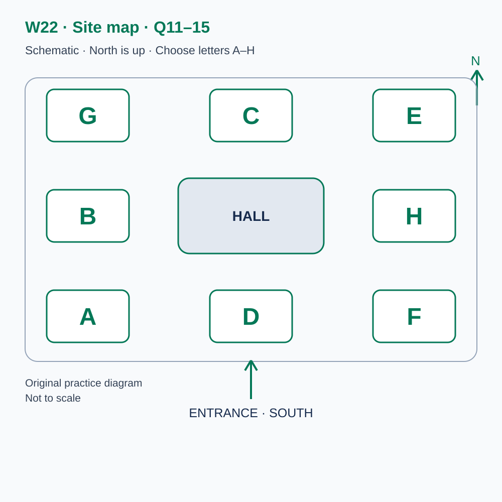
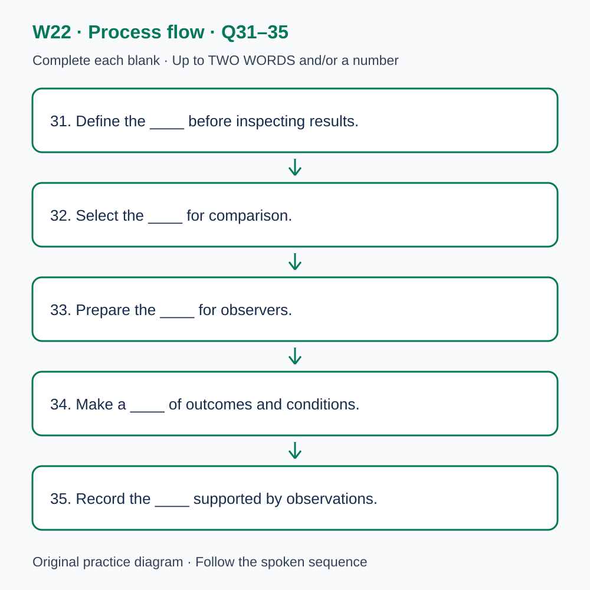

# U57 第22周听力题面与复盘（音频待补）

本页提供已核验的原创题目、参考答案和脚本。配套完整音频尚未验收，当前只能预览题面；不能进行有效的首次听力测试，也不能把读稿作答计作听力成绩或已完成一套听力。

请先保留首次作答机会：批准音频就绪前，不要展开下方答案和脚本。若已读稿，请标记为熟悉材料，之后的练习不能充当陌生题诊断。页面阅读标记只代表看过文字，不代表完成听力。

本材料非雅思真题、非标准化模考，不换算正式分数。计划分钟数不是实测音频时长；学习记录、正式测评和真人反馈须另行完成。

## 学生题面

### L-W22 — An original checkpoint in comparing evidence
> W22 是原创阶段检查，不能替代正式 T22，也不能据本练习换算官方分数。

> 原创 IELTS-style 技能练习，非真题、非标准化模考，不可换算正式分数。当前只有文字和题目，音频未生成，不能计作已完成听力套题。

共四部分、40 个计分空，每空 1 分。正式首次作答须等待批准音频，先不要打开 script.md 或 answers.md。朗读前先看题；只听一遍后提交首次答案及信心等级，再做精听。当前只能预览题面，不能把读稿作答记作听力成绩。

#### Part 1 — Booking a comparison workshop

Q1–6: Complete the notes. Write **NO MORE THAN TWO WORDS AND/OR A NUMBER** for each answer, using words from the recording. Numeric notation may replace spoken numbers. Do not repeat a printed unit. Q7–10: Choose **ONE letter, A, B or C**.

**Q1.** Selected workshop: ____

**Q2.** Confirmed date: ____ June

**Q3.** Workshop starts at ____ a.m.

**Q4.** Number attending: ____

**Q5.** Total booking cost: £____

**Q6.** Bring this essential document: ____

**Q7.** How should the original workshop result be treated?

- A. As an official examination result
- B. As local evidence separate from formal assessment
- C. As an automatic replacement for T22

Answer: ____

**Q8.** How should trial records be prepared?

- A. Invent missing figures
- B. Keep all identifiers regardless of purpose
- C. Use relevant permission and remove unnecessary identifiers

Answer: ____

**Q9.** What should a participant with a format need do?

- A. Request arrangements in advance
- B. Assume all formats are equivalent
- C. Omit the arrangement from the record

Answer: ____

**Q10.** How should a booking change be requested?

- A. Through a public discussion
- B. By replying with the confirmation reference
- C. By editing a trial result

Answer: ____

#### Part 2 — Orientation at the research centre

Q11–15: Label the map. Write **ONE letter, A–H**, for each destination. Three letters are unused. Q16–20: Choose **ONE letter, A, B or C**.

**Q11.** Reception

Answer: ____

**Q12.** Briefing

Answer: ____

**Q13.** Example display

Answer: ____

**Q14.** Observation

Answer: ____

**Q15.** Resources

Answer: ____

**Q16.** What must a checkpoint response contain?

- A. Only the most favourable total
- B. A finding and a relevant limitation
- C. An official band conversion

Answer: ____

**Q17.** What should be checked before comparing totals?

- A. Whether the preferred explanation is attractive
- B. Whether the totals look similar
- C. The definitions used in each session

Answer: ____

**Q18.** How should missing data be handled?

- A. Keep it missing and separate any assumptions
- B. Enter zero automatically
- C. Copy a plausible neighbouring value

Answer: ____

**Q19.** How should competing explanations be examined?

- A. Select the most familiar explanation
- B. Identify evidence that could distinguish them
- C. Treat a planned test as completed

Answer: ____

**Q20.** How should first responses and revisions be recorded?

- A. Convert the revised local total into a formal score
- B. Replace the first response after correction
- C. Keep them separate, with local counts correctly labelled

Answer: ____

#### Part 3 — Reviewing a visitor-layout trial

Q21–26: Match each proposal to the students' **final** positions at the end of that exchange. The tutor is not included. Write **A, B, C or D**. Letters may be reused.

- **A** Tess only
- **B** Noah only
- **C** Both students
- **D** Neither student

Q27–28 and Q29–30: Choose **TWO different letters, A–E**, for each pair. Write one letter in each numbered slot; either order is accepted. Each distinct correct choice earns one point, maximum two. Repeating a letter cannot earn two points. Submit no more than two letters.

**Q21.** At the END of this exchange, who supports: retaining the fixed outcome definition?

Answer: ____

**Q22.** At the END of this exchange, who supports: adding a comparison area next?

Answer: ____

**Q23.** At the END of this exchange, who supports: interviewing visitors next?

Answer: ____

**Q24.** At the END of this exchange, who supports: claiming that the layout caused every improvement?

Answer: ____

**Q25.** At the END of this exchange, who supports: leaving missing observations missing?

Answer: ____

**Q26.** At the END of this exchange, who supports: observing a busy period next?

Answer: ____

**Q27–28.** Which TWO actions are agreed for the next record?

- A. Preserve the outcome definition
- B. Treat missing data as zero
- C. Delete unexpected observations
- D. Record relevant conditions
- E. Claim a general causal effect

Answers: Q27 ____ · Q28 ____

**Q29–30.** Which TWO differences limit the session comparison?

- A. A cancelled session
- B. Visitors’ prior experience
- C. Lost records from both sessions
- D. Different admission fees
- E. Weekday versus weekend conditions

Answers: Q29 ____ · Q30 ____

#### Part 4 — Interpreting a small comparison responsibly

Q31–35: Complete the flow chart below. Q36–40: Complete the notes. Write **NO MORE THAN TWO WORDS AND/OR A NUMBER** for each answer, using words from the recording. Numeric notation may replace spoken numbers. Words or units already printed do not belong in the blank. The numbered text below repeats the SVG prompts for readability.

**Q31.** Define the ____ before inspecting results.

**Q32.** Select the ____ for comparison.

**Q33.** Prepare the ____ for observers.

**Q34.** Make a ____ of outcomes and conditions.

**Q35.** Record the ____ supported by observations.

**Q36.** Named process in which people choose whether to participate: ____

**Q37.** Named process of assigning values by a stated rule: ____

**Q38.** Named term for the competing influence linked to exposure and outcome: ____

**Q39.** Named term for what would have happened without the change: ____

**Q40.** State the ____ on the causal claim.

#### 本周训练安排（音频批准后执行）

- Preview questions without the script：8 分钟。
- Future continuous first listen, including planned part pauses：32 分钟。
- Submit first answers and confidence, without a second play：8 分钟。
- Check answers and classify errors：20 分钟。
- Four Q-located intensive segments, 15 minutes each：60 分钟。
- Diagram and opinion retelling：15 分钟。
- Next-day retry of missed items：15 分钟。

合计 **158 分钟**；最多另用 22 分钟缓冲，总计不超过 180 分钟。暂停、回放与查词均计入精听预算，不能另行无限追加。当前实际已完成听力分钟数为 0。精听区段和步骤见 intensive.md；答案和脚本另页。

参考答案与证据（完成首次听力后再展开）

### L-W22 — Answers and evidence
> 独立答案页。先提交首次答案，再看本页。当前缺音频，文本验题不能充当实听验收。

每个单空 1 分；双选各 2 分、答案顺序不限、按不同正确选项计分。接受形式仅做大小写和空白规范化；不做模糊词形推断。

#### Q1 — evidence comparison

Accepted answers: evidence comparison

Use the final confirmed detail in this exchange; the printed unit or date context is already supplied.

Evidence locator: Q01 (script.md; timestamps unavailable).

> Receptionist: Community research centre, good morning. Organiser: Our volunteers have records from a small exhibition trial and want help comparing them. We saw courses on chart design and evidence comparison. The second sounds closer to our question. Receptionist: Evidence comparison is the appropriate workshop if you want to examine what a difference can support. Organiser: Please book evidence comparison. We don't want someone simply to make the more successful session look impressive. Receptionist: The workshop uses an original local checkpoint to practise interpretation. It doesn't replace a separately required formal assessment, and the exercise's score has no established official conversion. Keep those purposes distinct when describing what the group has completed.

#### Q2 — 22

Accepted answers: 22 / 22nd / twenty-second / twenty second / the twenty-second / the 22nd

Use the final confirmed detail in this exchange; the printed unit or date context is already supplied.

Evidence locator: Q02 (script.md; timestamps unavailable).

> Organiser: Is the session on the fifteenth of June? Receptionist: That was the first proposed date. The confirmed workshop is on the twenty-second of June. Organiser: The twenty-second suits our group. I'll replace the old entry in the calendar. Receptionist: The confirmation will identify this workshop by name as well as date. Organiser: I'll forward the complete message, because another volunteer saved a notice for the chart course. Receptionist: Good. A practical detail can be correct for one event and wrong for another. Keeping the source attached to the information is useful even before you begin the workshop, rather than combining familiar fragments into a booking that no one actually confirmed.

#### Q3 — 9:35

Accepted answers: 9:35 / 9.35 / 09:35 / 09.35 / nine thirty-five

Use the final confirmed detail in this exchange; the printed unit or date context is already supplied.

Evidence locator: Q03 (script.md; timestamps unavailable).

> Organiser: When does the teaching begin? Receptionist: Nine thirty-five in the morning. The building opens at nine, but your session begins at nine thirty-five. Organiser: Then nine is not the time of the first exercise. Receptionist: Correct. Please arrive shortly before teaching so you can check in. Organiser: I'll distinguish the start from our planned arrival in the travel note. Receptionist: The opening explanation defines what the local checkpoint will examine. Missing it could leave someone comparing totals without noticing that the task also asks them to state a limitation. A complete response needs to address that requirement, not merely report which number is larger.

#### Q4 — 3

Accepted answers: 3 / three

Use the final confirmed detail in this exchange; the printed unit or date context is already supplied.

Evidence locator: Q04 (script.md; timestamps unavailable).

> Receptionist: How many places do you need? Organiser: Four volunteers discussed attending, but one cannot come. Please reserve three places. Receptionist: Three are available. Will the participants know how the records were collected? Organiser: Yes. One observed the first session, one managed the second and one prepared the summary. Receptionist: That should help you explain differences in the procedure. Organiser: We'll collect the absent volunteer's questions without counting that person as an attendee. Receptionist: If someone else comes instead, update the booking. A current list helps us organise the discussion and avoid assuming that every participant has the same first-hand knowledge of both observation periods.

#### Q5 — 57

Accepted answers: 57 / 57.00 / fifty-seven / fifty seven

Use the final confirmed detail in this exchange; the printed unit or date context is already supplied.

Evidence locator: Q05 (script.md; timestamps unavailable).

> Organiser: What is the total fee? Receptionist: Fifty-seven pounds for the three places altogether. Organiser: Fifty-seven for the whole booking, rather than for each person? Receptionist: Correct. That includes the practice materials. A separate visit to your exhibition would be a different arrangement and isn't included. Organiser: I'll tell our coordinator the total and what it covers. Receptionist: Please check those details on the confirmation before payment. If the number of places or amount differs, ask for a correction rather than assume an unexplained change represents extra analysis. Organiser: That will help us keep the booking record consistent with the decision the group actually made.

#### Q6 — brief

Accepted answers: brief / the brief / a brief

Use the final confirmed detail in this exchange; the printed unit or date context is already supplied.

Evidence locator: Q06 (script.md; timestamps unavailable).

> Organiser: What document is essential? Receptionist: Bring the brief that defined the trial's purpose and requested outputs. A chart of the results is useful but optional. Organiser: I'll bring the brief with any later changes marked separately. Receptionist: Good. We need to know what the comparison was intended to answer before deciding which figures matter. Organiser: Some volunteers remember a broader aim than the written brief contains. Receptionist: Preserve that difference rather than quietly rewriting the document. A later interpretation of the purpose should not be presented as though it governed the original observation. The distinction will make the workshop discussion more precise.

#### Q7 — B

Accepted answers: B

The local original exercise neither replaces formal assessment nor supplies an official score.

Evidence locator: Q07 (script.md; timestamps unavailable).

> Organiser: Will a strong result in the local checkpoint count as our formal stage assessment? Receptionist: No. The checkpoint is an original teaching exercise. Any separately required formal assessment must have its own appropriate material, conditions and record. Organiser: So we can describe what we answered correctly here without assigning an official band. Receptionist: Exactly. A local count may guide discussion of a skill, but its formal meaning has not been established. Organiser: We'll keep the records separate. Receptionist: That allows the workshop to be useful without claiming more than it provides. Clear scoring alone does not make an original practice set equivalent to an unfamiliar formal assessment.

#### Q8 — C

Accepted answers: C

The purpose and permission govern use; missing figures remain missing.

Evidence locator: Q08 (script.md; timestamps unavailable).

> Organiser: Can we bring copies of individual visitor responses? Receptionist: Use only material you may share for the workshop purpose and remove identifying details that aren't needed. You can also prepare a summary that preserves the relevant definitions and gaps. Organiser: I'll check the conditions rather than assume possession of a copy permits every use. Receptionist: Thank you. The fictional examples supplied here are enough to learn the method if your own material cannot be shared. Organiser: We should not replace missing observations with made-up figures to make our table complete. Receptionist: Correct. A clearly marked gap preserves information about the evidence that an invented number would conceal.

#### Q9 — A

Accepted answers: A

Advance arrangements and actual conditions must be recorded.

Evidence locator: Q09 (script.md; timestamps unavailable).

> Organiser: One participant needs an accessible digital version of the examples. Should we request it before the day? Receptionist: Please describe the practical format requirement now so we can check what is available. Organiser: I'll ask the participant for the details rather than guess. Receptionist: Good. A larger printed page may not address the same need. Record the arrangement actually used if it matters to a comparison, without treating all forms of support as identical. Organiser: That makes the conditions easier to interpret later. Receptionist: Exactly. A result becomes more useful when its relevant circumstances are visible, rather than when the record gives an inaccurate impression that everyone encountered precisely the same task.

#### Q10 — B

Accepted answers: B

The reference identifies the reservation.

Evidence locator: Q10 (script.md; timestamps unavailable).

> Organiser: How should we report a withdrawal? Receptionist: Reply to the current confirmation with its reference. Comments beneath the public programme don't update our attendance record. For an urgent issue, use the contact number in the same message. Organiser: I'll keep the latest complete confirmation in our group folder. Receptionist: It includes the entrance and the required document. Organiser: I'll also remind everyone that the session examines evidence rather than promising a preferred conclusion. Receptionist: That's the right expectation. You may discover that the comparison supports a limited observation and a better next question, rather than the simple explanation the group originally hoped the figures would prove.

#### Q11 — B

Accepted answers: B

Use the explicitly stated position relative to the hall, not an earlier layout or adjacent area.

Evidence locator: Q11 (script.md; timestamps unavailable).

> Welcome to the research centre. North is at the top of the map, and the entrance is on the southern edge. The hall in the centre is our fixed landmark. Reception is directly west of the hall, level with its centre. It isn't the space directly south that you pass after entering. Please check in at reception before going to the workshop. The letters identify positions, not room initials. If an older plan places an activity elsewhere, follow today's briefing and ask about any inconsistency. A remembered route can be convenient, but it is not a substitute for the current arrangement when the same building hosts several different teaching groups.

#### Q12 — C

Accepted answers: C

Use the explicitly stated position relative to the hall, not an earlier layout or adjacent area.

Evidence locator: Q12 (script.md; timestamps unavailable).

> The briefing room is directly north of the hall, in the northern central position. An earlier programme put the introduction in the north-west room, but today's briefing uses the space directly north. The first activity asks you to identify a comparison question before inspecting the chart. A striking difference can distract the group from the outcome it originally intended to examine. Keep the brief beside the results so that a convenient number does not silently become the purpose of the study. A comparison may reveal something unexpected, but that should be described as a new observation rather than presented as an answer to a question that was never specified.

#### Q13 — E

Accepted answers: E

Use the explicitly stated position relative to the hall, not an earlier layout or adjacent area.

Evidence locator: Q13 (script.md; timestamps unavailable).

> The example display is in the north-east corner. It is directly east of the briefing room and north of the space directly east of the hall. The two northern rooms share a row, so the display is east of the briefing room rather than north-east of that room. Several fictional records show how different definitions can produce figures with the same heading. Read the definition before comparing values. Two columns labelled completion may concern different tasks or different points in a sequence. The display is intended to make those distinctions visible, not to supply one attractive chart that every group should copy regardless of what its own information represents.

#### Q14 — F

Accepted answers: F

Use the explicitly stated position relative to the hall, not an earlier layout or adjacent area.

Evidence locator: Q14 (script.md; timestamps unavailable).

> The observation room is in the south-east corner. It lies south of the space directly east of the hall and east of the southern central room. Groups use it to examine a short fictional visitor task. Record what the visitor does before deciding why it happened. A pause may reflect reading, waiting or uncertainty, and the action alone may not settle the explanation. If an observer gives help, note the timing and content of that help. The eventual outcome should then be interpreted in relation to it. An accurate account of support is more informative than a simple success label that makes an assisted response appear independent.

#### Q15 — A

Accepted answers: A

Use the explicitly stated position relative to the hall, not an earlier layout or adjacent area.

Evidence locator: Q15 (script.md; timestamps unavailable).

> The resource desk is in the south-west corner. It is directly south of reception and west of the southern central room. Collect the worksheet version named in the briefing. The sheets distinguish observations, possible explanations and proposed next steps, so check the headings rather than filling a familiar table from memory. If a page is missing, ask the helper instead of copying another group's completed interpretation. The resource desk supplies the materials but does not choose the conclusion for you. A well-supported uncertainty is acceptable when the records don't distinguish competing accounts. The task is to explain the evidence clearly, not to invent certainty simply because every row has a blank to fill.

#### Q16 — B

Accepted answers: B

A supported observation must retain the relevant limit.

Evidence locator: Q16 (script.md; timestamps unavailable).

> The local checkpoint requires both a finding and a limitation. Reporting that one count is higher does not complete the task if the instruction also asks what the comparison cannot establish. Begin by identifying the required outputs and the stated word limit. Additional background may be interesting but can displace the qualification that gives the finding its proper scope. The review will examine the response against this brief, not against a different task that seems easier to answer. This is an original teaching activity. Its structured instructions make the work inspectable, but they do not give its score an official interpretation or replace a separate formal assessment requirement.

#### Q17 — C

Accepted answers: C

Measures with different meanings cannot be silently treated as identical.

Evidence locator: Q17 (script.md; timestamps unavailable).

> Check definitions before comparing results. If one session records arrival and another records completed visits, the totals answer different questions even if they appear in matching columns. The team should describe the start and end of the measure, the relevant period and any exclusions. A precise calculation cannot repair an undefined outcome. Where the records cannot support a direct comparison, state the mismatch rather than hide it in a note after a strong conclusion. That does not make the observations useless. It clarifies what can be described now and what a later collection would need to preserve before the team could ask a more specific question about change.

#### Q18 — A

Accepted answers: A

An absent observation is not an observed zero.

Evidence locator: Q18 (script.md; timestamps unavailable).

> Keep missing information visible. A blank observation is not automatically a zero, and replacing it with a convenient value would create evidence the trial did not produce. The group may discuss a clearly labelled analytical assumption, but it should distinguish that choice from a recorded fact. The local checkpoint asks you to explain the basis for a conclusion, including relevant gaps. A complete-looking table can be less informative than an honest incomplete one if it conceals uncertainty. If the group decides that another observation is needed, record that as planned work rather than placing an imagined result in the current comparison and treating the question as settled.

#### Q19 — B

Accepted answers: B

A discriminating observation is needed; its proposal is not a result.

Evidence locator: Q19 (script.md; timestamps unavailable).

> When two explanations remain plausible, identify what evidence would help distinguish them. A new layout might affect how visitors move, but a different visitor group or a changed schedule could also contribute to the result. Simply repeating the higher count more confidently does not resolve those alternatives. The team should connect a proposed next study with a specific uncertainty. It needn't investigate every imaginable cause before making any practical decision, but it should explain why the selected next step is relevant. A limited trial can support a cautious improvement while leaving a stronger causal claim unresolved, provided the report keeps those levels of conclusion distinct.

#### Q20 — C

Accepted answers: C

Revision and local performance must not be mislabelled as first-response or formal results.

Evidence locator: Q20 (script.md; timestamps unavailable).

> At the end, preserve the first response and record any later revision separately. An original checkpoint can show what was produced under its stated conditions, while a corrected answer can show what changed after feedback. Neither should be used to stand in for a formal assessment that has not occurred. The review should retain the source, timing and help received so the record remains interpretable. A high local correct count may be encouraging, but it does not establish an official result or readiness for a separate test. The next decision should be supported by the evidence actually available, with missing formal evidence left explicitly unverified.

#### Q21 — C

Accepted answers: C

Final stance: Both students. Ignore an initial proposal if later withdrawn; the tutor is not an answer option.

Evidence locator: Q21 (script.md; timestamps unavailable).

> Tutor: You reviewed the two visitor sessions last week. Should the outcome definition remain fixed for the next comparison? Tess: Yes. If completion means something different after the change, the totals won't answer the same question. Noah: I agree. I initially wanted to count any visitor who reached the display, but the brief specifies a completed information task. Tutor: Are you ruling out collecting another measure? Noah: No, but it would be labelled separately. Tess: That's the distinction I support. Tutor: Then both of you favour retaining the defined outcome for the comparison, while allowing an additional observation to answer a different, clearly identified question.

#### Q22 — B

Accepted answers: B

Final stance: Noah only. Ignore an initial proposal if later withdrawn; the tutor is not an answer option.

Evidence locator: Q22 (script.md; timestamps unavailable).

> Tutor: Noah proposes adding a comparison area that keeps the old layout. Noah: I support it. That could help us examine whether the change is specific to the redesigned area. Tess: I'd improve the records in the current area first. The other space may attract different visitors for reasons we can't measure well. Tutor: Would an exploratory label change your position? Tess: It would make the limitation clearer, but I still prefer to defer it. Noah: I continue to favour adding the area next. Tutor: Then Noah supports the specific proposal and Tess doesn't support it for this stage, even though both recognise that comparisons can be useful when their differences are recorded.

#### Q23 — A

Accepted answers: A

Final stance: Tess only. Ignore an initial proposal if later withdrawn; the tutor is not an answer option.

Evidence locator: Q23 (script.md; timestamps unavailable).

> Tutor: Tess suggests interviewing a few visitors after the task. Tess: Yes. Their explanations could help us understand whether a pause reflected reading or uncertainty about the next action. Noah: I'd first use the observation notes. An interview may introduce memories shaped by the outcome rather than the decision at the time. Tutor: Could you make that limitation explicit? Tess: Certainly, and I still support the interview. Noah: I understand, but for the next trial I would leave it out. Tutor: Then Tess supports that additional source and Noah prefers another sequence. The disagreement concerns what to collect next, not whether a visitor's account could ever contribute to a careful interpretation.

#### Q24 — D

Accepted answers: D

Final stance: Neither student. Ignore an initial proposal if later withdrawn; the tutor is not an answer option.

Evidence locator: Q24 (script.md; timestamps unavailable).

> Tutor: Your draft report says the new layout caused every improvement. Noah: I wrote that before checking the differences between the sessions. I don't think we can defend it now. Tess: I don't support the statement either. The visitor groups and the day of observation changed. Noah: I'll replace the causal claim with the observed difference and its limitations. Tutor: Does either of you want to keep the original sentence as a summary? Tess: No. A shorter sentence doesn't justify a stronger claim than the evidence supports. Noah: Agreed. Tutor: Then neither student supports the original explanation, even though it appeared confidently in an earlier version of the report.

#### Q25 — C

Accepted answers: C

Final stance: Both students. Ignore an initial proposal if later withdrawn; the tutor is not an answer option.

Evidence locator: Q25 (script.md; timestamps unavailable).

> Tutor: Should missing observations remain marked as missing? Tess: Yes. A blank doesn't tell us that no event occurred. Noah: I agree. I initially thought zero would make the table easier to calculate, but that would change the meaning of the record. Tutor: Could you discuss an assumption separately? Noah: Yes, provided it is labelled and its effect examined rather than presented as observed data. Tess: That is the approach I support. Tutor: Then both of you favour preserving the missing status in the record. A convenient calculation is not a reason to turn an absence of information into a fact the trial never established.

#### Q26 — B

Accepted answers: B

Final stance: Noah only. Ignore an initial proposal if later withdrawn; the tutor is not an answer option.

Evidence locator: Q26 (script.md; timestamps unavailable).

> Tutor: Noah wants another session during a busy period. Noah: I support that. Both completed observations were relatively quiet, so we don't know whether the same difficulty appears when more people arrive. Tess: I'd first repeat a quiet session using the revised definitions, so we can check the procedure before changing demand. Tutor: Could the busy session be treated as a different question? Noah: Yes, and I still favour it next. Tess: I would keep it for later. Tutor: Then Noah supports the busy-period observation and Tess doesn't support that timing for the next stage. Preserve the order you each propose rather than report agreement merely because both activities might eventually be useful.

#### Q27–28 — A, D

Accept unordered set: A, D. One point per distinct correct choice, maximum 2.

They retain the outcome definition and record conditions.

Evidence locator: Q27, Q28 (script.md; timestamps unavailable).

> Tutor: Which two preparation actions are agreed? Tess: Preserve the outcome definition in the next observation sheet. Noah: Agreed. The record should identify exactly what counts as completion, including the point at which the observer marks it. Tutor: Are you selecting a universal target score for the workshop? Noah: No. That would not help define this measure. Tess: Nor should we alter the definition afterwards to make a preferred result easier to report. Tutor: Then the first agreed action concerns the meaning of the outcome. Keep that meaning with the numbers so a later reader can understand what was counted rather than infer it from an attractive heading.

> Tutor: What is the second preparation action? Noah: Record the conditions that could affect the comparison, including the schedule and relevant visitor characteristics. Tess: Yes. We don't need unnecessary personal details, but the conditions must be clear enough to explain the scope of the observation. Tutor: Does that include inventing a value for every missing field? Tess: No. Unknown information stays unknown. Noah: We also don't need to rank the volunteers by the neatness of their charts. Tutor: Good. The two selected actions are preserving the outcome definition and recording relevant conditions. Both support interpretation of the actual comparison rather than decorating a result before its meaning has been checked.

#### Q29–30 — B, E

Accept unordered set: B, E. One point per distinct correct choice, maximum 2.

Visitor experience and weekday/weekend conditions remain alternative influences.

Evidence locator: Q29, Q30 (script.md; timestamps unavailable).

> Tutor: What limits the comparison already completed? Noah: The visitor groups differed in previous experience with the exhibition. Tess: Some people in the second session knew the task from an earlier visit, which may have affected completion. Tutor: Were records from the whole first session lost? Tess: No. The records are available. The limitation concerns who participated, not a missing event. Noah: We should describe that difference rather than assume that equal group sizes make the groups equivalent. Tutor: That will help the report distinguish what happened in these sessions from a claim about how any new visitor would respond to the revised layout under otherwise identical conditions.

> Tutor: Was the observation period comparable? Tess: One session was on a weekday and the other at the weekend. The surrounding activities and arrival pattern differed. Noah: That gives another possible contribution to the result besides the layout. Tutor: Does that mean the redesign had no effect? Noah: No. It means this comparison doesn't isolate its effect. Tess: Neither session was cancelled and the pages weren't incomplete. Tutor: Then retain the differences in visitor experience and observation period as the two limitations. The report can still state the observed pattern, provided it doesn't quietly convert a qualified comparison into proof of a single cause that the design cannot separate from the alternatives.

#### Q31 — question

Accepted answers: question / research question / focused question

Complete the named stage in the stated process order; retain any word already printed around the blank.

Evidence locator: Q31 (script.md; timestamps unavailable).

> Consider a fictional team evaluating an exhibition change. The first stage defines a research question. This focused question identifies the outcome and comparison the team intends to examine. It should not be chosen only after a striking result has appeared in the table. A question about completing an information task differs from a question about how long visitors remain in the room, even when both can be observed during one visit. The team may investigate both, but each needs a clear purpose. Defining the question keeps the later report connected to the enquiry that guided collection, while allowing unexpected observations to be recorded as new questions rather than disguised as planned findings.

#### Q32 — sample

Accepted answers: sample / visitor sample / selected sample

Complete the named stage in the stated process order; retain any word already printed around the blank.

Evidence locator: Q32 (script.md; timestamps unavailable).

> The second stage selects a visitor sample. The sample must be described in terms relevant to the comparison, such as prior exposure to the exhibition and the time of attendance. A small sample can support useful local observation, but it should not be treated as though it automatically represents every future visitor. The team records who could enter the sample and how participation occurred. Those details matter even when the selected sample contains the same number of people in each session. Equal counts do not establish equivalent experience, needs or conditions. This stage therefore concerns the basis of the comparison, not merely filling two columns with matching totals before the analysis begins.

#### Q33 — protocol

Accepted answers: protocol / written protocol / procedure / written procedure

Complete the named stage in the stated process order; retain any word already printed around the blank.

Evidence locator: Q33 (script.md; timestamps unavailable).

> The third stage prepares a written protocol. The protocol is the procedure the observers will follow, including definitions, recording points and the handling of missing information. A written procedure makes it possible to examine whether the two sessions were conducted in comparable ways. It should be specific enough to guide a decision without pretending that every unexpected event can be predicted. If the procedure changes, the change belongs in the record. A later report should not describe a revised method as though it governed an earlier session. Keeping the protocol identifiable allows the team to distinguish a difference in the observed process from a difference in how that process was recorded.

#### Q34 — comparison

Accepted answers: comparison / structured comparison / contrast / direct contrast

Complete the named stage in the stated process order; retain any word already printed around the blank.

Evidence locator: Q34 (script.md; timestamps unavailable).

> The fourth stage makes a structured comparison. The comparison examines the outcome alongside the relevant conditions rather than treating two totals as self-explanatory. The team checks whether the measures use the same definitions and whether the groups encountered comparable demands. Where the information cannot support a direct contrast, the mismatch remains visible. This does not require abandoning every useful description. It requires explaining what the contrast actually represents. A structured comparison may identify an unresolved alternative that the original plan did not consider. That is a reason to qualify the next claim and refine the enquiry, rather than hide the difference because it complicates an otherwise tidy account of improvement.

#### Q35 — interpretation

Accepted answers: interpretation / qualified interpretation / explanation

Complete the named stage in the stated process order; retain any word already printed around the blank.

Evidence locator: Q35 (script.md; timestamps unavailable).

> The fifth stage records an interpretation supported by the observations. This qualified interpretation connects the pattern with an explanation while preserving alternatives the design cannot rule out. The explanation should not become certain merely because it is plausible or because the team prefers it. A small trial may justify retaining a feature for further investigation without establishing a general causal conclusion. The report should identify the observation, the reasoning and the limit as related but distinct parts of the account. A reader can then see what the evidence supports now and what another study would need to examine before the team could responsibly make a stronger statement about the change.

#### Q36 — self-selection

Accepted answers: self-selection / self selection

The corresponding evidence block supplies this distinction or qualification; the question retains the surrounding grammar.

Evidence locator: Q36 (script.md; timestamps unavailable).

> The named selection process in which people decide for themselves whether to participate is self-selection. In this fictional example, visitors who volunteer for a task may differ from those who pass through without joining. That difference could concern familiarity, interest or available time. The term identifies the entry process, not a conclusion that every voluntary sample is useless. The team should describe how participation occurred and consider which claims the resulting sample can support. A larger number does not automatically remove the issue if entry follows the same process. The review can still use the observations while keeping the relation between the participating group and the wider audience explicit.

#### Q37 — measurement

Accepted answers: measurement

The corresponding evidence block supplies this distinction or qualification; the question retains the surrounding grammar.

Evidence locator: Q37 (script.md; timestamps unavailable).

> Measurement is the named process of assigning a recorded value according to a stated rule. In this example, the rule determines when a visitor's task begins, when it ends and what counts as completion. Changing those boundaries can change the number even if the visitor's experience remains similar. The team therefore checks the procedure as well as the value in the table. Precision in recording is useful only when the measure has a clear meaning. A result written to several decimal places does not establish that two sessions used compatible definitions. The review asks what was measured and how, before treating the numerical difference as evidence about the exhibition itself.

#### Q38 — confounder

Accepted answers: confounder / confounding factor / possible confounder

The corresponding evidence block supplies this distinction or qualification; the question retains the surrounding grammar.

Evidence locator: Q38 (script.md; timestamps unavailable).

> A competing influence associated with both the exposure being studied and the outcome is called a confounder here. The lecture also uses the term confounding factor for that same role. In the fictional comparison, a difference in visitor experience could affect both which session people attended and how they completed the task. The team should examine the proposed connection rather than attach the label to every difference it notices. A possible confounder is a reason to qualify a causal claim and improve the next design. It does not by itself prove that the preferred explanation is false or identify exactly how much of the observed difference belongs to the competing influence.

#### Q39 — counterfactual

Accepted answers: counterfactual

The corresponding evidence block supplies this distinction or qualification; the question retains the surrounding grammar.

Evidence locator: Q39 (script.md; timestamps unavailable).

> The named term for what would have happened without the change is the counterfactual. The same people cannot be observed both with and without that change at the same moment under otherwise identical conditions. A comparison or model therefore supports reasoning about the alternative, with assumptions that need to remain visible. A convenient group is not automatically a perfect substitute for the unobserved situation. The team should explain the important similarities and differences rather than rely on the appearance of two matching columns. The concept sharpens the causal question, but naming it does not give a small local trial information that its design and records do not actually contain.

#### Q40 — limitations

Accepted answers: limitations / relevant limitations

The corresponding evidence block supplies this distinction or qualification; the question retains the surrounding grammar.

Evidence locator: Q40 (script.md; timestamps unavailable).

> Before claiming that the layout caused the observed difference, the team states the relevant limitations. Limitations identify what the comparison cannot establish and why. They should refer to the actual task, sample and conditions rather than operate as a generic apology for having limited time. A narrow but well-supported observation can still inform a useful next action. The review may propose another session, a clearer definition or a different source of evidence. Those are plans, not results already obtained. The original checkpoint assesses whether the response makes that distinction; it does not replace formal assessment, provide an official score conversion or establish a learner's readiness from the local correct count alone.

完整脚本（提前阅读会失去陌生题首答机会）

### L-W22 — An original checkpoint in comparing evidence: transcript
> 原创虚构练习，非真题；音频缺失。仅供完成首次作答后的核对或文字审阅。Q 标记与角色名不属于朗读正文。

#### Part 1 — Booking a comparison workshop

##### Q1 evidence block

**Receptionist:** Community research centre, good morning.

**Organiser:** Our volunteers have records from a small exhibition trial and want help comparing them. We saw courses on chart design and evidence comparison. The second sounds closer to our question.

**Receptionist:** Evidence comparison is the appropriate workshop if you want to examine what a difference can support.

**Organiser:** Please book evidence comparison. We don't want someone simply to make the more successful session look impressive.

**Receptionist:** The workshop uses an original local checkpoint to practise interpretation. It doesn't replace a separately required formal assessment, and the exercise's score has no established official conversion. Keep those purposes distinct when describing what the group has completed.

##### Q2 evidence block

**Organiser:** Is the session on the fifteenth of June?

**Receptionist:** That was the first proposed date. The confirmed workshop is on the twenty-second of June.

**Organiser:** The twenty-second suits our group. I'll replace the old entry in the calendar.

**Receptionist:** The confirmation will identify this workshop by name as well as date.

**Organiser:** I'll forward the complete message, because another volunteer saved a notice for the chart course.

**Receptionist:** Good. A practical detail can be correct for one event and wrong for another. Keeping the source attached to the information is useful even before you begin the workshop, rather than combining familiar fragments into a booking that no one actually confirmed.

##### Q3 evidence block

**Organiser:** When does the teaching begin?

**Receptionist:** Nine thirty-five in the morning. The building opens at nine, but your session begins at nine thirty-five.

**Organiser:** Then nine is not the time of the first exercise.

**Receptionist:** Correct. Please arrive shortly before teaching so you can check in.

**Organiser:** I'll distinguish the start from our planned arrival in the travel note.

**Receptionist:** The opening explanation defines what the local checkpoint will examine. Missing it could leave someone comparing totals without noticing that the task also asks them to state a limitation. A complete response needs to address that requirement, not merely report which number is larger.

##### Q4 evidence block

**Receptionist:** How many places do you need?

**Organiser:** Four volunteers discussed attending, but one cannot come. Please reserve three places.

**Receptionist:** Three are available. Will the participants know how the records were collected?

**Organiser:** Yes. One observed the first session, one managed the second and one prepared the summary.

**Receptionist:** That should help you explain differences in the procedure.

**Organiser:** We'll collect the absent volunteer's questions without counting that person as an attendee.

**Receptionist:** If someone else comes instead, update the booking. A current list helps us organise the discussion and avoid assuming that every participant has the same first-hand knowledge of both observation periods.

##### Q5 evidence block

**Organiser:** What is the total fee?

**Receptionist:** Fifty-seven pounds for the three places altogether.

**Organiser:** Fifty-seven for the whole booking, rather than for each person?

**Receptionist:** Correct. That includes the practice materials. A separate visit to your exhibition would be a different arrangement and isn't included.

**Organiser:** I'll tell our coordinator the total and what it covers.

**Receptionist:** Please check those details on the confirmation before payment. If the number of places or amount differs, ask for a correction rather than assume an unexplained change represents extra analysis.

**Organiser:** That will help us keep the booking record consistent with the decision the group actually made.

##### Q6 evidence block

**Organiser:** What document is essential?

**Receptionist:** Bring the brief that defined the trial's purpose and requested outputs. A chart of the results is useful but optional.

**Organiser:** I'll bring the brief with any later changes marked separately.

**Receptionist:** Good. We need to know what the comparison was intended to answer before deciding which figures matter.

**Organiser:** Some volunteers remember a broader aim than the written brief contains.

**Receptionist:** Preserve that difference rather than quietly rewriting the document. A later interpretation of the purpose should not be presented as though it governed the original observation. The distinction will make the workshop discussion more precise.

##### Q7 evidence block

**Organiser:** Will a strong result in the local checkpoint count as our formal stage assessment?

**Receptionist:** No. The checkpoint is an original teaching exercise. Any separately required formal assessment must have its own appropriate material, conditions and record.

**Organiser:** So we can describe what we answered correctly here without assigning an official band.

**Receptionist:** Exactly. A local count may guide discussion of a skill, but its formal meaning has not been established.

**Organiser:** We'll keep the records separate.

**Receptionist:** That allows the workshop to be useful without claiming more than it provides. Clear scoring alone does not make an original practice set equivalent to an unfamiliar formal assessment.

##### Q8 evidence block

**Organiser:** Can we bring copies of individual visitor responses?

**Receptionist:** Use only material you may share for the workshop purpose and remove identifying details that aren't needed. You can also prepare a summary that preserves the relevant definitions and gaps.

**Organiser:** I'll check the conditions rather than assume possession of a copy permits every use.

**Receptionist:** Thank you. The fictional examples supplied here are enough to learn the method if your own material cannot be shared.

**Organiser:** We should not replace missing observations with made-up figures to make our table complete.

**Receptionist:** Correct. A clearly marked gap preserves information about the evidence that an invented number would conceal.

##### Q9 evidence block

**Organiser:** One participant needs an accessible digital version of the examples. Should we request it before the day?

**Receptionist:** Please describe the practical format requirement now so we can check what is available.

**Organiser:** I'll ask the participant for the details rather than guess.

**Receptionist:** Good. A larger printed page may not address the same need. Record the arrangement actually used if it matters to a comparison, without treating all forms of support as identical.

**Organiser:** That makes the conditions easier to interpret later.

**Receptionist:** Exactly. A result becomes more useful when its relevant circumstances are visible, rather than when the record gives an inaccurate impression that everyone encountered precisely the same task.

##### Q10 evidence block

**Organiser:** How should we report a withdrawal?

**Receptionist:** Reply to the current confirmation with its reference. Comments beneath the public programme don't update our attendance record. For an urgent issue, use the contact number in the same message.

**Organiser:** I'll keep the latest complete confirmation in our group folder.

**Receptionist:** It includes the entrance and the required document.

**Organiser:** I'll also remind everyone that the session examines evidence rather than promising a preferred conclusion.

**Receptionist:** That's the right expectation. You may discover that the comparison supports a limited observation and a better next question, rather than the simple explanation the group originally hoped the figures would prove.

#### Part 2 — Orientation at the research centre

##### Q11 evidence block

**Centre host:** Welcome to the research centre. North is at the top of the map, and the entrance is on the southern edge. The hall in the centre is our fixed landmark. Reception is directly west of the hall, level with its centre. It isn't the space directly south that you pass after entering. Please check in at reception before going to the workshop. The letters identify positions, not room initials. If an older plan places an activity elsewhere, follow today's briefing and ask about any inconsistency. A remembered route can be convenient, but it is not a substitute for the current arrangement when the same building hosts several different teaching groups.

##### Q12 evidence block

**Centre host:** The briefing room is directly north of the hall, in the northern central position. An earlier programme put the introduction in the north-west room, but today's briefing uses the space directly north. The first activity asks you to identify a comparison question before inspecting the chart. A striking difference can distract the group from the outcome it originally intended to examine. Keep the brief beside the results so that a convenient number does not silently become the purpose of the study. A comparison may reveal something unexpected, but that should be described as a new observation rather than presented as an answer to a question that was never specified.

##### Q13 evidence block

**Centre host:** The example display is in the north-east corner. It is directly east of the briefing room and north of the space directly east of the hall. The two northern rooms share a row, so the display is east of the briefing room rather than north-east of that room. Several fictional records show how different definitions can produce figures with the same heading. Read the definition before comparing values. Two columns labelled completion may concern different tasks or different points in a sequence. The display is intended to make those distinctions visible, not to supply one attractive chart that every group should copy regardless of what its own information represents.

##### Q14 evidence block

**Centre host:** The observation room is in the south-east corner. It lies south of the space directly east of the hall and east of the southern central room. Groups use it to examine a short fictional visitor task. Record what the visitor does before deciding why it happened. A pause may reflect reading, waiting or uncertainty, and the action alone may not settle the explanation. If an observer gives help, note the timing and content of that help. The eventual outcome should then be interpreted in relation to it. An accurate account of support is more informative than a simple success label that makes an assisted response appear independent.

##### Q15 evidence block

**Centre host:** The resource desk is in the south-west corner. It is directly south of reception and west of the southern central room. Collect the worksheet version named in the briefing. The sheets distinguish observations, possible explanations and proposed next steps, so check the headings rather than filling a familiar table from memory. If a page is missing, ask the helper instead of copying another group's completed interpretation. The resource desk supplies the materials but does not choose the conclusion for you. A well-supported uncertainty is acceptable when the records don't distinguish competing accounts. The task is to explain the evidence clearly, not to invent certainty simply because every row has a blank to fill.

##### Q16 evidence block

**Centre host:** The local checkpoint requires both a finding and a limitation. Reporting that one count is higher does not complete the task if the instruction also asks what the comparison cannot establish. Begin by identifying the required outputs and the stated word limit. Additional background may be interesting but can displace the qualification that gives the finding its proper scope. The review will examine the response against this brief, not against a different task that seems easier to answer. This is an original teaching activity. Its structured instructions make the work inspectable, but they do not give its score an official interpretation or replace a separate formal assessment requirement.

##### Q17 evidence block

**Centre host:** Check definitions before comparing results. If one session records arrival and another records completed visits, the totals answer different questions even if they appear in matching columns. The team should describe the start and end of the measure, the relevant period and any exclusions. A precise calculation cannot repair an undefined outcome. Where the records cannot support a direct comparison, state the mismatch rather than hide it in a note after a strong conclusion. That does not make the observations useless. It clarifies what can be described now and what a later collection would need to preserve before the team could ask a more specific question about change.

##### Q18 evidence block

**Centre host:** Keep missing information visible. A blank observation is not automatically a zero, and replacing it with a convenient value would create evidence the trial did not produce. The group may discuss a clearly labelled analytical assumption, but it should distinguish that choice from a recorded fact. The local checkpoint asks you to explain the basis for a conclusion, including relevant gaps. A complete-looking table can be less informative than an honest incomplete one if it conceals uncertainty. If the group decides that another observation is needed, record that as planned work rather than placing an imagined result in the current comparison and treating the question as settled.

##### Q19 evidence block

**Centre host:** When two explanations remain plausible, identify what evidence would help distinguish them. A new layout might affect how visitors move, but a different visitor group or a changed schedule could also contribute to the result. Simply repeating the higher count more confidently does not resolve those alternatives. The team should connect a proposed next study with a specific uncertainty. It needn't investigate every imaginable cause before making any practical decision, but it should explain why the selected next step is relevant. A limited trial can support a cautious improvement while leaving a stronger causal claim unresolved, provided the report keeps those levels of conclusion distinct.

##### Q20 evidence block

**Centre host:** At the end, preserve the first response and record any later revision separately. An original checkpoint can show what was produced under its stated conditions, while a corrected answer can show what changed after feedback. Neither should be used to stand in for a formal assessment that has not occurred. The review should retain the source, timing and help received so the record remains interpretable. A high local correct count may be encouraging, but it does not establish an official result or readiness for a separate test. The next decision should be supported by the evidence actually available, with missing formal evidence left explicitly unverified.

#### Part 3 — Reviewing a visitor-layout trial

##### Q21 evidence block

**Tutor:** You reviewed the two visitor sessions last week. Should the outcome definition remain fixed for the next comparison?

**Tess:** Yes. If completion means something different after the change, the totals won't answer the same question.

**Noah:** I agree. I initially wanted to count any visitor who reached the display, but the brief specifies a completed information task.

**Tutor:** Are you ruling out collecting another measure?

**Noah:** No, but it would be labelled separately.

**Tess:** That's the distinction I support.

**Tutor:** Then both of you favour retaining the defined outcome for the comparison, while allowing an additional observation to answer a different, clearly identified question.

##### Q22 evidence block

**Tutor:** Noah proposes adding a comparison area that keeps the old layout.

**Noah:** I support it. That could help us examine whether the change is specific to the redesigned area.

**Tess:** I'd improve the records in the current area first. The other space may attract different visitors for reasons we can't measure well.

**Tutor:** Would an exploratory label change your position?

**Tess:** It would make the limitation clearer, but I still prefer to defer it.

**Noah:** I continue to favour adding the area next.

**Tutor:** Then Noah supports the specific proposal and Tess doesn't support it for this stage, even though both recognise that comparisons can be useful when their differences are recorded.

##### Q23 evidence block

**Tutor:** Tess suggests interviewing a few visitors after the task.

**Tess:** Yes. Their explanations could help us understand whether a pause reflected reading or uncertainty about the next action.

**Noah:** I'd first use the observation notes. An interview may introduce memories shaped by the outcome rather than the decision at the time.

**Tutor:** Could you make that limitation explicit?

**Tess:** Certainly, and I still support the interview.

**Noah:** I understand, but for the next trial I would leave it out.

**Tutor:** Then Tess supports that additional source and Noah prefers another sequence. The disagreement concerns what to collect next, not whether a visitor's account could ever contribute to a careful interpretation.

##### Q24 evidence block

**Tutor:** Your draft report says the new layout caused every improvement.

**Noah:** I wrote that before checking the differences between the sessions. I don't think we can defend it now.

**Tess:** I don't support the statement either. The visitor groups and the day of observation changed.

**Noah:** I'll replace the causal claim with the observed difference and its limitations.

**Tutor:** Does either of you want to keep the original sentence as a summary?

**Tess:** No. A shorter sentence doesn't justify a stronger claim than the evidence supports.

**Noah:** Agreed.

**Tutor:** Then neither student supports the original explanation, even though it appeared confidently in an earlier version of the report.

##### Q25 evidence block

**Tutor:** Should missing observations remain marked as missing?

**Tess:** Yes. A blank doesn't tell us that no event occurred.

**Noah:** I agree. I initially thought zero would make the table easier to calculate, but that would change the meaning of the record.

**Tutor:** Could you discuss an assumption separately?

**Noah:** Yes, provided it is labelled and its effect examined rather than presented as observed data.

**Tess:** That is the approach I support.

**Tutor:** Then both of you favour preserving the missing status in the record. A convenient calculation is not a reason to turn an absence of information into a fact the trial never established.

##### Q26 evidence block

**Tutor:** Noah wants another session during a busy period.

**Noah:** I support that. Both completed observations were relatively quiet, so we don't know whether the same difficulty appears when more people arrive.

**Tess:** I'd first repeat a quiet session using the revised definitions, so we can check the procedure before changing demand.

**Tutor:** Could the busy session be treated as a different question?

**Noah:** Yes, and I still favour it next.

**Tess:** I would keep it for later.

**Tutor:** Then Noah supports the busy-period observation and Tess doesn't support that timing for the next stage. Preserve the order you each propose rather than report agreement merely because both activities might eventually be useful.

##### Q27 evidence block

**Tutor:** Which two preparation actions are agreed?

**Tess:** Preserve the outcome definition in the next observation sheet.

**Noah:** Agreed. The record should identify exactly what counts as completion, including the point at which the observer marks it.

**Tutor:** Are you selecting a universal target score for the workshop?

**Noah:** No. That would not help define this measure.

**Tess:** Nor should we alter the definition afterwards to make a preferred result easier to report.

**Tutor:** Then the first agreed action concerns the meaning of the outcome. Keep that meaning with the numbers so a later reader can understand what was counted rather than infer it from an attractive heading.

##### Q28 evidence block

**Tutor:** What is the second preparation action?

**Noah:** Record the conditions that could affect the comparison, including the schedule and relevant visitor characteristics.

**Tess:** Yes. We don't need unnecessary personal details, but the conditions must be clear enough to explain the scope of the observation.

**Tutor:** Does that include inventing a value for every missing field?

**Tess:** No. Unknown information stays unknown.

**Noah:** We also don't need to rank the volunteers by the neatness of their charts.

**Tutor:** Good. The two selected actions are preserving the outcome definition and recording relevant conditions. Both support interpretation of the actual comparison rather than decorating a result before its meaning has been checked.

##### Q29 evidence block

**Tutor:** What limits the comparison already completed?

**Noah:** The visitor groups differed in previous experience with the exhibition.

**Tess:** Some people in the second session knew the task from an earlier visit, which may have affected completion.

**Tutor:** Were records from the whole first session lost?

**Tess:** No. The records are available. The limitation concerns who participated, not a missing event.

**Noah:** We should describe that difference rather than assume that equal group sizes make the groups equivalent.

**Tutor:** That will help the report distinguish what happened in these sessions from a claim about how any new visitor would respond to the revised layout under otherwise identical conditions.

##### Q30 evidence block

**Tutor:** Was the observation period comparable?

**Tess:** One session was on a weekday and the other at the weekend. The surrounding activities and arrival pattern differed.

**Noah:** That gives another possible contribution to the result besides the layout.

**Tutor:** Does that mean the redesign had no effect?

**Noah:** No. It means this comparison doesn't isolate its effect.

**Tess:** Neither session was cancelled and the pages weren't incomplete.

**Tutor:** Then retain the differences in visitor experience and observation period as the two limitations. The report can still state the observed pattern, provided it doesn't quietly convert a qualified comparison into proof of a single cause that the design cannot separate from the alternatives.

#### Part 4 — Interpreting a small comparison responsibly

##### Q31 evidence block

**Lecturer:** Consider a fictional team evaluating an exhibition change. The first stage defines a research question. This focused question identifies the outcome and comparison the team intends to examine. It should not be chosen only after a striking result has appeared in the table. A question about completing an information task differs from a question about how long visitors remain in the room, even when both can be observed during one visit. The team may investigate both, but each needs a clear purpose. Defining the question keeps the later report connected to the enquiry that guided collection, while allowing unexpected observations to be recorded as new questions rather than disguised as planned findings.

##### Q32 evidence block

**Lecturer:** The second stage selects a visitor sample. The sample must be described in terms relevant to the comparison, such as prior exposure to the exhibition and the time of attendance. A small sample can support useful local observation, but it should not be treated as though it automatically represents every future visitor. The team records who could enter the sample and how participation occurred. Those details matter even when the selected sample contains the same number of people in each session. Equal counts do not establish equivalent experience, needs or conditions. This stage therefore concerns the basis of the comparison, not merely filling two columns with matching totals before the analysis begins.

##### Q33 evidence block

**Lecturer:** The third stage prepares a written protocol. The protocol is the procedure the observers will follow, including definitions, recording points and the handling of missing information. A written procedure makes it possible to examine whether the two sessions were conducted in comparable ways. It should be specific enough to guide a decision without pretending that every unexpected event can be predicted. If the procedure changes, the change belongs in the record. A later report should not describe a revised method as though it governed an earlier session. Keeping the protocol identifiable allows the team to distinguish a difference in the observed process from a difference in how that process was recorded.

##### Q34 evidence block

**Lecturer:** The fourth stage makes a structured comparison. The comparison examines the outcome alongside the relevant conditions rather than treating two totals as self-explanatory. The team checks whether the measures use the same definitions and whether the groups encountered comparable demands. Where the information cannot support a direct contrast, the mismatch remains visible. This does not require abandoning every useful description. It requires explaining what the contrast actually represents. A structured comparison may identify an unresolved alternative that the original plan did not consider. That is a reason to qualify the next claim and refine the enquiry, rather than hide the difference because it complicates an otherwise tidy account of improvement.

##### Q35 evidence block

**Lecturer:** The fifth stage records an interpretation supported by the observations. This qualified interpretation connects the pattern with an explanation while preserving alternatives the design cannot rule out. The explanation should not become certain merely because it is plausible or because the team prefers it. A small trial may justify retaining a feature for further investigation without establishing a general causal conclusion. The report should identify the observation, the reasoning and the limit as related but distinct parts of the account. A reader can then see what the evidence supports now and what another study would need to examine before the team could responsibly make a stronger statement about the change.

##### Q36 evidence block

**Lecturer:** The named selection process in which people decide for themselves whether to participate is self-selection. In this fictional example, visitors who volunteer for a task may differ from those who pass through without joining. That difference could concern familiarity, interest or available time. The term identifies the entry process, not a conclusion that every voluntary sample is useless. The team should describe how participation occurred and consider which claims the resulting sample can support. A larger number does not automatically remove the issue if entry follows the same process. The review can still use the observations while keeping the relation between the participating group and the wider audience explicit.

##### Q37 evidence block

**Lecturer:** Measurement is the named process of assigning a recorded value according to a stated rule. In this example, the rule determines when a visitor's task begins, when it ends and what counts as completion. Changing those boundaries can change the number even if the visitor's experience remains similar. The team therefore checks the procedure as well as the value in the table. Precision in recording is useful only when the measure has a clear meaning. A result written to several decimal places does not establish that two sessions used compatible definitions. The review asks what was measured and how, before treating the numerical difference as evidence about the exhibition itself.

##### Q38 evidence block

**Lecturer:** A competing influence associated with both the exposure being studied and the outcome is called a confounder here. The lecture also uses the term confounding factor for that same role. In the fictional comparison, a difference in visitor experience could affect both which session people attended and how they completed the task. The team should examine the proposed connection rather than attach the label to every difference it notices. A possible confounder is a reason to qualify a causal claim and improve the next design. It does not by itself prove that the preferred explanation is false or identify exactly how much of the observed difference belongs to the competing influence.

##### Q39 evidence block

**Lecturer:** The named term for what would have happened without the change is the counterfactual. The same people cannot be observed both with and without that change at the same moment under otherwise identical conditions. A comparison or model therefore supports reasoning about the alternative, with assumptions that need to remain visible. A convenient group is not automatically a perfect substitute for the unobserved situation. The team should explain the important similarities and differences rather than rely on the appearance of two matching columns. The concept sharpens the causal question, but naming it does not give a small local trial information that its design and records do not actually contain.

##### Q40 evidence block

**Lecturer:** Before claiming that the layout caused the observed difference, the team states the relevant limitations. Limitations identify what the comparison cannot establish and why. They should refer to the actual task, sample and conditions rather than operate as a generic apology for having limited time. A narrow but well-supported observation can still inform a useful next action. The review may propose another session, a clearer definition or a different source of evidence. Those are plans, not results already obtained. The original checkpoint assesses whether the response makes that distinction; it does not replace formal assessment, provide an official score conversion or establish a learner's readiness from the local correct count alone.

精听与复盘步骤（须有已验收配套音频）

### L-W22 — Q-based intensive listening
> 音频尚未生成；以下是未来执行安排，不是已完成记录。不要用文本阅读替代首次听力。无实际时间戳。

周预算：预览 8 + 首听 32 + 交首次答案 8 + 查错 20 + 精听 60 + 复述 15 + 次日重做 15 = **158 分钟**。含暂停/回放；加用缓冲最多 22 分钟，总计≤180。

四段各 15 分钟：先定位并不看稿听 2 分钟；分句回放、写关键词 4 分钟；对照稿找误听与改口 3 分钟；遮稿跟读和复述 3 分钟；重答并记录错误原因 3 分钟。不得把同一段回放另算在周预算之外。

#### Q2–3 — 15 minutes

定位 script.md 的 Q2 evidence block 起至 Q3 evidence block 结束（约 204 词）；音频起止为 null。

目标：核对更正信息和时间角色。

留痕：首次答案 → 听到的原词 → 干扰来源 → 修正答案 → 一句英文复述。

#### Q13–15 — 15 minutes

定位 script.md 的 Q13 evidence block 起至 Q15 evidence block 结束（约 329 词）；音频起止为 null。

目标：用两个相邻参照确认三个角落。

留痕：首次答案 → 听到的原词 → 干扰来源 → 修正答案 → 一句英文复述。

#### Q24–25 — 15 minutes

定位 script.md 的 Q24 evidence block 起至 Q25 evidence block 结束（约 199 词）；音频起止为 null。

目标：跟踪撤回因果结论和更改缺失值处理立场。

留痕：首次答案 → 听到的原词 → 干扰来源 → 修正答案 → 一句英文复述。

#### Q31–35 — 15 minutes

定位 script.md 的 Q31 evidence block 起至 Q35 evidence block 结束（约 555 词）；音频起止为 null。

目标：复述研究问题、样本、方案、比较与解释。

留痕：首次答案 → 听到的原词 → 干扰来源 → 修正答案 → 一句英文复述。

#### 15 分钟复述与 15 分钟次日重做

复述：5 分钟遮住答案口述地图五个位置；5 分钟按人说明三人讨论的最终观点；5 分钟复述流程及一个限制。次日：8 分钟仅重做错题对应 Q 段；4 分钟核对；3 分钟更新错误记录。若仍超时，留下未完成项，不把额外时间隐去。

#### W22证据与正式T22

将原15分钟复述时段末3分钟用于记录真实首答条件、目标是否已知及正式T22/独立真人反馈是否已有；这3分钟替换流程复述中的3分钟，不另加任务。缺项写未知，不能用本原创检查宣布达标、报考或必须延长。正式T22是项目另行保留的合法未见完整模拟检查，不等于已参加官方考试；本页不能替代，当前未选源、未实施、无核验结果。

## 许可说明

原创文字和图示：RayXBuilds and contributors，CC BY 4.0。本页不包含配套音频；现有基础VOA媒体不能代替本套题的录音。
