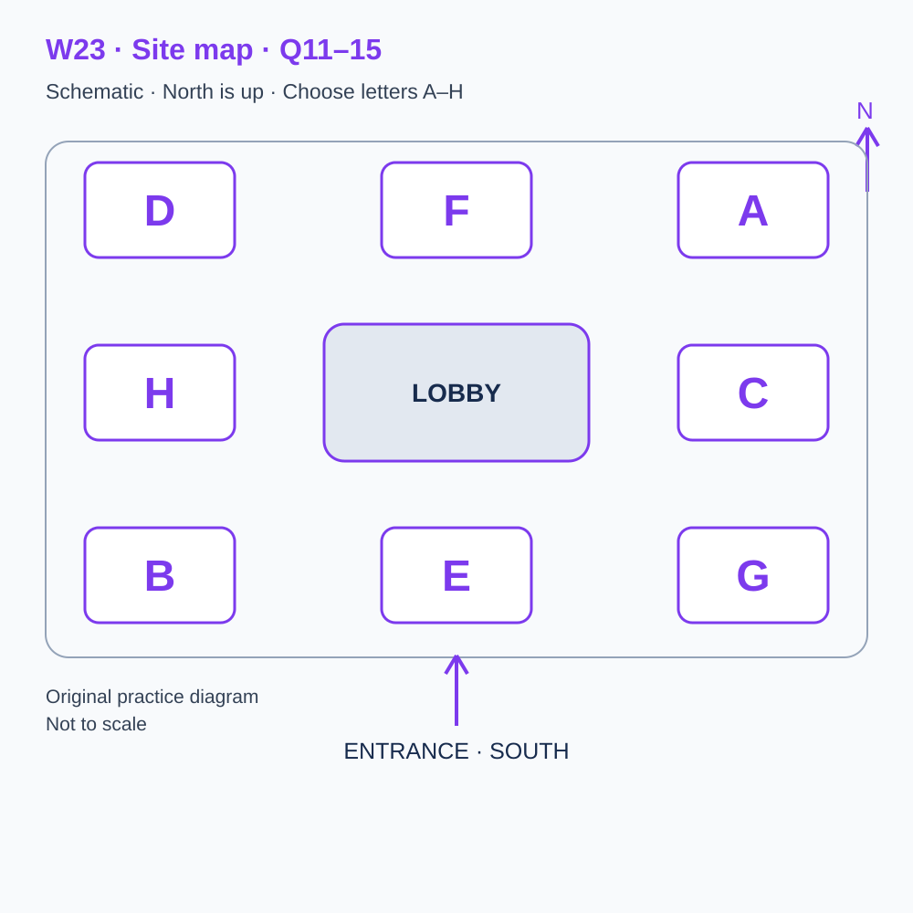
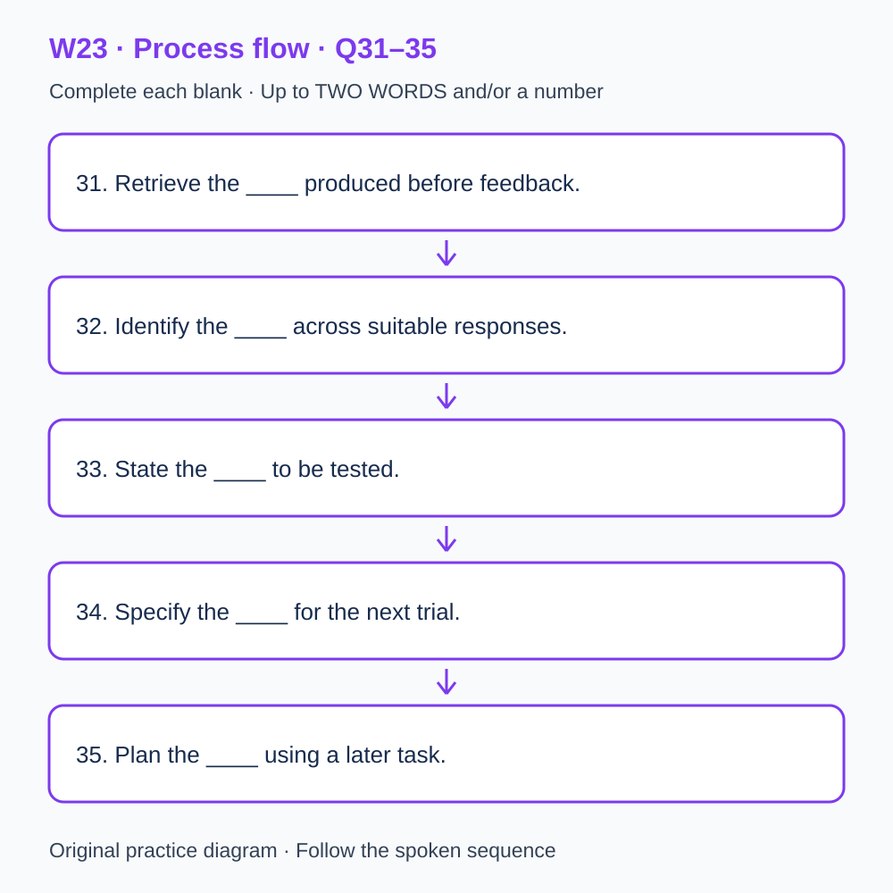

# U58 第23周听力题面与复盘（音频待补）

本页提供已核验的原创题目、参考答案和脚本。配套完整音频尚未验收，当前只能预览题面；不能进行有效的首次听力测试，也不能把读稿作答计作听力成绩或已完成一套听力。

请先保留首次作答机会：批准音频就绪前，不要展开下方答案和脚本。若已读稿，请标记为熟悉材料，之后的练习不能充当陌生题诊断。页面阅读标记只代表看过文字，不代表完成听力。

本材料非雅思真题、非标准化模考，不换算正式分数。计划分钟数不是实测音频时长；学习记录、正式测评和真人反馈须另行完成。

## 学生题面

### L-W23 — Choosing targeted practice from genuine response evidence

> 原创 IELTS-style 技能练习，非真题、非标准化模考，不可换算正式分数。当前只有文字和题目，音频未生成，不能计作已完成听力套题。

共四部分、40 个计分空，每空 1 分。正式首次作答须等待批准音频，先不要打开 script.md 或 answers.md。朗读前先看题；只听一遍后提交首次答案及信心等级，再做精听。当前只能预览题面，不能把读稿作答记作听力成绩。

#### Part 1 — Booking a targeted-practice session

Q1–6: Complete the notes. Write **NO MORE THAN TWO WORDS AND/OR A NUMBER** for each answer, using words from the recording. Numeric notation may replace spoken numbers. Do not repeat a printed unit. Q7–10: Choose **ONE letter, A, B or C**.

**Q1.** Selected session: ____

**Q2.** Confirmed date: ____ August

**Q3.** Session starts at ____ p.m.

**Q4.** Number attending: ____

**Q5.** Total booking cost: £____

**Q6.** If available, bring the ____ produced before feedback.

**Q7.** What is needed to identify a useful practice focus?

- A. A diagnosis inferred from the total alone
- B. The learner’s genuine responses and conditions
- C. A weakness copied from a fictional example

Answer: ____

**Q8.** How should later clarification of a note be recorded?

- A. Replace the original note
- B. Treat lost track as a settled diagnosis
- C. Keep it separate from the original observation

Answer: ____

**Q9.** How should format support be handled?

- A. Arrange it in advance and distinguish actual support
- B. Assume supported and independent attempts are equivalent
- C. Hide the support from the record

Answer: ____

**Q10.** How should a change to the booking be made?

- A. Invent evidence to complete the folder
- B. Use its confirmation reference
- C. Submit a corrected answer as the booking record

Answer: ____

#### Part 2 — Orientation at the review centre

Q11–15: Label the map. Write **ONE letter, A–H**, for each destination. Three letters are unused. Q16–20: Choose **ONE letter, A, B or C**.

**Q11.** Check-in

Answer: ____

**Q12.** Records

Answer: ____

**Q13.** Trial design

Answer: ____

**Q14.** Consultation

Answer: ____

**Q15.** Resources

Answer: ____

**Q16.** What is the starting point for personal remediation?

- A. An assumed common weakness
- B. A diagnosis from reading a fictional transcript
- C. A genuine first response, or an unknown status if absent

Answer: ____

**Q17.** What distinction should the error review preserve?

- A. Observed pattern versus proposed cause
- B. Correctness versus room location
- C. A total versus the booking fee

Answer: ____

**Q18.** How should a targeted activity fit the timetable?

- A. Add unlimited practice
- B. Replace work within the existing budget
- C. Omit time spent replaying

Answer: ____

**Q19.** How should improvement be interpreted?

- A. Retain relevant task and support conditions
- B. Ignore differences in guidance
- C. Attribute it all to the new routine

Answer: ____

**Q20.** How should a later check be recorded?

- A. Invent a cause if the result is mixed
- B. Treat a corrected familiar item as unseen
- C. Distinguish fresh evidence from familiar-item practice

Answer: ____

#### Part 3 — Selecting a small repair trial

Q21–26: Match each proposal to the students' **final** positions at the end of that exchange. The tutor is not included. Write **A, B, C or D**. Letters may be reused.

- **A** Mila only
- **B** Evan only
- **C** Both students
- **D** Neither student

Q27–28 and Q29–30: Choose **TWO different letters, A–E**, for each pair. Write one letter in each numbered slot; either order is accepted. Each distinct correct choice earns one point, maximum two. Repeating a letter cannot earn two points. Submit no more than two letters.

**Q21.** At the END of this exchange, who supports: starting with the observed word-limit pattern?

Answer: ____

**Q22.** At the END of this exchange, who supports: preserving the original response?

Answer: ____

**Q23.** At the END of this exchange, who supports: asking for a brief neutral explanation before feedback?

Answer: ____

**Q24.** At the END of this exchange, who supports: calling every omission a memory problem?

Answer: ____

**Q25.** At the END of this exchange, who supports: using an unfamiliar item next?

Answer: ____

**Q26.** At the END of this exchange, who supports: retaining two plausible explanations?

Answer: ____

**Q27–28.** Which TWO actions are agreed for the small repair trial?

- A. Diagnose every omission alike
- B. Choose a pattern supported by evidence
- C. Add several unrelated procedures
- D. Change one manageable procedure
- E. Replace original answers with corrections

Answers: Q27 ____ · Q28 ____

**Q29–30.** Which TWO limitations remain in the records?

- A. Some first responses are missing
- B. No records exist at all
- C. Every task was cancelled
- D. All learners received identical guidance
- E. Guidance was unequal

Answers: Q29 ____ · Q30 ____

#### Part 4 — Testing a proposed explanation for an error pattern

Q31–35: Complete the flow chart below. Q36–40: Complete the notes. Write **NO MORE THAN TWO WORDS AND/OR A NUMBER** for each answer, using words from the recording. Numeric notation may replace spoken numbers. Words or units already printed do not belong in the blank. The numbered text below repeats the SVG prompts for readability.

**Q31.** Retrieve the ____ produced before feedback.

**Q32.** Identify the ____ across suitable responses.

**Q33.** State the ____ to be tested.

**Q34.** Specify the ____ for the next trial.

**Q35.** Plan the ____ using a later task.

**Q36.** Named term for the alternative given up when time is allocated: ____

**Q37.** Named term for arranging the order of activities: ____

**Q38.** Named term for a conclusion extending beyond its evidence: ____

**Q39.** Named term for applying learning when the task changes: ____

**Q40.** Exact status word when personal evidence is absent: ____

#### 本周训练安排（音频批准后执行）

- Preview questions without the script：8 分钟。
- Future continuous first listen, including planned part pauses：32 分钟。
- Submit first answers and confidence, without a second play：8 分钟。
- Check answers and classify errors：20 分钟。
- Four Q-located intensive segments, 15 minutes each：60 分钟。
- Diagram and opinion retelling：15 分钟。
- Next-day retry of missed items：15 分钟。

合计 **158 分钟**；最多另用 22 分钟缓冲，总计不超过 180 分钟。暂停、回放与查词均计入精听预算，不能另行无限追加。当前实际已完成听力分钟数为 0。精听区段和步骤见 intensive.md；答案和脚本另页。

#### 补弱选择以真实错题为依据

当前没有本套音频或个人首答，不能指定你的弱项。已有可核验首答时，记录题号、原答、原文证据和当时条件，再选择一个反复出现且有证据的模式。没有首答或条件不明时记未知；仅学习审阅方法，待批准音频后采集新首答，不虚构错题。补弱时间使用既有60分钟精听预算，不额外叠加。

参考答案与证据（完成首次听力后再展开）

### L-W23 — Answers and evidence
> 独立答案页。先提交首次答案，再看本页。当前缺音频，文本验题不能充当实听验收。

每个单空 1 分；双选各 2 分、答案顺序不限、按不同正确选项计分。接受形式仅做大小写和空白规范化；不做模糊词形推断。

#### Q1 — targeted practice

Accepted answers: targeted practice

Use the final confirmed detail in this exchange; the printed unit or date context is already supplied.

Evidence locator: Q01 (script.md; timestamps unavailable).

> Adviser: Study review centre, hello. Caller: Our group wants help deciding what to practise next. We saw general revision and targeted practice on the programme. We have some saved responses, but we don't yet know which errors recur. Adviser: Targeted practice would let you examine that evidence before selecting an action. Caller: Please book targeted practice. Adviser: The session won't assign a weakness simply because you attend. If the records are incomplete, the appropriate next step may be to collect a genuine first response. Caller: So a fictional example can demonstrate the method without being treated as a diagnosis of our own performance. Adviser: Exactly. Those are different kinds of evidence.

#### Q2 — 14

Accepted answers: 14 / 14th / fourteenth / the fourteenth / the 14th

Use the final confirmed detail in this exchange; the printed unit or date context is already supplied.

Evidence locator: Q02 (script.md; timestamps unavailable).

> Caller: Is the session on the seventh of August? Adviser: That was the proposed date. The confirmed session is on the fourteenth of August. Caller: The fourteenth works for us. I'll replace the old calendar entry. Adviser: The confirmation will identify the workshop and date together. Caller: I'll keep that complete message, because another member saved a programme for a different course. Adviser: Good. A date correction is only useful if everyone can tell which version governs the booking. Leaving two notices visible without explaining the change may create the appearance of two opportunities to attend, when only one session has actually been confirmed for your group.

#### Q3 — 2:20

Accepted answers: 2:20 / 2.20 / 02:20 / 02.20 / two twenty

Use the final confirmed detail in this exchange; the printed unit or date context is already supplied.

Evidence locator: Q03 (script.md; timestamps unavailable).

> Caller: What time does teaching begin? Adviser: Two twenty in the afternoon. The reception desk opens at two, but the session begins at two twenty. Caller: Then two is the opening time, not the start of the first activity. Adviser: Correct. Arrive shortly before teaching to check in. Caller: I'll distinguish the lesson time from our planned arrival. Adviser: The opening discussion matters because it separates an observed response from an explanation of why it occurred. If someone arrives after that distinction, they may assume the task is to attach a familiar label to every error rather than decide which explanation the actual records support.

#### Q4 — 4

Accepted answers: 4 / four

Use the final confirmed detail in this exchange; the printed unit or date context is already supplied.

Evidence locator: Q04 (script.md; timestamps unavailable).

> Adviser: How many places do you need? Caller: Six people joined the earlier study group, but only four can attend this session. Please reserve four places. Adviser: Four are available. Caller: We'll collect the absent members' questions without counting them as participants. Adviser: If attendance changes, update the booking before making a substitution. Caller: I'll keep one current list. Adviser: The practical activity depends on knowing which people have brought first responses and which will use the supplied fictional examples. Both can learn the review method, but their records should not imply that the same personal evidence is available for everyone simply because they are sitting at the same table.

#### Q5 — 64

Accepted answers: 64 / 64.00 / sixty-four / sixty four

Use the final confirmed detail in this exchange; the printed unit or date context is already supplied.

Evidence locator: Q05 (script.md; timestamps unavailable).

> Caller: What is the total cost? Adviser: Sixty-four pounds for the four places altogether. Caller: Sixty-four for the whole booking, not for each participant? Adviser: Correct. The worksheets are included. An individual follow-on appointment would be arranged separately and isn't part of this booking. Caller: I'll explain the total and the scope to the person handling payment. Adviser: Please compare the confirmation with this conversation before paying. If the amount or number differs, ask for a correction. Caller: That should prevent an unexplained change from being interpreted as another service someone assumed we had purchased without discussing it with the rest of the group.

#### Q6 — first response

Accepted answers: first response / response / original answer / answer / actual work / work

Use the final confirmed detail in this exchange; the printed unit or date context is already supplied.

Evidence locator: Q06 (script.md; timestamps unavailable).

> Caller: What evidence should we bring? Adviser: Bring a first response if you have preserved one, with its task reference and conditions. A corrected copy alone cannot show exactly what you answered before feedback. Caller: I'll bring my first response separately from the revision. Adviser: If another member doesn't have one, leave that absence clear. They can examine the method using fictional material, then collect an appropriate response later. Caller: We shouldn't reconstruct an original answer from memory. Adviser: Exactly. A later recollection may contribute to discussion if labelled, but it should not replace the actual work and give a guessed starting point the appearance of a recorded event.

#### Q7 — B

Accepted answers: B

A total alone cannot identify the process behind an error.

Evidence locator: Q07 (script.md; timestamps unavailable).

> Caller: Can the leader tell us our weakest listening skill from a total score? Adviser: Not reliably from that number alone. The review needs the actual responses, the requirements and relevant conditions. A total doesn't identify which items were wrong or why. Caller: So we might leave with an unresolved question rather than a fixed weakness label. Adviser: Yes. That can be useful if the next activity is designed to distinguish plausible explanations. Caller: We want to avoid practising a guessed problem for several weeks. Adviser: Then begin with the evidence and keep the claim narrow. The session supports a reasoned next step, not an automatic diagnosis based on attendance or a familiar description of difficulty.

#### Q8 — C

Accepted answers: C

The original note and later interpretation have different evidential status.

Evidence locator: Q08 (script.md; timestamps unavailable).

> Caller: Should we rewrite unclear notes before bringing them? Adviser: Keep the originals and add any later clarification separately. Otherwise the record may appear more complete than it was when the response was produced. Caller: One note only says I lost track. Adviser: Preserve that wording and discuss what further detail would help. It might concern the question position, the speaker's point or an interruption, and the phrase alone doesn't distinguish them. Caller: We can ask about the conditions without inventing an exact cause. Adviser: Correct. A useful review can identify what remains unknown rather than turn every vague recollection into a confident explanation merely to fill a column.

#### Q9 — A

Accepted answers: A

Relevant support affects what an attempt can show.

Evidence locator: Q09 (script.md; timestamps unavailable).

> Caller: One participant needs the examples in an accessible digital format. Adviser: Please describe the practical requirement in advance so we can check the available files and explain any limitations. Caller: I'll ask the participant for the details rather than assume a larger printout solves it. Adviser: Thank you. Keep the arrangement visible if it affects a relevant comparison. Caller: That doesn't mean treating all support as the same kind of help. Adviser: Exactly. An access arrangement, a repeated play and an answer hint may have different implications for the question being examined. A clear record preserves those distinctions instead of using one broad assisted label that obscures what actually happened.

#### Q10 — B

Accepted answers: B

The reference identifies the booking; missing evidence is not fabricated.

Evidence locator: Q10 (script.md; timestamps unavailable).

> Caller: How should we report a change in attendance? Adviser: Reply to the confirmation with its reference. Public comments below the event announcement do not update the booking. For an urgent issue, use the contact number in that message. Caller: I'll keep the latest complete version in the group folder. Adviser: It contains the entrance and preparation details. Caller: I'll also remind everyone that missing first responses remain missing. Adviser: That's helpful. The workshop can prepare a collection plan within the existing practice schedule, but it cannot create personal evidence retrospectively or claim that a remedial activity is necessary before the records establish the difficulty it is supposed to address.

#### Q11 — E

Accepted answers: E

Use the explicitly stated position relative to the lobby, not an earlier layout or adjacent area.

Evidence locator: Q11 (script.md; timestamps unavailable).

> Welcome to the review centre. North is at the top of the diagram and the entrance is on the southern edge. The lobby in the centre is our fixed reference point. Check-in is directly south of the lobby, on the entrance axis. It is not in either southern corner. Please report there before joining the group. The letters identify positions rather than room initials. Keep the current map available even if you have attended before. A familiar name may refer to an activity now using another space, and the purpose of today's orientation is to establish the arrangement actually in use rather than reconstruct an older route from memory.

#### Q12 — D

Accepted answers: D

Use the explicitly stated position relative to the lobby, not an earlier layout or adjacent area.

Evidence locator: Q12 (script.md; timestamps unavailable).

> The records room is in the north-west corner. It lies west of the northern central room and diagonally north-west of the lobby. An earlier notice placed the records activity directly north, but the corner room is used today. Arrange the first response, task reference and later correction so their sequence remains visible. If one item is missing, mark the gap rather than silently substitute a different version. The room is not intended to make a portfolio look complete. It supports an evidence review in which another person can identify what was produced, under which conditions and before or after which information became available to the learner.

#### Q13 — C

Accepted answers: C

Use the explicitly stated position relative to the lobby, not an earlier layout or adjacent area.

Evidence locator: Q13 (script.md; timestamps unavailable).

> The trial-design room is directly east of the lobby, level with its centre. It is not the south-east room. Groups use it to choose one manageable action connected to a supported question. A proposal such as practise harder does not specify what will change or how the result will be examined. The leader may ask which observation would count against your explanation. That question helps make the trial informative; it isn't a demand that everyone reach certainty before acting. Keep the proposed action separate from its expected benefit, because a sensible plan can still produce a result that requires the group to reconsider its original interpretation.

#### Q14 — A

Accepted answers: A

Use the explicitly stated position relative to the lobby, not an earlier layout or adjacent area.

Evidence locator: Q14 (script.md; timestamps unavailable).

> The consultation room is in the north-east corner. It is directly north of the trial-design room and directly east of the northern central room. The northern spaces share a row, so the consultation room is east of its neighbour rather than north-east of that neighbour. In that room, participants discuss how strongly the evidence supports an error explanation. Two responses with the same visible mistake may have different causes. The conversation should refer to the task, answer and conditions rather than rely on a general judgement about the person. A cautious hypothesis can guide a useful next check without becoming a permanent description of the learner's ability.

#### Q15 — B

Accepted answers: B

Use the explicitly stated position relative to the lobby, not an earlier layout or adjacent area.

Evidence locator: Q15 (script.md; timestamps unavailable).

> The resource desk is in the south-west corner. It is west of check-in and below the room directly west of the lobby. Collect the worksheet version named in the briefing. Some sheets describe an observation, while others plan a trial or record a later reassessment. Their headings matter. Placing a proposed cause in an observation column can make a tentative interpretation look established. If a page is missing, ask the helper rather than copying another participant's completed diagnosis. The supplied fictional examples teach a method; they are not evidence that you personally made those errors or need the same action as the character described in the example.

#### Q16 — C

Accepted answers: C

No genuine first response means no supported personal diagnosis.

Evidence locator: Q16 (script.md; timestamps unavailable).

> Begin the review with a genuine response if one is available. Record the source, question number, original answer and relevant conditions before naming an error pattern. The evidence may come from an earlier session, provided its meaning can still be checked. If no suitable first response exists, mark the personal pattern unknown and plan collection when appropriate material is available. Reading this script is not a listening attempt, and a corrected example is not an independent first answer. The activity should make the evidence gap visible, not conceal it by assigning every participant a plausible weakness simply because the timetable contains a slot labelled targeted practice.

#### Q17 — A

Accepted answers: A

A descriptive pattern does not by itself establish its cause.

Evidence locator: Q17 (script.md; timestamps unavailable).

> Distinguish the observed problem from a proposed explanation. An answer that exceeds the word limit is an observable feature. Whether it resulted from a missed instruction, uncertainty about counting or a rushed final entry requires further evidence. Several causes may remain possible. The team can choose a small trial that addresses one distinction without claiming that the cause has already been settled. This is more useful than treating a broad label such as carelessness as a complete explanation. The review should identify what the learner did and what information would help understand it, rather than use a familiar word to close the question prematurely.

#### Q18 — B

Accepted answers: B

A manageable change uses the existing budget rather than an uncounted addition.

Evidence locator: Q18 (script.md; timestamps unavailable).

> Choose a practice action that can be examined within the available time. If the evidence concerns a printed-unit error, a short checking routine may be more informative than adding an unrelated long exercise. The choice should follow the record, not the popularity of a technique. Keep other needs visible without attempting to repair everything in one session. A manageable trial can produce evidence about a specific procedure, while an overloaded plan may leave the group unable to tell which change mattered. The weekly budget includes checking and reflection, so a new remedial task must replace an allocated activity rather than quietly create extra work outside the stated schedule.

#### Q19 — A

Accepted answers: A

Other changed conditions may contribute to the outcome.

Evidence locator: Q19 (script.md; timestamps unavailable).

> Preserve what changes between attempts. A second response completed with a hint, repeated listening or a familiar item provides different evidence from an unaided response to new material. The record should show the relevant support rather than describe all improvement as the effect of one practice routine. This does not mean the supported attempt has no value. It may reveal how the learner uses feedback or whether a procedure can be followed with guidance. The important point is to connect the conclusion with the conditions actually observed. A useful trial can support a limited next decision without proving a broader claim about independent performance in every future task.

#### Q20 — C

Accepted answers: C

Exposure and conditions must stay visible; a fictional example is not a personal diagnosis.

Evidence locator: Q20 (script.md; timestamps unavailable).

> The closing plan should include a later way to examine the proposed improvement. Repeating a corrected item may show retention of that answer, while a fresh item with the relevant demand asks whether the procedure carries across. Keep those results separate rather than treating every higher count as new evidence of independent ability. If the personal difficulty remains unverified, the plan may focus on collecting a suitable response first. Do not fill the record with an invented diagnosis or claim that an unperformed trial succeeded. The review ends with a specific next action and its evidence requirement, within the existing time budget, not a promise that a preferred technique must work.

#### Q21 — A

Accepted answers: A

Final stance: Mila only. Ignore an initial proposal if later withdrawn; the tutor is not an answer option.

Evidence locator: Q21 (script.md; timestamps unavailable).

> Tutor: You examined the genuine saved responses last week. What should the next trial focus on? Mila: The repeated word-limit errors we actually identified. I'd choose that one pattern before adding another demand. Evan: I'd compare it with the missing-qualification pattern first, because the second may affect the task more strongly. Tutor: Does that mean you dispute the word-limit evidence? Evan: No. I disagree about the next priority, not whether those answers exist. Mila: I still support choosing one pattern now. Tutor: Then Mila supports that specific focus and Evan wants a further comparison before selection. Preserve that distinction instead of describing both proposals as the same general intention to improve performance.

#### Q22 — C

Accepted answers: C

Final stance: Both students. Ignore an initial proposal if later withdrawn; the tutor is not an answer option.

Evidence locator: Q22 (script.md; timestamps unavailable).

> Tutor: Should the original response remain unchanged during review? Evan: Yes. I initially thought a corrected copy would be enough, but it hides what was produced before feedback. Mila: I agree. We can keep the correction alongside the first answer. Tutor: What if the writer immediately notices a spelling error? Mila: Record the later correction without replacing the submitted version. Evan: That makes the sequence inspectable and still allows us to discuss what the person can repair. Tutor: Good. Both of you support preserving the original. A clear record doesn't prevent learning; it prevents a later improvement from being silently attributed to an earlier stage where it hadn't yet occurred.

#### Q23 — B

Accepted answers: B

Final stance: Evan only. Ignore an initial proposal if later withdrawn; the tutor is not an answer option.

Evidence locator: Q23 (script.md; timestamps unavailable).

> Tutor: Evan proposes collecting a brief explanation immediately after the next response. Evan: I support that. It may help distinguish a misunderstood limit from a decision made under time pressure. Mila: I'd inspect the written planning marks first. An explanation could reflect what the person thinks the reviewer wants to hear. Tutor: Could you ask a neutral question before giving feedback? Evan: Yes, that is the version I mean. Mila: It would reduce one concern, but I still prefer the existing marks as the next source. Tutor: Then Evan supports the explanation and Mila retains another sequence of enquiry. Acknowledging a useful safeguard does not itself mean agreeing to the proposal.

#### Q24 — D

Accepted answers: D

Final stance: Neither student. Ignore an initial proposal if later withdrawn; the tutor is not an answer option.

Evidence locator: Q24 (script.md; timestamps unavailable).

> Tutor: Your early table labels every omitted answer as a memory problem. Mila: I used that label before checking the task sequence. I don't think we can support it now. Evan: Neither do I. One response followed an interruption, and another missed an instruction. Mila: I'll remove the universal label and retain the observed omission. Tutor: Are you replacing it with another single cause? Mila: No. We need evidence that distinguishes the possibilities. Evan: Agreed. Tutor: Then neither student supports the original classification. Keep that withdrawal visible so that a later reader does not mistake a discarded heading for the conclusion reached after examining the actual responses.

#### Q25 — A

Accepted answers: A

Final stance: Mila only. Ignore an initial proposal if later withdrawn; the tutor is not an answer option.

Evidence locator: Q25 (script.md; timestamps unavailable).

> Tutor: Should the next check use an unfamiliar item with the same relevant demand? Mila: Yes. I want to see whether the procedure is used without recalling the corrected answer. Evan: I'd repeat one familiar item first and ask the learner to explain the correction. Tutor: Could those activities answer different questions? Evan: Certainly, but for the next action I prefer the familiar item. Mila: I continue to support the fresh item. Tutor: Then Mila supports that proposal and Evan doesn't support it for the immediate next check. Your shared interest in learning doesn't remove the difference between testing memory of feedback and testing use of a procedure when the answer itself is new.

#### Q26 — C

Accepted answers: C

Final stance: Both students. Ignore an initial proposal if later withdrawn; the tutor is not an answer option.

Evidence locator: Q26 (script.md; timestamps unavailable).

> Tutor: What should the record say when two explanations remain plausible? Evan: Keep both and identify what might distinguish them. Mila: I agree. I originally wanted one cause in every row, but that would overstate what the evidence shows. Tutor: Would uncertainty prevent a practical trial? Mila: No. We can select a small action aimed at a specific distinction. Evan: And state what the result would and wouldn't establish. Tutor: Good. Both of you support preserving uncertainty without abandoning the next decision. The table should make the enquiry clearer, rather than reward confidence by forcing every observed error into a single cause before the relevant evidence has been collected.

#### Q27–28 — B, D

Accept unordered set: B, D. One point per distinct correct choice, maximum 2.

The trial begins with an evidenced pattern and one manageable procedural change.

Evidence locator: Q27, Q28 (script.md; timestamps unavailable).

> Tutor: Which two actions are agreed for the next trial plan? Mila: Select one observed pattern supported by the saved responses. Evan: Agreed. We can disagree about priority while still requiring evidence for the eventual selection. Tutor: Are you proposing to diagnose the learner from the total alone? Evan: No. The plan needs the actual question and response. Mila: Nor should we copy a fictional character's weakness into the personal record. Tutor: Then choosing an evidenced pattern is one agreed action. It establishes the basis for targeted practice without pretending that every participant in the workshop has the same difficulty or that a plausible label becomes true when written on a worksheet.

> Tutor: What is the other agreed action? Evan: Change one manageable feature of the procedure and record it clearly. Mila: Yes. If we add several routines at once, a different result may be hard to interpret. Tutor: Does that mean every other condition can be assumed identical? Mila: No. Relevant differences still need to be recorded. Evan: We also aren't choosing to fill missing first answers or forecast an official score. Tutor: Good. The selected pair is choosing an observed pattern and changing one manageable procedural feature. That gives the next trial a defined question, while leaving its actual result open until the learner has completed the work under recorded conditions.

#### Q29–30 — A, E

Accept unordered set: A, E. One point per distinct correct choice, maximum 2.

Partial missing first responses and unequal guidance limit interpretation.

Evidence locator: Q29, Q30 (script.md; timestamps unavailable).

> Tutor: What limits the review you completed last week? Mila: Some first responses were missing. The corrected versions survived, but they didn't establish the exact starting answers. Evan: That limits our claim about the frequency of the original pattern. Tutor: Were all the records unusable? Evan: No. We had genuine first responses for part of the sample, and we kept the missing cases separate. Mila: We should report that coverage instead of reconstructing the absent work from memory. Tutor: Exactly. The limitation concerns which evidence is available. A clearly defined partial record can support a narrower observation, whereas an invented complete record would make the conclusion appear stronger without adding real information.

> Tutor: Was support consistent across the remaining tasks? Evan: No. One task followed additional guidance, while another was attempted without that help. Mila: The difference was recorded, so we can preserve it when interpreting the totals. Tutor: Does that prove the practice routine had no benefit? Mila: No. It means the comparison doesn't isolate its effect. Evan: The room was available and both sessions occurred; those were not limitations. Tutor: Then missing original responses and unequal guidance are the two issues to retain. The report should describe the actual evidence gap and changed condition rather than add a generic list of problems that could have happened but did not affect this review.

#### Q31 — original response

Accepted answers: original response / first response / response / actual work / work / response record / record

Complete the named stage in the stated process order; retain any word already printed around the blank.

Evidence locator: Q31 (script.md; timestamps unavailable).

> Consider a fictional team planning targeted practice. The first stage retrieves the original response produced before feedback. This first response must be linked to its question and relevant conditions. It is the actual work, not a reconstruction based on the answer key or a later recollection of what probably happened. The response record may be incomplete, and that limitation should remain visible. If the required evidence does not exist, the team plans collection rather than inventing a starting point. This stage establishes what can be inspected. It does not justify a personal diagnosis simply because the learner has reached a scheduled week in a course or expressed a wish to improve.

#### Q32 — pattern

Accepted answers: pattern / observed pattern / description / proposed description / category / descriptive category

Complete the named stage in the stated process order; retain any word already printed around the blank.

Evidence locator: Q32 (script.md; timestamps unavailable).

> The second stage identifies an observed pattern across suitable responses. The pattern should be defined through features that another reviewer can locate, such as repeated inclusion of a printed unit or omission of a requested comparison. The team checks how many relevant opportunities existed rather than treating every question as equivalent. A single occurrence may be worth discussing without establishing a recurring pattern. The review should preserve cases that don't fit the proposed description, because they can reveal a definition that is too broad. This stage concerns what the evidence shows. It does not yet establish the cause, and it should not turn a descriptive category into a permanent label about the learner.

#### Q33 — hypothesis

Accepted answers: hypothesis / working hypothesis / explanation / clear hypothesis / proposal

Complete the named stage in the stated process order; retain any word already printed around the blank.

Evidence locator: Q33 (script.md; timestamps unavailable).

> The third stage states a working hypothesis to be tested. A hypothesis is an explanation that connects the observed pattern with a possible process. For example, a learner might copy a complete phrase without noticing that one part is already printed in the question. Another explanation may concern uncertainty about the response rule. The team asks what observation would help distinguish them. This explanation remains provisional even if it sounds familiar. If any result would be interpreted as supporting it, the proposal is too flexible to guide a useful test. A clear hypothesis identifies a question for the next trial rather than supplying a confident cause before the evidence has settled the issue.

#### Q34 — intervention

Accepted answers: intervention / targeted intervention / planned change / change / proposal

Complete the named stage in the stated process order; retain any word already printed around the blank.

Evidence locator: Q34 (script.md; timestamps unavailable).

> The fourth stage specifies a targeted intervention. The intervention is the planned change to the practice procedure, selected because it addresses the question being investigated. It might ask the learner to mark printed units before starting or to identify required outputs in a brief summary. The change should remain manageable within the existing session. Adding several unrelated activities may increase effort without clarifying which procedure helped. The team also records what was retained and any relevant difference in the task. A targeted intervention is a proposal whose result must be examined, not a guaranteed remedy that becomes successful merely because the learner completed the scheduled activity or spent more time working.

#### Q35 — reassessment

Accepted answers: reassessment / later assessment / check / later check / planned reassessment / attempt / actual attempt

Complete the named stage in the stated process order; retain any word already printed around the blank.

Evidence locator: Q35 (script.md; timestamps unavailable).

> The fifth stage plans reassessment using an appropriate later task. This later assessment asks whether the relevant procedure can be used under the conditions the team wants to understand. The check should distinguish a fresh item from a familiar corrected one, since they provide different information. A later check can be useful even if the result is mixed, provided the response and conditions are preserved. The team should not present the planned reassessment as completed or fill an expected score into the record. Its purpose is to produce evidence for the next decision, including the possibility that the original explanation or chosen action needs to be revised after the actual attempt.

#### Q36 — opportunity cost

Accepted answers: opportunity cost

The corresponding evidence block supplies this distinction or qualification; the question retains the surrounding grammar.

Evidence locator: Q36 (script.md; timestamps unavailable).

> The term opportunity cost names what is given up when limited practice time is used for one activity instead of another. In this example, adding a long unrelated exercise may displace the review needed to understand an error. The team should consider that trade-off rather than treat every additional task as a free improvement. A manageable plan can retain useful practice while reserving time to inspect its result. The concept does not provide a universal ranking of activities. It asks the planner to recognise that time spent in one place is unavailable elsewhere and to connect the choice with the evidence and purpose of this particular session.

#### Q37 — sequencing

Accepted answers: sequencing

The corresponding evidence block supplies this distinction or qualification; the question retains the surrounding grammar.

Evidence locator: Q37 (script.md; timestamps unavailable).

> Sequencing is the term used here for arranging the order of practice activities. The order matters because one activity can supply information that changes what a later response represents. A familiar corrected item before a fresh task may remind the learner of a procedure; feedback before a first response changes its independence. The team should therefore describe the sequence when interpreting results. This does not imply that there is one correct order for every learning purpose. Different sequences can answer different questions. The important point is to choose an order deliberately and retain it in the record, rather than treat the same collection of activities as equivalent regardless of when help became available.

#### Q38 — overgeneralisation

Accepted answers: overgeneralisation / overgeneralization

The corresponding evidence block supplies this distinction or qualification; the question retains the surrounding grammar.

Evidence locator: Q38 (script.md; timestamps unavailable).

> The lecture calls a conclusion that extends beyond the evidence an overgeneralisation. In this setting, one error is used to claim a permanent weakness across every task, or one successful correction is used to promise reliable performance everywhere. The problem is the scope of the claim, not the fact that the observation is small. A small observation can support a narrow, useful statement. The team should identify the boundary between that statement and the broader conclusion it cannot establish. Naming overgeneralisation does not require rejecting all practical decisions under uncertainty. It requires keeping the recommendation proportionate to what was actually observed and specifying what additional evidence would support an extension.

#### Q39 — transfer

Accepted answers: transfer

The corresponding evidence block supplies this distinction or qualification; the question retains the surrounding grammar.

Evidence locator: Q39 (script.md; timestamps unavailable).

> Transfer is the term for using learning when relevant aspects of the task or setting change. A learner may remember a corrected answer without applying the same checking principle to a fresh item. The later task should therefore preserve the demand under investigation while making the changed features visible. A difficulty in transfer can prompt another question about the procedure or the new task, rather than prove that the earlier learning was worthless. The team also keeps retention separate: remembering information after a delay is not identical to using it in a different context. Clear terms help the review state which question a particular repeated or unfamiliar task was designed to examine.

#### Q40 — unknown

Accepted answers: unknown

The corresponding evidence block supplies this distinction or qualification; the question retains the surrounding grammar.

Evidence locator: Q40 (script.md; timestamps unavailable).

> When personal evidence is absent, the status word used in this review is unknown. Unknown is not a low score, a diagnosis or a conclusion that the learner must extend study. It identifies information that has not been established. The team can record what needs to be collected and fit that activity into the existing plan when suitable material is available. Until a genuine response exists, a fictional example remains an example. The stage review should not fill an empty record with the errors described in this lecture. Its final purpose is to connect a practical next step with honest evidence, including an explicit unknown status where the required personal record is still missing.

完整脚本（提前阅读会失去陌生题首答机会）

### L-W23 — Choosing targeted practice from genuine response evidence: transcript
> 原创虚构练习，非真题；音频缺失。仅供完成首次作答后的核对或文字审阅。Q 标记与角色名不属于朗读正文。

#### Part 1 — Booking a targeted-practice session

##### Q1 evidence block

**Adviser:** Study review centre, hello.

**Caller:** Our group wants help deciding what to practise next. We saw general revision and targeted practice on the programme. We have some saved responses, but we don't yet know which errors recur.

**Adviser:** Targeted practice would let you examine that evidence before selecting an action.

**Caller:** Please book targeted practice.

**Adviser:** The session won't assign a weakness simply because you attend. If the records are incomplete, the appropriate next step may be to collect a genuine first response.

**Caller:** So a fictional example can demonstrate the method without being treated as a diagnosis of our own performance.

**Adviser:** Exactly. Those are different kinds of evidence.

##### Q2 evidence block

**Caller:** Is the session on the seventh of August?

**Adviser:** That was the proposed date. The confirmed session is on the fourteenth of August.

**Caller:** The fourteenth works for us. I'll replace the old calendar entry.

**Adviser:** The confirmation will identify the workshop and date together.

**Caller:** I'll keep that complete message, because another member saved a programme for a different course.

**Adviser:** Good. A date correction is only useful if everyone can tell which version governs the booking. Leaving two notices visible without explaining the change may create the appearance of two opportunities to attend, when only one session has actually been confirmed for your group.

##### Q3 evidence block

**Caller:** What time does teaching begin?

**Adviser:** Two twenty in the afternoon. The reception desk opens at two, but the session begins at two twenty.

**Caller:** Then two is the opening time, not the start of the first activity.

**Adviser:** Correct. Arrive shortly before teaching to check in.

**Caller:** I'll distinguish the lesson time from our planned arrival.

**Adviser:** The opening discussion matters because it separates an observed response from an explanation of why it occurred. If someone arrives after that distinction, they may assume the task is to attach a familiar label to every error rather than decide which explanation the actual records support.

##### Q4 evidence block

**Adviser:** How many places do you need?

**Caller:** Six people joined the earlier study group, but only four can attend this session. Please reserve four places.

**Adviser:** Four are available.

**Caller:** We'll collect the absent members' questions without counting them as participants.

**Adviser:** If attendance changes, update the booking before making a substitution.

**Caller:** I'll keep one current list.

**Adviser:** The practical activity depends on knowing which people have brought first responses and which will use the supplied fictional examples. Both can learn the review method, but their records should not imply that the same personal evidence is available for everyone simply because they are sitting at the same table.

##### Q5 evidence block

**Caller:** What is the total cost?

**Adviser:** Sixty-four pounds for the four places altogether.

**Caller:** Sixty-four for the whole booking, not for each participant?

**Adviser:** Correct. The worksheets are included. An individual follow-on appointment would be arranged separately and isn't part of this booking.

**Caller:** I'll explain the total and the scope to the person handling payment.

**Adviser:** Please compare the confirmation with this conversation before paying. If the amount or number differs, ask for a correction.

**Caller:** That should prevent an unexplained change from being interpreted as another service someone assumed we had purchased without discussing it with the rest of the group.

##### Q6 evidence block

**Caller:** What evidence should we bring?

**Adviser:** Bring a first response if you have preserved one, with its task reference and conditions. A corrected copy alone cannot show exactly what you answered before feedback.

**Caller:** I'll bring my first response separately from the revision.

**Adviser:** If another member doesn't have one, leave that absence clear. They can examine the method using fictional material, then collect an appropriate response later.

**Caller:** We shouldn't reconstruct an original answer from memory.

**Adviser:** Exactly. A later recollection may contribute to discussion if labelled, but it should not replace the actual work and give a guessed starting point the appearance of a recorded event.

##### Q7 evidence block

**Caller:** Can the leader tell us our weakest listening skill from a total score?

**Adviser:** Not reliably from that number alone. The review needs the actual responses, the requirements and relevant conditions. A total doesn't identify which items were wrong or why.

**Caller:** So we might leave with an unresolved question rather than a fixed weakness label.

**Adviser:** Yes. That can be useful if the next activity is designed to distinguish plausible explanations.

**Caller:** We want to avoid practising a guessed problem for several weeks.

**Adviser:** Then begin with the evidence and keep the claim narrow. The session supports a reasoned next step, not an automatic diagnosis based on attendance or a familiar description of difficulty.

##### Q8 evidence block

**Caller:** Should we rewrite unclear notes before bringing them?

**Adviser:** Keep the originals and add any later clarification separately. Otherwise the record may appear more complete than it was when the response was produced.

**Caller:** One note only says I lost track.

**Adviser:** Preserve that wording and discuss what further detail would help. It might concern the question position, the speaker's point or an interruption, and the phrase alone doesn't distinguish them.

**Caller:** We can ask about the conditions without inventing an exact cause.

**Adviser:** Correct. A useful review can identify what remains unknown rather than turn every vague recollection into a confident explanation merely to fill a column.

##### Q9 evidence block

**Caller:** One participant needs the examples in an accessible digital format.

**Adviser:** Please describe the practical requirement in advance so we can check the available files and explain any limitations.

**Caller:** I'll ask the participant for the details rather than assume a larger printout solves it.

**Adviser:** Thank you. Keep the arrangement visible if it affects a relevant comparison.

**Caller:** That doesn't mean treating all support as the same kind of help.

**Adviser:** Exactly. An access arrangement, a repeated play and an answer hint may have different implications for the question being examined. A clear record preserves those distinctions instead of using one broad assisted label that obscures what actually happened.

##### Q10 evidence block

**Caller:** How should we report a change in attendance?

**Adviser:** Reply to the confirmation with its reference. Public comments below the event announcement do not update the booking. For an urgent issue, use the contact number in that message.

**Caller:** I'll keep the latest complete version in the group folder.

**Adviser:** It contains the entrance and preparation details.

**Caller:** I'll also remind everyone that missing first responses remain missing.

**Adviser:** That's helpful. The workshop can prepare a collection plan within the existing practice schedule, but it cannot create personal evidence retrospectively or claim that a remedial activity is necessary before the records establish the difficulty it is supposed to address.

#### Part 2 — Orientation at the review centre

##### Q11 evidence block

**Centre host:** Welcome to the review centre. North is at the top of the diagram and the entrance is on the southern edge. The lobby in the centre is our fixed reference point. Check-in is directly south of the lobby, on the entrance axis. It is not in either southern corner. Please report there before joining the group. The letters identify positions rather than room initials. Keep the current map available even if you have attended before. A familiar name may refer to an activity now using another space, and the purpose of today's orientation is to establish the arrangement actually in use rather than reconstruct an older route from memory.

##### Q12 evidence block

**Centre host:** The records room is in the north-west corner. It lies west of the northern central room and diagonally north-west of the lobby. An earlier notice placed the records activity directly north, but the corner room is used today. Arrange the first response, task reference and later correction so their sequence remains visible. If one item is missing, mark the gap rather than silently substitute a different version. The room is not intended to make a portfolio look complete. It supports an evidence review in which another person can identify what was produced, under which conditions and before or after which information became available to the learner.

##### Q13 evidence block

**Centre host:** The trial-design room is directly east of the lobby, level with its centre. It is not the south-east room. Groups use it to choose one manageable action connected to a supported question. A proposal such as practise harder does not specify what will change or how the result will be examined. The leader may ask which observation would count against your explanation. That question helps make the trial informative; it isn't a demand that everyone reach certainty before acting. Keep the proposed action separate from its expected benefit, because a sensible plan can still produce a result that requires the group to reconsider its original interpretation.

##### Q14 evidence block

**Centre host:** The consultation room is in the north-east corner. It is directly north of the trial-design room and directly east of the northern central room. The northern spaces share a row, so the consultation room is east of its neighbour rather than north-east of that neighbour. In that room, participants discuss how strongly the evidence supports an error explanation. Two responses with the same visible mistake may have different causes. The conversation should refer to the task, answer and conditions rather than rely on a general judgement about the person. A cautious hypothesis can guide a useful next check without becoming a permanent description of the learner's ability.

##### Q15 evidence block

**Centre host:** The resource desk is in the south-west corner. It is west of check-in and below the room directly west of the lobby. Collect the worksheet version named in the briefing. Some sheets describe an observation, while others plan a trial or record a later reassessment. Their headings matter. Placing a proposed cause in an observation column can make a tentative interpretation look established. If a page is missing, ask the helper rather than copying another participant's completed diagnosis. The supplied fictional examples teach a method; they are not evidence that you personally made those errors or need the same action as the character described in the example.

##### Q16 evidence block

**Centre host:** Begin the review with a genuine response if one is available. Record the source, question number, original answer and relevant conditions before naming an error pattern. The evidence may come from an earlier session, provided its meaning can still be checked. If no suitable first response exists, mark the personal pattern unknown and plan collection when appropriate material is available. Reading this script is not a listening attempt, and a corrected example is not an independent first answer. The activity should make the evidence gap visible, not conceal it by assigning every participant a plausible weakness simply because the timetable contains a slot labelled targeted practice.

##### Q17 evidence block

**Centre host:** Distinguish the observed problem from a proposed explanation. An answer that exceeds the word limit is an observable feature. Whether it resulted from a missed instruction, uncertainty about counting or a rushed final entry requires further evidence. Several causes may remain possible. The team can choose a small trial that addresses one distinction without claiming that the cause has already been settled. This is more useful than treating a broad label such as carelessness as a complete explanation. The review should identify what the learner did and what information would help understand it, rather than use a familiar word to close the question prematurely.

##### Q18 evidence block

**Centre host:** Choose a practice action that can be examined within the available time. If the evidence concerns a printed-unit error, a short checking routine may be more informative than adding an unrelated long exercise. The choice should follow the record, not the popularity of a technique. Keep other needs visible without attempting to repair everything in one session. A manageable trial can produce evidence about a specific procedure, while an overloaded plan may leave the group unable to tell which change mattered. The weekly budget includes checking and reflection, so a new remedial task must replace an allocated activity rather than quietly create extra work outside the stated schedule.

##### Q19 evidence block

**Centre host:** Preserve what changes between attempts. A second response completed with a hint, repeated listening or a familiar item provides different evidence from an unaided response to new material. The record should show the relevant support rather than describe all improvement as the effect of one practice routine. This does not mean the supported attempt has no value. It may reveal how the learner uses feedback or whether a procedure can be followed with guidance. The important point is to connect the conclusion with the conditions actually observed. A useful trial can support a limited next decision without proving a broader claim about independent performance in every future task.

##### Q20 evidence block

**Centre host:** The closing plan should include a later way to examine the proposed improvement. Repeating a corrected item may show retention of that answer, while a fresh item with the relevant demand asks whether the procedure carries across. Keep those results separate rather than treating every higher count as new evidence of independent ability. If the personal difficulty remains unverified, the plan may focus on collecting a suitable response first. Do not fill the record with an invented diagnosis or claim that an unperformed trial succeeded. The review ends with a specific next action and its evidence requirement, within the existing time budget, not a promise that a preferred technique must work.

#### Part 3 — Selecting a small repair trial

##### Q21 evidence block

**Tutor:** You examined the genuine saved responses last week. What should the next trial focus on?

**Mila:** The repeated word-limit errors we actually identified. I'd choose that one pattern before adding another demand.

**Evan:** I'd compare it with the missing-qualification pattern first, because the second may affect the task more strongly.

**Tutor:** Does that mean you dispute the word-limit evidence?

**Evan:** No. I disagree about the next priority, not whether those answers exist.

**Mila:** I still support choosing one pattern now.

**Tutor:** Then Mila supports that specific focus and Evan wants a further comparison before selection. Preserve that distinction instead of describing both proposals as the same general intention to improve performance.

##### Q22 evidence block

**Tutor:** Should the original response remain unchanged during review?

**Evan:** Yes. I initially thought a corrected copy would be enough, but it hides what was produced before feedback.

**Mila:** I agree. We can keep the correction alongside the first answer.

**Tutor:** What if the writer immediately notices a spelling error?

**Mila:** Record the later correction without replacing the submitted version.

**Evan:** That makes the sequence inspectable and still allows us to discuss what the person can repair.

**Tutor:** Good. Both of you support preserving the original. A clear record doesn't prevent learning; it prevents a later improvement from being silently attributed to an earlier stage where it hadn't yet occurred.

##### Q23 evidence block

**Tutor:** Evan proposes collecting a brief explanation immediately after the next response.

**Evan:** I support that. It may help distinguish a misunderstood limit from a decision made under time pressure.

**Mila:** I'd inspect the written planning marks first. An explanation could reflect what the person thinks the reviewer wants to hear.

**Tutor:** Could you ask a neutral question before giving feedback?

**Evan:** Yes, that is the version I mean.

**Mila:** It would reduce one concern, but I still prefer the existing marks as the next source.

**Tutor:** Then Evan supports the explanation and Mila retains another sequence of enquiry. Acknowledging a useful safeguard does not itself mean agreeing to the proposal.

##### Q24 evidence block

**Tutor:** Your early table labels every omitted answer as a memory problem.

**Mila:** I used that label before checking the task sequence. I don't think we can support it now.

**Evan:** Neither do I. One response followed an interruption, and another missed an instruction.

**Mila:** I'll remove the universal label and retain the observed omission.

**Tutor:** Are you replacing it with another single cause?

**Mila:** No. We need evidence that distinguishes the possibilities.

**Evan:** Agreed.

**Tutor:** Then neither student supports the original classification. Keep that withdrawal visible so that a later reader does not mistake a discarded heading for the conclusion reached after examining the actual responses.

##### Q25 evidence block

**Tutor:** Should the next check use an unfamiliar item with the same relevant demand?

**Mila:** Yes. I want to see whether the procedure is used without recalling the corrected answer.

**Evan:** I'd repeat one familiar item first and ask the learner to explain the correction.

**Tutor:** Could those activities answer different questions?

**Evan:** Certainly, but for the next action I prefer the familiar item.

**Mila:** I continue to support the fresh item.

**Tutor:** Then Mila supports that proposal and Evan doesn't support it for the immediate next check. Your shared interest in learning doesn't remove the difference between testing memory of feedback and testing use of a procedure when the answer itself is new.

##### Q26 evidence block

**Tutor:** What should the record say when two explanations remain plausible?

**Evan:** Keep both and identify what might distinguish them.

**Mila:** I agree. I originally wanted one cause in every row, but that would overstate what the evidence shows.

**Tutor:** Would uncertainty prevent a practical trial?

**Mila:** No. We can select a small action aimed at a specific distinction.

**Evan:** And state what the result would and wouldn't establish.

**Tutor:** Good. Both of you support preserving uncertainty without abandoning the next decision. The table should make the enquiry clearer, rather than reward confidence by forcing every observed error into a single cause before the relevant evidence has been collected.

##### Q27 evidence block

**Tutor:** Which two actions are agreed for the next trial plan?

**Mila:** Select one observed pattern supported by the saved responses.

**Evan:** Agreed. We can disagree about priority while still requiring evidence for the eventual selection.

**Tutor:** Are you proposing to diagnose the learner from the total alone?

**Evan:** No. The plan needs the actual question and response.

**Mila:** Nor should we copy a fictional character's weakness into the personal record.

**Tutor:** Then choosing an evidenced pattern is one agreed action. It establishes the basis for targeted practice without pretending that every participant in the workshop has the same difficulty or that a plausible label becomes true when written on a worksheet.

##### Q28 evidence block

**Tutor:** What is the other agreed action?

**Evan:** Change one manageable feature of the procedure and record it clearly.

**Mila:** Yes. If we add several routines at once, a different result may be hard to interpret.

**Tutor:** Does that mean every other condition can be assumed identical?

**Mila:** No. Relevant differences still need to be recorded.

**Evan:** We also aren't choosing to fill missing first answers or forecast an official score.

**Tutor:** Good. The selected pair is choosing an observed pattern and changing one manageable procedural feature. That gives the next trial a defined question, while leaving its actual result open until the learner has completed the work under recorded conditions.

##### Q29 evidence block

**Tutor:** What limits the review you completed last week?

**Mila:** Some first responses were missing. The corrected versions survived, but they didn't establish the exact starting answers.

**Evan:** That limits our claim about the frequency of the original pattern.

**Tutor:** Were all the records unusable?

**Evan:** No. We had genuine first responses for part of the sample, and we kept the missing cases separate.

**Mila:** We should report that coverage instead of reconstructing the absent work from memory.

**Tutor:** Exactly. The limitation concerns which evidence is available. A clearly defined partial record can support a narrower observation, whereas an invented complete record would make the conclusion appear stronger without adding real information.

##### Q30 evidence block

**Tutor:** Was support consistent across the remaining tasks?

**Evan:** No. One task followed additional guidance, while another was attempted without that help.

**Mila:** The difference was recorded, so we can preserve it when interpreting the totals.

**Tutor:** Does that prove the practice routine had no benefit?

**Mila:** No. It means the comparison doesn't isolate its effect.

**Evan:** The room was available and both sessions occurred; those were not limitations.

**Tutor:** Then missing original responses and unequal guidance are the two issues to retain. The report should describe the actual evidence gap and changed condition rather than add a generic list of problems that could have happened but did not affect this review.

#### Part 4 — Testing a proposed explanation for an error pattern

##### Q31 evidence block

**Lecturer:** Consider a fictional team planning targeted practice. The first stage retrieves the original response produced before feedback. This first response must be linked to its question and relevant conditions. It is the actual work, not a reconstruction based on the answer key or a later recollection of what probably happened. The response record may be incomplete, and that limitation should remain visible. If the required evidence does not exist, the team plans collection rather than inventing a starting point. This stage establishes what can be inspected. It does not justify a personal diagnosis simply because the learner has reached a scheduled week in a course or expressed a wish to improve.

##### Q32 evidence block

**Lecturer:** The second stage identifies an observed pattern across suitable responses. The pattern should be defined through features that another reviewer can locate, such as repeated inclusion of a printed unit or omission of a requested comparison. The team checks how many relevant opportunities existed rather than treating every question as equivalent. A single occurrence may be worth discussing without establishing a recurring pattern. The review should preserve cases that don't fit the proposed description, because they can reveal a definition that is too broad. This stage concerns what the evidence shows. It does not yet establish the cause, and it should not turn a descriptive category into a permanent label about the learner.

##### Q33 evidence block

**Lecturer:** The third stage states a working hypothesis to be tested. A hypothesis is an explanation that connects the observed pattern with a possible process. For example, a learner might copy a complete phrase without noticing that one part is already printed in the question. Another explanation may concern uncertainty about the response rule. The team asks what observation would help distinguish them. This explanation remains provisional even if it sounds familiar. If any result would be interpreted as supporting it, the proposal is too flexible to guide a useful test. A clear hypothesis identifies a question for the next trial rather than supplying a confident cause before the evidence has settled the issue.

##### Q34 evidence block

**Lecturer:** The fourth stage specifies a targeted intervention. The intervention is the planned change to the practice procedure, selected because it addresses the question being investigated. It might ask the learner to mark printed units before starting or to identify required outputs in a brief summary. The change should remain manageable within the existing session. Adding several unrelated activities may increase effort without clarifying which procedure helped. The team also records what was retained and any relevant difference in the task. A targeted intervention is a proposal whose result must be examined, not a guaranteed remedy that becomes successful merely because the learner completed the scheduled activity or spent more time working.

##### Q35 evidence block

**Lecturer:** The fifth stage plans reassessment using an appropriate later task. This later assessment asks whether the relevant procedure can be used under the conditions the team wants to understand. The check should distinguish a fresh item from a familiar corrected one, since they provide different information. A later check can be useful even if the result is mixed, provided the response and conditions are preserved. The team should not present the planned reassessment as completed or fill an expected score into the record. Its purpose is to produce evidence for the next decision, including the possibility that the original explanation or chosen action needs to be revised after the actual attempt.

##### Q36 evidence block

**Lecturer:** The term opportunity cost names what is given up when limited practice time is used for one activity instead of another. In this example, adding a long unrelated exercise may displace the review needed to understand an error. The team should consider that trade-off rather than treat every additional task as a free improvement. A manageable plan can retain useful practice while reserving time to inspect its result. The concept does not provide a universal ranking of activities. It asks the planner to recognise that time spent in one place is unavailable elsewhere and to connect the choice with the evidence and purpose of this particular session.

##### Q37 evidence block

**Lecturer:** Sequencing is the term used here for arranging the order of practice activities. The order matters because one activity can supply information that changes what a later response represents. A familiar corrected item before a fresh task may remind the learner of a procedure; feedback before a first response changes its independence. The team should therefore describe the sequence when interpreting results. This does not imply that there is one correct order for every learning purpose. Different sequences can answer different questions. The important point is to choose an order deliberately and retain it in the record, rather than treat the same collection of activities as equivalent regardless of when help became available.

##### Q38 evidence block

**Lecturer:** The lecture calls a conclusion that extends beyond the evidence an overgeneralisation. In this setting, one error is used to claim a permanent weakness across every task, or one successful correction is used to promise reliable performance everywhere. The problem is the scope of the claim, not the fact that the observation is small. A small observation can support a narrow, useful statement. The team should identify the boundary between that statement and the broader conclusion it cannot establish. Naming overgeneralisation does not require rejecting all practical decisions under uncertainty. It requires keeping the recommendation proportionate to what was actually observed and specifying what additional evidence would support an extension.

##### Q39 evidence block

**Lecturer:** Transfer is the term for using learning when relevant aspects of the task or setting change. A learner may remember a corrected answer without applying the same checking principle to a fresh item. The later task should therefore preserve the demand under investigation while making the changed features visible. A difficulty in transfer can prompt another question about the procedure or the new task, rather than prove that the earlier learning was worthless. The team also keeps retention separate: remembering information after a delay is not identical to using it in a different context. Clear terms help the review state which question a particular repeated or unfamiliar task was designed to examine.

##### Q40 evidence block

**Lecturer:** When personal evidence is absent, the status word used in this review is unknown. Unknown is not a low score, a diagnosis or a conclusion that the learner must extend study. It identifies information that has not been established. The team can record what needs to be collected and fit that activity into the existing plan when suitable material is available. Until a genuine response exists, a fictional example remains an example. The stage review should not fill an empty record with the errors described in this lecture. Its final purpose is to connect a practical next step with honest evidence, including an explicit unknown status where the required personal record is still missing.

精听与复盘步骤（须有已验收配套音频）

### L-W23 — Q-based intensive listening
> 音频尚未生成；以下是未来执行安排，不是已完成记录。不要用文本阅读替代首次听力。无实际时间戳。

周预算：预览 8 + 首听 32 + 交首次答案 8 + 查错 20 + 精听 60 + 复述 15 + 次日重做 15 = **158 分钟**。含暂停/回放；加用缓冲最多 22 分钟，总计≤180。

四段各 15 分钟：先定位并不看稿听 2 分钟；分句回放、写关键词 4 分钟；对照稿找误听与改口 3 分钟；遮稿跟读和复述 3 分钟；重答并记录错误原因 3 分钟。不得把同一段回放另算在周预算之外。

#### Q6–7 — 15 minutes

定位 script.md 的 Q6 evidence block 起至 Q7 evidence block 结束（约 213 词）；音频起止为 null。

目标：辨认真实首答、后来回忆与原因假设。

留痕：首次答案 → 听到的原词 → 干扰来源 → 修正答案 → 一句英文复述。

#### Q12–14 — 15 minutes

定位 script.md 的 Q12 evidence block 起至 Q14 evidence block 结束（约 319 词）；音频起止为 null。

目标：同时使用中心点与相邻位置核验地图。

留痕：首次答案 → 听到的原词 → 干扰来源 → 修正答案 → 一句英文复述。

#### Q24–26 — 15 minutes

定位 script.md 的 Q24 evidence block 起至 Q26 evidence block 结束（约 308 词）；音频起止为 null。

目标：跟踪撤回、先后次序与共同最终立场。

留痕：首次答案 → 听到的原词 → 干扰来源 → 修正答案 → 一句英文复述。

#### Q31–35 — 15 minutes

定位 script.md 的 Q31 evidence block 起至 Q35 evidence block 结束（约 559 词）；音频起止为 null。

目标：区分原答、观察模式、假设、干预与复验。

留痕：首次答案 → 听到的原词 → 干扰来源 → 修正答案 → 一句英文复述。

#### 15 分钟复述与 15 分钟次日重做

复述：5 分钟遮住答案口述地图五个位置；5 分钟按人说明三人讨论的最终观点；5 分钟复述流程及一个限制。次日：8 分钟仅重做错题对应 Q 段；4 分钟核对；3 分钟更新错误记录。若仍超时，留下未完成项，不把额外时间隐去。

#### 条件式补弱分配

四段是待执行的默认技能训练，不代表个人已被诊断。若已有真实首答和条件记录，在原60分钟预算内将最多两段替换为同类真实错题Q段，保留原答、证据、原因假设与复验结果。无法核验时不替换、不编造弱项；音频未批准前仅保留计划，实际听力完成0。

## 许可说明

原创文字和图示：RayXBuilds and contributors，CC BY 4.0。本页不包含配套音频；现有基础VOA媒体不能代替本套题的录音。
