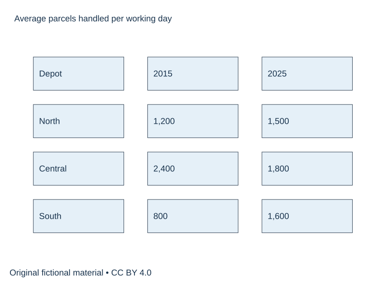

# U68 SUP-W01 A图表概述与数据选择

原创专项补充。先完成学生任务，再展开参考答案。用本单元笔记记录首答、错因和重练结果，实际录音与真人反馈另行完成。

## SUP-W01 A图表概述与数据选择

原创专项，适合另择时段练习，实际用时待学习者记录。70分钟。先保留自己的首稿，再阅读独立参考页。

### 完整题面

The table shows the average number of parcels handled per working day by three delivery depots in 2015 and 2025. Summarise the information by selecting and reporting the main features, and make comparisons where relevant.

Write at least 150 words. Spend about 20 minutes.

数据可访问文本。North 2015年1200、2025年1500；Central 2400、1800；South 800、1600。单位为每工作日平均包裹件数，数据为原创虚构。

### 直接练习

先用两句概述写最大值、例外和排名变化，再选首尾与关键差值。避免把六个数机械排成六句。

首答20分钟、诊断与两段修订15、参考核查10、整篇重写20、归档5，共70分钟。

1. 圈出题干要求，写一行段落功能提纲，计入首答时段。
2. 完成全文并保留真实结束位置。
3. 在下方教学原稿中圈出问题，先独立修订，再核参考。

### 教学原稿待修

#### 段落1

Overall, every depot handled more parcels. South was the busiest depot in 2025 because online shopping became popular.

你的修改____

依据____

#### 段落2

South increased by 1,600 parcels. Central fell to 600 parcels, so the total number went down.

你的修改____

依据____

### 整篇重写与自查

在原稿中选择至多两项有证据的优先点，完整重写。无问题可换组织练迁移，并注明保留理由。

- [ ] 逐一回答题干要求并达到最低字数。
- [ ] 数据/角色设定/立场前后一致。
- [ ] 用两处原句说明修改或保留依据。
- [ ] 记录实际用时与仍需核实事项。

完成后阅读参考（本页下方展开参考）

完成首答后查看参考、证据与修订

## SUP-W01 独立参考

以下为原创教学示例。自拟细节可替换，题干和图中事实须遵守。正式分数未确认，学生真实作品尚待提交。

### 完整范文

#### 范文1

The table compares the average number of parcels processed per working day at three delivery depots in 2015 and 2025. The figures cover the North, Central and South depots.

Overall, Central handled the most parcels in both years, although its daily average declined. The other two depots experienced increases, with South recording the larger rise and overtaking North by the end of the period. The combined average across the three depots also increased.

In 2015, Central processed 2,400 parcels per working day, exactly twice the figure for North and three times that for South. North handled 1,200 parcels, while South had the lowest figure, at 800. There was therefore a gap of 1,600 parcels between the largest and smallest depots.

By 2025, Central's average had fallen by 600 to 1,800 parcels. North rose by 300 to 1,500, whereas South doubled its average to 1,600. The three figures were consequently much closer together, with only 300 parcels separating Central and North. Their combined average rose from 4,400 to 4,900 parcels per working day.

正文词数 172。书信剔除称呼及结束署名。

### 逐段修订与理由

#### 原稿1

Overall, every depot handled more parcels. South was the busiest depot in 2025 because online shopping became popular.

#### 修订1

Overall, Central remained the busiest depot despite a decline. South recorded the largest increase and overtook North.

①Central由2400降至1800，撤回every。②2025最大仍Central1800，区分最大水平与最大增幅。③题面没有网购原因，删因果。

#### 原稿2

South increased by 1,600 parcels. Central fell to 600 parcels, so the total number went down.

#### 修订2

South increased by 800 to 1,600 parcels. Central fell by 600 to 1,800, while the combined average rose from 4,400 to 4,900.

①by是变化量，to是终值。②800→1600差800。③三点合计分别4400、4900，单点下降不能推出整体下降。

### 应用到自己的稿件

先用两句概述写最大值、例外和排名变化，再选首尾与关键差值。避免把六个数机械排成六句。

| 原句及段号 | 证据 | 修改或保留 | 重写对应句 | 待核问题 |
|---|---|---|---|---|
| 待填 | 待填 | 待填 | 待填 | 待填 |

按任务完成/回应、连贯衔接、词汇、语法各查一处。所有意见引用原句或缺失位置，有争议交独立评阅者核验。归档初稿、全文重写、三条修改或保留理由，使用学生页清单复查。

## 许可说明

原创文字和图示采用 CC BY 4.0，RayXBuilds and contributors。原创专项不换算正式雅思分数。
