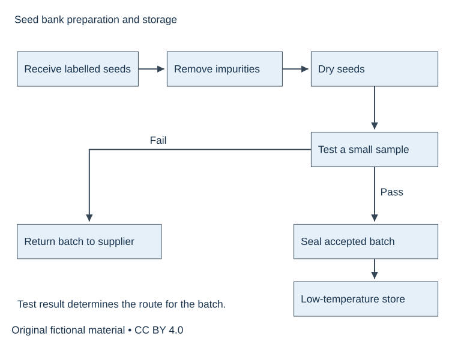
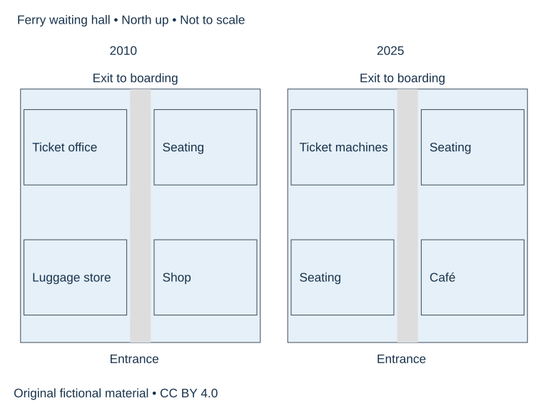

# U69 SUP-W02 A流程与地图的两种组织

原创专项补充。先完成学生任务，再展开参考答案。用本单元笔记记录首答、错因和重练结果，实际录音与真人反馈另行完成。

## SUP-W02 A流程与地图的两种组织

原创专项，适合另择时段练习，实际用时待学习者记录。140分钟。先保留自己的首稿，再阅读独立参考页。

### 完整题面

本工作坊分两次完成，每次70分钟，合计140分钟。两道完整Task 1分别练顺序与空间组织。

Task A. The diagram shows how a seed bank prepares seeds for long-term storage. Summarise the information by selecting and reporting the main features, and make comparisons where relevant. Write at least 150 words. Spend about 20 minutes.

完整数据。接收带标签种子→去杂质→干燥→从该批取少量样品做发芽测试；达标批次→装密封容器→低温储存；不达标批次→退还供种者。图未给温度、时长或测试阈值。

Task B. The plans show a ferry terminal waiting hall in 2010 and 2025. Summarise the information by selecting and reporting the main features, and make comparisons where relevant. Write at least 150 words. Spend about 20 minutes.

北向上。两年北中出口通登船区，南中入口，中央通道均保留。2010西北售票处、西南行李储存、东北座位、东南商店。2025西北自助售票机、西南座位、东北座位保留、东南咖啡店。外墙不变。

### 直接练习

流程先定起终点与分支，再按先后分组。地图先找保留基准，再按西/东组织变化。每个任务各写150词以上，分别完整重写。

首答20分钟、诊断与两段修订15、参考核查10、整篇重写20、归档5，共70分钟。
W02两题分别执行上述70分钟流程，合140分钟，可分两日。

1. 圈出题干要求，写一行段落功能提纲，计入首答时段。
2. 完成全文并保留真实结束位置。
3. 在下方教学原稿中圈出问题，先独立修订，再核参考。

### 教学原稿待修

#### 段落1

The seeds are frozen for ten days and all of them are stored. If the sample fails, the seeds are dried again.

你的修改____

依据____

#### 段落2

The terminal grew bigger. A new entrance was built in the north, and the shop moved to the west.

你的修改____

依据____

### 整篇重写与自查

在原稿中选择至多两项有证据的优先点，完整重写。无问题可换组织练迁移，并注明保留理由。

- [ ] 逐一回答题干要求并达到最低字数。
- [ ] 数据/角色设定/立场前后一致。
- [ ] 用两处原句说明修改或保留依据。
- [ ] 记录实际用时与仍需核实事项。

完成后阅读参考（本页下方展开参考）

完成首答后查看参考、证据与修订

## SUP-W02 独立参考

以下为原创教学示例。自拟细节可替换，题干和图中事实须遵守。正式分数未确认，学生真实作品尚待提交。

### 完整范文

#### 范文1

The diagram illustrates the preparation of seeds for long-term storage at a seed bank. It covers the stages from receiving labelled seeds to either storing an accepted batch or returning a rejected one to its supplier.

Overall, the seeds undergo cleaning and drying before their suitability for storage is assessed. A germination test determines which of two routes a batch follows. Only batches meeting the required standard proceed to sealed containers and low-temperature storage.

First, the seed bank receives seeds that already carry labels. Unwanted material is removed, after which the seeds are dried. A small sample is then taken from the batch for germination testing. This test provides the basis for deciding what happens to the batch as a whole, rather than simply sending every delivery directly into storage.

If the batch meets the standard, the seeds are placed in sealed containers and transferred to low-temperature storage. Batches that fail the test are returned to the supplier instead. The diagram specifies neither the drying time nor the temperature used for storage, and it does not give a numerical threshold for passing the test.

正文词数 184。书信剔除称呼及结束署名。

#### 范文2

The plans compare the layout of a ferry terminal waiting hall in 2010 and 2025. The entrance is in the middle of the southern wall, with an exit to the boarding area directly opposite it in the north.

Overall, the hall retained its external shape and central passage, while several facilities changed function. Seating occupied a greater part of the hall in 2025, and ticket machines replaced the staffed ticket office. A café also took the place of the shop.

In the western half, the ticket office in the north-west corner was replaced by self-service ticket machines. The luggage storage area immediately to its south was converted into another seating area. These changes left the western side with a different combination of functions, while access along the central passage was maintained.

On the eastern side, the original seating area in the north-east remained in place. The shop in the south-east became a café, in the same position beside the passage. Neither the southern entrance nor the northern exit moved. The principal changes therefore involved the use of existing spaces, rather than an extension of the hall or a relocation of its access points.

正文词数 193。书信剔除称呼及结束署名。

### 逐段修订与理由

#### 原稿1

The seeds are frozen for ten days and all of them are stored. If the sample fails, the seeds are dried again.

#### 修订1

After drying, a sample is tested for germination. Batches meeting the standard enter sealed containers and low-temperature storage, while rejected batches return to the supplier.

①图无十天和冷冻温度，去掉。②通过/失败分支都保留。③无返工箭头，删再次干燥。④样品代表批次，避免只储存测试样品。

#### 原稿2

The terminal grew bigger. A new entrance was built in the north, and the shop moved to the west.

#### 修订2

The hall retained its external shape and access points. In the south-east, a café replaced the shop, while seating replaced luggage storage in the south-west.

①外墙相同，撤回扩建。②北边原有出口保留。③replace说明功能替换，图未显示商店迁址。④方位为north-up图据。

### 应用到自己的稿件

流程先定起终点与分支，再按先后分组。地图先找保留基准，再按西/东组织变化。每个任务各写150词以上，分别完整重写。

| 原句及段号 | 证据 | 修改或保留 | 重写对应句 | 待核问题 |
|---|---|---|---|---|
| 待填 | 待填 | 待填 | 待填 | 待填 |

按任务完成/回应、连贯衔接、词汇、语法各查一处。所有意见引用原句或缺失位置，有争议交独立评阅者核验。归档初稿、全文重写、三条修改或保留理由，使用学生页清单复查。

## 许可说明

原创文字和图示采用 CC BY 4.0，RayXBuilds and contributors。原创专项不换算正式雅思分数。
