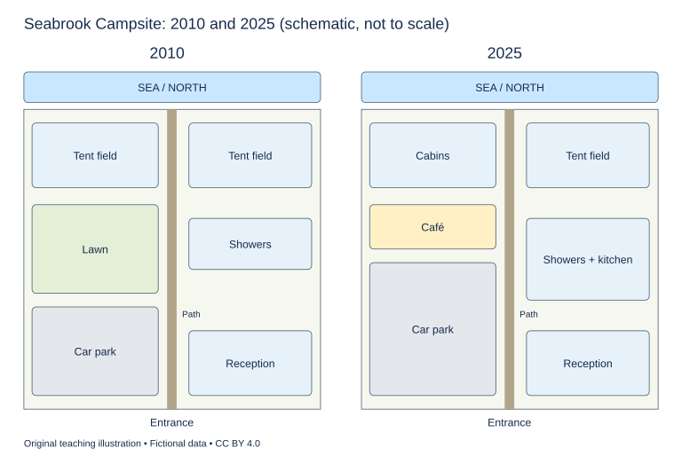

# WS-W07-T1A 学生页：海边露营地改造地图

周次 W07｜题型 T1A｜能力点：地图变化与方位

Task 1 的 A/G 分支二选一，另一分支不计入本周作业。

## 使用与记录

原创教学练习，非真题、非标准化模拟，难度未校准。先完成本页再打开参考页。人物、机构、经历与数据均为教学虚构。不要背诵示例。自评和 AI 反馈不能代替独立真人评分，未获得真人评阅时标记“分数未确认”。

保存：任务ID、实际日期、用时、初稿或原始录音、证据化反馈、重写/重答、三条修改理由。没有学生提交物，不得填写“已批改”或“已完成训练”。

## 完整题干

The maps show Seabrook Campsite in 2010 and after redevelopment in 2025. Summarise the information by selecting and reporting the main features, and make comparisons where relevant.

Write at least 150 words. Spend about 20 minutes on this task.

教学虚构示意地图，非比例尺实测。两图北向上，海在北边；中央南北路径和南侧中央入口位置相同。2010：西北/东北各一帐篷区；西中部草地；西南停车场；东中部洗浴楼；东南接待处。2025：西北木屋替代帐篷；东北帐篷保留；停车场原址向北扩入草地南部，剩余草地改咖啡馆；东中洗浴楼向南扩建并加厨房；接待处保留。

## 任务预算（含首次审题，不额外加时）

初稿20分钟（审题规划3、写作15、检查2）；诊断15；反馈阅读与证据核查10；完整重写25；对照归档5。合计75分钟。

## 初稿后自评清单

- [ ] 达到最低字数；全文连贯成段，没有用项目符号代替作文。
- [ ] 概述给主要特征；数据、阶段或方位都与题图逐项相符，不推断未提供的原因。
- [ ] 每段可写出一个功能标签；例子或数据与该段要点相连。
- [ ] 圈出两处词汇搭配和两处句法疑点，先自行修正再查询或求反馈。
- [ ] 记录一项最影响理解的问题和原句证据，不填写自猜分数。

## 反馈与重写

打开 [独立参考页](t1a-reference.md)，按逐段检查和通用协议核验。重写任务：完整重写至少150词；至少包含一处保持不变、一处替换和一处扩建；每句方位都回地图指认。
