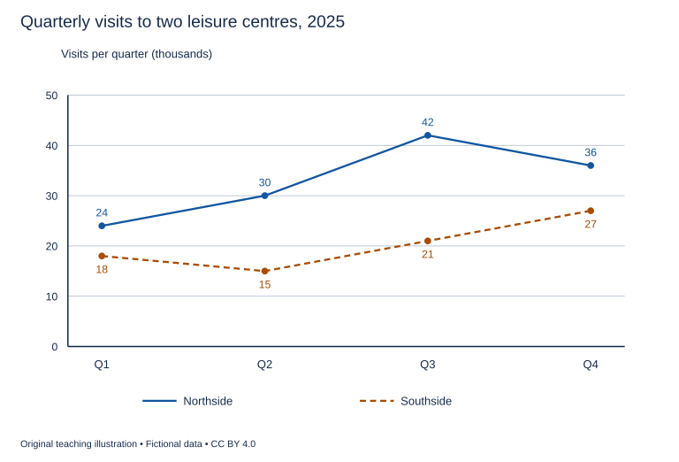

# WS-W09-T1A 学生页：健身中心季度使用量

周次 W09｜题型 T1A｜能力点：峰值、区间与趋势

Task 1 的 A/G 分支二选一，另一分支不计入本周作业。

## 使用与记录

原创教学练习，非真题、非标准化模拟，难度未校准。先完成本页再打开参考页。人物、机构、经历与数据均为教学虚构。不要背诵示例。自评和 AI 反馈不能代替独立真人评分，未获得真人评阅时标记“分数未确认”。

保存：任务ID、实际日期、用时、初稿或原始录音、证据化反馈、重写/重答、三条修改理由。没有学生提交物，不得填写“已批改”或“已完成训练”。

## 完整题干

The line graph shows the number of visits to two leisure centres in the four quarters of 2025. Summarise the information by selecting and reporting the main features, and make comparisons where relevant.

Write at least 150 words. Spend about 20 minutes on this task.

教学虚构数据。横轴Q1～Q4（2025季度）；纵轴千人次/季度。Northside：24、30、42、36；Southside：18、15、21、27。连线仅显示相邻观测值，非逐日记录。

## 任务预算（含首次审题，不额外加时）

初稿20分钟（审题规划3、写作15、检查2）；诊断15；反馈阅读与证据核查10；完整重写25；对照归档5。合计75分钟。

## 初稿后自评清单

- [ ] 达到最低字数；全文连贯成段，没有用项目符号代替作文。
- [ ] 概述给主要特征；数据、阶段或方位都与题图逐项相符，不推断未提供的原因。
- [ ] 每段可写出一个功能标签；例子或数据与该段要点相连。
- [ ] 圈出两处词汇搭配和两处句法疑点，先自行修正再查询或求反馈。
- [ ] 记录一项最影响理解的问题和原句证据，不填写自猜分数。

## 反馈与重写

打开 [独立参考页](t1a-reference.md)，按逐段检查和通用协议核验。重写任务：完整重写至少150词；把每个趋势动词圈定起止季度，另标一处首尾净变化和一处峰值，删除图外解释。

## 本周听读能力迁移（包含在既有预算）

在本题诊断/回听时段内用3分钟：圈出一个结论，回题面或自己的原话找直接证据；标出一个不能由现有信息推出的判断。对应U04 W09定位证据而非用常识替代。

这是本地写说步骤，不依赖音频已交付。若另有合法听读材料，只在该科原定复盘时段使用；没有材料则标待补，不宣称完成听力。
