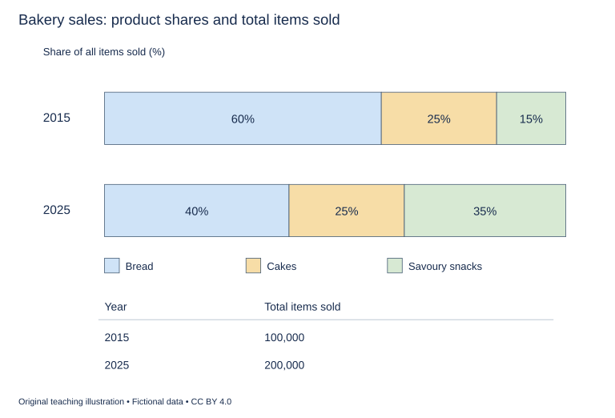

# WS-W11-T1A 学生页：面包店销售构成与总量

周次 W11｜题型 T1A｜能力点：比例与总量区别

Task 1 的 A/G 分支二选一，另一分支不计入本周作业。

## 使用与记录

原创教学练习，非真题、非标准化模拟，难度未校准。先完成本页再打开参考页。人物、机构、经历与数据均为教学虚构。不要背诵示例。自评和 AI 反馈不能代替独立真人评分，未获得真人评阅时标记“分数未确认”。

保存：任务ID、实际日期、用时、初稿或原始录音、证据化反馈、重写/重答、三条修改理由。没有学生提交物，不得填写“已批改”或“已完成训练”。

## 完整题干

The charts show the proportions of three product types sold by a bakery in 2015 and 2025. The table gives the total number of items sold in each year. Summarise the information by selecting and reporting the main features, and make comparisons where relevant.

Write at least 150 words. Spend about 20 minutes on this task.

教学虚构，三类互斥且覆盖全部售出件数。2015：Bread60%、Cakes25%、Savoury snacks15%，总计100,000件；2025：Bread40%、Cakes25%、Savoury snacks35%，总计200,000件。无价格/收入数据；由总件数与比例可计算类别件数。

## 任务预算（含首次审题，不额外加时）

初稿20分钟（审题规划3、写作15、检查2）；诊断15；反馈阅读与证据核查10；完整重写25；对照归档5。合计75分钟。

## 初稿后自评清单

- [ ] 达到最低字数；全文连贯成段，没有用项目符号代替作文。
- [ ] 概述给主要特征；数据、阶段或方位都与题图逐项相符，不推断未提供的原因。
- [ ] 每段可写出一个功能标签；例子或数据与该段要点相连。
- [ ] 圈出两处词汇搭配和两处句法疑点，先自行修正再查询或求反馈。
- [ ] 记录一项最影响理解的问题和原句证据，不填写自猜分数。

## 反馈与重写

打开 [独立参考页](t1a-reference.md)，按逐段检查和通用协议核验。重写任务：完整重写至少150词；保留两组比例与绝对量的对照，用英文一句明确说明占比和数量出现相反方向。

## 本周听读能力迁移（包含在既有预算）

在本题诊断/回听时段内用3分钟：给解释标出背景→主张/阶段→支持→限制的结构，并核对两处动词搭配和一处从句。对应U04 W11独白结构与句法。

这是本地写说步骤，不依赖音频已交付。若另有合法听读材料，只在该科原定复盘时段使用；没有材料则标待补，不宣称完成听力。
