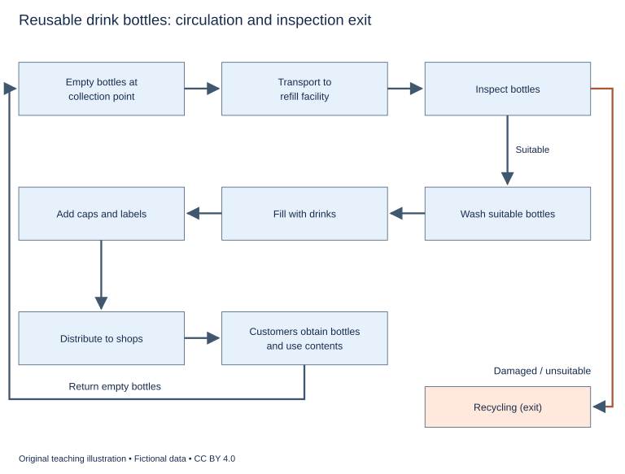

# WS-W15-T1A 学生页：可回收循环瓶系统

周次 W15｜题型 T1A｜能力点：循环流程与条件分支

Task 1 的 A/G 分支二选一，另一分支不计入本周作业。

## 使用与记录

原创教学练习，非真题、非标准化模拟，难度未校准。先完成本页再打开参考页。人物、机构、经历与数据均为教学虚构。不要背诵示例。自评和 AI 反馈不能代替独立真人评分，未获得真人评阅时标记“分数未确认”。

保存：任务ID、实际日期、用时、初稿或原始录音、证据化反馈、重写/重答、三条修改理由。没有学生提交物，不得填写“已批改”或“已完成训练”。

## 完整题干

The diagram shows the circulation of reusable drink bottles in a local refill scheme. Summarise the information by selecting and reporting the main features, and make comparisons where relevant.

Write at least 150 words. Spend about 20 minutes on this task.

教学虚构简化流程，非生产或卫生操作指南。客户返空瓶至收集点→运至补充装设施→检查；不合格/损坏→回收（退出，无返回箭头）。合格→清洗→灌装→加盖与标签→送商店→客户取用饮料→空瓶返收集点。未给回收后处理、循环次数、返还率或时间温度。

## 任务预算（含首次审题，不额外加时）

初稿20分钟（审题规划3、写作15、检查2）；诊断15；反馈阅读与证据核查10；完整重写25；对照归档5。合计75分钟。

## 初稿后自评清单

- [ ] 达到最低字数；全文连贯成段，没有用项目符号代替作文。
- [ ] 概述给主要特征；数据、阶段或方位都与题图逐项相符，不推断未提供的原因。
- [ ] 每段可写出一个功能标签；例子或数据与该段要点相连。
- [ ] 圈出两处词汇搭配和两处句法疑点，先自行修正再查询或求反馈。
- [ ] 记录一项最影响理解的问题和原句证据，不填写自猜分数。

## 反馈与重写

打开 [独立参考页](t1a-reference.md)，按逐段检查和通用协议核验。重写任务：完整重写至少150词；分别沿合格与损坏路径核验，明确循环起点与退出端；不为丰富词汇改变工序。

## 本周重点操作（已含原预算）

用原有诊断中的3分钟对照合格与损坏两路，指出分流条件及各自后果；再标一项图未提供的信息。比较的是流程路径，不要求写图外原因或虚构两方观点。
