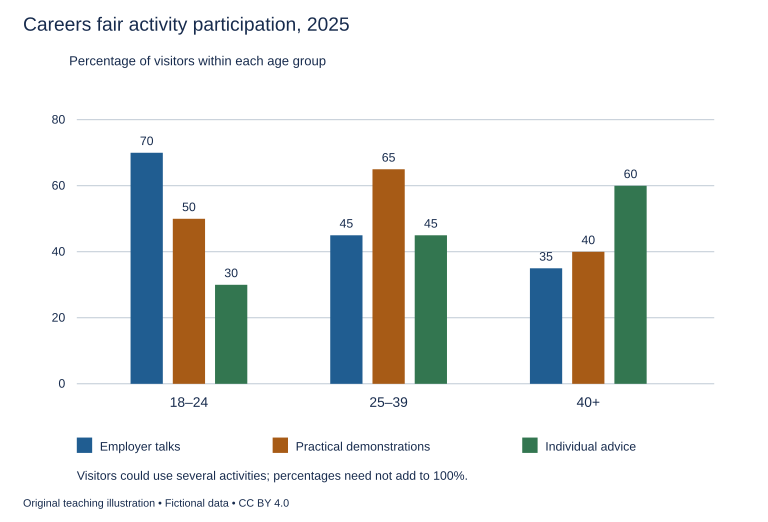

# WS-W17-T1A 学生页：招聘活动参与情况

周次 W17｜题型 T1A｜能力点：分组数据与证据诊断

Task 1 的 A/G 分支二选一，另一分支不计入本周作业。

## 使用与记录

原创教学练习，非真题、非标准化模拟，难度未校准。先完成本页再打开参考页。人物、机构、经历与数据均为教学虚构。不要背诵示例。自评和 AI 反馈不能代替独立真人评分，未获得真人评阅时标记“分数未确认”。

保存：任务ID、实际日期、用时、初稿或原始录音、证据化反馈、重写/重答、三条修改理由。没有学生提交物，不得填写“已批改”或“已完成训练”。

## 完整题干

The chart shows the percentages of visitors in three age groups who used three activities at a careers fair in 2025. Summarise the information by selecting and reporting the main features, and make comparisons where relevant.

Write at least 150 words. Spend about 20 minutes on this task.

教学虚构。各组内参与比例：18–24，Employer talks70%、Practical demonstrations50%、Individual advice30%；25–39为45/65/45%；40+为35/40/60%。可选多项，组内和不必100%；各组访客人数未知。

## 任务预算（含首次审题，不额外加时）

初稿20分钟（审题规划3、写作15、检查2）；诊断15；反馈阅读与证据核查10；完整重写25；对照归档5。合计75分钟。

## 初稿后自评清单

- [ ] 达到最低字数；全文连贯成段，没有用项目符号代替作文。
- [ ] 概述给主要特征；数据、阶段或方位都与题图逐项相符，不推断未提供的原因。
- [ ] 每段可写出一个功能标签；例子或数据与该段要点相连。
- [ ] 核查两处词汇搭配和两处句法；如有疑点先试改再核实，无问题则记录通过证据。
- [ ] 如有影响理解的问题，记录原句；否则记通过或待核查，不填写自猜分数。

## 反馈与重写

打开 [独立参考页](t1a-reference.md)，按逐段检查和通用协议核验。重写任务：完整重写至少150词；先查自身是否有分母/互斥误读，如有则改并记原句；如无则核查一项组织或语言问题，没有证据不强造错误。

## 本周重点操作（已含原预算）

用原有诊断/回听中的3分钟，按分母/多选解释、概述与比较、语言逐项找原句或时间戳证据。只选出现次数最多或最妨碍理解的至多两类；没有可靠证据就标“待核查”，不要猜失分或凑两类。用本题原定重写/重答验证所选点；如已清楚则保留并记通过证据。见W17证据选择表。

记录表见[证据选择与阶段表](../EVIDENCE.md)，只在上述原时段填写相关行。
