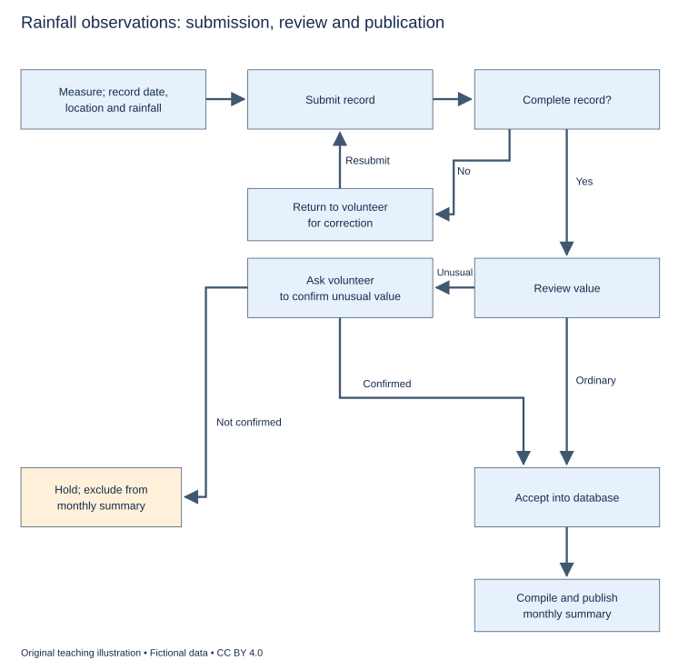

# WS-W18-T1A 学生页：雨量观察提交流程

周次 W18｜题型 T1A｜能力点：顺序流程与句法衔接

Task 1 的 A/G 分支二选一，另一分支不计入本周作业。

## 使用与记录

原创教学练习，非真题、非标准化模拟，难度未校准。先完成本页再打开参考页。人物、机构、经历与数据均为教学虚构。不要背诵示例。自评和 AI 反馈不能代替独立真人评分，未获得真人评阅时标记“分数未确认”。

保存：任务ID、实际日期、用时、初稿或原始录音、证据化反馈、重写/重答、三条修改理由。没有学生提交物，不得填写“已批改”或“已完成训练”。

## 完整题干

The diagram shows how rainfall observations submitted by volunteers are processed by a local project. Summarise the information by selecting and reporting the main features, and make comparisons where relevant.

Write at least 150 words. Spend about 20 minutes on this task.

教学虚构数据工作流。测量并记录日期地点雨量→提交→完整性检查；缺信息退回纠正后重新提交；完整→数值复核。普通值→接受入库；异常值→请求确认，确认则入库，不能确认则暂存且不进入月度汇总。入库→汇编并发布月度汇总。未给阈值、等待时长或暂存后的处理。

## 任务预算（含首次审题，不额外加时）

初稿20分钟（审题规划3、写作15、检查2）；诊断15；反馈阅读与证据核查10；完整重写25；对照归档5。合计75分钟。

## 初稿后自评清单

- [ ] 达到最低字数；全文连贯成段，没有用项目符号代替作文。
- [ ] 概述给主要特征；数据、阶段或方位都与题图逐项相符，不推断未提供的原因。
- [ ] 每段可写出一个功能标签；例子或数据与该段要点相连。
- [ ] 核查两处词汇搭配和两处句法；如有疑点先试改再核实，无问题则记录通过证据。
- [ ] 如有影响理解的问题，记录原句；否则记通过或待核查，不填写自猜分数。

## 反馈与重写

打开 [独立参考页](t1a-reference.md)，按逐段检查和通用协议核验。重写任务：完整重写至少150词；如发现指代/条件连接含混，重写对应句并沿流程核验含义未变；若原句清楚，保留并解释为何无需改。

## 本周重点操作（已含原预算）

用原有诊断中的3分钟选一处条件句和一处指代，沿图核对它们连接的对象/分支；如含混才改。重写后逐路核验，确认没有把异常值直接判错或把暂存改成删除。

记录表见[证据选择与阶段表](../EVIDENCE.md)，只在上述原时段填写相关行。
