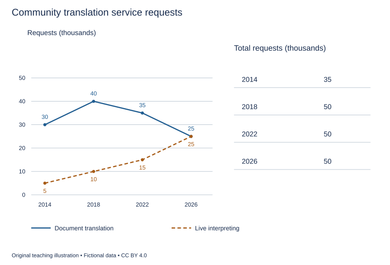

# WS-W20-T1A 学生页：社区翻译服务请求趋势

周次 W20｜题型 T1A｜能力点：趋势和总量的阶段核查

Task 1 的 A/G 分支二选一，另一分支不计入本周作业。

## 使用与记录

原创教学练习，非真题、非标准化模拟，难度未校准。先完成本页再打开参考页。人物、机构、经历与数据均为教学虚构。不要背诵示例。自评和 AI 反馈不能代替独立真人评分，未获得真人评阅时标记“分数未确认”。

保存：任务ID、实际日期、用时、初稿或原始录音、证据化反馈、重写/重答、三条修改理由。没有学生提交物，不得填写“已批改”或“已完成训练”。

## 完整题干

The graph shows requests for two types of support from a community translation service in selected years from 2014 to 2026. The table shows the total number of requests in each year. Summarise the information by selecting and reporting the main features, and make comparisons where relevant.

Write at least 150 words. Spend about 20 minutes on this task.

教学虚构，单位千次请求。2014/2018/2022/2026：Document translation30/40/35/25；Live interpreting5/10/15/25；Total35/50/50/50。两类互斥且覆盖所有请求，未给独立用户数、完结率或等待时间。

## 任务预算（含首次审题，不额外加时）

初稿20分钟（审题规划3、写作15、检查2）；诊断15；反馈阅读与证据核查10；完整重写25；对照归档5。合计75分钟。

## 初稿后自评清单

- [ ] 达到最低字数；全文连贯成段，没有用项目符号代替作文。
- [ ] 概述给主要特征；数据、阶段或方位都与题图逐项相符，不推断未提供的原因。
- [ ] 每段可写出一个功能标签；例子或数据与该段要点相连。
- [ ] 核查两处词汇搭配和两处句法；如有疑点先试改再核实，无问题则记录通过证据。
- [ ] 如有影响理解的问题，记录原句；否则记通过或待核查，不填写自猜分数。

## 反馈与重写

打开 [独立参考页](t1a-reference.md)，按逐段检查和通用协议核验。重写任务：完整重写至少150词；如存在范围或比较误述，回图修正并保留改前证据；如无则记录通过项和真实待核查点。将初稿时长与完成情况纳入W20证据表，不填虚构分数。

## 本周重点操作（已含原预算）

用原有归档5分钟中的3分钟填W20证据表的本题行：真实初稿用时、要点/词数、重复问题证据、独立真人反馈是否已有。没有结果写未知；只凭本题不能判达到目标或必须延长。正式T20与真人评分另登记。

记录表见[证据选择与阶段表](../EVIDENCE.md)，只在上述原时段填写相关行。
