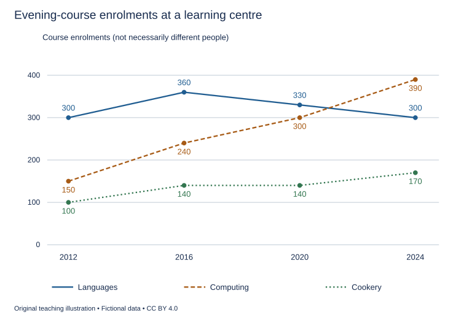

# WS-W21-T1A 学生页：晚间课程报名趋势

周次 W21｜题型 T1A｜能力点：趋势、限时与漏项检查

Task 1 的 A/G 分支二选一，另一分支不计入本周作业。

## 使用与记录

原创教学练习，非真题、非标准化模拟，难度未校准。先完成本页再打开参考页。人物、机构、经历与数据均为教学虚构。范例的身份、地点、动作和细节不是强制要求。口语优先用真实经历或真实观察，并说明来源；没有相关经历时，可将假设回答明确标为技能练习，不伪装成亲历。不要背诵示例。自评和 AI 反馈不能代替独立真人评分，未获得真人评阅时标记“分数未确认”。

保存：任务ID、实际日期、用时、初稿或原始录音、证据化反馈、重写/重答、三条修改理由。没有学生提交物，不得填写“已批改”或“已完成训练”。

## 完整题干

The graph shows enrolments in three types of evening course at a learning centre in selected years between 2012 and 2024. Summarise the information by selecting and reporting the main features, and make comparisons where relevant.

Write at least 150 words. Spend about 20 minutes on this task.

教学虚构。2012/2016/2020/2024：Languages300/360/330/300，Computing150/240/300/390，Cookery100/140/140/170。单位报名次数，可一人多课；未给价格、人数或开课频率。

## 任务预算（含首次审题，不额外加时）

初稿20分钟（审题规划3、写作15、检查2）；诊断15；反馈阅读与证据核查10；完整重写25；对照归档5。合计75分钟。

## 初稿后自评清单

- [ ] 达到最低字数；全文连贯成段，没有用项目符号代替作文。
- [ ] 概述给主要特征；数据、阶段或方位都与题图逐项相符，不推断未提供的原因。
- [ ] 每段可写出一个功能标签；例子或数据与该段要点相连。
- [ ] 核查两处词汇搭配和两处句法；如有疑点先试改再核实，无问题则记录通过证据。
- [ ] 如有影响理解的问题，记录原句；否则记通过或待核查，不填写自猜分数。

## 反馈与重写

打开 [独立参考页](t1a-reference.md)，按逐段检查和通用协议核验。重写任务：完整重写至少150词；如存在漏项/拼写疑点才修正，保留原词与依据；如无则记录核查通过。按所选纸笔或键入方式限时，但不能据此声称实际考场界面练习完成。

## 本周重点操作（已含原预算）

在原归档时段取3分钟登记所选考试形式及本次练习工具。写作按所选纸笔/键入方式完成，漏项和拼写检查已在初稿20分钟内的2分钟或40分钟内的5分钟，不另加时。核对报名单位、主要趋势、持平与比较；只核查实际写出的词语拼写。 如有问题才登记修正；无则记通过或待核查。普通编辑器、录音或本课页面不等于实际考试界面。真实界面熟悉练习单列来源、日期和完成状态；目前无记录，标“未完成/未确认”。

记录表见[阶段证据与交接表](../EVIDENCE.md)，只在上述原时段填写相关行。
