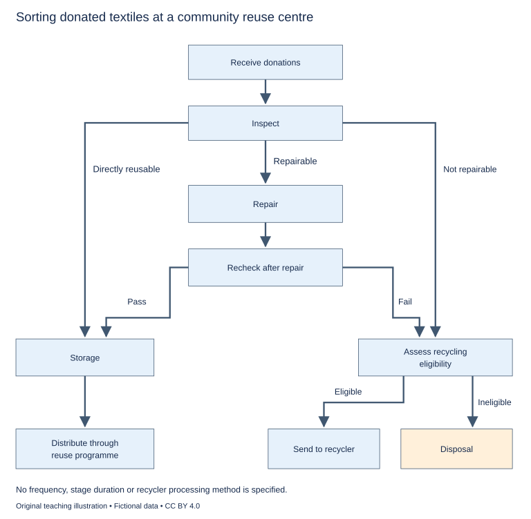

# WS-W22-T1A 学生页：二手织物分流流程

周次 W22｜题型 T1A｜能力点：流程条件与阶段记录

Task 1 的 A/G 分支二选一，另一分支不计入本周作业。

## 使用与记录

原创教学练习，非真题、非标准化模拟，难度未校准。先完成本页再打开参考页。人物、机构、经历与数据均为教学虚构。范例的身份、地点、动作和细节不是强制要求。口语优先用真实经历或真实观察，并说明来源；没有相关经历时，可将假设回答明确标为技能练习，不伪装成亲历。不要背诵示例。自评和 AI 反馈不能代替独立真人评分，未获得真人评阅时标记“分数未确认”。

保存：任务ID、实际日期、用时、初稿或原始录音、证据化反馈、重写/重答、三条修改理由。没有学生提交物，不得填写“已批改”或“已完成训练”。

## 完整题干

The diagram shows how donated textiles are sorted at a community reuse centre. Summarise the information by selecting and reporting the main features, and make comparisons where relevant.

Write at least 150 words. Spend about 20 minutes on this task.

教学虚构简化工作流：接收→检查。可直接再用→储存；可修→维修→复核，通过→储存，不通过→回收资格评估；不可修→回收资格评估。储存→再用项目分发。符合回收要求→送回收商；不符合→处置。未给频次、时长、清洗步骤、销售或回收商处理工艺。

## 任务预算（含首次审题，不额外加时）

初稿20分钟（审题规划3、写作15、检查2）；诊断15；反馈阅读与证据核查10；完整重写25；对照归档5。合计75分钟。

## 初稿后自评清单

- [ ] 达到最低字数；全文连贯成段，没有用项目符号代替作文。
- [ ] 概述给主要特征；数据、阶段或方位都与题图逐项相符，不推断未提供的原因。
- [ ] 每段可写出一个功能标签；例子或数据与该段要点相连。
- [ ] 核查两处词汇搭配和两处句法；如有疑点先试改再核实，无问题则记录通过证据。
- [ ] 如有影响理解的问题，记录原句；否则记通过或待核查，不填写自猜分数。

## 反馈与重写

打开 [独立参考页](t1a-reference.md)，按逐段检查和通用协议核验。重写任务：完整重写至少150词；如出现图外步骤、频次或时长则删去，清楚者保留。归档真实用时和覆盖，原创检查不能填正式T22完成。

## 本周重点操作（已含原预算）

在原归档时段取3分钟填EVIDENCE的W22对应行，只记录本题原创材料的真实初稿/首答表现。核对三个终点、修复复核与回收资格；图未提供频次或时长，不能补写。 正式T22另记合法卷源、是否见过、方式、真实条件、总分与听读写说单项，以及目标总分和单项要求；目前未提供的一律待填。自评、AI与本题参考示例不能填正式分数。正式任务如替换本题时段，本题改备用，不叠加后仍报原预算。

记录表见[阶段证据与交接表](../EVIDENCE.md)，只在上述原时段填写相关行。
