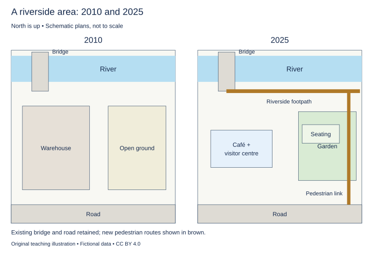

# WS-W23-T1A 学生页：河岸步行区改造

周次 W23｜题型 T1A｜能力点：地图变化与反馈核验

Task 1 的 A/G 分支二选一，另一分支不计入本周作业。

## 使用与记录

原创教学练习，非真题、非标准化模拟，难度未校准。先完成本页再打开参考页。人物、机构、经历与数据均为教学虚构。范例的身份、地点、动作和细节不是强制要求。口语优先用真实经历或真实观察，并说明来源；没有相关经历时，可将假设回答明确标为技能练习，不伪装成亲历。不要背诵示例。自评和 AI 反馈不能代替独立真人评分，未获得真人评阅时标记“分数未确认”。

保存：任务ID、实际日期、用时、初稿或原始录音、证据化反馈、重写/重答、三条修改理由。没有学生提交物，不得填写“已批改”或“已完成训练”。

## 完整题干

The maps show a riverside area in 2010 and after changes in 2025. Summarise the information by selecting and reporting the main features, and make comparisons where relevant.

Write at least 150 words. Spend about 20 minutes on this task.

教学虚构示意图，北向上不按比例。河沿北边、路沿南边，两年不变；西侧桥跨河位置不变。2010西部Warehouse、东部Open ground。2025西部以更小Café + visitor centre替换仓库，东部Garden + seating；新增河南岸东西Footpath，并新增东部南北Pedestrian link连接道路、花园与沿河步道。没有车流或实际坡度数据。

## 任务预算（含首次审题，不额外加时）

初稿20分钟（审题规划3、写作15、检查2）；诊断15；反馈阅读与证据核查10；完整重写25；对照归档5。合计75分钟。

## 初稿后自评清单

- [ ] 达到最低字数；全文连贯成段，没有用项目符号代替作文。
- [ ] 概述给主要特征；数据、阶段或方位都与题图逐项相符，不推断未提供的原因。
- [ ] 每段可写出一个功能标签；例子或数据与该段要点相连。
- [ ] 核查两处词汇搭配和两处句法；如有疑点先试改再核实，无问题则记录通过证据。
- [ ] 如有影响理解的问题，记录原句；否则记通过或待核查，不填写自猜分数。

## 反馈与重写

打开 [独立参考页](t1a-reference.md)，按逐段检查和通用协议核验。重写任务：完整重写至少150词；如反馈与图不符则标争议并求核实，不盲改；向第二轮真人评阅交原稿、图与改动依据，未有真人意见就记待安排。

## 本周重点操作（已含原预算）

在原反馈/诊断时段整理已有证据，在原归档时段取3分钟填写第二轮真人交接状态。把争议句定位到地图的桥、路、替换设施或新增步道；无法从图推出的内容标待核查。 有第一轮真实意见时附日期、评阅者和落实证据；没有则如实写“第一轮待安排，第二轮尚不具备比较依据”。交接原题、限时初稿/原音、重写/重答和一个具体核查问题，未收到真人回复记待评，不能把AI意见或示例讲评记作第二轮真人反馈。超出课内预算的会谈另记实际时间，不假装已经完成。

记录表见[阶段证据与交接表](../EVIDENCE.md)，只在上述原时段填写相关行。
