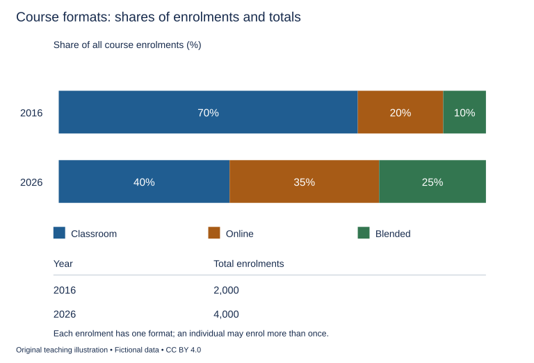

# WS-W24-T1A 学生页：学习中心模式构成与总参与量

周次 W24｜题型 T1A｜能力点：比例、总量与证据边界

Task 1 的 A/G 分支二选一，另一分支不计入本周作业。

## 使用与记录

原创教学练习，非真题、非标准化模拟，难度未校准。先完成本页再打开参考页。人物、机构、经历与数据均为教学虚构。范例的身份、地点、动作和细节不是强制要求。口语优先用真实经历或真实观察，并说明来源；没有相关经历时，可将假设回答明确标为技能练习，不伪装成亲历。不要背诵示例。自评和 AI 反馈不能代替独立真人评分，未获得真人评阅时标记“分数未确认”。

保存：任务ID、实际日期、用时、初稿或原始录音、证据化反馈、重写/重答、三条修改理由。没有学生提交物，不得填写“已批改”或“已完成训练”。

## 完整题干

The charts show the proportions of course enrolments in classroom, online and blended formats at a training provider in 2016 and 2026. The table gives total enrolments in each year. Summarise the information by selecting and reporting the main features, and make comparisons where relevant.

Write at least 150 words. Spend about 20 minutes on this task.

教学虚构。2016总报名2000：Classroom70%、Online20%、Blended10%；2026总4000：40%、35%、25%。每份报名只归一种模式，各年合100%；同一人可多报，独立人数未知。Blended指同一课程结合线上与面授。

## 任务预算（含首次审题，不额外加时）

初稿20分钟（审题规划3、写作15、检查2）；诊断15；反馈阅读与证据核查10；完整重写25；对照归档5。合计75分钟。

## 初稿后自评清单

- [ ] 达到最低字数；全文连贯成段，没有用项目符号代替作文。
- [ ] 概述给主要特征；数据、阶段或方位都与题图逐项相符，不推断未提供的原因。
- [ ] 每段可写出一个功能标签；例子或数据与该段要点相连。
- [ ] 核查两处词汇搭配和两处句法；如有疑点先试改再核实，无问题则记录通过证据。
- [ ] 如有影响理解的问题，记录原句；否则记通过或待核查，不填写自猜分数。

## 反馈与重写

打开 [独立参考页](t1a-reference.md)，按逐段检查和通用协议核验。重写任务：完整重写至少150词；有证据问题才改，核对数量/比例/分母。保存真实作答记录供W24证据表，不以本题完成或示例推断报考准备度。

## 本周重点操作（已含原预算）

在原归档时段取3分钟更新W24证据表，本题只贡献原创写说过程证据。核对份额、分母与换算；课堂份额下降并不等于报名数量下降。 核验真实T22、T24、目标总分/单项、两轮真人反馈和实际考试形式练习的来源及状态；缺关键证据写“未定”，不是自动失败，也不是自动建议报考。只有可信证据显示差距时才讨论针对性延长与复核节点，不能保分。本课完成不代表正式T24已完成或报考决定已作出。

记录表见[阶段证据与交接表](../EVIDENCE.md)，只在上述原时段填写相关行。
