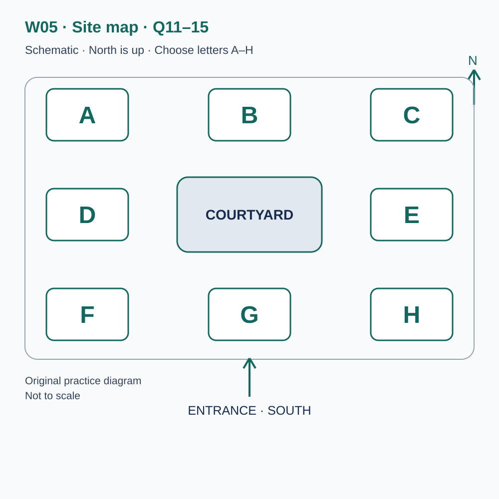
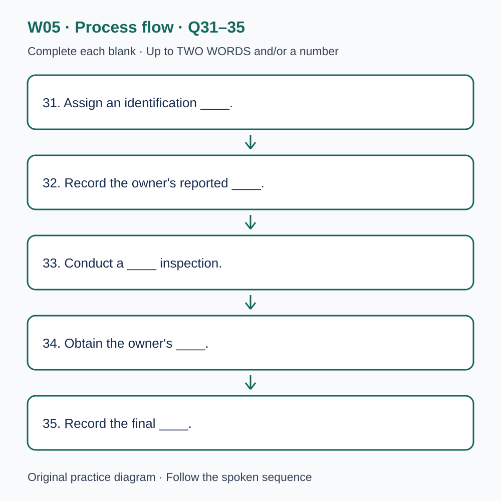

# L-W05 — Repair, reuse and shared spaces
> 原创 IELTS-style 技能练习，非真题、非标准化模考，不可换算正式分数。当前只有文字和题目，音频未生成，不能计作已完成听力套题。

共四部分、40 个计分空，每空 1 分。正式首次作答须等待批准音频，先不要打开 script.md 或 answers.md。朗读前先看题；只听一遍后提交首次答案及信心等级，再做精听。当前只能预览题面，不能把读稿作答记作听力成绩。

## Part 1 — Joining a repair fair

Q1–6: Complete the notes. Write **NO MORE THAN TWO WORDS AND/OR A NUMBER** for each answer, using words from the recording. Numeric notation may replace spoken numbers. Do not repeat a printed unit. Q7–10: Choose **ONE letter, A, B or C**.

**Q1.** Item booked for assessment: ____

**Q2.** Day of the public appointment: ____

**Q3.** Booked assessment start (a.m.): ____

**Q4.** Length of initial assessment: ____ minutes

**Q5.** Useful document to bring, if available: ____

**Q6.** Current location detail required for booking: ____

**Q7.** Why is booking useful?

- A. It guarantees a completed repair.
- B. It reserves time for an examination.
- C. It guarantees the lowest parts price.

Answer: ____

**Q8.** What happens if a replacement part is needed?

- A. The owner decides whether and where to buy it after receiving details.
- B. The fair automatically sells the owner a part.
- C. The owner must buy likely parts before the assessment.

Answer: ____

**Q9.** How are ordinary booking changes mainly communicated?

- A. Through public social-media posts.
- B. By telephone for every change.
- C. By email to the visitor.

Answer: ____

**Q10.** What should a child accompanying an owner do?

- A. Wait behind the visitor line with a supervising adult.
- B. Join the volunteer inside the working area.
- C. Stay in the activity area as guaranteed childcare.

Answer: ____

## Part 2 — Repair fair site briefing

Q11–15: Label the map. Write **ONE letter, A–H**, for each destination. Three letters are unused. Q16–20: Choose **ONE letter, A, B or C**.

**Q11.** Registration

Answer: ____

**Q12.** Tool store

Answer: ____

**Q13.** Bicycle assessment

Answer: ____

**Q14.** Children's activity area

Answer: ____

**Q15.** Donation point

Answer: ____

**Q16.** What is the central purpose of the fair?

- A. To finish the largest possible number of repairs.
- B. To help owners understand the examination and advice.
- C. To keep every assessment as short as possible.

Answer: ____

**Q17.** A close photograph of a repair requires permission from whom?

- A. Only the owner.
- B. Only the volunteer.
- C. Both the owner and the volunteer.

Answer: ____

**Q18.** If an item is declined for examination, what should the owner do?

- A. Try other tables without mentioning the decision.
- B. Ask the coordinator to clarify the decision and limits.
- C. Require the volunteer to complete a repair.

Answer: ____

**Q19.** What happens at lunchtime?

- A. Appointments continue while volunteer breaks are staggered.
- B. The whole site closes at once.
- C. Visitors may join any shorter queue for their repair.

Answer: ____

**Q20.** What is the feedback card especially intended to assess?

- A. Which volunteer deserves the highest ranking.
- B. Whether a booking problem needs an immediate response.
- C. Whether visitors understood the advice.

Answer: ____

## Part 3 — Evaluating a repair workshop

Q21–26: Match each proposal to the students' **final** positions at the end of that exchange. The tutor is not included. Write **A, B, C or D**. Letters may be reused.

- **A** Maya only
- **B** Noah only
- **C** Both students
- **D** Neither student

Q27–28 and Q29–30: Choose **TWO different letters, A–E**, for each pair. Write one letter in each numbered slot; either order is accepted. Each distinct correct choice earns one point, maximum two. Repeating a letter cannot earn two points. Submit no more than two letters.

**Q21.** At the END of this exchange, who supports: Short exit interviews?

Answer: ____

**Q22.** At the END of this exchange, who supports: The successful-repair total as the ONLY measure of the event?

Answer: ____

**Q23.** At the END of this exchange, who supports: Collecting visitors' exact addresses?

Answer: ____

**Q24.** At the END of this exchange, who supports: Follow-up accounts from owners whose items were not repaired?

Answer: ____

**Q25.** At the END of this exchange, who supports: Observing the waiting area from a fixed position, with organiser agreement?

Answer: ____

**Q26.** At the END of this exchange, who supports: A brief, permitted volunteer quotation in the presentation?

Answer: ____

**Q27–28.** Which TWO additions to the exit interview are selected?

- A. A personal score for the volunteer
- B. The visitor's intended next step
- C. The original purchase price
- D. Advice the visitor found unclear
- E. The visitor's home address

Answers: Q27 ____ · Q28 ____

**Q29–30.** Which TWO limitations must the conclusion state?

- A. Paper forms were necessarily unreliable.
- B. The workshop was cancelled.
- C. Only one event was observed.
- D. There was no access to the waiting area.
- E. Willing interviewees may differ from other visitors.

Answers: Q29 ____ · Q30 ____

## Part 4 — Tracing a repair request

Q31–35: Complete the flow chart below. Q36–40: Complete the notes. Write **NO MORE THAN TWO WORDS AND/OR A NUMBER** for each answer, using words from the recording. Numeric notation may replace spoken numbers. Words or units already printed do not belong in the blank. The numbered text below repeats the SVG prompts for readability.

**Q31.** Assign an identification ____.

**Q32.** Record the owner's reported ____.

**Q33.** Conduct a ____ inspection.

**Q34.** Obtain the owner's ____.

**Q35.** Record the final ____.

**Q36.** Requests are classified into consistently defined ____.

**Q37.** A missing value is marked as ____.

**Q38.** Example follow-up interval: ____ weeks.

**Q39.** Remove direct ____ before sharing a case publicly.

**Q40.** Review data quality and the ____ of collecting the data.

## 本周训练安排（音频批准后执行）

- Preview questions without the script：8 分钟。
- Future continuous first listen, including planned part pauses：32 分钟。
- Submit first answers and confidence, without a second play：8 分钟。
- Check answers and classify errors：20 分钟。
- Four Q-located intensive segments, 15 minutes each：60 分钟。
- Diagram and opinion retelling：15 分钟。
- Next-day retry of missed items：15 分钟。

合计 **158 分钟**；最多另用 22 分钟缓冲，总计不超过 180 分钟。暂停、回放与查词均计入精听预算，不能另行无限追加。当前实际已完成听力分钟数为 0。精听区段和步骤见 intensive.md；答案和脚本另页。
