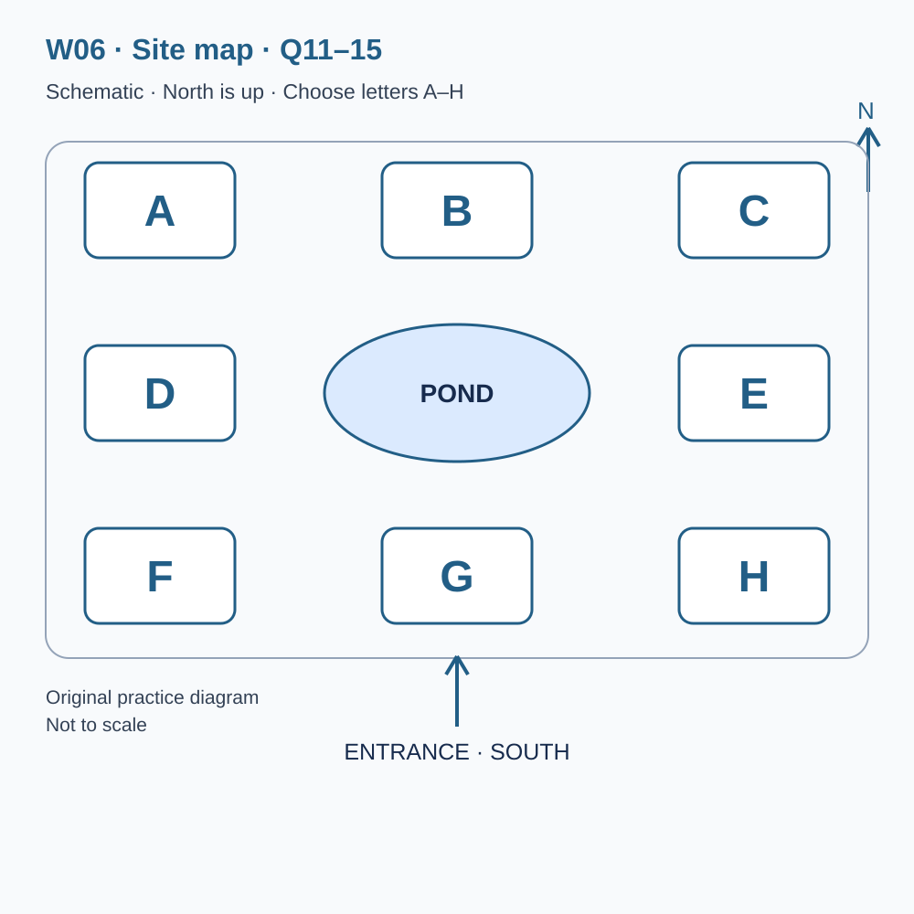
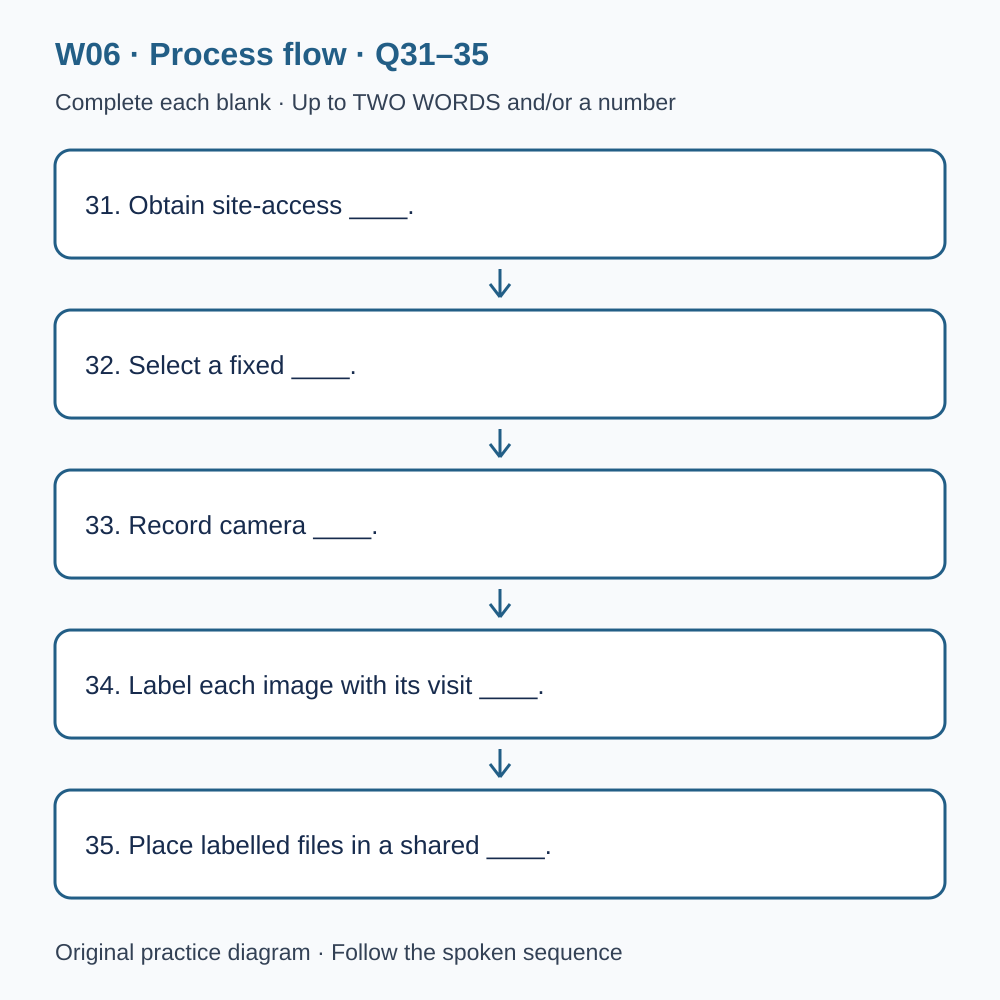

# L-W06 — Field visits and careful observation
> 原创 IELTS-style 技能练习，非真题、非标准化模考，不可换算正式分数。当前只有文字和题目，音频未生成，不能计作已完成听力套题。

共四部分、40 个计分空，每空 1 分。正式首次作答须等待批准音频，先不要打开 script.md 或 answers.md。朗读前先看题；只听一遍后提交首次答案及信心等级，再做精听。当前只能预览题面，不能把读稿作答记作听力成绩。

## Part 1 — Arranging a wetland group visit

Q1–6: Complete the notes. Write **NO MORE THAN TWO WORDS AND/OR A NUMBER** for each answer, using words from the recording. Numeric notation may replace spoken numbers. Do not repeat a printed unit. Q7–10: Choose **ONE letter, A, B or C**.

**Q1.** The group's main interest: ____

**Q2.** Chosen day of May: ____

**Q3.** Number of confirmed visitors: ____

**Q4.** Guide meeting time (a.m.): ____

**Q5.** Total guided-visit price: £____

**Q6.** Recommended footwear: ____

**Q7.** For the member using a walking aid, what should the organiser do?

- A. Assume every part of the standard route is suitable.
- B. Cancel the whole visit immediately.
- C. Discuss requirements and request an adapted route.

Answer: ____

**Q8.** Where can the group eat its own packed lunch?

- A. In a shared covered picnic area.
- B. At privately reserved picnic tables guaranteed to be empty.
- C. Only in the cafe after booking its menu.

Answer: ____

**Q9.** How are photographic observation points selected?

- A. Visitors may move barriers if they need a closer view.
- B. The guide selects permitted points for the conditions.
- C. Every booking includes access to nesting areas.

Answer: ____

**Q10.** What should the group do if heavy rain is forecast?

- A. Assume automatic cancellation.
- B. Let individual members make separate assumptions.
- C. Wait for a direct message about the plan.

Answer: ____

## Part 2 — Wetland learning centre orientation

Q11–15: Label the map. Write **ONE letter, A–H**, for each destination. Three letters are unused. Q16–20: Choose **ONE letter, A, B or C**.

**Q11.** Information desk

Answer: ____

**Q12.** Equipment loan point

Answer: ____

**Q13.** Sheltered observation area

Answer: ____

**Q14.** Indoor classroom

Answer: ____

**Q15.** Covered picnic area

Answer: ____

**Q16.** If a guided route changes, visitors should

- A. leave to follow the original route alone.
- B. follow the guide's explained adaptation.
- C. assume the whole visit has lost its value.

Answer: ____

**Q17.** When comparing display photographs, what should visitors consider?

- A. The dates and conditions under which images were made.
- B. Only the most dramatic difference.
- C. Every visual difference as definite long-term change.

Answer: ____

**Q18.** What makes an uncertain identification useful?

- A. Presenting an app suggestion as independent recognition.
- B. Reporting a confident name without details.
- C. Describing observed features and how a suggested name was obtained.

Answer: ____

**Q19.** Volunteer monitoring differs from an ordinary visit because it

- A. includes everybody on the tour automatically.
- B. requires a consistent method and training.
- C. values the largest number of observations regardless of quality.

Answer: ____

**Q20.** What feedback is most useful?

- A. A specific location or instruction that caused difficulty.
- B. A demand to make everything better without an example.
- C. A complaint sent after departure as an urgent same-day request.

Answer: ____

## Part 3 — Designing a student survey

Q21–26: Match each proposal to the students' **final** positions at the end of that exchange. The tutor is not included. Write **A, B, C or D**. Letters may be reused.

- **A** Leah only
- **B** Aron only
- **C** Both students
- **D** Neither student

Q27–28 and Q29–30: Choose **TWO different letters, A–E**, for each pair. Write one letter in each numbered slot; either order is accepted. Each distinct correct choice earns one point, maximum two. Repeating a letter cannot earn two points. Submit no more than two letters.

**Q21.** At the END of this exchange, who supports: Surveying only at the exit?

Answer: ____

**Q22.** At the END of this exchange, who supports: Piloting the questions before the main survey?

Answer: ____

**Q23.** At the END of this exchange, who supports: Collecting visitor names on the survey forms?

Answer: ____

**Q24.** At the END of this exchange, who supports: Including an optional open-response question?

Answer: ____

**Q25.** At the END of this exchange, who supports: Recording weather with simple consistent descriptions?

Answer: ____

**Q26.** At the END of this exchange, who supports: Counting people who decline to answer?

Answer: ____

**Q27–28.** Which TWO fixed-choice questions do the students retain?

- A. How visitors heard about the centre before visiting
- B. How many species visitors think live at the site
- C. What each visitor's camera cost
- D. Which information visitors used to find a route after arrival
- E. Each visitor's exact home address

Answers: Q27 ____ · Q28 ____

**Q29–30.** Which TWO changes would make comparisons between main survey sessions difficult?

- A. Recording the date
- B. Changing the question wording midway
- C. Using pencils instead of pens for legible records
- D. Changing which passing visitors are approached
- E. Not collecting income figures

Answers: Q29 ____ · Q30 ____

## Part 4 — Planning repeat photography

Q31–35: Complete the flow chart below. Q36–40: Complete the notes. Write **NO MORE THAN TWO WORDS AND/OR A NUMBER** for each answer, using words from the recording. Numeric notation may replace spoken numbers. Words or units already printed do not belong in the blank. The numbered text below repeats the SVG prompts for readability.

**Q31.** Obtain site-access ____.

**Q32.** Select a fixed ____.

**Q33.** Record camera ____.

**Q34.** Label each image with its visit ____.

**Q35.** Place labelled files in a shared ____.

**Q36.** Changing sun position can change the ____ visible in images.

**Q37.** Distinguish ____ variation from a longer-term trend.

**Q38.** Measure ____ between different observers.

**Q39.** Disturbed ground may have several possible ____.

**Q40.** The final review should describe ____, not only display clear images.

## 本周训练安排（音频批准后执行）

- Preview questions without the script：8 分钟。
- Future continuous first listen, including planned part pauses：32 分钟。
- Submit first answers and confidence, without a second play：8 分钟。
- Check answers and classify errors：20 分钟。
- Four Q-located intensive segments, 15 minutes each：60 分钟。
- Diagram and opinion retelling：15 分钟。
- Next-day retry of missed items：15 分钟。

合计 **158 分钟**；最多另用 22 分钟缓冲，总计不超过 180 分钟。暂停、回放与查词均计入精听预算，不能另行无限追加。当前实际已完成听力分钟数为 0。精听区段和步骤见 intensive.md；答案和脚本另页。
