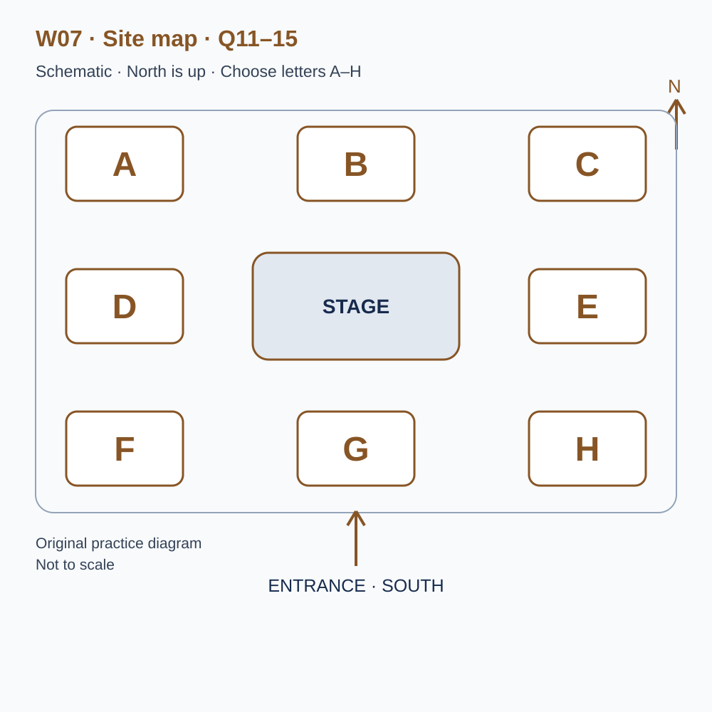
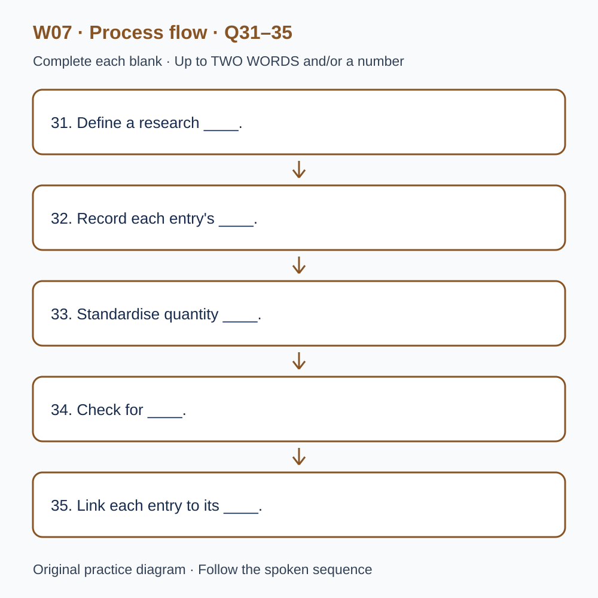

# L-W07 — Food, stories and community records
> 原创 IELTS-style 技能练习，非真题、非标准化模考，不可换算正式分数。当前只有文字和题目，音频未生成，不能计作已完成听力套题。

共四部分、40 个计分空，每空 1 分。正式首次作答须等待批准音频，先不要打开 script.md 或 answers.md。朗读前先看题；只听一遍后提交首次答案及信心等级，再做精听。当前只能预览题面，不能把读稿作答记作听力成绩。

## Part 1 — Booking a festival stall

Q1–6: Complete the notes. Write **NO MORE THAN TWO WORDS AND/OR A NUMBER** for each answer, using words from the recording. Numeric notation may replace spoken numbers. Do not repeat a printed unit. Q7–10: Choose **ONE letter, A, B or C**.

**Q1.** Main product to be sold: ____

**Q2.** Chosen day of June: ____

**Q3.** Number of stallholder passes: ____

**Q4.** Allocated unloading time (a.m.): ____

**Q5.** Total stall fee for this community group: £____

**Q6.** Items to attach the display board: ____

**Q7.** Why does the organiser suggest an illustrated information sheet?

- A. It guarantees programme priority.
- B. It lets visitors continue reading after a brief conversation.
- C. It replaces required stall information.

Answer: ____

**Q8.** What must the friend wishing to sell pottery do first?

- A. Submit a separate application.
- B. Use a corner of the existing stall informally.
- C. Arrive on the morning and claim neighbouring space.

Answer: ____

**Q9.** If all the products sell early, the group should

- A. drive away immediately.
- B. invent an extra performance.
- C. keep its information display open until the agreed close.

Answer: ____

**Q10.** Which plan should volunteers use?

- A. The rough early website sketch.
- B. The numbered plan in the booking confirmation, replaced if revised.
- C. Any old version provided they telephone each week.

Answer: ____

## Part 2 — Festival grounds orientation

Q11–15: Label the map. Write **ONE letter, A–H**, for each destination. Three letters are unused. Q16–20: Choose **ONE letter, A, B or C**.

**Q11.** Tasting tent

Answer: ____

**Q12.** Drinking-water point

Answer: ____

**Q13.** Information and first-aid tent

Answer: ____

**Q14.** Story corner

Answer: ____

**Q15.** Recycling point

Answer: ____

**Q16.** Why are pauses built into the performance programme?

- A. To allow movement and equipment checks.
- B. Because all performers are expected to be late.
- C. To require stallholders to make sales announcements.

Answer: ____

**Q17.** For an identifiable story recorded for the archive, collectors should

- A. assume attendance implies consent.
- B. ask a second volunteer to approach anyone who declines.
- C. explain the use and record the contributor's decision.

Answer: ____

**Q18.** What is the purpose of activity-trail stamps?

- A. To pay for goods at every stall.
- B. To encourage exploration without requiring purchases.
- C. To guarantee a free purchase after completion.

Answer: ____

**Q19.** How should a story-session change be handled first?

- A. Post only on the group's personal social account.
- B. Move to any apparently unused space.
- C. Report it to the programme desk for coordinated updates.

Answer: ____

**Q20.** What belongs in a shift handover?

- A. Unresolved requests and relevant confirmed changes.
- B. Every pleasant conversation in detail.
- C. A blank whenever nothing needs follow-up.

Answer: ____

## Part 3 — Editing a festival documentary

Q21–26: Match each proposal to the students' **final** positions at the end of that exchange. The tutor is not included. Write **A, B, C or D**. Letters may be reused.

- **A** Mira only
- **B** Ethan only
- **C** Both students
- **D** Neither student

Q27–28 and Q29–30: Choose **TWO different letters, A–E**, for each pair. Write one letter in each numbered slot; either order is accepted. Each distinct correct choice earns one point, maximum two. Repeating a letter cannot earn two points. Submit no more than two letters.

**Q21.** At the END of this exchange, who supports: Opening with a visual montage?

Answer: ____

**Q22.** At the END of this exchange, who supports: Recording conversations secretly?

Answer: ____

**Q23.** At the END of this exchange, who supports: Testing a short pilot clip with classmates unfamiliar with the festival?

Answer: ____

**Q24.** At the END of this exchange, who supports: Keeping the quiet interview in the final short film?

Answer: ____

**Q25.** At the END of this exchange, who supports: Maintaining a source and permission log?

Answer: ____

**Q26.** At the END of this exchange, who supports: Using a split-screen comparison?

Answer: ____

**Q27–28.** Which TWO clips are selected for the middle section?

- A. A celebrity's promotional greeting
- B. A first-time stallholder describing a changed expectation
- C. Anonymous cheering without clear context
- D. A child's close recording without the required agreement
- E. A recycling volunteer explaining sorting

Answers: Q27 ____ · Q28 ____

**Q29–30.** Which TWO caption changes are confirmed?

- A. Use a more decorative typeface
- B. Shorten every display time
- C. Increase the font size
- D. Remove all speaker labels
- E. Use consistent speaker labels

Answers: Q29 ____ · Q30 ____

## Part 4 — Reading historical market records

Q31–35: Complete the flow chart below. Q36–40: Complete the notes. Write **NO MORE THAN TWO WORDS AND/OR A NUMBER** for each answer, using words from the recording. Numeric notation may replace spoken numbers. Words or units already printed do not belong in the blank. The numbered text below repeats the SVG prompts for readability.

**Q31.** Define a research ____.

**Q32.** Record each entry's ____.

**Q33.** Standardise quantity ____.

**Q34.** Check for ____.

**Q35.** Link each entry to its ____.

**Q36.** A recorded ____ explicitly means none; a blank may mean missing information.

**Q37.** The team's main comparison uses ____, rather than money values.

**Q38.** The issue of which sellers appear in the records is called ____.

**Q39.** For ambiguous digits, calculate a ____ of possible totals.

**Q40.** The final report includes an account of ____.

## 本周训练安排（音频批准后执行）

- Preview questions without the script：8 分钟。
- Future continuous first listen, including planned part pauses：32 分钟。
- Submit first answers and confidence, without a second play：8 分钟。
- Check answers and classify errors：20 分钟。
- Four Q-located intensive segments, 15 minutes each：60 分钟。
- Diagram and opinion retelling：15 分钟。
- Next-day retry of missed items：15 分钟。

合计 **158 分钟**；最多另用 22 分钟缓冲，总计不超过 180 分钟。暂停、回放与查词均计入精听预算，不能另行无限追加。当前实际已完成听力分钟数为 0。精听区段和步骤见 intensive.md；答案和脚本另页。
