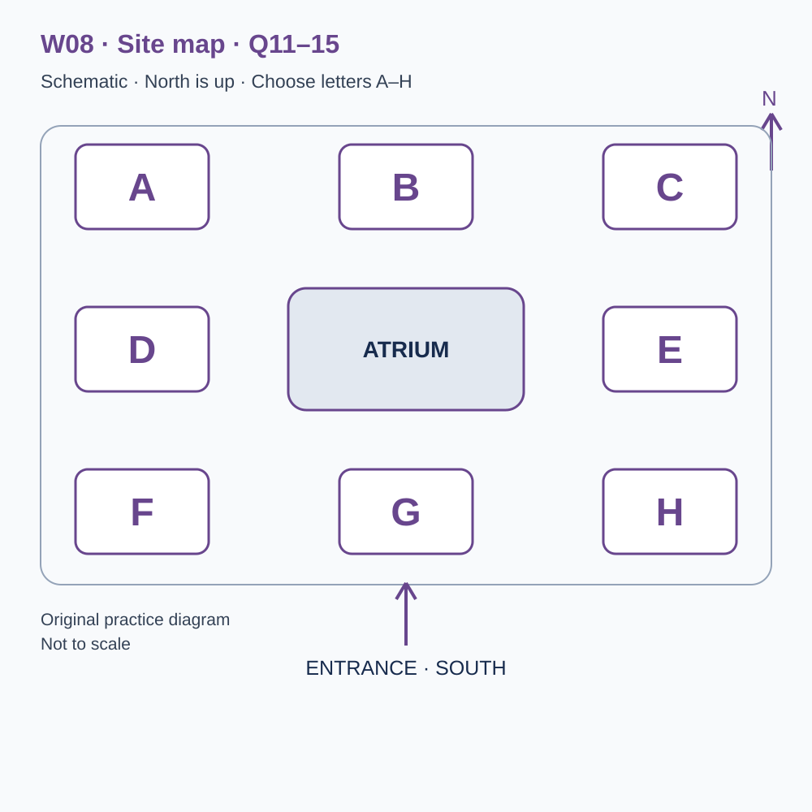
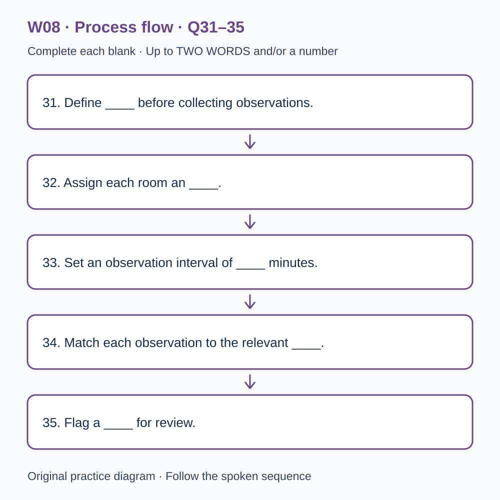

# L-W08 — Shared work and useful information
> 原创 IELTS-style 技能练习，非真题、非标准化模考，不可换算正式分数。当前只有文字和题目，音频未生成，不能计作已完成听力套题。

共四部分、40 个计分空，每空 1 分。正式首次作答须等待批准音频，先不要打开 script.md 或 answers.md。朗读前先看题；只听一遍后提交首次答案及信心等级，再做精听。当前只能预览题面，不能把读稿作答记作听力成绩。

## Part 1 — Reserving a shared workspace

Q1–6: Complete the notes. Write **NO MORE THAN TWO WORDS AND/OR A NUMBER** for each answer, using words from the recording. Numeric notation may replace spoken numbers. Do not repeat a printed unit. Q7–10: Choose **ONE letter, A, B or C**.

**Q1.** Type of space initially requested: ____

**Q2.** Chosen regular weekday: ____

**Q3.** First booking — day of September: ____

**Q4.** Daytime desk price: £____

**Q5.** Personal equipment needed for listening to recordings: ____

**Q6.** Number of digits in the locker code: ____

**Q7.** Where should a short individual phone call take place?

- A. At the shared desk whenever it is brief.
- B. In the designated call room when available.
- C. Only in a fully booked group meeting room.

Answer: ____

**Q8.** To change a booking for one week, the applicant should

- A. check availability and request the change through the booking page.
- B. leave a note on the desk.
- C. ask another user to take the reservation informally.

Answer: ____

**Q9.** What is the rule for equipment at the end of a day booking?

- A. A note reserves the desk for the next week.
- B. Day lockers automatically include overnight storage.
- C. Clear the desk and arrange any longer storage separately.

Answer: ____

**Q10.** What does the receptionist suggest before a long commitment?

- A. Choose a package during the call to secure the day price.
- B. Try the arranged day and review how it worked.
- C. Avoid using the workspace until all future needs are known.

Answer: ____

## Part 2 — Workspace building orientation

Q11–15: Label the map. Write **ONE letter, A–H**, for each destination. Three letters are unused. Q16–20: Choose **ONE letter, A, B or C**.

**Q11.** Reception

Answer: ____

**Q12.** Quiet work room

Answer: ____

**Q13.** Call room

Answer: ____

**Q14.** Project meeting room

Answer: ____

**Q15.** Kitchenette

Answer: ____

**Q16.** What should users do when an atrium conversation becomes a meeting?

- A. Promise clients unrestricted use of any empty chairs.
- B. Stop all communication with colleagues.
- C. Check the availability of a suitable room.

Answer: ____

**Q17.** How should a workshop notice reach the community board?

- A. Through the workspace submission form.
- B. By covering an existing notice.
- C. By claiming workspace endorsement automatically.

Answer: ____

**Q18.** If a reserved room is occupied, users should

- A. enter any other room that appears empty.
- B. show reception the booking confirmation.
- C. argue that their meeting is more important.

Answer: ____

**Q19.** What kind of trial-visit feedback helps most?

- A. Only complaints submitted with a compulsory name.
- B. General demands without examples.
- C. Specific observations about where an instruction was hard to find.

Answer: ____

**Q20.** Why is checkout useful?

- A. It confirms availability for the next use and helps locate forgotten items.
- B. It measures how productive other users were.
- C. It allows borrowed equipment to be left on any desk.

Answer: ____

## Part 3 — Testing a visitor information page

Q21–26: Match each proposal to the students' **final** positions at the end of that exchange. The tutor is not included. Write **A, B, C or D**. Letters may be reused.

- **A** Sam only
- **B** Priya only
- **C** Both students
- **D** Neither student

Q27–28 and Q29–30: Choose **TWO different letters, A–E**, for each pair. Write one letter in each numbered slot; either order is accepted. Each distinct correct choice earns one point, maximum two. Repeating a letter cannot earn two points. Submit no more than two letters.

**Q21.** At the END of this exchange, who supports: Recruiting first-time visitors for the page study?

Answer: ____

**Q22.** At the END of this exchange, who supports: Requiring participants to think aloud during tasks?

Answer: ____

**Q23.** At the END of this exchange, who supports: Putting participant names on response sheets?

Answer: ____

**Q24.** At the END of this exchange, who supports: Alternating the order of the two tasks between participants?

Answer: ____

**Q25.** At the END of this exchange, who supports: Recording wrong turns using a consistent definition?

Answer: ____

**Q26.** At the END of this exchange, who supports: Setting a strict task time limit in the pilot?

Answer: ____

**Q27–28.** Which TWO information-finding tasks are selected?

- A. Finding how to change a desk reservation
- B. Recognising the organisation's logo
- C. Finding the building's opening year
- D. Finding where to report a missing item
- E. Guessing an unlisted private telephone number

Answers: Q27 ____ · Q28 ____

**Q29–30.** Which TWO revisions are confirmed after the trial?

- A. Adding decorative photographs
- B. Replacing vague headings with action-based headings
- C. Replacing all text with icons
- D. Reducing text size
- E. Placing contact details beside the relevant reporting instruction

Answers: Q29 ____ · Q30 ____

## Part 4 — Investigating room bookings

Q31–35: Complete the flow chart below. Q36–40: Complete the notes. Write **NO MORE THAN TWO WORDS AND/OR A NUMBER** for each answer, using words from the recording. Numeric notation may replace spoken numbers. Words or units already printed do not belong in the blank. The numbered text below repeats the SVG prompts for readability.

**Q31.** Define ____ before collecting observations.

**Q32.** Assign each room an ____.

**Q33.** Set an observation interval of ____ minutes.

**Q34.** Match each observation to the relevant ____.

**Q35.** Flag a ____ for review.

**Q36.** Check whether ____ are missing from the booking export.

**Q37.** Summarise use separately in the morning and ____.

**Q38.** State the ____ used to calculate each percentage.

**Q39.** Occupancy does not directly measure user ____.

**Q40.** Before treating one week as a stable pattern, ____ the study.

## 本周训练安排（音频批准后执行）

- Preview questions without the script：8 分钟。
- Future continuous first listen, including planned part pauses：32 分钟。
- Submit first answers and confidence, without a second play：8 分钟。
- Check answers and classify errors：20 分钟。
- Four Q-located intensive segments, 15 minutes each：60 分钟。
- Diagram and opinion retelling：15 分钟。
- Next-day retry of missed items：15 分钟。

合计 **158 分钟**；最多另用 22 分钟缓冲，总计不超过 180 分钟。暂停、回放与查词均计入精听预算，不能另行无限追加。当前实际已完成听力分钟数为 0。精听区段和步骤见 intensive.md；答案和脚本另页。
