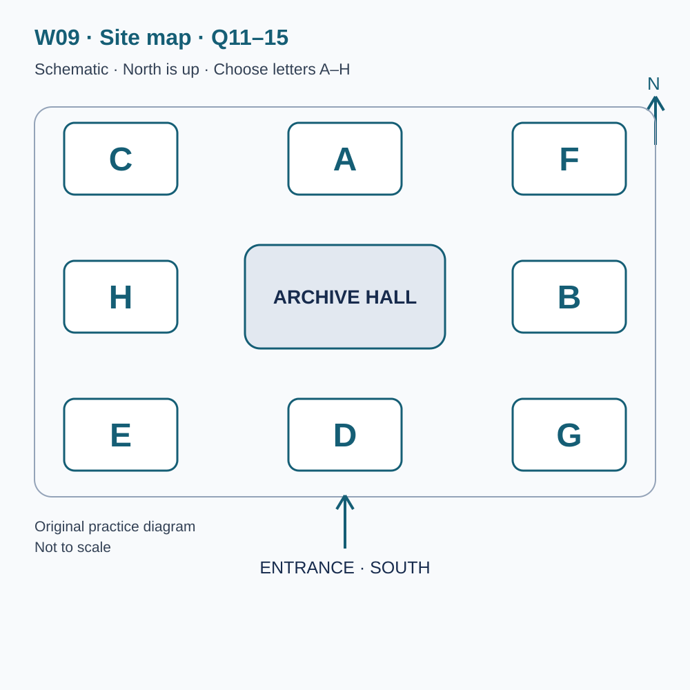
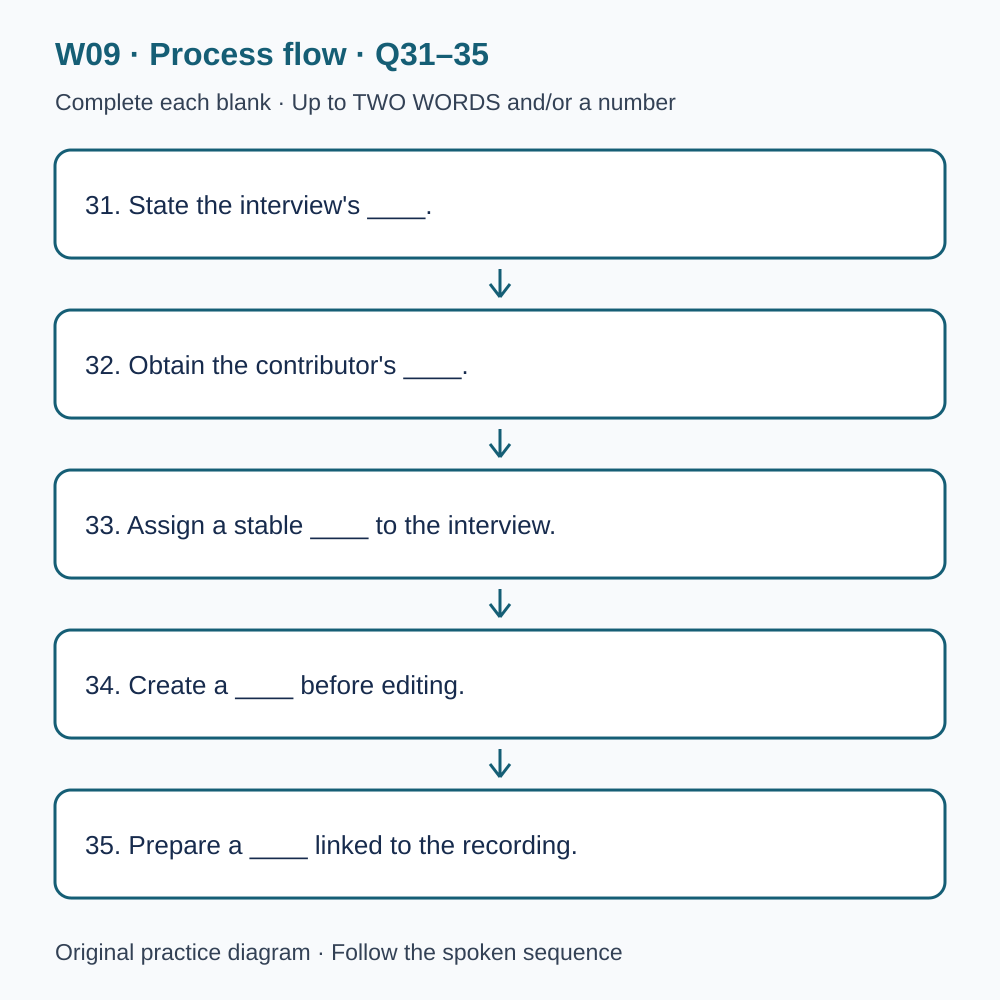

# L-W09 — Voices, memories and evidence
> 原创 IELTS-style 技能练习，非真题、非标准化模考，不可换算正式分数。当前只有文字和题目，音频未生成，不能计作已完成听力套题。

共四部分、40 个计分空，每空 1 分。正式首次作答须等待批准音频，先不要打开 script.md 或 answers.md。朗读前先看题；只听一遍后提交首次答案及信心等级，再做精听。当前只能预览题面，不能把读稿作答记作听力成绩。

## Part 1 — Booking an archive introduction

Q1–6: Complete the notes. Write **NO MORE THAN TWO WORDS AND/OR A NUMBER** for each answer, using words from the recording. Numeric notation may replace spoken numbers. Do not repeat a printed unit. Q7–10: Choose **ONE letter, A, B or C**.

**Q1.** Main material for discussion: ____

**Q2.** Confirmed day of October: ____

**Q3.** Session start (a.m.): ____

**Q4.** Places to reserve: ____

**Q5.** Bring a ____ of the material, rather than the originals.

**Q6.** The confirmation will be sent by ____.

**Q7.** What is the main purpose of the introduction?

- A. To transfer ownership immediately
- B. To help the family make an informed choice
- C. To approve all recordings for publication

Answer: ____

**Q8.** What should the caller do about access requirements?

- A. Describe them in advance and discuss available support
- B. Assume a front seat solves every difficulty
- C. Wait until arrival before mentioning them

Answer: ____

**Q9.** What does the scanning element include?

- A. An immediate copy of every visitor's photograph
- B. An informal queue for personal scanning jobs
- C. A demonstration using a prepared example

Answer: ____

**Q10.** How should an attendance change normally be reported?

- A. In a public comment only
- B. By replying to the confirmation with the booking reference
- C. By asking another visitor to mention it casually

Answer: ____

## Part 2 — Community archive orientation

Q11–15: Label the map. Write **ONE letter, A–H**, for each destination. Three letters are unused. Q16–20: Choose **ONE letter, A, B or C**.

**Q11.** Welcome desk

Answer: ____

**Q12.** Recording room

Answer: ____

**Q13.** Scanning station

Answer: ____

**Q14.** Listening room

Answer: ____

**Q15.** Returns point

Answer: ____

**Q16.** How does the catalogue handle uncertain contributor information?

- A. It preserves the distinction between the account and later checking
- B. It converts every confident memory into an established fact
- C. It discards memories whenever a date is uncertain

Answer: ____

**Q17.** Why should an item request include its catalogue reference?

- A. It guarantees permission to publish the item
- B. It replaces every descriptive title permanently
- C. It distinguishes particular items with similar titles

Answer: ____

**Q18.** Before using a recording in a public presentation, visitors should

- A. assume listening access includes all copying rights
- B. check the item conditions and explain the intended use
- C. finish the presentation before investigating permission

Answer: ____

**Q19.** Completing the introductory visit means a visitor

- A. may begin interviewing for any project immediately
- B. needs no further equipment practice
- C. can enquire about role-specific volunteer preparation

Answer: ____

**Q20.** What feedback best helps the archive?

- A. A specific difficulty, distinguished from a proposed solution
- B. Only a general demand for more information
- C. An urgent missing-item report left for later routine review

Answer: ____

## Part 3 — Reviewing an oral-history pilot

Q21–26: Match each proposal to the students' **final** positions at the end of that exchange. The tutor is not included. Write **A, B, C or D**. Letters may be reused.

- **A** Iris only
- **B** Ben only
- **C** Both students
- **D** Neither student

Q27–28 and Q29–30: Choose **TWO different letters, A–E**, for each pair. Write one letter in each numbered slot; either order is accepted. Each distinct correct choice earns one point, maximum two. Repeating a letter cannot earn two points. Submit no more than two letters.

**Q21.** At the END of this exchange, who supports: Replacing the chronological opening with an object-based opening?

Answer: ____

**Q22.** At the END of this exchange, who supports: Leaving a longer pause after answers?

Answer: ____

**Q23.** At the END of this exchange, who supports: Collecting the contributor's exact current home address?

Answer: ____

**Q24.** At the END of this exchange, who supports: Using the original contributor for the next limited pilot check?

Answer: ____

**Q25.** At the END of this exchange, who supports: Including a short permitted sound extract in the class presentation?

Answer: ____

**Q26.** At the END of this exchange, who supports: Reviewing the second pilot against the original aims?

Answer: ____

**Q27–28.** Which TWO detailed checks are agreed before the next interview?

- A. Add background music
- B. Compare the transcript with the recording
- C. Design a new logo
- D. Ask for clarification of an unclear reference
- E. Search social media for personal details

Answers: Q27 ____ · Q28 ____

**Q29–30.** Which TWO limitations will the presentation acknowledge?

- A. The pilot has only one contributor
- B. The interview was cancelled
- C. Interviewer prompts partly shaped the topics
- D. The room was unavailable
- E. Using a small recorder necessarily made the speech unusable

Answers: Q29 ____ · Q30 ____

## Part 4 — From interview to research record

Q31–35: Complete the flow chart below. Q36–40: Complete the notes. Write **NO MORE THAN TWO WORDS AND/OR A NUMBER** for each answer, using words from the recording. Numeric notation may replace spoken numbers. Words or units already printed do not belong in the blank. The numbered text below repeats the SVG prompts for readability.

**Q31.** State the interview's ____.

**Q32.** Obtain the contributor's ____.

**Q33.** Assign a stable ____ to the interview.

**Q34.** Create a ____ before editing.

**Q35.** Prepare a ____ linked to the recording.

**Q36.** Do not interpret every ____ as doubt about a memory.

**Q37.** Keep observation separate from ____.

**Q38.** Compare details with independent ____.

**Q39.** Shared themes alone do not establish a causal ____.

**Q40.** The stage review records procedural ____ and their reasons.

## 本周训练安排（音频批准后执行）

- Preview questions without the script：8 分钟。
- Future continuous first listen, including planned part pauses：32 分钟。
- Submit first answers and confidence, without a second play：8 分钟。
- Check answers and classify errors：20 分钟。
- Four Q-located intensive segments, 15 minutes each：60 分钟。
- Diagram and opinion retelling：15 分钟。
- Next-day retry of missed items：15 分钟。

合计 **158 分钟**；最多另用 22 分钟缓冲，总计不超过 180 分钟。暂停、回放与查词均计入精听预算，不能另行无限追加。当前实际已完成听力分钟数为 0。精听区段和步骤见 intensive.md；答案和脚本另页。
