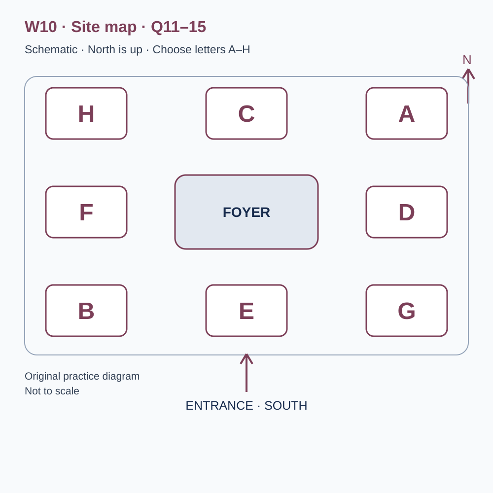
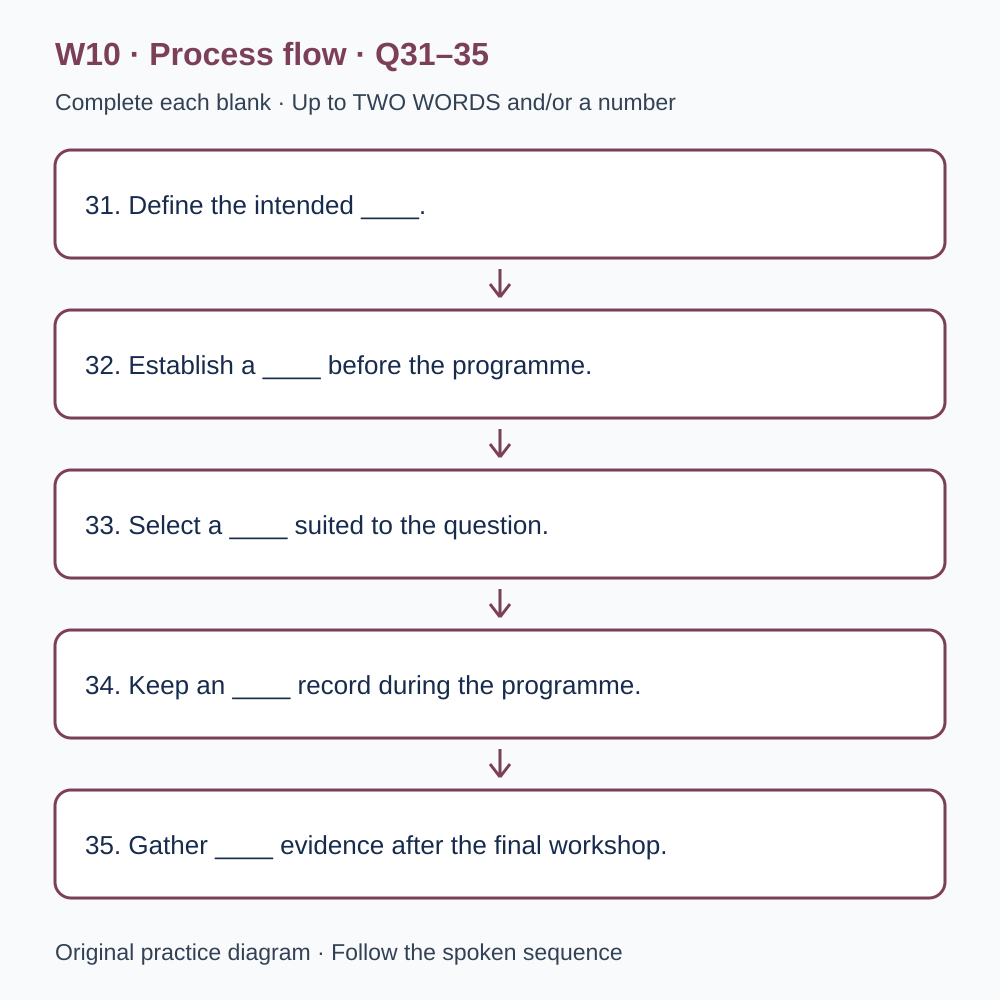

# L-W10 — Behind the scenes and beyond the headline
> 原创 IELTS-style 技能练习，非真题、非标准化模考，不可换算正式分数。当前只有文字和题目，音频未生成，不能计作已完成听力套题。

共四部分、40 个计分空，每空 1 分。正式首次作答须等待批准音频，先不要打开 script.md 或 answers.md。朗读前先看题；只听一遍后提交首次答案及信心等级，再做精听。当前只能预览题面，不能把读稿作答记作听力成绩。

## Part 1 — Joining a theatre workshop

Q1–6: Complete the notes. Write **NO MORE THAN TWO WORDS AND/OR A NUMBER** for each answer, using words from the recording. Numeric notation may replace spoken numbers. Do not repeat a printed unit. Q7–10: Choose **ONE letter, A, B or C**.

**Q1.** Main workshop interest: ____

**Q2.** Confirmed day of February: ____

**Q3.** Workshop start (p.m.): ____

**Q4.** Number of places: ____

**Q5.** Total booking cost: £____

**Q6.** Practical item to bring: ____

**Q7.** What drawing experience is required?

- A. A professional portfolio
- B. None: rough shapes and explanations are suitable
- C. Experience of public art competitions

Answer: ____

**Q8.** What does workshop admission allow regarding rehearsals?

- A. A public rehearsal needs its own event booking
- B. All ordinary rehearsals are automatically accessible
- C. Participants may enter any occupied production space

Answer: ____

**Q9.** How should the need to sit during the activity be handled?

- A. Assume the leader can promise any arrangement
- B. Avoid telling the team until the day
- C. Describe the requirement in advance and discuss options

Answer: ____

**Q10.** Which instructions should the group follow after a room change?

- A. An old performance poster
- B. The direct revised booking message
- C. Whichever screenshot was saved first

Answer: ____

## Part 2 — Theatre learning spaces

Q11–15: Label the map. Write **ONE letter, A–H**, for each destination. Three letters are unused. Q16–20: Choose **ONE letter, A, B or C**.

**Q11.** Costume workshop

Answer: ____

**Q12.** Prop display

Answer: ____

**Q13.** Main learning studio

Answer: ____

**Q14.** Collection point

Answer: ____

**Q15.** Break area

Answer: ____

**Q16.** Why does the leader pause practical work?

- A. To compare decisions and learn from different attempts
- B. To rank groups by speed
- C. To hide unfinished models

Answer: ____

**Q17.** What should participants do before a close photograph includes someone else or their work?

- A. Assume group participation grants publicity rights
- B. Discuss it with the person under the workshop arrangements
- C. Submit it directly as theatre publicity

Answer: ____

**Q18.** If shared materials are unavailable, participants should

- A. take items from another group's active workspace
- B. leave damaged items for the next user
- C. tell the leader and consider another approach

Answer: ____

**Q19.** What should the final group explanation describe?

- A. Why the final model is simply better-looking
- B. The initial idea, a noticed problem and the reason for a change
- C. Which other group was least successful

Answer: ____

**Q20.** What is a useful focus for feedback?

- A. A specific confusing stage and what the participant expected
- B. A ranking of everyone's artistic ability
- C. A demand to replace every feature of the workshop

Answer: ____

## Part 3 — Planning a visitor-flow study

Q21–26: Match each proposal to the students' **final** positions at the end of that exchange. The tutor is not included. Write **A, B, C or D**. Letters may be reused.

- **A** Clara only
- **B** Dev only
- **C** Both students
- **D** Neither student

Q27–28 and Q29–30: Choose **TWO different letters, A–E**, for each pair. Write one letter in each numbered slot; either order is accepted. Each distinct correct choice earns one point, maximum two. Repeating a letter cannot earn two points. Submit no more than two letters.

**Q21.** At the END of this exchange, who supports: Starting with a simple preparation task, analysed separately?

Answer: ____

**Q22.** At the END of this exchange, who supports: Offering anonymous written feedback after the route task?

Answer: ____

**Q23.** At the END of this exchange, who supports: Charging participants an admission fee?

Answer: ____

**Q24.** At the END of this exchange, who supports: Observing from one fixed foyer-corner position?

Answer: ____

**Q25.** At the END of this exchange, who supports: Reviewing the procedure midway and recording revisions?

Answer: ____

**Q26.** At the END of this exchange, who supports: Bringing the same group back for a limited wording check?

Answer: ____

**Q27–28.** Which TWO measures are agreed at the learning desk?

- A. Names of waiting visitors
- B. Visitors' shop purchases
- C. Queue length at scheduled checks
- D. Interruptions to the worker's explanation
- E. Each visitor's age

Answers: Q27 ____ · Q28 ____

**Q29–30.** Which TWO changes complicate attributing the shorter queue to the sign?

- A. The route into the foyer changed
- B. The same observation sheet was used
- C. The session date was recorded
- D. The session was cancelled
- E. A different staff member worked at the desk

Answers: Q29 ____ · Q30 ____

## Part 4 — Evaluating a community programme

Q31–35: Complete the flow chart below. Q36–40: Complete the notes. Write **NO MORE THAN TWO WORDS AND/OR A NUMBER** for each answer, using words from the recording. Numeric notation may replace spoken numbers. Words or units already printed do not belong in the blank. The numbered text below repeats the SVG prompts for readability.

**Q31.** Define the intended ____.

**Q32.** Establish a ____ before the programme.

**Q33.** Select a ____ suited to the question.

**Q34.** Keep an ____ record during the programme.

**Q35.** Gather ____ evidence after the final workshop.

**Q36.** A shift from another provider, rather than entirely new activity, raises the issue of ____.

**Q37.** Initial differences between volunteers and non-participants relate to ____.

**Q38.** Loss of participants from the follow-up is called ____.

**Q39.** Describe ____ alongside outcomes, using a clear calculation boundary.

**Q40.** The stage review lists ____ for the next trial.

## 本周训练安排（音频批准后执行）

- Preview questions without the script：8 分钟。
- Future continuous first listen, including planned part pauses：32 分钟。
- Submit first answers and confidence, without a second play：8 分钟。
- Check answers and classify errors：20 分钟。
- Four Q-located intensive segments, 15 minutes each：60 分钟。
- Diagram and opinion retelling：15 分钟。
- Next-day retry of missed items：15 分钟。

合计 **158 分钟**；最多另用 22 分钟缓冲，总计不超过 180 分钟。暂停、回放与查词均计入精听预算，不能另行无限追加。当前实际已完成听力分钟数为 0。精听区段和步骤见 intensive.md；答案和脚本另页。
