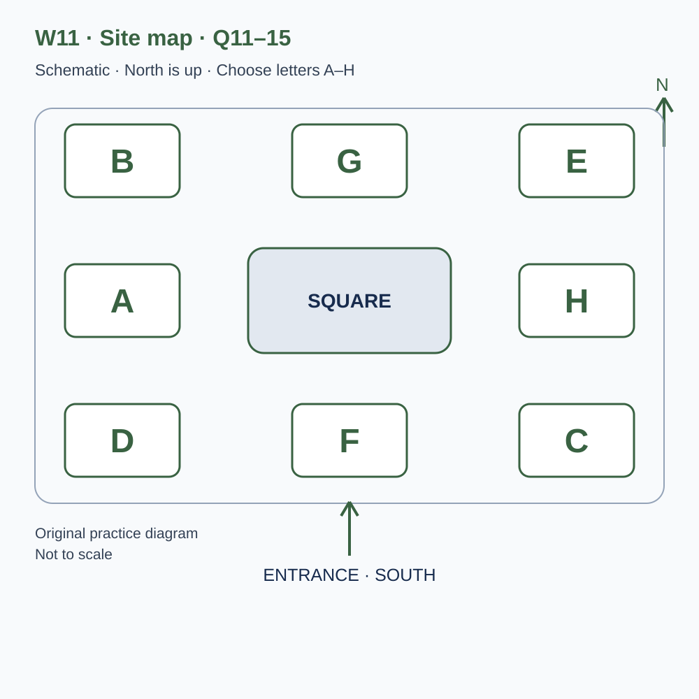
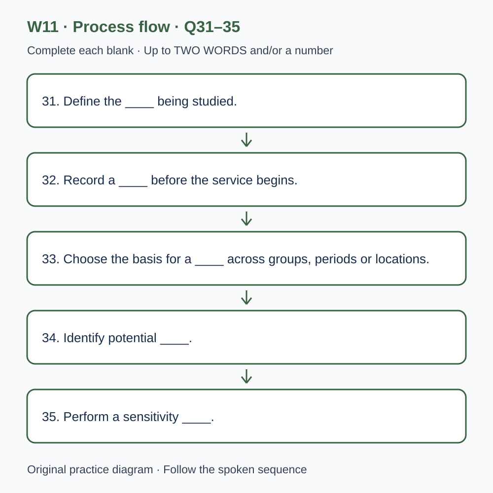

# L-W11 — Routes, choices and cautious explanations
> 原创 IELTS-style 技能练习，非真题、非标准化模考，不可换算正式分数。当前只有文字和题目，音频未生成，不能计作已完成听力套题。

共四部分、40 个计分空，每空 1 分。正式首次作答须等待批准音频，先不要打开 script.md 或 answers.md。朗读前先看题；只听一遍后提交首次答案及信心等级，再做精听。当前只能预览题面，不能把读稿作答记作听力成绩。

## Part 1 — Registering for an observation visit

Q1–6: Complete the notes. Write **NO MORE THAN TWO WORDS AND/OR A NUMBER** for each answer, using words from the recording. Numeric notation may replace spoken numbers. Do not repeat a printed unit. Q7–10: Choose **ONE letter, A, B or C**.

**Q1.** Project interest: ____

**Q2.** Confirmed day of April: ____

**Q3.** Meeting time (a.m.): ____

**Q4.** Confirmed group places: ____

**Q5.** Orientation before the walk: ____ minutes

**Q6.** Writing support to bring, if available: ____

**Q7.** How should passers-by's names be handled?

- A. Record every name offered in conversation
- B. Put all conversations into the data
- C. Keep names outside the observation sheet

Answer: ____

**Q8.** If the observation point is unavailable, volunteers should

- A. wait for the leader to confirm and document an alternative
- B. choose any convenient nearby corner
- C. begin independently before the briefing

Answer: ____

**Q9.** In heavy rain, the group should

- A. assume cancellation from any general forecast
- B. follow the direct update to the named organiser
- C. let each member invent a different plan

Answer: ____

**Q10.** What is required before main-project records can be collected?

- A. Only attendance at the introduction
- B. The fastest possible handwriting
- C. A supervised practice check as well as the introduction

Answer: ____

## Part 2 — Route-study meeting site

Q11–15: Label the map. Write **ONE letter, A–H**, for each destination. Three letters are unused. Q16–20: Choose **ONE letter, A, B or C**.

**Q11.** Briefing shelter

Answer: ____

**Q12.** Equipment desk

Answer: ____

**Q13.** Practice observation point

Answer: ____

**Q14.** Rest shelter

Answer: ____

**Q15.** Checkout desk

Answer: ____

**Q16.** How should a return to the junction be recorded?

- A. As proof that someone was lost
- B. As an observed action, with intention kept separate
- C. As evidence of a forgotten errand in every case

Answer: ____

**Q17.** When observers disagree, they should

- A. compare the case and inspect the definition or view
- B. choose whoever sounds most confident
- C. hide the uncertainty once a category has been selected

Answer: ____

**Q18.** What should volunteers tell interested passers-by?

- A. That a new crossing is guaranteed
- B. That every observer can set the project's scope
- C. The agreed purpose and limits from the briefing

Answer: ____

**Q19.** Why record temporary conditions in the notes field?

- A. To prove the reason for every route choice
- B. To provide relevant context while keeping causal claims qualified
- C. To collect unrelated personal details

Answer: ____

**Q20.** What belongs in the final review?

- A. Clear and difficult definitions, plus planned versus completed work
- B. Only dramatic problems
- C. An assumption that enjoyment means the full plan was completed

Answer: ____

## Part 3 — Designing a wayfinding pilot

Q21–26: Match each proposal to the students' **final** positions at the end of that exchange. The tutor is not included. Write **A, B, C or D**. Letters may be reused.

- **A** Luca only
- **B** Nina only
- **C** Both students
- **D** Neither student

Q27–28 and Q29–30: Choose **TWO different letters, A–E**, for each pair. Write one letter in each numbered slot; either order is accepted. Each distinct correct choice earns one point, maximum two. Repeating a letter cannot earn two points. Submit no more than two letters.

**Q21.** At the END of this exchange, who supports: Following participants along the whole route?

Answer: ____

**Q22.** At the END of this exchange, who supports: Writing definitions with examples before the main observations?

Answer: ____

**Q23.** At the END of this exchange, who supports: Adding an exploratory weekend observation session?

Answer: ____

**Q24.** At the END of this exchange, who supports: Putting participant names on the analysis sheet?

Answer: ____

**Q25.** At the END of this exchange, who supports: Keeping a factual log of temporary route closures?

Answer: ____

**Q26.** At the END of this exchange, who supports: Adding a short post-walk interview to this pilot?

Answer: ____

**Q27–28.** Which TWO measures are definitely included in the junction task?

- A. Time from entering the decision area to choosing a path
- B. Fastest possible walking speed
- C. Home address
- D. Price of the participant's shoes
- E. Returns to the marked junction

Answers: Q27 ____ · Q28 ____

**Q29–30.** Which TWO differences complicate comparing the trial sessions?

- A. The observers synchronised clocks
- B. Traffic conditions differed
- C. There were two clearly assigned observers
- D. The groups differed in prior route familiarity
- E. One session was cancelled

Answers: Q29 ____ · Q30 ____

## Part 4 — Interpreting changes in travel choices

Q31–35: Complete the flow chart below. Q36–40: Complete the notes. Write **NO MORE THAN TWO WORDS AND/OR A NUMBER** for each answer, using words from the recording. Numeric notation may replace spoken numbers. Words or units already printed do not belong in the blank. The numbered text below repeats the SVG prompts for readability.

**Q31.** Define the ____ being studied.

**Q32.** Record a ____ before the service begins.

**Q33.** Choose the basis for a ____ across groups, periods or locations.

**Q34.** Identify potential ____.

**Q35.** Perform a sensitivity ____.

**Q36.** An observed relationship is an ____.

**Q37.** ____ could mean that plans to walk more lead people to seek information.

**Q38.** Record the ____ in which observations were collected.

**Q39.** Describe ____ when reporting estimated differences.

**Q40.** Revise the ____ for the next round of work.

## 本周训练安排（音频批准后执行）

- Preview questions without the script：8 分钟。
- Future continuous first listen, including planned part pauses：32 分钟。
- Submit first answers and confidence, without a second play：8 分钟。
- Check answers and classify errors：20 分钟。
- Four Q-located intensive segments, 15 minutes each：60 分钟。
- Diagram and opinion retelling：15 分钟。
- Next-day retry of missed items：15 分钟。

合计 **158 分钟**；最多另用 22 分钟缓冲，总计不超过 180 分钟。暂停、回放与查词均计入精听预算，不能另行无限追加。当前实际已完成听力分钟数为 0。精听区段和步骤见 intensive.md；答案和脚本另页。
